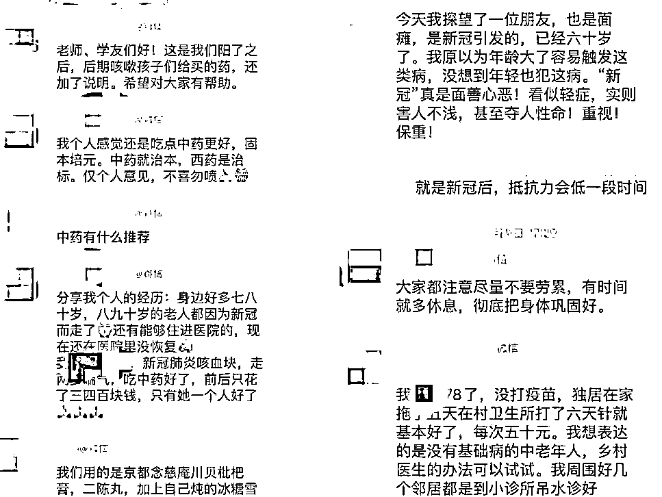
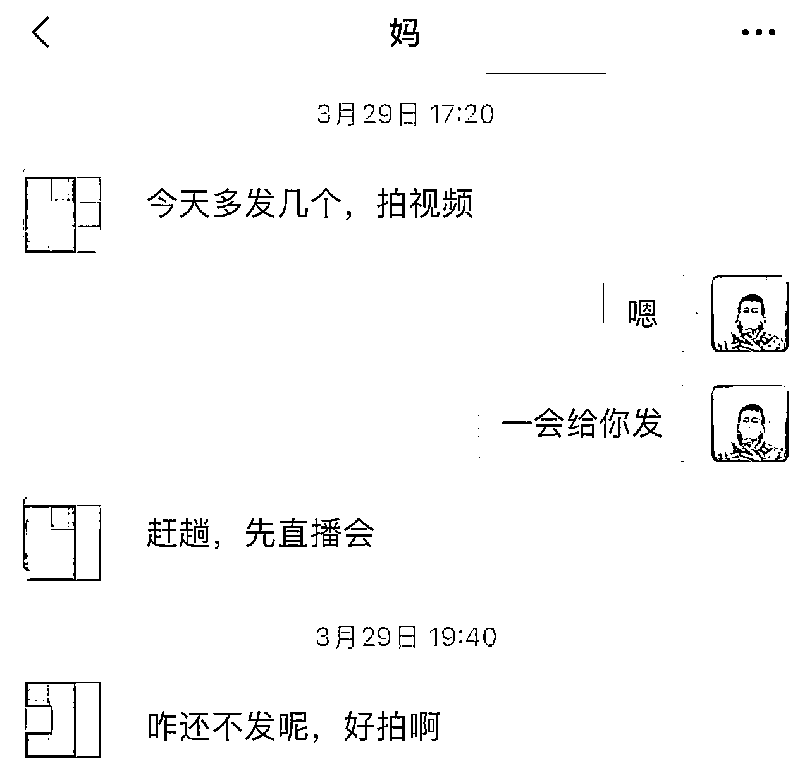
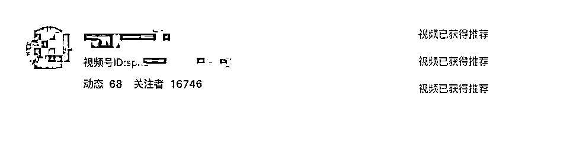
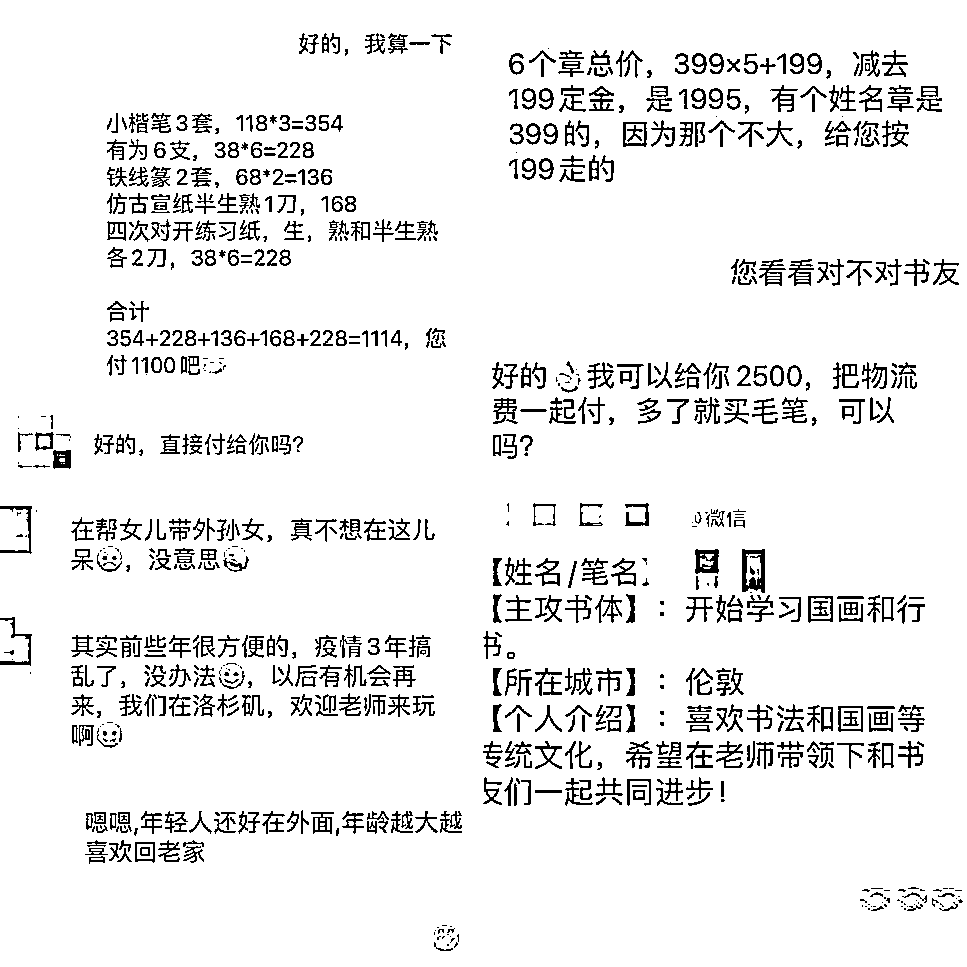
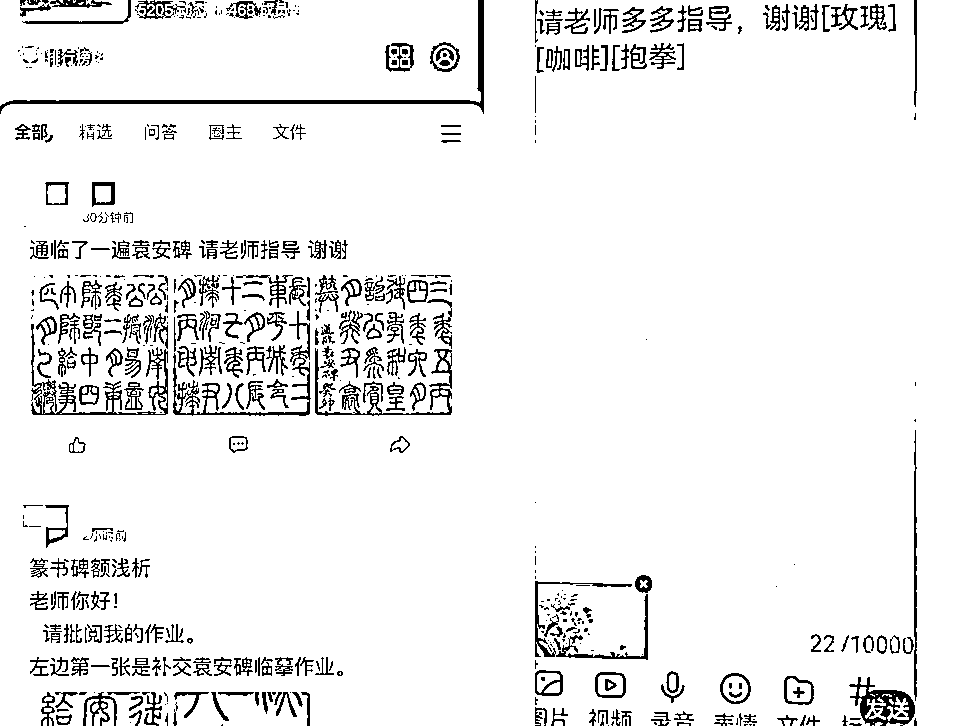
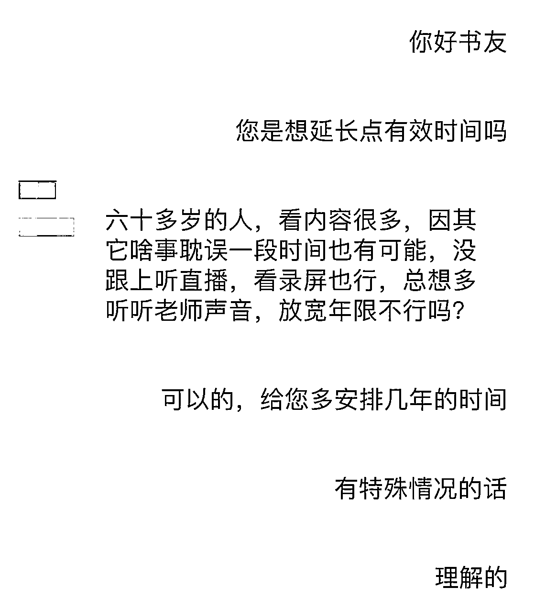
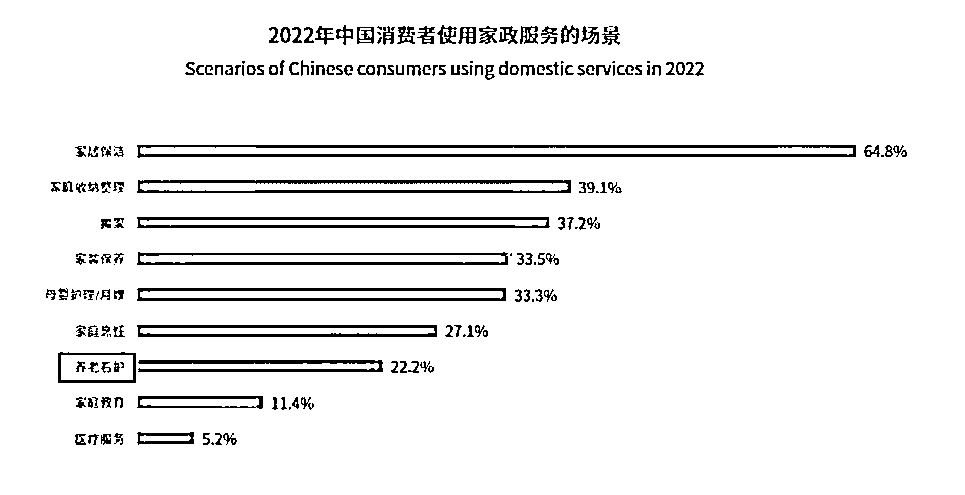
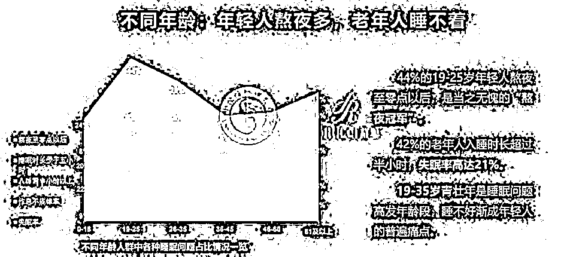

# 2023年，个人怎么切银发付费课这门生意？

近两年，围绕年长人群做的垂直内容付费，口子一下就打开了。圈里有人靠直播带叔叔阿姨认简谱、跟着唱谱，就把钱挣了；你要是没有音乐底子，换书法、国画这些方向照样走得通。

先自我介绍：我叫渔火，创业者，还在路上。从2019年算起，我手上的项目几乎都围着退休人群转。几年下来，投入的精力不算多，营收和数据的涨幅却挺可观，后来又延伸出好几个银发方向的课程和电商盘子。所以这块生意，我多少有点体感。

近况也交代一句：2021年，我参与联合创始的一个项目拿到了真格领投的千万级融资；我自己牵头的那摊银发业务，2019年就启动了。最近后台总有人来打听，我跟这群叔叔阿姨打了四五年交道，最夸张的一次，一位83岁的老先生主动掏了钱。说到底，他们是挺可爱的一群人——你把价值交付到位，回报不会缺席。

（特殊时期，学员群里互相打气）

今天主要讲2023年银发方向还有哪些缝隙，顺带复盘这两年我看到的变化。范围先圈定在付费课，其他品类之后另开一篇。

## 一、我当初为什么挑这块？

2019年选细分方向时，我先把内容付费的大盘捋了一遍。成人这条线，从知乎，到罗辑思维的会员、樊登读书、付费问答、专栏订阅，再到各种课堂专区、圈子社群；教培那边则是线下、线上、一对一、大班、小班、社群、AI课、训练营、行动营一路演化。规律很清楚：行业形态是跟着用户认知和习惯一起升级的。

当年K12那几家打得有多惨烈，不用我多说。个人要下注，肯定得挑好打的场子。拿银发方向一比，这边的付费课还停在很早期的状态，说是原始阶段也不夸张。那就能预判：往后内容和形式一定越来越丰富，这就是窗口。更何况，人到了退休的年纪，反而更有闲钱、更有闲工夫为自己的爱好买单。光兴趣生活这一块——琴棋书画、诗词、养生、摄影朗诵、茶、手机使用、花艺园艺——我调研下来，都有小团队在悄悄挣大钱。于是我就进去了，一直做到今天。

补一组数字：国家统计局的口径，2022年末60岁及以上接近3亿人，占全国人口19.8%。那45岁往上的规模有多大，你自行想象。

## 二、这群人到底怎么花钱？

今年最直观的感受是：盯着这块的人变多了，下场的人也在变多。可不少朋友其实并不了解他们。我这几个月把各平台银发内容底下的留言翻了翻，抓了些高频说法，比如“老人不会网购”“上了年纪的连手机都搞不定”“我开养老院亏了”之类。看完就明白——很多人的想象，跟这批人真实的行为和消费习惯是错位的。

在抖音的人群分层里，都市银发本来就在核心名单上，我原以为大家都懂。小镇银发确实难做，可都市这批人，妥妥的有钱有闲。我自己项目里“有效用户”的定义是40到75岁、主要集中在一二线城市，跑下来获客效果不差。

还觉得长辈玩不转手机？移动互联网都铺了多少年，如今山里也通网络了。我妈是1968年出生的，我替她把视频号搭起来，不到三十天粉丝就攒到一万六。

（母亲每天催我交脚本）

（母亲做视频号满一个月）

她每天开直播加上橱窗，能卖出800到1000元的货，手里那台依旧是几年前的红米。所以别低估长辈的学习能力，也别小看下沉市场那批人。

以为长辈只捡便宜的买？我的课程单价从500到2000不等，一位用户平均会重复购买3门以上。学书画的，一年光笔墨纸砚加印章还要再花2000左右；做艾灸这类健康方向，单价拉得更高。退休之后各有各的活法：有人跟着子女在国外住，有人在大城市帮带孙辈，也有人回了老家，但追求兴趣、讲究生活质量这件事，一样没落下。

（私域里部分用户截图）

概括成一句：今天都市里的银发族，手机用得顺、手里有钱、时间充裕、乐于分享，看服务比看牌子重，线上付钱也早已习惯。

## 三、这两年，市场发生了什么变化？

以我自己的经历来看，以付费课为主的发展，大致能划成三段（硬件、APP、电商这些今天不聊）：

2008到2015年，萌芽阶段。那时多数人还没想明白这门生意怎么做，玩家多集中在流量平台，后端变现也弱。以糖豆为代表的舞蹈类APP，在那几年吃走了大把流量。

2015到2019年，野蛮扩张阶段。垂直平台和机构陆续冒头：像美篇这样的兴趣社区，墨池、墨客、快乐50这类垂类机构，还有养老家政、健康睡眠等项目起身；线下的老年大学，名额要靠抢；音乐相册、天气查询这类工具产品也跑得飞快，红利吃得很足。

2020到2023年，高速增长阶段。大厂进来了：红松短时间内连拿蓝驰和经纬等机构的两笔千万美金级融资；知乎的合伙人出来做老年项目；尚德、大鹏（后来倒了，一声叹息）、高途等也纷纷加码。我自己的体感也很直接：2015到2018那几年，长得是真野。

说个早期数据。那会儿投👸号，既不用精细定向，也不用打磨转化文案，书法、国画课的ROI能干到20，复购还特别高。什么概念？每月扔5万进去，能卖出100万，课程单价随手抬到2000。关键在于流量便宜，进群一个人只要5元左右，而且是垂直的兴趣粉，不是泛量。同一时期，幼教和K12正打得火热，优质母婴流量从几十块一个，蹿到一两百。我这项目启动时，花的无非是店铺搭建工具的年费、请老师录试听课的钱（先卖期房思路：试听课加系统课大纲一出来就开卖），再算上第一个月的投放，全部投入不到5万，第一年营收却滚到200多万。这背后靠的是我前几年做幼儿教育的积累——做过K12或幼教的人转过来，做课、做服务、做营销，几乎就是碾压式的优势。这两年大厂替行业做了一轮用户教育，垂类付费课的空间反而被撑大了。

## 四、2023年，个人还能抓哪些机会？

一提银发，别就想到开养老院、卖保健品、送鸡蛋拉人、跳广场舞这几样。今天的银发族跟几年前完全不是一回事，移动互联网铺了这么多年，几乎所有赛道都值得对着他们重做一遍：社交、健康、吃穿住行、兴趣爱好、线上工具，维度里全是缝隙。最近跑得比较热的案例就有：老年版的Keep、老年版📕、老年家政、助眠、文娱、健康管理、教爷爷奶奶正确带孙辈的课……太多了。

在我看来，原因有几条：

（1）流量端：触达方式更多样。以长辈为主的🛰️视频号，加上美篇这类垂类社区崛起，新口子不断出现。

（2）用户端：大厂把认知和习惯慢慢养熟了；比起品牌光环，长辈更认服务感受。哪怕对面是大公司，只要我的服务更细、课程更贴需求，一样能卖。在他们眼里，大厂和小团队并没有天然的高下之分。再说操作层面，下载APP、转发留言、点开小程序、付款，都市银发早就是熟练工。

（3）产品端：供给还很薄。别的赛道你得做到120分才配有机会，这边做到60分就能上桌。想想看，当年的音乐相册和天气软件，几个月就能攒出几百万流量。但阵地和产品形态不能乱挑。主流渠道我基本都试过，有了用户之后也测过多种承接方式，结论是：从🛰️生态和视频号进去最顺，抖音和线下也能跑（电商玩法今天不展开）。

（作业打卡圈：即便用大字版手机，大家也很爱晒作品）

对个体来说，无论做流量还是做课，缝都不小。如果你没有产品和技术能力，我更建议个人直接去做课，投入产出比真的很香。我现在就沿着生活和兴趣两条主线，批量做轻课在测。有人会想：这不得有点专业技能？说实话，书法国画我一开始一窍不通，我真正擅长的是用户和流量。课交给懂行的老师录，老师先出大纲，我再按用户需求改、再审核；很多方向找在校大学生，成本极低就能产出相当专业的课程。

拿我最近做的一门电子琴课举例。之前有朋友问：电子琴，还是老年人学，这么小众能有人买吗？答案是——音乐类课程在这块盘子不小，快乐50、红松这些机构已经在做，而且卖得不便宜。先挖细分需求，这块不展开，可以翻我在赚钱写过的文章：https://articles.zsxq.com/id_pt1urnv5g4ah.html 。需求找准了，下一步是快速做MVP验证，把流量和产品两件事解决掉，因为最终靠卖课变现。我先拿视频号试了老年音乐的几个切口：老歌混剪、乐谱、唱谱、器乐，一圈测下来引流效果可以，前期流量就照这个跑。

产品才是重头戏。这门生意的胜负手，在于你到底懂不懂用户。同样是课程大纲，改动一点，卖的结果可能天差地别。我跟几千名用户一对一聊过。早期我死磕落地页好不好看、店铺装修、海报精不精致，后来发现人家根本不在乎这些。他们掏钱前真正在意的，是试听课的内容、老师讲得能不能让他服气、服务跟不跟得上，以及系统课能不能下载、能不能反复看。我做过两组对比测试：淘宝花1000元做的落地页，输给了我在在线模板工具上花10分钟拼的绿底大字长图。

（比起品牌，不少用户更在意能否下载、回看是否方便）

所以记住：产品不必华丽。多跟用户聊，把需求摸清，定课程形式——录播加直播、纯直播还是纯录播——然后定价、开卖，主干就通了，剩下的在推进中一点点调。

除了常规的付费课，最近我还看到一些团队在试这些方向，也是我近期重点调研的：

① 老年家政

家政这块市场本来就大，这两年发展也顺，圈友里有做得相当漂亮的。目前老年家政多是子女替父母下单，服务项包括保洁、营养餐、测血糖、擦湿疹药膏、陪散步聊天、陪诊代煎药等等。

（老年家政服务场景）

模式和云家政接近，差别在获客路径和切入点。你去天鹅到家搜一下就知道，涉老服务的订单已经不少了，只是服务项还偏单一。

② 睡眠方向

前段时间翻数据，《国民睡眠健康白皮书》里提到，40岁以上人群的睡眠困扰已经很普遍，而且还在加重。我又去摸了下数字睡眠这个盘，做的人不少：好睡眠、享睡这类APP，还有结合音乐助眠的白噪音产品。总之，睡不好是复合问题，成因很杂。

（睡眠健康相关数据）

个人想切，我看到三条路：一是偏教程，用极低价的小课教大家怎么挑、怎么用市面上的助眠产品；二是从心理和情绪层面做疏导；三是健康管理方向，比如请营养师帮你规划晚餐，或者教晚上做点什么运动能睡得更好。

③ 出行旅游

数据上看，银发旅游的增速很凶。年轻人出门爱做攻略，长辈却常常怕被坑，我妈就是一提到旅游先担心被宰。那个人能不能给长辈做定制化行程攻略，收一点服务费？顺带把靠谱旅行社导过去，赚佣金？至于流量，你去看看视频号里旅游、风景类内容有多爆就懂了。

④ 电商

这块不用我多说，星球里不少书友做得很好，还有做图书书单号的。我跟几个在做的团队聊过，目前跑得最好的是女装和鞋，鞋的利润尤其厚。这一块不细讲，手里有相关资源的可以自己琢磨。

⑤ 宠物

宠物这两年升温极快，幼教赛道验证过的打法，基本都能在宠物上再走一遍。之前看报告：全国一年新生儿约1000万，宠物猫5000万、宠物狗3000万。我调研还发现，养狗人群的平均年龄比养猫的高出十岁上下，大概在37岁——注意到了吗？这个均值已经贴近银发区间了，那中高龄养宠的人想必不少，其中养狗的更多。

那宠物这套打法能不能上手？我给我妈开的正是宠物账号。她是1968年出生的，自己出面讲，说服力更强。做了三十来天，粉丝到1.7万（前面写1.6万，是因为写稿这期间又涨了1000）。橱窗加直播——我妈直播纯聊天，没有任何技巧，人还在老家——每天能出800到1000元的宠物用品，佣金三成左右。私信里全是问养宠的。很多答案一搜就有，可他们既不习惯搜，也不大会搜。这里面的需求和想象空间都不小。下一步我打算不让她带货了，毕竟直播是门能力，她学起来吃力。可能改成直播引流，把人沉淀下来再卖货，往上再延一层。要是接上AI，是不是能做出个性化问答，当“爸妈的私人宠物医生”？是不是能开一门教长辈怎么养宠的课？篇幅有限，这里不铺开。

以上都是站在我个人角度的判断，有对有错，能给你一点启发就够。2023年银发方向的机会就聊到这儿，有想法在下面留言。

评论区互动：

Ray♻💥：女朋友学音乐的，想教她做博主😂
渔火：本身有技能的人做银发方向更容易。
控心：是不是得有点个人技能才好做？
渔火：不用，把用户摸透就行，我本身也没什么专业技能。
阿顾：内容真扎实，受教了，谢谢分享。
Jia：信息量很大，学习了。
Jia：主要你也有输出产品的资源。
渔火：你可能看漏了，最近电子琴和宠物方向的课，是找对应专业的大学生录的。