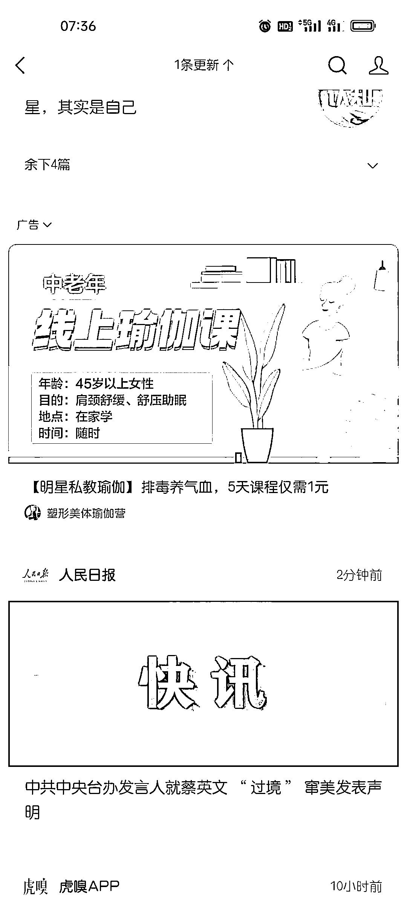

# 中老年入门课，机会不小

最近刷到一个面向中老年人的线上瑜伽引流课，课程内容其实很基础。这个案例给了一个提醒：如果你手上有专长，或者对某个方向特别有热情，不妨试着为中老年群体做入门课程。不少教学内容在网络上就能找到，门槛没有想象中高。

方向也不止瑜伽。中老年唱歌、交谊舞、摄影、绘画，都是可以切入的品类。

评论区里还有几个值得注意的点：一是长辈们的社交交友诉求同样旺盛；二是到了父母那个年纪，睡不好很常见，而且失眠并不只困扰中老年人，年轻人里也不少，助眠类产品好卖就是证明；三是中老年群体往往经济相对宽裕，时间也更充裕。

关于失眠赛道的变现，思路大致有两种：做正念课程，或者卖相关产品。有人去年在抖音直播卖酸枣仁，专门针对睡不好的人群，但没做起来；他对标的河北账号每天能卖三四百单，已经做到头部。小卖家现在再进场并不容易，投放成本很难扛住，所以动手前一定先把变现路径想明白。

这条内容也被标为中标，术值 +1。想看更多类似风向标，点最上方 #中标 专栏即可。