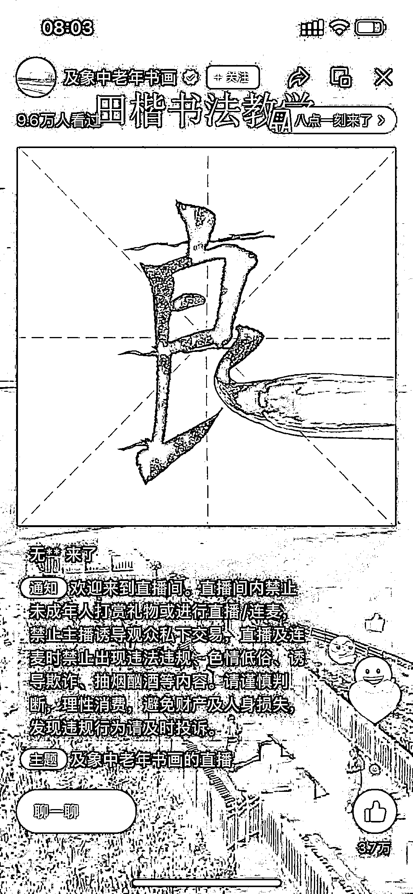
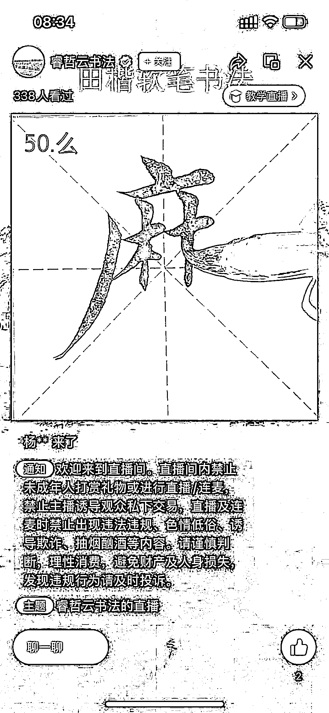
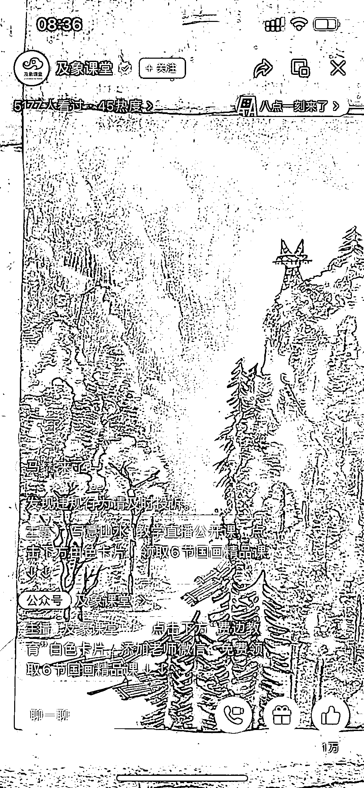
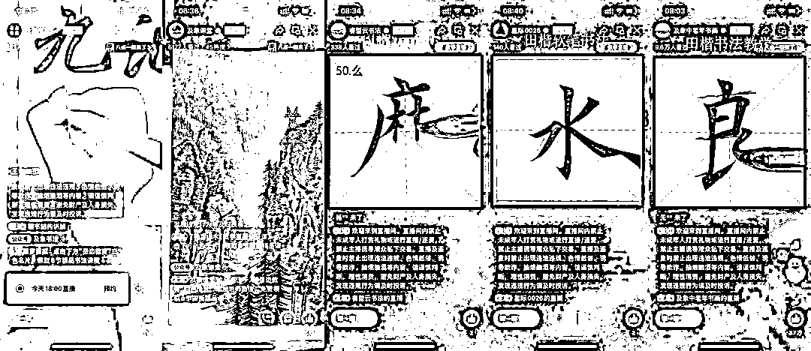
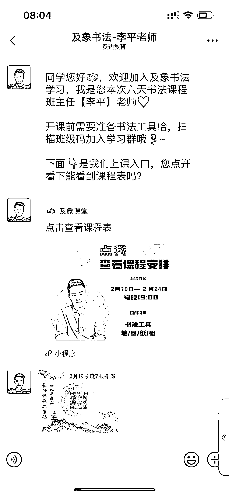
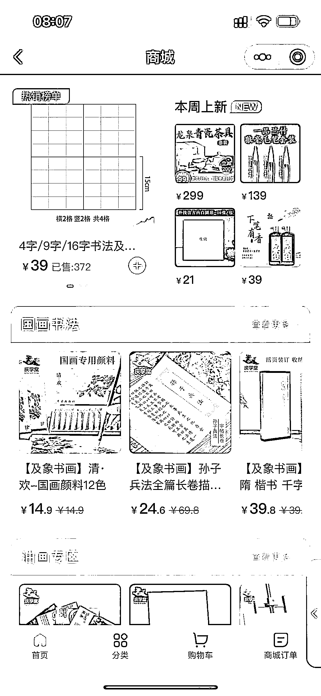
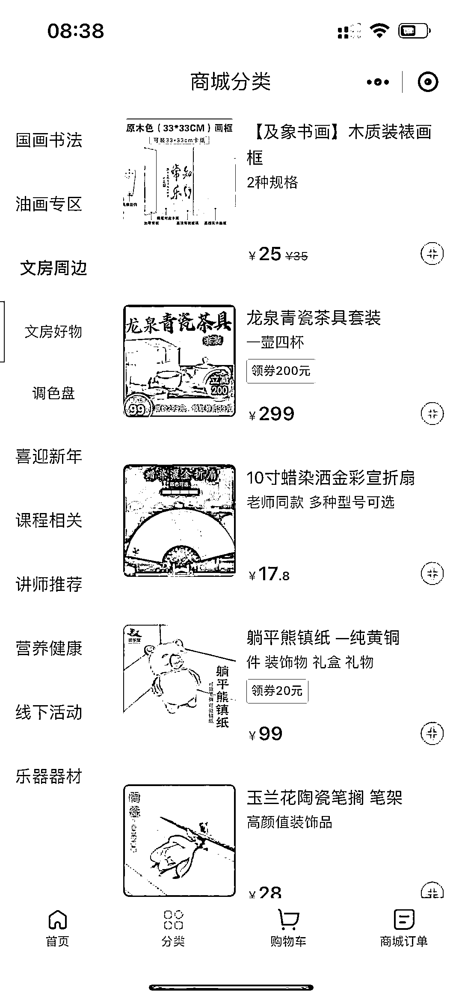
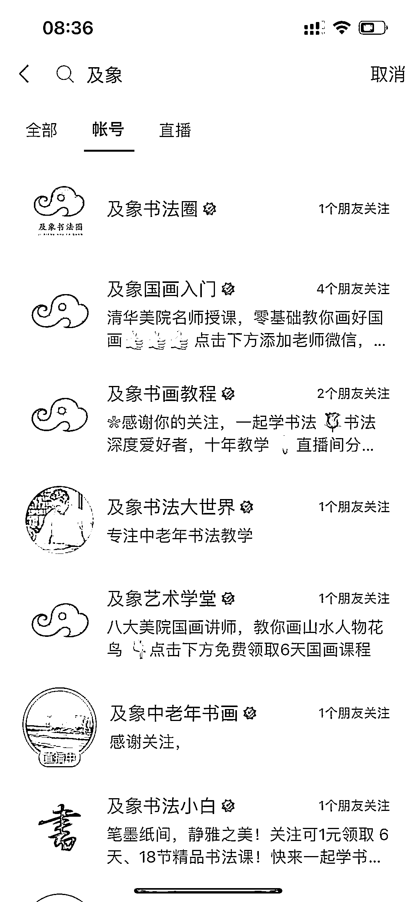
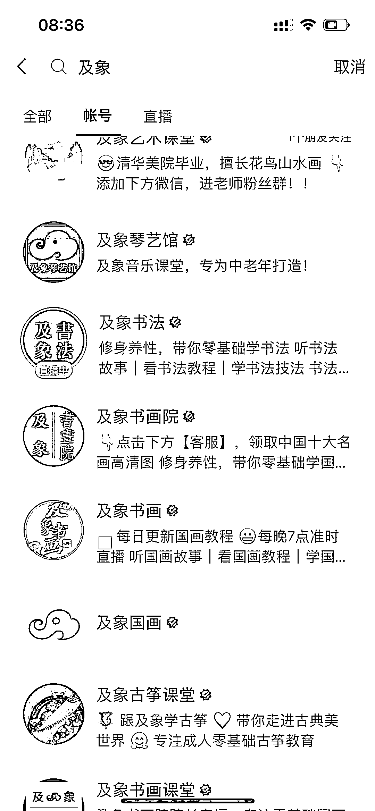

# 书法直播背后，中老年矩阵悄悄赚钱

一次闲刷视频号，我随手进了一个毛笔书法教学直播间，观看人数相当可观。主播会引导观众加企业微信，加上好友后，对方推来一个小程序，里面面向中老年群体的商品覆盖得很全，书法、古筝等品类都有。

顺着这个线索继续刷，又陆续看到不少教书法、国画的直播账号。点进去一加，竟然还是同一个企业微信。原来这些账号背后，是同一家机构在批量运营。

中老年内容这块市场，他们不声不响地把生意做起来了。

 

