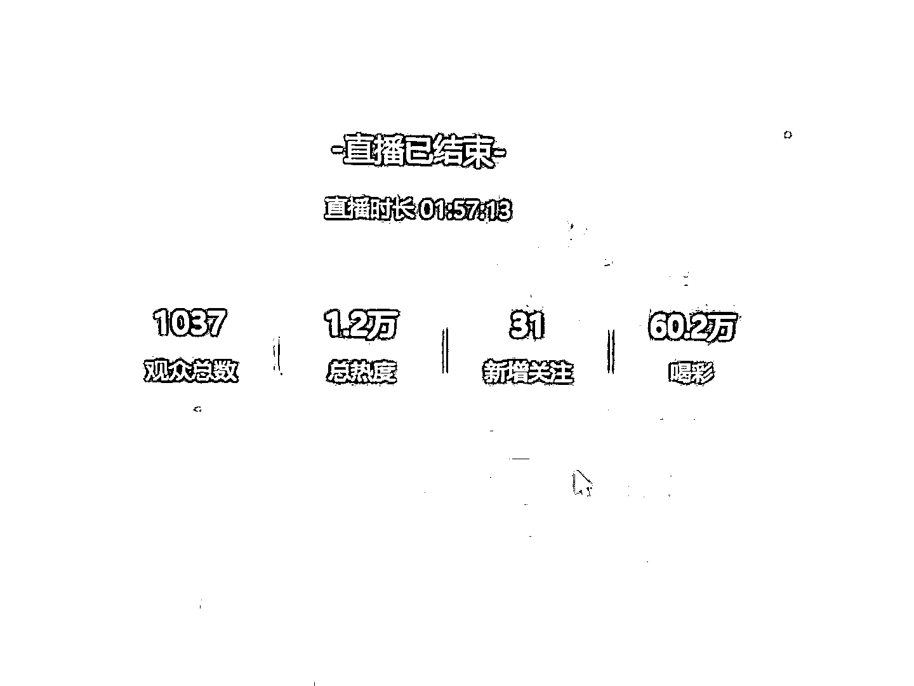
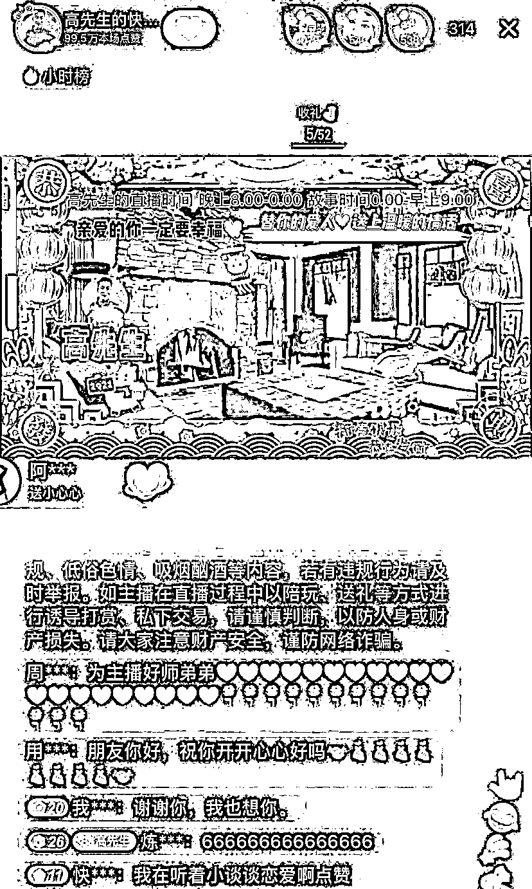
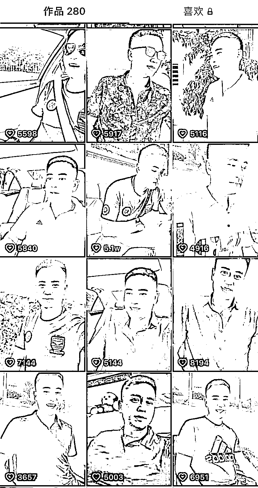
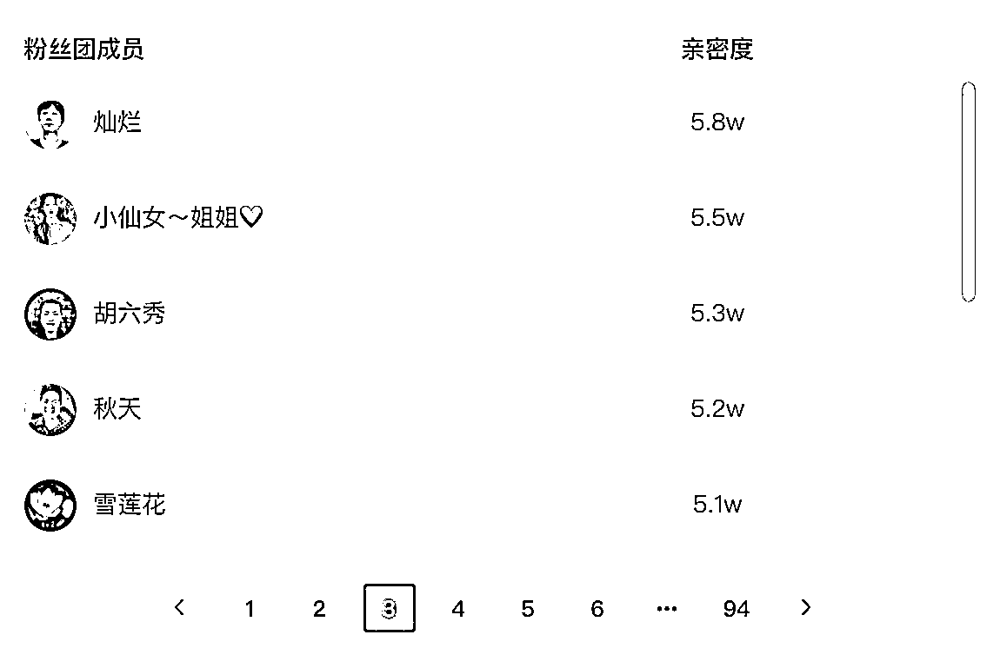
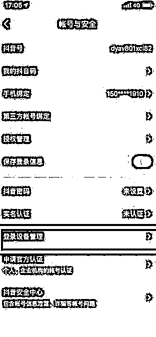
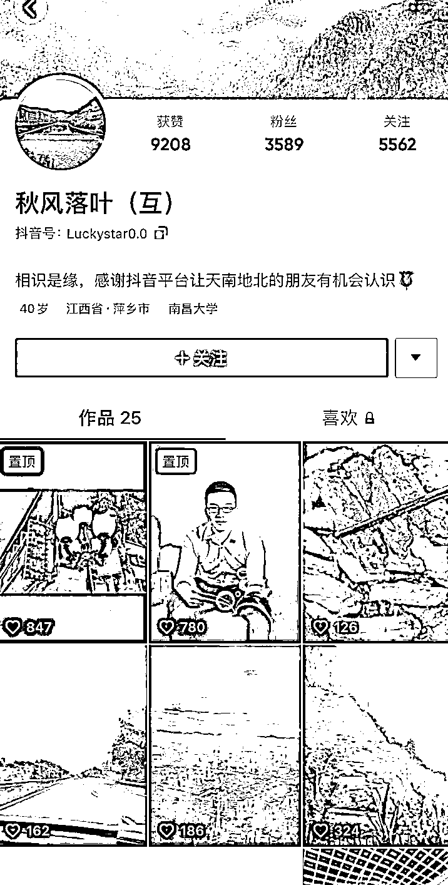
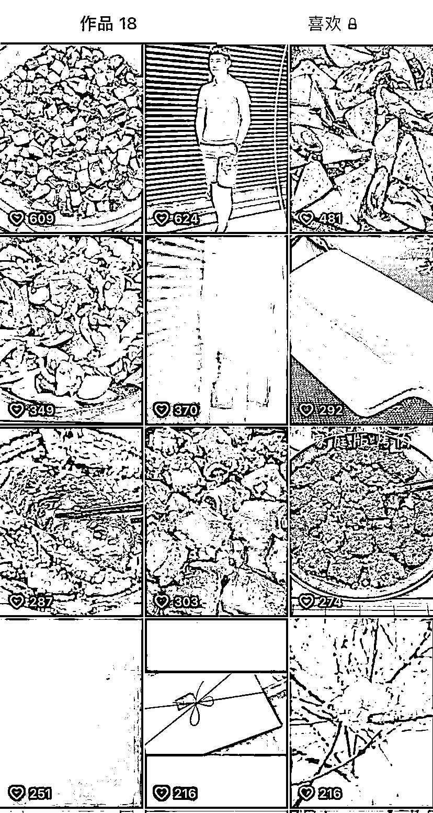
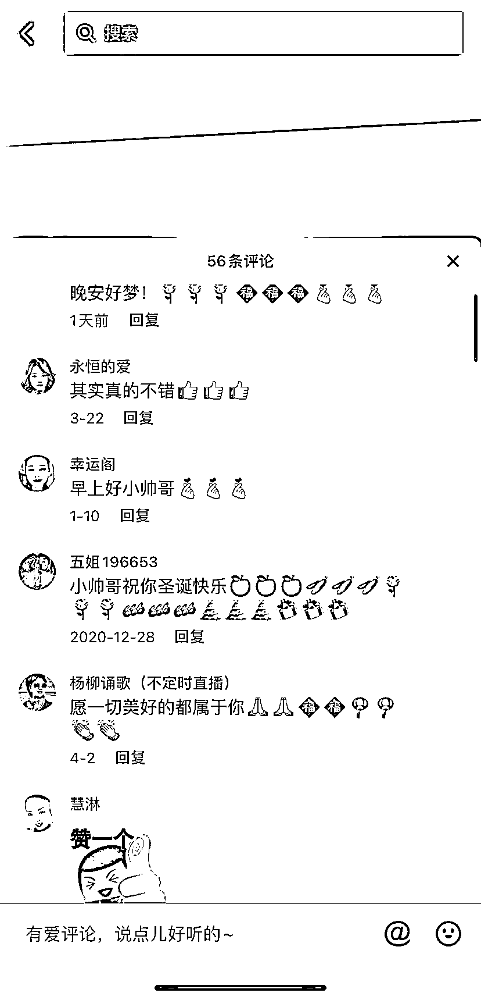
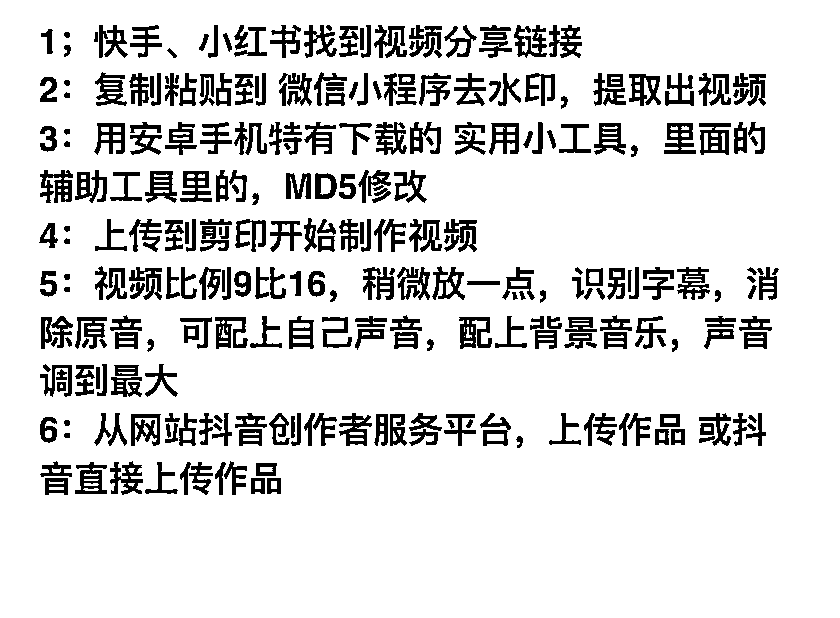
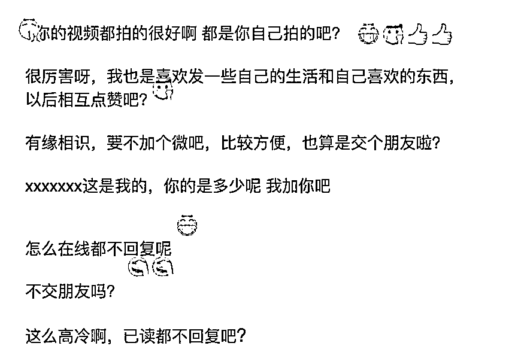

# 靠直播放歌，中年女粉让我月入过万

大家好，我是沈阳。今天聊一个我自己正在跑的小众玩法——把抖音上的流量引到微信，然后在视频号开直播放歌、聊情感话题，单靠听众打赏，一个月能拿到一万多。

先看一下我视频号近期的直播数据。

1.2W 热度折合 600 块。

这个路子确实偏门，也是我偶然撞见的。下面这个账号我去年就关注了，说实话有点刷新认知——女主播扭扭腰求大哥打赏的号我见多了，但中年女粉的消费力居然也这么猛，我是真没料到。

当时我自己也在搞无人直播，不过我们卖货，要发货、有成本。看到这个号的时候我挺震惊的：我们矩阵号卖产品，收入还不如人家一个靠打赏的号。

那能不能自己也干一个？最棘手的问题是直播间流量从哪来。我去拆了这些号的作品，发现套路高度相似：一个朴实帅气的农村小伙形象，对口型唱歌。

直播时基本就是聊情感故事加对口型唱歌。对，连真唱都不需要，也不用真人出镜，你只要口型对得上，有人打赏时道声谢就行。

观察了挺长一段时间，我发现这类直播间收益很稳，不算暴利，但一个号只要有 200 人左右在线，一个月打赏过万完全做得到。那就试试呗，反正长期泡在小项目里，看到能赚钱的事不试总觉得亏。

下面我把这个项目完整拆一遍。

一开始我想的是照葫芦画瓢做个抖音号——找个中老年人爱看的帅小伙，对口型唱歌，详情页挂微信导流。真做起来才发现没那么简单：我形象太年轻，拍了几条作品都不太行，偶尔有点赞的，不是阿姨就是小姑娘。

于是我换了个思路：能不能主动私信，把人加到微信，再通过视频号直播？加到微信后每次开播都能通知到，不用像在抖音那样看平台脸色吃饭。

第一个办法是找同行活跃粉丝，私信加微信。摸索下来，这条路走得通。先用数据分析工具找到同行的粉丝团成员，再看亲密度——亲密度越高，说明给主播打赏越多，这就是最优质的粉丝。拿到她们的抖音昵称和头像，就能定位到账号。

接下来是一对一私信导流。这里坑不少，首先你的抖音号得包装好，否则人家根本不会加你。

怎么包装？先准备四个老号，最好一年以上，找爸妈、好朋友换号。具体操作：自己开几张手机卡，把他们的老抖音号换绑到你新卡上，让他们重新注册。关键一步：换绑后记得去“登录设备管理”里把旧设备踢掉。

账号到手后，从五个维度包装：

头像用风景或花草，中老年人吃这一套；名称选四字成语，像“淡泊明志”“宁静致远”这种带点内涵的；签名写励志正能量；地域随便填或不显示；背景用风景图。下面这张就是标准模板。

内容也要对准中老年审美，大概这几类：花草、美食、歌曲、旅行、风景。画面稍微有点美感就行，可以跨平台找素材，快手搬来用剪映稍改。关键点：三条置顶内容必须有。

第一条，阳光帅气的自拍视角，不一定是本人，但用自己最好，配中老年妇女爱听的背景音乐。

第二条，拍自己开车的视频，音乐同样选她们喜欢的。

第三条，花花草草或旅行画面，背景音乐照旧。

三条置顶搞定，账号包装就完成了。之后每天更新美食、美景、旅行类内容，背景音乐一定按中老年女粉的喜好来，内容跟着粉丝审美走。

一个包装到位的账号长什么样？看下面第一张图。随便点开一条作品评论区，基本都是精准的中年女粉。

作品从哪来？快手、小红书搬就行，这类内容太好做了，制作方法如下。

账号养好，就进入最关键的导流环节。分享几条路径：

日常作品下面有粉丝评论，先评论互动，再私信聊。给你评论的基本已是粉丝，私信回复率很高。话术见下图。记住：一定等对方回复再发下一句，强扭的瓜不甜，导流前就把不愿沟通的人筛掉，不然加过去也难转化。

另一条就是前面说的主动私聊。效率低些但能跑，一天加十几个优质用户没问题。操作：用蝉妈妈找到同行优质中年女粉的抖音号，三步走——先关注，等回关后再私信。愿意回关说明对你感兴趣；中老年女粉基数大，只筛最优质的，不回关的直接跳过。

两种方式并用，只要攒几百上千个中老年女粉到微信，光直播打赏每月稳拿 1W，更别说这批高信任度粉丝还能做微商卖货。

今天就分享到这，想实操的直接评论区问，也方便其他人看到。

干就完了！