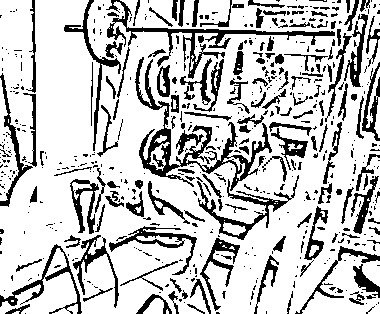
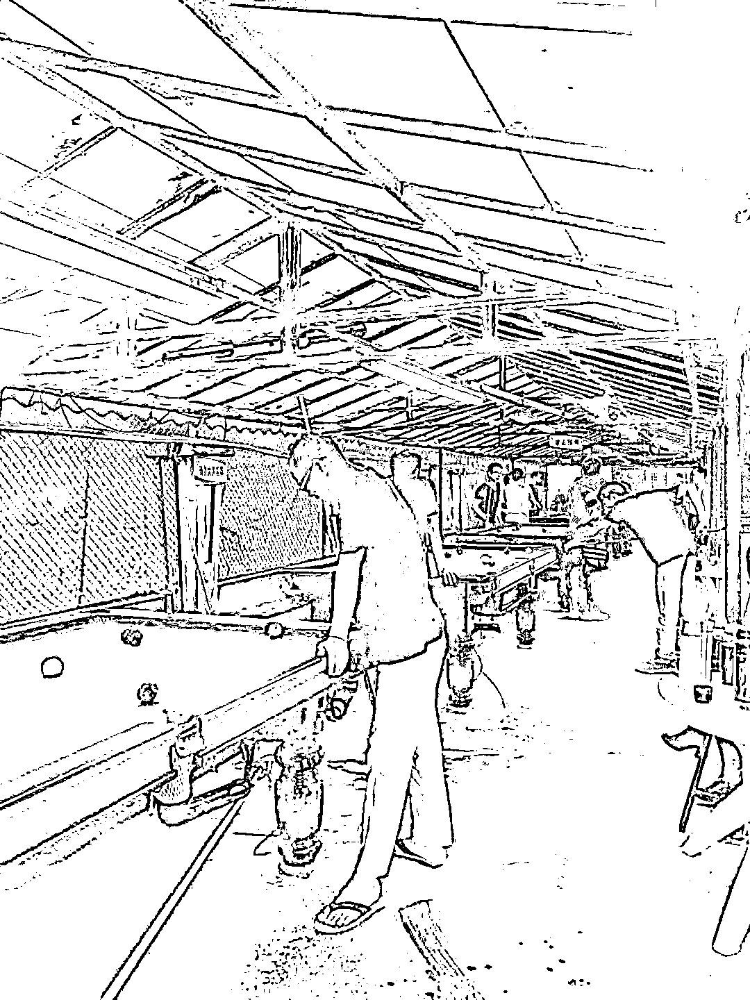
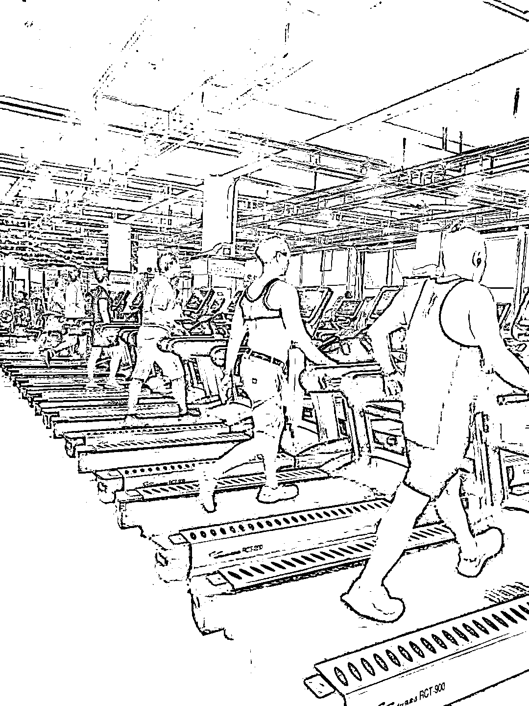
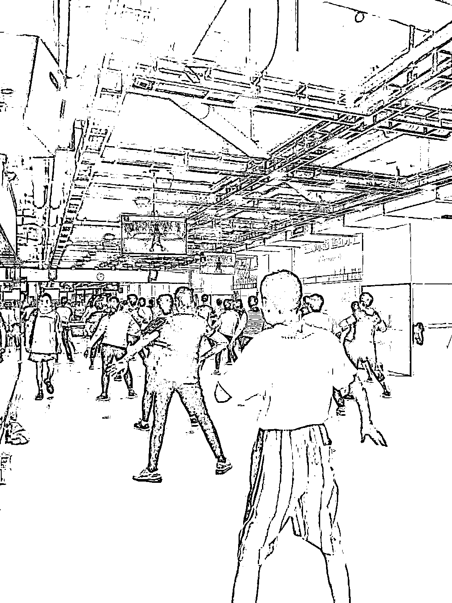
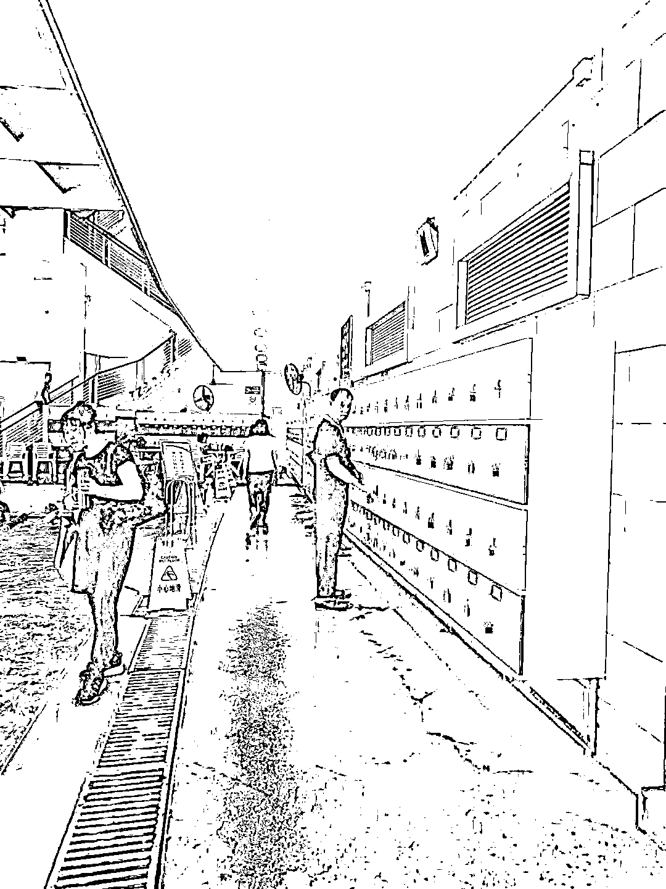
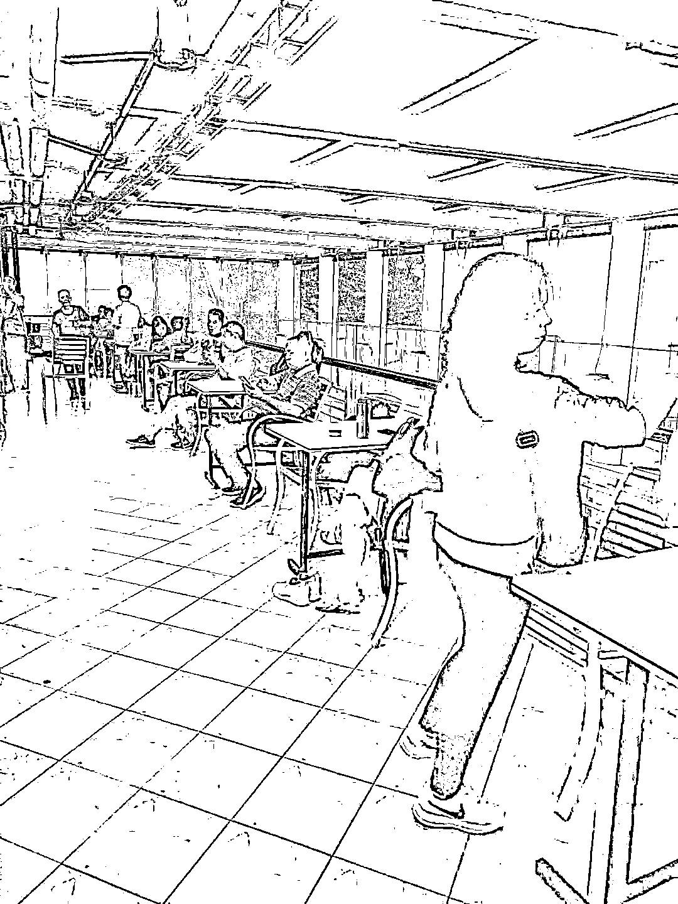
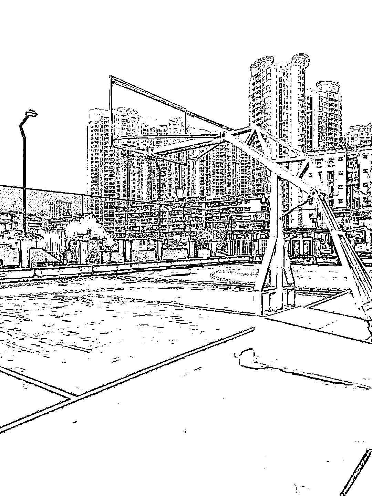
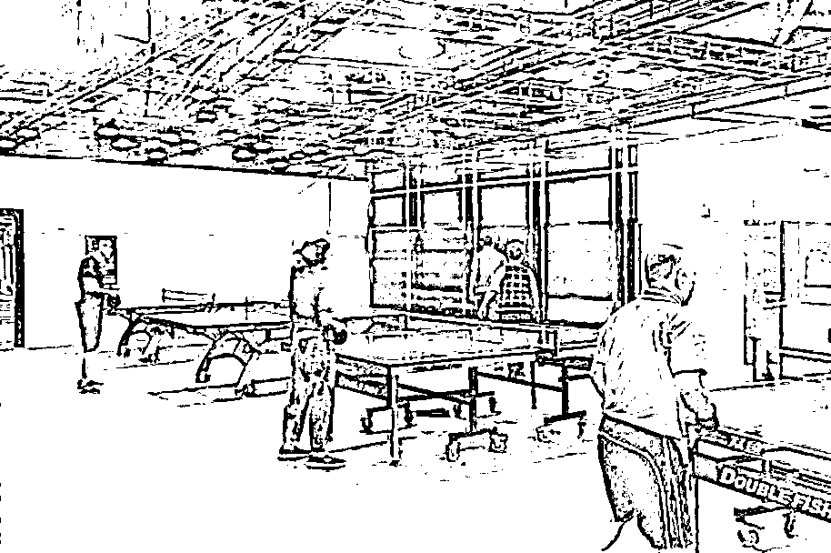
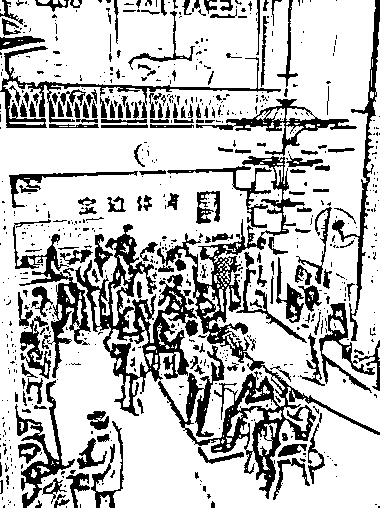

# 靠租柜和老人社交，这家健身房火了20年

作者：老黄牛  
日期：2021-02-28

今天来拆解一家开在老城区的健身房。它没有走常规路线，却20年没被市场淘汰，反而场地越扩越大，人气越来越旺。

这篇文章会先聊聊“场、人、货”三个维度，看它到底哪里与众不同；再用这个框架，帮大家想想怎么找到自己的差异化模式。

## 场：设施上有哪些不同

这家健身房藏在广州一个老城区，占了整整三层。

常规配置一样不少，比如撸铁器材、跑步机；但还有这些不太常见的东西：
- 两个游泳池，一个是室外池，一个是室内恒温池；
- 舞蹈室、形体室、瑜伽室；
- 篮球场、乒乓球台、桌球台。

场地大、功能全，按理说经营压力不小，可它偏偏越做越好。真正的秘密，要从“人”和“货”里找答案。

## 人：目标人群有哪些不同

1. 因地制宜
健身房开在住宅老区，而不是白领扎堆的商务区。周边中老年人多，所以主力会员是50岁以上的退休女性、60岁以上的退休男性。

2. 全年龄段通吃
会员年龄从6岁到90岁都有：
- 退休中老年在这里跳操、撸铁、游泳、打乒乓、玩桌球；
- 上班族下班后来锻炼；
- 学生放学后去打篮球；
- 小学生报儿童游泳训练班。

3. 全天候运转
营业时间是7:30到22:00，从早到晚都有人。周一到周五的白天，基本由退休老人撑场；到了晚上和放学时间，白领、学生陆续进场。

中老年会员为什么这么多？社交需求是关键。

早上和中午，休息区总能看到退休的大叔大妈一边吃早餐，一边聊得热火朝天。之后再去踢毽子、打桌球、打乒乓。这种打法，其实替代了“喝早茶”和“逛公园”的社交功能。

大妈们还有微信群，约好固定时间一起跳操，互相盯体重、互相比较、互相调侃。隔三差五还会约饭、唱K、组团旅游。

高密度的社交互动，把人和健身房牢牢绑在一起。换一家健身房，就等于失去了整个小圈子，所以会员很少流失。也是这种“有人一起练”的氛围，让她们一周能来五天，不需要靠反人性的自律硬撑。

## 货：产品和服务有什么不同

很多健身房靠教练卖课、健身房抽成来盈利，这种模式很难持续，倒闭的不在少数。而这家店全场只有一个教练看着，而且不主动推销课程。

它的特别服务是——租柜。

整个健身房的柜子，粗略数下来大约1200个。每个柜子每月40元，一年下来就是近60万的纯利润。

为什么大家都愿意租柜？
1. 来得勤：锻炼已经成了退休生活的一部分，每周一到五都准时出现，几乎不缺席。既然频率高，每次带上冲凉用品、拖鞋、运动鞋就很麻烦，不如把东西放在柜子里。
2. 占点小便宜：不少住在附近的会员，练完直接在健身房洗澡洗头，回家就不用再冲凉了，省下不少水费。

另外，这里的月卡也很有特色：月卡170元（但每年要交100元会员费），年卡则是买12个月送3个月，多数人会选年卡。这么便宜的月卡，还能把散客也收进来。

在这家店里，“场、人、货”是互相成就的。项目也是慢慢迭代出来的：篮球场、桌球台、柜子数量，都是逐步增加的。

## 怎么用“场、人、货”框架，找到自己的差异化模式

把三个要素单独拆开，再按MECE原则列出所有可能性，然后逐项看看能不能放进自己的商业模式里。

### 场（场地设施）
以书店为例，书是入口，还能延伸出很多场景：
- 吃：很多书店做了咖啡消费区，买杯喝的就能坐下看书；
- 住：比如“1200book&bed”，把书店和民宿结合起来；
- 行：打造网红打卡地，比如茑屋书店；
- 衣：成都的诚然书店专门卖衣服，看着“不务正业”，却火得一塌糊涂。

尽量多列出各种可能，从中找出属于自己的创新基因。

### 人（消费者）
可以从很多维度拆分：
- 按身份：学生、在家待业者、职场人、老板；
- 按年龄：儿童、少年、中年、老人；
- 按婚姻状态：单身、恋爱、已婚、离婚；
- 按职业：程序员、司机、医生、律师、产品经理……参考《国际标准职业分类表》。

比如“生财有术”会根据人群不同，提供副业、私董会等服务；“得到”也做了“少年得到”。把所有人群画像都列出来，头脑风暴。

### 货（产品与服务）
- 线上：文章、音频、训练营、社群、直播；
- 线下：见面会、座谈会、演讲分享、饭局、私董会；
- 产品服务：日历、礼品、书、咨询。

再结合“场”和“人”的特点，打造自己的产品线。

## 总结

这家开在老城区的健身房，用中老年人群作为突破口，靠“中老年社交需求”和“租柜服务”稳稳经营了20年。它的故事提醒我们：从“货、人、场”三个角度重新审视自己手里的生意，或许就能发现一条不一样的路。

 

评论区：

小蚁：这个案例真有意思！[强]
郑小焦：观察细致，解析到位。用“经营”的眼光去看身边的场所，确实会有新收获。
芷蓝：这就是从人群做行业差异化，厉害！
HEXIN：感谢分享，我也在用“人货场”分析。补充一点：传统健身房靠年卡会员费+私教课时费盈利，所以内部会分会籍部和私教部。年卡赚的是办了卡却不常来的人的钱，因为场地容量有限，如果人人都天天来，器械磨损和维护成本反而更高；私教赚的是健身新手急于见效的钱。链接：https://articles.zsxq.com/id_155ttlvf66rg.html
老黄牛：那这和“年卡+私教”的模式完全是两回事了。
萧遥：日本好像也有专门针对老太太的连锁健身房，模式挺像。
老黄牛：想到孙正义的时光机理论。多看案例，对创业启发很大。
老黄牛：嗯，这也和场地设施、会员模式有关，相互吸引。