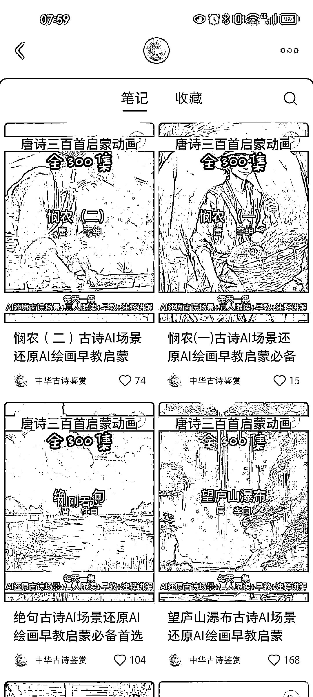
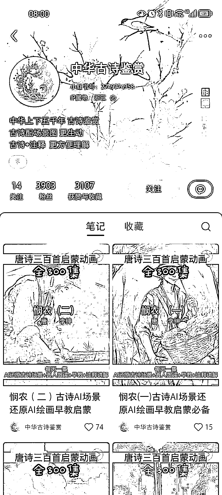
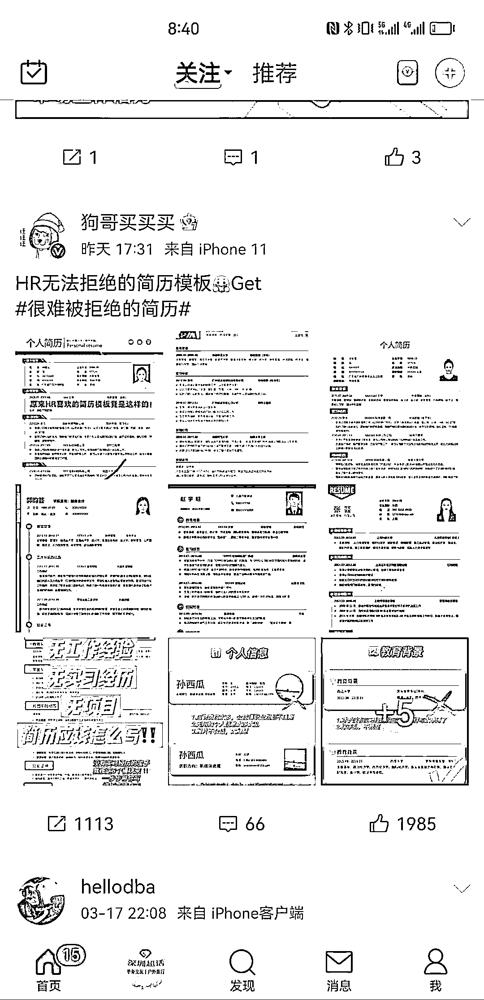
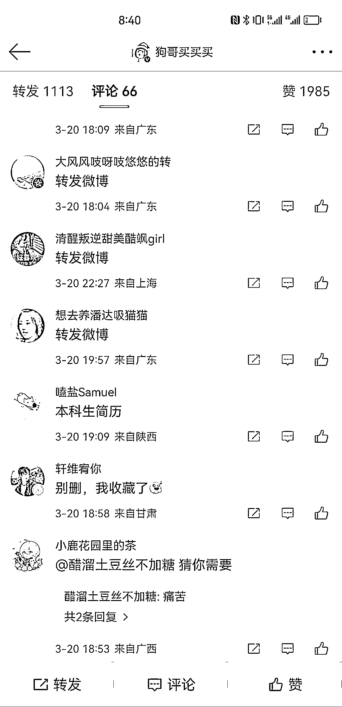

# 唐诗配AI图，12条视频涨粉近4000

作者Daemon在2023年6月30日分享了一个获140赞的案例：把《唐诗三百首》做成AI绘画内容，诗句逐句交给Stable Diffusion出图，最终只发布12条视频，就获得接近4000个粉丝。这套做法很适合流水线批量制作，也能落到具体教育场景里——例如“小学生必背的XX首唐诗/宋词”，围绕“孩子不爱背诗，让他爱上诗”做内容。

 

评论区也有不少延伸：万简问sd指什么，Daemon解释为Stable Diffusion；这条案例获评“中标，术值+1”，可在专栏点击#中标查看风向标。万律师提到，自己刚在📕看到相近思路，正打算发风向标；mikan阿橘KK*关心这种账号怎么变现；o吉吉积极向上认为有需求就会有产品；伟业的理解是，用AI绘画给古诗配图，吸引小学生家长，解决孩子不爱学古诗的问题，变现则可往私域引流，卖小学生教培课程；小白脸则说自己早想过做成绘本，但不确定版权是否成问题。

# AI生成简历发📕，普通内容也能引流

上川书记在2023年3月21日记录了一个获35赞的方向：借助AI绘画自动生成简历等资料，再发到📕做引流。其观察是，🧣上很普通的简历都能拿到较高流量，若把质量更高的版本发上去，流量表现应该不差。

 

这条同样获得“中标，术值+1”，并提示可在上方专栏点击#中标查看全部中标风向标。