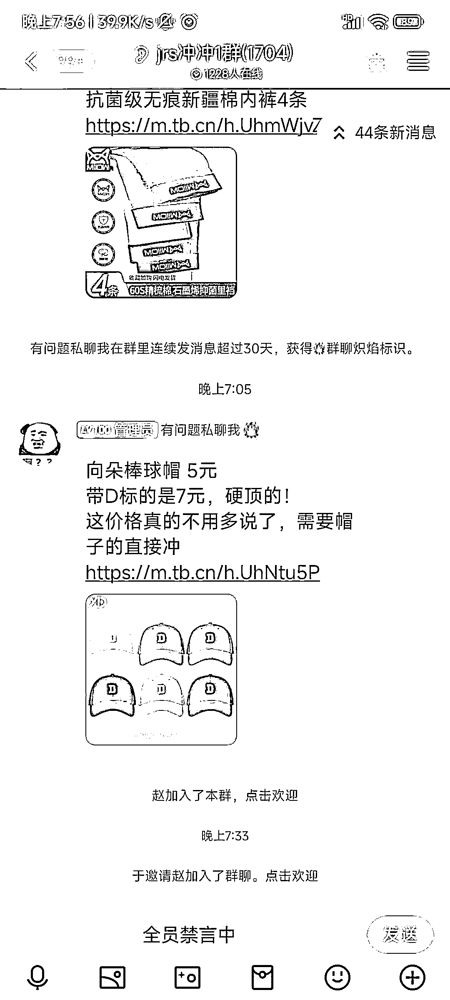
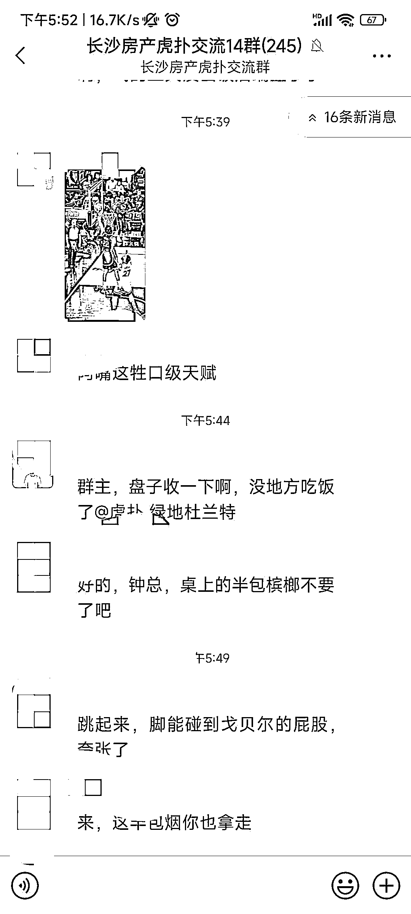
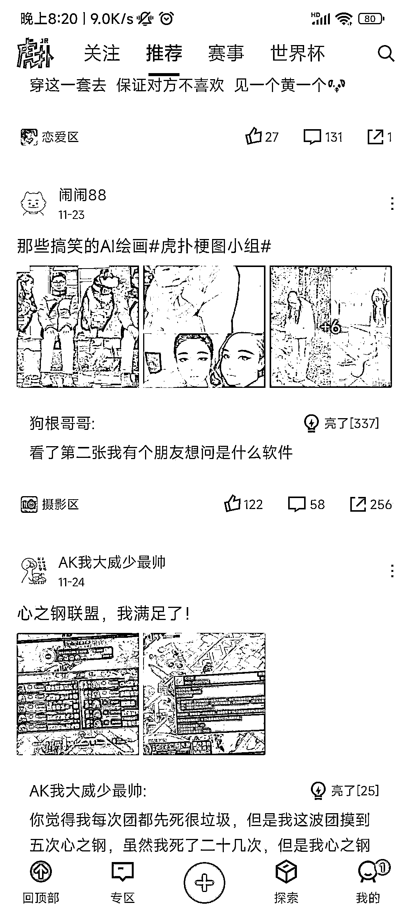
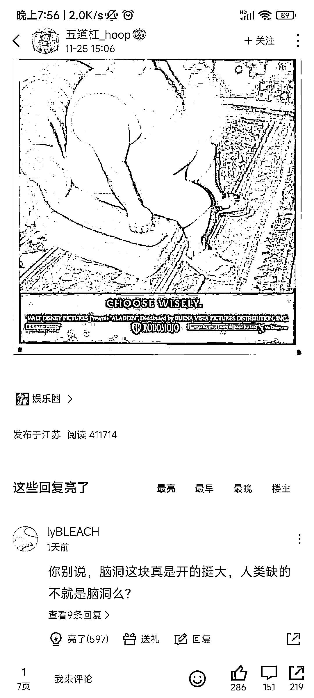
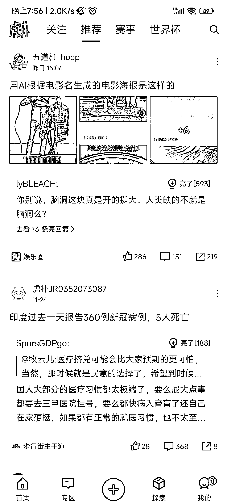

# 虎扑引流：两条现成思路

文 / 姚麻｜2022.11.28

虎扑的流量盘子不小，拿来做导流很顺手；用户几乎都是男性，但粉丝质量并不差。

我看到两种比较顺的玩法。

一是运动装备人群。把用户引到🐧群，群里用机器人发优惠券，走淘客转化。图一里这个群已有1700人，而且对方似乎同时运营着四五个群。

二是地域社群导流。图二中的群主是房产中介，他把长沙各楼盘的动态发在虎扑，借此把用户引入群；进群后有人想看房，他就约时间带看。顺着这个思路，能不能把线下资源接进来，做全国各地的本地群？不局限于买房，买车、线下活动、相亲都能做。群人数多、活跃度高，收费也有空间。飞盘热的时候，虎扑上就有人建长沙飞盘群拉人，按39.9元/人收费。

另外，新事物在虎扑也容易起量，用户兴趣高、愿意了解咨询。比如AI绘画，帖子经常几十万浏览，很多人追问用什么软件、怎么操作、能不能教。

     

评论区：

龙哥：中标，术值+1。到上方 #星球栏目 专栏里点 #中标，能看到全部中标风向标。