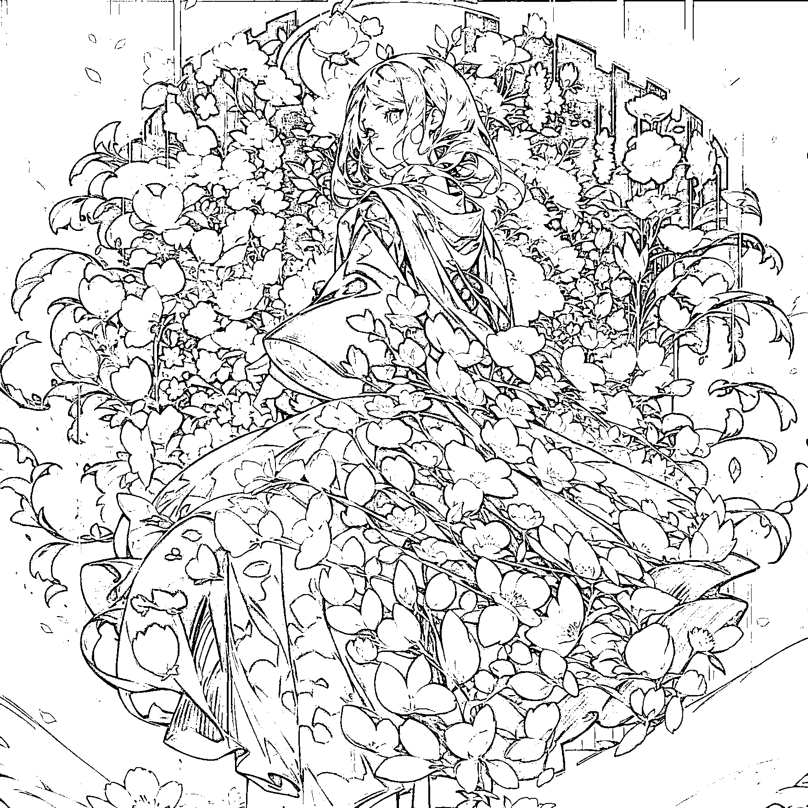

# 精华帖·144赞｜SD 稳定产出高质感艺术二维码的方法

文｜明月 2023年7月11日

我是明月。艺术二维码火了一阵，网上相关教程也不少。可看来看去，市面常见效果始终没让我满意。最近我终于折腾出一套自己比较认可的方案，而且出图稳定性不错。

这篇内容干货密集，零基础 AI 绘画新手读起来会有门槛。想获得更顺滑的阅读体验，完整版放在文末飞书文档。

https://hdjmn9shgs.feishu.cn/docx/OUYOdKSwzoHS8pxpeRNcRcdqnHh

评论区也有点小插曲：一开始有读者反馈链接打不开，有人建议试试第二条；也有读者提醒重新编辑，在飞书链接后敲一下回车，让链接真正变成可点击状态。随后有人贴出同一地址，有读者确认能打开并准备实操，伟业还说会实操后反馈、欢迎交流。明月最后更新了链接，确认可以点开并感谢大家。