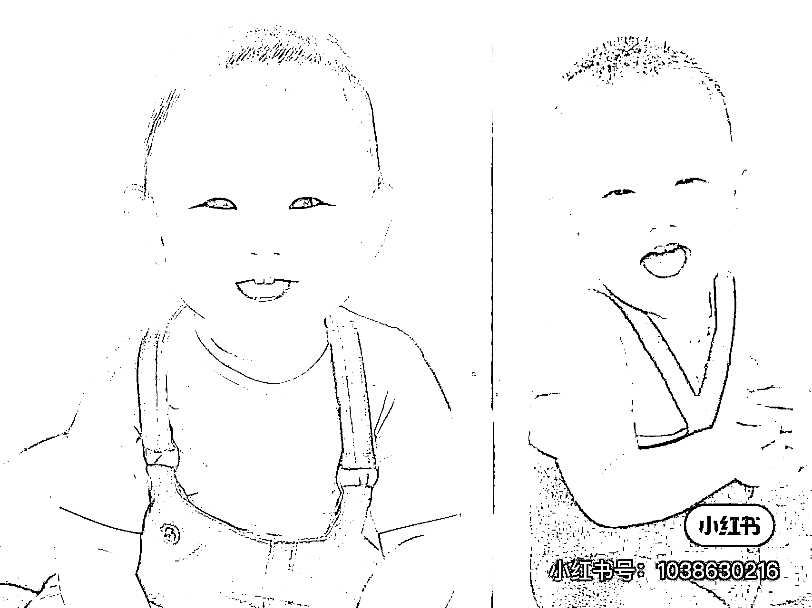
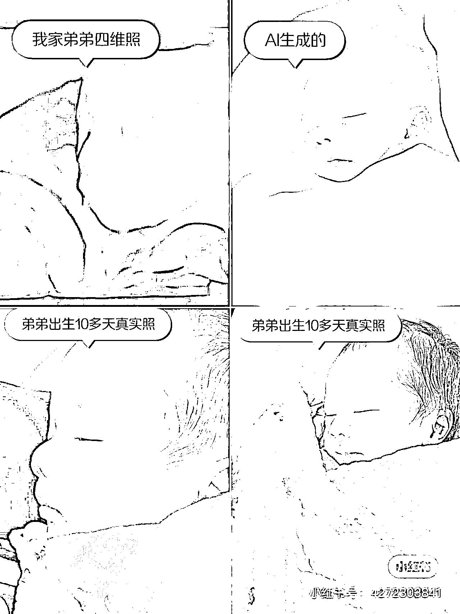

# 小红书AI头像变现：5天起号实测

作者：阿凯  
日期：2023-05-05

先交代两个前提：小红书天然适合图文内容；AI绘画则把图片与文字素材的制作成本拉得非常低。基于这两点，上个月我拿一个小红书老号做测试，连续5天、每天发1篇笔记，第5天流量爆了。内容是把宝宝的真实照片做成迪士尼风格头像（图1）。

爆了之后，单日涨粉约1000，私信也差不多有1000条，基本都是问能不能给自家宝宝做一张。我定价40元一张，先不考虑后端承接率，在这个价格下每天成交约150单，日流水约6000元。但150单不是白来的：至少需要3个人力，再加一个月30美元的Midjourney账号。为什么用3个人？我对相似度要求很高，原片和成片要尽量像、非常像，每单耗时10到15分钟，还得有人兼顾客服，基本满负荷运转。另外还有复购和转介绍：有人一次想做几张，也有人拉别的宝妈来，因为微信头像换出来宣传效果很好。不过单量突然涌来，我没做好准备，引流方式太直接，几天后账号被封。

怎么复制和拓展？第一，批量起号是本能反应，但我观察到AI图文账号在新号阶段并不吃香，能跑出来的样本很少，容易产生幸存者偏差。第二，找人代发，让有宝妈粉丝的小红书老号发布并给提成，关键算投入产出比；客单价不高，我没敢试，站内投放也没测。第三，扩产品线，我认为这才是重点。淘宝上头像定制类目月成交约180万，真正的主力是日漫风，我做的迪士尼风反倒偏小众。围绕风格、人群和场景还能拆出不少玩法：情侣头像量很大；还有人给胎儿做头像，第一个想到这个点子的人真是天才（图2）。第四，线下摆摊可能带来意外收获。第五，抖音上已经有人在直播做迪士尼风头像，靠收徒变现的肯定也有；实际数据如何，欢迎圈友交流。

注意事项：引流可以走群、私信或小号；生财里有成熟的小红书引流打法，这里不展开。AI出图成本太低，门槛不高，一旦内容大爆、图片被看见，同行很快会跟进，价格随之被压下来。流量红利窗口不会太长，小红书用户的新鲜感也会慢慢消退。不过要强调三遍：这项目对在家做兼职的人很友好。每天发一条并不占多少时间，持续发总会有起色；把预期放低，用时间慢慢磨，做出几百赞的笔记后，一天多赚两三百并不难。这类需求相对稳定，也有长期性。若想把它当成一套模式、规划半年甚至一年以上，挑战就完全不同了。

评论区：  
音无：大佬好，我自己用MJ和SD把照片做成风格头像，相似度总提不上去，有啥技巧吗？  
字节叔叔：SD也能做，就是对设备有要求[呲牙]  
亦仁：中标，术值+1。  
在上方专栏点击 #中标，可查看所有中标风向标。  
阿凯：技术原理上很难做到，更多是耐心反复开盲盒。重点放在销售前置，提前把相似度说明白；多数人没想象中那么在意。  
音无：明白了，谢谢大佬。