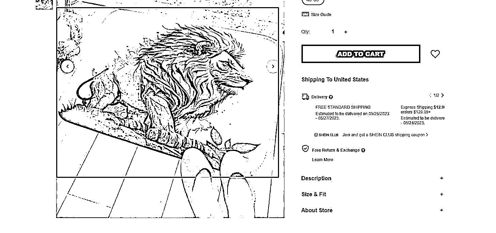

# AI 出图做印花电商，小单也能快跑

像靠枕、地垫这类需要印图案的商品，图样完全可以交给 Midjourney 或 Stable Diffusion 来产出。

还有一种更省事的做法：在 Midjourney 公共频道里看到合眼缘的图，把提示词复制下来，再重新跑一版。也可以拿付费图库里的成品图当参考，用提示词做出风格接近的画面，这样能省下不少授权和拍摄成本。

这套思路特别适合单件也能接的工厂，尤其是做小批量数码印花的企业。一天上新几十款图、持续铺产品，同行很难跟上这个节奏。我朋友就是靠这种打法，已经做到 Temu 地垫类目的头部卖家。

圈里之前也有人分享过类似操作：把 MJ 生成的图片直接用到自家商品上。说到底，凡是依赖图案设计的产品，都值得试一遍。

要是圈友照这个思路跑出结果、进账六位数以上，别忘了回来送我一颗龙珠[偷笑]

评论区里也有交流：

亦仁：中标，术值+1。到上方专栏点 #中标，能看到全部中标风向标。

骷髅绒：这有点像亚马逊上的指纹定制。

阿奇：配图是 SHEIN 的，SHEIN 也适合卖家入驻吗？  
子不语：适合。