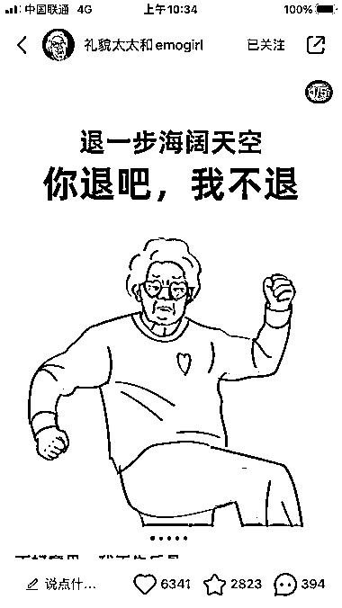
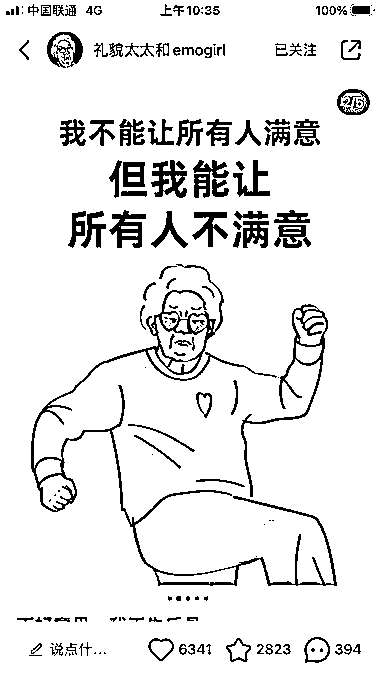
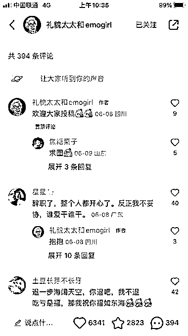
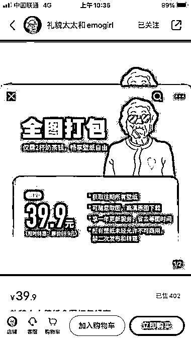
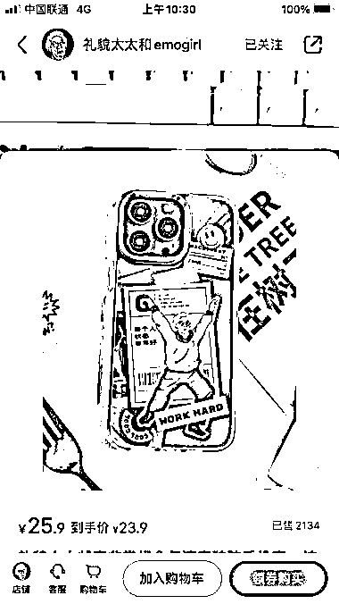

# 反PUA笔记，靠手机壳赚了5万多

刷小红书时，我注意到一组反PUA主题的笔记，点赞互动都挺可观。图1到图3是笔记内容，图4能看到数据表现。这个账号的变现路径也很有意思：壁纸会员、原创手机壳等，其中手机壳这一项就带来了5万多元收入。图5、图6分别是相关产品。

如果你会手绘，完全可以参考这个思路；即使不会，也可以借助AI绘画工具，做出另一个有辨识度的IP。比如原博主走“疯狂老太”路线，你可以换成“嘚瑟老头”“焦虑老婆”之类的角色，形成差异化。

评论区也很热闹：胖大魔说“暴力丑学，我刚把徐志胜看顺眼”，老金调侃他太卷了，胖大魔随后害羞地表示“不卷不卷”；亦仁给出“中标，术值+1”的评价，并提醒大家到上方专栏点#中标，就能看到全部中标风向标；Sunshine觉得“这个好玩”；Alex恭喜中标；老金也向亦仁老师道谢，并用表情回应。

相关截图：