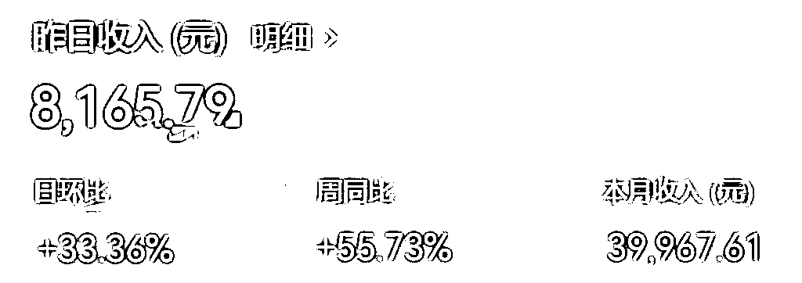
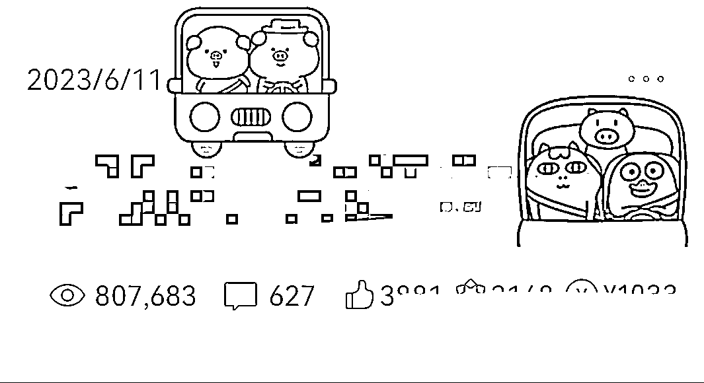
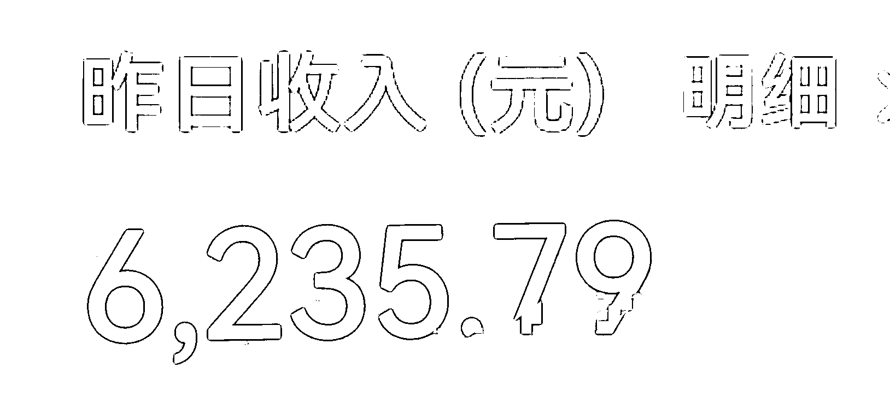
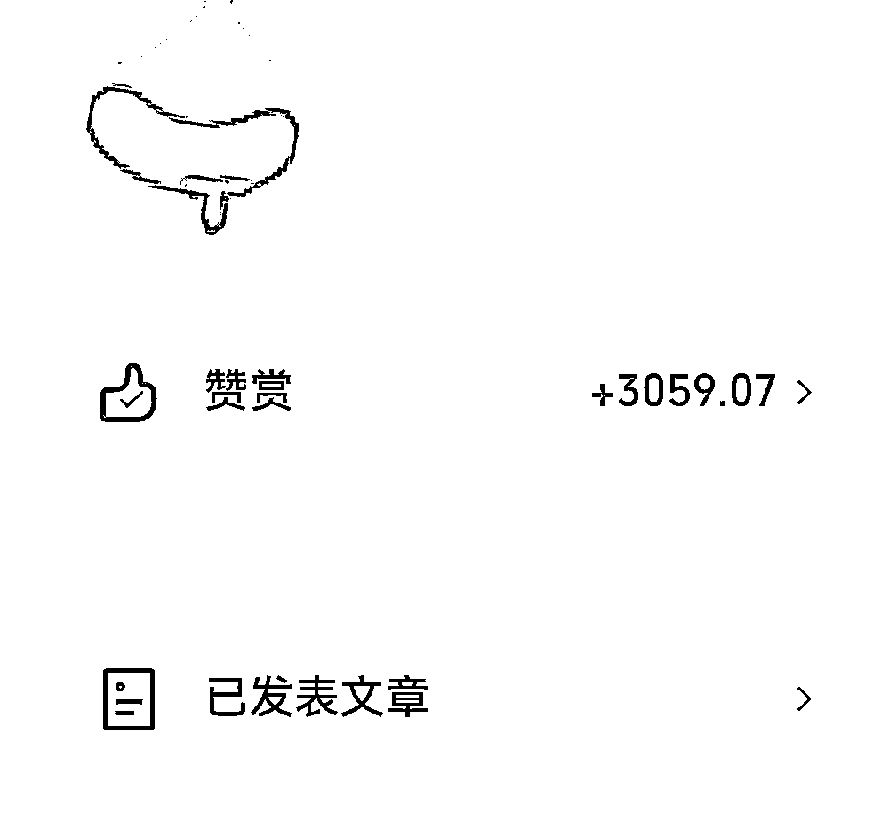

# 12天入账39900+，AI+热点做公众号有多香？

最近看到一位作者的分享：她把AI绘画、ChatGPT和热点选题搭在一起做公众号，12天收入39900+，另外还收到3000+赞赏，忍不住感叹“太香了”。

  

评论区里，翱翔蓝天好奇地问：都这么厉害，发的是什么类型的文章？妞妞💋回应得很干脆：行规，账号不方便公开。她还补充，追的就是那几天刷屏的“牵手门”热点。帅子留言“教练威武”，妞妞也回夸对方，说自己正在练习发帖，多尝试总没坏处，还笑称生财星球比公众号后台复杂不少。翱翔蓝天随后连发三个[强]。