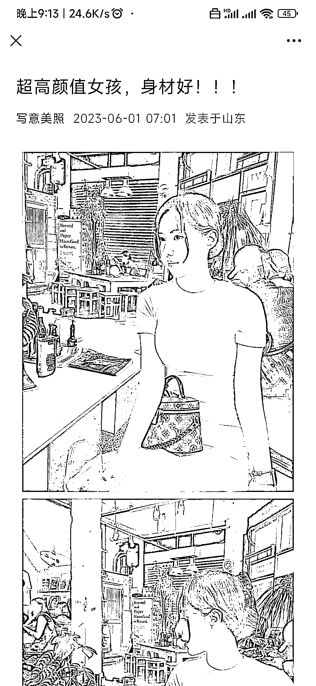
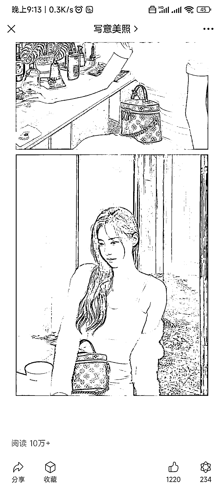
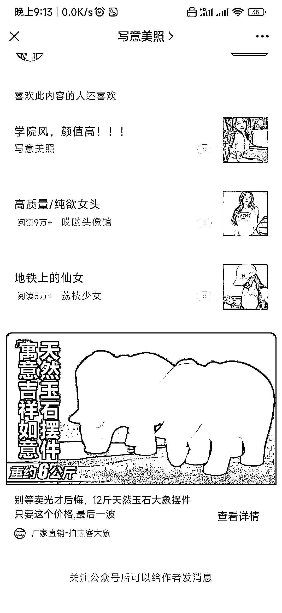
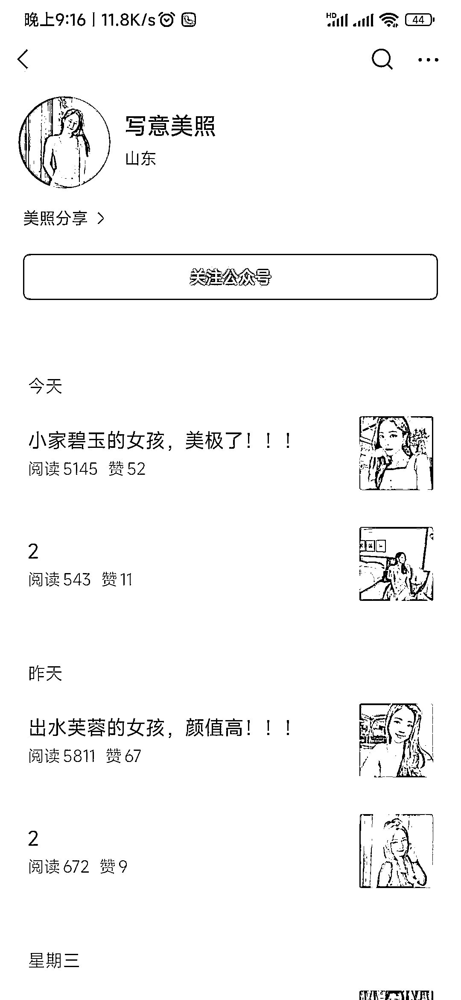
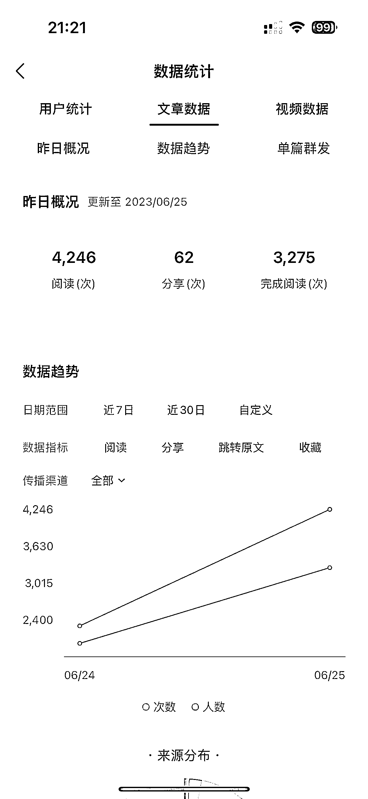
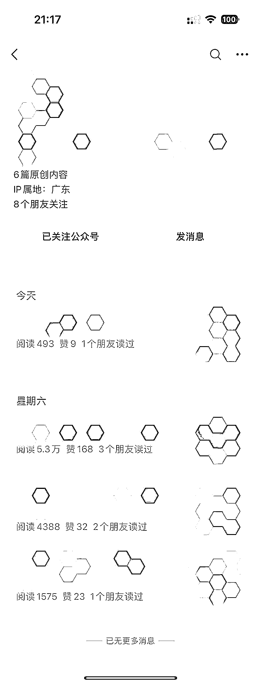
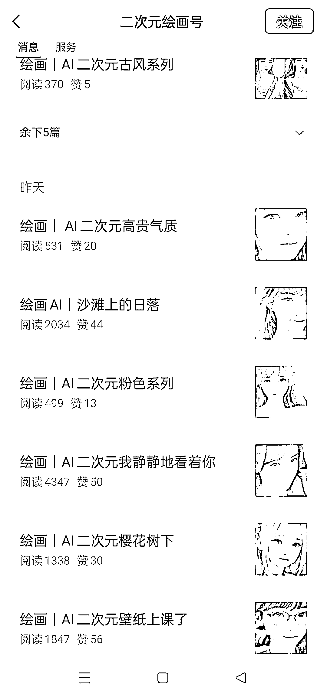
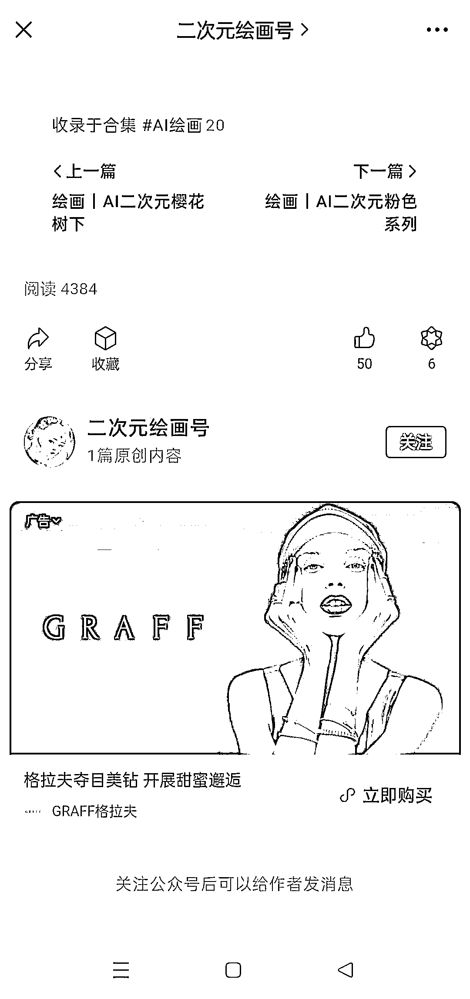
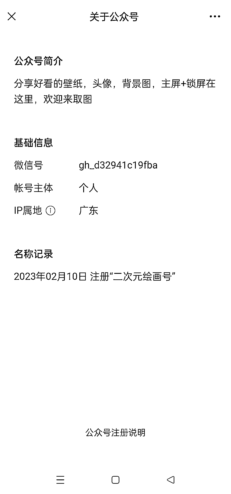

# 美女图账号的广告分成：三个实操样本

先给判断：在订阅号里用人工智能生成的美女图做内容，赚平台推荐流里的广告分成，是眼下门槛偏低的一条路。受众广、素材出得快、尺度可控，图片版权也能靠生成式工具绕开。

**美女图方向：受众广，广告分成好接**

男性读者、爱看美图的泛娱乐人群，再加上单纯欣赏好看画面的人，是网上基数最大的群体之一。这个方向产出简单，内容守住平台规范，不碰低俗边界；图片版权则交给人工智能作图解决。曝光起来后，靠文章推荐流里的广告分成收钱，冲上十万加并不稀奇。

   

留言里有人算账：朋友实操时，一万次阅读大约换来二三十元。叶华也补充，这类号适合个人号铺矩阵。还有人困惑：发布时勾了群发、原创、壁纸分类，连续六天却只有夫妻俩阅读，哪里出了问题？叶华顺势安利了赚钱的爆文写作小航海——手把手教程，而且免费。

**ChatGPT配作图：三天进池，五万+**

元彻的分享是：ChatGPT 配合人工智能作图，三天进入推荐池，跑出五万加阅读。他拿老号和零粉新号一起试，结论是老号进池会顺一些。

 

留言里，思行Super问，这是情感文配美女图吗，元彻确认是的。羽落追问情感文和美女图怎么配比，自己也在做，最高只有一千阅读。元彻答得具体：文一图九，图片尽量真实、够耐看，让人看着舒服又不越界；进池后就持续更新，靠数量碰运气。另有人追问标题是否要挂“AI作图”关键词。

**纯生成图也能起量：日更八条，单篇四千+**

奇点的案例是：人工智能作图加订阅号，走广告收益。截图里的账号二月十日才注册，每篇就几张工具产出的画面，最高阅读四千加，更狠的是一天能发八条。

  

留言中，有人问这是纯靠平台推荐，还是从外部导流，也有人求导流方法——可见这个玩法的核心仍在量大、图好看、持续发。

三个样本指向同一条链路：生成式工具解决版权和产能，平台推荐流承接曝光，广告分成完成收钱。接下来只需选好图、配好文、稳定更新。