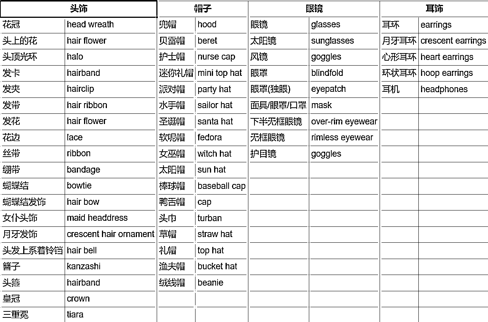
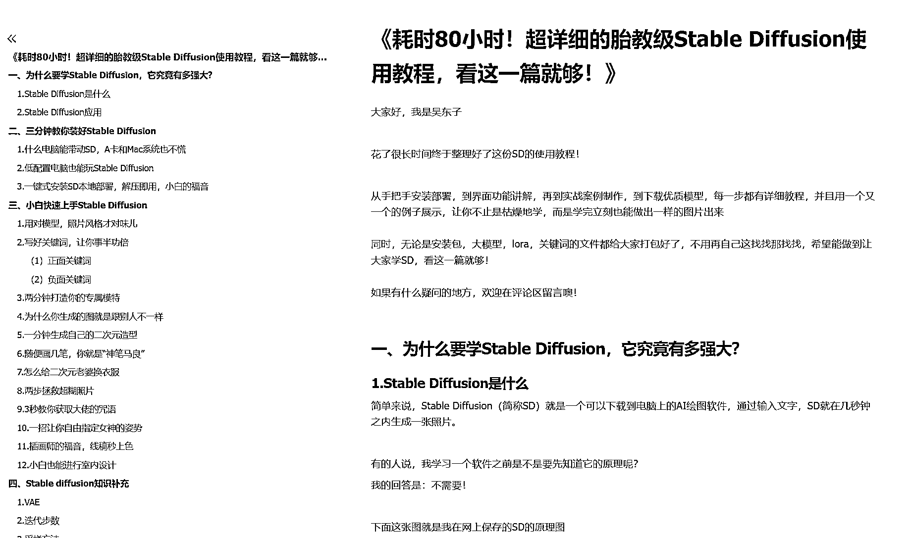
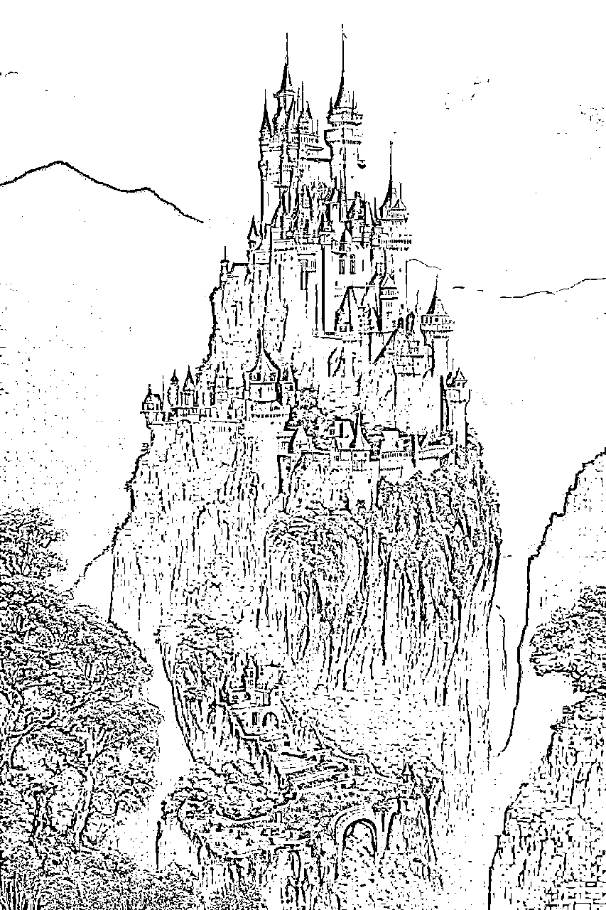
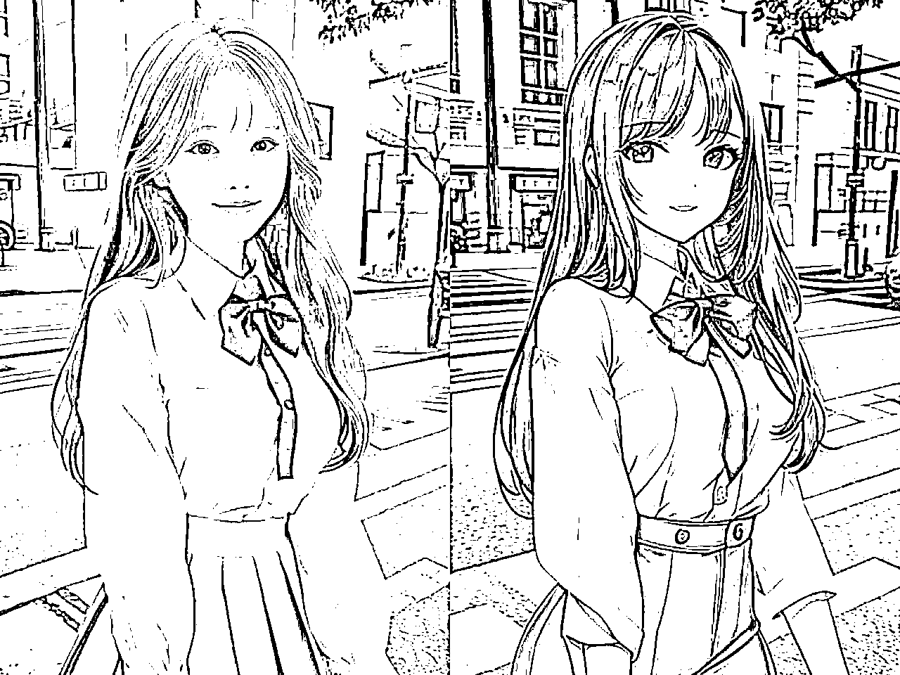

# 80小时整理：一篇吃透 Stable Diffusion

我是吴东子，先和大家打个招呼。这份 Stable Diffusion 教程前后打磨了约80个小时，最终整理成上万字的内容，今天正式交到大家手上。

内容会先带你把软件装好、顺利跑起来，再逐项拆解界面功能，随后进入实战案例制作，最后教你如何挑选并下载优质模型。每个环节都写清了操作路径，还穿插大量实例做演示，不会只停留在理论层面——跟着学完，你就能动手做出同款效果。

此外，部署所需的安装包、主流大模型、LoRA 以及提示词清单，我都已经打包备好，省去你四处翻找的麻烦。我的目标很简单：关于 SD 的入门与实操，尽量都收在这一篇里。

有疑问，直接到评论区说一声。

如果希望排版更舒服，可以移步飞书阅读：
https://ry5hwpuf7b.feishu.cn/docx/HYrZdLBMRorB0qxKqFFcQ075nWf

  

评论区里，GEWO.GUO🌪 用“大写厉害”表达认可；+龙说会先收藏再慢慢看；愚者觉得一个“牛”字都不够；悦佬同样表示先收藏；开心夸作者太棒了；欢乐马则提出一个技术疑问：用的是云平台、显存也够，可宽高比一设成9:16就出黑图，想知道症结在哪；西元和红烧电饭煲也都在点赞。