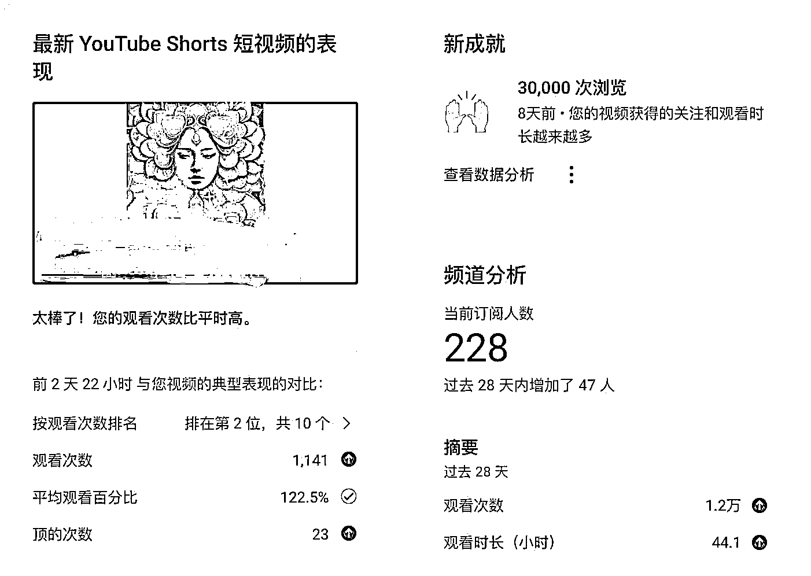

# 一天顶半月：AI绘画加文案批量做Shorts

2023年3月22日，作者do小鱼分享了一套实操打法：借助AIGC来批量制作YouTube Shorts。具体做法是先让AI生成绘画画面，再为画面搭配文案，这样一天就能攒出足够半个月发布的视频素材。从跑出来的实际数据看，这种方式的效果比他平时自己做YouTube内容时要好不少。

评论区中，大支询问具体制作方法以及如何联系；亦仁给出了“中标，术值+1”的评价，并提示可以在上方专栏点击#中标，查看所有中标风向标。