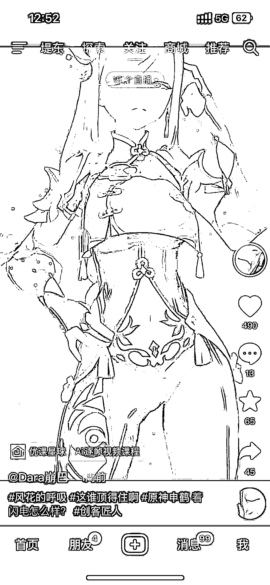

# AI绘画课，400元卖三千多份

一门AI绘画课定价400元，居然有三千多人下单，这买卖确实够赚。

它的引流路子并不复杂：把视频加工成动态漫画，用这种内容吸引流量。显卡性能跟得上的话，30秒上下的短片，一天产出20条以上完全不是问题。操作门槛也不高，会用SD就能上手。

 

评论区有人追问：怎么把画面做成动画？作者给出的做法是，先用PS把视频逐帧导出，再用SD定下首帧风格，最后借插件完成全部绘制。也有人提到mov2mov插件，直接把视频拖进去就能用，省事不少，但对硬件要求会更高。

这些内容发在抖音。不过想上架这类产品，开店认证等流程恐怕绕不开。