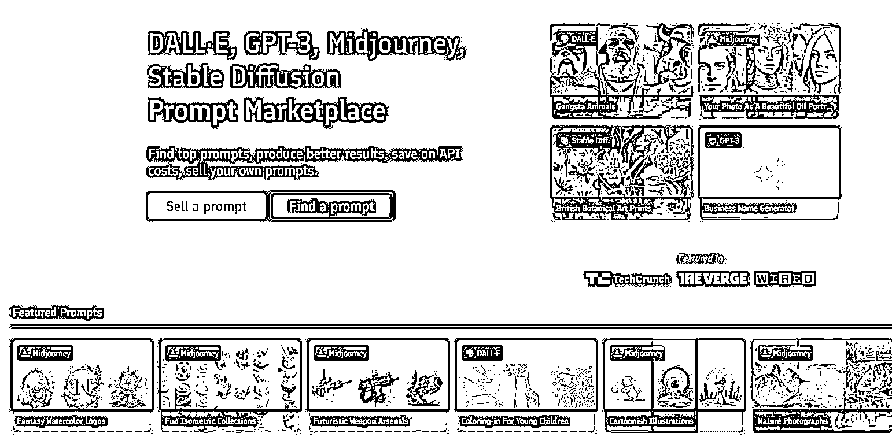

# 一组词最低1.9美元：海外提示词交易站

海外有个提示词交易站，买家和卖家都能进场：你可以挑现成的AI绘画关键词，也能把自己整理的词组上架出售。单组词门槛是1.9美元。

站内把关键词分成DALL·E、GPT-3、Midjourney、Stable Diffusion四类。另外，它还有风格类词汇可参考，方便你借画风思路，再自行撰写描述词。

入口：https://promptbase.com/

评论区：亦仁表示“中标，术值+1”，并提示：在上方 #星球栏目 专栏里点击 #中标，就能查看全部中标风向标。