# 首航AI绘画：赚到副业第一桶金，读懂利他

作者：巴菲｜2023-05-09

大家好，我是巴菲。白天是常年996的程序员，在社群里潜水快一年，算个不起眼的小白。第一次参加航海，我在15000人里排到第二，短视频账号涨粉过万。也正是在这次实战里，我发现赚钱很适合像我没有资源、没有人脉的人做副业，我的副业第一桶金就是这么来的。今天把这段经历梳理出来，送给还在岸上观望的朋友。

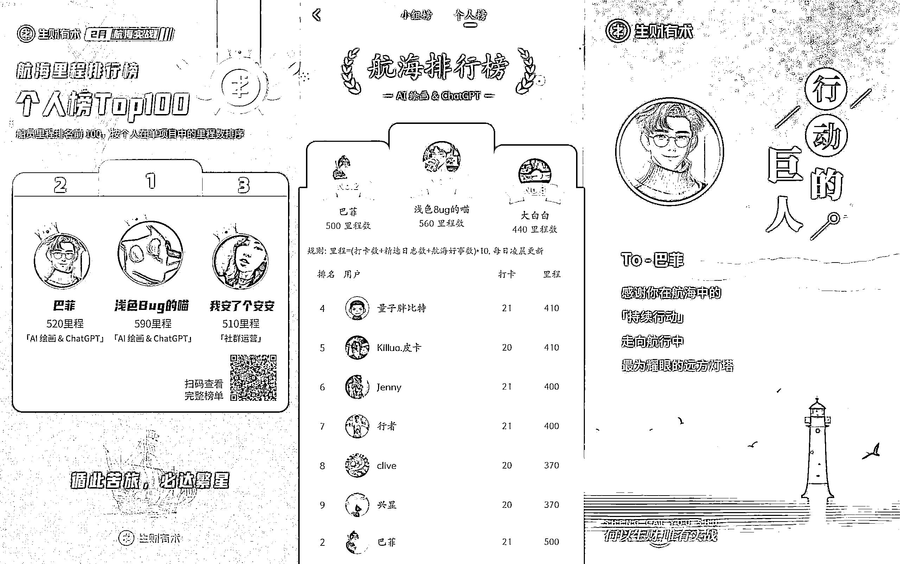
## 一、背景：收藏了几百篇干货，却没赚到一分钱

2022年4月18日，我加入赚钱。和许多圈友一样，我带着闯荡一番的心思，盼着在这里找到财富密码，最好能日进斗金、走上人生巅峰。

刚进来时，感觉遍地是机会，市面上常见的赚钱项目几乎都能找到。我甚至幻想同时启动三个项目，很快就能实现财富自由。看到一种赚钱方法，我就收藏一种。

结果收藏夹里堆了几百篇干货，我的收入还是零。

转机出现在2月航海开始前——鱼丸发来新一期航海的提醒。我盘算着，这已经是第六期最后一次航海，就算下一期不续费，也该下场体验一次实战，才算没白来赚钱。

于是，我抱着试一试的心态，报名了当时很火的AI绘画与ChatGPT方向。第一次参加航海，说不怕陌生环境是假的。进群一看，满屏ID都不认识；此前也没链接过圈友，作为完全陌生的小白，心里难免失落，不知道该怎么融进这个实战团体。发现大家像老朋友一样熟络，我只能强装镇定，小心发出第一条消息。可接下来21天，我竟慢慢成了群里最活跃的成员之一。

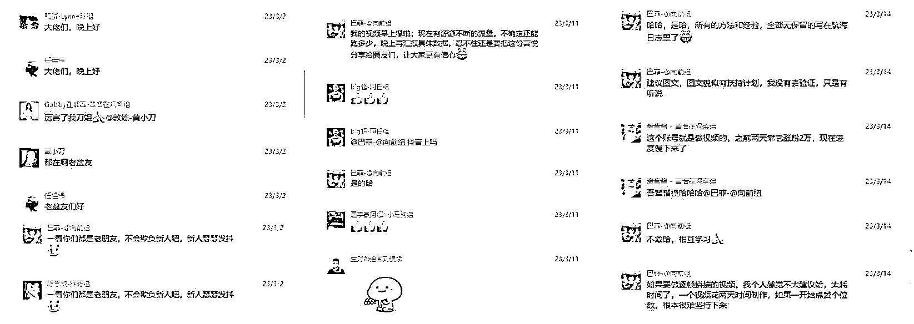
子安在开船仪式上提到，航海要抓住五件事：把实战手册读透、持续动手探索、遇到问题主动举手、别人有难热心解答、高频交流经验。这五句话，后来一直影响着我的行动。

## 二、实战涨粉：从零开始，把目标写进日志

航海第一天，我和多数人一样先啃手册。内容非常细，我看了整整一晚，最后决定抓重点：先挑自己感兴趣、又关键的知识学，很快便产出了第一张图。

航海日志模板有个设计很妙：末尾必须写下接下来的目标。为了逼自己一把，我在第一天日志里就立下flag——7天内在短视频平台发出第一条作品。

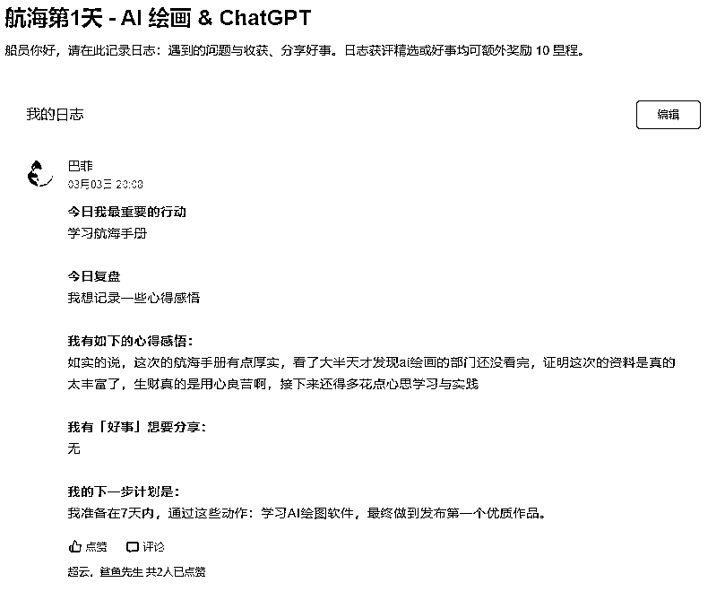
之后，所有动作都围着这个目标转。

第二天，天辉教练授权我们使用他分享的内容。我把它发到朋友圈，用小额收费的方式拉朋友一起学。

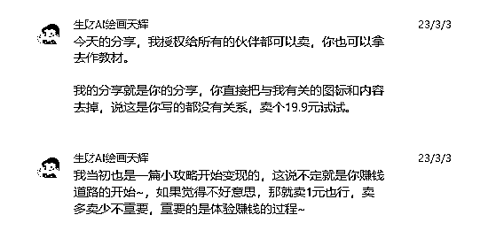
当晚我发了朋友圈，文案里用了“原价29.9元，前10名19.9元”的设计。第一天就卖出了几份，我也成了群里第一个靠快速执行拿到正反馈的人。

钱不多，但成功的甜头来得很快。我把这次行动经验发到群里，收获了不少圈友的称赞。

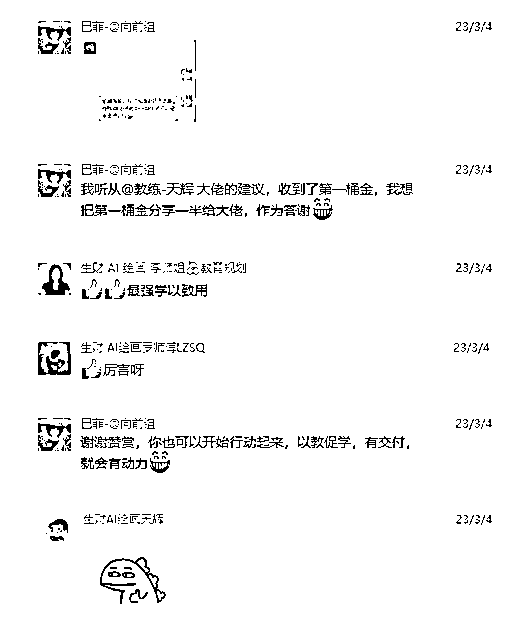
不少圈友因为我的执行力和愿意分享加了好友，这让我信心大增。当天，我也拿到了航海日志里的第一件“好事”。

做对别人有帮助的事，还能得到认可，这件事真的会让人上瘾。我因此更愿意学，也更愿意分享。

第三天，我的出图从最初质量不稳定，进步到能生成比较稳定的人物图。在我看来，这是不小的跨越。我把解决问题的过程写进航海日志，没想到又拿到了好事和精选。

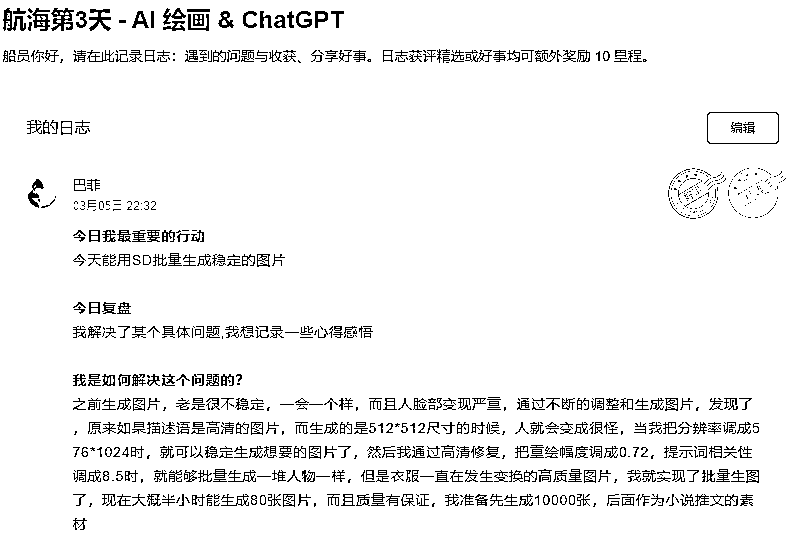
这让我再次意识到：每天积极行动、努力解决问题，遇到卡点就在群里求助，既能提升自己，也能帮到其他圈友，还会得到大家的认可。

从那以后，我每天钻研问题、把过程发到群里、再记录进作业。大部分航海日志都成了精选，称赞也越来越多。越分享越幸运，越分享越有收获——在利他的过程里，我的AI绘画技术和人脉一起长了出来。

第七天，我在抖音和📕同步更新了第一个作品，顺利完成第一个七天目标。

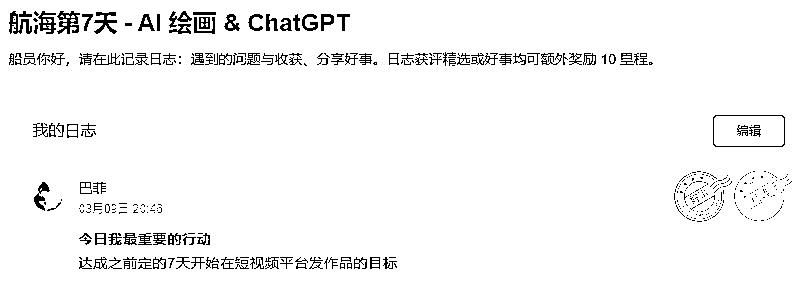 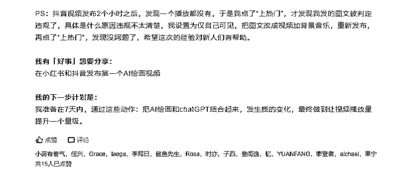
接着我定下第二个目标：再用七天，让抖音播放量上一个量级；到第九天，把这个量级具体成10万播放的小爆款。

可第一个作品发布24小时，只涨了个位数粉丝，点赞也寥寥。第二天我又发了两条，效果依旧不好，点赞还是个位数。连续三个作品没什么人看，确实打击人；其中一条还被判低质量违规，更让我受挫。但一想到目标，我只能告诉自己不能放弃。

我对图片质量其实有信心。毕竟不少圈友夸过好看，东西应该不会太差。我又去看抖音上同类型视频，别人播放量不错。排除作品质量问题后，我开始反思：自己和爆款到底差在哪？

我发现爆款视频的背景音乐听着很舒服，便想：能不能借来用？我按这个猜想，把爆款BGM拿来搭配自己的作品，看着挺顺眼，就抱着试试的心态发了出去。

惊喜的是，一天时间播放量跑到2万，涨粉1000。发现出了爆款后，我立刻用同样格式，一天连发三条。我的理解是乘胜追击：刷到爆款的人如果点进主页，一定还想看更多同类型内容。这样做有两个好处：一是让爆款带动新视频流量，二是让新视频带来更多关注，让用户相信关注我就能持续看到喜欢的视频。

到第十四天，10万播放的小目标没完成，最高一条是7.6万。虽有遗憾，但已经很接近了。

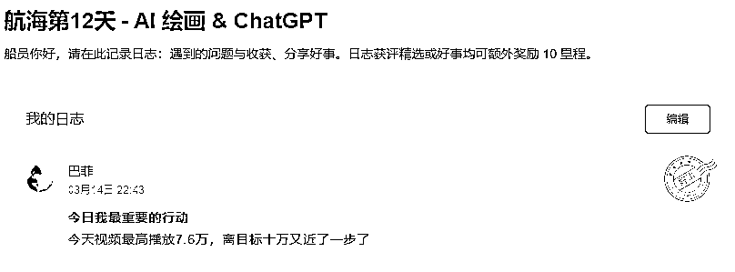
我开始琢磨下一个目标怎么定，才能有更大突破，真正跑通项目、做到变现。于是给自己定了新的七天任务：完成AI绘画入门课程大纲。

接下来几天，抖音继续快速涨粉，📕粉丝也突破1000。航海结束时，抖音8600粉，📕2700粉。

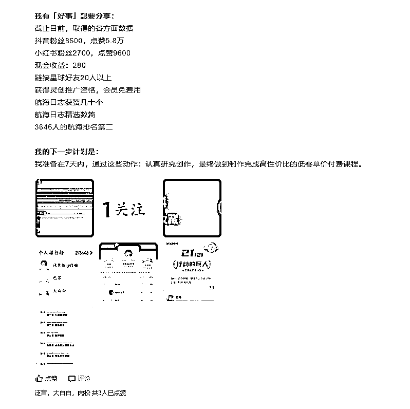 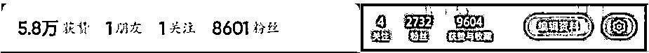
这段时间，我没有花太多精力迭代视频，只是保持同一种风格、相同频率，一天更新三条，把更多时间投进课程准备。

## 三、变现路径：从一张壁纸0.27元，到知识星球399元

下面说说，一个AI绘画零基础的人，怎么靠这次航海变现。

我用AI绘画软件生成的图片，在抖音做出爆款、涨了粉之后，就一直在找变现口。我的图偏好看壁纸类型，适合靠分享图片引流。航海手册里提到，可以导流到壁纸小程序变现，于是我通过抖音的“神图壁纸”小程序做转化。用户下载一张图，单价0.27元；开通会员则有几块钱。

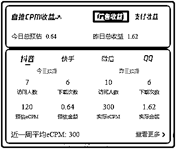
同时，我在灵创小程序看到有推广合作需求，抱着试试看的心态加了商务。对方要求短视频平台至少有5000粉，而我当时有6000多粉，刚好踩线，于是又多了一条变现渠道。

为了让抖音流量更值钱，也为了更好地推广灵创小程序，我调整了短视频变现策略：把对AI绘画感兴趣的粉丝引到👸号，再开发一套AI绘画入门课程，把课程和灵创小程序绑定。卖课的同时推广小程序，两条渠道一起变现。

方案想清楚后，我马上着手做课。

第一次开发课程，完全没经验。正好想起有优秀小伙伴在航海日志里分享过，可以让ChatGPT帮忙出课程提纲。我回去复习了一遍，改了几次，大纲就成型了。由于之前的ChatGPT账号已经不能用，当时调教的细节没找回来，我只简单贴一下大纲效果。大纲出来时，21天航海也快结束了。

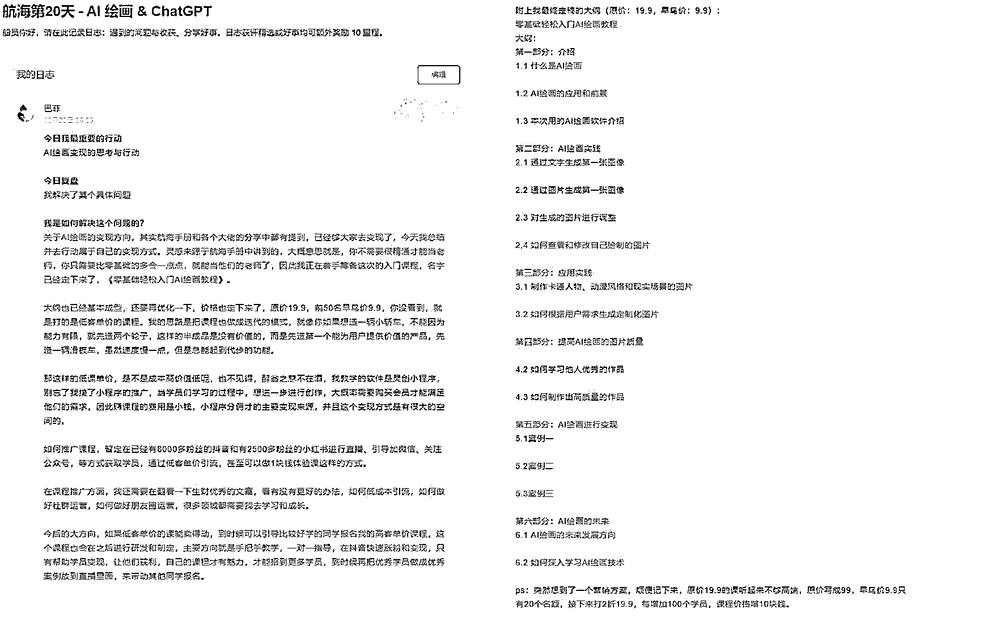
不过，航海结束并没有让我停下AI绘画变现的探索。

大纲有了，但课程质量还没底，时间不确定，方向也不清楚，更不知道上哪个平台。即便如此，我还是先在朋友圈做起了课程预售。因为航海期间我一直在朋友圈分享AI绘画成果，只靠一张简单的大纲宣传海报，第一天就卖出好几份。

也正因为“欠着客户一门课”，后面开发课程时遇到困难，我都没想过退缩。钱都收了，再辛苦也得咬牙把课做完。那阵子经常加班到晚上9点回家，再写课件、录视频到深夜12点多。

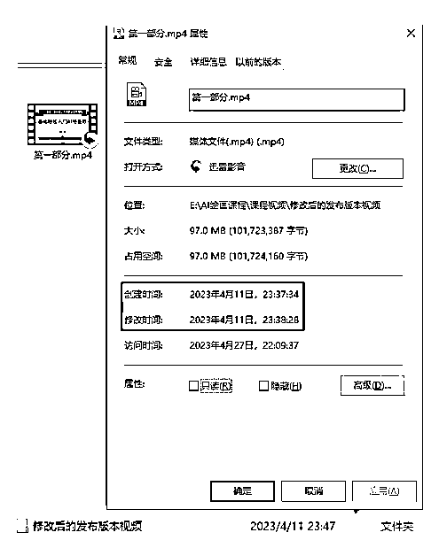
所以我的视频课程声音不大——怕说话太大声吵到家人和邻居。

做课过程一波三折。起初我不知道抖音默认字体不能商用，PPT默认字体也不能商用。课程都录好了，准备找平台上架时，还好群友嘟嘟知道我在做视频，特意发到群里提醒我。

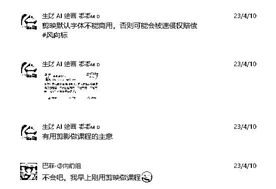
那一刻真是毁灭性打击：昨晚刚熬夜录完，今天又要重录。怪自己没提前做功课，心酸得想放弃；可想到钱已经收了，只能算了，重头再来。折腾一两天，我终于把商用字体换成免费字体。

找到平台上架后，审核了一天，商务告诉我：PPT里出现🛰️号和👸号信息，无法过审，需要修改。

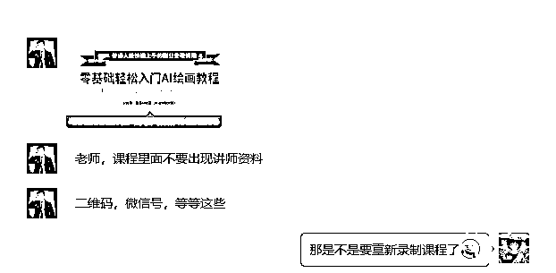
我这才意识到，自己把水印打在了每一页PPT上，又得重来一遍！离终点只差一步，只能再次通宵。想着好事多磨、希望就在眼前，我又打起精神。

所有视频录制完成后，我终于松了口气，能睡个安稳觉了。整个课程制作花了20天。上架平台第一天，算上预售，一共卖出20几份。

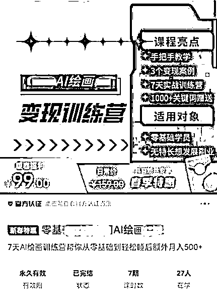
客单价不高，数量也不多，但我已经挺欣慰。

为了提升体验，我决定把课程做成7天训练营模式，每天布置作业，增强学员参与感。7天结束后，事实证明这个决定是对的：陪学员通过一次次作业看到进步，他们慢慢喜欢上了AI绘画。结营前，有同学问我有没有进阶课，可惜我没时间开发。

为了不浪费第一波转化流量，我当机立断，建了自己的知识星球，成功转化5位客单价399元的付费学员。

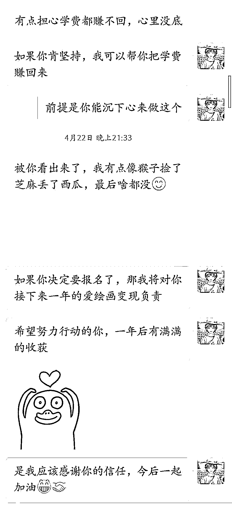
我的AI绘画变现路，就是这样一级小台阶一级小台阶往上爬：从单张壁纸0.27元，到知识星球付费用户399元。我还在继续规划，后面想推出999元、1999元甚至更高客单价的服务，用一对一指导帮学员通过AI绘画短视频变现。

## 四、航海环境：让我少走弯路的“外脑”

如果没参加这次航海，我不可能主动去学AI绘画。我一直觉得时间不够用，哪有空碰新领域。但这次航海，我跟着学完航海手册，也看高手分享、优秀航海日志，随时修正跑偏的方向，进步更省力、更快。

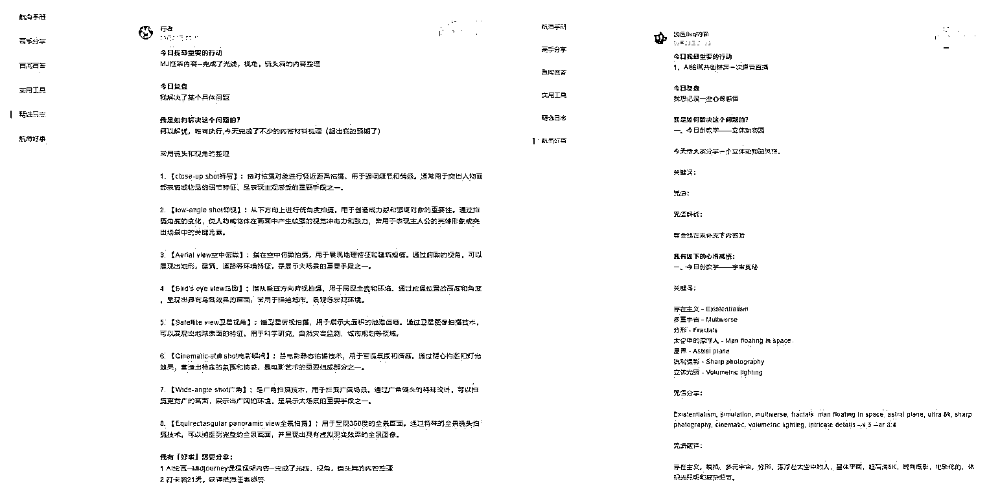
我每天都会翻精选日志，学大家分享的优质内容。怎么提升图片质量，是看精选分享受到的启发；怎么提高短视频播放量，是从别人的日志里学的；用ChatGPT出课程大纲，也是看小伙伴分享后自己用起来的。我的很多动作都和优秀伙伴的分享有关，成果也离不开他们利他的分享。

我的变现方法则来自航海手册的变现教程：里面写了几十种变现方式的详细操作，还分析了各自适用场景。我结合自己的情况，选了比较合适的一条路。

## 五、那些帮过我的人：利他不是口号

在赚钱，“利他”这个词经常被提起。以前听没什么感觉，这次发生在自己身上，才特别有感触。

刚进航海群时，我一个认识的朋友都没有。可正是这群素未谋面的人，给了我非常多帮助。

首先要感谢子西和天辉，他们对我帮助极大。子西是我的第一位贵人，我们很聊得来。她懂命理，涉猎也广，筛选和总结信息的能力很强。她分享了很多做课程、运营朋友圈和社群的方法，还教我如何链接更多大佬、向大佬请教。正是在她的帮助和鼓励下，我才有机会得到其他大佬的帮助。

天辉教练同样帮了我大忙。第一次带着课程大纲去请教时，他很耐心地听我讲完，再给出建议和指导，帮我补上课程不足。卖课前，他又教我打造个人朋友圈IP，靠稳定输出增加课程曝光，还教我朋友圈运营。入门训练营结营后，学员要转到知识星球服务时，他又给了很好的方案，帮我顺利完成付费转化。

感谢领队何伟建。航海期间他一直鼓励我们多实战。看我认真记录日志，他建议我持续学习和分享，冲击排行榜。那时我才知道，自己已经进了AI绘画排行榜前十。这让我更有斗志去冲更高目标，最后拿到AI绘画第二名，同时也是航海全榜第二名。

感谢饼公子。向他请教时交流很愉快，他帮我解开不少疑惑，让我做课程的信念更坚定。

感谢嘟嘟MD。我们很聊得来，经常讨论问题、相互鼓励；课程用到付费字体时，他第一时间帮我纠正。

感谢一三，指导我课程要设置体验课、核心课，还教我如何转化。

感谢Loiy卢艺，给我课程售卖技巧的建议：用具体数字呈现，宣传时让课程看起来物超所值，才更有吸引力。

感谢组长向前，一直给我很大鼓励。

感谢排行榜第一的浅色bug的喵。虽然我们没交流过，但看他分享的那么多优秀航海日志，我学到很多；也感到自己的技术和他还有差距，这反而成了我持续学习的动力。

感谢和风，和他交流给了我很多创作灵感。

也感谢同群一起实战的圈友。我们一起努力、相互帮助、互相成就。

## 六、写在最后：把分享变成放大价值

这次航海实战，无论物质还是精神，我都收获很多。

从AI绘画零基础小白，到做出入门课程训练营，再到成为AI绘画联盟合伙人，我迈出了出圈的第一步。更多人认识了我，也给了我很多机会。希望这次分享能实实在在帮到还没参加过航海的小白。

送人玫瑰，手留余香。一路走来，我受到太多大佬的帮助和指导；同样，我也希望尽自己微薄之力，去帮更多需要帮助的新人。

我已经申请挑战5月AI绘画航海的教练和志愿者。如果你也对AI绘画感兴趣，我们到时候见；如果你对航海或AI绘画有疑问，欢迎来链接交流，一起龙哥盟。

最后，要感谢那个上班996、却在航海21天里每天下班后至少死磕3小时实战的自己；感谢课程制作中一次次出错也从没放弃的自己；感谢敢于每天分享经验的自己。

我也是严重的社恐患者，但我深知：默默行动、独享成果，没办法放大行动的价值。低调做人，高调做事。在航海里高调分享经验成果，帮助别人，也让自己被看见。生活和工作又何尝不是如此？一次次分享中成长、积累人脉，你会收获意想不到的东西。

从今天起，一起高调行动，一起龙哥盟！

评论区里，有同为996的程序员来加V；也有人说这篇分享给即将首次出海的人做了及时扫盲。我回复：现在正是航海报名期，我在AI绘画船上等你，一起冲。何伟建、梁辰、一次就好等朋友也留言点赞。