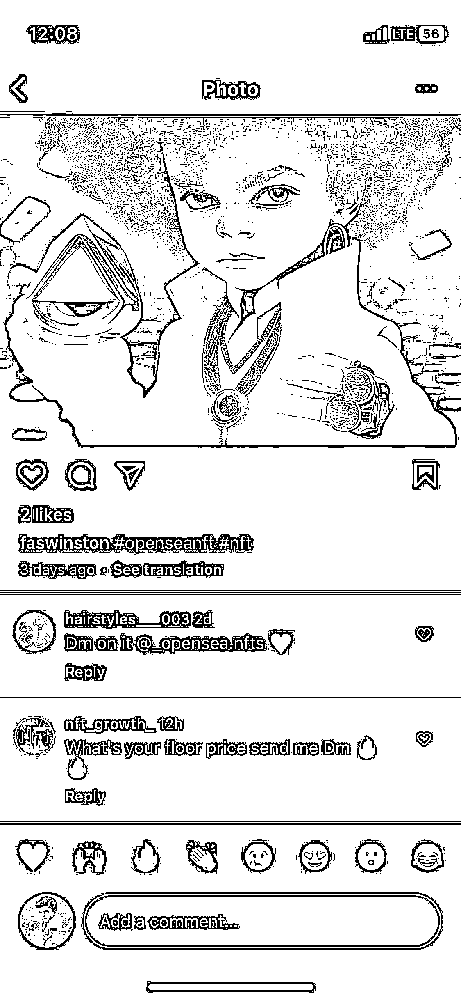
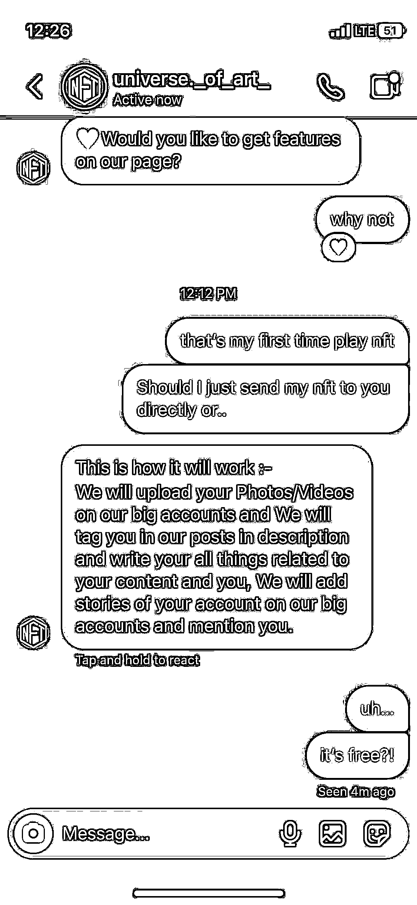
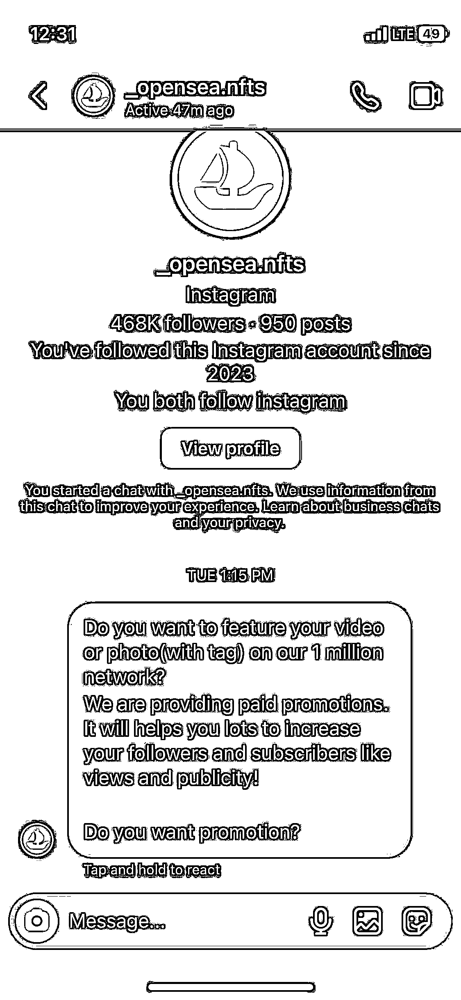
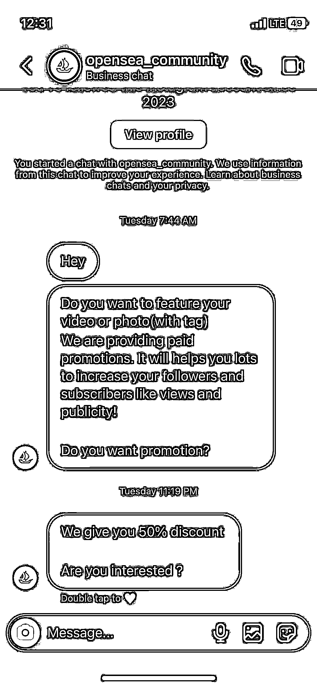
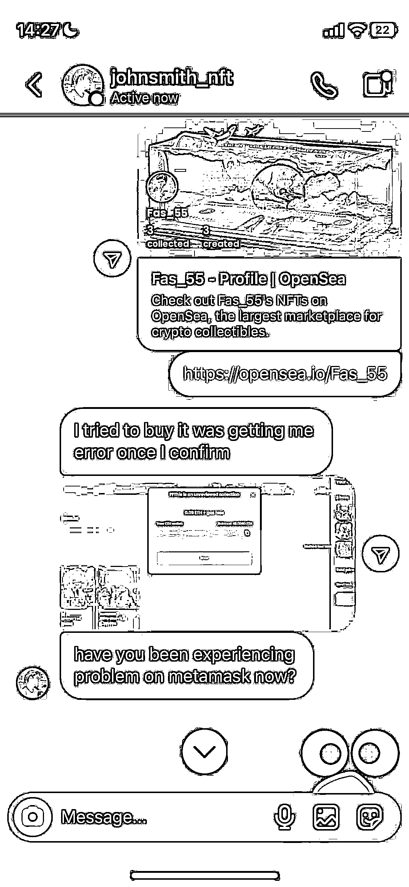

# (35 赞) 想靠AI绘画做NFT割韭菜？先看看这个骗局

打算用AI生成的画作铸造NFT去卖钱的人，真该留个心眼。很多人总觉得自己掌握了新技术，就能随意操作，还认定旁人想不到，可往往一不留神就踩进陷阱。

今天，我一位朋友就吃了亏。我站在骗子的角度，把套路重新捋了一遍：

1. 去推特上物色容易上钩的目标，假装高价收购NFT，先把人的情绪调动起来，降低心理防备。
2. 提前诱导对方点击自己的链接，或者登录自己的网站，从而偷到小狐狸钱包的密码。
3. 随后声称账号出了状况，并强调这是正常现象，还拿出Opensea与自己此前的沟通截图作证明，要求对方先充0.2ETH作为保证金，自己才能把款转过去。
4. 受害者一旦充进0.2ETH，钱马上被转走，因为账号早已被盗。
5. 接着继续解释这仍是正常流程，打感情牌并作出保证，说再补0.2ETH就能彻底解决问题，完成第二次收割。

NFT的价值，很大程度上并不由图像本身决定，更关键的是项目方、模式、信任机制和热度这些东西。你本来就没有名气，别人凭什么来买你的画？

AI绘画听起来很厉害，但说白了门槛非常低。写几段prompt，大多数人稍微研究一下都能做。既然这样，这件事就谈不上稀缺性。

所以，怎么能指望单靠AI绘画直接变现，或者做成NFT就轻松赚钱呢？AI绘画眼下只是比较新，存在信息门槛，而且训练模型大多基于英文语料，因此还有地域门槛。

正因如此，不少人能卖课程教别人怎么作画。可实际上，等信息差慢慢缩小、基于中文语料的模型发展起来后，根本不需要别人来教，甚至不用怎么学，就像吃饭喝水一样自然。

这次朋友只损失了2k，没酿成大祸。但这件事也提醒我，人性的贪婪很容易被利用，每个人都得提高警惕。

别觉得谁会那么傻。有时候不是你不傻，而是给你的刺激还不足以让你犯傻而已。

保持高度警惕和思考🤔

    

评论区：

龙哥：命中，术值+1。  
在上方专栏点击 #中标，可查看所有中标风向标。