# 出海十年：把货卖对的七个关键

在跨境圈，把日常动作压缩成挑款、上传、打折，是很多人的惯性路径。可走着走着就会卡住。做了十年出海生意的@拓跋勇，在「生财合伙人」里给出一套不太一样的答案。他先把整件事缩成一句：先圈定足够规模且精准的人群，再借过硬的品牌资产与视觉表达，把合适商品送到这些人眼前。拆开看是七块：人群、产品、内容、品牌、视觉、传播、价值。

### 一、人群先行

平台店也好，独立站也罢，开局先答一道题：以后靠谁吃饭？这道题答不好，后面的动作大概率白费。不少国内团队却反过来，先捧出商品，跑了一圈才补用户课。如今获客成本节节高，人群没定就开卖，推广预算很容易打水漂。反过来，人群清晰，往下找流量池、内容口子才有坐标。十万泛人群里筛出少量真正需要你的人，与在五千名对口用户中找出三百位愿意掏钱的人，投入和产出完全两码事。十年下来我越发笃定：行业可以不同，先定人群这一步不能省，它让目标和路径都变清楚。

早些年出海零售吃到流量便宜的红利，卖家少、同款少，商品稍用心就能起量。现在多数品类获客成本高得吓人，盲目冲失败概率很大。更麻烦的是，货权在卖家手上，卖不动时库存价值可能瞬间归零。因此，动手前先圈定服务对象。

### 二、产品：为具体问题而生

很多人理解产品就是追热点。八九成企业把拉数据叫选品，那只是很浅的一层。更关键的是：某类人的某个麻烦，由你的货来解决。

举例，新冠疫情自2019年底暴发后，居家时间变长，室内消费品销量往上走。人闷在屋里容易烦躁无聊，不少行业都能据此改商品。我熟悉的北美狩猎射击赛道，过去训练在室外靶场、狩猎在户外，疫情后只能在家。我们于是做了一款能在家练射击的器材，并配套练习课程与测评方案。老玩家和新手都能借它消磨时间、提升技术。这就是用明确商品回应明确人群的实际难题。

若你的货可替代性太强、对消费者可有可无，机会通常不大。最危险的是想一款通吃所有需求：看着美，一旦大厂入场，淘汰往往很快。即时通讯工具不是腾讯或FB首创，最终市场却被他们拿走，道理相同：盘子越大，对手越多。个人护理人人要用，可真正杀出来极难，结局常是被巨头收编或被挤出。因此，做商品要盯住细分人群的细分问题，低调生长。电影里有句词：悄悄的进村，打枪的不要。

### 三、内容：把商品讲成故事

我的长期判断是：中国团队把货做硬不难，难的是持续产出好内容。出海企业普遍卡在“有货、没话”：商品设计改良相对可控，像套公式，方法对了结果八九不离十；内容却没那么听话。许多团队商品上线后才临时抱佛脚，推广组合拳打完，不是爆就是死。硬广的转化通常不好看，缺内容生产和分发能力，推广预算会漏掉不少。

去年海外短视频平台带火了紧身裤，TikTok 上那阵 Leggings 风潮把多个电商渠道的销量推得离谱。普通团队很难复制，症结就在没有规模化内容产能。新团队不具备内容制作力，这不必放弃，反而可能是与同行拉开距离的切口。

我们赛道有几家美国公司，幕后是海外华人。他们借本地语言和地域优势，于当地找内容公司，把商品图、视频、博客稿、新闻通稿、网站软文、社媒贴文素材一并搭起来。货未必比我们强，但内容能抓住目标客，销售结果更亮眼。Savior Equipment 常被我拿来举例：商品本身不差，若没有内容打底，关注度不会那么高。

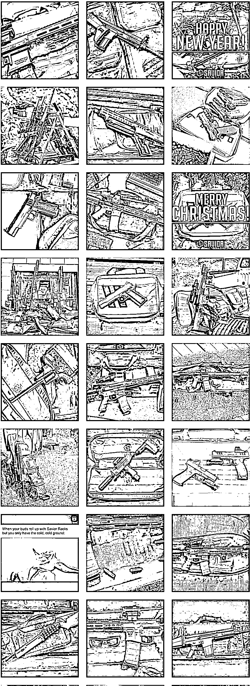

这里要补一句：行业讲分工，一个团队很难包打天下。你懂商品，内容可能是短板。与其自建内容组或从零学，更有效的路径是找靠谱伙伴，定合理方案，分阶段推进。我建议出海团队内部设一个岗位，专盯本土资源协调，效率会快很多，结果也远胜闭门硬扛。

### 四、品牌：让名字被记住

人群、货、内容都齐了，品牌要跟上。严格说，品牌应排在内容前面，它干的事是占住用户记忆。

我们踩过坑：曾做出一款很受欢迎的货，几乎零差评。推广时只顾夸商品好，结果客户记得东西，却记不住牌子，因为当时没有品牌意识。一年后市场冒出同款，连包装都照搬，价格只有我们一半。尴尬来了：老客户掉头去买那家，我们开发者只能看着。若早点有品牌和知识产权布局，事情不会这样。

此后我们下决心补品牌课，因为只有品牌能让生意活得更久。商标只是起点，背后工作很多。第一步是品牌故事：说清你是谁、为何做、能替客户解决什么。

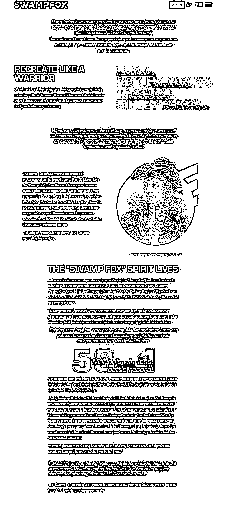

这些内容在后续渠道合作中很关键。除此之外，还要有视觉识别体系与核心卖点，最终目标是让消费者记得住。视觉识别涵盖LOGO、主色、字体、包装、基础Banner、Slogan，以及展示形象的品牌官网。

### 五、视觉：不同场景不同表达

视觉其实是内容的一部分，也是我认为更难的一块。国内团队常按本土审美做站，颜色越多越热闹；欧美用户偏好干净利落。亚马逊这类巨头的商品图，用国内眼光看甚至有点土，但海外消费者买账，因为他们要一眼看清商品原貌。

到了推广场景，逻辑又变。有些人图省事，同一款货只做一套视觉。优秀品牌通常分三套：自有阵地、平台规范、宣发渠道。官网与平台店铺用图有差别，媒体和内容渠道又是另一套。平台图服务识别与成交，宣传图负责吸引注意、促成转化。平台可以用白底图，渠道里场景化图片更容易打动人。

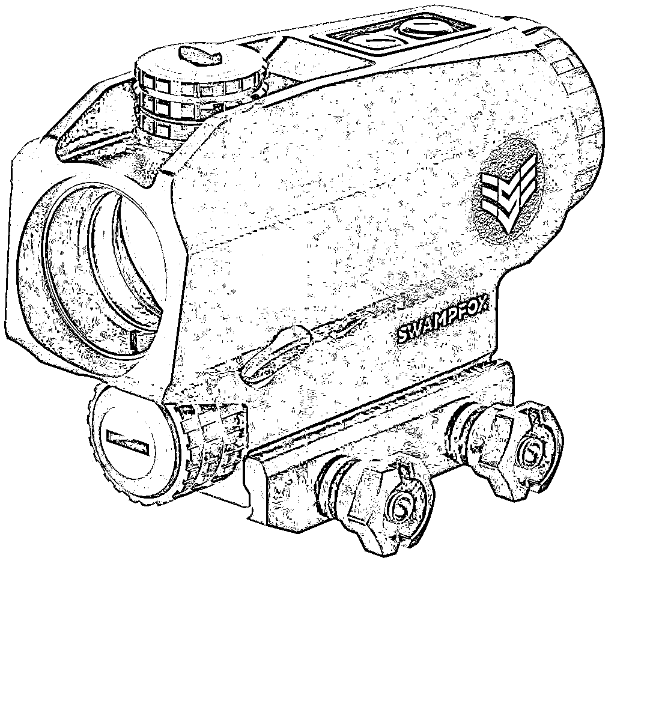

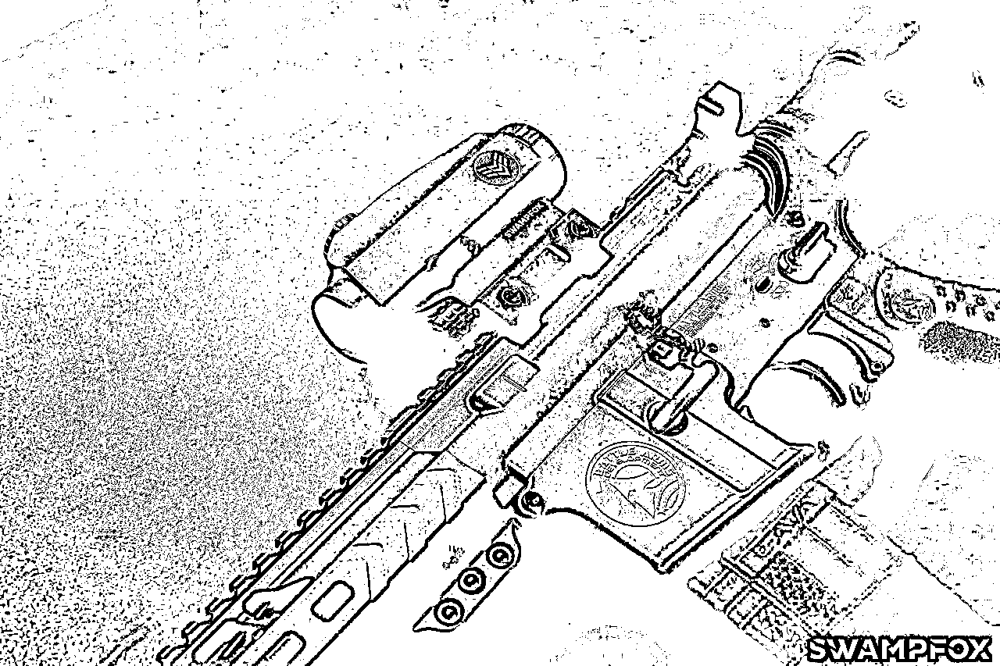

假如你是内容站编辑，选哪张配图？答案是全都要。场景图能当Banner、能讲故事，纯商品图让访客快速认清东西，二者都不能少。现实是多数中国出海企业只做了前半段，后半段缺失。

视觉不只指商品本身，还包括详情页、网站形象、店铺形象，少一个都不行。获客像漏斗：先让更多目标客看见，再让感兴趣的人进页面，最后推动有购买意向的人下单。每个环节该用的视觉元素不同，不能一套模板走到底。

### 六、传播：先点燃专业圈

内容、品牌、视觉之外，传播是九成以上公司的软肋。很多人把推广等同于促销或找达人带货，即便合作也只会打折。这样来的客户未必忠诚，甚至未必真实。翻翻订单，有多少是被低价和折扣拉来的？真要做营销，先弄懂信息怎样流动。

我总结过一个零售打法：先让专业用户形成口碑，再借他们向大众一圈圈扩散。普通消费者有羊群心理，爱跟着领头者走。有影响力的媒体、网红号召力自上而下。聪明的品牌会先请专业圈体验商品，再用他们的影响完成转化。

Anker 就是一个样本：前年年中与消费电子测评大V Unbox Therapy 合作一期视频

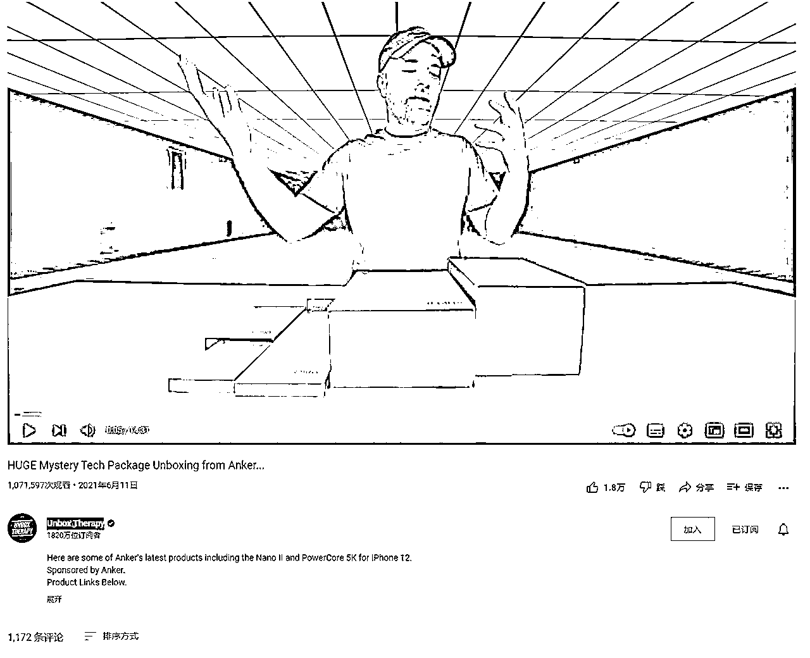

目前播放约110万。换算成电商流量，按最低1美元获客成本也要近700万元人民币。视频平台数据与电商口径不同，但品牌和商品短期获得有效曝光后，会在不少人心里种下印象。有人看视频当下下单，有人当时没买却记住了品牌和它能解决什么。等需求出现，这个记忆点会被唤醒，选择概率不低。

用户特征清晰的内容站、新闻媒体、网红达人、测评机构，都是好渠道。做运营很难绕开它们，除非只打算一辈子做促销。人群越清晰，渠道往往越集中。锁定目标客后，要花力气把渠道梳理出来并打通，我把它叫作搭建品牌与用户之间的桥。识别渠道、用合适话术开发同样重要。给个小建议：品牌和商品定下来后，请专业写手整理邮件模板、电话沟通话术等材料，资源渠道拿得够，失败概率会降下来。

### 七、价值：站在中间，补上缺口

价值这件事想的人不多，但它决定一门生意能做多久、一条路能走多远。随便创个牌子、推款货就能成功的时代过去了。真正让企业走得稳的，是补上用户某个未被满足的需求。

以我们行业为例：头部品牌溢价高，普通消费者够不着；底部卖家靠低价抢客，商品质量却未必达标。我们因此选中间路线，做腰部企业，守住品质，把价格压到用户能承受的区间。如果你所在赛道没有这样的空位，我建议慎入。没有谁能在现有格局里一夜冲到头部；若你做的事和底层玩家没差别，市场未必需要你。

为验证这套判断，我拆一个户外品牌Savior Equipment的成长过程。

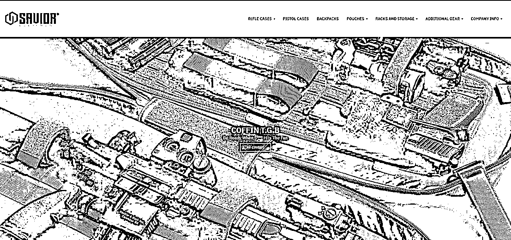

Savior Equipment 做射击周边，通俗说是枪包和支架，2017年下半年诞生。先看商标注册情况。

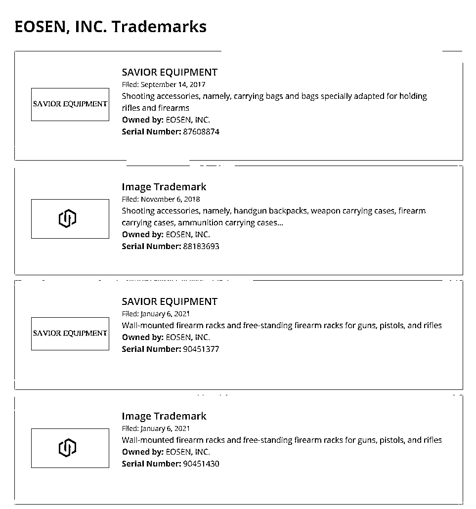

这家公司起初并不卖这类货，团队也很小。我知道它，是因为公司恰好在我一位美国朋友家附近。三位华人青年在美国发现，市面上缺少质量过硬的步枪枪包；美国又是合法持枪国家，持枪人群庞大。几人一合计，注册商标，做起枪包。

我在谷歌搜这个品牌，最早出现在一个射击论坛：他们自己注册账号发帖介绍商品，评论区几乎清一色质疑，说看着不怎么样、是不是劣质中国货。转折来自我那位美国朋友。他是美国步枪协会认证射击教练，住得近，双方常讨论怎样把枪包改得更好用。第一款正式商品见下图：

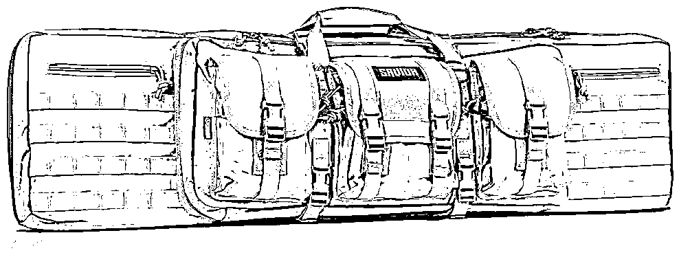

该商品2017年11月17日在电商平台开售。开发阶段有行业重度玩家参与设计和改良，一上市就在射击圈引起轰动。有人指点，他们把发售前宣传做到很足，往下看便知。

他们先找射击圈小有名气的内容公司offensivegroup，负责商品拍摄、视频制作、社媒内容生产和托管。

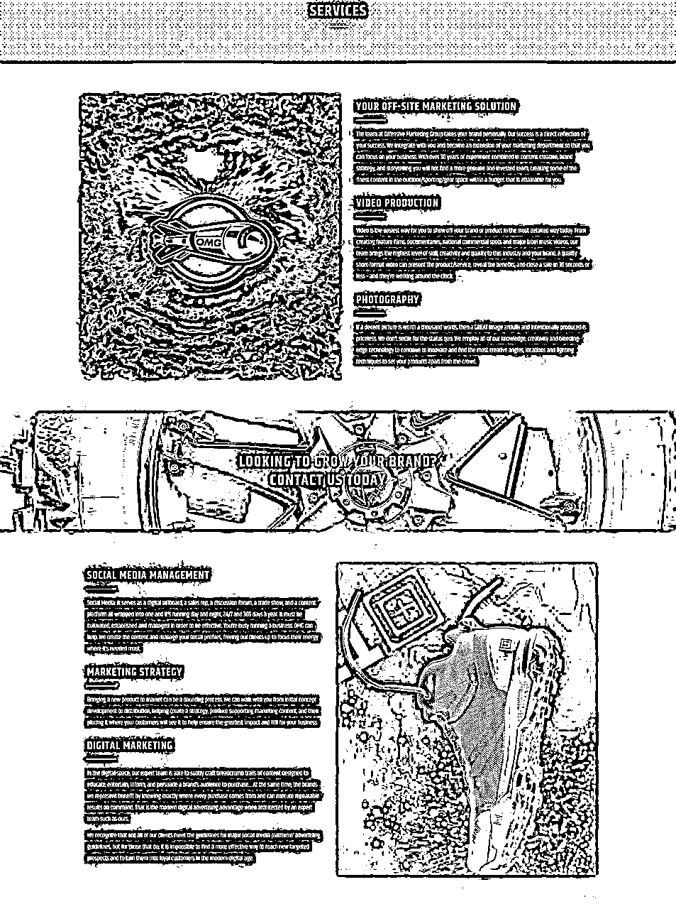

这家公司名气不大，却服务过不少户外战术装备品牌，代表性客户是5.11战术服饰。随后，这个当时没名气的小牌子又与leviathangroupllc合作。

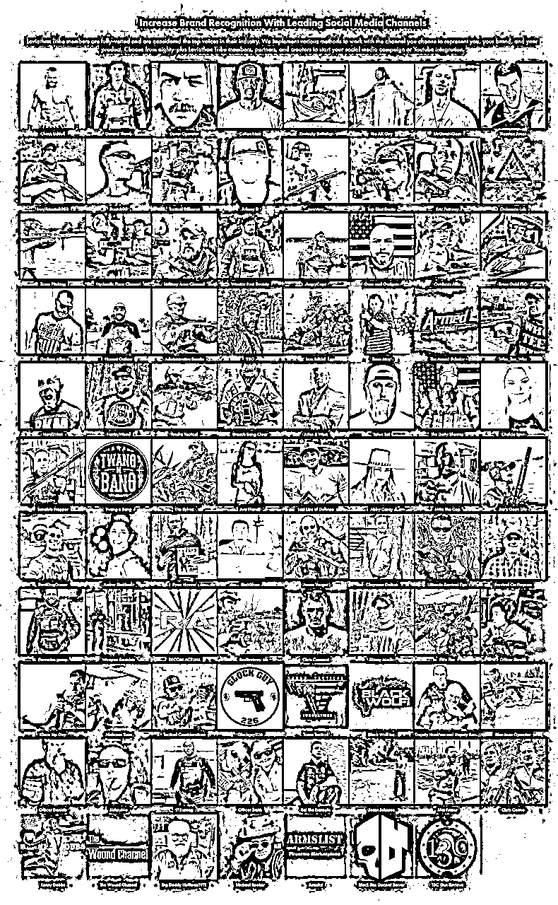

对方同样低调，却在射击领域签了上百位YouTube网红。好商品、好制作、好传播叠在一起，品牌很快在专业圈掀起风潮，有影响力的网红和教练几乎人手一只他家枪包。借着这波传播，他们又在专业媒体、网站、论坛铺了大量内容。感兴趣可搜Savior Equipment forum，结果如下。

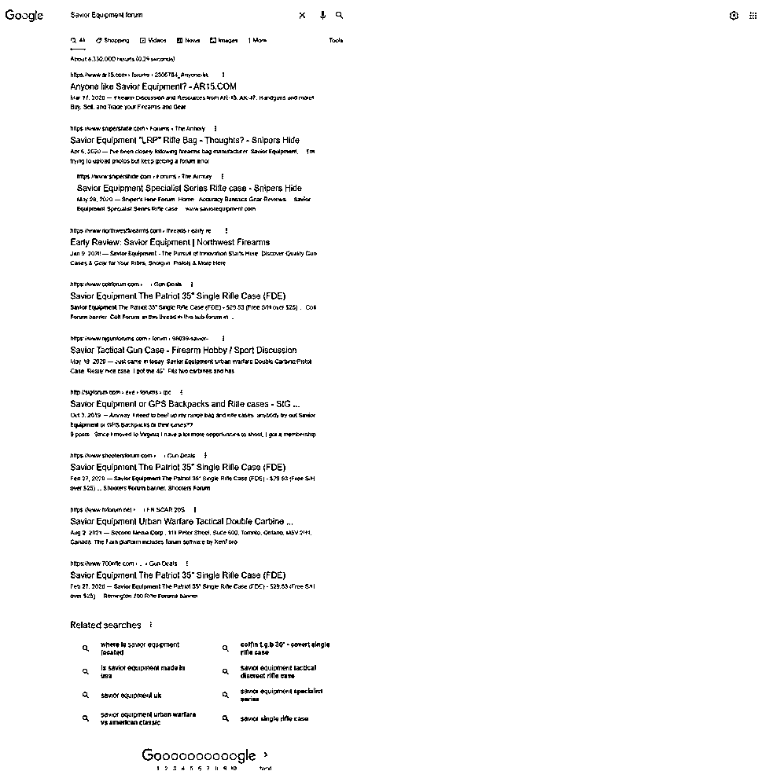

这家不到十人的公司，后来做到一年4000万利润。说到底，跨境这门生意，功夫远在挑货、上架和打折之外。

# 小众装备品牌，凭什么长期霸榜？

不少论坛里，这个品牌的话题一直没断过。用户的注意力在哪里，品牌势能就在哪里；注意力如果能持续聚拢，最后就会变成实打实的订单。结果，产品登陆亚马逊仅三个月就冲到类目榜首，从2018年守到今天，还没有谁能把这个纪录掀翻。它的定价高过同类不少，用户照样买单，原因并不复杂：

一是设计、功能和品质都经得起检验；二是 **savior equipment** 有一套完整的品牌概念；三是专业圈子里口碑极硬；四是产品信息覆盖面很宽。

后面的走势更能说明问题：一年后，同系列的其他产品上线，很快又卖爆；两年后，产品线从步枪枪包延伸到手枪枪包，热度依旧；2019年切入步枪支架，还是爆；2021年再做手枪支架，照样卖爆。

与此同时，卖货路径也在扩：起先依赖亚马逊，随后自建品牌官网，再往后铺到线下30多家经销商。现在去查，亚马逊、沃尔玛、eBay、好市多、新蛋都在卖他们的产品。这些动作背后，正好对应前面提到的思路：聚焦一个细分行业，锁定一类明确受众，把好产品、好品牌形象、优质内容和强传播力组合起来长期深耕，最终就能蹚出适合自己的长期路线。

2020年我和那位美国朋友聊起他们，他说公司在2019年不到十人，却做出了4000多万元的年利润。

更有意思的是，去年为了把这个品牌研究透，我请朋友在美国下单，再把产品空运回来。有点意外的是，顺着供应链往下挖，我发现合作工厂就在广州。等实物到手，我才真正理解用户为什么那么上头：从功能布局到材料选择再到细节打磨，都让人挑不出毛病。比如，外包装盒内壁印着靶纸纹样，顾客拆箱后就能把盒子摊开当靶纸，没有一丁点冗余设计。

回头看，无论偶然还是必然，他们切入的是国内多数企业并不熟悉的赛道，却自带天然优势：目标用户清楚，资源渠道也清楚。更关键的是，他们清楚自己的短板，愿意借力，主动找专业圈的人帮忙，后面的增长才顺理成章。把一类用户服务透，把产品做好，把品牌立住，把传播做透——这就是他们跑出来的经验。

其实不少行业都值得按这个思路重做一遍：母婴、垂钓装备、骑行露营、宠物用品，甚至游戏办公。特定场景里的特定需求，远比想象中多。要做的是先圈定服务对象和行业，再挖透需求，配齐内容生产资源与传播渠道，最后用品牌把各环节串起来。如果还没感觉，建议认真拆一拆宠物用品品牌 **BarkBox** 的案例，看完会发现，真正的运营和营销远不是选品、上架、促销这么简单。

另外，品牌出海还有不少坑和机会，比如优势怎么守住、产品怎么改造、产品线怎么搭得有效、发展节奏怎么保持健康。内容太多，这里不展开。感兴趣可以点赞留言；点赞过188，我再接着聊其他内容。

最后，感谢生财团队的邀请。我是拓跋勇，在跨境行业摸爬滚打十年。

P.S. 如果你也想在生财有术专栏分享自己的经验和认知，可以点击链接 http://form.shengcaiyoushu.com/f/HA1G1g 填写表单。我们会陆续邀请有赚钱相关经验和案例的嘉宾来分享。已经填过表单的话，忽略这条即可。