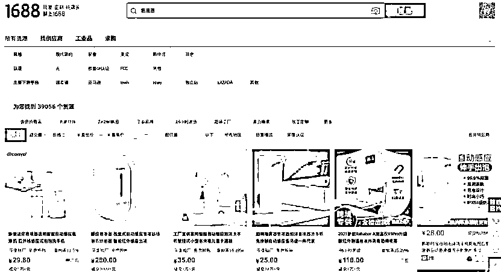
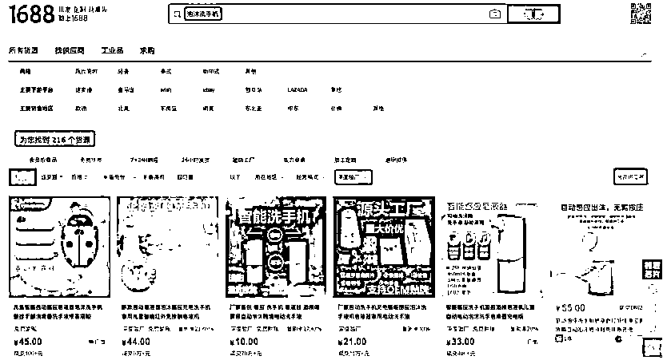
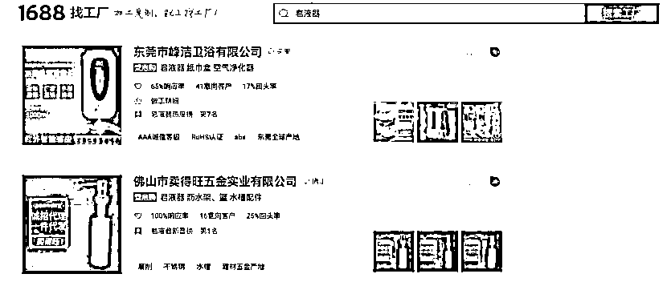
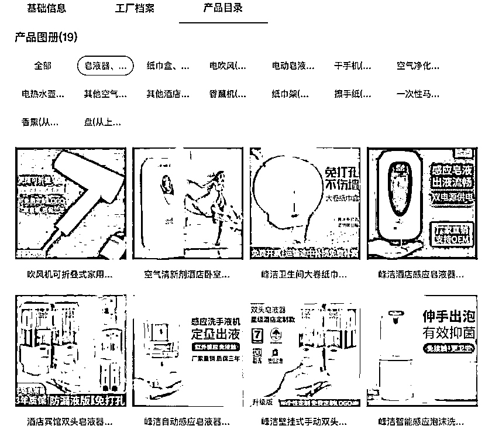

# 先跑量，再做款：亚马逊产品进阶实战

很多卖家一上亚马逊就想做独家款，觉得只有差异化才有出路。但真做起来会发现，开私模的投入不轻：钱压得多、交期长、首批风险也高。要是类目本身有足够深度，而手里又没有供应链，更稳妥的顺序其实是先拿公版货试市场，跑出感觉后再往专属款走。这个路径不只对亚马逊成立，换到别的电商渠道也值得借鉴。

今天请到的分享者@Bryce，有四年跨境经历，早年负责过有棵树的主管岗位，摸过十多个平台；后来到远古科技带新平台团队、做项目策划，参与过2019年国内蓝牙耳机出口量第一的目标，还在法国fnac把月销售做到百万元人民币以上。自己创业后，他在某个类目里赚到过180W+利润，也沉淀了不错的现金流。下面用五分钟把他的打法拆开讲。

目录
一、选品如何起步
二、工厂如何甄别
三、公版货的机会与雷区
四、限定专属款：门槛、好处与短板
五、包销专属款怎么谈
六、联合开发模具怎么落地
七、我的实操复盘
八、收尾总结

---正文---

我是Bryce，自己在亚马逊上摸爬滚打两年。先交代一句：真正下场之前，我没有亚马逊实操经历。这个渠道门槛偏高，货得先压到海外仓，销售节奏和规则理解也比一般平台更吃功夫。不过它的优势也突出：站内流量足、类目挖得深、仓配体系成熟。对已经有行业积累、又拿得出启动资金的人来说，做自有品牌反而更有空间。

一、选品如何起步

**1. 蓝海方向**
可以先读Seven老师那组文章：
- https://wx.zsxq.com/dweb2/index/topic_detail/241155558258851
- https://wx.zsxq.com/dweb2/index/topic_detail/421144845824518

这两篇主要讲，怎样在细分赛道里从零做出别人没有的产品。对已经有一定运营底子的团队，这是打产品护城河的第一块砖，也是最要紧的一步。
但新手往往两头受困：一边是经验少、挖需求的能力弱，面对庞杂品类不知道从哪下手；另一边是蓝海选品整套动作跑完常常要三到六个月，再把物流和销售周期叠上去，回款速度很容易低于预期。

**2. 红海方向**
可以看小马丁那篇选品思路：
- https://articles.zsxq.com/id_mrzguwk55xw1.html

无论你是从过去的运营经验里找线索，还是被近期行业热点带到某个产品上，红海选品都说明这个类目已经有人挖过，只是你判断它还有钱可赚。

选完品，下一步就是看工厂。

二、工厂如何甄别

拿1688上日本站曾经卖得不错的皂液器做例子。

**1. 供货方类型**
代理商：自己不办厂，店铺里往往铺着十几个小类，报价高低不一。
组装工厂：强项是整体结构设计，但芯片方案、外观模具多半从别家采购，性质接近代工。
产研一体工厂：也就是ODM，手里握着一部分或全部方案专利，技术上更能自己说了算。

**2. 搜索词**
平台上看到的名字常常是直译，工厂内部叫法未必一样。拿现有词去搜，再顺藤摸瓜找常用别名，能少漏掉关键产品。
比如搜皂液器时，系统会把“皂液器”和“洗手机”认作同一类词并标红，所以“洗手机”也要试，搜索面才打得开。

**1）按产品找工厂**
直接在首页搜，进的是货源模式，满屏都是货。再按需求把条件收窄，挑中产品下单。
以“泡沫洗手机”为例：
- 在深度认证里勾深度验厂，再选合并供应商，大部分小代理会被筛掉。
- 价格区间、所在地区都可以按需加条件。

**2）按工厂找产品**
换到首页的找工厂入口，输入关键词，就进入工厂模式。
- 品类排行榜能看热门厂，但要留意有些位置是花钱刷上去的。
- 点开厂名，详情页里能看到工厂档案和产品目录。

**3）拿样**
把产品横向比一遍，挑3—5款合适的。下单时一般有起订要求，常见是至少2个，再用阿里旺旺找卖家改价、安排样品。

**4）跑厂**
样品比过之后，再带着问题去实地看：
- 交期怎么排、质检按什么标准、海外认证和专利有没有。
- 大货起订量多少、首批价格怎么算。
- 返单后能降多少、账期能不能谈。

三、公版货的机会与雷区

选完品、看完厂，接下来就会碰到最常见的公版产品。下面说说怎么从公版往专属款过渡。

**1. 公版货的机会**
公模是工厂把模具开好之后，谁都可以买它生产出来的货。买来再卖，通常叫现货模式。
现货模式的短板很明显：生命周期不长、跟卖的人多、竞争也激烈。但对刚入场的卖家，它依然是上手亚马逊的好入口，原因有四：
**1）试单压力小**
公版货常常就是用来探路的。找代理商或工厂拿很少的量也行，两三百件通常谈得下来。
**2）报价容易比较**
行情不熟的时候，公版价格很有参考意义。一个模具有一堆代理在卖，爆款模具甚至几家组装厂同时做，横向比价很方便。
**3）现货好等**
私模动不动一个月起步，公版货因为参与卖家多、出货量大，供应商手里常备着两三千件；就算没现货，排产也多在五到十天。
**4）链接寿命短**
链接活得短，是坏事也是好事。老卖家能赚钱的窗口有限，长期收益不能看太高；新卖家反而因为类目整体评论少，起新链接更快，资金转得开。

**2. 公版货要防什么**
**1）代理商的用处**
量很小的产品，代理商确实不占优势。但在热门货里，想测款、又够不到工厂起订线的卖家，可以通过代理把小单聚起来，从工厂那边拿到更好的价。
热门产品中，代理下单多，通常会留一部分现货给市场，下单和返单都能快一些。代理不碰生产，小批量订单也能配合贴标、打单、发货。
**2）成本要盯住**
前期让代理供货，等产品返单稳定了，就可以直接找工厂谈。
**3）备用链接早准备**
市面上同款一多，排在前面的链接就容易挨打，这也是产品寿命短的重要原因。可以用卖家精灵这类工具看同类生命周期，很多在六到十二个月之间，通常到生命中期就该搭备用链接了。

**3. 把公版货用出差异**
**1）印LOGO**
多数工厂五百件起就能印标，这能挡住一部分白牌跟卖。
**2）做包装和说明书**
包装定制一般两千件起，说明书最好一千件起。返单稳定后，把定制包装图放到主图，跟卖会明显减少。
**3）换配色**
起订量能到两千，就可以跟工厂商量改外观颜色。通常动一下产品A面配色，就能和对手拉开距离。

四、限定专属款：门槛、好处与短板

限定私模一般由实力较强的组装厂或产研一体工厂发起，挑两到五个卖家一起推一款产品。不管你是创业时就带着本金，还是靠公版红海厮杀攒下了钱，小范围专属款都值得认真看。

**1. 门槛**
**1）过往销售**
不少工厂会翻你以前在它那里的采购记录，或者看你店铺其他产品的历史销量，以此判断你的卖货能力。
**2）起量要求**
不同产品通常一到两千件起。因为卖家数量被限定了，也会配套退出机制；后续返单达不到工厂要求，售卖资格可能被收回。
**3）价格约束**
卖家少，工厂为了保利润，会规定各站点的最低售价和活动折扣底线。谁违反限价，就按合同处罚，严重的直接取消资格。

**2）好处**
**1）产品更能打**
限定私模一般至少外观有优势，自研工厂的款往往还带技术门槛，和同类公版比更容易起量。卖家数量被限定后，还常能拿到独占配色。
**2）利润更稳**
限价挡住了同款互打价格战，参与者的利润下限更有保障。
**3）活得更久**
卖家数量和销售协议能压住恶性竞争，竞争环境比公版更公平；再加上产品本身有优势，一段时间内生命周期会更长。

**3）短板**
**1）利润算得出来**
限价让出厂价趋同。除了排名最高的卖家能稍微抬价，其他人大多只能守在统一的较低价位，利润空间几乎一眼能看到头。
**2）强卖家降维打击**
同一款私模，卖家实力并不一样。要是冒出特别强的对手，或者工厂自己下场，前期推广节奏会迅速拉开，尾部卖家很难追上，排名和销量容易很难看。
**3）工厂资源有偏向**
原材料紧张或工期吃紧时，头部卖家的备货会先被满足，尾部卖家的交期被拉长，甚至断供，强者越强。

五、包销专属款怎么谈

包销私模，就是工厂把一款产品交给一个卖家，在约定渠道和区域里销售。

**1. 协议要点**
**1）渠道与范围**
渠道分线上、线下。做亚马逊的一般只拿线上，或者只拿单一站点的包销资格，工厂通常会保留线下出口权。范围按你的主营市场谈，可以只拿欧美日中的某一个站点，也可以拿全站点。
**2）人选与销量**
工厂每年新模具数量有限，决定包销开发时，为了保住预期利润，会挑有实力的卖家。通常优先有合作基础、过往销量靠得住的伙伴；新卖家如果有同类运营经验，又愿意承担模具费用，也可能拿到机会。销量一般按年度约定最低年销量，同时写清退出或补偿机制。

**2. 风险提醒**
**1）产品本身的风险**
升级风险：包销模具在你的市场里是独一份，人无我有既是优势也是风险。不是每款模具都能被市场接受；一旦备了库存却卖不动，厂家又不能转卖给别的客户，损失会比普通货更大。
区域风险：很多产品开发时有区域针对性，适合欧美的未必适合日本，反过来也一样，所以要先确认目标市场能不能卖。
**2）交期可能变长**
不同模具从壳料到部分原材料采购都不一样，备料只能按你的销售计划来。没有明确备货计划，临时采购会把特定材料的到位时间拖长；体量不够，工厂排期也给不了优先。
**3）认证和专利别漏**
走到包销这一步，基本摆脱了跟卖和同款恶性竞争。但要注意，很多厂家不愿意替你准备对应国家的认证和专利。认证关系到能不能正常卖，专利则能防止推广成功后别人做类似款、倒模款，或者被有心人抢注后陷入被动。

六、联合开发模具怎么落地

在一个产品领域攒够经验后，就可以向工厂提模具开发需求，联合开发。

**1. 可参与环节**
**1）外观**
参与外观设计最常见，也最基础。你可以根据过往同类产品的市场反馈，或者当下的流行趋势，给工厂提方向，也可以直接交设计图稿。
**2）功能**
把销售中看到的消费者痛点整理出来，向工厂提功能升级或新增需求，有结构方案的也可以直接给。
**3）方案**
如果要改电子产品的PCB、整机方案，卖家自己得具备一定的方案研发能力。

**2. 为什么值得做**
**1）把升级方向握在手里**
卖家离消费者更近，对痛点抓得更准。参与开模后，更容易做出贴合市场的产品。
**2）做细分、立调性**
细分：不同痛点有时没法在同一款产品里同时解决，产品越分越细，就要在功能上做取舍。拿TWS耳机来说，便携和长续航在设计上会打架，所以要根据不同卖家需求开发不同版本。
调性：品牌要有自己的风格。偏商务的可以素雅、线条利落；偏运动的可以配色大胆、造型前卫。这种风格就是品牌调性，也是品牌的文化底子，需要和工厂把开发意图聊透。
**3）为团队升级铺路**
走到这一步，团队会逐步引入研发人员，加大产品和品牌投入，从传统贸易公司往技术驱动型公司转，技术竞争力和品牌溢价都会往上走。

七、我的实操复盘

最后回顾我创业过程中最重要的一条产品线。

**1. 第一条链接没跑起来**
2019年9月初，我们在日本站上了第一条listing。8月时对比了5款热销品，最后挑了一款价格中等偏上的，目的是避开卖家扎堆的低价段。为了从一开始就有差异，首批出货前我们自己做了包装盒和说明书。包装盒为了质感加了覆膜、凹凸工艺，成本三块多，起订两千；说明书开机费约五百，一千本和两千本只差一百块，于是也定两千。
首批两百件上架后，很快被该产品最大的竞争对手恶意差评，还被投诉质量问题。开卖十天，链接被下架，申诉没有结果，到现在还有91件库存处于不可售状态。
这次之后，我们进别的类目一直守着两条：
- 试水别选价格太高、卖家又少的产品，目标太显眼，遇到的对手手段也更狠，那往往是别人的利润款。
- 试水产品别一上来就定制，失败的话成本太重。

**2. 换节点换来第一个BS**
2019年9月底，第二条listing上架。因为前期联系的供应商多，产品下架后我们马上锁定了一款市面上销量最大的低价品，它也是该小类的BS。供货方是有自己组装厂的代理商，好处是产品线多、能小批量拿到大厂货、配合度高。
按当时的测评环境，过了15天新品推广期，排名就到了小类前30。为了不再像第一次那样过早被盯上，我们果断把节点换到流量小一些的小类。到2019年12月底，顺利拿到第一个小类BS，当月这款产品带来约8W利润。

**3. 冲小类第一前做了什么**
2019年12月，我们注册了自己的品牌。欧洲站十个月下证；美国站提交后一周可以申请TM标做备案；日本站当时还在公示。第二条链接起量后，为了尽快备案、减少跟卖，我们在2020年1月买了日本商标，当时均价两万左右。
2020年3月，第三条listing上线，做的是颜色变体，红色最后拿到约10%市场份额，属于独占但非主流偏好的颜色。
观察五个月后我们发现，这类产品使用频率高、属于消耗型电子品，通常卖三个月后差评开始爆发，链接存活多在四到六个月。所以我们在3月同时铺了备用链接，2020年5月让它顶替了第二条listing。
2020年5月，最大竞争对手占该产品约40%份额，我们约30%，月利润在12W左右。

**4. 拿下真正的BS**
同样在5月底，小类里出现一个FBM卖家恶意跟买，不少卖家收到勒索信。大家很快结成联盟。我的竞争对手选择每月交保护费保销量，我们没交，而是用多种方式投诉跟买者的多个店铺。一个月后，关掉对方两个店，销量开始回升。
竞争对手后来又被跟买数次，链接权重慢慢下滑，9月彻底消失。我们则在8、9月靠积累的评价转回原本的小类，一直稳在BS。
有了类目经验和销量打底，2020年8月我们作为首批卖家上了第四条listing，做当年新品。工厂在武汉，主要接大批量外贸订单、分发给代理。虽然控制不了卖家数量，但因为有先发资格，新品从2020年10月到2021年2月一直牢牢占着BS。

八、收尾总结

公版起步、专属款进阶，中间不是跳跃，而是先用通用款验证需求、练团队、攒现金，再借限定、包销、联合开模逐步深入供应链。选品、筛厂、控风险、做品牌，每一步都作数。手里没有供应链资源时，先通用后专属往往更稳；跑通之后，短期的出货成绩才有机会沉淀成长期本事。

这个细分赛道当时每月大概还能给我们带来二十万上下的利润。

5. 对手砸钱抢评价，我们六十天丢掉七成单量

春节那段日子，跨境评价合并的玩法在多个赛道铺开。一位打法凶悍的同行突然杀出，产品、文案到页面风格都贴着我们来。对方砸钱，把五万多条评价并到三款产品页上。每天的单量从两百掉到五十，前后只用了六十天左右。把存货处理完后，2021年五月我们彻底抽身。

起步阶段，这个赛道给过我们一百八十多万利润，还带来充裕周转资金；重新选品未必不能挣钱。但它特殊：线下订单量太大，圈内几乎没人做独家模具，同行只能赤膊相搏。摸爬滚打近两载后，我们已不必再靠一个难以深耕的赛道来养周转。于是把钱压到限定款专属模具和能包销的生产线上；今年前六个月，又和合作满一年的成熟产品线工厂一起打磨出两副模具。

八、收尾：先用通用模具试水，再转独家款

只要赛道有足够延展空间，手里没工厂资源的新手一般会从通用模具起步，慢慢转向独家模具。手作类、家居大件或服饰等特殊产品，可能会跳过或弱化某些步骤。但路径内核不变：在血海产品里选了同款之后，怎么逐层做出自己的区隔。

当工厂资源和实操经验攒够，和工厂的协作方式只是灵活打法。先用通用模具试水，再用独家模具压低开发费用和试错代价，然后靠更强的运营与研发实力去做模具，拉高利润和产品溢价空间。

上面这些，是我在跨境赛道摸爬滚打四年的体会：怎么挑工厂、产品怎么往上走。自己创业这些年，弯路没少走，手上的产品总算走到和工厂一起做模具这一步。当然，目前还只是向工厂提一些比较初级的外观想法和功能改进方向（笑）。往后做模具这件事，也算是我从上一家公司带出来的经验。

这是我给生财写下的首次经验帖，Lissa牵线，我才进了这个挺有意思的圈子，谢谢她。各位尽管挑毛病、提建议，也盼着和圈里的朋友多聊多长进。顺带一句，最近跨境平台风波不少，愿各位熬过低谷、迎来转机，一切顺遂。

P.S. 如果你手里也有能变现的实战经验与认知，愿意到生财有术的专栏聊一聊，可以打开 http://form.shengcaiyoushu.com/f/HA1G1g 提交资料；之后会分批请一些有实战赚钱经历的朋友来聊聊。已经交过资料的就不用再操作了。

留言区里，鱼丸（亦仁的助理）道谢并招呼大家提问；草木青照旧点赞后细读；Bryce亮明作者身份，欢迎来聊[呲牙]；Lissa Tam、轩辕（视频号方向）、张大大接连点赞；大头说更早刷到能省六个月摸索；丁邱洁团队邀他周末去“云上夜话”的跨境主题场。成绩单是：不足十二个月挣到一百万，队伍由一人扩到八人，单日盈利峰值两万。体会嘛，选择和运气都重要，但把力气收拢才是要害，要像激光束一样集中；你所在的圈层基本框定了能力和认知的上限，入行时肯拉你一把的引路人尤其难得。