# 服务、流量、成交：站外渠道百万复盘

作者：雪球（陈凯锐）｜日期：2022-02-17

陈凯锐，网名雪球，96年出生。2021年10月结算时，我往家里打了50万，个人账户还剩约50万，合计100万。这笔钱放在龙哥盟里不算扎眼，但对我而言，是创业后的首个百万积累。小队从孤身一人扩到8人，办公点由15平方米换到50平方米；更让我开心的是，有三位伙伴因这门生意月收入过万——两位同事、一位代理。

目录先放这里：

**0.** 开场  
**1.** 不到一年做出百万收入，我踩中了什么？  
**2.** 成绩不是偶然：旧积累与旧坑  
**3.** 创业路上，我记下的六句话  
**4.** 谢谢赚钱，也谢谢贵人  

**—开场—**

2021年10月，我算了算账：家里收到50万，自己手里还有50万左右，合计100万。数字不算大，意义却不小。更让我高兴的是，小队已经有8人，场地从15平方米搬到50平方米，还有三位伙伴因这项业务月入过万，其中两位是同事，一位是代理。

**—01—**

**不到一年做出百万收入，我踩中了什么？**

2021年3月，我退出原来的合伙项目，租下15平方米空间，独自开始做一件事：只服务亚马逊商家的站外渠道推广。

为什么选它？

一，合伙阶段我们试过这项业务，跑通了从无到有的小闭环，说明需求真实存在。此前既卖货又接服务，精力被撕开，没做出应有水平；如今专心投入，我有把握做得更细。

二，我判断2021年这块会进入窗口期。2020年底，圈外人士大量涌进亚马逊，业内流传日增约3700名新店主，甚至有媒体拿“深圳湾一号被跨境人买走”当谈资。同时平台规则收紧，靠人工干预冲数据的玩法风险升高，正规化趋势明显。

据侃侃网统计，2021年初每天新增约3700位亚马逊新手：

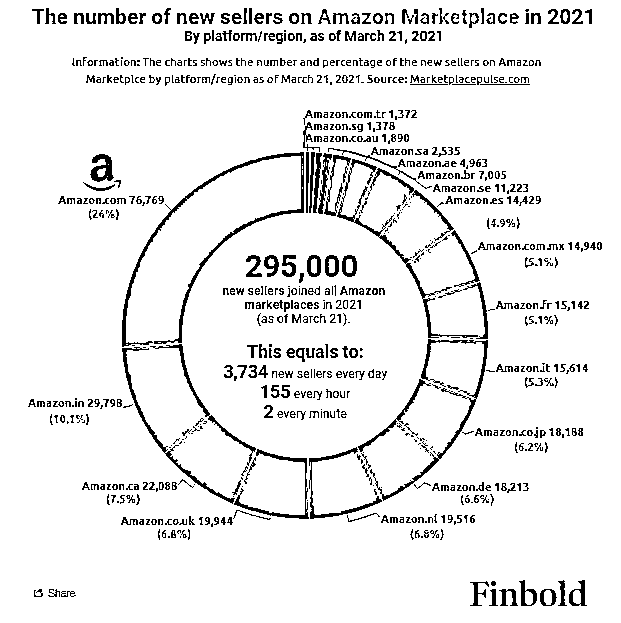

三，业务链条不复杂：先聚流量，再引到🛰️，最后用站外促销服务完成转化。

四，启动资金需求低。服务类生意大多先收钱再交付，只要资源靠谱、执行到位，现金流可以按天滚动。对刚起步的人，这一点极其关键。

之后我分三阶段推进。

**第一阶段：从0到1，跑通站外模式**

**「服务」这块**

我的打法可以拆成三环：服务、流量、成交。

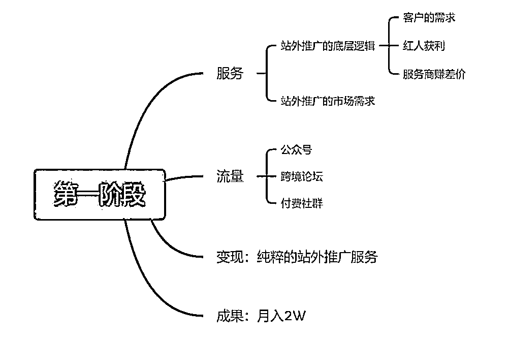

所谓站外渠道推广，是替亚马逊商家在站外做促销，常见形式叫Deals。我们本质是流量中间人：把外部渠道的曝光转给有卖货需求的人。看一门服务，先看需求，再看它为什么能成立。

**1）需求**

我做过卖家，知道商家在站外主要有四类诉求：

- 推排名、拉新品；
- 清滞销、腾库容；
- 给秒杀活动预热；
- 稀释评价率、退货率与投诉率。

**2）底层逻辑**

我们撮合流量与需求，海外达人和群主获得收益，中介方赚取差价。

收入有两块：一是发帖服务费，即付给资源方的执行费用；二是亚马逊联盟返点，这一块占大头。

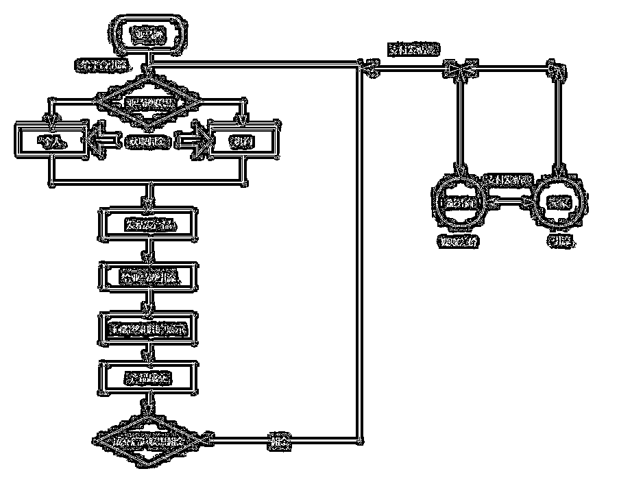

流量掌握在海外达人手里，他们有粉丝群。我们把促销信息放进群，成交发生后，商家诉求得到解决。

那资源方为什么愿意配合？因为他们也能从联盟体系拿到回报。

**「流量」这块**

亚马逊联盟与国内淘客相似：推广链接绑定某位群组负责人后，平台按成交额给一定比例返点，本质是平台出钱换曝光。举例，约7万人的美国群组，负责人每天可拿约1000美元，月入约3万美元。

不同类目的联盟返点不一样：

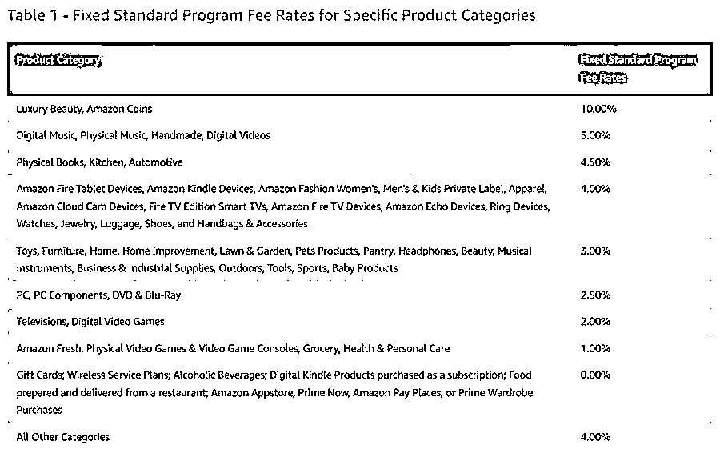

中介方的角色类似直播带货中的选品方：达人拿返点，买家拿到折扣，商家拿到销量，三方都受益。

站外渠道同样如此：买家得低价，商家得订单，我们得服务费，还是三赢。模式自然成立。

跑通后，核心变成找顾客。只要对方在做亚马逊店铺，就可能有站外需求。难点是当时行业里混入不少不靠谱服务方，商家整体信任度低，新人很难被选择。大家更愿意找长期合作对象。我一直在想，怎样切入口。

当时能想到三条获客路：

**1）内容号**

同行是最好的教材。我盯着某家头部账号研究，逐渐看出套路：用实操干货吸引人，再用资料包引导转发。这样来的读者精准，需求也强；当时这么做的机构不多，除了那家头部，基本就我在干。第一批顾客正来自这里。不到半年，账号从零涨到5000多关注，绝大多数是做亚马逊的商家。此前另一个号也到过5000，可惜被封。

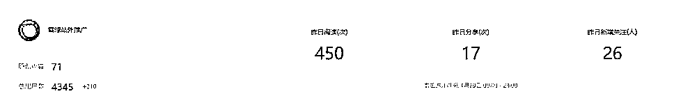

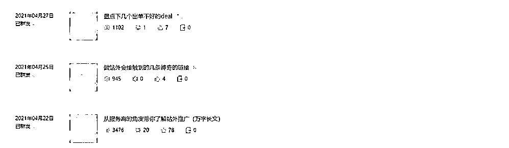

**2）跨境社区**

我把内容号文章搬到多个亚马逊社区，阅读表现不错。后来摸清规则：只要有人回帖，帖子就会上浮。于是我在文末提醒读者留邮箱，方便发送资料。结果帖子常被顶到首页前列，曝光很足，每天至少上百人加🛰️。虽然来者多是新手，但只要在做店铺，就是潜在顾客。

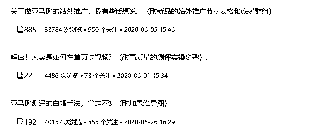

**3）付费圈子**

我进了两个付费圈子：龙哥盟、优联荟。

龙哥盟谈钱不伤感情，我在里面被大量案例打开思路。那阵子常熬夜翻精华帖，看别人怎么做私域，慢慢明白：只要🛰️里沉淀足够多做亚马逊的人，他们就是潜在顾客。目标变得很直接——加人。

优联荟偏外贸，里面也有不少亚马逊商家。我起初只想学习，后来因为分享得到认可。再后来，优联荟创始人小北老师把我的文章转到他的👸号。

当时在Lissa鼓励下，我写了篇站外从0到1的万字长文，发到优联荟社群。运气不错，顾小北老师看到后转到“小北的梦呓”。借着他的影响力，文章阅读到1.2万，也带来一批信任我的顾客。有人开始称我“顾小北推荐的站外服务方”。有了这次站台，“雪球站外”完成了冷启动。

**「成交」这块**

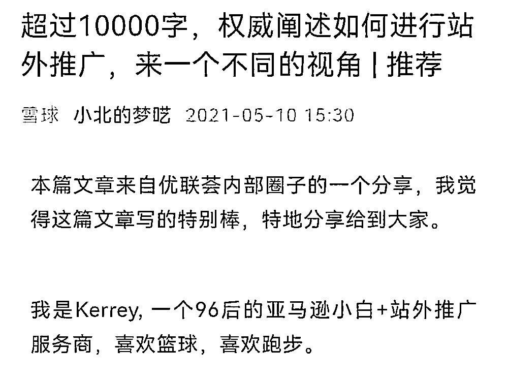 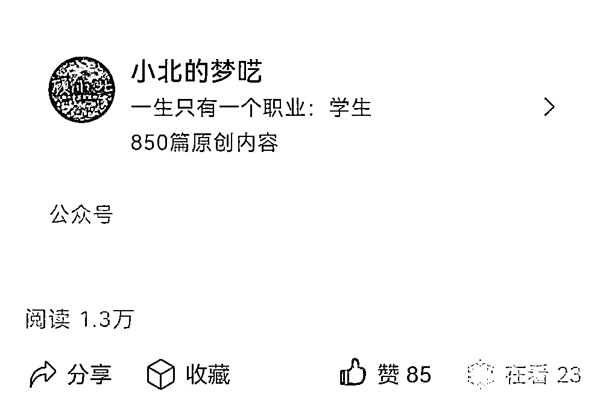

这门生意靠差价收钱，公式很直白：差价=顾客付款－资源方费用。通常一单的毛利能到销售额的一半。效率与规模怎么放大，后面讲。

中间存在信息差：不少商家不会找外部流量，也有人知道却不愿花时间。我们替他们对接，既解决需求，也获得收入。

执行时需要Facebook账号，用来联系海外群组、主页负责人。方法不神秘：持续寻找能发Deals的群组，再逐个沟通。

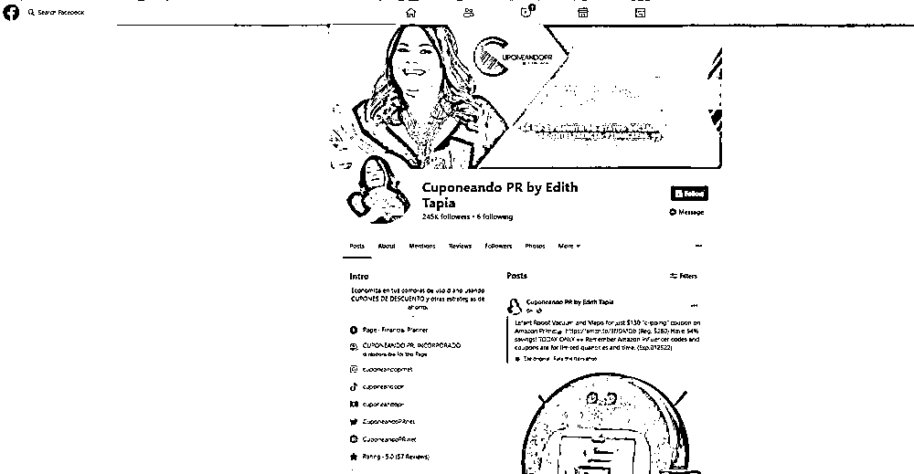

这一阶段，我一个人跑完全流程，启动成本为零。顾客与资源逐步累积，月净利到2万。

**第二阶段：从1到10，搭小队**

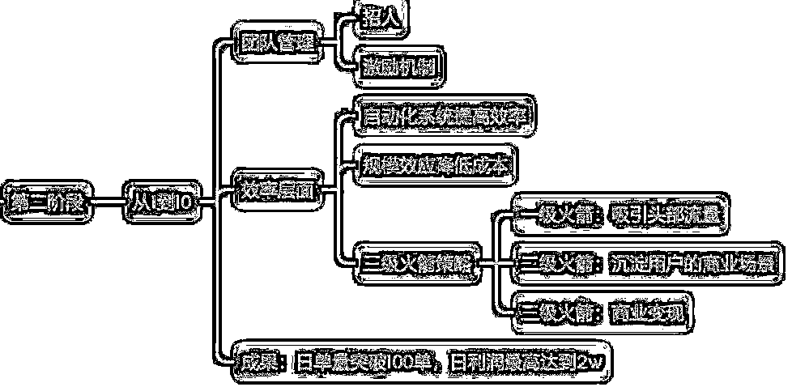

模式从0到1跑通后，接下来是复制。

单干不到一个月，月利润已到2万。我当时想：自己做到顶也就这个数，如果能复制出几个“我”，上限会不会完全不同？于是开始招人。

一个人干活容易，带一群人干活难。我此前没有管理经验，搭班底时问题不少。

**1）招人**

为省开支，我把办公点放在深圳宝安偏郊的位置，结果反噬：年轻人更愿意去市中心，招聘很难。只能投广告，Boss直聘和前程无忧同时开，花了近万元，好在招到了合适伙伴。

**2）激励**

刚起步时流程不细，前期要手把手带。岗位是客服，技术门槛不高，做久了容易觉得重复，有人没几天就走。我很苦恼，后来向前辈请教，才发现问题在激励与福利：员工看不到奔头。

于是我补了提成制度，设销售冠军、进步奖等；开会时同步规则，每周业绩放进在线表格，谁都能看、能比较，也知道离目标多远。

2021年最后一个月，一位同事拿到销售冠军，月薪过万；其余人多在6-7k。数额不算大，但对小队是很实在的刺激。

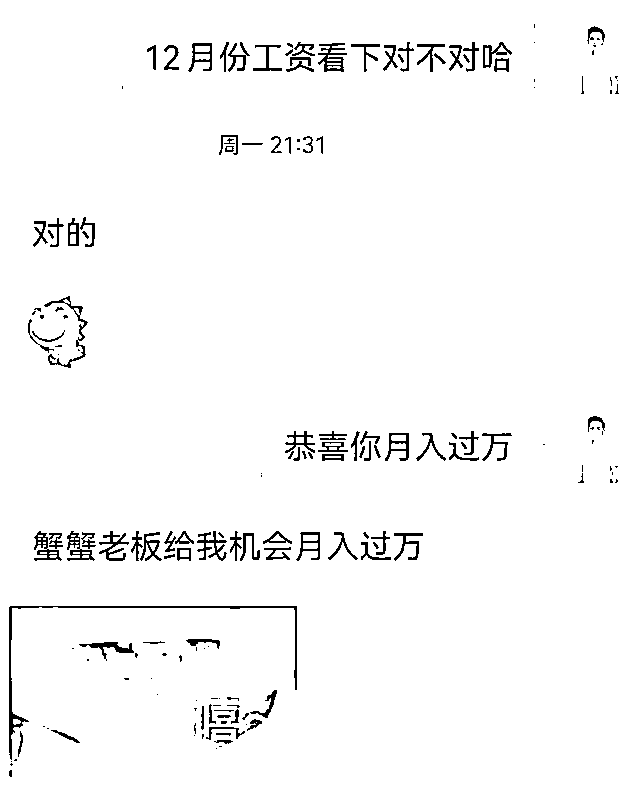

班底搭好后，我们做了三件事，让体量向头部靠拢。

**1）程序化工具提效**

订单变多后，人力吃紧。我找程序员做了一套工具。

每单在当时叫一条“发帖任务”，流程是：接单—整理—验证折扣码—交给资源方—回收效果。按业务量，至少三人才能周转。

这活机械性强，理论上可程序化。我常去拜访头部同行B，一边合作一边学。交流久了发现对方已上线类似工具，我更有底，把需求交给程序员朋友。一个月后系统落地，原来三人干的活，一人即可完成。

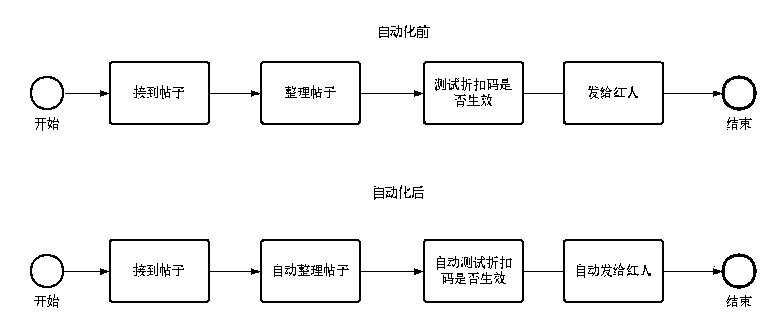

**2）规模采购压成本**

当时行业按发帖数量结算：一条促销信息付一次费用，群主负责发给粉丝。

单量上来后，我们开始谈批量：原来一条5美元，若一次买1000条能不能降价？结果单条成本压到1-2美元。部分群主接受包月，固定费用即可不限量发，边际成本接近零。

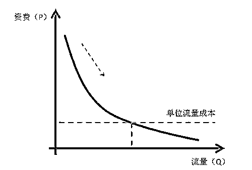

省下来的钱，一部分留作利润，一部分变成顾客福利：发更多条、覆盖更多粉丝，提升爆单概率。效果比同行更稳，也带来更多转介绍。

**3）三层推进法**

龙哥说过，先卖A罩杯，再推荐丰胸产品。我的不同在于，“丰胸产品”不负责赚钱。

站外口碑起来后，我们开始给顾客配周边服务。亚马逊商家的需求很杂，周边供给也多。我去找源头供应方，因为手里有流量，能拿到更低价格。

周边包括物流、知识产权、图片视频等。我不碰不懂的领域，每个行当都要沉淀，所以优先选与运营相关的：买家秀、QA、点赞、首页无差评等，操作轻、频率高。外行可能看不懂，内行早已熟悉。它们利润薄，却接近刚需，因此我们几乎按成本给顾客，用来增强粘性。

这套思路受梁宁“三级火箭”影响。什么是三级火箭？

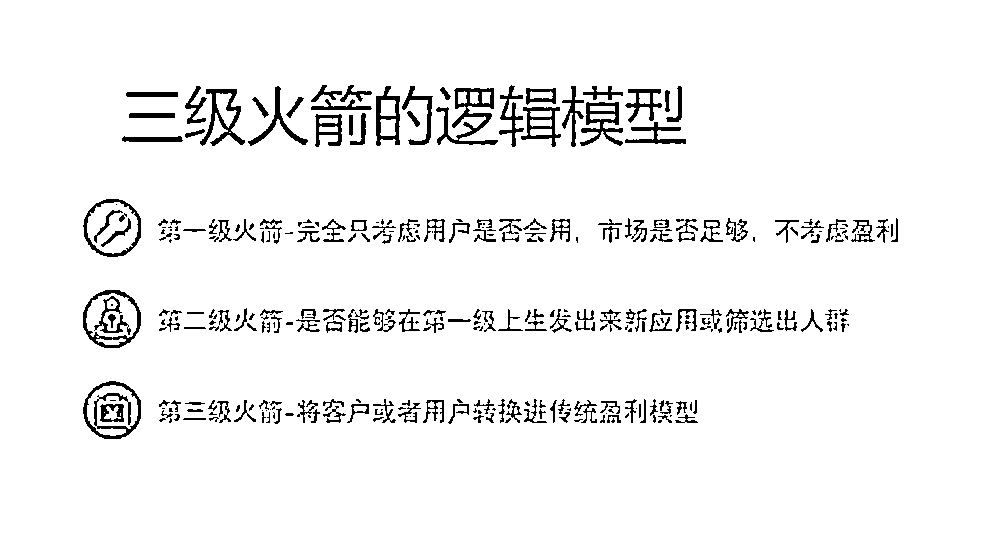

我的版本是这样：

一级：抓头部流量。靠内容与高频周边，把大量商家引到🛰️，这一步不赚钱。  
二级：做承接场景，主要是🛰️群，安排专人答疑。  
三级：高利润业务，也就是站外渠道推广。

还有个原因：站外并非高频刚需，需要用高频服务带低频业务，这就是“高频带低频”。

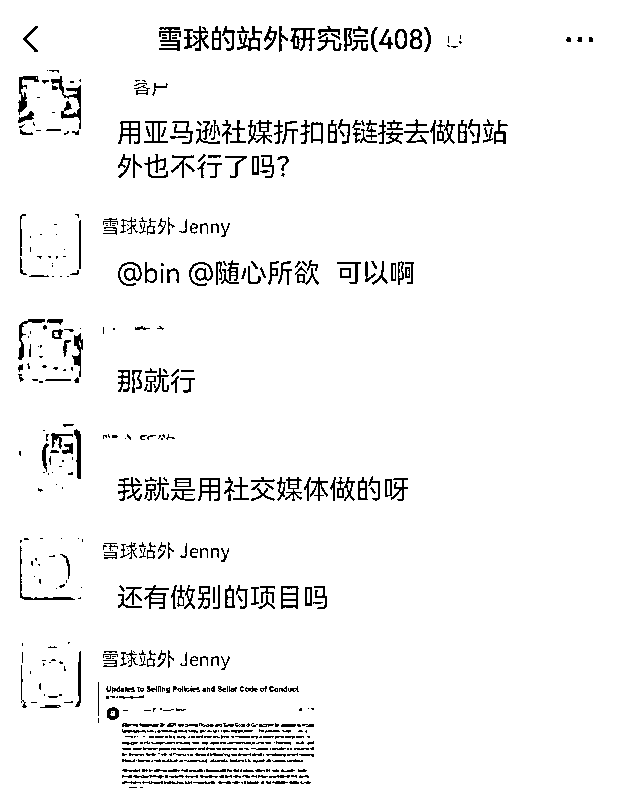

**1、平台红利**

**2、向头部同行取经**

这套三层推进法虽然简化，但很管用。粉丝粘性高，转介绍多，关注量也慢慢扩大。

叠加平台红利，业务放大。最高峰日利润到2万，日订单100多；当时头部一天约150单，而他们已经做了两三年，我们不足一年。

复盘成功原因：

**1、平台红利**

年初判断成真。大量商家涌入，形成卖家红利。很多人只看到亚马逊赚钱就盲目进场。2020年底我已察觉，过完年便全力投入服务赛道。

政策端，2021上半年平台限制仓库库容，又封了一批人工干预的大卖品牌。结果一是开新品要先清滞销库存，商家会找站外清货；二是过去靠刷，现在怕封店，只能选更安全的推品方式，站外正好接住。

**2、向头部同行取经**

早期我们仅靠🛰️号与Facebook在运转，流程不完整。后来主动找头部交流，吸收经验，把全流程整理成SOP，方便招新与培训。

**3、个人聚焦**

2021年前，我既卖货又做服务；2021年后只做站外渠道，并用内容号把流量导入🛰️完成转化。

**4、信誉与站台**

我们追上头部，基础设施差距其实不大，差在信誉。跨境服务方整体风评不佳：有的资源缩水，有的售后冷淡。我们坚持顾客优先。信誉做好，再加上几位亚马逊牛人朋友站台，站外服务逐渐品牌化，复购与转介绍都强。

**5、小队力量**

业务增多后，我们上线程序化方案，效率提升数倍。0到1跑完后，剩下的是复制。小队像飞轮，管理者的任务是让它高效转动，即使自己暂时不在，也能继续转。

**—02—**

**成绩不是偶然：旧积累与旧坑**

很多人问我怎么进入亚马逊。倒回2019年2月，我刚开始实习，在一家亚马逊公司做欧洲站。那时没经验，公司打法粗放，核心就是刷。每天泡在Facebook群组里发帖，找老外帮忙补数据，日复一日。

当时平台管得松，深圳卖家圈几乎都笼罩在补数据的气氛里。确实，刷往往能把链接做起来，身边成功案例不少，线下聊天也绕不开。但我清楚这条路没有未来，于是拼命补广告与站外玩法。

那段时间我每天写内容号，把学到的整理后发出去。输出倒逼输入，我想尽快离开那种环境；同时通过分享认识了一些同行，前合伙人A就是内容号过来的。

乔布斯说过：你无法提前把点滴串起来，只有回头看，才知道它们如何相连。

第一，我熟悉了亚马逊整套体系，也认识了一批商家；  
第二，我攒下Facebook站外资源。

现在看，当时的判断没错。很多事当时像浪费时间，回头才发现每一步都算数。

这次上班给我的收获：

# 从合伙到单干：我的跨境创业复盘

有位朋友 A，某次聊天时被我半真半假地问了一句：要不要一起下场做 Amazon 生意？话出口时我并没当真，结果后来它竟成了现实。于是我开始两头跑：一边打理平台店铺，一边接站外渠道的活。

那阵子，我白天主要维护内容账号，用文章把有需求的卖家引到私域里谈合作；店铺那边从挑产品到上架运营都得自己啃，边学边做。早上九点进办公室，常常忙到夜里十一二点才走，累归累，但每天都很满。

设想漂亮，落地却磕磕绊绊。平台卖货这条线走得并不顺。挑产品的方法来自几节课程，真动手才发现坑一个接一个。当时用数据工具筛到某些品类需求旺、毛利看着也高，却没把潜在风险想透，脑子一热就备了 1000 件库存发过去，前期每人差不多投了 5 万元。

原本计划先用站外推广加数据补量，等后期再靠站内投放接棒。偏偏供货方交期延误，运输环节又掉链子，等货抵达时，那个品类已经杀成血海，售价被压得很低，再怎么推也救不回来，只好低价处理。

那次折戟后，我反复问自己：是不是选错了方向？是不是压根不适合做平台卖货？

好在另一条线——站外推广服务——慢慢抬头。内容号和论坛帖子带来访客，再把需求转成付费客户。我此前积累过引流经验，团队前期又肯在声誉上下功夫，所以项目虽谈不上暴利，却足以让团队活下去。

我逐渐明白，商品生意与服务业务两头抓并不现实，精力会被撕碎。权衡之后，我把重心挪到服务端。这个决定和我最初的想法相反：我原本更想深耕平台卖货，把服务当成前期补回款的辅助；我甚至以为平台卖货能做得更久，服务只是阶段性的。后来才看清，平台卖货的资金门槛远比想象中高，尤其资本涌入后，想跑出来就得持续烧钱。我既没有足够弹药，也扛不住那么大的不确定性。服务则不同，它能在较短时间内带来回款，让团队抵御波动的能力更强；哪怕不是长久买卖，也能先完成初始积累。

光合那句话我记到现在：把力量收束成一束激光，每天只往前挪一小步，也能穿透一层层圈层，持续向前。

我于是把主要精力压到站外推广服务，自己补引流、转化的基本功。经良辰美引荐，我进了龙哥盟。起初没抱太高期待，长期潜水；后来发现它给我的价值远超十倍门票。当时还没显出威力，等我独立单干时，它带来的帮助非常实在，也让我结识了多位关键人物。

搭档 A 见我心思转向服务，我们开始频繁摩擦，最后我选择退出。敢做这个决定，是因为站外项目我已经从无到有走通，月度数据持续抬升，到第四季度订单突然放大。我判断，这个方向值得我把时间全压上去。

那段合伙收场虽不圆满，我仍感谢 A。他让我的认知发生了很大变化。那段经历给我的收获如下：

**1**、圈层的力量

那时我也正式以平台卖家身份活动，混进不少跨境圈层，和人交流后回自己账号实操，再把过程写成文章发到内容号，吸引一批卖家加我，后来他们成了站外服务的第一批客户。

**2**、性格上的松动

我本身有社交恐惧，起初不爱主动搭话。创业后进入 A 的圈层，大家话题绕不开平台生意和收入，我索性不再纠结性格，把社交看成信息交换。前提是自己手里得有可交换的价值，所以我把更多时间用在磨专业能力。

**3**、把一个好项目从零孵出来

好项目极难遇，尤其是投入几乎可以忽略、年营收却能做到七位数的机会；除非有前辈愿意拉你进门。A 就是那个人。

所以即便后来分开，我们也没闹僵，更多是彼此祝福。至于未来，当时谁也看不透。

—03— 创业复盘

作为后辈，我经历尚浅，踩坑也不多，写出来的东西难免停在表层，多是个人的感受，硬核方法有限。下面把我的体会归拢一下：

人往往要先在创业里挣到钱，才会对钱有新的认识：知道它从哪里来，也更有劲头去挣更多。为什么许多项目会死？我猜是设想太飘，落地太难，又没先完成初始积累，结果倒在曙光之前。

**1**、先攒出首笔启动资金

**2**、独立前先跑通小循环

**3**、分享会放大运气

**4**、看见红利就收拢战线

**5**、对手也是老师

**6**、帮别人等于帮自己

如果还没完成首笔积累，我的建议是先上班或跟人合伙；等自己独立跑通一个项目的最小完整流程，再出来全力投入，这样成功率会高一些。独立干和上班、合伙完全是两种游戏：前者风险极高，后者即便失手，也还有不少翻身机会。

写内容号一方面逼我快速梳理这个领域的框架，另一方面也让我认识行业内的高手。对普通人来说，写作是破圈成本最低的方式，没有之一。持续输出，说不定某位大咖顺手帮你转一次，效果会比你闷头干很久都强。

红利窗口很短。2021 年的机会集中在上半年，下半年风向转冷，平台甚至开始收紧站外动作。我们能在短时间内跑到同行前面、进入头部，关键在于收拢战线，只做站外推广，丢掉了此前精力分散的做法。

小排老师有个说法：同种之间常拼得你死我活，不同物种反而会彼此留空间，放到生态里，大家更该彼此照应。刚进站外领域时，我就看到行业极卷，低价互卷打得凶，声誉也差。我分析完市场后，几次登门请教一家头部服务商；对方起初并不热情，但我愿意把自己的东西和资源拿出来分享，最后竟谈成深度合作，也从对方那里学到不少经验和资源。

盘子足够大，我希望大家都能挣到钱；如果有人做得比我好，把好经验反哺给我，盘子才会越做越大。我更愿意一起抱团，把站外推广这件事研究透。单兵冲刺或许更快，结伴同行才更持久。

—04— 谢谢赚钱，也谢谢一路贵人

从 2019 年毕业至今，我从上班到创业，从合伙到独立，整体算顺，踩的坑不算多。我也有自知之明：能走到今天，不靠个人本事有多强，更多是时代红利和贵人托举。这些关键人物大多来自龙哥盟，也包括搭档、同行、伙伴和家人。

@龙哥盟，进这个社群，最大的收获不是挣了多少钱，而是认知被打开：能链接到各行业做出结果的人。我的好几位伯乐就来自这里。看别人的项目复盘让我受益很多，社区里出现频率最高的词是“利他”。准确说，它教我的不是怎样挣钱，而是怎样先帮到别人。

@杨涛，涛哥是赚钱里有名的宝藏。加入他的星球后，我常看到他给每个人回很长的解答，话很实在。最记得他那句：钱要挣，招牌不能砸；两者不能兼顾时，取更重的那一个。我很佩服这种先帮别人的做事方式，耳濡目染下，我也开始对伙伴、客户和朋友践行它。

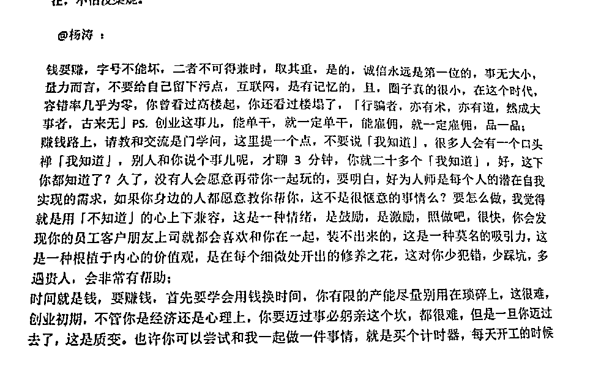

@Lissa Tam，赚钱的小姐姐。年初我进了她的星球，她给我派了个硬任务：一个月内写一篇自己擅长领域的文章。我拖了很久，直到团队拆伙、自己独立后才交出一篇很长的稿子。文章发到优联荟后，被小北老师转到“小北的梦呓”👸号，给新业务带来不少客户，也帮雪球站外完成了最初一批客户启动。对了，“雪球”这个名字就是她起的。那以后我更意识到内容的分量：分享越多，好运越容易靠近。

@吴熳（财神爷小姐姐），赚钱的盯稿担当。她在个人品牌上给了我很多指点，从头像、社交动态到表情包，算是我做个人品牌的启蒙者。我是拖延晚期，这篇文章是在她全程盯着的情况下写完的——不交稿就要挨揍，最后总算按时交付。

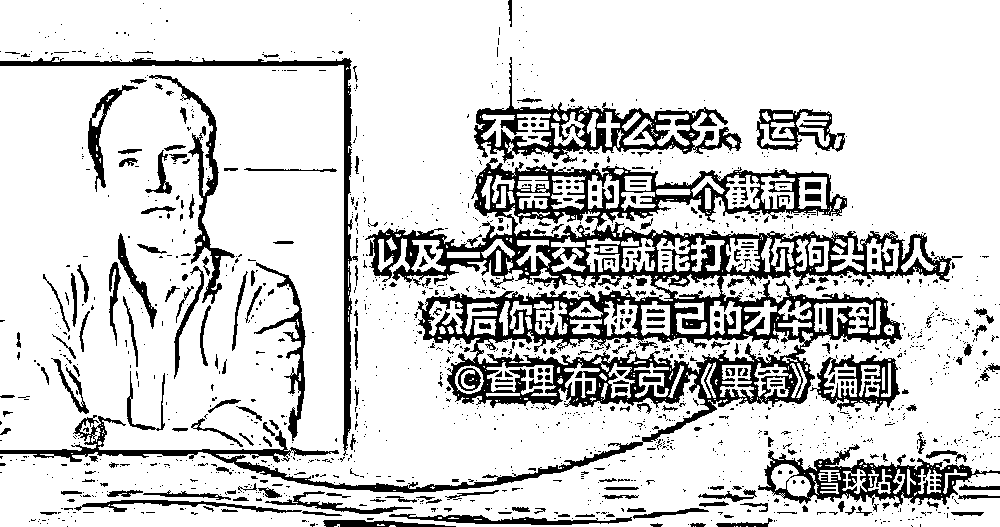

@杨爽学姐，赚钱的内容小姐姐。她在这篇文章上帮了我很多。最初我写成长篇大论，堆经历、堆感受，可读者未必需要。经她提醒，我试着从先帮别人和读者视角重新组织。也不得不感叹，赚钱的精华帖确实是层层筛选，每篇都经过把关；有时候一篇好文就值回入场券。

@良辰美，赚钱成员，和我同龄，也做跨境。他坚持日更，执行力比我强好几个档。以前他常盯我写文章。我们有过同一个目标：在深圳安家。上班那阵我常看他的内容，每次看完都像被充电，立刻有动力。当时我想得很简单：跟着他走，大概不会偏。

@合伙人A，我过去的搭档，也是引我入行的人。虽然最后分开，但合作时他帮了我很多，分开后也愿意给我时间。初出茅庐、还没被社会捶打的我，是他带进这行，给了我挣到首笔钱的机会；遇到难题时，他的建议常常来得刚刚好。

@同行B，站外推广里的头部玩家，也是我最大的合作方兼竞争者。做到头部却仍谦虚，给我的帮助不小。我多次登门请教，他没拒绝过；后来我们达成深度合作，彼此学习。

@顾小北，我的跨境前辈导师。在优联荟，我的文章有幸被小北老师选中。他当时问我要不要帮忙，我想等做出点成绩再当面聊，就没开口。后来文章被转到“小北的梦呓”👸号，陆续有优联荟学员来加我，不少人直接成交。因为小北老师的光环，他们把我称为“小北老师推荐的站外服务商”。有前辈站台确实重要，但前提是我得靠谱，否则就辜负了这份信任。

@团队的小伙伴，年初我还是光杆司令，如今已有 8 个人，速度不算慢。中间有人来有人走，最后留下这 8 位，我认他们是愿意一起扛事的人。也因为他们，我这个连会议都发怵的人，被逼成了能独当一面的负责人。熟悉我的人知道我社交恐惧，但为了带队伍，我硬是练到不怕开会、不怕当众讲话，甚至能在线分享半小时。

@家人、球友，还有自己，谢谢你们在生活里的陪伴和支持。

上面这些人在我创业路上给过不同程度的帮助。没有他们指路，就没有今天的我。创业路上，有人带真的关键。

最后，祝大家一起龙哥盟！

评论区：
- 李天民：信息量很足，谢谢分享。
- 个人理解：站在跨境行业看，你能盈利还有一个关键——比起只做平台卖家，站外推广服务这个角色在生态里更占优势。
- 宋大刀：很优秀！
- Tyler：英语这关得先过吧？
- 森林：感谢分享～
- 龙哥：感谢分享，已加精华。
- 雪球：谢谢龙哥大大🙏
- 跨境老兵聊电商：方向选对了[偷笑]
- chloe：你好，方便加个🛰️吗？