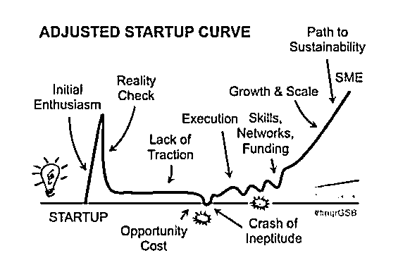
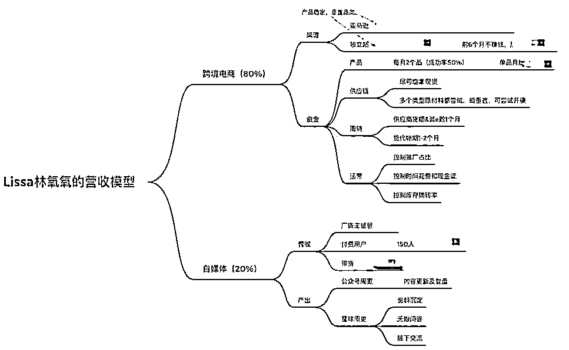
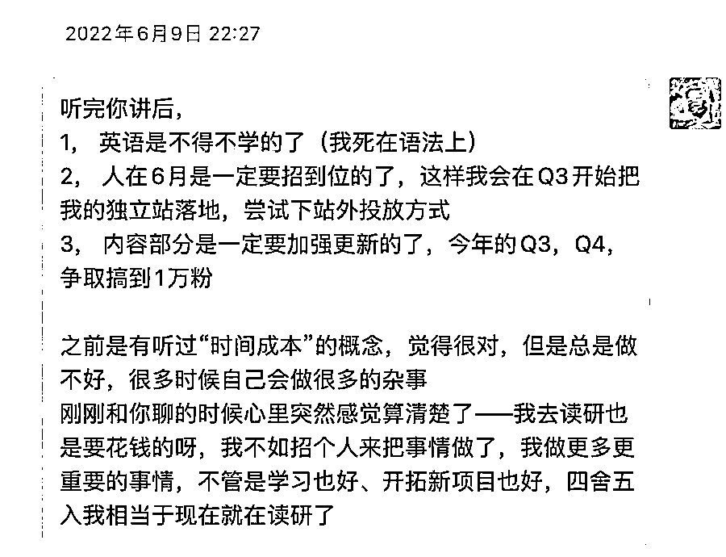
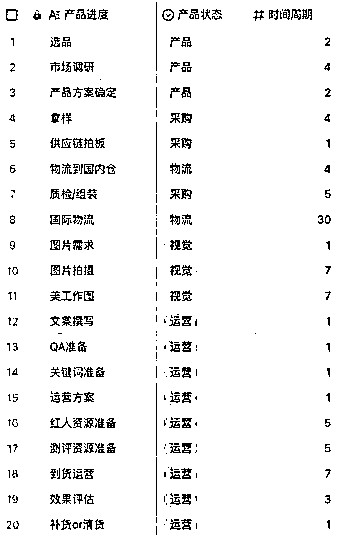
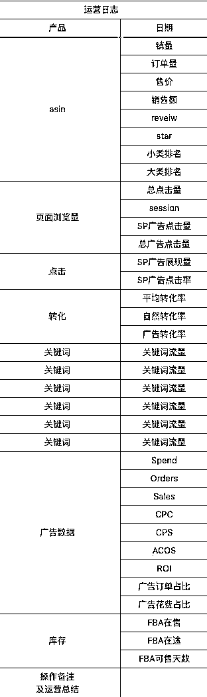
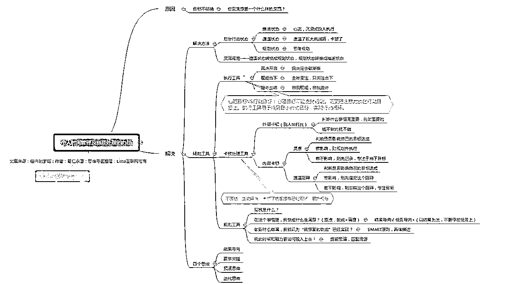
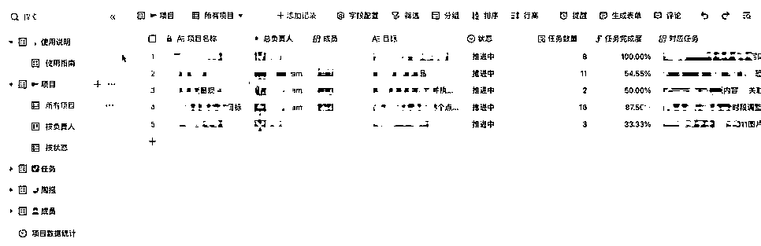
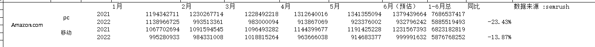
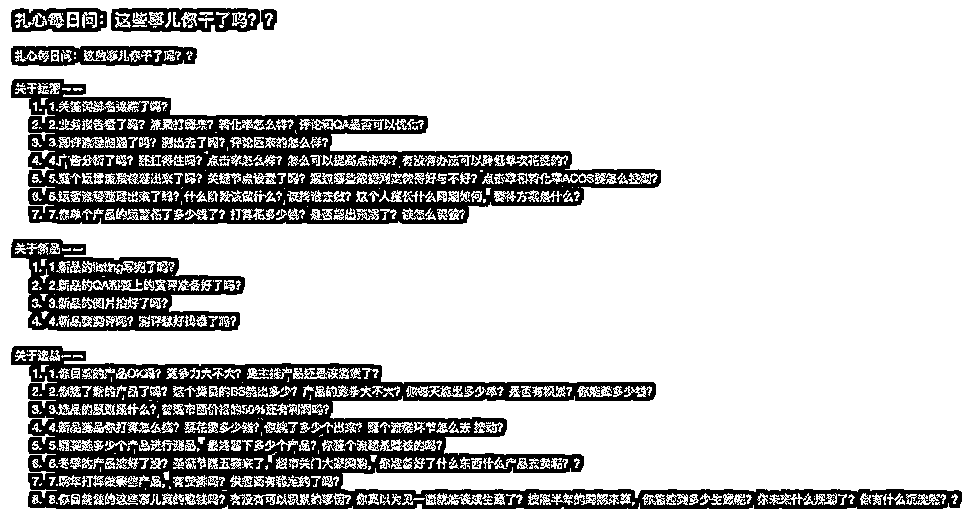

# 我做跨境单干的一年：亏过两万，也困在一公里

文｜Lissa Tam  
2022年6月22日

落笔前随手一算，才惊觉整个单干岁月里都有“生财”的影子。时间这东西，真是拦都拦不住……我最早动笔时，讨论的还是2020年跨境这行值不值得入场；后来回去上了班，又重新出来闯，一晃已经整整十二个月。

我叫Lissa，电商科班出身，在跨境这行已经是第五个年头，2020年进的生财。挑品的门道、商业上的思考方式、以及怎样跟焦躁握手言和（这真不是客套话），都是在那儿学的；也顺带看到了不少这行以外的新鲜玩法。

在那个圈子里，我学到对付不安最管用的招数其实很笨：把手上的活干扎实，接受自己不过是个平凡人，然后比别人多迈几步。

这篇算是我单干一年的流水账。“创业”两个字听着太大，不如叫自由职业。想跟你聊聊过去这十二个月的四件事：

1. 我作为自由职业者的经历
2. 收入结构长什么样
3. 每天的安排
4. 以及关于“到底该不该自己干”，我的一些心里话

我这点成绩都能撑下来，屏幕前的你，没道理不比我强。

## 一、我的自由职业经历

刚起步那会儿，谁要叫我“自由职业者”，我心里老大不乐意。因为我认定自己干的是有分量的事，是在经营一家能立得住的买卖。

一个眼里带光、心里有奔头的人，开口说话时对迷茫者有着近乎致命的吸引力——这世上总有一部分人还没找到自己的方向。我一度特别爱摆出这副姿态，后来才明白根本没用……按理讲，“望远方”与“走脚下”本不该打架，真正的卡点在于，你手里的资源够不够把这两头接上。

撑了不满半年，现实就给我上了一课，疼得彻底。办公司头等大事只有一条：先别死。

不管你是单干的自由职业、soho、一人公司，还是注册了有限责任公司，说穿了都绕不开两个字：盈利。说得冠冕些，就是拿社会需要的价值去换回报；干得漂亮，还能换来认可和掌声。

于是Lissa林氧氧这个人，一天比一天务实，一天比一天接地气，铆着劲想做个像样的生意人。

### 为什么出来单干

2021年，跨境这波热潮算是退了个干净。这就跟炒股一样，我偏偏买在了山顶。别人恐慌的时候我亢奋，别人亢奋的时候我眼红，别人转身离场的时候我一头扎进去——证据确凿。

我出来单干的原因，说出来可能没人信：4月的时候因为一些没办法抗拒的因素，工作没了。那会儿其实也没盘算好下一步做什么。

我这人天生不太安分。上班也好，自己干也好，脑子里想的都是怎么攒出一件拿得出手的“作品”。可绝大多数岗位，短时间内根本给不了这种可能。做销售这一行，进了公司，头号任务就是把账打正、持续给公司输血、创造利润。至于烧钱试错，可不是每家老板都乐意放手让你去干的。

再说成熟点的企业，职位切得极细，人人都是流水线上的一颗钉，汇报线一清二楚，能对接谁、不能碰谁，界限分明。不少资源仿佛就摆在鼻子底下，但跟吊在驴嘴前的那根萝卜没两样——望得见，够不着。我那个急啊，简直抓心挠肝。

可有些事，偏偏急也没用。

一旦嵌进公司这台大机器的齿轮里，就只能靠日子慢慢熬出信任、熬出证明，后面的戏才轮得到你。偏偏我这个人，最受不了前期那种无人问津的冷板凳，也做不到慢条斯理地等。重复、毫无波澜的活计只会把我磨得迟钝、原地打转——那是我最怕的处境。

我性子太急，太渴望看清一家企业从头到尾怎么转，太想装进更多东西。待在那家公司里，我挪得太慢、长得太慢，就算工资稳当，也天天心里发慌。

朋友看不下去了，劝我：你索性自己干吧，省得每次动念头又不动手。年纪轻轻的，豁出去试一回，认认真真做一场；真做砸了，再回来老老实实上班。

于是，我下了海。

结果嘛，下了海之后，慌得更厉害了🥲。

此处省略一长串不能播的脏话。

### 开荒的那几个月

四月初动手，业务一点没展开，注册资料和店面先折进去三套。

鬼知道我走了什么霉运。那十几天，我全耗在申诉上，水、电、网、物业、燃气公司挨个跑，资料收了一摞，招商的、客户经理，能找的关系全找了，还是死局。

更糟的是货早已上路，店面却捞不回来，银行卡每月还被倒扣，仓储之类的杂费一个月四五百。偏巧物流又出岔子，两个月迟迟不抵港，连想撤都撤不了，我又白白被割了一大笔。

那段日子怎么形容呢，我整个人就像中了邪的倒霉蛋，头顶一片黑云。

挨到六月中旬，局面才算松动。

我把先前的资料、店面连同店里的存货全部弃掉，一算账，亏了两万。后来从朋友那儿借来一套资料，推倒重来。新店落定，把清理好的货发出去，这摊子才算真正开张。

日子我记得真切——6月16号，跟眼下差不多的时间。

店面稳住之后，选款、上架、推广这些环节，就顺着既定节奏往下走了。

头两个月把地基（也就是店铺）打稳，接着两个月跑通一款能赚钱的品，并让它持续返单，剩下八个月就是不停循环“选品—拿样—采购—拍摄—运营”这套动作。货一开始摞在客厅，后来蹭朋友仓库的一平米角落，再后来自己租库房。存货越滚越多，直到自家小仓也塞不下，里里外外全是成品和半成品。

今年三月，我开始雇人，从孤身一人变成个小班子。后来负责运营的伙伴对前途犯了迷糊，转行走了，我又回到单打独斗。今年平台上的行情依旧平淡，我的品又要等到下半年旺季，所以暂时没再进人。等七月新品上线，再把队伍扩一扩。

我在网上见过一张描绘初创企业的走势图：先是一路高歌冲顶，随后陡然下坠，在谷底来回磨蹭，再往后磕磕绊绊，差点散架。事实上大量公司根本走不到后半程。九死一生这话不假，比的就是谁更能扛。

涛哥曾在直播里说，自己干这事，归根结底看你能忍多久。打个比方：一口井要挖半年，有人只肯忍受一个月毫无收成，挖三十天就撤了；有人能咬牙埋头半年，到第六个月等来那条上扬的曲线。

我恰恰属于忍功极差的那类人，必须不断有分量十足的正反馈砸过来，我才有劲头。

平台上的事，说透了也不复杂：铺新品、做测试、卖出去。只要你持续上新，把挑品的眼光练出来，再以快节奏验证、让链路正常转，摊子自然会铺大。

一款单品能触到的上限也许有限，但放到整盘生意看，卖货这件事的天花板其实相当高。

当然，能做垂类自然最好，尤其当你手握长期合作的供应链。但要没有呢？像我这样两手空空的，直接扎垂类，倒不如多铺几个方向去试，慢慢筛出适合自己的那一类，再往深处做。听着轻巧，这么耗下来的时间，少说也要一年往上。

这两天我琢磨明白了一件事：新品可以开得慢一点。原先给自己定的指标是一个月两款，现在甚至可以再压，一个月只推一款。假如每款月销做到两万美金，净利按15%算，理想情况下全年就是150万美金的流水，落到口袋里22万美金。这么一算，可比火急火燎地铺货舒坦多了吧？

卖得顺，反馈猛，我就越亢奋，整个人的状态也跟着往上走。当然，这算不上什么“长期主义”。在我看来，真正的长期思路，是先把眼前的短期活下来、活滋润，然后水到渠成长出来的东西。道理很简单：长远算下来挣的一定多过短期凑合，你才会选长线嘛！归根结底是笔账。再漂亮的理想，也得先过财务这一关，才谈得上落地、成真。

心慌很正常，自己干哪有不慌的。要学会跟这份不安处成朋友，接受它就在那儿，再顺势借它的力，拼命推进度、抢截止日，这才叫把焦虑用对了地方。今天刷到新东方带货的片段，我直接一句卧槽。

他们说，没想到粉丝一下子涨了好几万，之前直播间就几百号人，一直死守着、熬着；痛苦没毛病，它来自你对现状的不甘，正因为疼，你才想改，疼本身就是劲儿；焦虑也没错，焦虑是因为你想干得更漂亮，说明你心气高；悲观是看得远，乐观是活得明白。能看清眼下还不行、以后也未必一路顺，这本身就需要胆量、需要见识、需要智慧。

外界如何，随它去，咱们把自己的事做扎实就行。只要一直往前挪、始终不掉队，把每一分钟都用在刀刃上，哪怕将来回去打工，我也能谈到更好的条件和机会。

这么一想，还真没什么好怕的，接着干呗～

## 二、我的营收模型

前面反复念叨过，做买卖头等大事是挣钱，自己干头等大事是别倒。

平台这门生意其实挺“重”的，前期不光砸时间，还得砸真金白银。

说到这儿必须提一嘴：生财那个社群虽然没少让我上火，却是我起步阶段撑住局面的关键。

刚下海那阵，正好撞上生财2021年招新。我寻思自己从没推过社群，不如试一把！于是开招前三天就动手宣传、建群，最后拉进来24个人，拿到第一笔内部分成，前期的吃饭问题算是解决了。另外我在社群里做过分享，攒下过龙珠。资金周转不开时，一万块卖掉过一颗，缓了口气。

单枪匹马做事特别孤单，人也容易把自己关起来。这就是有个圈子能唠嗑的价值所在：各种新鲜事、机会、新花样、聊得来的人，都能碰到。它也是我单干期间重要的信息来源和知识储备。

要是借用《小狗钱钱》里“会下金蛋的鹅”这个说法来盘我的投资和收入，那我现在手里是：一只鸡，外加一群鹅。

鸡指的是我的自媒体，眼下还是只雏鸡。这块投入产出比相当高，只要天天记得投喂，它就能源源不断地下蛋。虽说更新不勤，倒也攒下了一批铁杆读者。

鹅说的是平台卖货这块，目前养了八只，大小不一，产蛋还算稳当。可说实话，它的回报率并不好看。这两年平台物流费涨得离谱，货全都得走海运，原本能有五成的回报，再扣掉仓储和漂在海上的压货，就只剩两成半了。利润薄，钱全压在货里打转，抽不出来。

忙活一整年，平台上挣了不到五十万人民币，而且全变成了库存。我活脱脱一个搬砖的，挣的是社会发我的那份辛苦钱，岗位名称可以叫“全球资源流转加速官”🫠

当然，钱之外也攒下些别的东西：店铺、品牌、办公设备这些固定资产，还有越用越多的诚e赊额度、货代给的账期，以及我这颗越来越会转弯的脑袋(*☻-☻*)

我给自己搭的收入结构，还是平台卖货挑大梁，内容作补充。照着自由职业者通常的成长路径，我画了张图：

按我的盘算，跨境这块要吃掉八成以上的时间，重心压在平台上；靠一轮轮选品循环把总营收抬上去，用以抵消单品寿命越来越短的风险。

另外，能少囤就少囤，尽量吃现货，把资金的周转速度提起来。

刘润老师早前有篇文章拆解资金的进出，说“创业无非是向五类人借钱，再花到四个去处”。五类来源是：自己的、投资人的、客户预付的、银行借的、供应商赊的；四个去处则是：现金、存货、应收款、固定资产。

找得到钱、花得明白、让钱转起来，再把现金流周转表算清楚，生意就能自己循环、正常转下去。

中间还有个小插曲。我对“雇人”“带队伍”实在没经验，加上脸皮又薄……总担心人招来了，给不了人家该有的成长和期望的薪水，于是一直拖着，等自己“准备充分”了再动手。初创公司嘛，资源本来就紧，钱开不到位，自然也招不来什么像样的人。

涛哥早先教过我，要把自己的时间折成钱来算。比方说你一小时值一千块，却跑去干八十块一小时的活，那就是亏，就是糟蹋。

可我那会儿的脑回路不是这么转的：我并非每个钟头都能挣到一千，那么在那些闲着没事的时段里，八十块一小时也是进账啊！（不知道涛哥瞧见这套算法会是什么表情，哈哈）

前不久跟朋友聊到自我提升，我原本的打算是一两年后去读MBA。我拿自己那套歪理🤏一掐算：反正读MBA也得掏钱，那不如把这笔预算提前花掉，拿去雇人，这样我的时间就能腾出来，用来学东西、开新局！

我假设自己有一笔六十万的未来预算，先把它挪到眼下，投在扩编上，把整体产出提上去。再说招来的人总不能一直亏，姑且算他最多亏两个月（通常挣不回自己工资的早就被请走了），那我招两个人，顶天也就亏四万块。换来的是我有余力去开新项目，等于花这笔钱给自己做了提升，总比交学费上那些割韭菜的课划算吧？将来还能去读个更好的MBA，成长空间更大～（朋友说结论虽然离谱，但这套歪理给满分💯）

这也是上面那张思维导图里我会提到独立站的原因。今年三、四季度，我打算给跑稳的那几条产品线配上独立站，用半年时间去等它开花。

还有就是内容这块，我用了各种奇奇怪怪的手段逼自己更新，比如拉广告主（卖家精灵）合作，成功拐来一位可爱的美少女编辑Doris，外加一个交稿截止日；比如报了视频号训练营，甚至准备把视频也发起来（不把我的公众号置顶加星，兄弟们可能就刷不到了哇）。

很多事说起来轻飘飘的，真上手做过的人才明白，背后要砸多少时间和死磕。

我不清楚最后能做成什么模样，但有一点我确定：我会拼尽全力。因为有你们，因为有这份陪伴和打气，我挺开心。

愿咱们都能狠狠赚上一笔～～～

## 三、我的日常规划

有朋友跟我讲，想看看我的日常，说我像时间管理界的高手，好像什么都能干成。其实真不是那样。

平台这条路跑顺之后，我的动作大致是：挑品、拿样、敲定方案、下单采购、拍照、修图、剪片子、上架运营、补货。

一圈下来两到三周，碰上选品卡壳，就顺延几天。

给大家看看我21年刚起步时画的进度甘特图。

 

最让我觉得“一天下来啥也没干成、白晃悠”的环节就是挑品。这一步，我拿“筛出一款产品”当里程碑。可这周期实在拉得长，我几乎收不到什么回应。

后来我尽量把目标切碎：一天初筛多少个品、一周出几份方案、一个月敲定几款能投产的。

流程之外，数据整理和汇总同样关键。我用第三方工具拉数据，再自己拿Excel搭一块看板，盯着各节点的完成率。推新品另有一份专门的记录表，把每天的销量、关键词位次、产品表现、流量转化、上新日志都记下来，方便日后复盘，也方便把打法复制出去。

我大半精力都投在挑品上，估计占到65%。产品上费心最多，运营那头花的时间相对少些。

运营方面，眼下我只挑效率最高、投产比最漂亮的那件事做：投广告。像帖子维护这类，之前有人的时候全交给运营。它对我而言费时但回报尚可，可我精力有限，只能往后排，时间不够就干脆不做。

新上的款我天天看，老款就把节奏放长。新品的排名、销量、广告表现每天过一遍，随时调；老款一周瞧一回，集中调整。销售数据则每周汇总一次，对照目标校准。

听着杂七杂八一大摊，摊到每天其实也没那么紧。拿最近来说，我八点起，九点到十二点泡在星巴克，下午一点回办公室待到晚上十点。上个月两个要开模的品推进了，上个月和这个月筛出来的款也毙掉了一批，眼下正为这个月的产品指标挠头。

每天干什么，事多的时候我会用印象笔记列个清单，照着划（其实大半当天都干不完）。多数时候，还是看心情来。

拖延、懒散、情绪化，这些人类通病我一样不缺，也没法彻底根治。可恰恰是它们，拼出了我这个人的模样。

我这人时间管理水平确实一般，靠的是拿加班往里填……

单干的人，最金贵的就是自律。自律换来自由，这话一点不假。

我对时间管理的理解是：它图的是每个单位时间用得更值，而不是把总时长无限拉长。我更看重“结果导向”加“聚焦”，同时配合精力管理。精力盘顺了，时间的利用率和效率才上得去。这套方法也是从生财那儿学来的，出自易仁永澄老师的时间管理和CC老师的精力管理：https://t.zsxq.com/03MrB2Zb6；https://t.zsxq.com/03ZrfiybY

之后我还会用飞书。每月初先把当月的OKR/KPI定下来，再拆成若干小计划，逐个推进。

飞书的模板功能真的好使！真心推荐各位都用起来！

同款链接：https://vzzx5hov90.feishu.cn/base/bascns3tNXQ7OjZB0RF9jQKPwsd?table=tblrpPfle2ObsJQP&view=vew9vIz0jN

 

自己干的人，看时间得往长了拉，起码以半年为单位。这是一场长跑，很多时候人放弃，不是因为公司垮了，而是自己撑不住了。

做个人使用说明书那会儿，小白@白一喵老师的一句话让我记到现在：你把时间花在哪儿，你就会长成什么样子。（白一喵老师原帖：https://t.zsxq.com/037iuN7Mf）

把时间放到周甚至月的尺度上，我的安排大致如下：

1. 按平台的项目节奏推进，平均每周投入六十小时左右
2. 每周落一次文字复盘：两千字的稿子花一到两小时，六千字往上的要八小时
3. 每周至少运动两回，跑步、跟刘畊宏、去健身房或打羽毛球，平均每周三小时
4. 每周留一天休息，多半追剧、翻书，偶尔涂涂油画；每两周或每月给自己放个“自嗨”假，唱一小时歌乐呵乐呵
5. 每个月或每两个月出门玩一趟，一般去海边或爬山
6. 每周两杯奶茶，主要用来压压惊（乱入）

日子瞧着寡淡又机械，倒也算正常转着。

要说遗憾，最大的大概是：我没把自由职业者最值钱的两样东西用足——空间的自由，和时间的自由。随时随地开工，想去哪儿就去哪儿，做自己真正想做的事。

我幻想过当个数字游民，像Jarod、Natalia那样，靠东南亚的地域差价过日子，用极低的生活成本换极高的人生体验，跳伞、潜水，挎着电脑，进出各种有格调的城市咖啡馆；也幻想过房车自驾的活法，像博主小墨与阿猴，花上半年，走到一处就停下，住上一阵，触摸生命的真实，接住自然的馈赠……还想过更实际一些的：每个月挑一座城市待一周，约上当地的三五好友碰一碰，尝尝不一样的风土人情。

当然啦，我嘴上念的永远是西双版纳，脚上实际去的、或者准备去的地方，永远是杭州😂

最近这一年，连杭州都不敢轻易动身。总感觉肩头压着一堆事，虽说没什么十万火急、也并非非得守在附近，可就是不敢松劲，不敢走开。

做卖货就是这样，起码我眼下这套打法是这样。库房每周或每两周必须跑一趟，得亲眼瞧瞧，有货要处理、要验收；办公室常有样品寄到，得亲手摸一摸。我甚至琢磨过一个歪点子：把库房搬回老家，让我爸妈替我盯着，帮我验收、发货，我就能痛快撒欢了～哈哈哈！（也就想想）

放不下手里这摊事，又想着迟早要做大、得雇人干活，于是自由职业者的那份自在也没了，人也慢慢被框在这一公里里。

这是我的困局。我不清楚，它是不是多数个体创业者的共同困局。

### 要不要自己干，我想说几句

最后一个话题。销售这行的特殊性摆在那儿，我注意到很多运营、开发都动了单飞的心思。再被网上各路博主一忽悠，不少老板也琢磨着找新增长点，想挤进跨境这条道。不过看过我这一年，真要入局前，至少得先问问自己：能不能接受先活下去？能不能扛住长时间没动静？能不能把账算清楚？出来单干从来不是躲开上班的退路，它是另一门更硬的功课。

# 今年，先别急着创业

2020年那会儿，我曾按手里的资源算过一笔账，写了篇“要不要下场创业”的文章。放到今年，我的想法变得更保守了：能不出来创业，就先别出来。

## 大盘先冷下来了

一季度店铺数据还说得过去，到了二季度，访问和成交都肉眼可见地往下走。起初我以为是自己本事不够，后来一问，身边同行大多也是这个状态，心里反倒踏实了些。再看亚马逊的数据，今年流量只有去年的八成；同时，FBA履约费、头程运输成本还在往上走，利润空间被压得越来越薄。

还有个细节很能说明问题：以前是我们追着招商经理跑，今年变成招商经理主动找上门。热闹退潮，大家都感受得到。市场承压的时候，先稳住、活下来，比急着冲名次更实际。

## 创业本来就是低胜率游戏

亚马逊门槛低，有货、有店就能开卖，所以不少做得好的运营会出来单干。若在2020年及以前，个人创业的成功概率相对高一些：获客成本低，竞争没那么拥挤，毛利也更好看。现在不一样了，更拼综合能力，也拼谁能把有限预算用到极致。

货源与供应链稳不稳、产品有没有竞争力、仓储质检能不能落地、运营能不能抓住高价值流量，每一项都要过关。没做过时，很多事只是纸面概念，轻飘飘的，让人误以为简单；真从起点走到终点，中间藏着大量步骤和判断。正是这些组合决策，让用着相似方法的人，最后结果差得很远。创业考的是综合能力、心态和软技能。

今年不少公司大幅裁员，运营被离职、被降薪。但在BOSS直聘等平台上，运营岗位的薪资依然不低。之前听moss分析过，我觉得有道理：不少运营习惯了以前的高薪，不愿接受降薪，也怕一旦降下去以后难涨回来；行情偏弱，公司多在清库存，新入职很难做出提成，索性更看重底薪。

深圳早些年做SD黑科技的公司，这一年被封得伤筋动骨。这座城市鱼龙混杂，行业热的时候尤其显得浮躁。有人把行业红利误认成个人本事，膨胀一阵，再栽个大跟头。

今年招聘和同行交流时，我发现不少运营换了个思路：一边在公司打工，一边自己开店。不得不说很聪明，但放在我身上，我不会这么做。道义和法律层面先不下判断。做与主业相关的副业，确实能多一条收入来源；可自己另开一家店，精力消耗得算清楚。我全职投入都自觉做得不够好，重资产创业还要真金白银砸进去，迟迟没结果，心态能扛住吗？

更何况，你还要面对同事、老板和KPI。精力怎么切，时间怎么分？如果时间全耗在选品、供应链、运营，或者沟通扯皮上，留给自己升级的时间还剩多少？上一次完整读完一本书是什么时候？后台新上线的功能，你摸透了吗？后台里非亚马逊广告的投放工具，你试过没有？如果你是管理层，团队业绩怎样，组员有没有在成长？有没有拓展新项目、新业务，试过站外渠道，比如TikTok、YouTube达人合作？

说这些不是贩卖焦虑，而是这些问题得自己掰扯清楚：到底追一个短期赚钱项目，还是先把自己变得更值钱？每个人答案不一样，没有标准对错，想明白后坚定执行就行。

我也理解大多数人，尤其是运营同学，对当下阶段的迷茫：前路模糊，不知道自己该做什么；想快点成长、想提升，又找不到起点；想狠狠拼一把，却因为迟迟没有正反馈而泄气，接着怀疑自己。别焦虑，我也是这样。

创业早期我特别迷茫，有时会突然无所事事。我给自己列了一组“每日扎心问”，放在印象笔记快捷入口里。每次焦虑，就翻一遍，给自己找点事做。先做点小事，拿到反馈和成就感，人也慢慢冷静。涛哥那句话我一直记着：事情不是想明白的，是干明白的。

回看**2021**年，我最大的收获是两句话：世界很大；靠自己。创业这一年，我也攒下两条经验送给你：别辜负好时光，自我成长要放在前面；没想透，就先动手。

生财有术这个社区挺适合泡一泡。这个月我报名了两条航海线：视频号和读书。时间挤一挤，居然多出不少，@明白老师 就是很好的例子。如果还没想好从哪儿开始，可以跟着航海走一轮，沉浸式体验一下。我能做到，你大概率会做得比我更好。

过去这一年，谢谢大家的分享和各类活动的陪伴，也谢谢鱼丸一直很照顾我（我问过她到底是哪颗鱼丸，她偏不答）。这些也是我动笔写这篇文章的动力。@光合 那句“成为一道激光”给了我力量，@杨涛 涛哥一路做心理按摩、帮我出主意，同城的@Sky老思 思哥在我犯迷糊时帮我拆解问题。

把文中提到的文章也放在这里，方便取用。

如何尽快和陌生人破冰&白一喵的使用手册 https://t.zsxq.com/037iuN7Mf @白一喵  
易仁永澄的时间管理分享 https://t.zsxq.com/03MrB2Zb6 @易仁永澄  
CC老师的精力管理分享 https://t.zsxq.com/03ZrfiybY @CC活成一道激光 https://t.zsxq.com/03BUJiqnQ @光合  
平民版人生复利修行准则 https://t.zsxq.com/03QrZNbQ7 @杨涛  
真正的跨境运营和营销绝不是简单的筛选产品上架促销这么简单 https://t.zsxq.com/03NF2nY76 @拓跋勇  
如何创造更多优质创意赋能给产品来实现差异化竞争 https://t.zsxq.com/03BuByj2n @lenry  
完美的创业项目，是怎么被想出来的 https://t.zsxq.com/03UJuNr3B @刘小排……

还有很多，不一一列了，生财的精华帖值得慢慢翻。

我是Lissa林氧氧，在深圳做跨境电商，正在努力搞钱。

我在生财有术的精华帖，按时间排列如下：

https://t.zsxq.com/03E27qvjM 手把手教你如何选出月入上万的单品  
https://t.zsxq.com/03RvRzFqr 我是如何毕业两年晋升为跨境电商大厂经理的  
https://t.zsxq.com/03AUZrVZn 手把手带你在亚马逊开店卖货  
https://t.zsxq.com/03QneyJyJ 10人团队做亚马逊年营收7000w的方法论  
https://t.zsxq.com/03z3NJa2b 疫情下，跨境电商还有机会入局吗  
https://t.zsxq.com/033nu7MFM 不靠广告，如何在亚马逊3个月把一个产品做到100W销售额  
https://t.zsxq.com/03MFMjQF6 我是如何3个月时间推出一个类目老大商品的

业务在增长，团队要扩编，欢迎来聊：https://t.zsxq.com/03eyvR7Q3

谢谢生财，让我们遇见～

#跨境电商 #创业 #轻享 #复盘 #个人成长