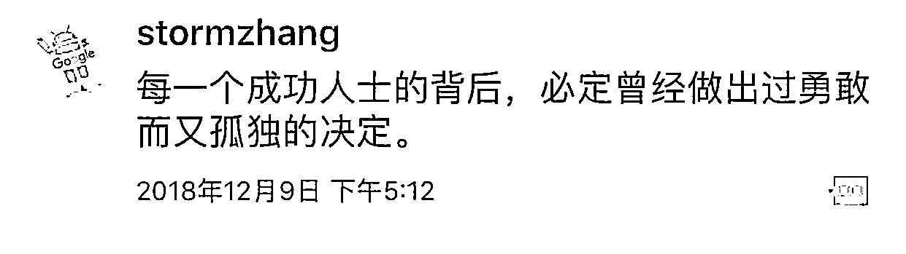

# 四次跃迁：从海外流量操盘到跨境服务平台

又逢周三，生财有术的合伙人专栏如约见面。前两天亦仁在朋友圈写下一句话：那些看起来走得远的人，多半都曾在无人喝彩时做过艰难选择。这句话让不少人心里一动，我也一样。

和不少合伙人聊过之后我发现，哪怕是在商场里摸爬滚打多年的老手，碰到看不清的局面时照样会犹豫、会害怕，有人整宿睡不着，有人几个月愁白了头。可问题想再多还是问题，动手做才可能找到答案；要是被恐惧钉在原地，什么也干不成。创业这件事，说到底就是学会和恐惧共处，然后继续往前走。

本期的嘉宾 Moss，就是在一次次跟内心恐惧较劲的人。他靠海外流量起家，单个细分站点曾做到每月五万美元进账；转身做 Amazon 卖家，黑五周期单月流水冲到五百万美元；后来又整合资源，做出日刷万单的评价团队；如今他把重心放到跨境电商媒体服务上。从流量操盘手到媒体平台创始人，他到底踩中了哪些节点？下面把时间交给他。

大家好，我是 Moss，感谢亦仁兄的邀请。先交代一下背景：我在新西兰和澳洲读完本科和硕士，专业是电子商务与计算机科学。毕业之后一个人跑去美国找机会，做出一点成绩后回国继续折腾，现在还在路上。

回国这些年，我先后待过合肥、杭州、重庆、深圳。眼下公司在重庆和深圳，所以今年基本在这两座城市之间来回跑。有缘碰到这两地的朋友，欢迎一起坐坐。

要是按自传的写法把每段经历都铺开，篇幅太长，大家也未必有耐心。在我看来，人生本就是由一个个阶段拼起来的，可能是事业上的阶段，也可能是感情或身体上的阶段。既然这里是生财有术，不是情感专栏，也不是人生哲学课堂，那今天就集中聊聊我做事业的几个阶段。

作为连续创业者，我在每个阶段都拿到过一些结果，最直接的体现是财务回报。更准确地说，我做的项目都围着同一个大方向转，跨度没有大到离谱。每段经历都给了我很多积累，经验和人脉会推着下一个项目往前走。上一段路像是在给下一段路铺台阶；而新项目启动时，旧项目还能在不牵扯太多精力的情况下贡献现金流。回头看，我运气不错，但每一步也走得比较克制。

接下来按四个阶段展开，希望能给各位一点参考，也欢迎一起交流。

## 第一阶段：海外流量试水与细分站群

大学时我上过一门偏入门性质的课，讲 social media、SEO 和 SNS 这些东西。内容不算深，但老师讲得很有意思，算是把我领进了海外流量这扇门。

那会儿我还是学生，很多东西不懂，纯靠瞎琢磨。我自己搭网站，做产品测评类内容，把 Amazon 上的 review 拿过来加工，再挂 Google AdSense，想靠访问量换钱。结果不出所料，页面看着像回事，实际访客少得可怜，很快收场。

我性子比较犟，没打算认输，就边学边找原因。有两件事对我影响特别大。第一件是读了两本书：一本《长尾理论》，一本 Zac 写的《SEO 实战密码》。前者让我放下只做一两个大站的执念，转向长尾站群、细分站点；变现思路也从 CPM 的 AdSense 换到 CPA 的 Amazon 联盟。后者则帮我把 SEO 的整体框架搭了起来。

第二件事是混进不少黑客群、SEO 群，认识了一批莆田玩家。机缘巧合下，我碰到一个高中生，也是莆田人，在百度和 Google 上做黑五类产品做得风生水起。我狠狠心掏了一万块拜师，他线上教了几个月，带我入门黑帽玩法，比如点击脚本、流量劫持、抓取数据之类。计算机本就是我的专业，只要给个方向，我自己就能钻透。所以有时候，有人指路确实比一个人闷头努力更管用。

系统学了一阵后，路子就顺了。最猛的时候，我手里有 150 个细分站点，其中最大的那个每月进账超过五万美元。那阵子，我还没毕业。

## 第二阶段：转战 Amazon 卖家

临近毕业，我琢磨这事终究不是长久之计，想换个更稳的方向，最好能当成一辈子的事业来做。原因也简单：黑科技用得太狠，后来又碰黑五类，利润高但风险也大，Google 封掉不少站，收入明显受挫。

当时我一直在做 Amazon 联盟，就自然想到：光帮别人导流都能赚钱，自己下场卖货是不是利润更厚？可这毕竟是陌生领域。而且那会儿 Amazon 还没开放全球开店，中国团队也没建起来，想开店只能借目的国的公司或个人身份。想来想去，我决定毕业后去美国碰碰运气，看能不能吃上这波红利。

我注册了一家美国公司，拉了一位有身份的华人合伙，就这么开干了。货源不复杂，从速卖通做代发。那时 FBA 还没流行，基本都是自发货。做 Amazon 算是踩中了风口：平台上老外卖家居多，流量成本极低，刷单也几乎没人管。

我用虚拟机开镜像、配 VPN，养了上千个买家账号。产品一上架就开刷，广告基本不投，同时用直评方式，一个 listing 上架就堆几百条 review，再把关键词顶到首页，坐等出单。差不多刷一款爆一款。后来量太大，速卖通代发顶不住，直接转到阿里巴巴国际站做 B2B 采购。最顶峰时，黑五旺季单月销售额冲过五百万美元。

开局很顺，后面却很难。物流和供应链我抓不住主动权，说实话也不懂行，毕竟是流量出身，产品端比较薄。结果大批订单延迟、退货，账号被平台直接关停，损失不小。但我仍然看好跨境电商：它是外贸出口的新方向，而外贸又是拉动经济的三驾马车之一，中国又高度依赖出口。所以我判断，这行能长期做，况且供应链在国内，想走远还是得回来。

## 第三阶段：评价资源整合与刷单团队

回国后我开始梳理供应链，也谈了不少工厂。Amazon 卖货没停，又做了 Shopify + Facebook 的独立站，顺手接一些代运营。卖家盘子维持得不大不小，2016 年最高做到约 1.5 亿销售额。

可中国卖家越来越多，竞争越来越挤，FBA 还要提前把货压到美国，资金链变得很不健康：利润全滚进库存，账上见不到现金，一旦封号，前面赚的也可能打水漂。所以我必须找新的现金流业务。正好 2016 年底平台出了禁止激励性评价的政策，review 一下变成硬通货。我们抓住这个口子，开始搭刷单团队。

当时铺了五条路：一是美国线下拉人头派单，主要找华人；二是 Facebook 投广告加群控，把人引到私密 group 里派单；三是短信和邮件轰炸拉人；四是用 WhatsApp 群控买数据加人；五是与北美机房合作，配合家庭 IP 渠道自养账号，机器号在系统里自动跑。卖家为了拿评价基本白送产品，只要留评就行，吸引力很强。团队很快膨胀，自然人为主、机器号为辅，规模在行业里排得上号。

但这块业务只能补现金流，终究上不了台面。后来平台打击力度越来越大，黄金期一过，这条路也开始往下走。

## 第四阶段：跨境电商新媒体一站式服务平台

我们押的下一个风口，是跨境电商行业的新媒体平台，这也是公司现在的主业。B2B 外贸出口逐年走低，跨境电商却异军突起，成了出口里的新亮点。政府越来越重视，大型外贸工厂和传统品牌商纷纷进场，品牌出海越来越热。

准确说，我们是今年年初起步，第一步先把流量盘子做大。平台叫跨境电商侃侃网，不到一年就做到行业里流量最大的媒体平台之一。半年时间里，靠社群和分销裂变，三个微信公众号粉丝都过了五万，最大的“Moss 的精神家园”超过十万；同时运营 2000 多个微信社群，覆盖约二十万跨境从业者，付费会员破万。放在一般行业这不算什么，但在垂直新媒体里已经是很可观的体量。前期重点铺公众号和社群矩阵，主战场在微信；后面要把网站流量做起来，形成论坛、资讯、视频直播、小程序、App、公众号和社群打通的完整生态。

线下也没落下。半年内办了一场大型千人跨境选品大会，五场千人干货分享会。我们还借鉴樊登读书会的做法，在全国五个主要跨境城市建了线下社群，定期聚会交流。线上和线下互相导流，慢慢转起来。

不少人问，为什么我们起得这么快？一方面，团队在跨境行业待得久，现有代运营等业务还在跑，能持续产出选品运营干货和一手资讯，内容底子厚；另一方面，我们大量使用裂变和社群玩法，用增长黑客的思路替代传统广告投放。这里不展开，感兴趣可以私下聊。

还有一点，我们把过去做海外流量的思维和方法论，嫁接到国内新媒体流量玩法上，衔接得比较顺，这也是起步快的原因。刚转新媒体时，《流量池》这本书给了我不少启发，推荐大家翻翻。

所以，现在的侃侃网是一个跨境电商一站式新媒体服务平台，目标是助力中国品牌出海。我们为跨境卖家和出海品牌提供最新资讯、实操干货、信息咨询、推广代运营落地服务，以及品牌出海、工厂转型的一整套方案。想做出海品牌、想转型跨境电商的传统 B2B 外贸工厂和国内电商卖家，欢迎联系我，一起交流。

 

评论区：

stormzhang：开头看到自己名字，还以为这期主角是我，转念一想不对，我没跟亦仁聊过啊……
正明Jimmy：大佬能加个微信吗？正好有 Amazon 运营难题想把把脉。
亦仁：图中二维码就是 Moss 的微信。
正明Jimmy：[OK][嘿哈]
Steven：这一期评论有点少。