# 从0到100万利润，我的亚马逊副业复盘

作者：国民弟弟的跨境十年
日期：2022-08-24

鱼丸来找我约稿时，我正在核对订单。她说我的经历值得写出来，我犹豫了一下，还是答应了。毕竟我也是从平凡到极致的人起步，如果这个故事能给你一点参考，就不算白写。

先交代背景：我是Bruce，公众号叫“国民弟弟的跨境十年”。目前在跨境公司做项目合伙人，同时经营自己的副业——美国本土Amazon店铺的零售套利和批发。从月销2000美元做到月销2万美元，我用了半年；副业月收入也从0涨到2万多元人民币。这篇内容写于4月，现在原样贴出来。

**1. 先看结果**
2022年4月某天的主店后台显示，近30天销售额2.6万美元，货值约8000美元，占售价的1/3左右。利润约为货值的一半，即4000美元，折合人民币2.6万元。到8月，月销售已达6万美元，利润约5到6万元人民币。
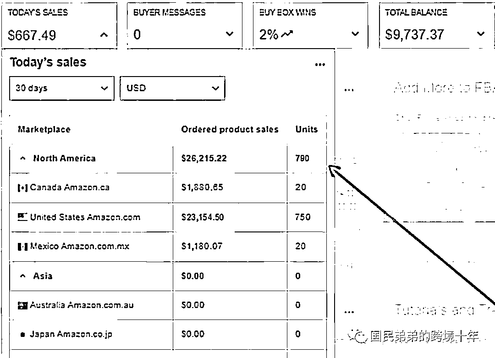
细节图附后，带时间戳。
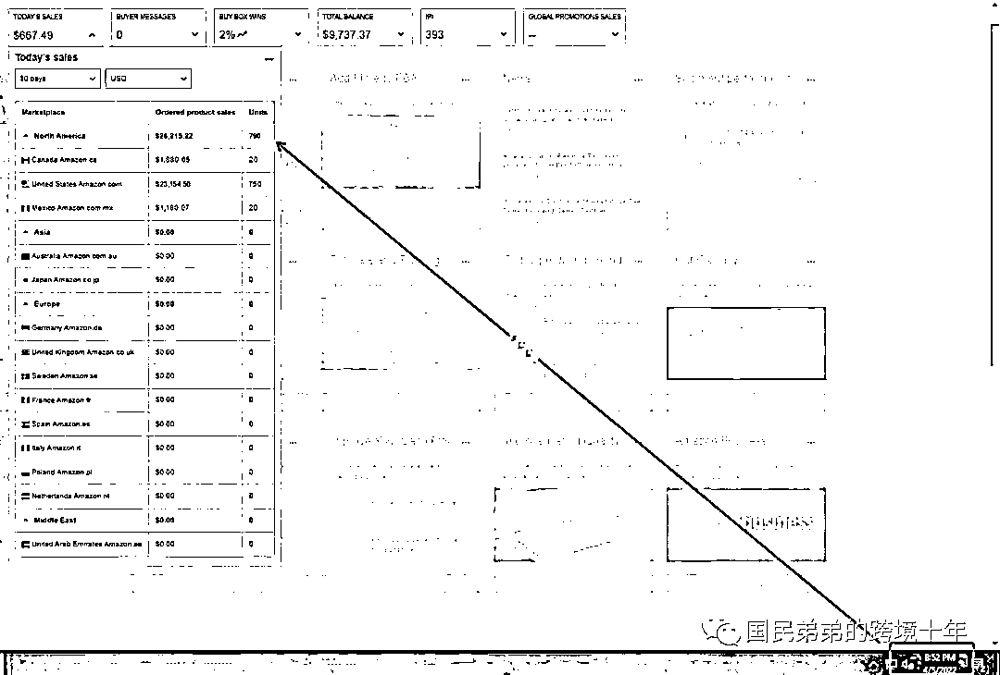
随手截的毛利图，从SKU命名方式就能看出，这款产品毛利接近100%。

**2. 我的经历：从打工人到创业者**
我读的是二本，专业很“万金油”。毕业后先做外贸，后来去东南亚Gap year。回国后在一家公司当户外向导，一年上六个月班，剩下半年穷游。最窘迫时，我在飞机上问空少要了四份飞机餐，又撑了两天。2016年，我进入万科做教育板块，后来因为办公室政治等原因离开。在这个行业待了六七年，却没有沉淀下什么，只留下“做事认真”四个字。30岁时，我在人才市场几乎没有竞争力，只有小公司会勉强收我。

当时我负责宁波的新业务。带我的团队有三个深圳同事，一大早从深圳飞过去，两小时后落地一座陌生城市。前五天都在租车认路。接下来的三个月几乎没有休息，白天定计划，晚上做复盘。团队里只有我一个有经验，其他人都是新手，还有个再过几个月才满18岁的小孩。作为负责人，我压力很大，晚上只能打电话给圈内朋友和其他分公司的负责人。记得我常站在平楼的沥青阳台上，来回踱步，试图找到流量的突破口，像热锅上的蚂蚁。

但客户增长急不来，亲子项目尤其需要信任积累。我又是流量新手，团队忙了一年，夏令营口碑虽好，利润表却不好看，最后团队被拆散。我也随之离开。

这段经历让我决定换行业。我花钱请教过两位跨境前辈，就怕再选错。毕竟现在试错成本太高，宁可赚得少，也不能落得一地鸡毛。2020年末，我从深圳一家小公司开始做Amazon，后来换到一家大型跨境公司做项目合伙人。2021年末，我悄悄启动了副业，目前副业收入已经超过主业。

**3. 为什么选择跨境？**
2018年，我打电话给一位做Amazon的同学，闲谈中得知他年入50万。当时我做项目经理，月薪1万，到手8000。那一刻我才明白，在一个对的行业里用力，效果完全不同。行业选错，比没能力更让人懊悔。
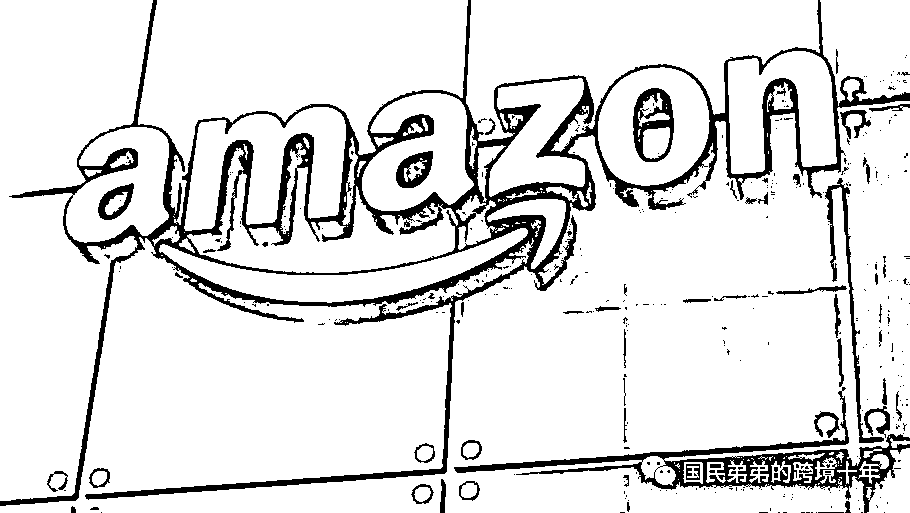
回头想想，世界上绝大多数人都是平凡的，你我都不例外。如果你不是，那你很可能就是那1%的老板。

**4. 平凡人怎么弯道超车？**
答案是找一条持续向上的赛道。判断标准很简单：它是不是在替代旧需求。特斯拉替代燃油车，成了妖股；美国Amazon电商替代线下商超，和当年淘宝崛起如出一辙。未来中国供应链会卖向全球，这个赛道至少还有十年空间。

2020年12月，我从社群了解到Amazon套利。说白了，就是从美国其他零售平台买打折商品，再放到Amazon卖。比如在沃尔玛捡漏尾货，再到Amazon上架，相当于“拼多多进货，淘宝卖”。看到有人用20万本金，4个月赚回20万，我彻底心动了。但因为公司项目太忙，直到2021年3月才真正开始。

当时只能周末学习，面对满屏海外网站和商品，完全不知道从哪下手。我用了最笨的办法：复制采购网站标题，到Amazon搜索，人工比对是不是同款、有没有利润、能不能卖。可白天工作已耗尽精力，一个月下来只进过一次货，店铺几乎没动静。这是5月的新店数据。
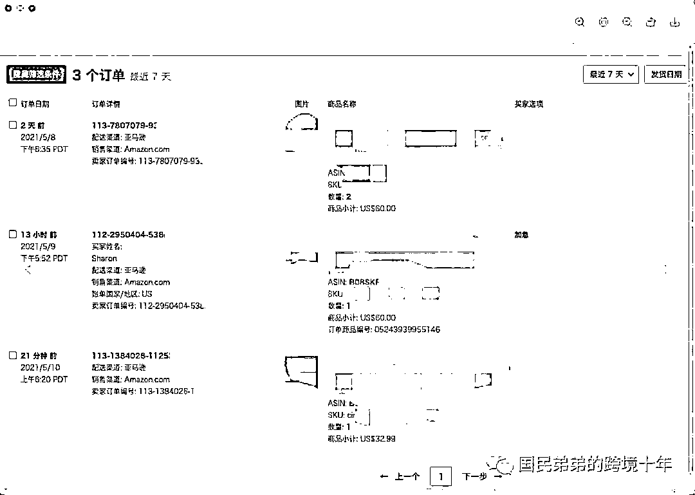
唯一开心的是赚到第一笔60美元。这让我明白：业余项目起步阶段，必须留出整块时间。
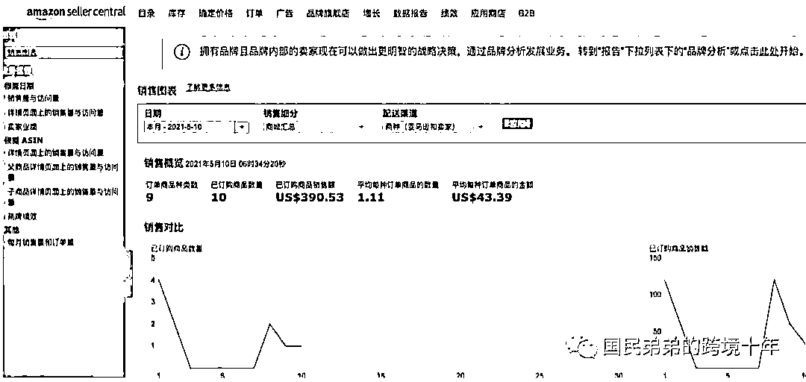

**5. 第一次启航，就被封店**
2021年7月中旬，我终于空出时间准备全力投入，结果刚准备开工，就收到Amazon封店邮件（配图是网图，非正式邮件）。原因是店铺闲置太久触发审核，而店铺是买来的，我拿不出注册资料。这种感觉就像店还没开张，房东就告诉我“不租了”。

收到邮件时，我心情跌到谷底，只想躺在沙发上刷手机，点外卖配碳酸饮料。半小时后，我开始找朋友确认，发现确实无法挽回。坐在公寓台阶上，我盯着天空发呆，脑子里忽然冒出一句：唯一不变的就是变化，你控制不了所有事情，积极应对才是强者——You are not in control。反复念了几遍，我慢慢接受现实。几天后，听说大量中国身份注册的店铺也被封，我反而觉得是提前换了赛道。

**6. 注册美国公司，重新出发**
封店之后，我开始研究美国公司路径。通过美国朋友牵线找到代理，陆续完成公司注册、地址明信片验证和二审。记得某个晚上，我和一位在美留学的朋友视频，从三个备用名字里挑了一个很地道的公司名。就这样，一家美国公司在我小小的房间里诞生了。
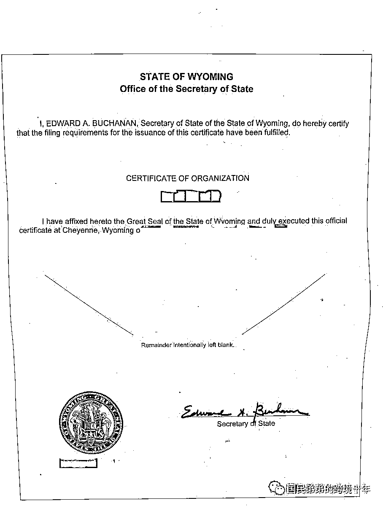
接着我提交资料、预约视频验证。面试官是南美口音的小姐姐，核对资料约15分钟，中间因为格式问题来回了一次，总算顺利通过。8月中旬，新账号到手，权限齐全，那天空气都感觉是甜的。

**7. 有了账号，一切从零开始**
2021年8月中旬，我又开始手动选品。在Nordstrom Rack清仓区，把商品标题一条条复制到Amazon搜索，连续熬了几个夜晚，凌晨三点还在选，仿佛回到高考冲刺。但几天过去，单量依然很少，效率很低。

**8. 遇事不决，就找新办法**
我开始重新啃TA和SM两款选品软件，把能找到的教程视频都看了一遍，又试了一轮选品，终于选出几款毛利30%-40%的产品。正当我兴奋时，美国区的PayPal突然被封。这是我做套利最重要的支付方式，我以为老账号权重高不会出事，结果说封就封。我打了20多分钟电话，对方一个字：No。
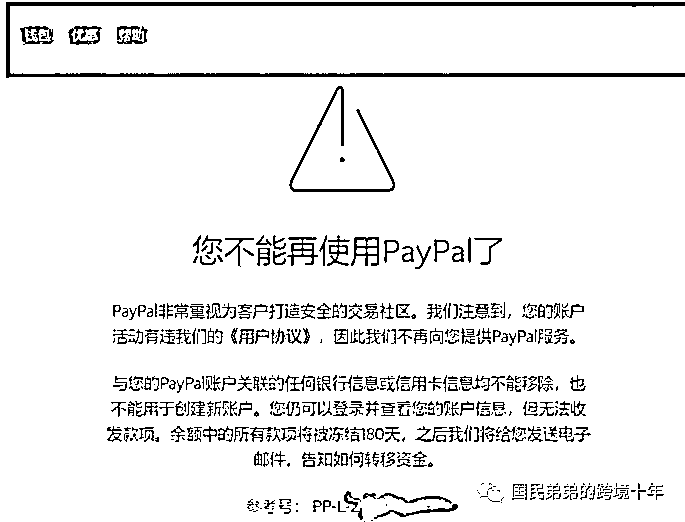
紧接着，沃尔玛、Macys、Academy等平台也开始砍单，我既付不了款，也下不了单。那几天整个人非常丧，躺床上翻遍全网，也没找到同类问题的解法。于是我开始在晚上11点后给美国客服打电话，经常聊到一半断线，又要重新排队。这种状态持续了几周，每天至少3小时。
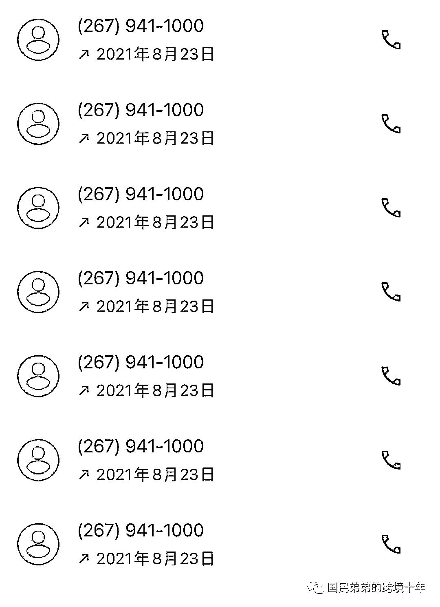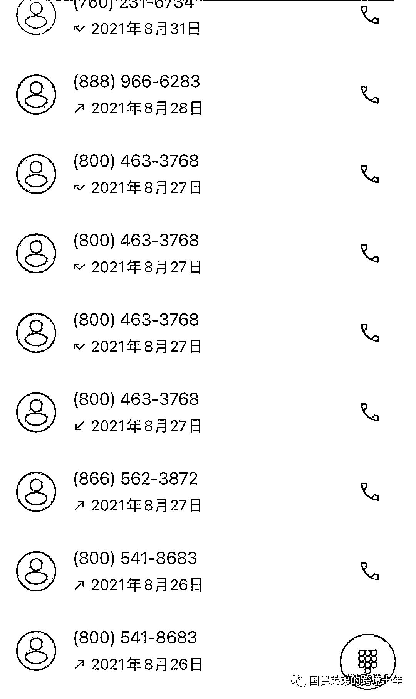
正是这些电话，让我摸清了不同平台的支付规则，也学会了怎么跟客服高效沟通。在没人带路的领域，实践就是最好的老师。支付和砍单问题解决后，我进入下一关：批发。

**9. 批发之路：靠勤奋，也靠借力**
我一个平凡人，能拿得出手的只有比别人更能熬。我用15天时间，从互联网里扒出600个批发商名单，挨个打电话、写邮件。
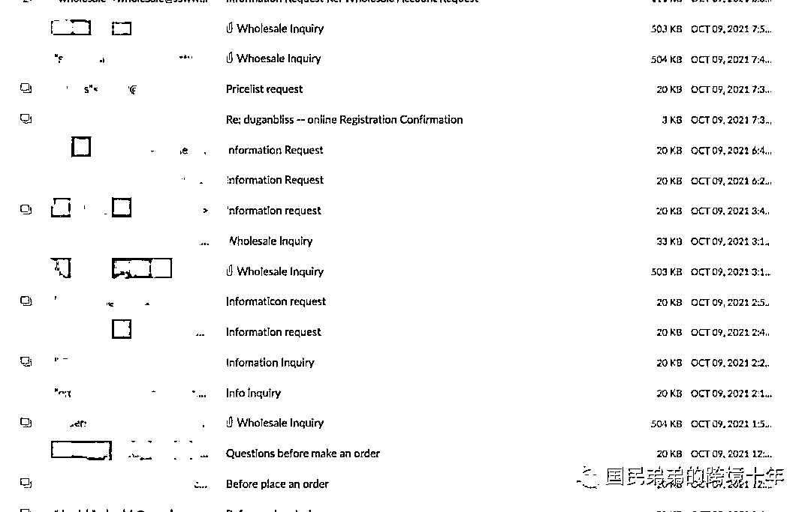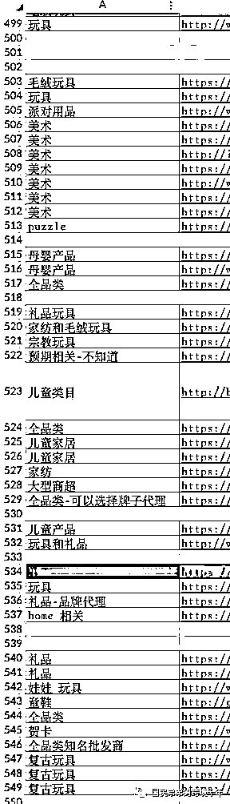
但有名单还不够，大部分批发商要求资质证明。碰了几次钉子后，我想到一个办法：雇美国人帮忙打电话。通过朋友圈找到一位美国老爷子，他闲着没事，愿意低价代劳。
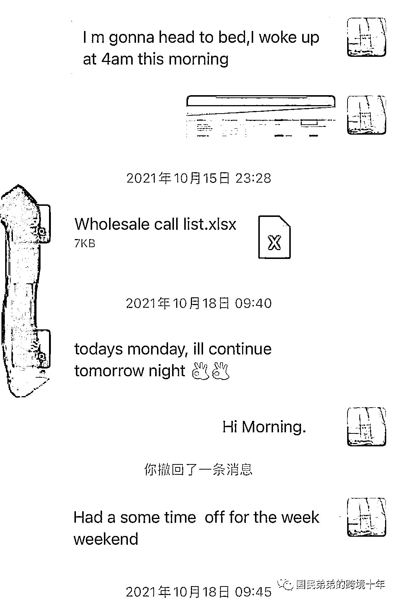
我们配合得不错，找到几个利润可观的批发商。总结下来，本土人之间沟通更顺，年长者做事稳，也更能获得销售信任。

**10. 半年里的至暗与高光**
那半年，很多夜晚我都在跟海外客服battle，只求订单别被取消；很多夜晚我在不同网站间跳转、对比、分析，把选中的产品放进采购清单。第三方贴标服务商曾压着我几十万的货，因为仓库人手不够，我只能等着。我还反复测试IP，研究怎么不被PayPal封号；被封之后，每天三小时电话沟通。
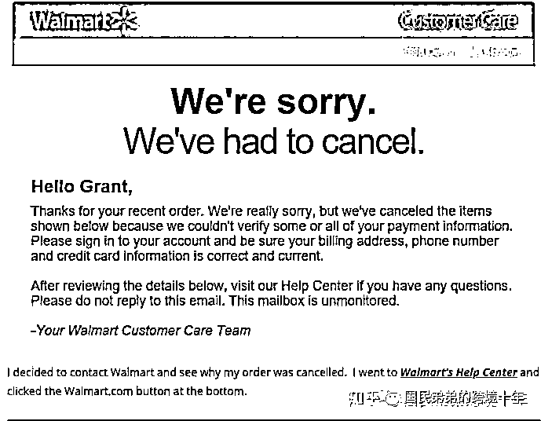
这些新问题逼着我快速成长。我每天看YouTube练商务英语，学更地道的表达；自己搭独立站，做到足够本地化，后来没推广也能出单。我学会电话拜访供应商，聊完正事再拉家常。我还测试出用ITIN绑定美国区的PayPal，降低封号概率；又开通了美国公司主体的商业PayPal。某个熬夜的晚上，我顺手用空壳美国公司申请了美客多、Etsy等平台，这些都是普通中国公司很难拿到的资源。我还批量开了美国信用卡，又开通了美国区的Stripe。到后来，我可以用美国公司开Walmart店铺，也能指导朋友一起做OA套利。一旦跑通，一切都越来越轻松。

**11. 时间给我回馈**
店铺月销售从第一个月2000美元，到第二个月单日20单，再到5000美元、1万美元，最后突破2万美元。利润不断加码，我还请了亲戚帮忙。半年时间，整个局面就变了。这是第一个月2000美元的截图。
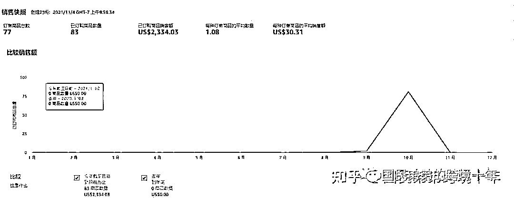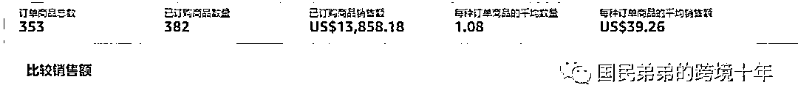
每个环节都成了积累，我能稳定找到毛利50%-100%的高周转产品，个人效率也明显提高。顺手截了一张当前在售产品图。
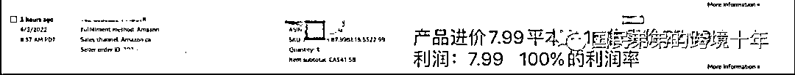

**12. 实践总结**
1. 副业没有速成法，大量前期“垃圾时间”绕不开，每天都要有总结。
2. 提前规划很关键。用美国公司主体之后，后续开通各种权限、办ITIN、申请信用卡都顺理成章。
3. 努力之外要善用资源。没有美国朋友和代理，很多事情在国内根本办不到。
4. 主动学习和提问，能少踩很多坑。
5. 在自己擅长的领域发力，投入比常人更多的时间。无数个凌晨电话，换来了后程的顺遂。
6. 方向比努力更关键。如果我一直用中国公司做Amazon，可能早就撞上瓶颈；美国公司虽然折腾，但给了我更多选择。

现在副业收入稳定了，事情却没变少。我在培养新人运营新店，兼职员工已经请到第三个。今年的100万目标应该不远，终极目标是150万。关于利润，同样没有截图证据。目前我的人民币资产已超过90万，包含卖货利润、知识付费、工资和项目收益，美元账户里还有30万左右。对很多大佬来说，这不算什么，但对我来说，是实实在在的起点。
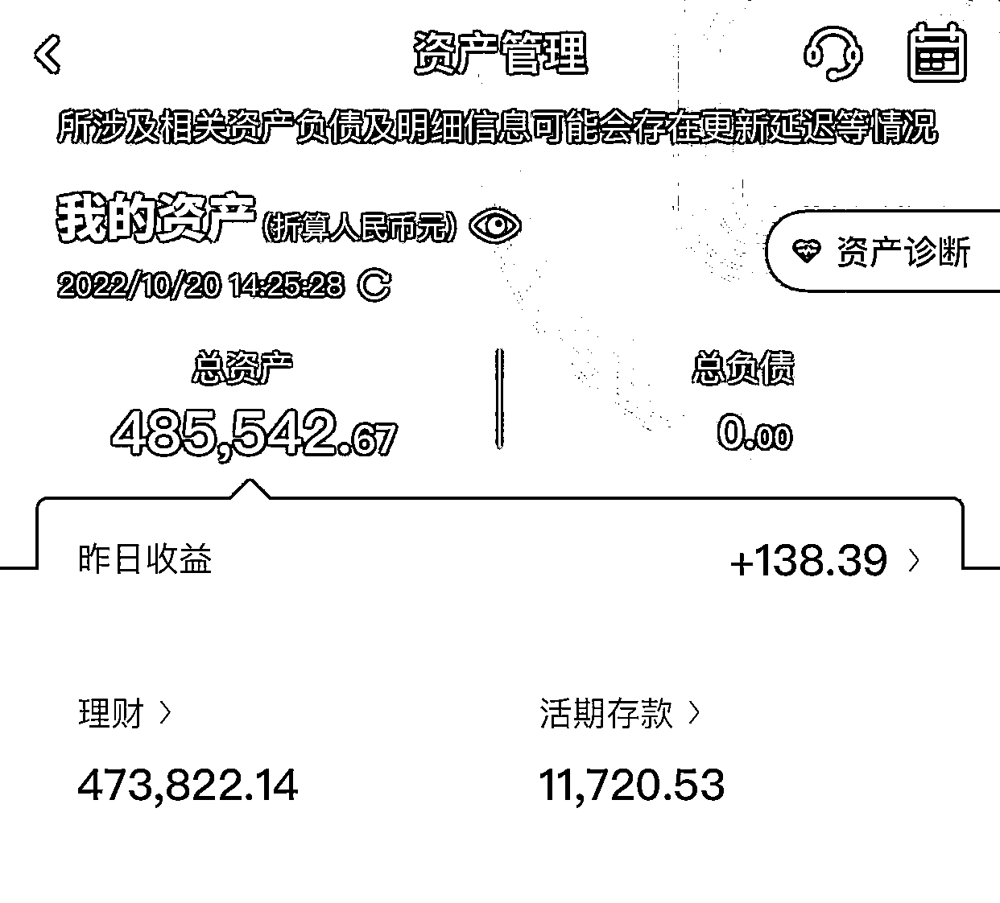  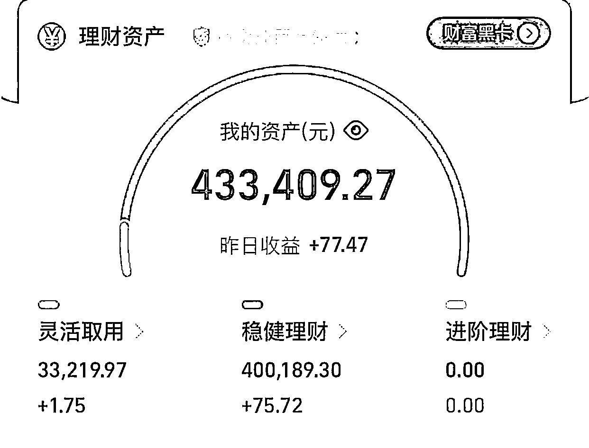

赚到钱之后，我并没有高消费，只给自己买了一辆公路车，偶尔给家人买点东西。美元一倒手就继续进货，让复利跑起来。越是起步阶段越要节省，平凡人的资本积累，最重要的是复利。那些不能带来生产力的炫耀型消费品，我不会买；车子对我来说就不是必需品。我见过有人刚有点现金就换豪车，最后又卖车回血。我依然是个平凡人，写这些不是炫耀，只是分享给同样平凡的伙伴。毕竟大佬也是从平凡起步的。

**13. 最后**
天助自助者，这个世界很公平。

公众号：国民弟弟的跨境十年。我会持续更新美国公司相关的实操经验和避坑方法。

【可提供资源】
1. Amazon套利从0到1，OA高阶及批发经验，个人博客 amz10years.com
2. 39美元低成本注册美国公司及税务资源
3. 用美国公司开通Walmart、eBay、Etsy、美客多等平台的经验
4. 美国区Stripe和商业版PayPal的开通经验
5. 美国信用卡开通经验
6. 海外美元账户开户经验
7. 英国TikTok小店从0到1落地经验
8. 滑雪、滑翔伞、野外急救经验
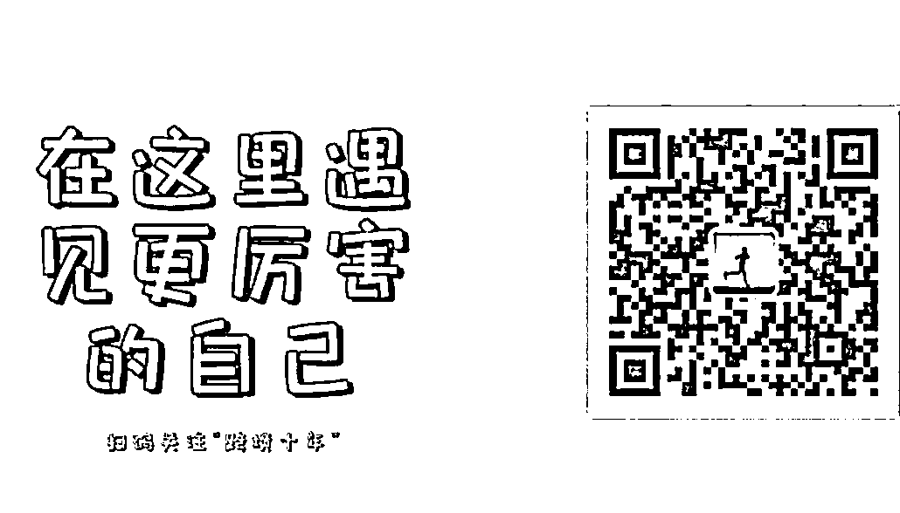

评论区揭开了十年坚持的真相，不是技巧，而是这一点

在amz10years.com那篇关于Amazon OA经验的文章下方，读者留言热闹又真诚。“凯”敲下了一个“牛”字，“倪大胖”点了个“赞”，“苏生”也送了句“厉害”。字不多，却都是实实在在的佩服。

“阿鸿”则感慨：一般人的确是做不到。“曾世拓”欣赏地写道：精神可嘉。比起这些简短的评价，“无念”的留言更让人回味——他说看完文章，能体会到Bruce一路走来的困难，不停向前，不停闯关，真的优秀。他还说自己尤其喜欢Bruce讲过的一句话：主动面对，才是生活真正的强者。

博主“国民弟弟的跨境十年”也在评论区露面，回了一句“谢谢喜欢”。“66”则送上了“真棒，加油”。

几条留言串起来看，大家感动的不是某种高深技术，而是Bruce在困难面前不回避、不退缩的态度。所谓强者，大概就是遇到难题时，选择积极应对的那个人吧。