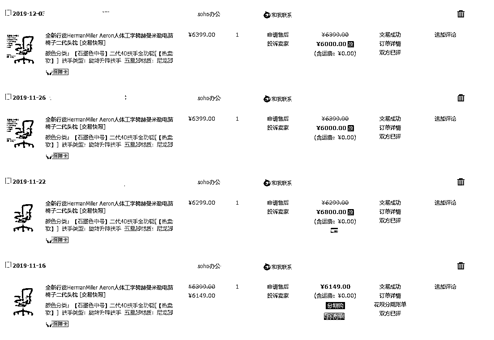
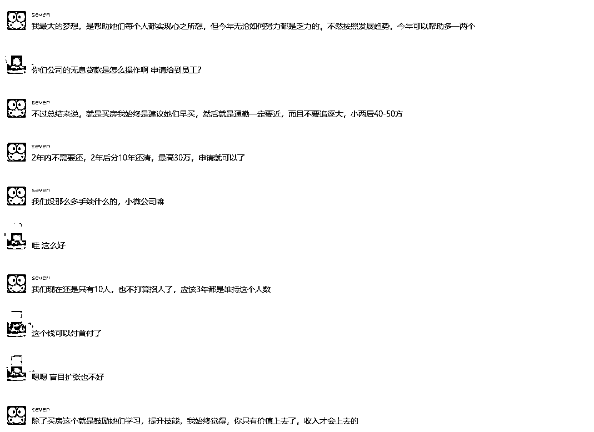
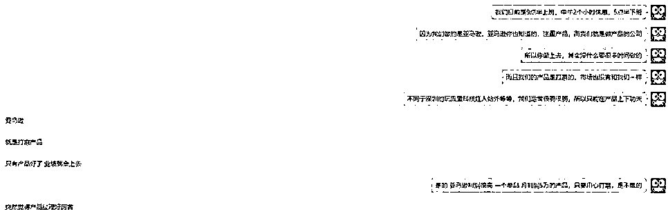

# 价值百万选品法：在细分市场做到单品第一

作者：seven
日期：2020-04-19

这篇内容只聊产品，不聊运营和流量，因为我自己也不擅长。以前在大公司做产品经理，分工细得像螺丝钉，除了产品别的都不会。创业时资金有限，投不起运营，也挤不进那些肉搏战，只能死磕一条路：把单品打磨到市场占有率的头名。

选品这件事，产品决定七成，运营只占三成。只要找到一个需求旺盛、竞争很小的细分领域，把一个单品做到绝对的领先，年利润百万并不是什么遥不可及的事。我用七年时间验证了这条路，也靠它拿到了远超百万的回报。

2014年我进入某谷，一家跨境龙头企业。大邹是老板，平时极少搭理我们这些小角色。有一回他召集产品经理开会，上来就把我们骂得一无是处，说自己重心在独立站，没时间管我们，但今天要教一个杀手锏级的技能。他说，学会这个技能，以后不管在哪做亚马逊，都能闯出自己的天地。那时我还没完全听懂，直到自己创业后才明白，那不是什么刷单黑科技，而是一套产品开发的底层思路。

2019年1月4日，我和合伙人创办公司，五五分账，我有65%的决策权。一年后，两人各自分红超过百万。这条路被验证可行，所以我想把它写下来。

这个技能的核心并不复杂：去和本土卖家竞争，不要在红海里和中国卖家自相残杀。具体做法是聚焦一个细分市场的单品，把产品打磨到市场绝对领先，做成占有率第一。一个细分单品的冠军，足以支撑年利润50万到百万。

我知道好方法一旦公开，知道的人多了就会失效。我犹豫了很久，最终还是决定分享，因为心里有两个更重要的念头。一是希望国内企业能少一点压榨，多一点善待，别把员工当成工具。有人明明盈利，还要借疫情扣工资、强制加班，真是吃相难看。二是希望中国卖家把心思放在真正的出海能力上，而不是窝里斗、丢差评、恶意投诉。我自己的listing也经历过改图、差评、投诉下架，背后全是自己人。这个方法对小白很友好，零起点、小成本，就有机会高概率切进去，获得百万级利润。

我现在带一个六人小团队，大家是平级同事。因为我长期加班落下肩颈劳损，就给每个人都配了赫曼aeron人体工学椅和bose降噪耳机。早上9:30上班，下午17:30下班，中午休息两个小时，配午休床，1:30后强制午休。大小周，小周周六12点下班，上下午各10分钟强制断网休息。学生时代都有课间，工作了反而三小时连坐，这说不过去。年度体检预算每人1200元。盈利分配大致是：15%给同事分红，15%给管理层，40%-50%留作发展，20%-30%用于无息贷款，额度5万到30万，前两年不用还，之后十年还清。目前已经帮两位同事买了房，要不是疫情，今年还能再帮一两位。

我也希望国内企业的收入至少能达到发达国家的四分之一，工作时长别老往1.5倍、1.7倍上冲。效率才是关键，大家都做亚马逊，差距不该这么大。

为什么我们敢这么分？因为我们走的是本土化、高利润路线，不是拼低价。本土卖家数量少、素质高、单品利润厚，所以他们收入高、工作时间短。我们和他们的差异化，就在于用本土思维去做产品：在需求大、供应小的市场里，收集需求元素，做出贴合本土用户的单品，从而做到细分第一。

下面是可以落地的四步实操。

第一步，市场分析。寻找可塑性极强的品类，优先选择以本土卖家为主的领域，竞争小、需求高。用keepa看这个品类是否已经存在很久，存在久意味着我们也可能做两三年甚至更久。还要判断自己能否做到细分第一，然后持续开发，把一个单品的潜力吃尽。

第二步，流量和对手销量分析。用keepa看排名，用Helium 10估算出单量，还可以把商品加购物车观察库存变化，判断对手的真实销量。

第三步，利润分析。先评估自己有没有七成把握做到市场第一，然后用利润表格预估出单量，算清单品潜力。配送费可以通过亚马逊FBA计算器，输入对手ASIN来查询。

第四步，选品实操。锁定一个可塑性强的单品，开始挖掘细分市场。记录热卖元素，也就是需求，包括心理需求、生理需求、衣食住行、吃喝玩乐、喜怒哀乐。可以谷歌搜索“关于衣着的关键字有哪些”来拓展思路。用最大范围的关键词优先在亚马逊搜索，不要先入为主、不要刻板印象，记录平台的长尾词、关联推荐，再自己组合关键词去搜。看产品不能只看表面，必须对客户需求有极强的认知。如果能做到对本土需求如数家珍，就能把多个功能需求糅合进一个产品，做出完全贴合市场的全新单品。

为了照顾行业外的朋友，我举个具体例子。狗碗，也就是dog bowl，这个类目需求非常大，但常规产品只有几美元，已经红海。中国卖家常怎么做？找一款10美元的热销品，发几千个库存，刷单刷评，站外广告全开，再把对手链接搞变狗、改图片、丢差评。这种路子又累成功率又低，新手资金少更别碰。

换个思路：带升降功能的狗碗。一搜，整个市场只有寥寥几家，还都是本土卖家。用工具估算，一天能出80单以上。通过组合款优化配送费后，单品利润能做到50美元以上，一天利润就有4000美元，年利润超过百万。

但光有升降还不够。要调研狗碗的五大需求，比如防过快进食、升降等等。主要通过亚马逊、谷歌、独立站收集有价值评价，提炼需求点，再全部糅合到一款产品上。以前客户要满足五大需求，可能得买好几件产品，花上80美金；我们做出来的产品只要30美金，而且全市场只有这一家。这时候不需要复杂运营，每天投5美金广告，让客户看到你，他们就会尖叫并选择你。价格还可以继续上探，因为你是唯一。

记住：做长尾市场占有率第一，和本土卖家竞争，这就是本土思维。本土卖家从来不打价格战，价格战和恶性竞争是中国卖家才爱干的事。本土卖家中，一年赚两三百万甚至五百万的，大有人在。我身边最好的单品，就是做到了市场绝对领先，价格还比原本最好的对手高。

当你能持续输出高质量单品，你的亚马逊创业才算有了根基。我希望更多中国出海企业像华为、抖音一样，去和本土卖家正面竞争，别再做低附加值的生意。日本、韩国早期也是从低端起步，但后来靠产品和技术升级进入发达国家行列。希望这个行业别继续low下去，而是靠产品和技术赚钱。利润高了，才有能力善待员工。

最后说点个人的想法。我努力让团队里的同事未来能在广州市区买个小两居，哪怕是老破小，也能解决通勤问题。人一天清醒的时间，除去上班和睡觉只剩三四个小时，不能再耗在路上。只要工作有成长性，业余坚持学习，收入会随着年资和能力的提升而上涨，房子总有一天买得起。如果看完有疑问，欢迎交流，我很乐意解答。

工具链接：
https://sellercentral.amazon.com/fba/profitabilitycalculator/index
https://www.amazon.com/gp/product/B00TV1A6IA

评论区：

果¥郡$王：太牛了，佩服！
王子健：真优秀
概率：因为价值观关注了
捕风人：老板还招人不？[呲牙]
Eric：大卖，某谷每年赚好多
allen：向大佬学习[抱拳]
Ryan老陈：正能量的老板，点赞！
Jeremy：小团队可以做，但要做大还是得回归大品类、大单品。