# 跨境选品：怎样挖出有利润的爆款？

做电商这行，日子紧不紧？紧。机会少不少？不少。

本期#赚钱合伙人#请到@小马丁来做分享。他发起过跨境掘金俱乐部，常年琢磨在海外市场挣钱的门道，对跨境电商站点精细运营、谷歌SEO、社交平台推广及内容营销都攒下了实战体会；他经手的商品，曾在厮杀惨烈的亚马逊杀进类目Top行列。

接下来话筒递给@小马丁。

对电商人来讲，当下谈不上最舒坦，但也绝不是最黑暗的时刻。

这篇内容按下面几块来讲：

一、开场聊聊

二、新手阶段的选品逻辑

三、实用选品工具盘点

四、可以照着用的选品框架

五、收个尾

## 一、开场聊聊

各位好，我是小马丁，跨境掘金俱乐部的发起人，这几年一门心思研究在海外市场搞钱的各种路数。

跨境这行摸爬滚打挺久，要说一点成果没有，那也不实事求是。至少在亚马逊这样卷的平台上，我做出过类目头部排名的产品；现在回头想，胸口还会热一下。

栽跟头当然也有。货源和供应链都攥在别人手里，碰上差评几乎使不上劲，最后产品被平台强行下架；那种眼前一黑的滋味，我到现在都忘不掉。

到底是同行正常挤压，还是有人背后使绊子，如今再掰扯这些已经没多大意思；不如把它当成给后来人的一个提醒。

从心里憋屈，到慢慢释怀，再到乐意掏心窝子分享，中间经历了多少心路，只有自己清楚。

我总讲，跨境电商是个行当，众人一起做才撑得起行当；自己关起门来搞，路只会越走越窄。我依旧爱生活，也依旧爱这行。眼下能拉着更多人一块儿折腾，是我给自己找到的行当价值。

所以这篇就从选品说起，带大家下水试试深浅。水到底多深，我说了不作数；跟小马过河一个理儿，自己蹚过才明白。

干亚马逊这些年，我时不时会拧巴：一边觉得好像没啥品还能在亚马逊上做了，一边又觉得明明还有大片空地没被踩过。

前不久苏伊士运河堵了，全球贸易大动脉被掐住，一天就亏掉600亿美元；这事其实在提醒我们，跨境电商的盘子仍然大得很。

那“没啥可卖”的错觉是怎么冒出来的？说白了是我自己把选品想窄了：光顾着扒什么品好卖，却没琢磨它凭啥好卖；眼睛全盯在爆款上，反倒把买家真正的需求晾一边了。

## 二、新手阶段的选品逻辑

选品说到底就是“抄”，但抄的不是同款——那叫跟卖，犯不上选品。刚起步、兜里银子不多的时候，可以按这五条来压低试错开销。

**1.** 优先挑分量轻、占地方小、外观又讲究的品，好看不贵，成本还能摁到最低；

**2.** 挑四季都能卖、需求不飘的硬通货，省得换季时仓库里堆成山；

**3.** 有大牌霸着的类目别硬挤，可也别一头扎进没人问的角落；

**4.** 盯住小众人群的刚性需求，做溢价高、对手少的东西，切进窄市场和蓝海；

**5.** 同类产品里做出自己的花样，别人没有的我有。

## 三、实用选品工具盘点

思路有了就能闭眼选品了？当然不能。纯靠手点页面翻，不光慢，还容易把自己的主观偏好掺进去。咱们的口味、习惯、文化跟海外买家压根不是一回事：疫情那会儿老外疯抢厕纸，很多人看懵了；老外同样搞不懂国人为啥囤米囤面。这种主观滤镜会带偏选品的准头，所以把工具拉进来几乎是绕不开的一步。

**1. 谷歌趋势 Google Trends**

这工具不花钱，对电商人来说相当友好。敲进产品关键词，马上就能看到热度曲线和走向，市场大小和未来势头心里就有数了。比方想摸美国墨镜的底，把sunglasses丢进搜索框，墨镜一整年的需求起伏就摊在眼前了。

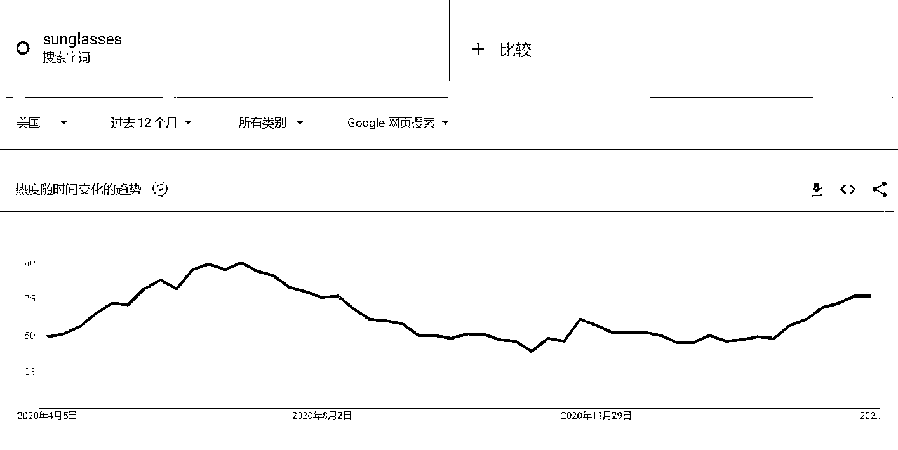

还能拿相近的品摆一块儿比，比如普通眼镜跟墨镜放一起，谁的热度高、谁的需求大，一目了然，选品卡壳时正好拿来拍板。

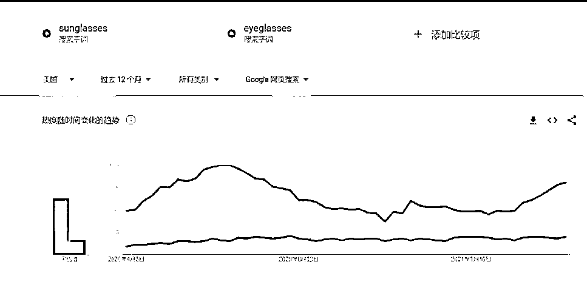

它还能显示产品在美国各州的需求冷热，连带相关搜索词和话题也一并给出来，方便顺着往下挖长尾品、关联品，把目标买家的口味摸得更透。

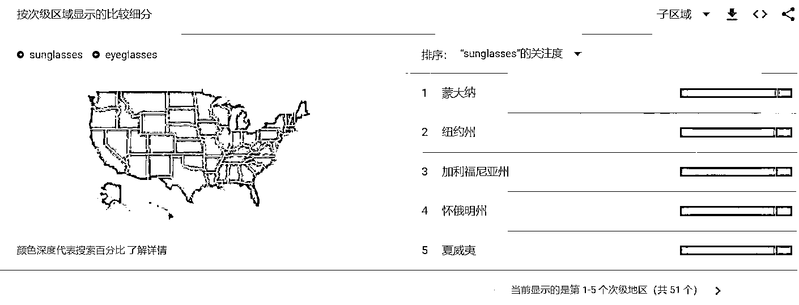

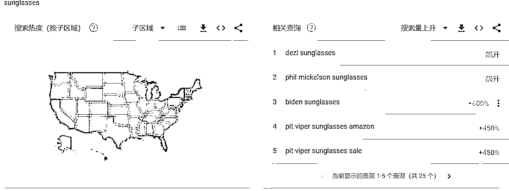

**2. Semrush**

Semrush可以当成Google Trends的加强款，要掏钱，但数据颗粒度更细。网站近期平均流量（按天、按月）、访客来自哪些国家、对手是谁、品牌词能带多少流量、站点投了哪些广告，这些它都能扒出来。拿Semrush拆同行的流量盘子和访客来路，选品时看对手就能看得更准。

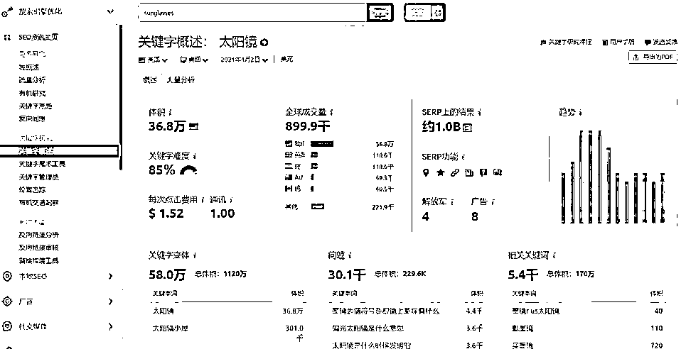

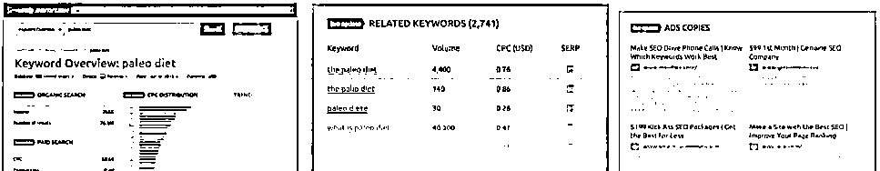

**3. Ahrefs工具**

Ahrefs跟Semrush本事相近、覆盖的活儿也差不多，两个里挑一个用就成，常见搭配是Google Trends配Ahrefs或Semrush。产品搜索量牵出来的衍生词，Ahrefs都能给你捞出来，再拿搜索量和点击量掂量这个品、这个行当合不合自己的胃口。它还能翻出同行在谷歌上投的广告词和广告语，摸清对方投放的路数，回头有针对性地摆自己的词和文案，把广告效果往上提。借助Ahrefs看产品在谷歌趋势里的搜索量走势，过去和将来的方向也能估个八九不离十，顺带把外部行业情报收了。站内诊断、关键词研究、热门内容研究、外链分析、关键词排名追踪，它一个人全包，做SEO少不了；要是愿意付费，Semrush和Ahrefs都值得往深里抠。

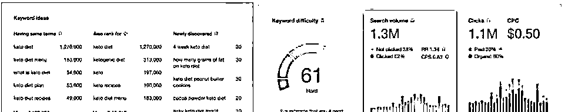

**4. 亚马逊榜单 + Keepa插件/卖家精灵**

用Ahrefs摸清关键词的SEO竞争难度之后，再去亚马逊Best Sellers热销榜看当下什么卖得火，New Release新上架榜看新品苗头，Movers & Shakers榜看人气涨落，Most Wished For榜看存量市场和买家下单意愿。再挂上Keepa插件或卖家精灵，按价格、订单、发货时效、广告产品这些条件过筛子，目标品很快就能圈出来。

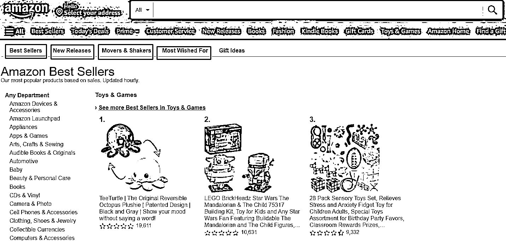

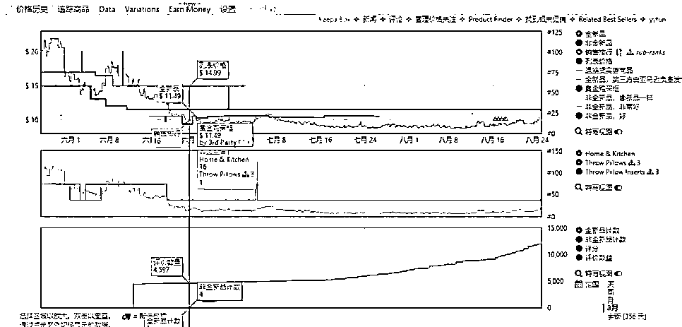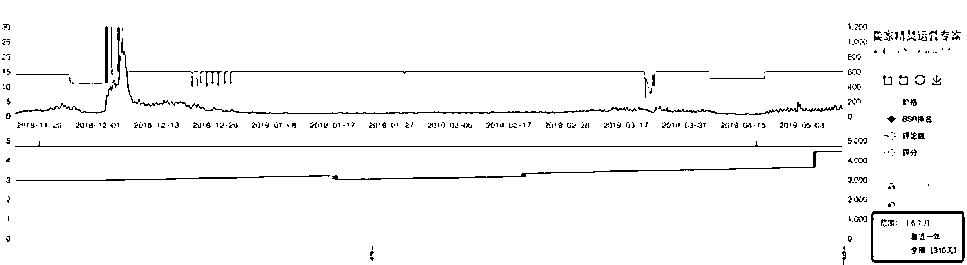

**5. Bigspy**

从亚马逊榜单圈定合适产品后，再拿Bigspy扫一遍主流社交平台上正在投广告的品，挑出点赞和互动量高的广告。结合自身情况判断哪个社媒平台更对路，找出同行里跑得最好的几条广告，它们的广告语和活动策划都能拿来参考，自己做社媒活动时文案也有处借。

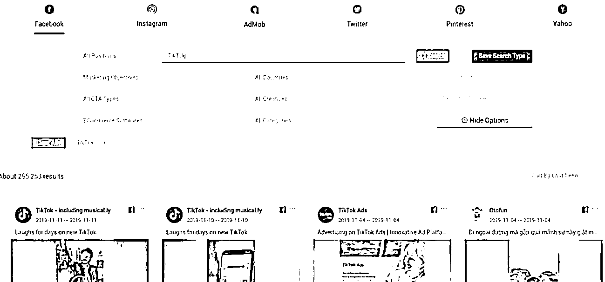

思路加工具搭在一起，图的就是别脑子一热就拍板卖什么，先把市场调研做扎实。

a. 摸清同行什么卖得好、卖什么价，给自家新品开发和定价找个靠谱的数据靠山；

b. 摸清同行站点流量主要从哪来，分析这个类目的主要引流口子，有针对性地导流，少交学费；

c. 摸清同行的关键词怎么铺，帮自己把词布得更全，后期排名上多占点便宜；

d. 摸清买家画像、拆解买家诉求，绕开血拼激烈的市场，甚至揪住痛点切进无人区，一下子跑起来。

说白了：同行缺的，我得补；同行有的，我得做得更细；买家想得到的，我得备着；买家想不到的，我也得替他们想到。

## 四、可以照着用的选品框架

这一套“抄”的路数，不是照搬产品，而是把爆款的内核抽出来，照葫芦画瓢，拿猫的架子搭出老虎的形。听着有点绕，下面把思路和工具捏成一套框架，看看这只老虎究竟怎么描。

**1. 跟卖型选品**

这是选品里最直给的一招，但确实顶用。注意，是跟卖型选品，不是直接跟卖。

拿玩具类目开刀，翻开亚马逊Best Sellers榜，排头名的玩具品就在那儿；再点开Most Wished For榜，发现它照样坐头把交椅。

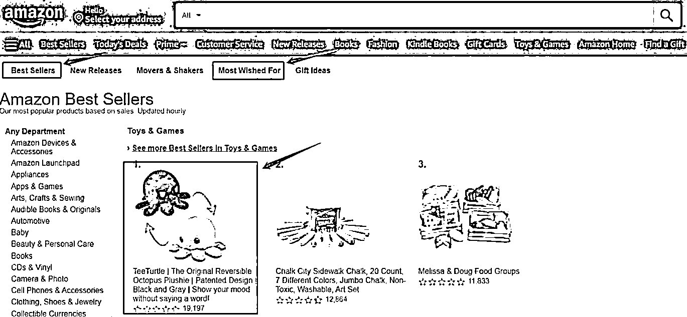

这说明这品够火，而且货还有得卖，市场盘子够大。

为啥咬定是跟卖型选品而不是跟卖？因为我们要抽的是它的内核。在我看来，这玩具的内核就是“讨喜的玩具”，这就是跟卖选品要奔的方向。

接着用谷歌趋势看它的势头，手头宽裕就上更专业更全的Semrush。

谷歌趋势图：

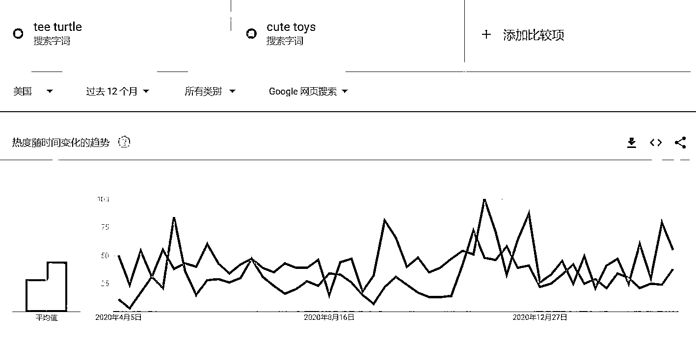

Semrush分析图：

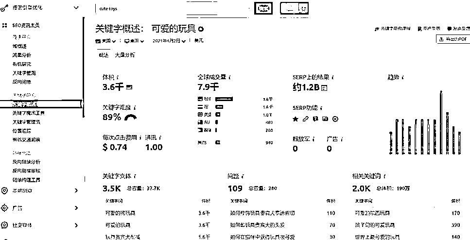

曲线是上下颠着往上走的。再用Keepa插件看价格走势和卖价：

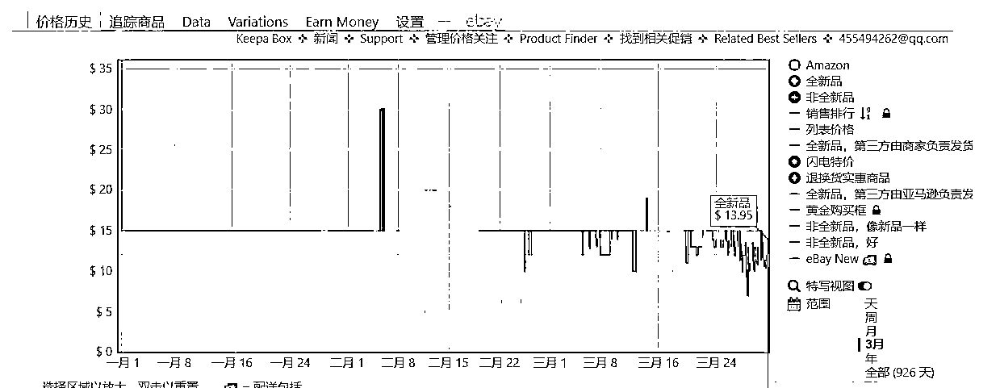

然后去1688瞅瞅同类品的进价：

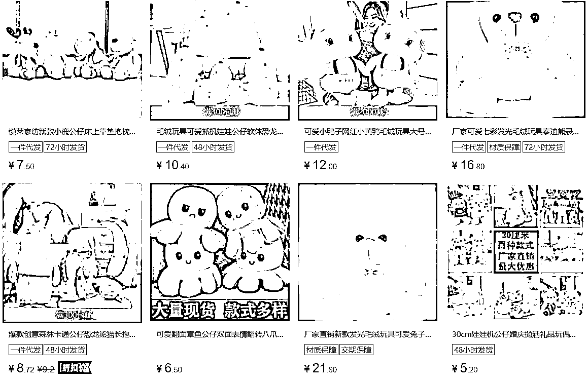

算下来利润能看，选品就可以拍板了。

注：毛利润的算法是，卖价扣掉采购成本、头程运费、FBA费用、亚马逊佣金和收款汇损；欧洲站还得再减VAT税。

整个流程串起来就是：锁定爆款→核实市场盘子→判断产品势头→算清利润→拍板选品。

这套打法搁eBay、速卖通、独立站，甚至各大社交平台上都能使。

拿跟国内百度贴吧有点像的Reddit说事，它特别适合对准某类人群做选品摸底。比如想往宠物类目里钻，虽说宠物市场尤其是猫粮狗粮已经卷成红海，但不耽误拿来练手。你可以去Reddit上找宠物相关的版块；养猫养狗的人话头多、共情强，正好借这股热乎劲儿让热心网友替你干活，你只管撒点样品出去。

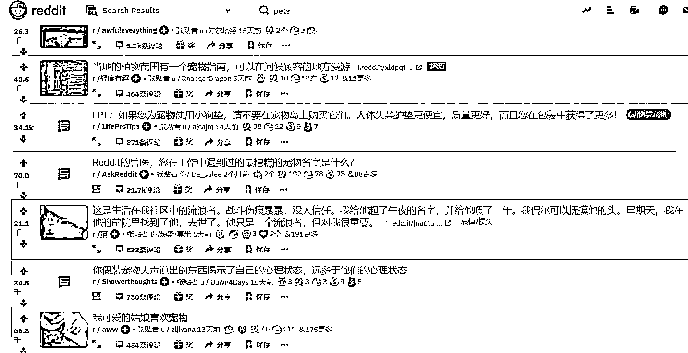

等拍板要上一款品了，也能去对应的宠物小组发帖，请大家对着功能点和图片挑毛病，甚至先送一批出去换反馈；不行就拿回厂里改，这相当于产品正式亮相前的一次试水。往后要是在组里混了个脸熟，请他们帮忙搞定亚马逊测评也不难。眼下亚马逊刷单查得紧，但贴吧这类地界从来不缺热心肠。

**2. 视觉型选品**

瞅着那毛绒玩具连着仨月霸住热卖头名的时候，不得不叹一句人终归是看脸的动物。但视觉型选品不是说品一定得漂亮，审美这事太私人，一千个人眼里有一千个哈姆雷特。我觉着视觉型选品的内核是视觉冲击力得够，那就从“weird”（怪）这个词切进去。

翻亚马逊销售榜，还真能翻出这类货——比如那个长得跟月球似的煎饼，其实是一条毯子。

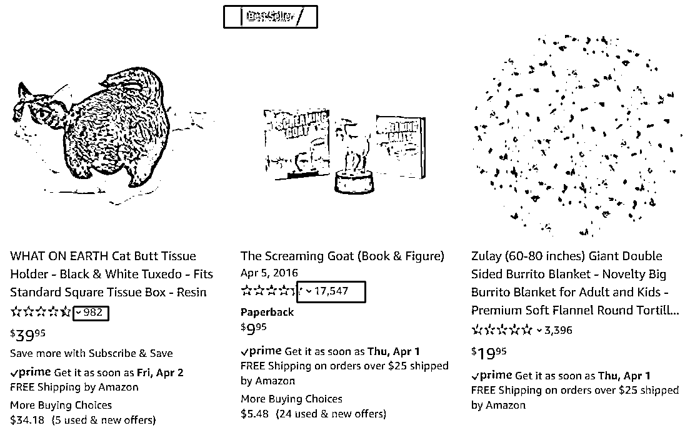

这类品能挤上热卖榜，说明市场盘子够。谷歌趋势上看，这类货也正往上走。

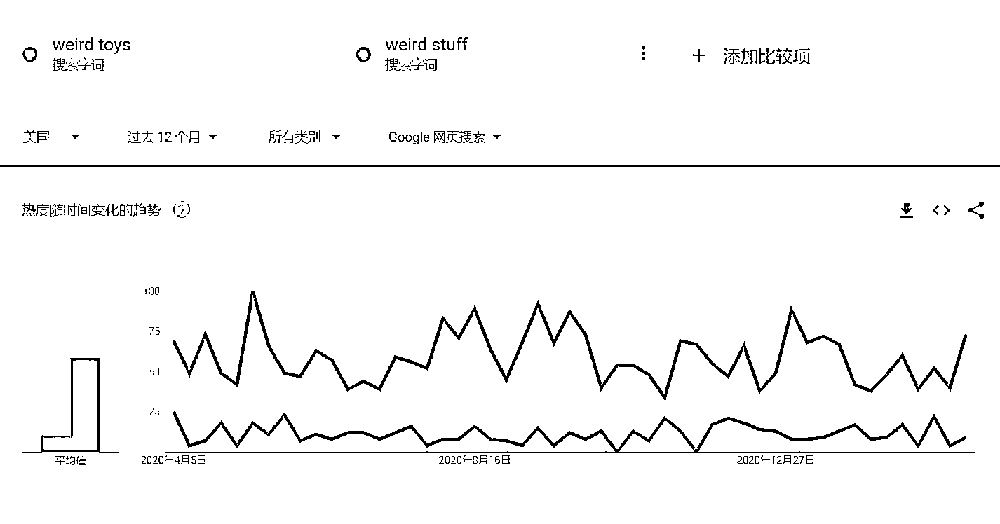

再拿Keepa插件看价格，也算稳当。

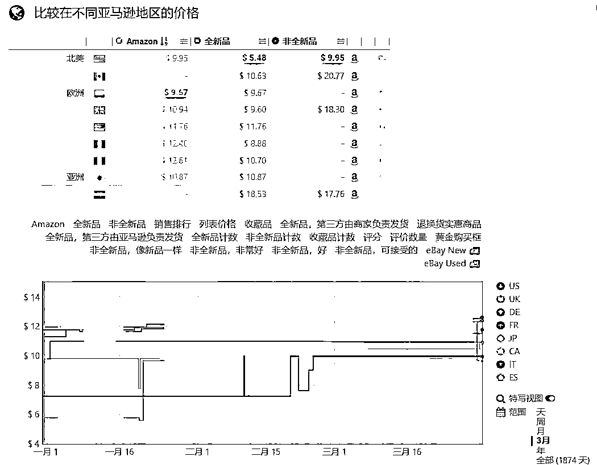

剩下的问题是视觉冲击力还欠火候。后来机缘巧合撞见一组品：

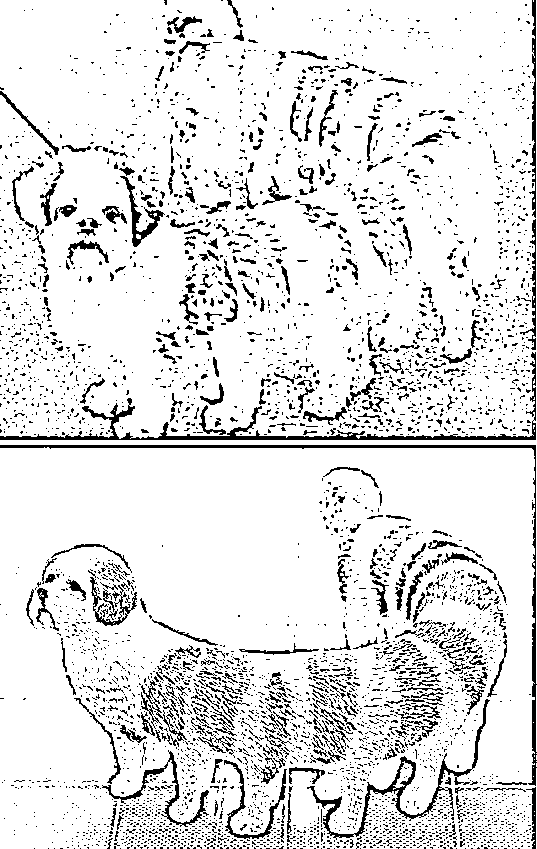

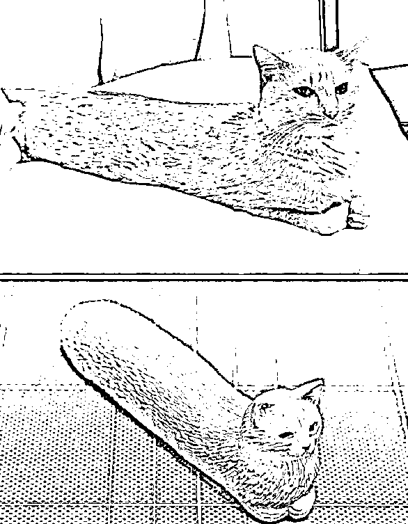

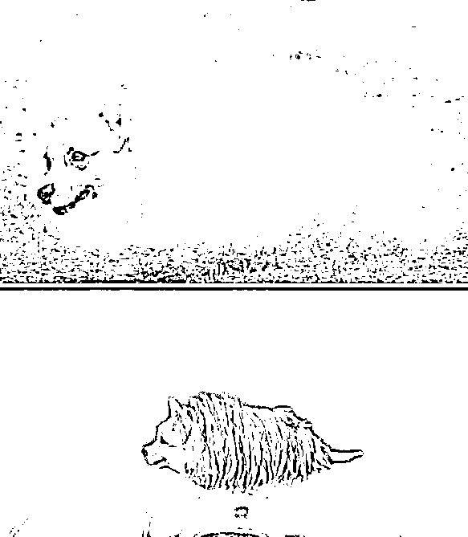

能把网上那些魔性表情包做成实物，冲击力直接拉满。我粗粗搜了一遍亚马逊，搞怪玩具不少，但这个路数的还真没有。配上够大的市场盘子和不赖的搜索势头，要是能摸到生产厂家，或者有厂子愿意接定制，没准能劈开一块蓝海。

**3. 实用型选品**

逛网店的时候，除了被好玩的小物件勾得手痒下单，更多时候是带着明确目的去搜实用品的。所以卖实用类东西也是一种选品思路，核心简单得很：好用。可正因为太简单，反而显得没边没沿。

对着这么宽的核心不知道从哪下嘴时，亚马逊会告诉你它能长出什么词来。直接在搜索栏敲“useful”，一堆联想词条就蹦出来了。

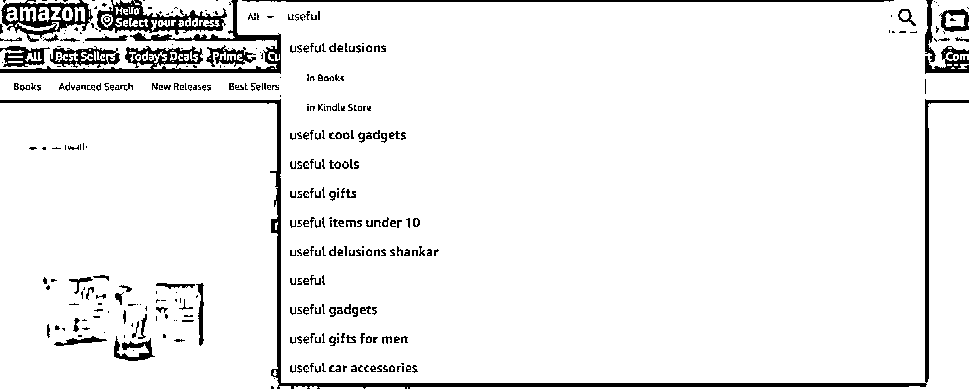

实用型选品有个坑：使用场景一变，产品就容易冒出意想不到的幺蛾子。比如车载手机支架，不卖不知道，一卖吓一跳，差评里净是“手机太重磁铁吸不住”“吸盘吸力不够”“得拿胶纸粘车上，脏了不好收拾”这类话。这就牵出一个小窍门：从热卖品的差评里找选品灵感，看差评拆痛点，掂量有没有改的余地，同时把Best Seller的产品特征摸一遍。自家产品得有点基本的差异化，开发出能扛更多场景的版本。

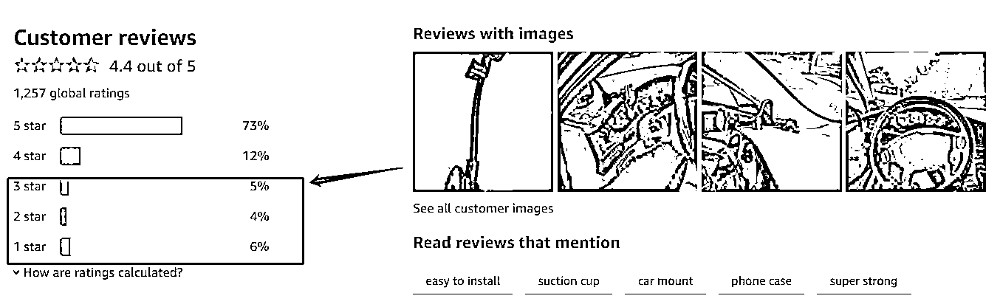

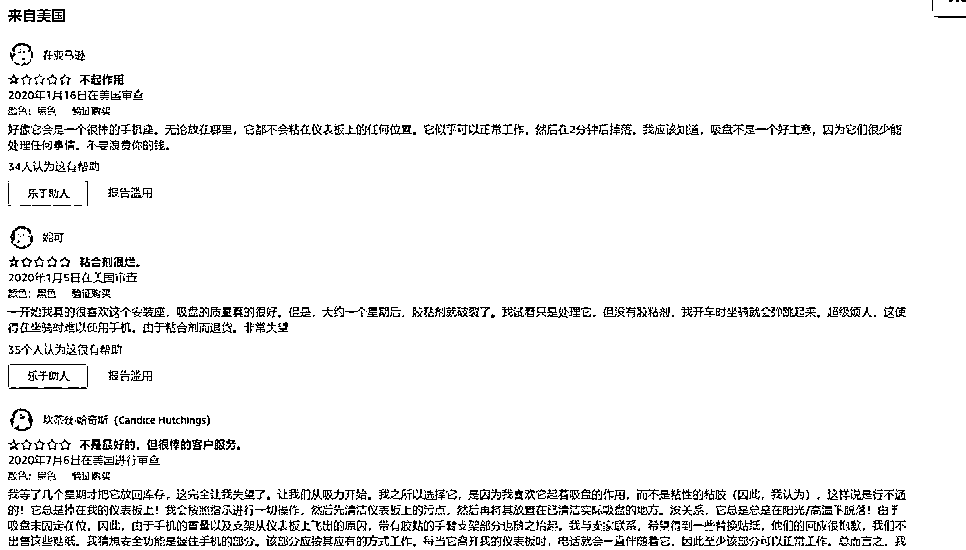

产品本身的毛病、服务上的短板，全都会在这儿露出来，是拆竞品、修自己不能错过的富矿。

**4. 细分市场型选品**

做电商再久，我还是觉得“利基”这词太虚，更愿意叫它细分市场。比如前头手机支架说的做出差异化、开发更多使用场景，其实就是细分市场。同样是玩具，一岁男娃、一岁女娃、两岁男娃、两岁女娃，每一个点都是一个细分市场。

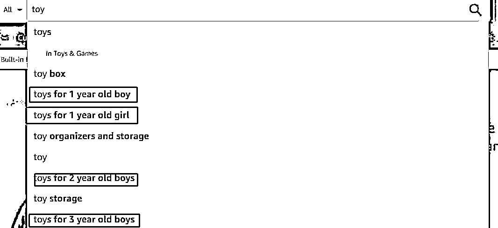

不光亚马逊，还能用谷歌、YouTube、QUORA这些搜索引擎，只看它们输入关键词后能联想出什么词条，用Keyword Tool就办得了。

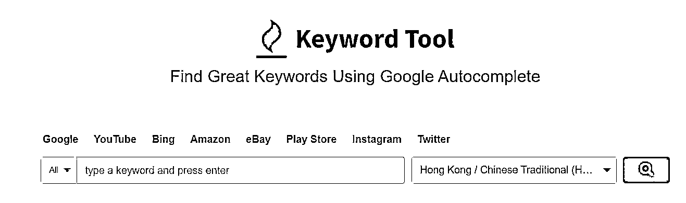

所以细分市场选品的核心，是脑洞开得够大、靶子定得够准，听着拧巴，可事实就是这样。

比方现在要做马克杯，就能拿发散的脑子给杯子加元素，挖细分市场：

节日：母亲节、父亲节、护士节、独立日、复活节、感恩节、圣诞节；

主题：订婚、婚礼、周年、生日、退休、搬家、洗礼、祷告、毕业、怀孕；

对象：母亲、父亲、祖父母、姐妹、兄弟、朋友、医生、护士、教师；

场景：厨房、浴室、卧室、厕所、花园、办公室；

功能：收纳、装饰、保鲜、测量、应急。

脑子飞得这么散，偏偏每一条都对着一个足够精准的细分市场。

前头说尽量绕开季节性扎眼的类目，免得库存堆成接盘侠；但准备做足了，还是能试的，尤其节日，每个节日都是爆单的窗口。要不要赌一把单车变摩托，得自己掂量抗风险的本事。

亚马逊首页的产品类目导航，也是快速刨细分市场的好地方，拿宠物市场举例。

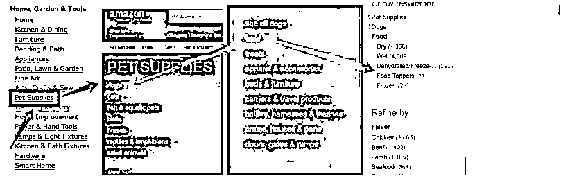

在Pet Supplies > dog > food > wet里一层层往下挑。

再比如家电洗衣机市场快挤爆了，怎么杀条血路？做迷你洗衣机，专洗内衣内裤，专治特定问题。

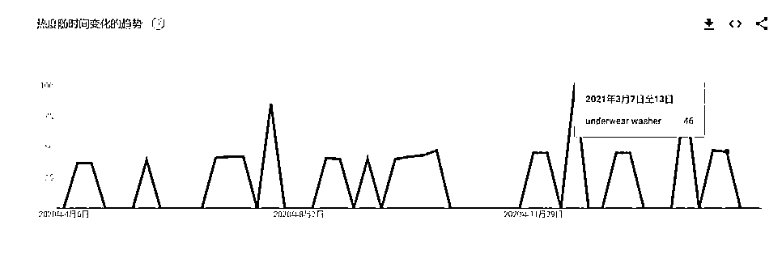

趋势虽说起伏大，可一旦有需求，热度能蹿得老高。亚马逊上也有一定流量，1688进价偏高，但客单价也高。

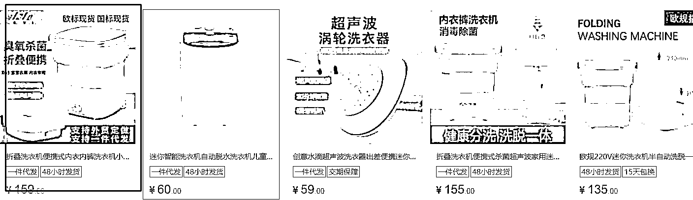

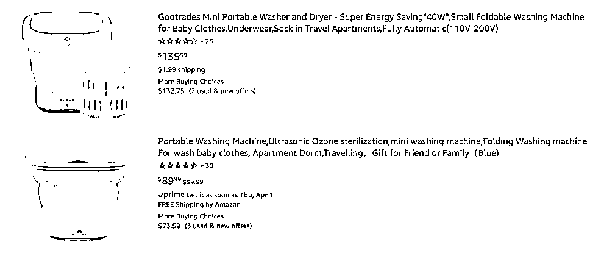

细分市场定下来，就拿前面提过的谷歌趋势图、Keepa插件、Semrush，再加上没提的Jungle Scout、魔词这些工具，走一遍核实市场盘子→判断产品势头→算清利润的“三连”，就能选品了。这种选品要留意不同产品、不同使用场景下的季节性周期问题。

**5. 情感型选品**

从马克杯那套发散细分市场的思路里，还能抽出另一条核心：把品牌故事揉进选品里，靠讲故事卖货。

比如卖家庭亲子T恤，家庭氛围拉满，还能一次走好多件。

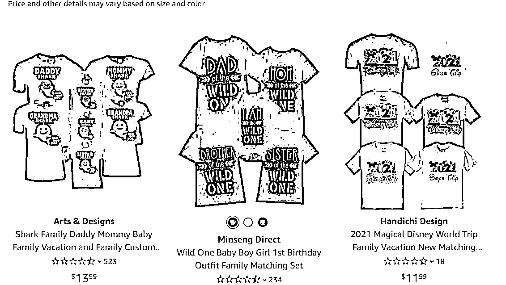

要是觉得情感型选品太虚，那就直接抽产品内核：有一类品能让买家生出认同感，或者说买完之后能获得群体归属感。

比如美国人对文化衫有种咱们不太熟的热情，他们爱搞游行，每场游行就是几千件文化衫的定制，所以在衣服上印Logo也是一条可行的选品路。衣服上的Logo和特殊饰品，是最快最直白亮出自己属于哪个圈子的方式，尤其明星粉丝群体，他们总急着给偶像打call。

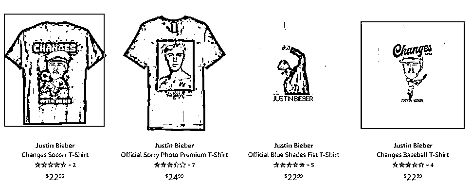

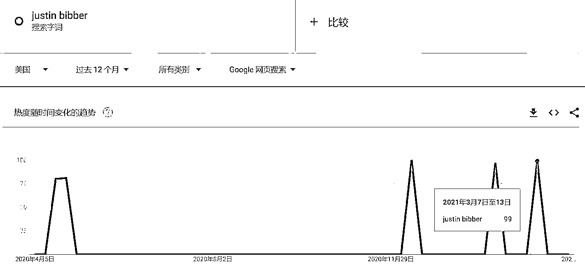

贾斯汀·比伯也算隔三差五冒一波热度的老美明星，总是不甘寂寞。当然，侵权这根弦得绷紧。或者做明星恶搞印花，比如奔跑的小李和黑人问号。

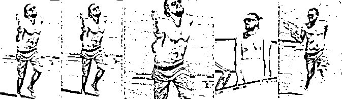

从热度趋势能看出来，这两位也一直在供货热度。怎么把他们带给粉丝、网友的情绪热乎劲儿转成产品价值，就是情感型选品的关键。

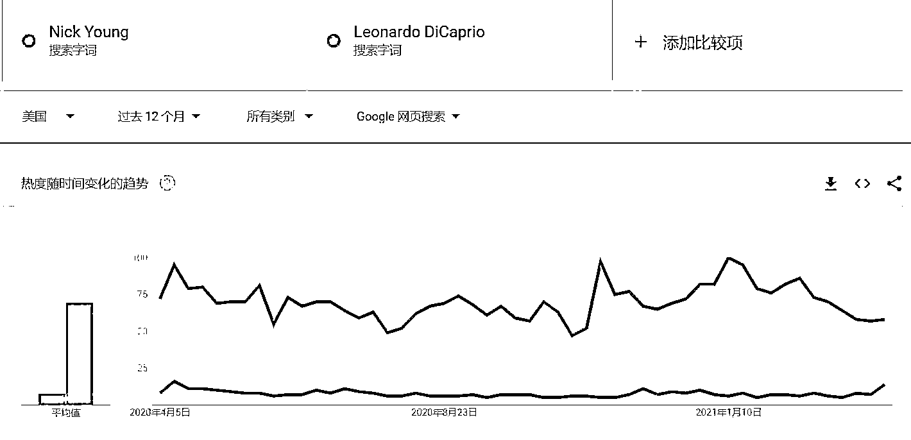

除了主流文化圈子，还能把目光挪到非主流、亚文化群体，比如日本动漫的ACG文化、Cosplay文化，在美国也挺流行，虽说小众，可购买欲旺得很。

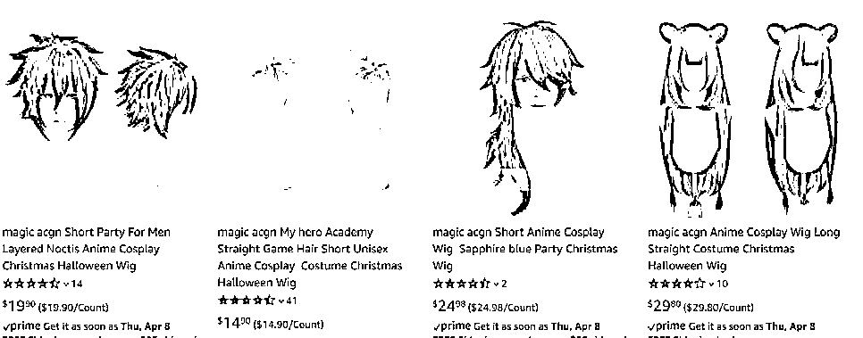

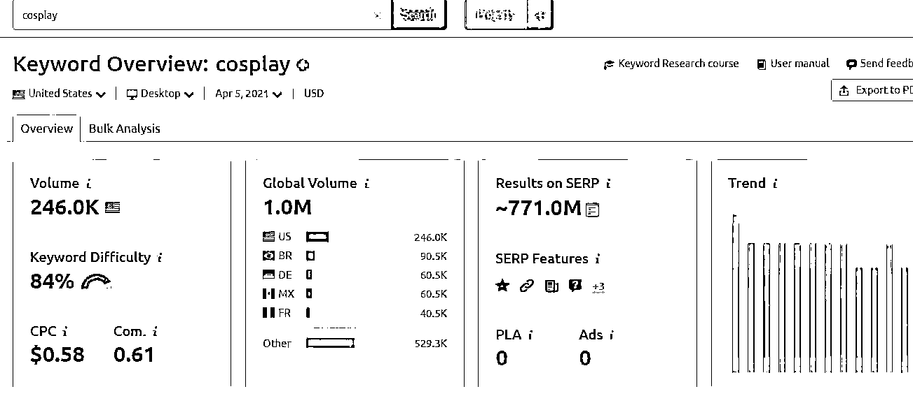

## 五、收个尾

选品没有包打天下的公式。把思路、工具和对买家需求的理解拧成一股绳，多摸底、小步试，才更容易刨出有利润空间的爆款。

做选品，真正的功夫在耳朵和眼睛上——勤于倾听、善于观察，持续捕捉大众群体中涌动的情绪，也留意不同小众圈子各自的文化认同。把这些人群的深层需求挖掘出来，再转化成衣服、口罩、手环、旗帜、手机壳、贴纸等一切能承载“潮流+文化+诉求”的载体，产品就有了灵魂。

从某种意义上说，情感型选品就是情绪型选品。所以，你研究的不该只是产品本身，而是产品背后的情绪。要时刻盯住目标客户的情绪走向，甚至可以有意识地调动他们的情绪。数据显示，超过60%的网购行为属于冲动消费。只要用户看到你的产品就“上头”，选品离成功还远吗？

五、结语

以上分享的，是一整套选品逻辑：由浅入深，环环相扣。哪怕你只参透其中一个环节，再去看其他选品方法，都会发现选品的套路万变不离其宗。想完全靠自己的力量开发爆款，大概率是行不通的。罗永浩做手机的故事就是前车之鉴——他本想造个爆款，最后造出了“锤子”。

归根结底，选品是一个从具象走向抽象、再走向细分的过程。跨境电商选品，既需要放大与发散的思维，也需要细腻的心思。你得靠自己的持续挖掘，培养出独属于你的思维模式和打法，才能沉淀出真正的成果。拥有这种选品思维之后，再舍得投入资金购买工具，并懂得让工具合理搭配、协同作战，照葫芦画瓢，你还有什么学不会的呢？