# 跨境选品：流量、差异、竞争，三关怎么过

做跨境这些年，我越来越觉得选品不是“挑一个爆款”那么简单，而是在挑一套能持续赚钱的结构。以下内容来自我自己的踩坑和复盘，仅供参考。

一个跨境项目要转起来，通常得靠三样东西：产品、内容、渠道。只想赚快钱时，少一样有时也能跑——铺货型爆品站更像“内容＋渠道”的玩法，供应链配亚马逊则偏“产品＋渠道”。但要把生意做长、把竞争力守住，这三样最好都别缺。这篇只聊【产品】，内容和渠道以后另找机会说。

## 01 流量：先弄懂人从哪来

选品选准了，流量往往就顺了。这句话我强调多少遍都不嫌多。

互联网生意说到底是在抢注意力：谁能从密密麻麻的信息里被看见、被点开，谁就更容易在同一个大池子里多拿订单。所以研究卖什么之前，先得搞清楚流量从哪来。

刚接触电商的人，可以把流量先分两类：搜索型、推荐型。它们不是完全分开的，实际常常接近“三七开”——搜索排序里掺着推荐结果，推荐结果又会参考用户以前搜过什么。

### 1. 搜索入口：意向更明确

搜索来的流量，转化率通常更高。人在百度、淘宝或亚马逊敲下一个商品词，多半已经带着了解或购买的目的，意向自然更强。以亚马逊为例，平台成交里大约八成来自搜索。如果你的数据不理想，问题一般出在两段：曝光有了却没人点，或者点进来却没成交——本质上，是客户被同行接走了。这时要反复搜索、对比、调整展示面，一点点把竞争力磨出来。

获取方式：长期做 SEO。

SEO 说白了，就是顺着搜索引擎的规则，把自然排名往上拱，在平台内部抢位置。只要平台有搜索框，SEO 就有用武之地。小红书、淘宝、闲鱼各有各的脾气：美团偏地理位置，淘宝偏销量，闲鱼偏信用。但它们都有一个共同动作——关键词优化。这里不展开技巧，只讲核心：顾客可能拿哪些词来找你，就让这些词尽量出现在商品页里。

有些 SKU 很难被准确搜到。比如透明外壳、内部嵌着金属件的朋克熊挂坠，这类货就不适合放在淘宝这种搜索主导的场子，更适合推荐型渠道。

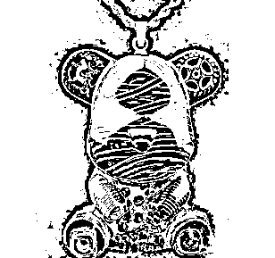

还有一些产品，像手摇切丝机，用户在看到之前根本不知道世上还有这东西，自然也不会主动搜。所以它同样不适合以搜索为主的平台。

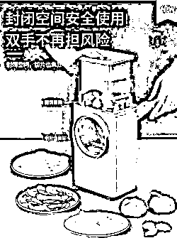

### 1. 推荐入口：随机性更强

推荐流量最大的特点是随机。算法里，人负责定规则，机器负责跑结果，最终呈现很难精准预判。拿抖音来说，视频会先丢给十个标签相近的人试水；如果十人里有三人点赞，就再放给一百人的第二批池子，如此逐层滚动。假如碰巧前十个用户都没点，这条视频就很难继续传播。于是同一个视频在不同账号上数据可能天差地别，也就有人拿多个账号发同一条内容碰运气，往往能跑出一两个。后来平台加强了查重，重复内容会被限流，矩阵玩法也就走不通了。

获取方式：精准标签＋内容。

想提高推荐流量，一是让每批受众更准确，二是打磨内容、提升点赞率。前面提到的手摇切丝机，使用过程本身就是好素材，教人如何轻松切菜，很适合推荐流量，尤其适合短视频这种承载量大的媒介。

以上关于自然流量的判断，放到广告投放上同样成立。

## 02 差异化：别让货在货架里隐身

这张图我很喜欢：格子完全一致，里面小鸭各不一样，可我第一眼只注意到蓝色那只。它其实不算好看，却成功抢走了注意力。

淘宝也是同理。很多商品过于标准，和旁边同类拉不开距离，一页铺开就被略过了。淘宝还能在主图上做视觉文章，亚马逊则基本只能放干净的纯白底图。

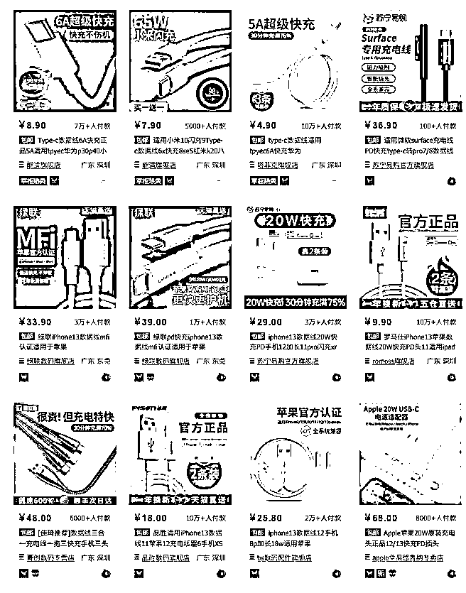

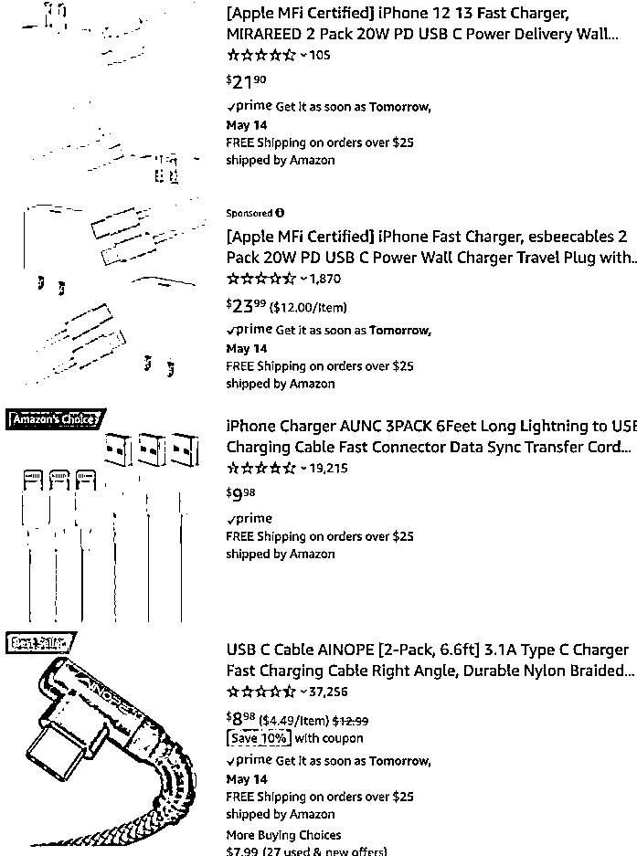

（搜数据线：上方为淘宝，下方为亚马逊）

可见外观差异化是商城货品的突破口，尤其搜索型商城——同类全摆在一起，用户很容易犯选择困难。

说到数据线，就绕不开 Anker。看看别人在亚马逊是怎么做的。

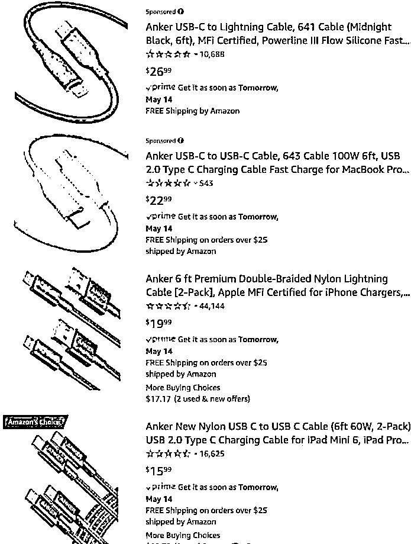

（亚马逊搜索“anker”的结果）

数据线在 3C 里算标准化程度极高的品类，但在亚马逊搜 Anker，再对比上面那批白色公模产品，无论配色、设计、材质还是造型，各维度都明显更能打。Anker 很重视产品外观与电商呈现上的差异，单是数据线就做了八款配色、五张视觉图。数据线本身技术门槛不高，在华强北跑一天，能碰到上百家同类供应商。

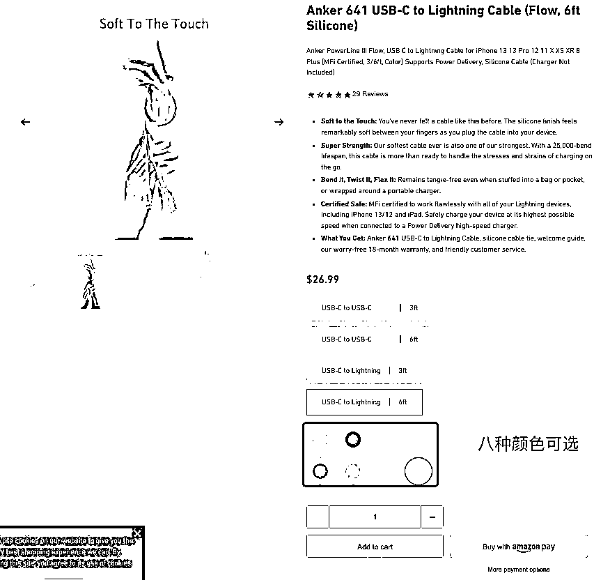

（Anker官网数据线产品页）

做商城，就该在外观差异上多下功夫，做出真正能被记住的区别。

## 03 竞争度：算清楚再进场

好项目很多，赚钱路子也不少，可一旦涌入的人太多，僧多肉少，大家抢得太凶，蛋糕就不够分，最后收益还抵不上辛苦。

比如在人流旺的地段卖早餐，原本生意不错；旁人一看有利可图，周围连开十家，活没少干，收入却只剩十分之一。

线上又是另一套局面：一个流量大的位置只有一个铺位，谁租下谁吃全部流量。于是十个人竞价，有人算完加租还能赚一成，干了；有人算完剩半成，也干了；有人只剩百分之一，想想没别的出路，还是干。最后利润最薄的人拿下，累得够呛还赚不到钱，收入都交了租，房东满盆满钵。

电商行业里，平台方就是房东。你们竞争越激烈，它赚得越多；最后除平台方之外，大家都不算赢家。所以选品时，竞争度必须严格纳入判断。

两种流量差异大，这里还是分开研究。

推荐流量

卖家时间通常不宽裕，没法经常刷国外软件看推荐产品、找选品灵感，这时就只能借助广告监控工具。比如 PowerAdSpy 就是典型的广告追踪软件，可以在上面批量查看广告。这类广告数据化工具不少，能让你直观看到热门广告、点赞数和评价数。

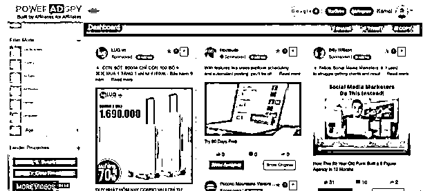

（选品会用到的广告工具）

有时你会在广告间谍软件里看到很有意思的热门产品，但一定要保持理性。产品酷炫不等于能卖，有些广告只是特效广告，真实情况根本没这种产品，COD模式里尤其常见。另外还要考虑货源：不是所有产品都能在1688找到。如果对产品预期很高，供应资源却跟不上，那也只是空谈。

到2022年，这类广告间谍软件已经比较落后了。太多卖家在用同一款软件、看类似数据，最后大家都赚不到多少钱，因为爆款生命周期太短。

关键词难度

关键词研究工具很多，较好用的有Ahrefs、Semrush，不过这两个不便宜。我每个月在这些工具上大约花五千元，作为个人能力补充，还算值。

Shopify选品可以通过关键词展开。核心逻辑是找到搜索量高、竞争较低的核心关键词，再进入市场做这个产品。必须说，这个策略最难，因为我相信八成关键词都已是血海。想找到剩下的蓝海非常难，但用合理手段仍有机会。

这里重点看三个指标：KD、月搜索量、趋势。

**Keyword Difficulty（KD）**

它反映竞争激烈程度，范围从百分之一到百分之百，越高越激烈。一般八成以上基本不用想；六到七成仍有市场空间；四到六成值得期待；四成以下通常更理想，但这类词已经很少，往往是品牌词或长尾词。顺着长尾词去找品类里最标准的词，难度常常又回到八成以上。

**月搜索量**

它反映市场需求。一般认为，近似词累计不足一千的市场完全不值得做。但有一种例外：头五个词的搜索量都接近且很大，说明这个商品没有标准叫法，叫什么的都有。这时你只要能在一个叫法上做到第一，分到的流量就很多。

**趋势**

它反映市场未来。如果是缓慢增长，说明还有未来；如果是迅速增长后到了平台期，等你入场时红利大概率已经过了，下一个红利期一般又要等三年；如果是下降趋势，就好好考虑还要不要进场。

特别要注意，有些周期性产品永远有机会，比如泳衣。今年夏天前大量推广前两年的爆款，仍然可以获取不少流量和收益。

## 04 用户生命周期价值（Lift Time Value）（略超选品范畴）

LTV指的是：你的用户平均每人一辈子能在这里花多少钱？

如果做3C或自有品牌，这个板块设计得好，会成为超级大招，直接让利润翻几倍。它偏向商业模式和企业战略设计。如果你是新人卖家或大厂打工人，在这类决策上基本没太多话语权，可以忽略。

### 1、搭卖

一个买衣服的人，近半数愿意再买条裤子来搭这身；如果有帽子，还能再加一顶；再配双鞋，整套造型就齐了。当然这是理想情况，但一般来说，这样卖一定比单卖一件衣服利润高。

搭卖不只在产品上设计，店铺布局和运营也要配合好，才能循序渐进引导用户二次加购。注意，搭卖的产品必须目标人群高度统一，才能提高每次加购的可能性。小米就是典型：品类很多，但都围绕“朴素却追求智能”的男性用户来设计，所以会让人买了又买。

### 2、软件增值：

如果做的是3C类产品，恰好你是品牌方，又恰好产品需要个App，那么恭喜，你已经脱离3C制造业的低利润陷阱了。

3C属于制造业，成本高，服务成本也高，利润普遍低。而且产品耐用，正常一个小家电能用三五年，复购率自然低。但如果App里能提供一点点增值服务，事情就不一样了。

比如海康威视的监控系统，一套下来几百元；要加“人脸识别”功能，每月租用云服务二十元；再加“车牌识别”，每月又加二十元。对用户来说，真有需求的话，每月这点费用影响不大；对品牌方来说，这个机制很容易让第一年利润翻一倍，而且明年还能继续收。

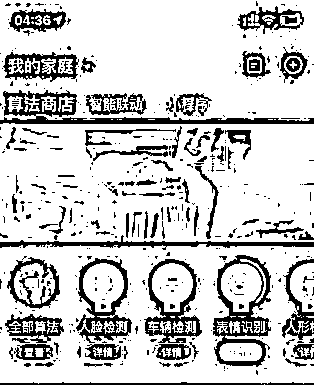

（海康威视App里的算法商店板块）

还有华为手表，整块表定价不过一千五，买回来下载App后，发现还能买表盘，最贵的甚至到八十八元。

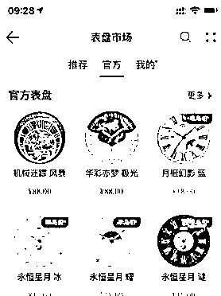

（华为健康运动App——Watch GT 2——表盘市场）

这里还是要回到用户画像：华为用户一般购买力不弱，也支持国产，花八十八元支持一下国产表盘，其实没什么不妥。

### 1. 耗材：

如果一个3C品牌想让用户源源不断想起你、购买你，耗材一定是最性感的。

我第一次听到这个说法，不是在跨境电商，而是飞利浦电动牙刷。

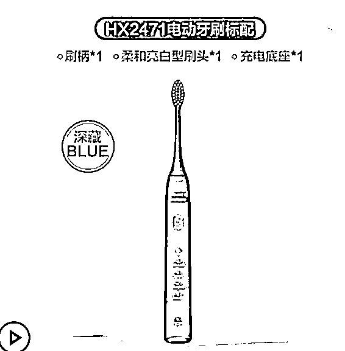

这只牙刷价格五百六，应该加了产品设计费和品牌溢价，所以第一批利润估计也还勉强。但它的刷头每隔一段时间就要换，于是就有了下面这款产品。

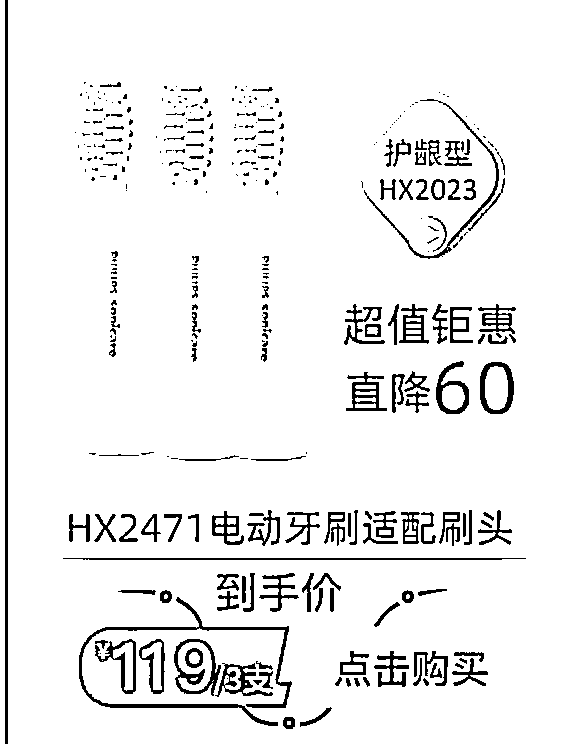

这种刷头，说实话在国内批发价三支九块就差不多了。但它是飞利浦专用，而且上面那款牙刷的用户消费力很强，根本不在乎这一百元差价，所以刷头高价也不愁卖。

算一下利润：三个刷头毛利润一百元，大约用一年；电动牙刷毛利润我估计在三百元左右。于是利润就变成【300+100×年数】。这就解决了一个卖家痛点：3C产品耐用导致复购低。这个模式用得越久，复购率反而越高，换刷头这个机制也容易让客户接受。

但是，有两个点必须注意，否则耗材会被大量平替，别人抄刷头就会流失一部分用户。

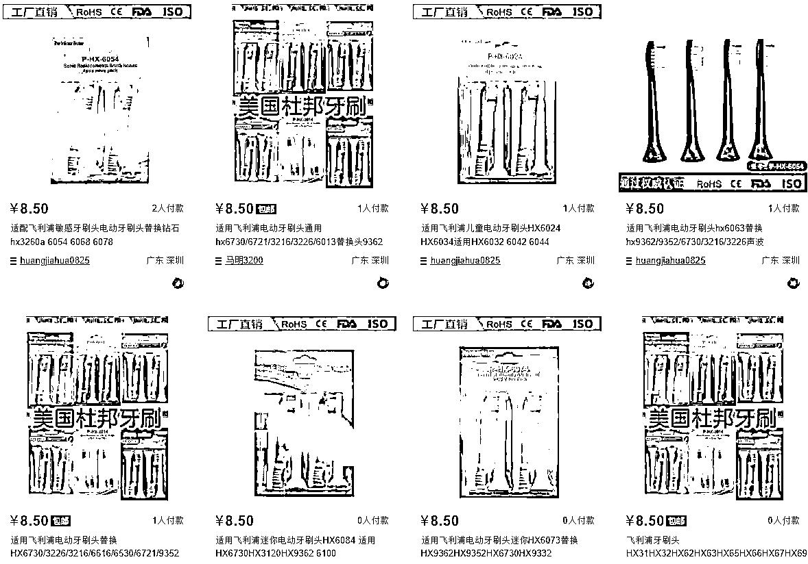

（淘宝上在卖的飞利浦平替刷头）

第一，耗材要包装得有点技术含量。比如“纳米材料”“Tritan耐热科技”等，用这些词抬高价格壁垒。因为便宜货说自己有科技，即使是真的也没人信，哪怕这个科技本身其实很便宜。

第二，定价要回归用户人群。再说一次这个点：如果飞利浦牙刷定价是两百元左右，客户人群就会更追求性价比，这时你卖一百一十九元三个刷头，客户就会去找四十元左右的平替。

类似模式，蓝月亮也玩得很溜。

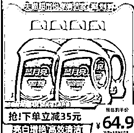

洗衣液用完了，客户会想“该换一瓶洗衣液了，想想买什么牌子”。但如果你知道有下面这个东西，决策就会变成“我什么时候该去买一瓶补充液”。这个方式直接斩断了客户选择竞品的可能性：只要上一瓶用得不算太差，补充液总比新买一瓶便宜。

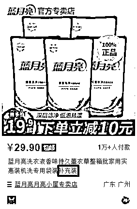

以上就是我用约五千字分享的跨境电商选品思考。

END