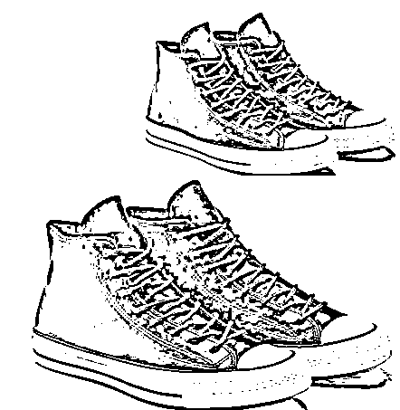
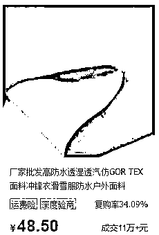
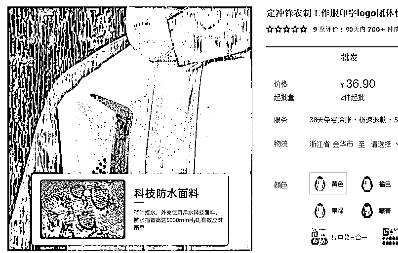
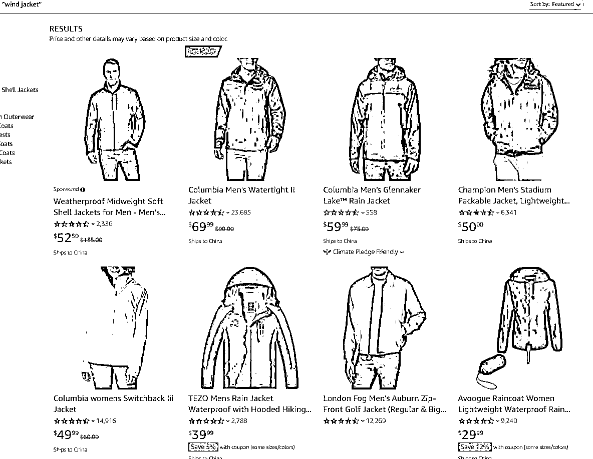
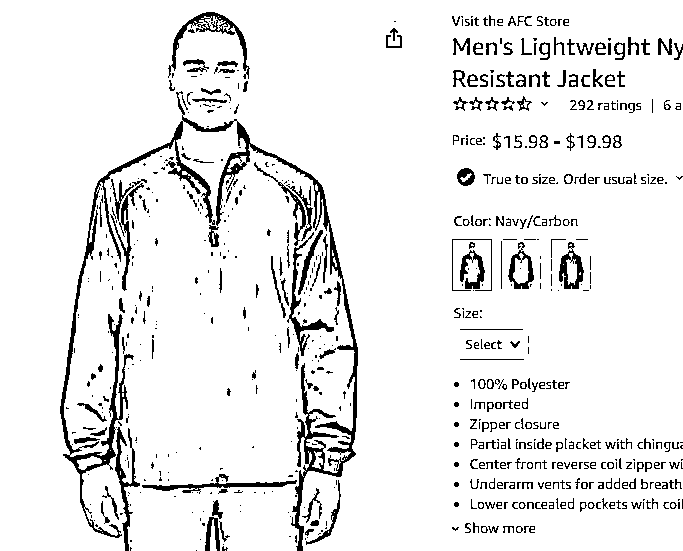
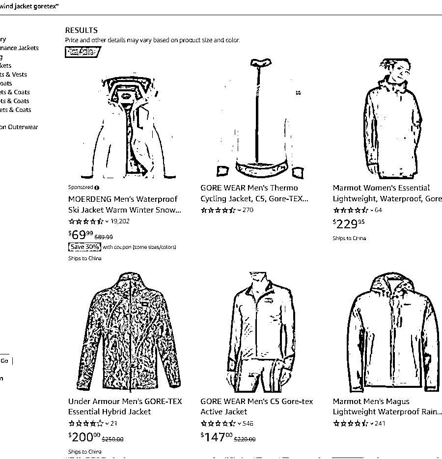
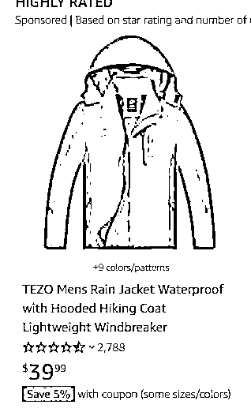
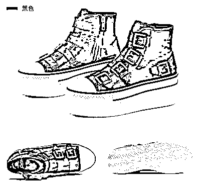

# 四步法：先专业再铺货，把爆款做成常态

做跨境电商13年，连续创业，九成项目年变现过百万，圈内叫我“蓝海偏执狂”。这篇是《选品四层方法论》的付费课缩水版，专讲没钱怎么做产品。

底层框架分四层：
- 套利：用成本差、信息差和确定性控制风险；
- 流量/成交：每一分钱和时间，至少要换到曝光或下单，只感动自己是没用的；
- 模式：把“找货”升级成“找生意”，红利才走得更远；
- 资产：建自己的产品词典，才能批量复制。

这套框架被我叫成“必胜法”，其实是流量和产品两条腿走路。过去一年多，我在Amazon官方活动、线下大会都讲过；台下有大卖、KOL、服务商、外贸工厂老板，复盘后大都承认自己的成功没跳出这四步。国内电商朋友也试过，在淘宝选出过单件净利200-400元的蓝海品，窗口期还不短。生财有术里，流量团队能一夜暴富，但也怕昙花一现；产品型玩家如seven，打法偏白帽冷启动。两边能合璧，长期主义胜率更大。

下面只讲“没钱做产品”的可复制打法。

1. 平台选择题：从Amazon聊到煤炉

平台选得对不对，先看三个条件：小语种发达国家、人口过亿、本地入驻门槛。记住这三点，再逐个看。

a) Amazon

Amazon不能一概而论。澳洲是发达国家，客单高、竞争少，但人口太少，市占率不如eBay，投入不划算。欧美日和日本站还能做，但只适合利基产品。美亚劝退过很多人，新手亏钱大多是不懂利基，乱铺货、乱压仓。走Amazon物流还是自发货？看买家体验。前者时效好、体验好；后者适合独家品测款，发货慢也有人等。市面上很多直播间不讲这条判断逻辑；只给结论不给原因，还承诺稳赚的，多半是镰刀。

b) 自建站

我服务过上千个自建站。早年杂货铺靠Facebook广告测爆款，有人月赚百万；现在基本熄火，因为那只是把铺货思维搬进了广告组。活下来的是品牌站、垂直站、定制站。顾小北当年带火的Facebook广告+建站工具套路，已经失效；Facebook广告属于“货找人”，信息差没了，投产比崩掉，还混进不发货、货不对板的卖家。说自建站不行的人，多半只见过这一种玩法。自建站同样有“人找货”流量：搜索广告和Google购物广告，配上蓝海选品依然能赚。市面上的课程还在炒旧模式，谁来教都没用。好做不好做，要自己懂“曝光”和“成交”。

c) TikTok

TikTok和Facebook广告一样属于“货找人”，但更尴尬：它是娱乐平台，产品视频很难拿到自然流量，国家版本又多，新手很容易选到东南亚。一天发100条视频，美其名曰大力出奇迹，实际和赌博差不多；那些时间拿去上班，一个月也有一万块。新手做TikTok，流量和选品两条腿都是瘸的；付费投放的投产比也极不稳定，一级代理商的数据摆在那里。TikTok最撩人的是天天有人靠自然流量爆单，最扎心的是那个人不是你。成功的人抓确定性，彩票心态要不得。我认识的大卖，没有主战场在TikTok。

d) AliExpress和Shopee

这两个都靠低价走量，我算不清他们的利润。我在AliExpress赚过快钱：抢注国内商标做山寨，或抢注国外三线品牌迁到手表等类目；平台认国内商标注册证，老外分不清，客单和成交都不错。但那是有窗口期的套利。Shopee现在能赚钱的店群，多少带点侵权；仿牌都卖亏本价，蓝海玩家没法玩。Shopee招商铺天盖地，跨境圈里坑宝妈和副业人群最多的就是它。Temu同样走低价逻辑，新手别碰。当年Fanno出来，行业一片叫好；我接受财经媒体采访说不看好：平台低价，且字节嫡系却得不到TikTok导流，流量和成交两端都存疑。半年后果然崩了。

e) Etsy和Ozon

相对新，还有一点铺货红利，但窗口快关了。Ozon同样靠低价走量，意思不大。俄罗斯赶走西方大牌、平行进口合法化，Ozon上做仿牌有特殊窗口，票据齐就行。Etsy偏设计师手工艺，产品迭代比Amazon快，和Amazon之间有搬运红利，可作为Amazon选品的参考。

f) 煤炉与Facebook Marketplace

这两个C2C场子，基本是店群或批量账号卖仿牌，略过。

2. 第一步【找蓝海】：市场、平台和产品方向

蓝海分三档。最蓝：小语种发达国家、人口过亿、有本地入驻门槛，比如日本Rakuten。次蓝：发达国家、人口过亿、平台仍有利基空间，如Amazon欧美日。微蓝：新平台或刚开放中国卖家入驻，即使是低价平台也有些搬运窗口。剩下的平台凡以低价为核心，直接排除。有这个意识，你已经超过九成新手。

再往下找方向。我们在日本锁定“真皮”，美国锁定“户外防风防水科技材料”。方法包括“海关壁垒”“平台搬运”“材质升级”等。为什么真皮在日本成立？日本海关对真皮制品收高关税，传统外贸没有大规模倾销，价格体系一直稳在高位；日本人觉得真皮靴子卖100美元以上正常，中国工厂出厂价可能只要几十元人民币。方向不等于品类：真皮可做鞋，科技材料可做鞋和服装。方向虽宽，但搜索“真皮”的人已经自带精准标签，有消费力。到这一步，算是“蓝中蓝”，彻底告别Shopee这种Hard模式。

3. 第二步【走捷径】：曝光和成交一起设计

“七分选品三分运营”我不太同意。选品即运营。好产品在定下来时，引流词和卖点也定下来了；曝光和成交至少要解决一个，最好两个都解决。

“合规平替”就是典型。仿牌违法；山寨不一定违法，但可能侵权；我们把合规的山寨叫“平替”。平替能对标明星产品，也能对标高端材质，两者都自带搜索流量。产品合规且有自有品牌后，可以投竞品品牌词和系列词，精准且便宜。课程里有4个找词方法和合规细节。

真皮鞋案例： 这个平替选得一般，原产品价位不高、品牌不奢侈，成交普通；但第四步加了确定性热点，做成高客单品。好的平替价格是原版十分之一，单件净利200元以上；在发达国家做平替，不能做成低价劣品，否则利润和退货都撑不住。标准是体验还原90%，价格是原版的五分之一。

再看材质平替：  它吃的词是“冲锋衣+Gore-Tex”，价格只有正版Gore-Tex产品的五分之一，靠极致性价比成交。产品一旦确定，曝光方案和成交方案也确定，运营只剩上架和广告执行，实习生都能做。加上固定参考来源，产品库可以像查字典一样输出，0基础一人也能全流程操作。这个模式适用绝大多数品类，同时有流量捷径和成交捷径。多数人做到这里，手里已经有1-3年产品库；小语种发达国家，红利期更长。

4. 第三步【加光环】：用空壳品牌抬轿

十年前，JEEP、骆驼、CAT鞋服在国内被中国老板抢注，和美国越野车、骆驼烟、CAT机械没有关系。日本Rakuten和Amazon当时不查授权，因为这三个牌子在当地不存在。我们借此垄断了这三个牌子在日本的销售，赚到第二桶金，给这类产品取名“空壳品牌”。

今天这招仍可复制。AliExpress净利100+的产品，就是这么做的。空壳品牌分三类：一是抢注海外品牌，复制全系产品，例如koolaburra被UGG收购；二是抢注后跨类目做新品，AliExpress常玩；三是在海外注册品牌、包装品牌故事，国内电商也常见。三种打法在Amazon都有过窗口，目前还能做的是第三种。与其用中国牌子硬闯，不如策划空壳：在日本做德国牌，在东欧做日本牌，在美国做欧洲或日本牌，本地用户查不到，故事就能成立。淘宝也有人这样玩：渔具卖家把产品包装成日本品牌，做日本官网，再反向营销国内，靠口碑吃高溢价和复购。按我们的数据，空壳品牌复购率约10%，净利最高提升30%。它本身也是一套低成本搬运选品模式，信息差大，以后再说。

5. 第四步【微创新】：用小改动换长红利

前三步能靠工具或花钱解决，第四步要拼人。做成了，护城河深、红利期长。微创新其实就是不创新。新手最该做的差异化是“材质套利”，即材质平替的延伸。原创设计和痛点迭代，新手没有积累，确定性太低；最好基于大标品做升级和热点嫁接。大标品不愁卖，但容易被低端材质和价格战拖累；高端货又卷不动，中端性价比市场就被空出来了。找一种高端材质，用低成本平替还原90%体验，吃小幅消费升级的人群，竞争少、红利长。1688有现成供应商，几千块投入就能起盘。

看Amazon案例：搜“冲锋衣”，首页是 ，最低十几美金 ；搜“冲锋衣+Gore-Tex”，首页变 ，客单价到了100-200美金。其中  卖39.99，销量很突出。它没有Gore-Tex认证，但能在这个词下露出，功能接近、价格低。如果把它放进普通冲锋衣的池子，卖点就没了；但它放弃标品词，只做长尾词，反而拿到流量和成交优势。

再看一个“三合一”案例： 帆布变真皮、头层皮换二层皮，成本砍掉三分之二，再嫁接厚底和边扣两个热点。精准词可以铺真皮、厚底、边扣、某品牌、高跟、增高、女式板鞋、侧拉链；打动人的点则是厚底、经典平替、极致性价比。和普通帆布板鞋比，它有四个差异点：真皮、边扣、厚底、平替，每个差异点都是一个精准入口。这双鞋70元成本卖到70美金，老外还觉得值；1688有现货，新手看不到是因为认知不够。配合小语种发达国家门槛，我们在类似产品上吃了七八年红利。

# 别再追爆款了

常有人问我：做这种产品，难道不怕被同行跟卖？

我的回答很明确：不怕。因为它走的是差异化路线，本身不靠冲单量取胜。常规选品工具很难把它筛出来，同行也未必看得上。单量不夸张，利润却足够厚——单个产品一年跑出百万元上下的净利，并不稀奇。

这也是我反复讲的一件事：跨境卖家未来十年，要慢慢放下“爆款执念”。把全部筹码压在爆款上，看似激进，实际是把自己往险处推。爆款来得快，跟风也来得快，最后常常是热闹归别人，成本归自己。

真正好的选品，同一套逻辑放到亚马逊、独立站或TikTok都能成立：窗口期更长，利润更稳，不会火一阵就散。

补一句：这篇内容最早来自一次公益分享，后来整理成帖。它其实是一套比较完整的产品方法论，里面有不少别人不会明说的细节，也不只适用于跨境电商。想看更完整的内容，可以在抖音搜“跨境杨少”，置顶视频里有入口；助理会发券码。感谢亦仁加精。