# 97年创业者的亚马逊复盘：选品逻辑、数据陷阱与人效自动化

结论先摆出来：亚马逊这盘生意，今天照样能做。

我叫张子卿，97年生。跨境电商B2B做了两年，2021年中期转到B2C，扎进亚马逊的蓝海选品赛道，自己开始干。一年多时间里，贴着消费者的真实诉求去做产品设计和打磨，美国站GMV做到一千万以上，毛利率十来个点。

下面讲我们创业路上遇到过的问题与解法，偏重道与术。这是压缩版，一万多字的原文放在最后。

动手之前，先立个预期：这门生意的终局，拼的是投入产出比和链接沉淀下来的资产；早期最值钱的优势，是试错成本低、门槛低，能反复试，外加会借力。借力最集中的落点还是选品——中国制造业的供应链既全又快，可以拿它给产品做差异化改良。

**—01—** 选品这道坎，拆开来看

复杂的事，我习惯先切成几个小步骤。

选品能力必须攥在公司自己手里，这是做亚马逊的立身之本。我把它拆成两段：找赛道、打磨产品。

一、找赛道

思路很直接：让数据替你判断。三条原则——关键词即赛道；关键词的搜索量即市场体量；市场体量除以这个词下的竞争密度，就是蓝海程度。

落地时我用数据工具加爬虫双线跑。第一轮把海量词做粗排，筛出值得做的方向；第二轮靠人工配合软件细调研、精排，把赛道最终敲定。

二、产品迭代

赛道定了不等于收工，产品得持续改。我一直劝跨境同行走这条路：先研究产品，再研究用户，最后落到真实世界的需求。

方法大致几类：先框定价带、算出利润区间、定采购预算；再摸清用户画像，选高客单吃利润，还是低客单冲量。预算之内，往下做这些动作：

1. 压成本——换材质；
2. 改外观——调颜色、换包装，实质是在主图和点击率上做文章，而点击率牵着广告权重；
3. 把设计理念装进链接文案——产品设计和运营端讲故事能拧成一股；
4. 降维；
5. 跨维；
6. 做研发设计。

拿个真实案例串一遍：washer door prop，家用洗衣机门支撑架，最火的时候H10月搜索接近七万。

赛道筛完先算ROI，达标了才进入用户需求研究和产品迭代。

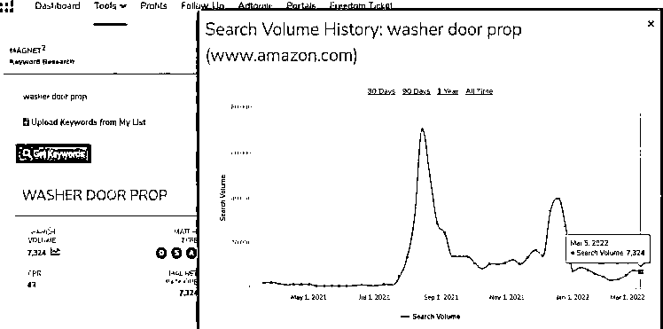

先把成本盘清楚，倒推采购价。

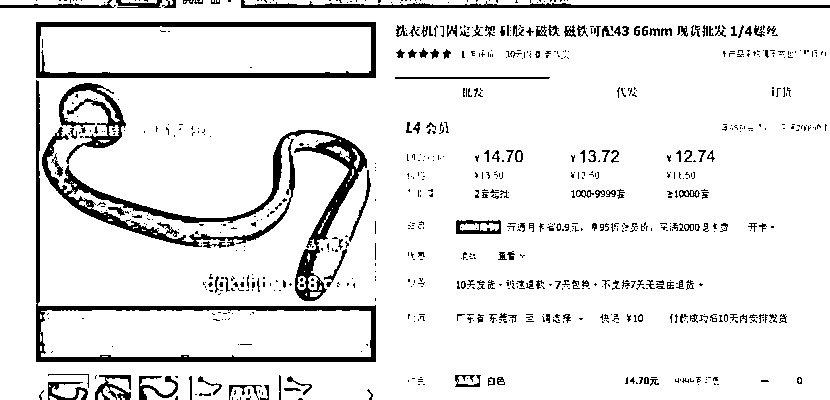 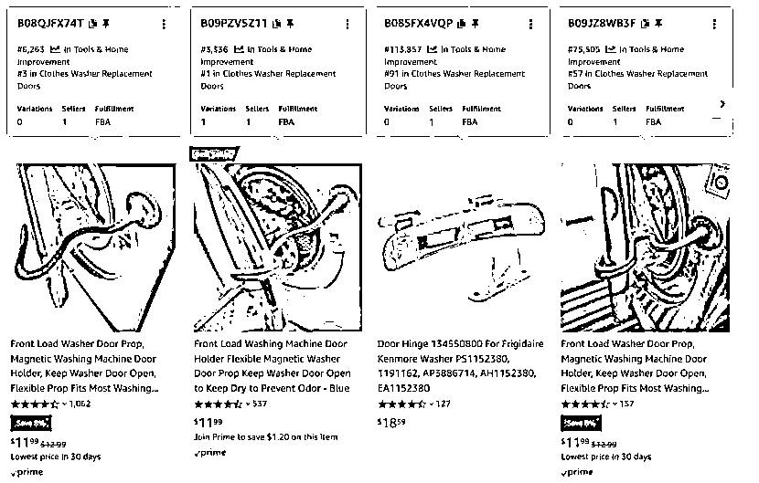

半年前这品刚起势，头部链接评论还不到三百条，月搜索过万，利润还算宽裕。放到眼下就挤了，整个品类的搜索盘子还在往下掉。

这里插一句：再看好一个新赛道，也得小批测款、按需备货。要是七万搜索量的高点一口气压五千套，结局会很难看。

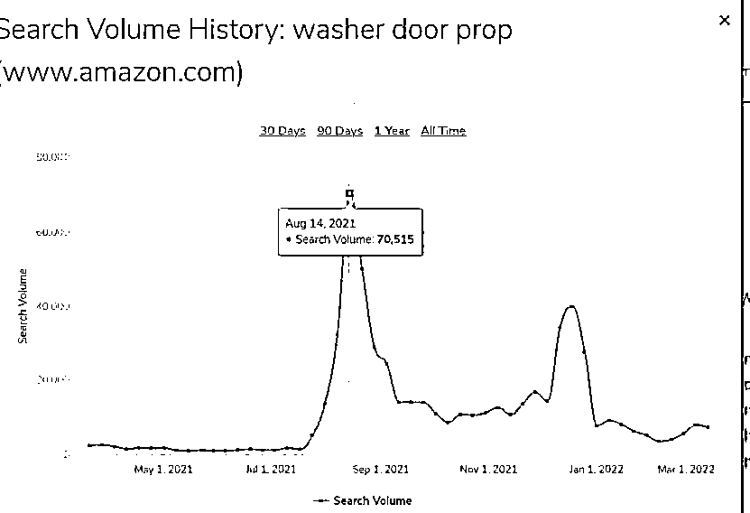

备货这件事后面会讲leadtime。钱不宽裕时，少量多次更稳，资金转得也快——毕竟这门生意算的是单位时间里的回报。

按眼下11.99美元的售价来估，helium自带的利润计算器直接能用。假设发空运：FBA费3.77美元、佣金1.80美元、头程运费1.81美元、产品成本2.40美元。

ROI＝（11.99−3.77−1.80−1.81−2.40）÷（2.40＋1.81）≈52.4%

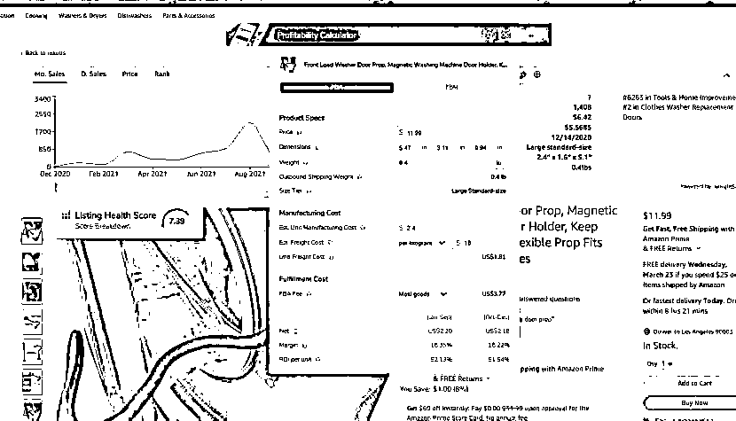

要不要继续，看ROI落在哪个档：

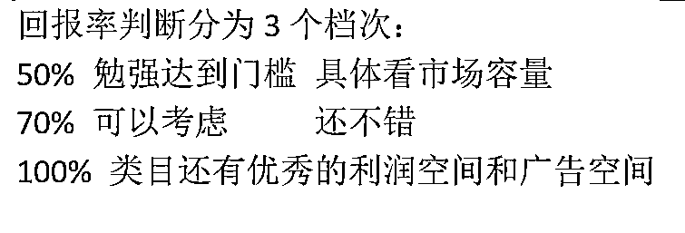

50%出头，只能算勉强及格。何况头部位置已经有人占住，搜索量还在缩，翻盘空间有限。

走到这一步就能拍板去留。现在回头看，答案显然是不做；可半年前，这还算个有戏的类目。假设答案是继续，我把后面的流程演一遍，方便你看懂我的选品思路和优化逻辑。

接着做用户需求研究：

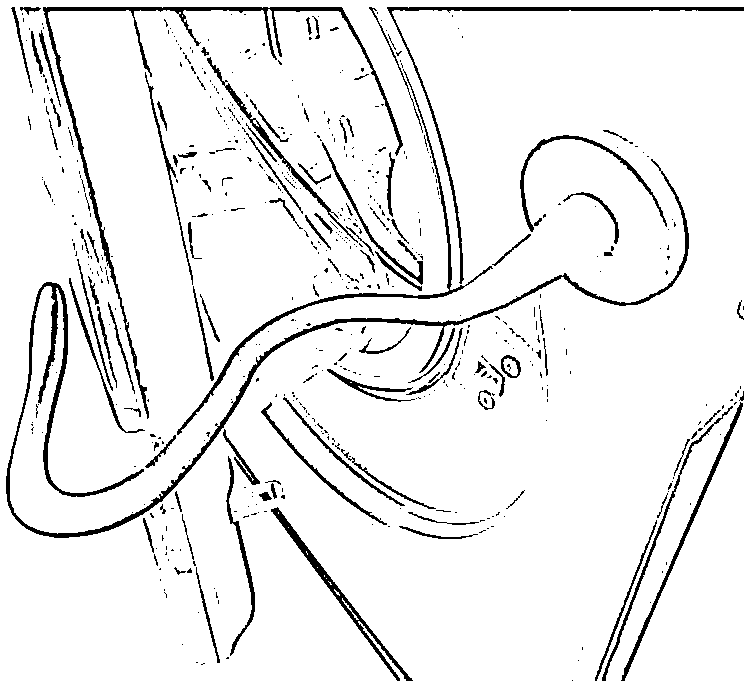

这产品解决的是公寓住户滚筒洗衣机门的麻烦。

老式公寓里，滚筒机常常塞在进门那条过道。洗完衣服想敞开舱门晾干、防潮防菌，门就得长时间开着，走道立刻被挡。家里有小孩或宠物的，还多一层磕碰风险。

人群：住公寓、用滚筒洗衣机的住户。痛点：晾门时别把过道堵死。

再看对手的销量和差评：销量用jungle scout扒，差评靠人工一条条翻。

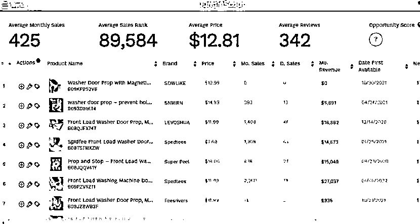

差评这块没有捷径，以实际情况为准——看对手哪里没做好，预算够就补上。

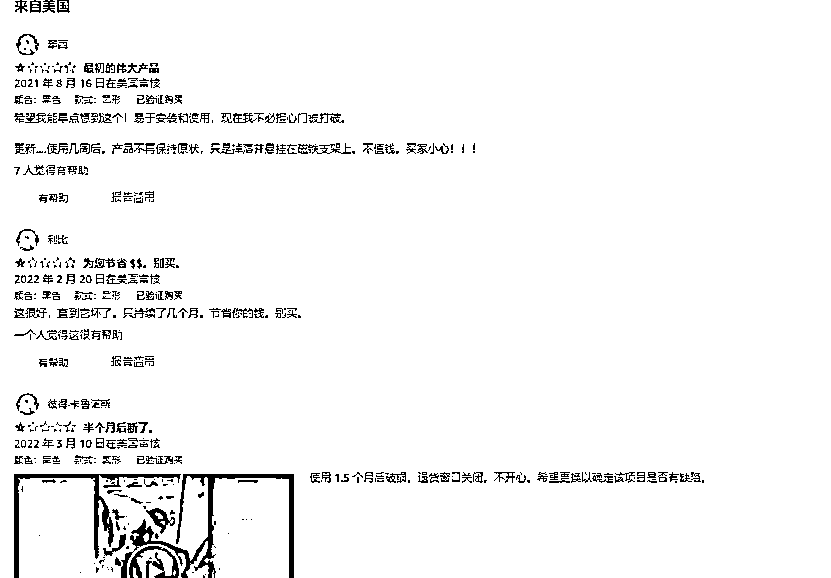

用helium 10演示：把与核心词关联的精准出单词全部拉出来，再顺着发散找需求。过程中，搜索量最高的词、带颜色的高搜索长尾、新冒出来的精准词，都会浮出来。据此能判断哪种颜色、哪种形态的长尾最吃香，而搜索量本身就是用户偏好的晴雨表。

   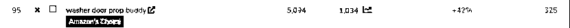

有两个词被我圈了出来：

- front load washer door prop，前置式洗衣机门支柱；
- washer door prop buddy magnetic man，洗衣机门道具伙伴磁铁人。

还有个发现：washer door prop这个词，经常跟洗衣机清洁washer machine cleaner出现在同一批搜索里。

产品迭代怎么做：

1. 先看还能不能压成本。不走海运的话，预算已经紧到极限；稍有风吹草动，ROI连50%都保不住，风险太高。采购端，同等质量下找报价最优的供应商；物流端，盘一盘海运的可能；材质端，找有没有更便宜、又能满足同样功能的替代。写这篇文章时，市面上已经有人动手改了。

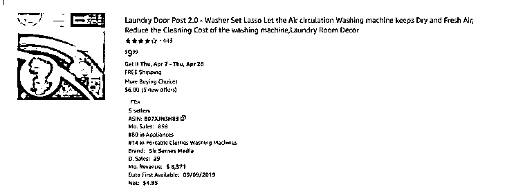

另一个方向是提溢价：能不能改产品本身，把价格带往上抬。跟工厂来回沟通后确认，底部磁铁要更强、尺寸要更大，成本得多出两块钱。市面上的厂家基本聊遍了，硅胶这条路压成本已经走到头。海运能省一点，但差不多被磁铁涨的部分吃掉。

那就得换思路：有没有别的材质能达到同样效果，把成本压下来、ROI做上去。同时也可以想，能不能再挖一层潜在需求，做出高溢价版本——定价拉到11.99美元以上。

2. 外观。我的选品和迭代一律以数据为锚。那外观为什么要改？随便糊个牛皮纸盒不行？这里先把运营侧的结论搬过来：在亚马逊，点击率是命门，它牵着广告组权重，也牵着广告花费。电商里，一张高点击的主图，能让一条链接起死回生。

怎么让人在货架上一眼想点？改颜色、改外包装、加配件。总之结合主图拍摄的实操难度去琢磨，力争一眼跳出来。还可以用PICKFU做AB投票测试。不过这个品类收效有限——它走的是应用场景图，不是白底图。改色、加配件、优化包装这些提点击的手段，前提都是白底图。

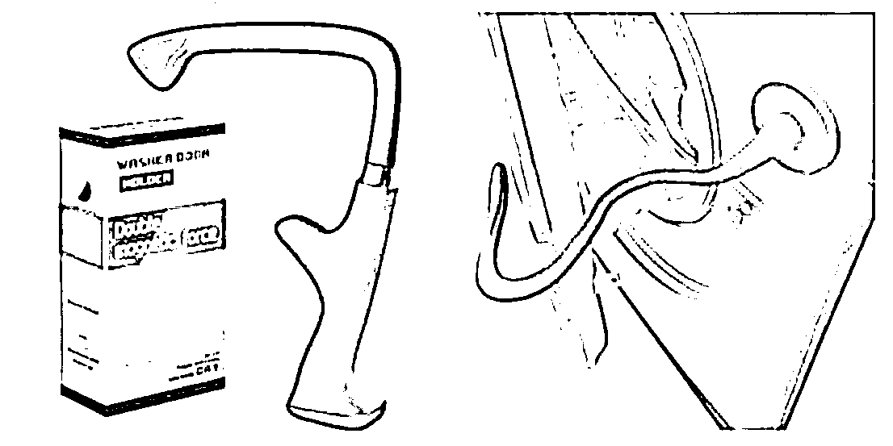

换成这种类目，上面那套就很灵。

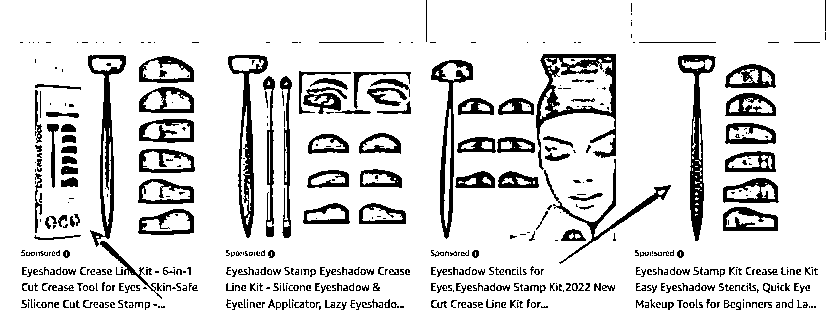

两张主图的点击率，可能差一倍。

3. 从理念到文案——产品设计可以和运营讲故事打通。数据最终盯的是转化率。说白了，设计之初就带着某种理念，后面写链接文案、做详情页会省一大半力。比如卖彩妆，一开始就定位给有疤痕的女士做天然温和的遮瑕，文案就有得写了。我们这款产品，也能从优化生活细节、护住孩子和宠物这些角度切，但影响有限，不值得推翻重做——它是实用型产品，用户看的是好不好用；而且无论硅胶还是塑料，开模都贵。

降维和跨维放一起说。降维，是把高维打法搬到低维场景；跨维，是把别的品类的产品拉进新类目解决新需求，以此抬高溢价或砍成本。

还记得前面那个发现吗？washer door prop常和washer machine cleaner同框。机会就来了。

- washer door prop，洗衣机支撑架；
- washer machine cleaner，洗衣机清洁，调研下来多以清洁片形态出现。

顺着想：买支撑架的人，是不是也在买清洁片？能不能算完成本后做个组合装？这就是降维和跨维的玩法。

washer machine cleaner

这个词的搜索体量，是洗衣机支撑架的五到十倍。

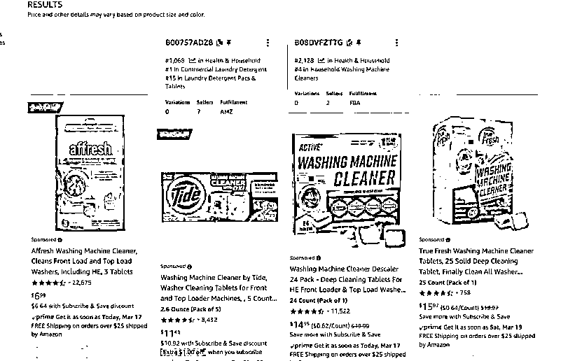

那把它俩打包成combo，溢价空间是不是更大？算过成本，看起来走得通。

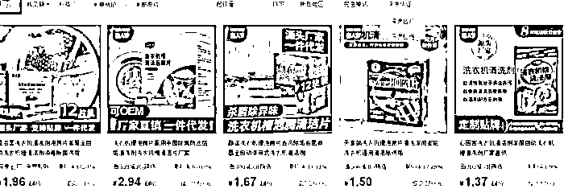

4. 研发设计。开模、画图、改功能，让产品更贴合需求，都归在这里。比如很多大件木制品安装又累又烦，改成免螺丝的榫卯结构，或许就是新卖点。

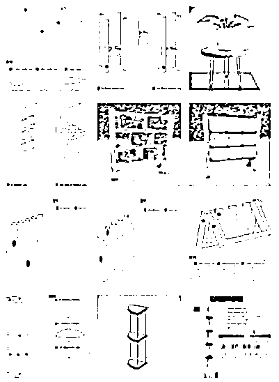

以上是几种术的拆解和落地示例。

再补一段运营端容易被忽略的数据细节和陷阱：

**—02—** 运营端：别被表面数字牵着走

日常操作之外，有几个指标和假象必须盯紧。

如果把运营当成一套算法来看，单个产品最要紧的几组数据是：点击率、转化率、核心词排名、星级评分，以及整个项目在单位时间里的ROI。

一、点击率——产品最能被影响的一项

放第一位，是因为它直接左右广告组权重，进而左右你的出价。点击率高的链接，出价能差出一倍；一美金的位置打到两美金很常见。影响它的核心变量：主图、价格、标题、星级。

PS. 广告的权重根子在点击，点击的根子在选品后端的迭代和主图。点击率是少数能人为大幅调整的指标，所以叫可操作数据。一张好主图，拉高五成点击率不稀奇。

二、转化率——最像陷阱的指标

满屏的帖子都在说转化率多重要，这话没错。可在我看来它是坑，因为它基本不可操作。

想想转化率由什么决定：价格、五点卖点、图片、A+、QA、评论区、AZ/BS标……你会发现，只要按标准流程做产品——认真调研、打磨卖点、横向对比、写本地化文案、找同一支团队拍图拍视频——转化率拼的其实是内功：开发、设计、文案、视觉、QA。

关键点：真正决定关键词排名的，是链接在单位时间内、对应关键词下跑出的销售额，也就是淘系常说的坑产。

上架之后，转化率几乎动不了；上架之前，这些活已经按固定流程走完，也没法大改。于是开卖以后，除了测评和降价，运营手里几乎没有影响转化率的牌。说到底，转化率反映的是你做产品那套流程制度的水平。上架后不必天天盯着，能做的事本就不多。

三、关键词排名

其余那些表面因素——标签、转化率、评论、星级、历史数据等，都只是间接作用于销售额。而且这里只认对应关键词下的销售额，站外和折扣不算数。

四、现金流紧、项目又多，怎么用leadtime破局？

——把leadtime当方向盘，从投资视角看这门生意。

运营端还得盯项目整体的ROI与风险，对资源投入和回报做个合理预估。把这套能力流程化，是以后能不能捅破商业天花板的关键。

重点说一句：要盯全年整个项目的资金投入ROI。这就绕不开leadtime——从生产到上架那段周期。它对大盘ROI影响极大，而且是可控的。

举个不太严谨的例子：一款木制品，生产三十天、运输二十五天、上架五天，leadtime就是六十天。售价39.99美元，重1.5公斤，成本40元，佣金15%，FBA配送5.4美元。海运15元/公斤，运费22.5元。先不算广告等其他投入：

- 利润＝39.9×0.85×6.3−40−5.4×6.3−22.5＝117.1元
- 运费加成本＝22.5＋40＝62.5元
- 理想ROI＝117.1÷62.5≈187%

假设月销一千套，实际要砸进去的钱远不止1000×62.5元。因为leadtime有六十天，想不断货，一个月销量可能得压三个月的资金。你投的是三个月的钱，算的却是一个月库存的回报。所以在六十天leadtime下，实际ROI往往只有理想187%的三分之一。何况销量是涨的、是波动的，实际支出比理想状态还高。这还没算亚马逊押着的那部分回款。

反过来，如果提价、换出货更快的供应商、走更快的物流，把leadtime压到四十天，哪怕单价贵十块，最终的资金ROI也远高于原来。省下的闲置资金还能投新项目。这就是leadtime的核心：宁可让一点利润，换更快的周转，因为利润薄一点，钱却能多转几圈。上架后持续压缩leadtime，本质上是从财务角度再做一次优化。

小结：

运营别停在表象，把深层内核丢了。转化率、关键词排名这些，建议结合自家实际情况深想，做针对性流程优化。另外，初创阶段钱少、想做的项目多，leadtime优化对同样投入下的实际资本回报影响极大，有时甚至值得牺牲利润换周转。

走到这里，只要持续试、持续改，小团队的亚马逊就能转起来。

但做生意的人，多半都想做到像工厂流水线那样自动化，这是终极追求之一。

落到亚马逊，想突破认知和选品上限，关键在这几点：

- 自己开发选品软件，把选品产能提上去；
- 用流程化制度加体系化知识，培养跨境领域的产品经理，把产品落地这件事接住；
- 文案和图片交给专业外包，由有视觉审美的运营来统筹、提需求；
- 成熟期产品用AI调广告，把后端运营全自动化——从回评追评到广告中后期，都能交给机器。

以上是我对亚马逊的一些观察，希望对你有用。

另外，我在跨境亚马逊全自动化这条路上做过一些摸索，细节都写在赚钱那篇长文里：
https://articles.zsxq.com/id_jex6uu2zeu7o.html

评论区也有几位补充了视角：

龙哥：选品大概是龙哥盟里被搜得最多的一个词。背后有几层逻辑：选择比努力重要，选品比运营重要；起步阶段先想选品，别急着造品；电商是平台流量变现的最优路径之一；选品就是选赛道，赛道决定你长期的利润空间。

Hanson不帅：兄弟，一年时间能总结到这个程度，佩服。言简意赅，选品的思路和方法我基本认同，操作上也对得上。leadtime这个概念，真是一句话点醒。亚马逊费用暴涨、内卷严重的当下，压缩leadtime确实是降风险、提利润的有效办法。以前一门心思追利润，运营端总发最便宜的海运，周期四五十天，头程费用看着省了不少，实际周期被拉长，死库风险上去了，只见钱进不见钱出。FBA这门重资产生意明知有坑，我已经抽不了身。眼下再进场，还是得多掂量。

张子卿：是的，这个指标一眼就能看到。厉害。

# 亚马逊还能做吗？看完这些争论，我反而更确定了一件事

有位卖家问“留个联系方式老板”，结果评论区却先吵起来了——有人坚持关键词排名比产品排名更重要，因为关键词是入口；也有人反驳说产品排名才是结果，光有词没有转化照样白搭。两边各执一词，但最后都指向同一个核心：选品。

更让人惊讶的是，有人提到现在选品已经可以自动化了，全程不用手工操作。这样的思路确实少见，但也说明行业正在快速进化。

作为做亚马逊发货的服务商，我想正面回应那个老问题：亚马逊还能做吗？能，而且一直有人做得很好。差别不在平台，也不在运气，而在选品。

跨境圈流传一句话：选品70%，运营30%。这句话虽然老，但一点不过时。方向选错了，运营再努力也是事倍功半；方向对了，后面每一步都轻松很多。

顺便说一句，今年我和朋友刚成立了一家欧美线货代，主营美国海运，优势明显。我朋友在货代行业摸爬滚打了好多年，经验丰富，深圳的朋友如果想合作，欢迎随时联系。

最后提一句，那位说“这回复里面埋词了”的圈友，真是火眼金睛——你猜我们埋了什么？