# 月赚万元的小卖家，选品靠这四步

（精华帖·99赞）  
作者：Lissa Tam｜2021-09-24

先交代结果：我四月启动项目，花一个月把店铺搭起来，又用一个月定产品；链接上线至今两个多月，中途两次断货，现在数据慢慢稳住。按上月核算，单品月净利已经过万。今天补上之前答应的选品方法，主要面向预算不多、手里也没有工厂资源的同行：怎样筛出自己能吃下的品。

市面上常见做法无非三类：拿现货、做优化、自己创新。

先说服现货。偏销售驱动的团队更常走这条路。资金厚的直接包厂包销；资源次一点的拿特定渠道授权；再往下就是1688找货上链接。最后一种通常只适合仍处蓝海或半蓝海的阶段，不然很容易选的时候兴奋、推的时候崩溃。季节货和突发爆款可以这样操作，像灭鼠先锋系列、前年的小矮人。我朋友@Bryce 惠东很擅长这块，他写过《以亚马逊电商为例，聊聊从公模到私模的整个过程》：https://t.zsxq.com/bUJuRzVB

再说优化。它分两类：把现有货品重新搭配，或者对模具做小修小改，例如换色、加配件。搭配式相对容易，身份有点像买手兼筛选者，组合出来的东西有自己的辨识度，面向某类明确人群，推起来竞争没那么挤。模具微调逻辑接近，不过起订量得跟上。

最后是创新。自己设计、开模，难度最高。产品型公司更愿意走，要求懂材料、结构、消费端、买家诉求和使用体验。前期调研与设计很耗时间，打样研发也烧钱，但成品出来后的加价空间更大。木作、金属、纺织这类品，模具和打样费用相对低，周期短，适合练手。可整体节奏还是慢：拿木制品来说，打样1-2周，优化定样1周，大货6周，起步就8周；若货重只能海运，海上再4周，三个月没了。等链接上线，行情可能已经换了一轮。研发底子不够、创新又不足，很容易赶晚集。这条路要扎进用户里做调查，我认为更适合副业，不太适合刚起步的创业团队。

对照自身条件，我开局用了组合式打法。麻烦，但试错成本低，能快速把流程跑通。

我的路径分四段：先圈定候选，再做市场摸底，接着拆买家诉求，最后敲定上线方案。

一、圈定候选

有三句话，我一直当尺子：

1. 交付价值要超出买家预期，至少多出30%（@seven）。
2. 如果各家看起来都一个样，差异化就无从体现（@Zev@樊登读书）。
3. 蓝海怎么理解？对手比你弱，就是蓝海（@盗坤）。

圈市场时，我会设这些门槛：关键词月搜索量高于4000；搜索量除以搜索结果大于4；市场集中度低于50%，即非垄断；该词下评价量不足80的链接也有机会挤进首页；类目平均月销200以上；毛利尽量到40%；成本利润率（净利润/货及物流）尽量80%以上；同时这个类目还能做出区别，现有链接的文案、图片比我弱。翻成大白话：有优化余地、盘子够大、新品能露头、对手没我强。

筛选用工具就行，卖家精灵、数据魔方都可以。下图是卖家精灵的筛选界面。

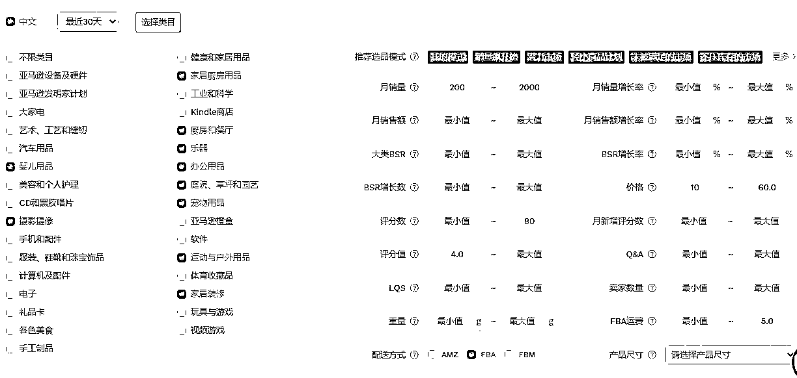

工具之外，还能翻BSR和NEW RELEASE榜。amz123.com、amz520.com这两个导航站能直接跳榜单，也可以先攒一批值得参考的店铺，再从店里反挑选品。另一个入口是自己有兴趣的品类。@阿发 在《9大选品方法 + 4种选择垂直细分领域的技巧，一次解决两个独立站最让人头疼的问题》里讲过怎么整理兴趣类目：https://wx.zsxq.com/dweb2/index/topic_detail/185228511284552

候选出来后，马上算利润。碰到顺眼的店或链接，及时归档到自己的选品库。

拿我举例，我平时爱喝两杯，酒具自然会被我翻出来。比如下面这套调酒器具，先锁定关键词，把数据收进库，再跑利润测算。去1688问工厂报价和重量，套进公式。

亚马逊的账可以这样算：利润=售价-货品成本-头程（海运/陆运/空运）-FBA配送费-平台佣金（通常15%）-退货损耗-营销支出（测评+广告）。FBA配送费和佣金基本不变，货品成本与头程小幅浮动，真正波动大的是退货和营销。不同类目我会设退货率2%，营销总支出按10%预估。

按我的表格跑下来，如果不考虑组合玩法，这套调酒产品的利润偏薄，不适合我当前阶段。

（备注：图片主要参考表头，数据有差异，仅作示例。）

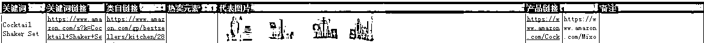 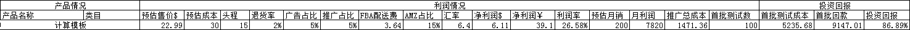

二、市场摸底

摸底时我盯五件事：品类结构、盘子规模、对应款型的利润水平、竞争烈度、消费走势。它们会影响我每月能赚多少、能卖多少、前期要砸多少营销费、推起来难不难、未来有没有戏。

落到数据上，就是看体量与趋势、各款型占比、竞争烈度、货源稳定度、需求与使用场景比例、痛点分布、现有差评集中在哪。

（一）体量与走势

这组数据用来判断盘子大小、走势、淡旺季和入场时点。若体量不够，或行业整体往下，长期看我就放弃。

先看趋势。我常用两个工具：Google trends（https://trends.google.com/）和卖家精灵（https://www.sellersprite.com/）。前者看全网关注，后者看亚马逊站内搜索变化。做哪个站点就抓哪个国家的数据，下文以美国为例。

仍以调酒器具为例，核心词是Cocktail Shaker。用谷歌趋势抓美国近三年，可以看到关注曲线持续上行。

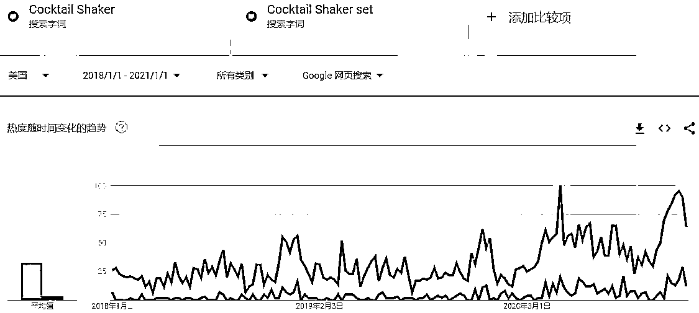

再用卖家精灵看月搜索走势，量不小，方向也向上。

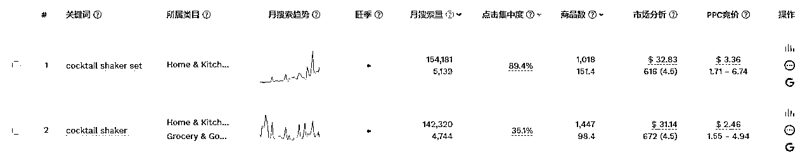

趋势看完，接着估体量。

找到该品的BSR榜，用卖家精灵把整榜数据拉下来，30天销量和销售额都能看到。也可以按垂直词搜，抓前3-5页，去重后拼成产品表再分析。

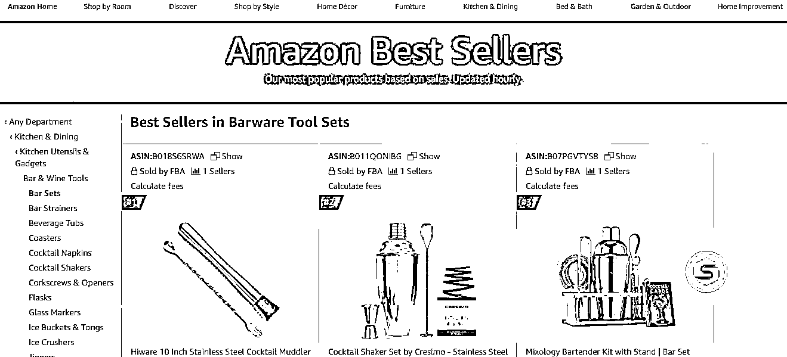

抓完先清洗，把不相关产品剔掉，得到对应产品当月销量。再把谷歌趋势数据下载，按波动粗略推全年体量。为提高可信度，我还会用amazon business analysis，把关键词近12个月排名拉出来对照。ABA和Google trends反映的不是一回事：一个看购买平台的需求，一个看“how to”类搜索需求，数据有偏差，所以我会交叉看。

查销量的平台里，Helium 10和卖家精灵准确度相对高，JS偏差略大。当然，这些数只能看个大概。选定工具后，后面每月更新体量、观察行情，也要继续用同一个，保证口径一致。

最后会得到类似下面的图表（注：表格仅参考，内部数据并非对应产品的精准数据）。

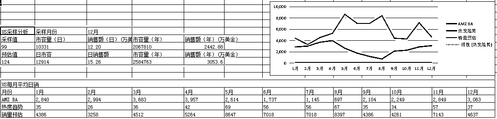

（二）款型占比

如果只想粗看市场，可以跳过产品层分析。用前面拉出的数据，在excel里做简单处理，看品牌销量占比、评价量与销量的关系、TOP10—TOP20—TOP50—TOP100的销量分布，就能大致判断竞争格局，并估算最低营销预算。

比如目标是日销80，位置至少要到BSR80，评价量至少200。这样刷单预算大概能倒推。广告侧，第三方数据能看到BID出价、转化率，据此算单笔订单广告花费和广告占比。整个营销盘子心里就有数，这个类目靠我的资金和资源能不能打，也有初判。

如果判断可做，或者还没看出明显结论，就进入深度分析。这时站在产品和买家两侧调研，看有没有切入缝隙。

到这一步，先用Google搜文章，看看买家下单前会问什么，测评博客会从哪些角度拆产品。把这些参数抽出来，就能拼出一个产品组成框架。

比如air fryer，大家关心容量、内胆、操作方式、加热方式、性能、噪音、材质、外观、配件等。做产品分析时，这些就是调研清单。

最初下载的BSR100表，这时要逐条补参数。部分信息可以自己写爬虫抓，但多数藏在产品描述和QA里，还是得点进链接看。这一步做完，对品类能摸清六成以上。

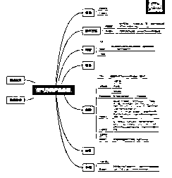

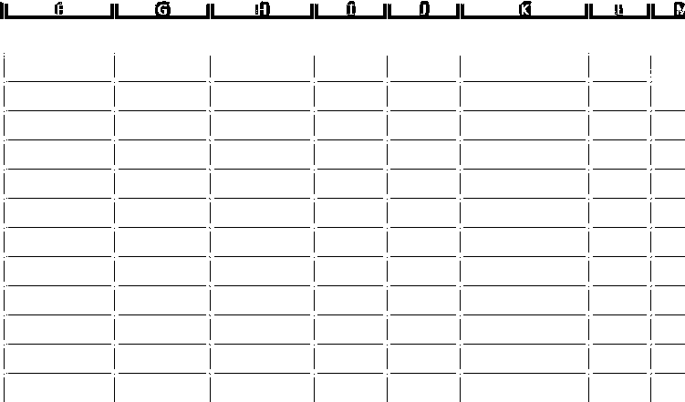

数据收齐后再分析：哪类款型体量大、价格带落在哪、哪些功能属于基础配置、哪些只是加分项。这些会为后面选款或改款提供依据。

（三）竞争烈度

这里主要拆几块：

1. 市场面：体量、增长、上线时间、Listing垄断程度。
2. 品牌面：品牌占有率、垄断程度、上线时间、增长速度、上新节奏、产品布局。
3. 参数面：不同参数下的占有率，含款式、容量、材质、性能等。
4. 价格带：买家对各价位段的需求占比，以及不同价位段的功能配置。
5. 运营难度：评价量，以及前面市场、品牌、参数信息的汇总。

我会重点看这些数：

1. 各款式的售价区间及对应体量；
2. 不同评价量区间对应的日销；
3. 上线时间及对应体量；
4. 各款型的最早上线时间与时间占比；
5. TOP20品牌、TOP20链接的占有率。

它们分别指向：产品生命周期、新品上线后的机会窗口、买家最能接受的价格带、买家认为必须具备的功能排序、市场垄断程度。具体拆哪些，要按自己的实际情况和关注点来，最后形成模板。

如果品牌或头部链接占比过大，基本可以放弃（这个数据在款型占比或初筛前就能看到）。但如果你真对这个品有信心，或者手里有货源、设计资源，那可以继续深挖。

把头部品牌近几年的上线款、上线时间、客单价做成品牌表，就能看清各家布局。大概长下面这样，有产品图、核心功能、ASIN、售价、品牌。

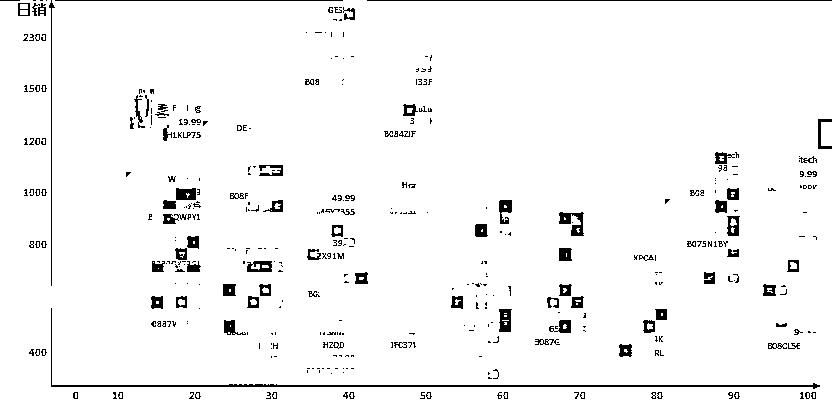

（四）货源稳定度

从运营角度看，主要看产品评分、1688供货家数、对应工厂数量，做个大致判断。

若评分普遍在4.3分，也就是亚马逊四颗半星以上，说明货源体系比较成熟。对产品经验少、工厂资源弱的人来说，选这类类目不容易踩雷。若市场上大部分评分在四星以内，说明类目还不成熟；假设这东西还卖得不错，那就是新需求市场，有研发经验的人可以进场做升级，只要把痛点解决掉，就能在行业里冒头。

举个例子：champagne gun，夏季爆款。我之前拿过样，用起来真难用，使用前体验很差，但产品很花哨，很贴合夏季派对需求。3颗星评分，8月时一个链接最多卖1000+，Kitchen & Dining排名2000左右。如果有小号，这个品很适合前期冲一波，赚笔钱就撤。50RMB采购成本，重量300g左右，FBA配送费3.47美金，竞品售价35.99。假设我们卖29.99，走海运，毛利45%，投资回报率158%。算上退货10个点、营销10个点，也能赚25%，卖1000个约5万；走快递，18个点利润，1000个约3万6。但新手把握不住，很容易变成库存。

看1688供货家数，也是为了判断是否被垄断、被包销、有没有专利、制作难不难。被货源卡脖子很难受。还是champagne gun，当时在1688找，只有2家在卖，都拿了样品，联系后发现一家抄另一家，另一家抄的好像是国外产品，但声称改良版、自己有专利（我没细查）。中国工厂大多求快、求爆品，这种工厂在细节和体验上做不到位，比较常见。尤其工厂如果不控价，市场一旦卖起来，却被货源卡住，再遇到同行恶性竞争，就很难搞。包括一些品牌方的产品，前期拿货可以卖一波，能起来最好；后期品牌自己到同一平台下场卖，开启收割模式，拿货方就很被动。

所以前期，我更倾向货源相对稳、市场相对成熟的类目。一方面市场已经验证过，只要产品有特色，就可以往长期做；另一方面，专利威胁少，工厂选择多，市场成熟，退货率和店铺安全都有一定保障。

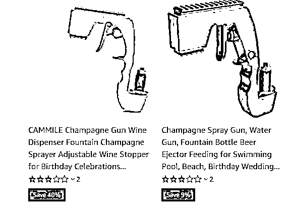

（五）需求、场景与痛点

需求可以借KANO模型拆成五类：基本型、期望型、兴奋型、无差异型、反向型。

1. 基本型需求：产品功能必须满足。满足不充分，买家很不满；满足充分，满意度也难再大幅提升，顶多是满意。比如社交产品的加友、音乐产品的听歌。
2. 期望型需求：满意度随满足程度线性上升或下降。越满足越满意，反之越不满。比如音乐产品歌曲越多越好。
3. 兴奋型需求：完全出乎意料的属性或功能。提供会让人惊喜，满意度大幅提升；不提供，满意度也不会下降。比如🛰️的摇一摇。
4. 无差异型需求：满足与否都不影响满意度，买家根本不在意。比如产品简介。
5. 反向型需求：买家没有这个需求，提供了反而适得其反。比如产品付费功能。

需求数据来自评论和QA。通过分析问题、好评、差评，把诉求提出来。

我的提取模型是：产品选不同类型TOP3或BSR TOP10（太多分析不过来，看头部更有代表性）；QA、好评、差评取近3个月或最近80条（产品一般3-4个月迭代一次，看最新内容才反映最新version）。

补充一句：亚马逊在评价时，会针对不同类目让买家给不同问题打分，也会对评论做词频整理。这些就是重点关注对象，可以分类整理，再对照提炼QA和评论，分析买家关注点和需求。

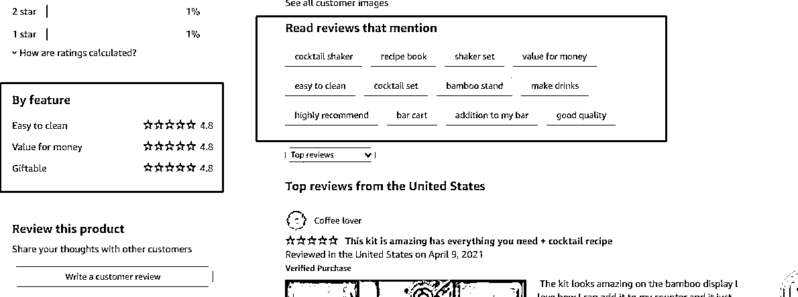

分析后，把QA和review内容提炼出来；差评还能支撑研发方向。

需求分析完，使用场景也用QA和Review数据，通过词频提取场景和排名，得到场景需求。

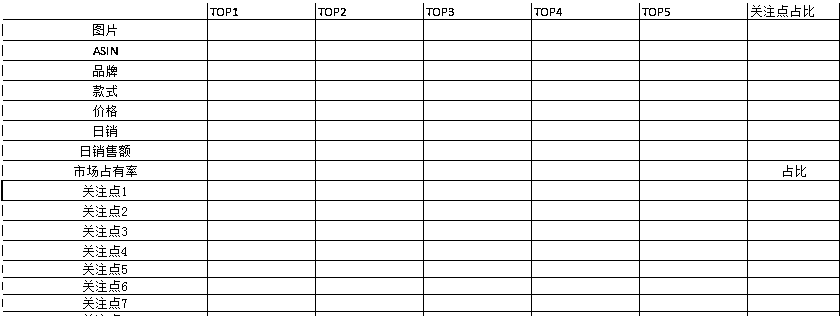

三、拆买家诉求

上面做完，最终会得到一份用户调研表：包含使用场景（场景+时间）、用户人群（人群+使用目的）、客户需求。

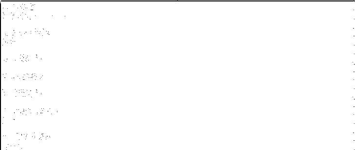 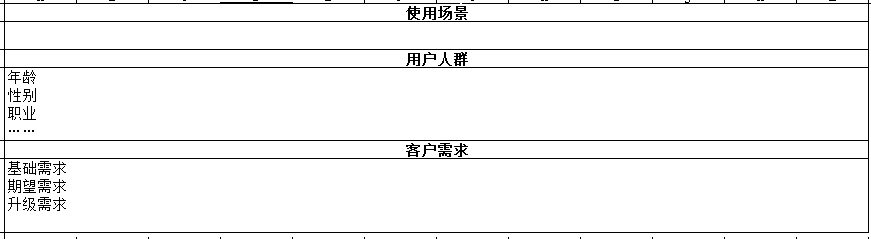

这张表就是产品开发的依据。要清楚产品背后的细分人群是谁，再针对这群人具体研发或改良。

举个例子，我做组合式产品，首先得明白这群人的诉求是什么、他们是什么样的人、买这个产品用来干什么、除了这个还需要哪些前后端产品、在不在意方便性、在不在意质感、最倾向哪个价格带、对应价格带的产品有哪些功能。这类产品的基础功能是什么、升级功能有哪些。词频分析里，他们最常提、最喜欢的款式是什么，最多场景是什么，需要配什么功能或产品。

把这些整理好，用文字加数据展示出来。

四、敲定最终方案

根据前面的用户分析，判断这个品类有没有机会。具体做哪个价位段、什么功能方向，对应的体量、销售额和利润是多少，是否符合预期。

对基础用户，给基础功能，匹配低价段里体量最高的价格；对要求更高的用户，配关注度更高的升级功能，或者上下端产品。

最后把“产品组成方案—价格—利润测算—预期销量—预期营收—对应1688初选”整理出来。

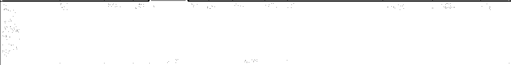

方案出来后，可能还有几种选择，比如颜色组合。心里没底时，就做问卷。

用Google设计表单，投FB广告，让买家填写，送礼品卡等方式收集信息。更省事的办法是上fiverr.com，有一帮歪果仁能帮你做，200份问卷价格大约25美金。想不明白、猜不透的时候，就用数据来解答。

但最重要的是别纠结。做产品本身就有不确定性，上面这些工作是为了做精品，在砸钱之前把不确定性变小一点。做亚马逊是压资金的活，确定一个品类，首批货少则200，多则2000。时间其实更重要。“犹豫徘徊，等于白来。”

方案落定，再找工厂把产品落地，创建链接，准备发货。

什么？没有店铺？可以看这篇文章：https://wx.zsxq.com/dweb2/index/topic_detail/815528858411152 虽然是去年写的，但仍然适用。

最重要的一点：产品上架前，做好项目投资回报表和推广方案。做到“知道竞争对手是谁、什么时候要达成什么销售目标、什么时候盈亏平衡、什么时候回本”。

然后按部就班去做。计划=方向=具体执行时的灵活调整指南。

好了，整套选品思路就写到这。

读到这里，你可能已经在心里吐槽：不就做个小玩意吗，至于绕这么大一圈？答案先放这儿：动作确实不少，可等你全部跑通，对这个赛道的熟悉度会肉眼可见地上涨。尤其到落地阶段，跟工厂来回掰扯、磨细节，人脉和资源也会顺带攒起来，你对这条赛道的判断会更准。

这些动作本质上是在给结果上保险：让可控的部分更多，让翻车空间更小，最后做到心里有谱。刚入行的新手，靠它把第一次试水的胜率抬上去；做细分深耕的人，更该用它把市场摸熟。

如果你走的是广撒网路线，那重点就落在小步试款上，前面不少环节可以砍掉。广撒网拼的是覆盖面，SKU 铺得足够多，整体命中率才会上去。也就是说，那套细选动作主要服务于单款命中率，但生意终究要靠多款式去试。此时把力气花在初筛款式、拆买家诉求上；竞对调研则不必太重，直接扒数据，凭老手直觉扫一遍即可，市场风向得一直盯。

我的启动资金不算多，所以最早那批货，每上一个款都拆得比较细，方案确认后才动手。可即便这样，受限于手上功夫还不够，再加上当年市场环境，最后跑出来的比例也就两成。真正撑住的那一个，后来拿到了 Best Seller 榜首、Most Wishes 第一，也在 Gift 榜登顶。说到底，赛道本身不大，赚头有限，但那种正向反馈足够让人继续扛。沿着这个款，我又往同一方向深挖，把高客单和低客单的坑位都卡住，形成一层防护。

至于落地细节，我做过一轮复盘，散落在自己的知识星球、🛰️动态，以及赚钱 #挑战2021收入翻倍# 的打卡记录中。供货、获客、赛道选择、搭班子这几块踩过的坑和后来想明白的事，都写在里面。想翻的话，去赚钱的打卡区找。到了十月，我会把《从0挑出并做出月赚1万的小爆款（运营打法篇）》（白帽打法）整理成文，再端给大家。

如果这篇内容能给你一点启发，就算没白写。有不同想法，留言区见，咱们接着聊。

延伸阅读：
1.《两年从新人到出海大厂经理》
https://wx.zsxq.com/dweb2/index/topic_detail/414815521552858
2.《Amazon从注册到发货：品牌备案与账号养护全攻略》
https://wx.zsxq.com/dweb2/index/topic_detail/815528858411152
3.《十人小队，怎样在Amazon做到7000万年营收》
https://wx.zsxq.com/dweb2/index/topic_detail/241141458255151
4.《没投广告，90天把Amazon单品卖到100W》
https://t.zsxq.com/u7AIAQB
5.《疫情之后，出海电商还值得进场吗？》
https://wx.zsxq.com/dweb2/index/topic_detail/118851151558182
6.《出海电商从0到1全链路拆解》
https://t.zsxq.com/jy7AMfE

Lissa：出海圈的内容作者，也在音乐区发视频；人在深圳，喜欢研究怎么让买卖多赚一点 ;)

———— 以下聊点心里话 ————

这篇稿子其实压了很久。原因不复杂：验证周期没走够，结果本身也有随机性。直到最近多轮小测跑出一点成绩，确认这套打法基本站得住，我才敢发出来。早前上涛哥那档栏目时，我聊过自己创业阶段的拧巴：早期效率低得让人怀疑人生，继续扛还是回去打工，脑子里反复打架。我清楚需要搭班子，可合拍的人不好碰；也担心招进来后没活给人家，业务没闭环，工资发得心虚。@杨涛（涛哥）当时关于获客和成交的提醒，我后来每次回想，都能把自己从情绪里拽出来，变清醒也变踏实。他还说过，伙伴的价值不只在分担业务，更在情绪上托底——有人同行，路没那么孤单，也更有机会走长。

单枪匹马，起步确实利索，可后劲是真的耗人。焦躁、迷惘、反复否定自己，轮番上门。熬过来之后，方向感才慢慢回来。我也逐渐看懂平台内温室和真实丛林的差别，明白拍板这件事有多重，以及拍板之后要背多大的代价。谨慎让我躲过一些雷，犹豫也让我错过窗口、成本一路往上蹿。有时我会开解自己：这段折腾至少把人磨稳了，也让我真正明白打工和买卖各是什么滋味，从只会讲理论，变成下场干活的人。我很清楚，大家要的是结果上的胜，不是嘴上的胜。

人人都有想完成的事。我希望眼下这份事业，不只是让自己有口饭吃，而是能再做大一点，做出点价值。既然已经上路，就往前走吧。

每周复盘时，我总会提到两件事：找搭档、找资金。甚至还搞了个“一周约见一位”的小计划。现在我觉得，该把它从念头挪到日程上了。如果你在 Amazon 选品、运营获客上有自己的心得，或者对创业这件事有热情，又或者想认识 Lissa，不妨来聊一聊。看看我们有没有缘分，结伴走一程，再试着走远一点。

最后要谢谢一路给我打气的@森淼，谢谢@涛哥 指点，谢谢@龙哥 鼓励，也谢谢@白一喵（小白）分享的内容。要不是前阵子刷到赚钱上小白那篇精华帖，这篇稿子八成还会继续躺在草稿箱里。小白真是神人。也谢谢每一位帮过我的朋友。

借一条🛰️动态收尾：赚钱越来越大，我显得越来越小；赚钱很棒，我也会使劲长大。