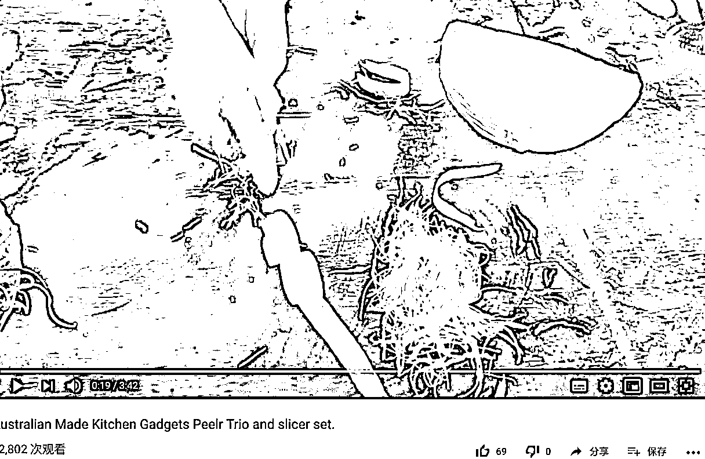
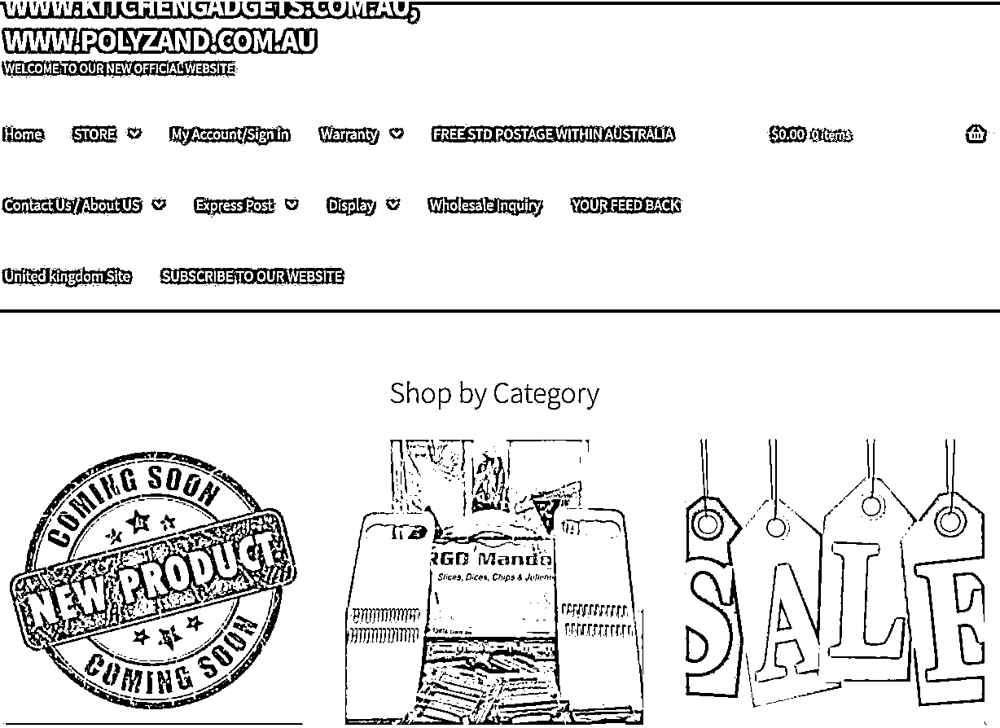
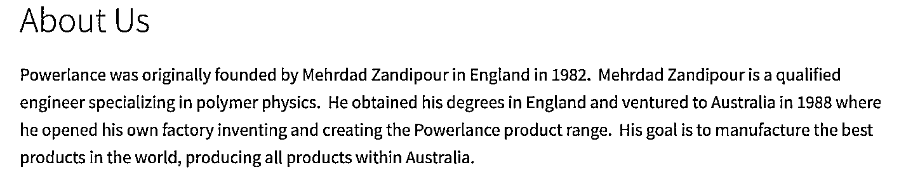
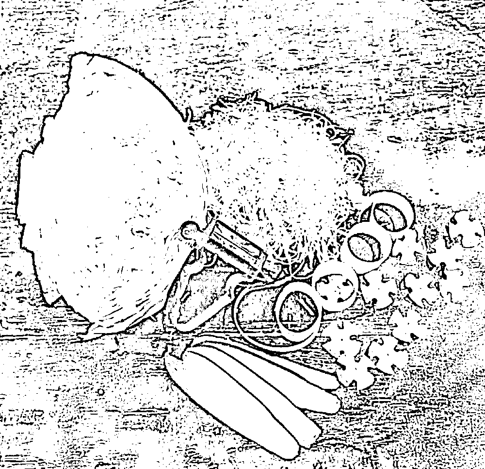
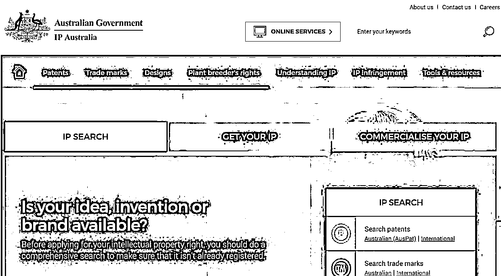
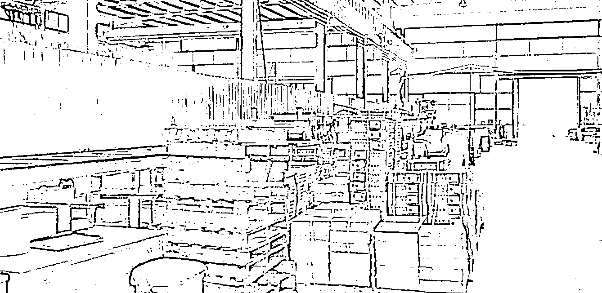
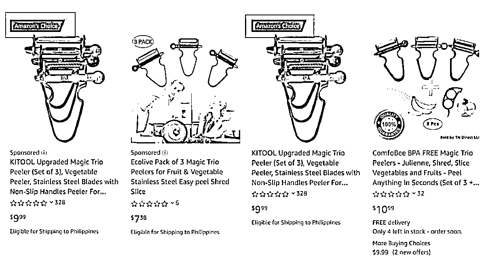
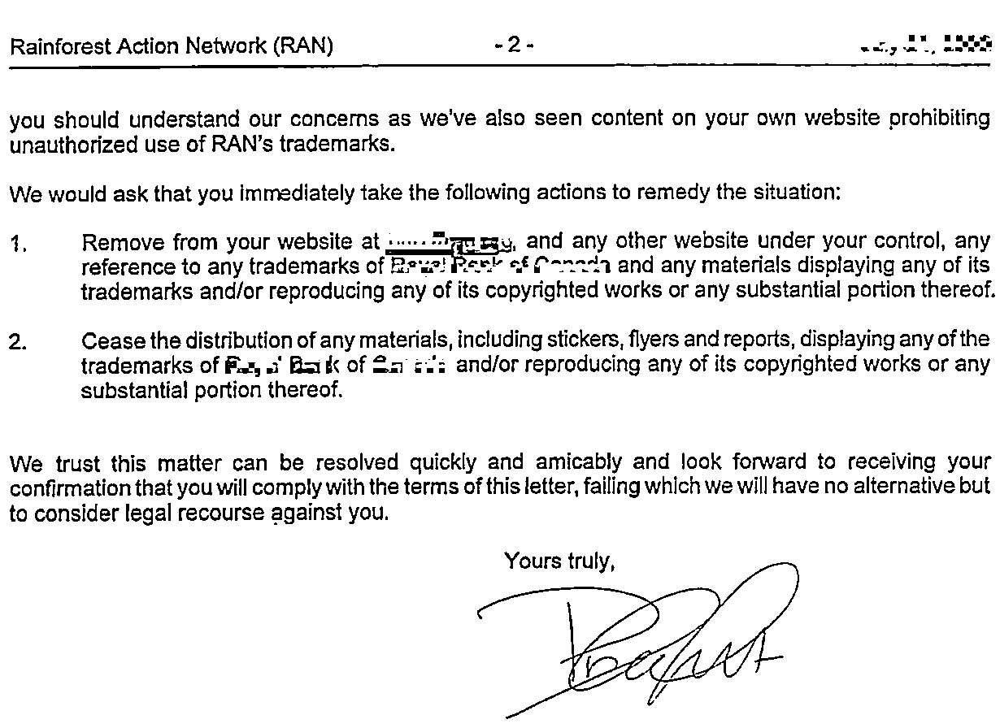
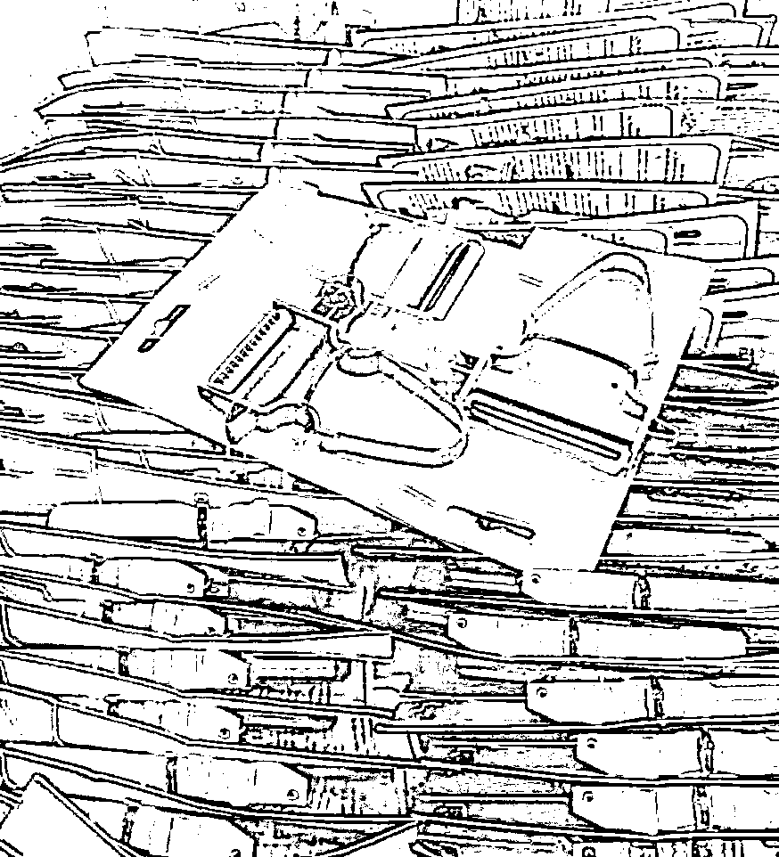

# 冷门削果器卖爆记：从找货到百万利润

作者：jersy｜2020-06-27

这篇文章最早发在我的公众号，记录独立站从选品到放量的完整过程。内容由我和供应链朋友Aye一起整理，文中的爆款也是我们共同开发。

## 1-初识产品

2018年1月，英国同行发来一段YouTube视频，问能不能找到同款货源。视频2015年上传，播放量平平，第一眼没看出什么特别。看完却来了兴趣：这东西功能不少，去皮、切片、刨丝、雕花、挖果肉都能干，软硬果蔬通吃，操作很顺，像个全能选手。我们转身就搜遍搜索引擎和各大电商平台找货。

## 2-货源难寻

淘宝、1688都没有。托朋友问台州工厂，那边是塑料制品产地，答复都是没做过。亚马逊、速卖通、wish上也找不到竞品。最后在eBay只找到两个卖家，一个澳洲一个英国，还顺藤摸瓜找到原厂家官网。官网做得很粗糙，红绿撞色刺眼，导航栏乱摆，稍微懂点卖货的人都不会这么干。后来看“about us”才明白，站点经营者就是产品发明者，一位工程师。官网和推广之所以这样，也就说得通了：工程师不擅长卖货和营销。

产品出自澳洲公司，我们先在eBay两个卖家里选了澳洲那家，下单两套。结果几天过去不发货，站内信也不回。只好改从英国卖家处再下两套，两天后显示已发货。大约三周后到货，我们直接去农贸市场，把能想到的果蔬都买回来，在场地里逐一测试。没想到这三把小刨刀出奇好用，YouTube视频一点没夸张。

我们判断这里可能有生意，又把澳洲商标和专利网站翻了个底朝天。可能因为销量不好，原厂家连相关专利都没注册。于是决定联合朋友的工厂自己开模。一来对自己的眼光有信心，之前沙拉碗卖出近百万个；二来市场没有竞品，产品本身也过硬，真做出来，短期内竞争不会多，能先占一波先机。

## 3-找工厂开模

4月，合作方去对接温州工厂——之前一起做过上百万个沙拉碗——让对方报开模价。塑料件在温州工厂那里不算难事。难点在刀片。看着简单，工艺却复杂，国内只有广东阳江能做，他们有渠道搞定，评估开模费在5万到7万元左右。

工厂收到样品后也看好，开模费双方各承担一半。量产后我们拥有前期产能买断权和最低价拿货权：我们4元一套，其他人拿货要12元以上。不过温州工厂和阳江刀片厂开模时小问题不断，前后折腾近4个月才成品。最初两周刀片日产能约1000套，良品率不高，每做1000套要报废大几十套。

## 4-上线即爆

7月拿到货，上架后马上投广告。这款产品在广告上的爆发力很快显现，加上我们入场早，广告一开单子就不断，评论区也热闹起来。第三天就发现亚马逊有卖家把图片整套照搬，当天那个Listing拿到Amazon Choice标识；再过3天，产品竟冲到家居厨具类Best Seller榜首，一天卖出上万单。3天里单价从19.99美元一路打到4.99美元，疯狂程度可见一斑。但这些卖家都拿不到货。供应商也反馈，他和下线贸易商天天被找货的人电话打爆。

## 5-侵权警告

某天我们收到一封警告信，发信人自称Polyzand版权持有人，要求我们立即停止所有宣传，否则追究法律责任。做到这一步，一旦因侵权翻车，前面就白干了。做电商的多少都碰过侵权，一些专做爆款的工厂还开玩笑：一年到头没被投诉侵权，说明这一年没做出爆款。话虽如此，真遇上国外律所，比如跨境电商卖家熟悉的GBC，还是很头大。

我们先去澳洲商标专利网站查相关关键词，没有发现注册记录。另外，图片和视频都是我们自己拍的，商标、著作、专利这几类侵权其实都能规避。想到这些，我们没有下架产品。当然，如果对方较真，隐患仍在，我们确实冒了风险，好在结果值得，后来对方也没再跟进。说到底，这款产品根本没注册专利，只要素材不侵权，对方也拿你没办法。

## 6-抢货风波

亚马逊和Facebook上卖爆了，但很多卖家没货。有人打听到我们温州合作工厂的地址，组织一帮人带着现金跑到工厂，堵门、堵车、堵人抢货。工厂吓得连夜换地方，之后每天来抢货的人还越来越多。大约两个多月后，才有其他工厂做出这款货。从去年7月到今年3月，工厂累计出货约300万套，我们累计出货50万套，利润过百万。

## 8-几点启发

这次从开发到放量走完一遍，这个产品给我们的启发很大。

做出爆款的人，和把爆款卖爆的人，常常是两拨人。这款产品的设计者是澳洲工程师，其实他最冤：既不会推广，又没申请专利，大头利润都被同行拿走；真想起诉，手里没专利也难有抓手。

最早把产品做出来的人，未必是最后赚到钱的人。及时跟卖并不耽误赚钱，跟卖比的是信息灵通和执行快慢，不少卖家手上没货，照样敢投几千几万美元广告。

广告只能助推，真正决定成败的是产品。行业正从流量导向转向产品导向，Facebook投广告越来越容易上手，跨境电商最后拼的就是供应链。缺了供应链壁垒，就算把产品推爆，也难守住优势。我们流量出身的人对此体会很深：不少产品自己没有稳定供应链或工厂，谁都能拿到货，即便推广出去，最后也会被迅速抄袭分食，留不下积累和沉淀。

平台和独立站都该布局。回头看我们推爆的很多产品，不管自己推还是被抄袭，大多会从Facebook一路火到亚马逊等平台。用户需求本来就多样，别再用“独立站比平台适合做品牌、平台比独立站适合卖货”这种偏激论调框住自己。

https://www.youtube.com/watch?v=AaxnjKvvNGk https://www.polyzand.com.au/

 

 

 

 

