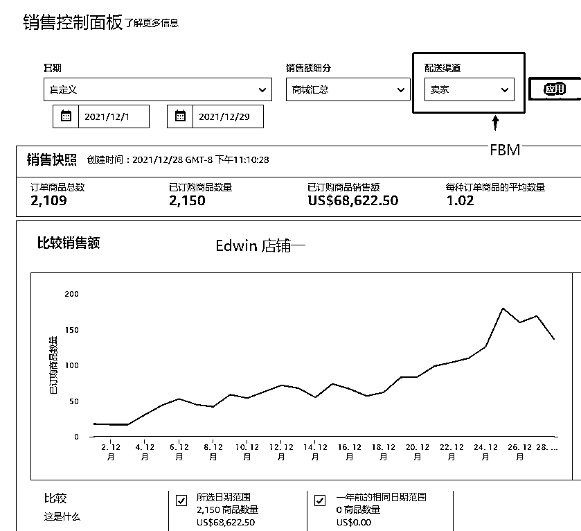
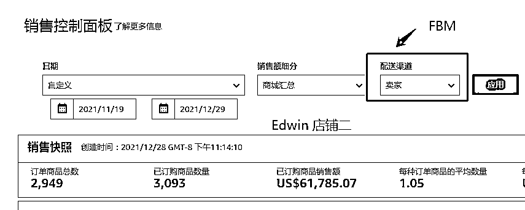
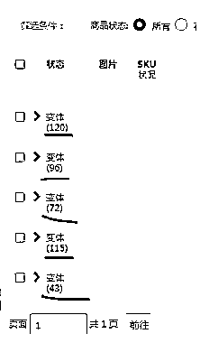
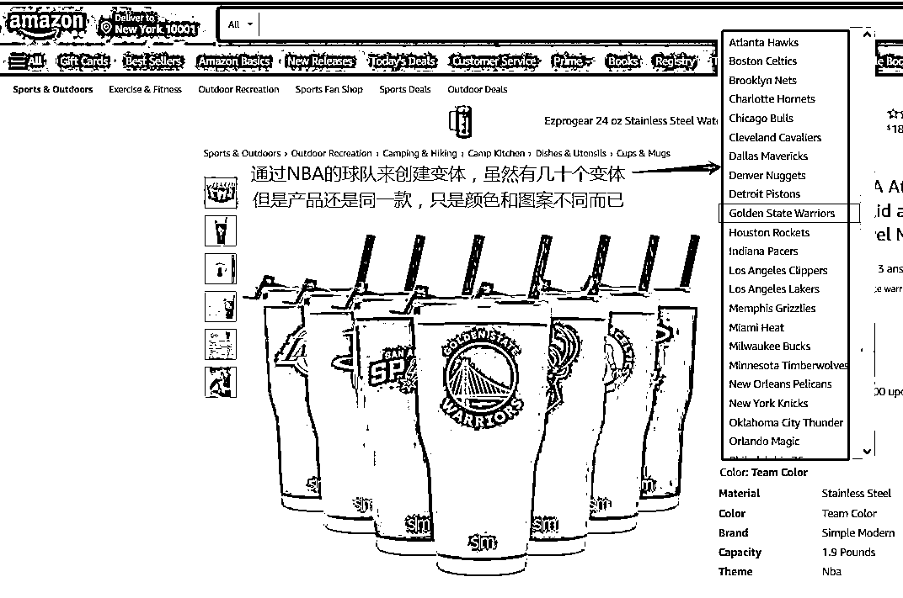
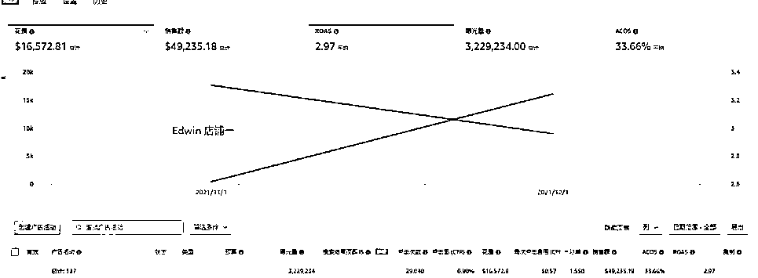
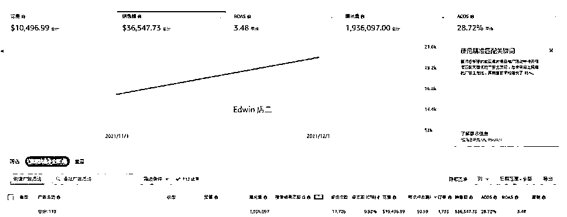

# FBM不囤货，也能把自发货做成精品

做亚马逊这些年，我的主力一直是FBA，也真心觉得这套仓配代发模式适合大多数人：配送、客服这些杂事由平台承接，卖家把心思放在选品和运营上就行。

不过今天换个话题，聊聊**FBM自发货精品模式**。

理由很简单：它对新手更友好，起步轻，不必一上来就把大批货压到海外仓，资金占用少，试错空间也更大。不少人对自发货的印象还停留在铺货——疯狂上链接、又累又不挣钱，觉得这套早过时了。但配送方式终归只是外壳，产品才是内核。能不能戳中消费者更底层的需求，能不能在同质化竞争里做出真正的价值差，让买家甘愿忽略物流等待，这才是决定成败的地方。

我一直想说的一个态度是：把平台视角调低，把用户视角拉高。多去感受买家真正在意什么，他们自然能接住你产品里的诚意。所谓更深层的需求，其实像冰山：浮在水面的是显性需求，大多数人都能看见；价值超越则要往水下走，去接住那些藏起来的隐性需求。它不容易被察觉，可一旦被满足，买家会有“对，我要的就是这个”的顿悟。汽车出现之前，人们嘴上说想要更快的马，可本质诉求是“快”，不是马。产品迭代不能只靠收集水面上的反馈，得往深一层挖。

每次分享，我也习惯把平时学到的思路揉进去，用输出倒逼自己输入。只有把东西讲明白，才算真的掌握，这也是我愿意写的原因。下面不会写得太细，毕竟这套方法我还在靠它吃饭，只聊一些思维碎片和关键点，能拼起来的人自然会往下研究。

先放几张后台数据：

 

图上这两个店，配送方式清一色是卖家自配送。右边后台只挂了5个父体产品，子体虽然多，但本质上是同一款货。我的操作是：先挑一个通款，把热卖的爆款元素叠上去，再拆成多个子体挂到同一个父体下。备货端只要管好这5款；然后找做水晶标、热转印贴纸的工厂谈，把元素做成标，出单后按订单贴到产品上，新品就出来了，处理起来并不复杂。

可能有人还是没画面，我找了个相近案例拆解。先声明：我不卖这款，只是模式类似，拿来举例方便理解。

选品时得往用户深层需求里挖，找到能套这个思路的品，再用尽量多的子体去铺。FBM做自发货，这么做更有优势，权重还能叠加。当然，图里这款碰不得，侵权风险很高，除非拿到**NBA**官方授权。所以找爆款元素时，知产问题要格外留神，风险提前估。核心思路就是：调研用户深层需求，提炼高热度元素，给产品做出差异化，完成价值超越。

下面进正题，希望文字能让我们交流得更顺。

Go...

新手跑FBM自配送，绕不开这十个问题

1.店铺怎么解决
2.选品如何更快起单
3.新手产品上架
4.商品详情页怎么打磨
5.产品怎么推
6.订单批量处理
7.小包分拣与打包
8.物流怎么发
9.退货和售后
10.账单回款

**1.店铺怎么解决**

店铺是最底层的一环。我当时只想验证这套FBM精品自发货方法论跑不跑得通，算了一笔时间账：自己注册 vs 直接买现成店，最后选了买，反正只是当小号试水。两个店从号商手里拿的，单价约2800元，视频认证和明信片地址认证都过了。但我不建议新手买店，里面的坑太多，不可控因素很难防。除非你经验够、也扛得住各种风险，否则老老实实自己注册更稳。注册本身不难，社群里不少人写过教程，搜一下就有。我纯粹是为了省时间才走这条路，风险也掂量过；完全不懂就冲进去，很容易变成最大的韭菜。最坏的结果是店和钱都拿不回来，你能坦然接受再去试。相关资源别来找我，我不想和社群里任何人产生利益往来，只是单纯分享。

**2.选品如何更快起单**

a. 这套玩法有前提：做垂直细分类目。先圈定目标人群，再倒推选品和打造，满足这群人的需求，做错位竞争，实现价值超越。

b. 自配送最大的好处是不用入仓囤货，正好拿这个优势去和FBA卖家掰手腕。要把需求切得足够细，从颜色、尺寸、场景、功能、型号、用途等维度下手；单款尽量多做子体，全部挂在一个父体下，几十个甚至上百个都行。这样能覆盖人群的大部分需求，每个子体也能在长尾词里精准接住真实搜索，转化自然不差。

c. 子体全部绑在一起，评论共享，出单后整条链接的权重也能叠加。新品期冲排名更快，关键词位次越高，后面自然流量越可观。

d. FBA如果也这么铺，子体多就意味着库存重，风险和效率都成问题。FBM不压货，子体再多也不慌。只要把这层优势用足，自配送卖家同样有机会赢FBA。单个子体出单也许不多，但整条链接加总起来，量会很吓人，排名也会更漂亮。

e. 在细分赛道里接住一部分人的深层需求，把调研过的需求切到极致，再以子体形式聚拢。子体在垂直领域点击表现更好，所有子体汇到同一个详情页，买家进来后能形成闭环，转化也会被推高。

核心思路：基础爆款（从平台榜单里找）**+**热点爆款元素（调研人群需求）**+**极致细分多子体聚合。

基础爆款可以直接去亚马逊前台翻。先定类目，优先挑那些容易把热点元素叠上去的品，只要能印图案，基本都能拿来试。还是拿NBA球队元素的杯子举例：你在榜单上看到某款杯子卖得火，这就是基础爆款；但别直接照抄同款，否则大概率一单都难出。榜上的基础款往往价格压得低、评论堆得高，小卖家硬拼没胜算，何况你还是自配送。这时要往基础款上加热点元素。元素也不是随便印个图，我习惯先锁定人群，再挑产品，所以调研必须前置。可以翻亚马逊QA和评论，也可以逛社媒、泡国外论坛，先摸清这群人喜欢什么，再匹配基础款，把元素叠上去。比如你长期研究运动人群，就可以把篮球、足球、棒球、橄榄球等元素加到杯子上。最后一步是做极致细分：用关键词工具分析，发现篮球里NBA热度最高、搜索流量最大，那就用NBA球队继续切。PS：这里只是举例，不是让大家做这款品，别误解，底层逻辑是通用的。选品有两个重点：第一，基础款定下来后，同步查专利和侵权风险，热卖品很可能有专利；第二，热点元素确定后，也要查知产隐患，提前排雷。

PS：如果对极致细分产品还不太熟，可以先翻我之前那篇：亚马逊蓝海：如何极致细分产品  
https://articles.zsxq.com/id_4uow5bz9k495.html

另外，前两天在赚钱精华里读到一篇很好的文章，《如何创造更多优质创意赋能给产品来实现差异化竞争》。它的理念和我很接近，以“基础爆款+元素创新”为切口，通过案例拆解和产品开发思路，论证元素赋能做爆款创新的方向。写得非常透，建议大家反复看，价值很大，也谢谢作者。  
链接地址：https://articles.zsxq.com/id_tgzqxwfdj4tw.html

OK，上面这些消化完，基本就能挑出一些不错的品了。继续往下。

**3.新手产品上架**

重要的事说三遍：《卖家大学》！《卖家大学》！《卖家大学》！真不懂就去亚马逊后台的卖家大学，基本是免费手把手教，比市面上不少培训机构都实在。花点时间耐心跟一遍，90%的问题能解决；剩下10%再交给搜索引擎。

**4.商品详情页怎么打磨**

虽然是自配送，每个产品的详情页也要按精品标准做。图片要把卖点摆出来，文案可以精炼，但卖点必须突出。

a.图片。挑完基础款就去找货源，阿里或拼多多都行。找到同款后私聊店主，说明自己是做亚马逊的，加🛰️要产品原图。多问几家，很多批发商愿意配合，就看沟通本事。这两年跨境热，批发商也知道亚马逊单量大，通常乐意给图。拿到原图后做微调：做美国站就把风格调成欧美感，文案换英文，会点基础PS基本能搞定，最好参考同类优秀产品的视觉风格。最后把每个子体对应的爆款元素P到合适位置。

b.标题、卖点、描述。这里涉及运营。可以用第三方工具或竞品页面，通过JS、卖家精灵反查对手的核心出单词，再把元素词埋进文案。每个子体的长尾词都要单独调研，图片和文案围绕这个词布局。这样在细分领域里，买家一搜，你的产品匹配度最高。这一步对运营能力有点要求。

c.每个子体的详情页都要按调研过的长尾词优化。务必保证买家搜这个词时，这个子体是页面上最贴合需求的那个。图片、标题、卖点、描述都要做出独特性，最好用专属定制类词汇突出个性与唯一感，这样才能完成价值超越。

d.上架后要有节奏地铺QA，还要传QA视频。不用测评，只要详情页够扎实、QA引导到位，零评论裸奔也能出不少单，这点不用太焦虑。

e.主图很关键，尽量把点击表现拉高。后期用广告的长尾词去测，在点击表现有保障的前提下，用广告推，不测评也有机会打爆。

**5.产品怎么推**

目前推广上，我做QA、拍并上传QA视频，不碰真人测评。平台政策松的时候，也会考虑上几个直评，成本不高：QA大约3—5元一组，直评10—15元一个。不过最近直评上得慢、不太稳，基本只做QA和QA视频。

重点还是站内广告。按这套模式，单靠广告推，成功率也不低。前提是前期选品过关，运营方法和模式对路，一般不会太难。这也侧面说明选品有多重要，后期运营节奏要根据产品特性来排。

 

站内广告的逻辑：

a.假设一款产品有4种颜色、50个元素，那就是4×50=100个子体。我通常会建50个广告活动，相当于每个元素的子体各建一个活动，每个活动里放入该元素的4种颜色，让它跑。

b.选词一般分两类：一类是50个爆款元素的长尾词、大词，分别塞进刚才建的50个活动里，用广泛匹配跑；等有点权重后，再加精准匹配，去抬长尾大词的自然排名。另一类是基础款的核心词，可以用工具调研，找到核心词后，在前面拼上50个元素的词，各自放进对应活动。

c.我开的都是手动广告，词选得比较精准，流量也准，所以点击表现很关键。前几天要持续测试，不满意就及时调；点击表现稳住了，转化慢慢会来，因为产品在这个长尾词下已经是最匹配的，成交概率不低。只要点击表现不错，就继续加预算，每天复盘前一天的实际花费，ROAS好看的广告活动就持续递增预算。

d.这样投下来，花费确实不少，因为子体多；但好处也明显：点击表现好的时候，每天持续有大量点击，产品排名会起得很快，后期自然排名也会跟着涨。等自然位到了比较理想的状态，就可以降低广告竞价，去吃后面的自然流量，利润率会明显改善。

e.还要注意，尽量在目标销售国的白天多花钱，尤其是转化率高的时段。比如做北美站，我会在中国时间下午4点（美国晚上12点）把预算全部调成1美金，到中国时间晚上9点多再恢复正常，同时加大竞价，让预算尽量在白天高转化时段花完，性价比更高。

f.通过广告把产品推起来后，后期要不断点亚马逊后台的请求评论按钮邀评，有些插件可以批量操作。也可以在包装里放售后小卡片（你懂的）。自发货不入亚马逊仓库，包裹平台查不到，只要买家不举报，基本没事。一般做对买家有利的事，正常不会举报；如果你比较保守，就别搞这个。

**6.订单批量处理**

订单批量处理有不少好用的ERP。我一直用店小秘，免费，效果也不错，功能很适合自发货：订单来不及发时可以虚拟发货，避免ODR超标；还能做订单管理、打印订单，基本都能搞定，关键还免费。市场上类似系统很多，按自己的实际情况选就行，不一定非用它。

**7.小包分拣与打包**

小包分拣和仓库打包，可以找大学生兼职。先培训出一个能力强的骨干，再让那个人带着其他几个学生做。每个产品最好设一个编码，按编码操作，防止打包出错。自发货发错货很麻烦，买家一退货基本就亏了。

**8.物流怎么发**

小包物流渠道不少，递四方、云途、燕文时效都不错；邮政偏慢，尤其E邮宝很不稳定，所以一般选前面几家。美国通常两周左右买家能签收。详情可以去官网看，加客户经理🛰️让对方指导。也可以考虑亚马逊的购买配送，能解决ODR问题，亚马逊推出一段时间了，效果很好；云途、燕文都支持亚马逊线上购买配送，对自配送卖家挺友好。

**9.退货和售后**

最重要的是把ODR控制住，别超标。注意几点：第一，选时效稳定的物流商，最好用亚马逊合作购买配送的渠道，更有保障。第二，一定要用ERP系统，可以虚拟发货，规避迟发率问题。第三，外国骗子一定存在，只能尽量沟通、多让点利，不要给差评或争议，不然店铺绩效容易出问题；目前来说，U1S1，这种情况还比较少。第四，尽量别做客单价太高的品，资金压力大，售后严重会吃掉大部分利润，要权衡自己能接受的价格带；也不要太重、体积太大，物流费太贵，不适合国内直发的自配送，除非走海外仓模式。

**10.账单回款**

这一环同样不能忽视。原素材到这里没有展开，先留个位置，后面再补。

# 自发货回款慢，扩张别太急

做FBM，最容易被低估的就是回款周期。不少货款会先沉淀在预留余额里，平台通常要等买家签收满七天且没有异常，才会放款，所以物流商尽量挑时效更稳、更快的。

另外，自发货一旦起量，资金占用会迅速放大：运费和货款都得提前垫，日常的物流费、产品成本天天在出，回款却迟迟不到账。这个时候必须盘清风险，也盘清自己的现金流实力，别用借贷资金去补周转。宁可少卖一些，把利润守住；扩张太急，风险很容易反噬。

最后：

昨晚在YouTube刷到Ray Dalio一段30分钟谈“如何成功”的视频。

链接：https://www.youtube.com/watch?v=B9XGUpQZY38&list=RDCMUCqvaXJ1K3HheTPNjH-KpwXQ&index=9

他把自己的人生成功法则归纳成“五步流程”，说只要严格照做，就能实现人生目标。五步是：

1. 把目标定明确。
2. 找出挡住目标的问题，并且不容忍它存在。
3. 准确诊断问题，找到根源。
4. 规划解决问题的方案。
5. 坚定地从头执行到尾。

我想借这套流程说的是：很多事的第一步，是把目标想清楚；然后找出阻碍，准确诊断，拿出方案，再坚决执行。多数人的终点无非是盈利，亚马逊只是众多跨境平台之一，FBA和FBM也只是两种配送模式，生意内核没变：卖家在平台出货，买家付钱收货，卖家赚合理利润，平台拿佣金，三方都满意，链路才成立。当然，FBA的配送体验更好、权重更高；FBM物流慢，买家体验会差不少，但需要自己权衡，因为各自优劣都很明显。

别急着给自己画框。很多人是先看见再相信；我的顺序反过来，先相信，再看见。很多事先动手，别一上来就盯结果；如果你判断方向没错，也能扛住失败的最坏代价，那就去试，说不定就成了。

先相信，再去看见。

以上。

评论区：

龙哥：谢谢分享，已经设为精华。

Grace：2017—2019年做了两年FBM，被E邮宝的时效拖累得够呛。

Edwin：多谢龙哥大佬。

Edwin：没错，E邮宝不太稳，我更多走递四方和云途。

亦行：大佬，你一个店铺通常能撑多久？遇到过封店吗？

郑小焦：谢谢Edwin分享，写得特别好。目前还没尝试过FBM，这样读来挺有意思，学习啦，准备拿一两个账号来测试玩一玩。另外，昨天我也刚看《原则》的五步流程实现人生愿望，真巧。步骤逻辑都很清晰，还细心地分享了一些具体工具，特别棒的文章！

张yan：做出用户需要的差异化，做对的事，先别盯结果。

Edwin：多琢磨怎么避坑就好，办法总比困难多。