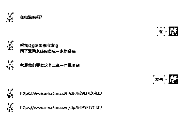
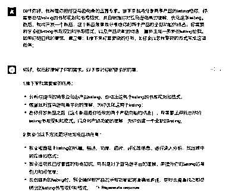
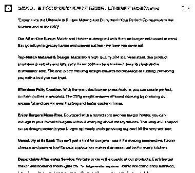

# 亚马逊Listing新玩法：ChatGPT五分钟出新品文案

作者：阿路hh ｜ 日期：2023-06-02 ｜ 获赞：19

今天下午，一位做跨境电商的朋友聊起，想把ChatGPT和亚马逊运营结合起来，用来优化Listing的撰写流程。至于效果如何，他心里也没底，于是顺手发来两个不同链接的Listing，让我试试让GPT参考这两款产品的功能，给一款新品写出一版Listing。

我并没有做任何提示词调校，直接让ChatGPT生成了一版新品Listing。结果比预期更让我满意，而整个流程加起来还不到5分钟。稍微想一想就能明白：如果认真调教提示词，效率还能往上提升多少[机智]。做跨境的朋友，不妨尽早试起来！

 

评论区：

阿路hh：朋友后来补充说，链接其实也能直接丢给GPT，让它顺带看看评论，再提出优化方向。

Nini：想问一下具体怎么调教？我们现在用的是他人调教好的API接口，要付费。

阿路hh：GPT-3.5就能上手，当然，能上4.0会更好。

Nini：这个我们也在试。只是没调过的ChatGPT写出来，文案太像机器硬凑字了。

阿路hh：调教这一步绕不开，建议拿4.0试一轮。

Nini：好，我试试，谢谢。

开平：具体该怎么调教？