# 播客制作实战手册｜2023年8月航海

出品时间：2023年8月9日

本手册想带你看清这个项目的更多可能性，让理解和实操都更省力。想快速定位具体内容，可以按 Ctrl+F（Windows）或 command+F（Mac）输入关键词搜索。

# 写在前头

嗨，很高兴在这里和你相遇。这份手册会陪伴你走过8月航海的播客制作之旅。

先聊大家最关心的：播客到底是什么？现在入场还有没有机会？

播客可以想象成网上的广播，谈新闻、聊故事、讲娱乐、做知识分享都可以。小宇宙、喜马拉雅、Apple Podcasts 都是大家常用的收听渠道。据 eMarketer 统计，2021年中文播客听众已有8600万，到2022年突破1亿。同时，中文播客的数量也在快速上涨，截至2023年5月已达5.7万档。有预测认为，2023到2024年，国内播客消费规模会保持年均15.8%的增速，位居全球首位。

有了自己的频道后，赚钱的路子并不少：接广告、卖周边、做付费内容、建社群，都能带来收入。尤其是想打造个人IP、或希望扩大已有IP影响力的人，播客是个非常趁手的媒介。

那什么样的人适合做播客？即使你是新手，只要有一定创作力、表达力和沟通力，就能尝试。如果再会剪辑后期、或者手头有不错的嘉宾资源，项目推进会顺利很多。播客制作既有挑战性也有创造性，需要不断摸索、保持开放心态，才能把节目越做越好。

这本手册该怎么用？我们从频道筹备、节目策划、采访录制、运营推广、商业变现等环节，都写了具体说明和实用技巧。新手请优先关注这些模块，也算本次航行的重点动作：

✅ 1.5 变现模式
✅ 第二步：筹备播客
✅ 第三步：创作播客内容
✅ 第四步：播客访谈、录制与剪辑
✅ 5.2 用 Show Notes 提高打开率
✅ 6.3 运营方法二：IP 社群运营

另外说明一下，为了给大家更一线的视角，我们邀请了知名播客厂牌宇宙电波的创始人、也是《末日狂花》和《消费圈内人》主理人@旺仔珂珂糖 来共同搭建手册。她会把自己的实战经验和幕后思考都放进来，所以你会在手册里多次看到《末日狂花》的案例，这样能更真实地感受一档播客从0到1的过程。

最后想强调：多提问，多交流。手册里没讲透的地方，就把问题抛出来，我们一起找解法。

希望这次航行，你不只收获结果，还能结识一群并肩向前的伙伴。

本手册由龙哥盟联合圈友制作，仅供航海船员和龙哥盟星球圈友学习使用。也欢迎大家在实践中持续反馈，可联系鱼丸（yuwan387）提出修改建议～

# 第一步：认识播客

## 1.1 播客是什么

播客是一种依托互联网传播音频的形式。它和传统广播有点像，但听众可以随时点播，不受收听时间和地点的限制，APP、网页、小程序都能承载。

2010年前后，智能手机和移动互联网逐渐普及，播客慢慢走进主流视野。越来越多人用手机应用订阅、收听节目，许多传统媒体机构和名人也开始入局，播客的内容种类和质量都因此有了提升。

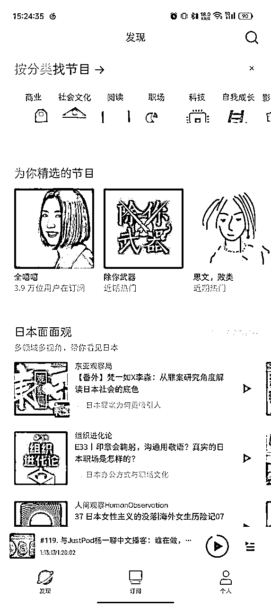

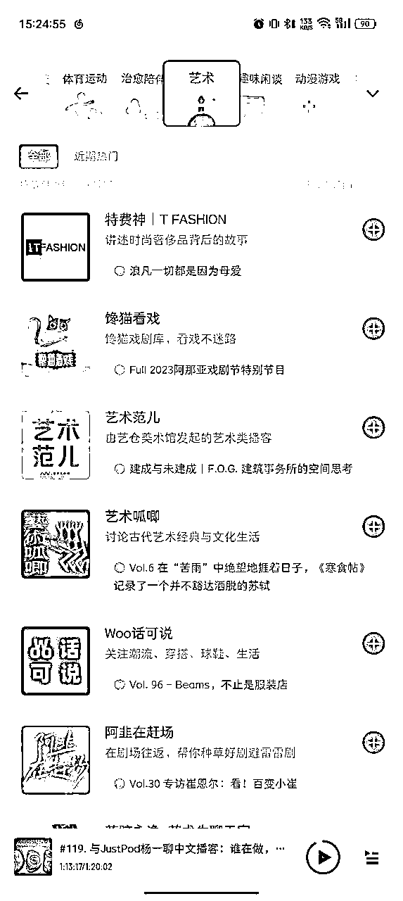

播客的类型可以按内容和主题分成很多种：

- 故事讲述类：讲真实或虚构的故事，题材和情感跨度很大，比如人生故事、悬疑、戏剧；
- 学习教育类：分享知识和技能，覆盖语言、科学、历史、文化等主题；
- 娱乐文化类：聊电影、音乐、流行文化和艺术；
- 科技类：聚焦技术、互联网、编程和行业趋势；
- 健康生活类：关注健康、心理、生活技巧和幸福感，提供建议和支持；
- 商业创业类：谈创业经验、商业洞察和职业成长；
- 旅行探险类：分享旅行经历、目的地攻略和文化体验；
- 专业垂直类：面向法律、医学、金融等特定行业，为从业者输送专业知识。

各平台也都有自己的内容分类方法。随便点开一个播客App感受一下，你会发现几乎任何兴趣都能找到对应的节目。

## 1.2 播客平台有哪些选择

目前常用平台包括：小宇宙、喜马拉雅、网易云音乐、Apple Podcasts、荔枝 FM。下面逐一介绍它们的特点，方便你选择适合自己的阵地。

小宇宙

对创作者来说，小宇宙是目前最值得推荐的App，应用商店就可以下载。它的注册流程和托管体验都很顺滑。和那种什么音频都有的综合平台不同，小宇宙是播客垂直App——用户下载它就是为了听播客，所以你的听众天然懂播客、爱播客。另外，小宇宙的Show Notes界面（可简单理解为节目简介区）可以放二维码，方便听友加你，也不太会被限流，非常友好。

喜马拉雅

喜马拉雅是国内体量很大的音频平台，集合了有声小说、有声书、睡前故事、相声小品等内容。它的优势是盘子大、覆盖广；短板也恰恰来自内容太杂，播客容易被淹没。但这几年喜马拉雅也在大力扶持播客生态，做好的节目完全可以同步上去。

网易云音乐

网易云音乐的主要使用场景是听歌，但也提供不少播客内容，新闻、科技、音乐、文化等领域都有。用户量虽然大，但多数人并非冲着播客来的，想找到精准受众不容易。和喜马拉雅类似，建议把它当作同步分发渠道，用RSS推送即可。

*RSS 是站点之间共享内容的一种简易方式，也叫聚合内容，常见于博客这类按时间顺序排列的网站。

Apple Podcasts

Apple Podcasts 是全球最大的播客平台之一，也是很多人收听播客的首选，和苹果设备深度集成。局限性在于它只在 iPhone、iPad、Apple Watch 的 App Store 中提供。要不要用它发布节目，要根据你的目标、受众和节目性质来判断。

荔枝 FM

荔枝 FM 是2013年上线的国内在线音频平台，也是国内较早的音频直播平台之一。用户可以通过移动App和网页收听、下载节目，内容涵盖电台、音乐、有声书、情感心理、娱乐、财经等。同样可以用RSS同步节目，把它当作分发渠道。

## 1.3 播客值得做吗

先看基础优势：

- 制作门槛不高，一部手机就能录；
- 主题选择空间大，兴趣爱好、专业知识都能做成内容；
- 对个人IP有帮助，在特定领域有见解的人，可以借播客建立声誉，吸引垂直粉丝。

从门槛和发展空间来看，播客是值得探索的方向。

担心市场容量？再看一组数据：eMarketer 调查显示，2021年中文播客听众8600万，2022年超过1亿；中文播客数量也持续攀升，到2023年5月已有5.7万档。另有预测认为，2023—2024年中国播客消费规模会保持年均15.8%的增速，全球最快。

如今播客市场已经有不少品牌跑出了良性商业模式。不只个人，对品牌、公司、集团来说，播客也可能成为“双微一抖一红”以外的标配——也就是“双微一抖一红一播客”。

不妨想想：现在还能找到几个长达60分钟的品牌沟通场景？种草追求的是泛流量和曝光，种树则看重对高购买力精准人群做深度交流。“播客种树”的价值在于，它服务的是品牌的长期建设，而不只是短期卖货。很难再有哪种媒介，能让受众静下心陪伴你一个多小时，形成这种深度的沟通。你可以在节目里从容地讲品牌故事，让理念慢慢渗透；也可以借忠实粉丝之口去影响更多人；它甚至可以成为对抗短内容洪流的武器，沉淀出更持久的品牌资产——前人栽树，后人乘凉。

## 1.4 什么人适合做播客

做播客当然也有门槛。

创作者一般需要具备：内容创作能力，能产出有趣、有价值的内容，选对主题，写出脚本或大纲，并保持表达清晰；语言表达能力，说话有自信，能用合适的语调、语速和情绪抓住听众；互动能力，能和粉丝交流、给反馈，把社群氛围维护好；社交能力，能完成嘉宾邀约、沟通和访谈（单人播客可以暂不考虑）。

同时还要解决音频剪辑问题，可以自己上手，也能外包给团队。

这些能力并不是要求你样样精通。每个人都能在自己擅长的方向上发光，粉丝最终也是因为你的独特价值而留下来。

硬件层面，播客真的没有太高要求，一部手机就能完成创作。想升级设备，可以参考第四步的设备推荐和价格。

总之，普通人完全可以做播客，不需要特殊背景或天赋。只要你有热情、愿意学，就可以通过播客把故事、知识和观点分享给世界。做播客也会认识很多同频的小伙伴，是件很开心的事。

当然，制作播客需要耐心和毅力，要投入大量时间和精力，才能做成真正优秀的作品。但只要保持热爱、持续努力，你一定能做出好节目，也会收获充足的正反馈。

## 1.5 播客的变现方式

为爱发电之余，也要认真考虑收入。目前播客常见的商业变现方式有5种：广告、周边、线下活动、付费内容和社群。

### 1.5.1 变现方式一：广告

广告是最普遍、也最被熟知的变现方式，主要分口播和定制两种。

口播广告通常出现在节目前段，像贴片一样，不影响后续内容，比较轻量；定制广告则是围绕品牌和推广主题专门策划，可以说为某一期节目量身打造，通常还包含品牌植入、社群同步等。目前《凹凸电波》和《末日狂花》在定制方面做得比较突出。

广告还有一种特殊形式：整季赞助。比如一季有10期或15期，由品牌方冠名，走的是PR预算。这类合作需要和品牌建立很强的信任，通常先试投一期看效果，效果好再买年框，也就是一年内露出三到四次。对新手来说，这种形式借鉴意义不大——它一般由品牌创始人直接拍板，转化又很难衡量，更偏向纯品宣。目前市场上的品宣投放占比并不高，所以主播接广告时要想清楚，能否帮品牌赚回投入，比如带动销售。大趋势来看，口播和定制会更主流。比如低度酒品牌Jollee，就喜欢在开头几分钟讲品牌和优惠信息，据说投放效果很好。

定制广告该怎么做？

不同节目对定制的理解不一样。有的节目认为，定制就是Show Notes里露出品牌，开头结尾感谢广告主，内容中间不深入介绍。这取决于节目调性。比如文化类节目接护肤品广告，不可能在讲书过程中突然讲产品功效，开头结尾致谢已经是比较硬的广了。而《末日狂花》这种偏“好物分享”的播客，就适合在开头结尾之外，于节目中间自然提到产品功效。

你也可以有自己的广告态度。《末日狂花》的态度一直是明确告诉听众这是广告，不玩软广。我们会说：这个产品很好，我自己也在用；我给你一个合适的价格，买不买你自己决定。钱在听众手里，我们不会强迫消费，只是把信息给足，让大家自己选择。

广告报价和谈判怎么做？

关键是让品牌方看到你的人群价值。很多品牌方看不到具体数据，只能看到粉丝数，于是习惯用粉丝数乘以一个系数来报价。这对垂直领域的节目很不友好。你要拿出足够的数据，证明你的用户质量高、购买力强，才能撑起你的定价。

报价本身也有心理因素。很多没经验的人，对方说“你开个价”，你报了之后就被压价，甚至自己都觉得报贵了。目前行业里没有统一参考价。我们看过很多家的刊例，分析过报价和粉丝数、播放量比例的关系，找不出什么规律。每家都是用自己的方式说服品牌方，品牌方也会对不同播客横向比较。有人说现在的报价生态像一片黑暗森林，谁都想打听别人。但我认为，这种信息参考价值有限——只要你在自己的领域里有独特优势，没有同质化竞争，你就拥有足够的定价权。

如果完全没头绪，可以请教有经验的业内老师。不过在节目定位和受众情况都不清楚时，很难给通用建议；掌握更多具体数据后，或许能得到更定制化的方案。

分享一个报价小技巧：一开始可以报得比自己预期高一点，至少定一个自己不会亏的价格，免得做完了有“白干”的吃亏感。报高了未必能成交，但成交次数越多，你对市场的判断越清晰。当然，大胆报价不等于对方一定会接受；对方不接受，价格就悬着，不会成为真实价格。所以报价最好有往期成交数据来支撑。

还没接过广告的主播，可以先分析自己的听众，设定一个自己满意的价格，并努力说服广告主。实在说服不了，就去找其他广告主。如果一味迎合甲方的低价，做完东西自己也不会开心——赚得少，还要承担掉粉风险，太不划算。

接广告怕掉粉怎么办？

答案很直接：你永远无法让所有人都喜欢你，所以发广告后会不会掉粉，没人能提前预测。但只要你的涨粉速度足够快，就不用太担心。

换成粉丝视角想想：我喜欢的主播接了广告，我会替他开心，因为我知道他全职做这件事，没有品牌方支持，可能就断更了。作为粉丝，我希望他持续更新，所以能理解他接广告。如果广告产品正好是我需要的，我还会直接购买。如果因为一个广告就取关，那这部分人本质上是“白嫖粉”。发广告反而是一种提纯，留下的都是真心喜欢你、支持你的人。关注数真的没那么重要。

《末日狂花》的广告听起来很自然，因为主播真的在用那些产品，会分享真实的使用场景和心得。而且他们的广告还很有创意，比如有一次讲香水时做了拟人化处理，听众哪怕一开始不想听，也会不知不觉听完，甚至忍不住脑补画面。这些小巧思很值得学习，也可以多听些同类账号找灵感。

### 1.5.2 变现方式二：周边

周边吸引的受众，是那些喜欢你、愿意为你花钱的人。周边未必是最刚需或最划算的商品，但带有很强的情感连接属性。

周边的范围很广。比如《末日狂花》做过徽章，灵感来自塞尔达里的克洛洛——你碰到它，它会送你一颗克洛洛果实。他们的做法是：你在线下遇到我，我就给你一个徽章。这就是徽章的意义。

他们也做过T恤。一开始只做了3件自己穿，发到群里后大家都说好看，于是计划在以后的VIP线下活动里送这些T恤——只送不卖。

# 卖IP周边，真不是好买卖

先说结论：靠IP周边变现，算不上一条好路子。随便逛一圈市场就能发现，做定制衫的商家多如牛毛，单件成本往往只要四五十元。要是你换上六十元的优质棉料，自然想把售价往上抬，九十九元乃至一百二十元都敢标。可它终归只是一件广告衫——同样的九十九元，在优衣库能拿两件，不是真心喜欢你的人，很难下这个单。

如今的IP周边，早就不把“便宜又好用”当卖点了，它更像粉丝表达喜爱的一种载体。也正因如此，多数周边的定价压得比较低，质量上难免会打折扣。另外，周边设计本身也有门槛：产品如果千篇一律、像套模板，用户很难产生强烈的购买冲动。

归结起来，如果你正打算变现，别把IP周边当成起步阶段的首选，更别让它扛起主要收入的大旗。这类产品的回报率和投产比通常都不算高，还容易招来吐槽。

做任何商业化之前，先扪心自问：这笔钱凭什么该由你来赚？这也是我们谈播客商业化时最看重的一条。为什么是你而非旁人？你和别人之间真正拉开差距的地方在哪？你的绝对优势又是什么？愿意掏钱的人，能从你这里得到什么价值？

当然，如果你还是想走周边变现这条路，我们也搜罗了一些案例，可供借鉴。

比如卫衣——文化有限去年推出的一款卖得相当火，入手的人不少。它之所以能走量，关键在于这档节目属于中文播客圈最顶尖的那一档，粉丝体量足够大。

再看姜思达的周边店。价格亲民的商品往往更容易走量，而高客单价的产品推进起来就吃力得多——只有真正喜欢你的人，才肯为高价买单。举个例子，他们卖过四五百元的酒，虽说定制成本不低，但消费者可选择的空间很大，未必会选你的酒。说到底，这考验的是有多少粉丝愿意为你大手笔花钱。

也有别的节目尝试过抱枕、冰箱贴这类小周边。成本低、起订量也不大，可实际买单的人寥寥无几，基本靠亲友捧场。可见想靠周边盈利，必须走量，而走量这件事本身门槛不低。

知识型周边的销路则好得多，单款卖到一两百万并不稀奇，利润率也相当可观。不过要提醒一句，这类产品的背后是团队巨大的精力投入：规模约十人的队伍，半兼职运作，前后耗时半年上下，其中至少有一两个月需要全职扑上去。正是这样的投入力度，才撑起了对应的业绩。因此，动手做周边之前，务必先掂量自己能否拿出同等的投入，以及期待的回报是否合理。此外，别把思路锁死在实物上，周边的形态完全可以再往外延展。

拿《提钱退休》的乌素老师来说，她自己开了个小报童专栏，教人做📕，把播客里的听众导流过去。不少人对进一步的学习有需求，自然就愿意付费订阅。从这个角度看，专栏同样算播客的IP周边，只不过它属于知识型的那一类。

### 1.5.3 模式三：线下活动如何落地

接下来看看第三类变现路径——线下活动。播客的线下活动，商业化到底该怎么跑？

像广播节这类常规的线下录制或聚会，场地方和主办方已经把成本扛了下来，完全可以开放免费名额给听众，不必再设收费门槛。可一旦你的受众群体足够聚焦，就不妨为他们量身打造付费型线下体验，比如游学营或面授课。这类形式既回应了听众的真实诉求，也是他们乐意买单的变现思路。核心只有一条：让参与者觉得这钱花得值。

下面就借《末日狂花》和《消费圈内人》的实操经验，供各位参考。先看《末日狂花》。此前上海举办广播节时，主办方分给我们一个摊位，我们就借此和粉丝面对面交流，全程没有收费。另有一种和品牌联合举办的线下活动，同样不设收费，但会优先向曾经帮助过我们的业主发出邀请，算是表达谢意。

《消费圈内人》则走的是收费路线，会组织线下课程和游学营。这档播客的定位是“年轻人的第一堂MBA”，团队把MBA里的游学、课程、行业交流、大会等环节拆成模块，学员可以按自己的时间安排和实际需要来挑课。前期对接本地资源、讲师和场地，样样都要花钱，所以这类线下项目必须走商业化路径。我们当然不是在做慈善，但只要服务对得上用户的需求，他们自然会找上门。

因此，判断一场线下活动该不该收费，标准其实很简单：你提供的服务，是不是用户真正需要的？

总的来看，线下活动单笔收入有限，而参与者的期待值却很高。一旦达不到预期，这件事就很难做成。所以别轻易碰这种“赚得不多、交付压力却不小”的活动。

### 1.5.4 模式四：付费内容如何跑通

播客的付费玩法大致分两类：订阅制和打赏制。

打赏和订阅，底层逻辑完全是两码事。打赏发生在节目听完之后，听众一时兴起决定给不给心意；而订阅是用户带着明确需求来掏钱买内容，两者的心理机制大相径庭。并且，多数节目的打赏数据都比较冷清，甚至有些体量不小的播客压根没有打赏——这不代表他们商业化能力弱，很可能听众已经在别处完成了消费，比如买了付费专辑或进了会员群。

订阅数据同样会左右品牌方的投放决策。在品牌方看来，订阅人数不只是冷冰冰的数字，它反映的是用户愿不愿意为你掏钱——毕竟人家投你，图的是你能帮他们卖货。如果你的数据没法佐证自己能带得动货，或者证明不了用户有付费意愿，刊例价就很难喊上去。

做付费内容，核心在于把用户画像摸得足够准。

《末日狂花》曾经试过一期订阅制内容，从上线到下单前后十天，卖出一千七百多份，标价四块九毛九，成绩相当不错。可见，体量不大的播客同样可以试着推出付费单集。

在起步阶段变现渠道有限的时候，用付费内容来试探用户需求是个好办法。有人愿意付费，说明用户是真心认可你的内容，你也能借此判断他们究竟有没有兴趣。免费节目人人都会点开，所以收听量高低说明不了太多东西；但付费行为能直接验证需求是否够强。如果付费之后反馈同样积极，那就说明方向选对了，值得长期做下去。这是一个相当靠谱的模式，能为播客商业化再添一把火。

### 1.5.5 模式五：社群怎么变成生意

IP社群建起来之后，能承接的生意不少，比如社区团购、知识付费、训练营陪跑等等。

拿《末日狂花》来举例。这档节目目前运营着十三个听友群，总人数接近六千，入群率相当可观。这些群还有一个附加用途——做团购。

这档节目的选品瞄准高端、轻奢、小众，所以运营团队在氛围营造上花了不少心思，努力让群聊保持住这种调性，让进来的人觉得自己就是追求品质的“富姐富哥”，自然要买些配得上生活水准的东西。

说实在的，做播客项目，粉丝关注量并不是最要紧的指标。在广告主眼里，往往只分“过万”和“不过万”，或者“过十万”和“不过十万”；只要能突破一万粉，就具备商业化条件，也算跻身大号行列。过了这道坎，接下来更关键的是把用户运营做细、把社群经营好、让群内保持热度，再以此为基础去铺更多商业化的路。只靠广告收入的话，变现会非常被动，基本是看天吃饭。

对做播客的人来说，不妨多参考前人的做法，把各种变现路径都试一遍，挑出投入产出最划算的那条，再深耕下去。同时，别忘了回到最初那个问题：这笔钱，凭什么轮到你赚？

# 第二步：播客筹备阶段

## 2.1 给播客找准定位

经常有朋友来问我：我想开一档播客，可不知道做什么方向，你能帮我理一理吗？

这类问题我收到得实在太多，于是干脆总结出一份【灵魂 6 问】。把这六个问题想透，甚至只要答得上第一个，播客定位基本就水到渠成了。这份神秘清单到底长什么样？先卖个关子，具体内容放到下文【2.1.1 方向定位】里展开。

我不推荐一开始就照着“商业”“成长”“体育”“休闲”这些平台现成的分类去定方向。

### 2.1.1 方向怎么定

我给内容定位立的第一条规矩很简单：从你本人出发。你是什么样的人，就做什么样的播客，别被现成的类目框住。

播客恐怕是所有内容形式里，听众和主播关系最紧密的一种。现实生活里，哪怕交情再深的朋友，也未必能一年听你讲满五十个小时；但播客听众和主播之间却常常如此：“天啊，我居然听这个人说了一百个小时的话！”

你在节目里讲的每句话，本质上都是你自身特质的一个横截面。如果做播客不是从本人出发，那股别扭劲儿会非常明显，听众一耳朵就能听出来。

做播客，其实也是向内审视自己、重新认识自己，并把最长的板子放大的一场修行。

播客这种表达方式，对语言输出的要求相当高。要是某个话题你能跟朋友连续聊上四五个小时还意犹未尽，说明你在这个领域的底子够厚，也愿意通过对话把自己的知识和看法分享给别人。

我一直认为，内容做什么样，就会聚拢什么样的人；反过来，你想聚拢哪类人，就可以往那个方向去做。但对媒体行业之外的内容素人来说，想做出跟自己特质不搭的东西，真的很难。所以我建议的第一步，是先把自己的特点和长处剖析清楚，再据此梳理定位。

好了，现在该揭晓【灵魂 6 问】的真面目了：

哪个话题，你能跟朋友连着聊四五个小时都不嫌累？

哪个领域，是你从小到大投入最多时间去钻研的？

跟同年龄段的人比，你身上有没有什么“别人没有、你有”的特质？

周围人通常会拿哪些词来描述你？

你最爱听的播客是哪一档？它最打动你的地方在哪？你觉得这份特质在自己身上也有影子吗？

你希望借这档节目结识怎样的朋友？

把以上答案拼在一起，就勾勒出了你这档播客的性格底色。

以旺仔珂珂糖为例，看看她怎么回答这【灵魂 6 问】。第一问，哪个话题能跟朋友连聊四五个小时？她的答案是：好物安利、情感话题、香水、威士忌、餐厅推荐，以及消费、互联网、创投这些行业的交流。第二问，哪个领域是她从小到大花最多时间琢磨的？答案是：怎么把日子过得更快乐、让人生更丰富。第三问，跟同年龄段的人比，她有什么别人没有的特质？她更外向、更愿意尝鲜、行动力拉满，还认识一大票各个行当的朋友。第四问，旁人一般用哪些词说她？答案是：爱攒局、爱把朋友介绍给彼此认识的开朗的人；爱讲段子、爱抛烂梗；行走的种草机。第五问，她最爱的播客是哪档？它最打动她的是什么？她觉得这特质自己身上有吗？她的回答是：2022 年她最迷《凹凸电波》，最让她上头的就是节目里那种放飞自我的氛围，而她自己恰恰也是这种氛围的制造者。第六问，她希望借节目结识怎样的朋友？她想聚拢的，是同样爱琢磨“怎么让日子更快乐、人生更丰富”的那群人。

综合这些答案，她最终做出了一档聚焦城市女性的情感、好物、职场心得和日常吐槽的杂谈节目——《末日狂花》。

### 2.1.2 差异怎么做出彩

这一节聊聊怎么锁定对标对象、把差异性做细，进而做出个人特色。

动手做播客之前，先盯一眼自己的“收听时长”。

我发现不少人对播客这件事存在误会，以为不过是拉几个朋友随便唠唠。遇到持这种看法的人，我通常会追问一句：你小宇宙听多久了？要是有人反过来问“小宇宙是啥”，我大概会直接晕倒。不至于吧，难不成真有人打算做播客，却连小宇宙都没碰过？

万事开头，请先把「小宇宙 APP」装上，听够三十小时以上、三十档不一样的节目。

为什么定在三十小时？大体说来，单集时长在六十分钟上下，三十个钟头的底子，足够你听掉三十集各不相同的节目。有些内容对味，你会心甘情愿追完；有些可能一开场就让你想关——那你就可以多想一步：它究竟哪里劝退了我？如果换我自己操刀，又该如何规避这种尴尬？

接下来，拿上【章节 2.1.1】那份灵魂 6 问的答案，再拿来逐条问自己（本手册只聊简体中文播客这块）：

我想做的方向，现如今市面上是否已经有人在做？

若有，对方目前经营得如何？拆一拆它为何能起来。

再琢磨一下：我有没有可能比它做得更强？

我能在哪些环节上做得更出色？例如邀到更大牌的嘉宾、拿到别人没有的选题、找到更抓人的角度……若这些都不成立，就掰扯一下原因：是话题过于冷门，还是踩线太危险？

我做内容的态度很明确：先大规模摄入，再精简地吐出。

想做出好东西，就得踩着前人的肩膀往上走。要是有人愿意拿宝贵的一小时来听我的节目，我就必须给到他一些别处听不到的东西——也就是大家常说的“信息增量”。

怎么才能造出“信息增量”？最直接也最折腾的土办法，就是把同类型账号和内容通通刷一遍，琢磨它们靠什么赢，拆一拆它的内容骨架，再往里掺进你自己的独门创新（【章节 2.1.1】讲过怎么找到自身的独家亮点）。

内容圈有条不成文的规矩：爆款的底层骨架高度雷同。毕竟从人的心理出发，能勾住好奇心、让人忍不住点开的，无非就是那几样。所以越早开始研究并拆解优秀作品，对自身水平的拉升越明显。

两个思路，帮你轻松锁定对标账号。

比如你想做职场方向的播客。常规做法是：在小宇宙 APP 里输入“职场”这个词。跳出来的基本是名称或介绍里挂着“职场”的节目。这其实也在提醒我们：命名、写简介、拟标题时，可以塞进这类覆盖面广的词，从而提升被检索到的几率（一个小 SEO 窍门）。

进阶玩法：在📕 APP 里搜“职场+播客”。你会看到，搜出来的结果和小宇宙那边完全两样。原因在于📕这几年涌出了海量播客推荐，大多是博主手工筛完再攒成合集的，其中单集推荐合集尤其多——这对找对标特别有帮助。并且评论区里能瞧见不少人对这些节目的点评和感受。另外，你还能点进别人的头像，看看对方过着怎样的日子、处在人生的哪个阶段。这能帮你更清楚地判断这些节目的听众是什么人，是不是你想聚拢的那批。

随后，把两个 APP 上的搜索结果汇总起来，列二十档播客和二十期节目。这二十期未必来自那二十档对标播客，不用给自己设框。

参考的播客那边，重点看三样：简介怎么写、shownote 怎么排、标题怎么取。

要参考的单集那边，则要：整期听完、评论区翻完，弄清楚它的内容骨架长什么样、主线怎么走、评论区里留了哪些互动钩子。

找到它们成为爆款的原因，再把你的独门创新加进去。

## 2.2 播客做成什么形式

播客的玩法可谓花样繁多：有人独自讲，有人两两对话，也有人凑一起聊。那么，到底该挑哪一种？

其实形式未必是死的。听多了你就会发现，同一档节目里也可能不止一种玩法。所以这一节我们挑几种比较典型的形态来聊，各位对照自己的情况参考即可。

下图是一张「播客形式」的导图，边看图边读这一节会更好理解。

### 2.2.1 一个人怎么起步

如果你眼下还没找到搭子，或者想先把个人 IP 立起来，这部分可以多留意。

假如你手里攒着体系化的内容能往外倒，我很建议你先从单口起步，也就是自己一个人讲。这样你的表达能原封不动、不被中途打断也不被误读地送进听众耳朵，还省掉了约人、列访问提纲这些琐碎活儿，开张速度会快不少。

另外，头几期先自己一个人讲，能让听众先对你和你的一套观点建立印象。要是一开始就拉人对话，反而可能冲淡听众对这个个人品牌的认知。

不过单口也有短板：一个人的经历加理论储备终归有限，往后大概率会撞上素材见底的卡壳。这个节点就很推荐转到对话模式，借别人的经历和故事来补自己素材见底的窟窿。

当然，对谈节目能走多高，取决于你人脉圈有多大、约嘉宾的本事有多强。后面的章节也会讲怎么请人。

归纳一下并配上例子，便于各位对号入座：如果你在某个领域底子深厚，单口就很适合你。比如《联名关系》这档节目，主理人是“丁不拉咚”，内容聚焦品牌联名、IP 授权、播客串台和明星合作。整整四期，目前已完结，从策划到输出全由“丁不拉咚”一人包办。

如果你某个领域人脉很广，那就很适合做对话。比如《乱翻书》，由“潘乱”主理，是一档聚焦商业、科技、互联网从业者的对话节目。每期他都会请来与话题对口的行内人，就着当期的题目聊开。

如果你既底子深厚又人脉广阔，那可以先自己一个人讲，把自己的主张和看法亮出来，之后按每期的题目再邀对口的人来。另如《量贩冰糖》，由“范冰”主理。前十一期由她单口完成，到第十二期开始，按话题请来对口行家，围绕当期的题目聊开。

### 2.2.2 几个人一起怎么起步

要是你已经物色好合伙做节目的人，或者本来就是几个兴趣相投的伙伴一聊就拢到一块，决定合力开一档节目，那我建议这样操作：

起步阶段：先和搭子围绕一些话题开聊，让听众先熟悉你们的声音和表达习惯。比如《末日狂花》，最早四期只有三位主创，就着“约会”“鉴渣”“都市丽人一年花多少钱”“2022 年度好物”这类题目开聊。

成熟阶段：往后若想把话题范围往外扩，就可以按主题去请外面的嘉宾了。

### 2.2.3 公司怎么做播客

假如你替公司或品牌做一档节目，大致有这几种形式：

一种玩法是主播轮换、嘉宾也轮换。可按“第一季”“第二季”这样来切分，比如三顿半的《星球电台》、GIADA 的《岩中花述》，每季每集都是不一样的主播配不一样的嘉宾。

第二种，主播固定、嘉宾轮换。主播可以由公司内部的创始人或同事来当，也能请外部播客厂牌的主播代班。像耐克的《耐听》。

公司或品牌做播客的花样当然远不止这些，不过本节面向的是入门者，就不铺开细讲了。

## 2.3 播客怎么起名

这一节要解决的，就是怎么给播客取一个既好传播又有点意思的名字。

我经常跟朋友打趣：如今节目多到连谐音梗都快被薅光了。

其实给播客命名，用谐音梗并非唯一出路。我们归纳了几种取名招数并配上例子，并在小节末尾列出一些不推荐的方向，以及命名最后冲刺的比拼诀窍，希望能给你点灵感。

先说说一个常被提及的疑问：播客名字到底取几个字比较妥？

其实给播客取名并没有硬性框框，不撞名就能用。不过通常更建议控制在三到四个字，短好记，传播也占便宜。最好让人一眼扫过去就明白你要聊什么，省去理解成本。

### 2.3.1 几种起名思路

取名方法大致有这么几类：拿主创名字命名、围绕播客主题取名、玩谐音梗、带上公司或组织大名、用小圈子梗或致敬经典作品。

前四种比较好懂，直接拿例子说话；最后一类，我们借《末日狂花》展开聊聊。

# 从取名到上线：播客包装实操清单

## ① 用主创名字当节目名

若你本人已有可辨识的个人形象，把名字直接放进节目名最省力。听众容易认人，节目传播时也会反哺个人品牌。例如：范冰的《冰镇电波》；酸奶哥的《酸奶哥聊天社》；张春的《张春酷酷酷》；姜思达的《姜思达》；Toby 的《T 哥的新邮件》；王大力的《大力如山》；苗炜的《苗师傅》；小马宋的《小马宋》；潘乱的《乱翻书》……

## ② 围绕节目主题命名

这种思路最通用。听众扫一眼标题，就能猜到你大概聊哪类内容、定位是什么。优点是直观，能迅速建立内容预期。前提是核心关键词抓得准：既让人一看就懂，又能激起点击欲。例如《剧谈社》对应翻译艺术品；《半拿铁|商业沉浮录》；《美妆内行人》；《商业就是这样》；《组织进化论》；《歪波音室》；《识人识己》；《Slow brand》；《Buidler talk | web3 对谈》；《豆大王的睡前故事》；《账号侦探》；《早晚卖货》；《创业内幕》；《蜜獾吃书》……

## ③ 用谐音梗取名

谐音梗很经典：一边提示内容方向，一边制造轻松感。比如《饭不着》《大食话》《厨此以外》《木有娱丸》《贝望录》……

## ④ 把公司、组织或品牌名放进标题

做法很直接：让品牌名、机构名成为节目名的一部分，听众更方便判断归属。例如《GQtalk》（GQ 杂志）；《书外 SSI Redtalk》《红了再说》（📕）；《Gadio》（机核网）；《耐听》（耐克）；《协和八啦吧》（协议医学生）……

## ⑤ 圈内梗与经典作品致敬

这一类名字能让同好一眼会意。例如《退相干》《文一西路夜谈》《人间布洛芬》《薯条码头》《磕学小组》《星球电台》《瓜儿与少年》《跳进兔子洞》《末日狂花》……

以珂珂老师的《末日狂花》为例：一层是向女性题材电影《末路狂花》致意——三位女主播、公路片气质，也呼应她对“人生不是轨道是旷野”的理解；另一层是双关——节目常聊消费和花钱，珂珂老师笑称三位主创属于“末日到了也要狂花”的类型，名字就这么定下来了。

### 2.3.2 命名时应回避的方向

1. 生僻、冷门、违禁以及容易引起歧义的词，尽量别碰。

2. 标题中少放标点，尤其是感叹号之类，否则搜索时容易被忽略。

3. 若听众以简中用户为主，尽量别用全英文名。

4. 如果你坚持用一个第一眼看不出主题的名字，记得用“|”或“——”留出解释空间。例如《剧谈社——翻译艺术品》《半拿铁|商业沉浮录》。

### 2.3.3 候选名进入终选后怎么验证

最后分享一个判断名字是否好记、是否容易传播的小办法：先准备三个备选，分别告诉三位朋友。第二天再去问：“昨天那几个名字，你记住的是哪一个？”选大家记得住的那个。

如果三个人都没印象，就推翻重来，重新准备三个，再测一轮。

## 2.4 视觉包装

这一节要解决的问题是：不懂设计、也不打算花大钱请设计师时，播客 logo 怎样做出可用效果？有哪些坑要避开，哪些细节能让封面更抢眼？

### 2.4.1 拆解 logo 的三个动作

一个最基础的播客 logo，通常由这些部分构成：

底色；节目名；与内容相关的点缀元素（可有可无）。

动作一：确定底色。你完全可以选自己最喜欢的颜色。

如果没有明显偏好，又希望节目在成百上千个封面里更容易被注意到，可以试试这个办法：打开小宇宙 App，进入“订阅”，把第一屏截下来；继续下滑，截第二屏；再滑，截第三屏。

手里有了三张布满不同播客 logo 的截图后，先把判断清空，用陌生眼光快速扫一遍，记住最先抓住你视线的几个封面。然后归纳它们在色彩上的共同点。你大概率会发现：最先跳出来的是黑白、黄黑、蓝紫之类的撞色；其次可能是高饱和的红、蓝、橙。

总结出规律后，就可以照这个方向决定自己的配色。《末日狂花》定主色时也用过这个办法，最后选了爱马仕橙。

动作二：处理字体。

几个上手快、适合新手的设计站点：可画（https://www.canva.cn/）；稿定设计（https://www.gaoding.com/）；创客贴（https://www.chuangkit.com/）。

有位播客创作者的原话是：“可画帮了我不少，我直接开了年费会员；这笔钱还不够请专业设计师出一张图。”

在这些平台开通会员后，可以用到一批可商用的素材与字体，零基础也能体验“自己动手做设计”的轻松感。

最简排版就是：底色铺满，节目名压在上面。尺寸选 500*500。

一个小提醒：字号要大！字号要大！字号要大！

别忘了，你的目标是在海量封面中第一眼被看见。

动作三：加入与主题相关的元素。

对多数人来说，前两步已经能做出一个能用的 logo。若还想多一点巧思，可以在上述站点挑素材叠加，或者导入美图秀秀、醒图等修图 App，加上你喜欢的元素。

### 2.4.2 用 AIGC 帮你想视觉方向

如果前面的办法还不能满足你，这里有个更好玩的思路：让 AIGC 辅助设计。

只需在原流程前多插一个动作。

打开 https://www.logosc.cn/，先让 AI 生成 logo。你会看到大量方案，结果未必一次满意。

没关系，这一步真正的作用，是让 AI 先替你搭一个 Mood Board。Mood Board 也叫情绪板，通常由一组图像、文字或样品拼贴而成，用来呈现设计师对某个项目的感受和方向。

举个例子：用 https://www.logosc.cn/ 给《消费圈内人》的 logo 设计搭 mood board，截图如下：

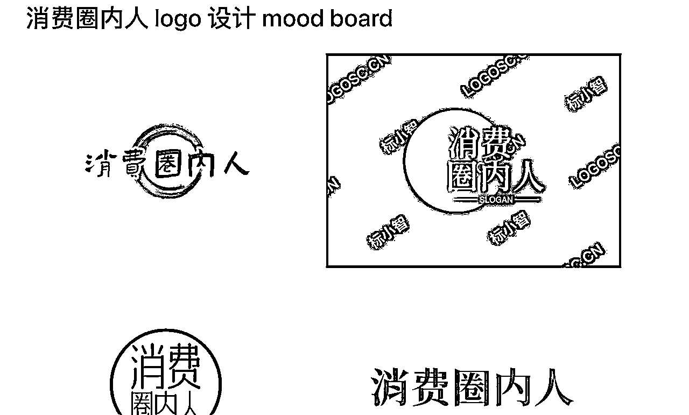

怎样得到这样的 Mood Board？拿“宠物研习社”走一遍流程。

动作一：打开 https://www.logosc.cn/，点击“在线 LOGO 设计”，再点“开始”。

动作二：填写 LOGO 名称。口号栏会根据名称自动补全，也可以手动修改。

动作三：选择行业；不想选可以直接跳过。

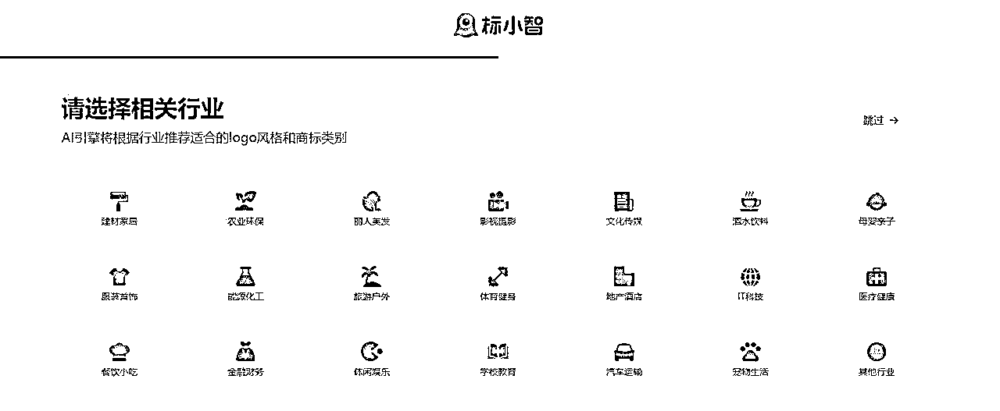

动作四：挑选喜欢的色系与字体风格，可以多选，不感兴趣也能跳过。

动作五：拿到 LOGO Mood Board（顶部小菜单还能调整名称、颜色等搭配），借此摸清自己的审美偏好。

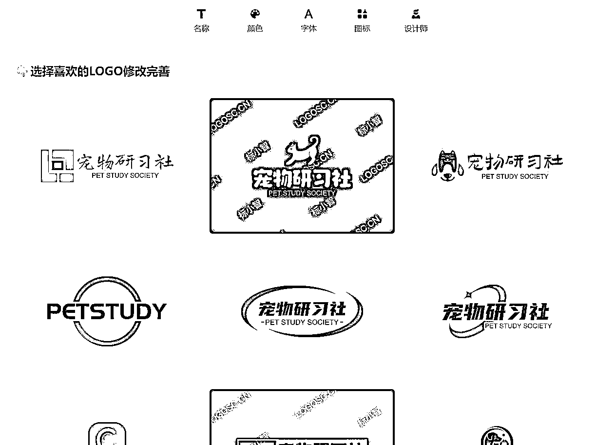

走完这一趟，你至少会知道自己在 logo 设计上更偏爱什么、更排斥什么。

## 2.5 把节目建起来

以小宇宙为例，演示创建播客的流程。

动作一：打开小宇宙网页版👉小宇宙播客，完成登录。

动作二：点击“+”，创建节目。

动作三：创建节目。

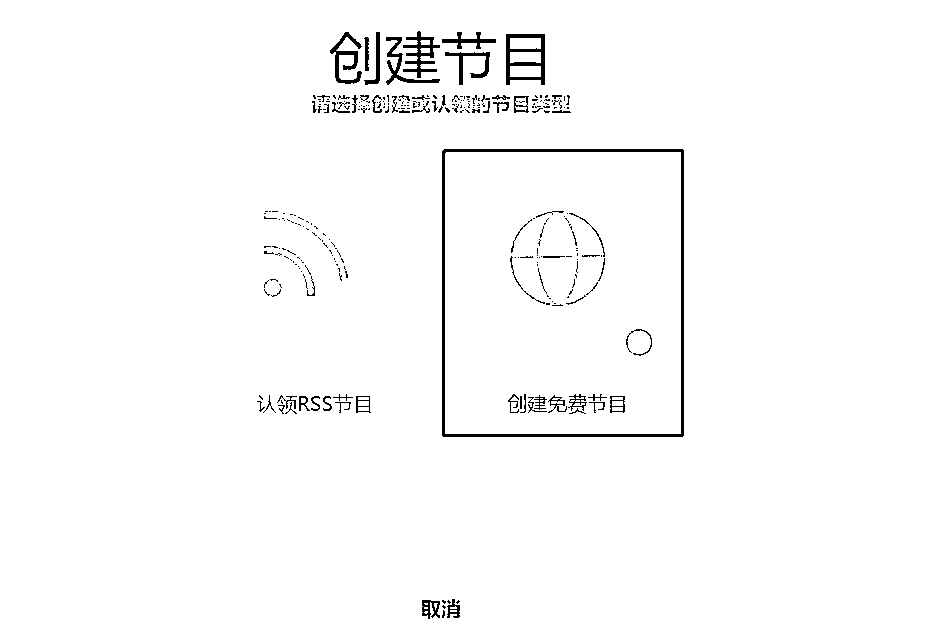

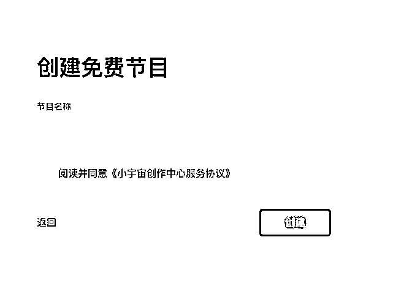

填入节目名称，恭喜，创建成功。

节目创建后要经过审核（通常很快，一般当天完成）。审核通过后，记得完成实名认证，否则无法上传单集节目。

# 第三步：把播客内容做起来

前面几章聊的“播客定位”“播客形式”“播客取名”“视觉包装”，相当于搭起了节目骨架；这一章要讲的“定选题”，则是往骨架里填血肉。

本章先讨论播客冷启动阶段最要紧的三条底层逻辑。无论你做哪类播客，都能从中得到一些参考。

理解底层逻辑后，我们再逐一拆解选题、嘉宾和播客大纲，希望你看完这一章，对节目内容有一个初步判断。

## 3.1 冷启动阶段的三条内容逻辑

### 3.1.1 先攒够十期再说

坊间有个不算严谨的观察：不少主播会在第三期或第四期停更。常见原因是开始前高估了自己的可投入时间；或者做了才发现正反馈太少，比如指望一两期就爆、立刻涨粉。再加上前期往往是录一期看一期，于是很多节目在第四集就“烂尾”。

但在内容行业看来，爆款是偶遇，不是 KPI。我们能控制的，是持续稳定地产出高质量内容，然后等待。爆款来自前期稳定积累，再在天时地利人和的那一刻“等”来。

顺便说说我对爆款的看法。做内容像种地：踏实做，不低估自己，也别飘。今天播下种子，未来长成什么样，有内容自己的造化。把主客体分开看，放下“必须冲爆款”的执念。春天把该做的做了，秋天自会看到结果。

所以第一条底层逻辑是：无论如何，先录满十期。量先积累起来，手感有了，再谈打磨细节。最值钱的，永远是你沉浸在这一行里的手感。

因此一开始就要把头十期的选题准备好，然后不管怎样，录完、发布、等听友反馈。

### 3.1.2 让关键词扎得足够深

有了先录十期的心理准备，接下来看这十期选题怎么定。

我的看法是：这十期就是点进你主页的听友对你的第一印象。要让一个陌生人在十期内容里明白：你这档节目讲什么、和别的节目有什么不同、他能得到什么。

你只有这“十期”，也就是十秒左右的被扫视机会。最好的办法是聚焦，把关键词打穿。

前面 2.1.1 提过“灵魂 6 问”，第一问是：“有什么话题，你能和朋友滔滔不绝聊上四五个小时？”

以《末日狂花》为例，拆解什么叫“把几个关键词打透”。

我之前的回答是：聊“情感恋爱”，我能和朋友聊四五个小时。但“情感恋爱”范围太大，落到最初的播客选题，必须继续收束。

比如，“情感恋爱”和“鉴别渣男”就不是一个量级：前者是大话题，后者颗粒度更细。对播客选题来说，颗粒度还要更细，最好细到这期节目具体讲哪几个故事。所以定选题时，关键词一定要拆得足够细。

有了关键词，也明白目标是在十期内容里让听众看到这个词就想到你的节目，这时可以再用 2.1.2 提过的“站在巨人肩膀上”的方法。这里不重复背后的道理。

直接给动作：先定自己节目的核心关键词；再搜相关节目，大量看和听，先发散；最后结合自身情况聚焦，思考自己能在现有基础上怎样做得更好。如果第三步的结论是“我没法比现在的基础做得更好”，那就回到第一步重来。

### 3.1.3 用故事代替说教

播客不是公开课，别给听友灌输没有理论和案例支撑的大道理。

人性爱听故事，顺着人性来，别做反人性的事。

把第 2 条和第 3 条合起来看：播客选题的颗粒度要更细，最好细到这期节目要讲哪几个故事。

可以点开这个链接收听，感受节目的故事感和颗粒度：https://www.xiaoyuzhoufm.com/episodes/63c8af8078910ae65c945a30

## 3.2 怎么确定播客选题

### 3.2.1 四个找选题的入口

入口一：最省事——在听友群里问大家最近想听什么，或者抛出两个选题让群友投票。

入口二：跟着营销节点走。七夕、情人节、春节等固定节日，平台往往有运营活动，可能带来额外流量。

入口三：热门话题有传导效应。关注📕、抖音、🧣等平台热搜，再到播客平台搜一搜有没有人做过。做的人少，就可以试试。

入口四：判断你想做的内容是否踩中趋势。用关键词工具，比如 Google AdWords 关键词规划工具、百度指数、🛰️指数，输入相关词，看搜索量和走势，找到受众关注的热门话题。

### 3.2.2 加餐：跟市场走，还是按自己的兴趣来？

这里讨论两个很多人关心的问题：

① 选题要不要结合时间节点？要不要强时效性？

② 应该迎合市场，还是做自己喜欢的选题？

我认为这两个问题的底层逻辑相近。

做营销的朋友熟悉“营销日历”：上面标着一年中可预测的营销节点，比如妇女节、情人节等。做选题规划时可以提前把这些节点纳入考虑，因为平台运营在节点到来时，可能给相关话题更多“运营流量”。

但遇到突然冒出来、无法提前预测的热点，我的建议是：非内容行业的专业人士别追。

理由有四条：

1. 制作时间更紧，质量难保证；

2. 和你抢这个热点的是专业人士，素人节目很难跑出来；

3. 突然出现的热点会打乱你已经规划好的内容框架，整体观感不搭，让你失去自己的节奏；

4. 爆了还好；没爆，心态容易崩，会想“我这么努力追热点怎么没火”，进而消耗做播客的热情。

热爱可抵岁月漫长，朋友们，一定要保护好这份热爱。

“追风口这件事其实不存在。只有当这阵风刚好吹过你身边时才有效，你最多离风三步远；风来了，你迅速挪过去。太远就无效，因为还有其他团队离风只有三步远。”

最好的心态是：踏踏实实在自己擅长的领域做事。风口可能很快刮到你这边，也可能很慢，这些都不重要；重要的是风来时，你能按自己的节奏迎接、驾驭、乘风而行，而不是被风吹着跑。

这里特别想引述马东老师的一句话送给大家：

“一个想做节目的人，如果天天猜受众想什么、然后照着喂，也未必做得好。把自己最擅长的东西做到最好，其他的输赢交给命运。”

## 3.3 节目嘉宾怎么选

选题定下来后，接下来就是找对应的嘉宾。当然，也有人喜欢先定嘉宾再定选题；这里不做优劣判断，看个人习惯。

本节分享请嘉宾时的四个注意点：

从哪些角度判断嘉宾合不合适？沟通过程中哪一点很多人会忽略、但做不好很致命？要不要一上来就请大 title 嘉宾？怎样拥有源源不断的嘉宾池？

### 3.3.1 判断嘉宾合不合适的几个维度

怎么判断一个嘉宾是否合适？最省事的办法：正式录制前做一次预采访。

预采访可以理解为正式录制的彩排。录制环境尽量模拟正式状态，然后拿着提前写好的录制大纲（3.4 节会讲怎么写）和嘉宾顺一遍，看看效果。

这样做是因为，很多人在日常聊天时很能输出观点，但面对录制设备会紧张，不知道说什么。所以，不能把一个人在非录制状态下的表达能力，等同于录制状态下的表达能力。提前预采访，相当于“排雷”。

如果你很任性，不想做预采访，那我只能把压箱底的 4 维评分法拿出来。

维度一：普适性。嘉宾擅长的话题，是不是上至 60 岁、下至 18 岁都感兴趣？如果你找一位量子技术大牛，我只能说，90% 的听友可能听不懂。

维度二：势能性。把请嘉宾理解成嘉宾与节目的一次“联名”，这一条看的是：邀请他能不能给节目带来势能提升或破圈。

维度三：价值性。本手册一直强调，要给听友交付“信息增量”。这一条判断的是：嘉宾能不能带来信息增量。比如，他能不能在你的节目里分享此前在其他媒介没讲过的内容，或者讲小宇宙上还没人讲过的话题（但也要考虑第一条的普适性）。

维度四：情绪性。看你要请的嘉宾是否迎合当下的情绪点。比如，大厂毕业季邀请从大厂出来的朋友，秋招季邀请当年秋招的嘉宾，等等。

怎么用这四个维度综合判断？

每个维度满分 10 分，总分除以 4：高于 8 分，别犹豫，去邀请；低于 8 分，但你仍想请某位嘉宾，那就把预采访做扎实，尽量优化节目效果。

### 3.3.2 想请却联系不上的嘉宾怎么破冰

这一节聊的是：怎样接触到原本不认识的嘉宾。这里面的底层逻辑是：

能确定自己要找谁，其实已经意味着对方在某个公开角落留下了痕迹——可能是一篇人物专访，也可能只是熟人闲聊时的一句提起。接下来要干的活，就是揪出毛线球最外头那根细线，再一点点往里抽。

为了让操作更直观，先设定一个具体任务：你打算约一位做独立香氛的品牌主理人，到自己的播客里聊一期。下面把五种找人路径分别拆开讲。

第一招：顺着熟人网络摸线索

思路不复杂：借由已有的人脉，把关系延伸到陌生圈层。

动手时，先在🛰️搜索框里输入该品牌名，限定范围为群聊记录和朋友们的朋友圈动态，筛一遍有没有人提过它。

要是没捞到线索，就换个角度琢磨：哪类人有机会跟这位主理人打上交道？把“独立香氛”拆成若干圈层——买手集合店的从业者、香水发烧友、香圈打工者，还有专投小众赛道的投资人，都可以挨个问。

倘若对方姓名不算烂大街，还能把名字丢进搜索框，从公开的履历与人际网络反推：自己的通讯录里，是否躺着一位跟 ta 有交集的人。

多数情况下，光靠这一招，八成左右的寻人需求就能落地。

第二招：社交平台直接敲门

眼下，不管公司、品牌还是个人，几乎都在🛰️👸号、🧣、📕、即刻、Instagram 或官网上开着门面。挨个平台搜品牌名或主理人账号，然后通过评论、邮件、私信把来意说明白。

第三招：从招聘入口绕进去

社交平台没人理，别急着灰心。账号背后常常是代运营，日常也碰不到老板这一层。这时不妨绕道招聘站点：找到该公司的主页，挑一个在招岗位，通过私信把意图讲清楚。小团队招人往往由老板亲自过目，负责招聘的 HR 也离决策层更近；更何况求职者刷招聘软件的习惯，远比翻社交平台私信频繁。

第四招：查工商信息

要是仍旧没进展，就打开企查查一类的工商信息平台，输入品牌名，顺藤摸出它背后的注册主体。这类数据库通常公示着企业的联系电话与邮箱，照着打过去或写封信就行。

第五招：请店铺客服带话

这一条对极其垂直的小众消费品尤其灵。小本买卖里，老板常常亲自盯客服后台；即便不是本人，一线客服也多半跟老板熟络，托他们带句话并不难。

### 3.3.3 嘉宾邀约与沟通怎么做

给出一套和嘉宾对接的基础流程，可照此自行延展。

1、第一步先做自我介绍：讲清节目是什么、为什么这期主题非 ta 不可，同时敲定录制形式是线上还是线下。

2、把录制档期定下来；若选线下，记得把具体地址提前发过去。

3、开录前三天，把提纲交到嘉宾手上，方便对方预热。

4、对方若是头一回录节目，不妨先来一次预演，模拟正式场景，把可能冒出来的问题提前排掉。

5、线上录制的话，提前告知需要备好的器材。参考话术：

“辛苦 xxx，提前准备【电脑（下载飞书）】+【有线耳机（连电脑）】+【手机（用来录音）】”

6、正式开录前，请双方各自检查设备电量与可用状态。

7、收工后，请嘉宾尽快把音频文件传进群里，并问一句对方希望剪掉哪些部分。

8、节目上线之前，务必先让嘉宾过一遍确认。

9、上线之后，把链接发过去，邀请对方一起转发扩散。

### 3.3.4 让嘉宾池自己长大

总有人担心圈子窄，列来列去就那么几个名字。其实有个省力的法子，能让你手里的嘉宾名单源源不断。

操作只有一句话：每期访谈收尾时，补上一句“能不能再帮我推荐三位适合来我们播客聊聊的朋友？”

如此滚下去，嘉宾数量会以 3 的 n 次方膨胀。

这就是嘉宾裂变，学会了吗？

### 3.3.5 【拓展讨论】第一期就上大咖，稳吗？

先摆结论：别这么干。

理由有两条。

其一，不少人偏爱开局就甩出 title 吓人的嘉宾，我管这叫“富贵打法”。短期或许能冲一波量，长期却难以为继。一个人的交际面终归有边界，大牌早早打完，后面拿什么接？更麻烦的是，前期把听众胃口吊得太高，等重磅嘉宾退场，心理落差随之而来，用户粘性自然下滑。

其二，假如你此前没做过采访，属于内容行业的新手，提问的火候不够，问题容易浮在表面，嘉宾身上真正值钱的东西挖不出来。再者，面对大人物容易发怵，成片效果打折；数据一旦难看，负反馈就会找上门，很可能让你在播客这条路上打退堂鼓。

所以，别拿大嘉宾当练手的靶子，太费了。

头几期，从身边熟悉的、故事有意思的朋友入手，双方都不必背着包袱。录制的过程本身就在磨你的访谈手感与控场能力。这样的内容发出去，数据压力也小，你更能平心静气地复盘，找出该改的地方。

## 3.4 播客大纲的写法

### 3.4.1 为什么非得写大纲

有人说播客不就是朋友闲聊嘛，这么想也不算错。但换成听众的耳朵来感受，一场对话如果有清晰的脉络与推进次序，听起来会舒服得多；反之信息东一榔头西一棒槌，很难让人坚持到结尾，更别提主动转发推荐了。传播度与完播率，往往就藏在这份结构感里。

结构从哪儿来？两条路：一是前期把大纲做扎实，二是后期靠剪辑硬修。两者有点此消彼长的意思——前面省了力，后面就得把整段内容搬来搬去重新拼接；前面发散聊，后期就得下重手重排逻辑线。以多数人的剪辑功底而言，我更倾向于把功夫花在前头，也就是老老实实写一份详尽的大纲。

### 3.4.2 一份大纲该怎么搭

拿对谈型节目举例，我心目中的理想模板是：开场与收尾写成逐字稿，中间部分列出问题清单。问题数量上有个经验值——比你预估会用到的多备一半。

开场和结尾为什么要逐字稿？录了这么多期，我的体会是：人很容易高估自己临场开口的水平，真到那一刻，磕巴、卡词、吃螺丝都是常事。不如提前写好，照着念反而稳。另外，固定的开场语和结束语会反复强化听众的记忆，形成节目的辨识度。

开场一般包含这几块：问候听众；用一两句说清这档节目是什么；用一两句介绍本期来宾；再用一两句点明聊的主题，以及为什么请 ta 来讲这个。

要是不知道怎么下笔写节目介绍、嘉宾介绍和主题简介，最省事的办法是找对标账号取经，把优秀播客多听几期，照着学。

这里附两期节目的开场供参考：

Vol.27 爱你在心口难开：聊聊暗恋的故事 | 串台不开玩笑

Vol.4 品牌做抖音直播如何少交学费？起底常踩的 10 大坑！| 对谈前头部抖音品牌操盘手 Joey

问题为什么要多备 50%？打个比方，你估摸这期能聊满 10 个话题，那就按 15 个问题去准备。多出来的部分，是留给主播的一层心理缓冲——不必时刻担心时长凑不够。

问题从哪儿来？我的做法是：如果嘉宾在公开渠道有大量报道，我会以“提供信息增量”为目标，把能找到的关于 ta 的访谈素材通通过一遍。渠道不限，视频站点、社交平台、信息检索工具，都可以是矿。

设计问题时，可以从这几个方向下手：

- 哪些问题 ta 从未被问过，但我的听众会感兴趣？
- 哪些问题 ta 答过，却因篇幅等原因只开了个头？这次能否设计得让 ta 讲透？
- ta 有没有什么话，是想借我这个平台说出来的？我该用什么问题把它引出来？
- ta 深耕的领域，现有播客里有人聊过吗？若没有，ta 愿不愿意做第一个开腔的人？
- 怎样安排问题，能让听众一开场就被 ta 的故事钩住，一路听到最后？
- 什么问题一出口，嘉宾就会觉得“你懂我、你做过功课”，瞬间拉近距离？

这套写提纲的路子笨、耗时，但确实管用。

让大纲写得轻松点的小习惯：除了上面这种硬功夫，还可以慢慢攒自己的问题库。比如拿普鲁斯特问卷里的条目做变体，当作破冰暖场的常规问题。这份问卷涵盖生活、思想、价值观与人生经验，能较立体地照出受访者的偏好与特质。

另外，也可以去听友群里互动，提前放出录制预告，收集大家的疑问，作为列提纲的素材。自己闭门写，容易有盲区——你以为听众关心的，未必是大家真想听的。把选题权部分交出去，让听众点菜，是双赢。

附普鲁斯特问卷：

1. 你认为最完美的快乐是怎样的？
2. 你最希望拥有哪种才华？
3. 你最恐惧的是什么？
4. 你目前的心境怎样？
5. 还在世的人中你最钦佩的是谁？
6. 你认为自己最伟大的成就是什么？
7. 你自己的哪个特点让你最觉得痛恨？
8. 你最喜欢的旅行是哪一次？
9. 你最痛恨别人的什么特点？
10. 你最珍惜的财产是什么？
11. 你最奢侈的是什么？
12. 你认为程度最浅的痛苦是什么？
13. 你认为哪种美德是被过高的评估的？
14. 你最喜欢的职业是什么？
15. 你对自己的外表哪一点不满意？
16. 你最后悔的事情是什么？
17. 还在世的人中你最鄙视的是谁？
18. 你最喜欢男性身上的什么品质？
19. 你使用过的最多的单词或者是词语是什么？
20. 你最喜欢女性身上的什么品质？
21. 你最伤痛的事是什么？
22. 你最看重朋友的什么特点？
23. 你这一生中最爱的人或东西是什么？
24. 你希望以什么样的方式死去？
25. 何时何地让你感觉到最快乐？
26. 如果你可以改变你的家庭一件事，那会是什么？
27. 如果你能选择的话，你希望让什么重现？
28. 你的座右铭是什么？

### 3.4.3 定稿与使用大纲的几点提醒

1. 若嘉宾很少面对镜头或麦克风，正式开录前不妨拿大纲陪 ta 走一遍预采，发现哪块不顺就改，改完再跟对方核对。

2. 录制之前要把大纲发过去供准备；嘉宾觉得不妥的问题直接删，免得现场尴尬。

# 第四步：访谈、录制与剪辑

## 4.1 开录前要备什么

为了让访谈与录制顺畅些，这一节先聊硬件的基础原理和各自适用的场合。

考虑到每个人的预算和对专业器材的接受度不同，后面也会给出具体的录音设备推荐，按需取用。

还是那句老话：场地与设备丰俭由人，别让它们捆住你表达的兴致。

### 4.1.1 麦克风怎么选

如果你打算加点预算上设备，先花两分钟弄懂麦克风的门道。

常见的分类方式有两种：按电子特性，分为动圈与电容；按指向性，分为全指向与心型。

动圈麦克风篇：

它长得最符合大众对麦克风的想象——手机 emoji 里那个 🎤 就是。这类话筒对周遭杂音不敏感，使用时把嘴控制在离它一拳上下的位置，人声就会相当干净。

电容麦克风篇：

与动圈相比，电容话筒的拾音灵敏度更高，适合在安静得下来的空间里工作。反过来说，环境一吵，录出来的声音就容易糊。

全指向型麦克风：

简单讲，电容麦基本都是全指向的，四面八方的声音都会进来。

心型麦克风：

录人声的首选。

接下来进入选购环节。以下机器均为珂珂老师亲自使用并测评过的，覆盖面未必全，但性价比都是实打实验证过的。

### 4.1.2 入门档设备

如果只是想先下水试试，可以这么配：

① 把 iPhone 垫高当录音设备：参数设置与操作细节，后文会讲。

② 有线耳机录音：将耳机线上的小方块麦克风贴在下巴位置即可。

### 4.1.3 进阶档设备

家用场景，推荐谛听 vo7u。

理由：千元以内的狠角色，技术指标对着舒尔 mv7（京东价 1888）来的，实际表现相差无几，价格却只要对方一半。声音的质感很好，用过之后你会重新认识自己的嗓音。USB 直插即用，不用额外声卡，机身上还带监听耳机接口。

外出单兵作战，推荐 Zoom H1N 录音机。

理由：参考价 780 元（价格可能有浮动）。体积小、分量轻，出门配上毛套和三脚架就能当小话筒使。无需外接动圈麦，开机即录；不占用手机存储，自带卡槽；也不用担心手机没电，它吃电池。通常几位嘉宾就备几台，我手头常备三台。

外出整套方案，推荐 rode wireless go 二代 一拖二。

理由：整套参考价 2680 元（价格可能有浮动）。小巧好带，网红同款；罗德出品，品质可靠；可用线直连手机录制。如果你平时拍 vlog，这套同样派得上用场。

### 4.1.4 Pro 档：预算充足怎么配

能看到这里还愿意往下读，说明你已经做好花钱的准备了。

下面这份是珂珂老师的 Pro 清单，可以直接照单采购。

rode 大全套：RØDECaster Pro II 播客一体机，单机 5480 元。

动圈麦克风 Podmic n（n 为常驻主播人数），单机 980 元；

或动圈麦克风 PRO CASTER n（n 为常驻主播人数），单机 1430 元。

NTH-100 监听耳机 n（n 为常驻主播人数），单机 1495 元。

PSA 话筒支架 n（n 为常驻主播人数），单支架 1195 元。

## 4.2 访谈现场的技巧

先说准备工作，这一步的分量最重。

开访之前，把对方的背景摸清楚：经历、成绩、立场观点，都该心里有数。大纲要提前拟好并交给对方确认，确保关键议题都被覆盖，问题之间还得有层次、有纵深。

信任与亲和力同样不能少。开场不妨先聊几句闲篇，让嘉宾松下来，感到自在，才愿意多说。让对方体会到你的尊重与好奇，感受到你确实在意 ta。

访谈进行中，耳朵要竖起来。把回答的时间留给对方，别急着插话打断。认真接住对方的观点与故事，用神态传递你的专注。如果是远程连线，建议打开摄像头。

提问讲究火候。问题要准、要深，能把话题往深处推；多用开放式问法，鼓励对方展开讲，而不是只换来“是/否”。带偏见或带引导的问句要避开，立场保持中立。

顺着对方的回答走，该追问就追问，该深挖就深挖，把细节和思考过程一点点剥出来。

隐私与敏感区要绕开。别问越界的问题，尊重对方的边界与保密要求。

另外，留意非语言信号：肢体动作、面部神情、语调起伏，这些细微之处往往藏着额外信息。

现场还要能随机应变。根据对方的反应调整问题顺序或话题走向，让流程保持顺滑。同时顾及对方的时间安排，把时长控制好；临近结束提前打个招呼，确保最后几个问题能问完。

收尾时别忘了道谢，告诉对方今天收获很大，并同步后续内容的推进节奏。

## 4.3 远程录制怎么操作

从这里开始进入实操环节。

录制大体分两类：远程与线下。能面对面当然最好，可惜地域常常不答应，只能隔着屏幕来。

这一节先把远程录制的注意事项与流程讲清楚。

### 4.3.1 远程录制的步骤

准备阶段：一对一远程对谈，需要提前备齐——耳机两副、电脑两台、录音设备两套（手机也行），再找些书或别的硬实物件把手机垫到与说话人脖子齐平的高度，或者直接用手机支架。

手机若是 iPhone，建议先用它录几期，再考虑购入更专业的设备。先完成、再完美，一上来就砸钱没必要，钱也不是天上掉的。

非 iPhone 的安卓机也能用，只是成品效果会逊色一些。

具体流程：

第一步：在电脑上装好飞书、Zoom、腾讯会议之类的客户端。推荐飞书，一是后续转飞书妙记更省事，二是实测通话最稳。飞书首页：https://www.feishu.cn/

第二步：找一副带麦克风的耳机插到电脑上。有线优先，蓝牙会有延迟。

第三步：另备一台设备专门录自己这路音轨，iPhone、Zoom H1 之类都行。开录前，建议在 iPhone 的【设置—语音备忘录—音频质量】里把音质调成【无损】。

第四步：正式开录前，先和嘉宾做一次连线测试。确认耳机里能听见对方，自己的录音设备只收自己的声音，对方那边同样只收 ta 自己的。后期剪辑时，几条音轨会合并到一起。

第五步：别忘了在飞书、Zoom、腾讯会议的会议界面点一下“录制”，留一份音频备份。

第六步：开录！双方同时击掌，在音轨上留下一个清晰的起始标记。

### 4.3.2 防坑清单

这里整理几条录音时容易踩的坑，提前知道能省不少事：

1. 房间别挑大而空的，尽量选紧凑一点的地方，回声会少很多；
2. 手机侧着摆，别正对嘴，喷麦概率能降不少；
3. 录音前把手机设成飞行模式或静音，防止通知声串进素材；
4. 关掉自动锁屏，让屏幕一直亮着，方便随时看一眼录音波形，确认机器没罢工；
5. 电量不够就先充满，要么直接接着充电器录；
6. 录的时候别抖腿、别摇椅子、别揉纸、别打字、别写字，这些细微动静都会变成底噪；
7. 桌上铺条浴巾，等于自制了一个简易吸音层；
8. 多人远程开麦，如果谁都不开摄像头，很容易抢话，建议大家都露脸；实在怕镜头，就在飞书会议里点【特效】，给自己换个动物头像；
9. 人一多，声音容易对不上号，主持人可以多做引导，比如说一句“某某某，你怎么看”。

远程录制把这些细节都做到位，出来的效果和线下面对面录几乎没什么差别。放两期节目给大家感受一下，一场线下、一场远程，差距很小：

Vol.23 笑到打鸣！人生在世哪有不社死的，硬撑罢了！

Vol.18 男女坦白局！老蒋返场聊聊约会软件鉴渣指南和使用心得

## 4.4 线下录音的准备

一定要订专业棚、买专业设备才能线下录？结论是不用。场地和设备本来就是丰俭由人的选择，别让这些外在条件挡住你表达的热情。先完成，再完美，目标就是先一口气录出10期发出去。线下录音要准备的东西，拆开看就两样：场地，加上录音设备。

### 4.4.1 场地怎么选

场地要求我们列了一张简单清单，照着筛就行：空间安静、不空旷，最好堆满杂物，这样回声能少一些。注意空调和风扇这类家电运转的声音；留意楼上楼下有没有装修动静；门窗尽量关严。椅子选稳一点的，别坐那种一动就嘎吱响的，我们录节目时一般直接坐在地毯上加靠垫，移动起来也没声。猫猫狗狗先抱到别的房间去。

如果实在找不到合适的地方，也可以去对外开放的录音场地。下面列一下上海和北京两地的推荐点。

上海地区

CPA 线下录制场地
地址：上海市静安区陕西北路 278 号金鹰国际购物中心 8 楼 802
联系方式：Rex 13818337506 同🛰️
可录人数上限：4 人
设备：RØDECaster Pro II 播客一体机

小宇宙线下录音室
地址：上海市杨浦区淞沪路 303 号 6 楼
联系方式：填完小宇宙录音预约表单后，和领航员约时间
可录人数上限：4 人
设备：RØDECaster Pro II 播客一体机
备注：推荐下午过去，整个下午都能自由使用

北京地区 CPA 线下录制场地
地址：北京市朝阳区三里屯 soho 办公 A 座 1006
联系人：哲爷
联系方式：15001009569
设备：RØDECaster Pro II 播客一体机
可录人数上限：4 人

上面的价格和使用方式多少有时效性，如有变化请以官方最新公布为准。

### 4.4.2 设备与细节

录音设备：手里还没有专业麦克风的话，别想太多，iPhone 就能顶。把它摆在几个人中间即可。开录之前，建议在 iPhone 上走一遍【设置-语音备忘录-音频质量】，把音质调成【无损】。录完之后，在【语音备忘录】里选那段音频，点左下角【三个点】，选【增强录音】，就能发给制作人了。手机侧放，别对着嘴，防喷麦；录制之前把手机调成飞行模式或静音；屏幕保持常亮，别自动黑屏，这样才能随时看波形，确认录音还在继续；电量充足，或者直接插着充电器；桌面铺条浴巾，就是最简单的降噪设置。

拿我们某次现场录制的图来说说，哪些点值得注意：

图上能看到：我们三个人坐得很近；空间不大，还堆了些东西，反射回声反而不多；iPhone 放在正中间，用实心物体垫高；坐的椅子都偏重，不容易移动出声；大家不会正对设备说话，避免喷麦。路边社消息：录的时候稍微喝点酒，状态来得更快，效果也更好（请适量）。另外，个人也有几个小要求：头发扎起来，减少摩擦；穿柔软面料的衣服，避免衣物摩擦声；别抖腿，减少脚和地面的摩擦；资料都放在面前，尽量少翻动；录制中别用电脑打字，也别写字。

这里放一期线下用 iPhone 加紧凑房间录的节目给大家听听，音质到80分还是有的：Vol.20 大爆笑！都市男女蹦迪实录：“我下班以后其实玩很大！”

## 4.5 剪辑和后期

### 4.5.1 常用的剪辑工具

先把家伙什儿准备齐，后面才省力。这节先说剪辑工具。目前我观察到的常用软件主要是这三个：AU、PR、剪映专业版。

AU 软件下载地址和安装说明

Windows 系统下载：https://www.yuque.com/docs/share/d01f2858-cc5e-4a52-8ac1-ab7c10821e6c?#

Mac 苹果系统下载：https://www.yuque.com/docs/share/f07468f2-c326-4f68-90d6-36227848caae?#

下载说明：① 上面两个链接里都有安装教程，仔细看完再动手；② 按你的电脑系统复制对应链接，粘贴到电脑浏览器地址栏打开（不要用百度搜，也不要用🛰️直接点）。

剪映下载地址和安装说明

官网地址：https://www.capcut.cn/

进网站后选择「专业版」，点「立即下载」就行：

### 4.5.2 音频剪辑流程

音频剪辑的流程都是固定的：粗剪、精剪、降噪。剪辑本身是个大技能，手册里没法把每款软件都讲得很细，而且大家也没必要都学一遍，挑用着顺手的就好。下面是我们整理的一些教程，按需取用。

剪映新手教程：8 月航海中我们同步开了「剪辑特训」项目，覆盖剪映的基础和进阶学习，想看教程可以跳到该手册👉【8 月航海｜剪辑特训｜实战手册】

AU 新手教程

AU 新手教程 - B 站版：
5.3 音频处理-Adobe Audition 采样降噪 _ 哔哩哔哩 _bilibili
10 人声的压缩处理 _ 哔哩哔哩 _bilibili

AU 新手教程 - 📕版：
https://www.xiaohongshu.com/explore/60ec4a360000000021035fca?secondshare=weixin&share_from_user_hidden=true

AU 新手教程 - 油管版：
https://www.youtube.com/watch?v=b1eW2Tu_eK8&ab_channel=SimonRao

AU 播客剪辑制作全流程笔记（由珂珂老师的热心群友 @liu 提供）：
https://docs.qq.com/sheet/DRkhGSnlNWEt0empV?tab=BB08J2PR

PR 新手教程

PR 零基础入门指南：
https://mp.weixin.qq.com/mp/APPmsgalbum?action=getalbum&__biz=MzI2ODI4MjIwMA==&scene=1&album_id=1451757337706119171&count=3#wechat_redirect

### 4.5.3 后期怎么让听感更好

有位专业后期老师跟我讲过：日常说话时，10句话里真正带信息量的可能只有3句。这个数据未必准确，但它提醒了一件事——只要不是念逐字稿，嘴里一定免不了“多余的话”。《末日狂花》单集平均90分钟，完播率接近60%，也就是平均每位听友会听54分钟。大家凭什么愿意花近一小时？后期秘密现在揭晓。

首先，特别想再强调一句：播客大纲可能比你想象的还重要。前期大纲做扎实，后期就省事，基本不用整段搬来搬去；前期聊得太散，后期就得下功夫重做逻辑线。以大多数人的后期水平，我更推荐在前端多下功夫。怎么写一份让后期省力的大纲？请看【章节 3.4】。

后期操作时，有这些提醒：

① 正式开剪前，先试听一段，总结主播和嘉宾的常用口癖。比如很多人爱说“这个”“然后”“了解”这类词，出现频率太高会影响听感，可以适当剪掉。剪口癖时，字与字之间要留一点空隙，也就是业内说的“刀口”，后面接起来才自然，听起来像平时说话，不生硬。

② 注意语义重复的地方。大段反复说同一层意思的内容，压缩成一两句话就够了。

③ 守住可信度。凡是数据、不确定的事实、名人名言、理论等，都要跟主播或嘉宾二次确认，避免节目出硬伤。

④ 把脏话和政治不正确的内容剪干净。

⑤ 开头混剪1-2句本期金句。文字毕竟没有声音那么有感染力，光看标题和 Show Notes（不了解的伙伴可跳【章节 5.2】），很难马上get到节目的调性。但如果在开头混剪一两句金句，尤其对新节目来说，这头两分钟能让大家更快认识你。声音一出来就能造出一个“场”，把听友拽进这期节目想传递的氛围里。

⑥ 用最差的耳机检查成片。很多听友是在通勤路上听的，环境噪杂，也不是人人都有降噪耳机。我们自己在安静环境里听待发布音频，容易失真。所以建议用一副普通无降噪的耳机把成品过一遍，代入听友的实际场景去改细节。

## 4.6 别忘了这些

### 4.6.1 定稿要让嘉宾点头

很多人会有个误区：跟嘉宾录完播客就算完事。其实正相反，和嘉宾的对接工作才刚开始。有一件事很容易被忽略：节目正式上线之前，务必要把定稿发给嘉宾确认，等对方明确回复“确认”两个字，才能上传。结合前文，整理一个精简版 SOP 在这里：

初稿大纲和嘉宾确认 → 预采访 → 定终稿大纲 → 正式录制 → 初稿音频给嘉宾（这里要同时给音频和转文字稿，转文字稿推荐飞书妙记）→ 终稿音频给嘉宾（同样给音频和转文字稿）→ 嘉宾文字确认 → 上传发布

上传音频之前，对照上面的步骤检查一遍，至少得确认内容定稿已经跟嘉宾达成一致。

# 第五步 发布你的播客

## 5.1 发布播客：以小宇宙举例

发布策略上，我们的建议是：先打透一个平台，毕竟个人精力有限。如果那么多音频平台只能选一个认真运营，首选我会推小宇宙。先说明，我们不是小宇宙请来的托，但它的注册流程和托管功能是真的顺滑。而且小宇宙跟网易云、喜马拉雅这类综合音频 App 不同，它是播客垂类，也就是说，愿意专门下小宇宙的人，本身就是播客受众，从源头就把听众筛了一遍。再加上小宇宙在 Show Notes 页面可以放二维码，方便听友加你，还不会被限流，确实很实用。

怎么在小宇宙发单集？直接看截图，一步步来：

第二步：进到后台（主页或单集管理页都行），上传作品并发布：

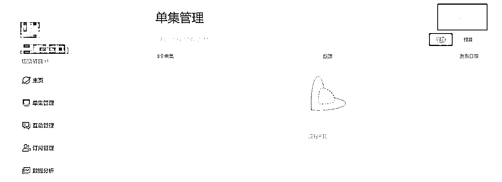

## 5.2 想提高打开率？做好 Show Notes

这章聊聊 Show Notes 是什么、为什么重要、以及可以怎么写。

### 5.2.1 Show Notes 是什么

Show Notes 目前还没有一个公认的中文翻译。简单来说，它通常会以文字或图片的形式出现在节目简介里，凡是和本期相关的内容都能放进去，比如录制背景、嘉宾介绍、引用文献、时间戳直达等等。

### 5.2.2 它为什么重要

很多时候，听友在决定要不要听这期节目之前，会先点开 Show Notes 看一眼。单靠标题给的信息量往往不够。一份完整、又带点小幽默的 Show Notes，既能补充背景信息，让听友产生兴趣，还能展示你除了口条好之外的其他本事，比如文笔不错，或者长得好看。这么一来，节目打开率自然就上去了。尤其是商业财经、文化历史这类偏严肃的内容，在 Show Notes 里放上支撑观点的论据和引用文献，可信度会高很多。

这里说一个小技巧：在小宇宙 App 的订阅界面，每期节目会按发布时间排成一张张小卡片。每张卡片上能看到的信息只有：标题+Show Notes 的第一句话。

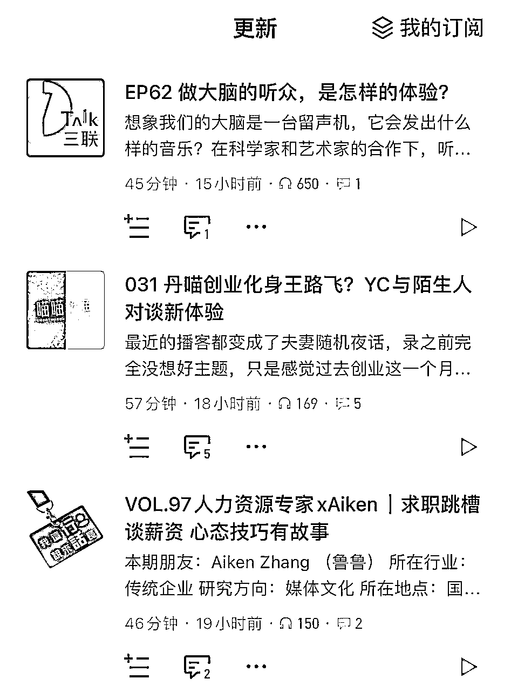

所以，标题负责吸引人点进来，Show Notes 的第一句话则是临门一脚。把本期最大的爆点提炼成一句话，放在最前面，能有效提升点击率。

### 5.2.3 Show Notes 怎么写

先说句宽心话：目前没有一套能适配所有节目的 Show Notes 模板，你甚至可以完全不写，比如姜思达的播客就没写。所以不用给自己太大压力。音频内容才是主体，Show Notes 写得好只是锦上添花，别指望靠花哨的简介冲上榜。

知名流媒体音乐平台 Spotify 在2020年发过一篇《Your Podcast Needs Show Notes》，里面给了这些建议：1. 把参与制作的人员都列出来；2. 给出播客官网和其他社交账号；3. 告诉听众怎么支持你，比如众筹、打赏渠道、周边商店；4. 如果节目有优惠码或赞助商，也注明。

这套标准版对大多数节目都适用。但如果想来点花样，下面几个技巧能让 Show Notes 更有可读性：

① 开头写一段本期背景介绍，聊聊为什么想做这期、和嘉宾怎么认识的、会聊哪些内容，100-200字就够，帮听友降低选择成本。

② 如果做的是陪伴类节目，可以在 Show Notes 里说说近况，把它当周记手账来写，再贴点图片，沉浸感更强。

③ 如果做的是商业财经、文化历史这类偏严肃的内容，可以在 Show Notes 里写研究过程：为什么选这个题、引用了哪些信源、做了哪些调研来支撑论点，有点像读书时写的论文开题报告。

④ 学学📕博主的写法，在文字里点缀一些 emoji 和颜文字，让页面更透气、更有趣味。

⑤ 你甚至可以在 Show Notes 里放自拍，或者晒猫晒狗，放开点，没在怕的。

拆解一期《末日狂花》的 Show Notes 框架，给大家参考：

1. 录制背景介绍
2. 本期节目重点提要
3. 听友群加入引导
4. 主播介绍、嘉宾介绍
5. 时间戳
6. 节目介绍
7. 制作团队
8. BGM 直达链接：https://www.xiaoyuzhoufm.com/episodes/63ee06240d7e8eaa72c50057

## 5.3 同步内容到其他平台

想把播客同步到喜马拉雅、网易云音乐、苹果 Podcast 上？方法如下。

同步到喜马拉雅、网易云音乐等国内平台：

第一步：登录小宇宙网页版：https://podcaster.xiaoyuzhoufm.com/
第二步：进后台-节目设置-多平台同步

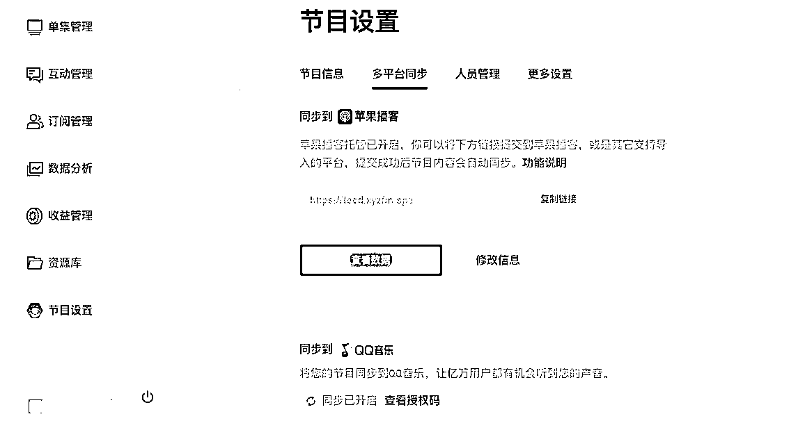

同步到苹果 Podcast：

第一步：打开 Podcast Connect（点击跳转）并登录你的苹果账号。
第二步：点加号，选择「新节目」

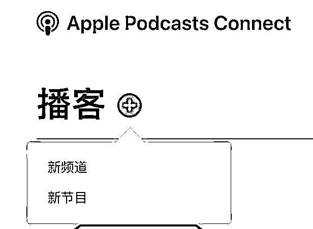

第三步：

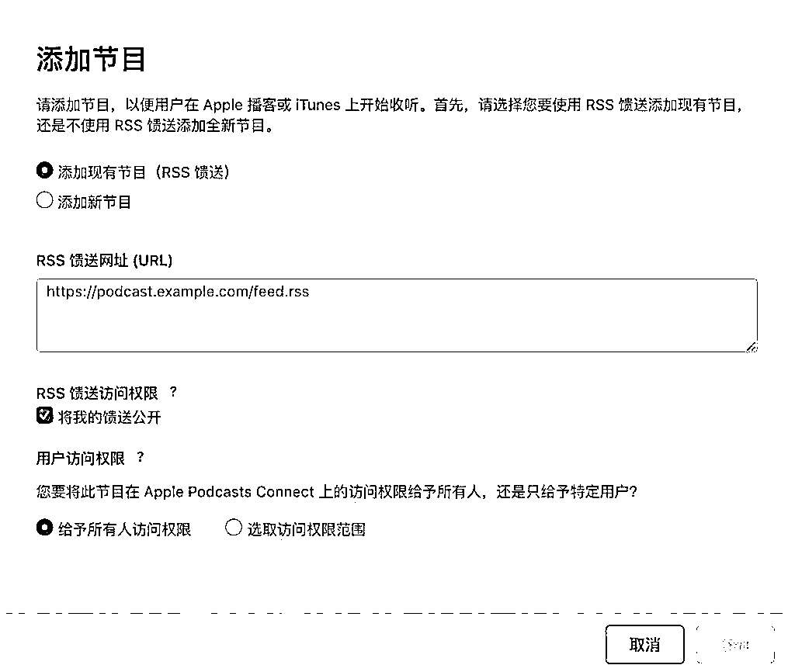

提交之后，节目会先进入草稿状态，等苹果审核通过就完事。

# 拿到 RSS 链接

想生成订阅源地址，入口在小宇宙的节目管理页。先进入节目后台，再打开节目设置，找到「同步到苹果播客」，提交「立即申请」。功能启用后，系统就会给出可用的 RSS 链接。

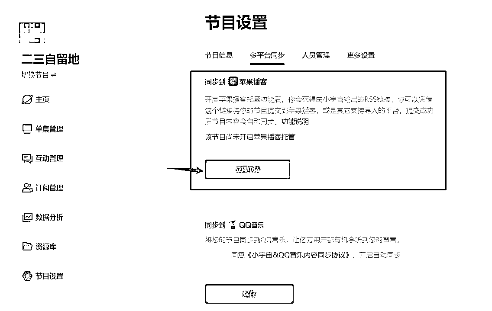

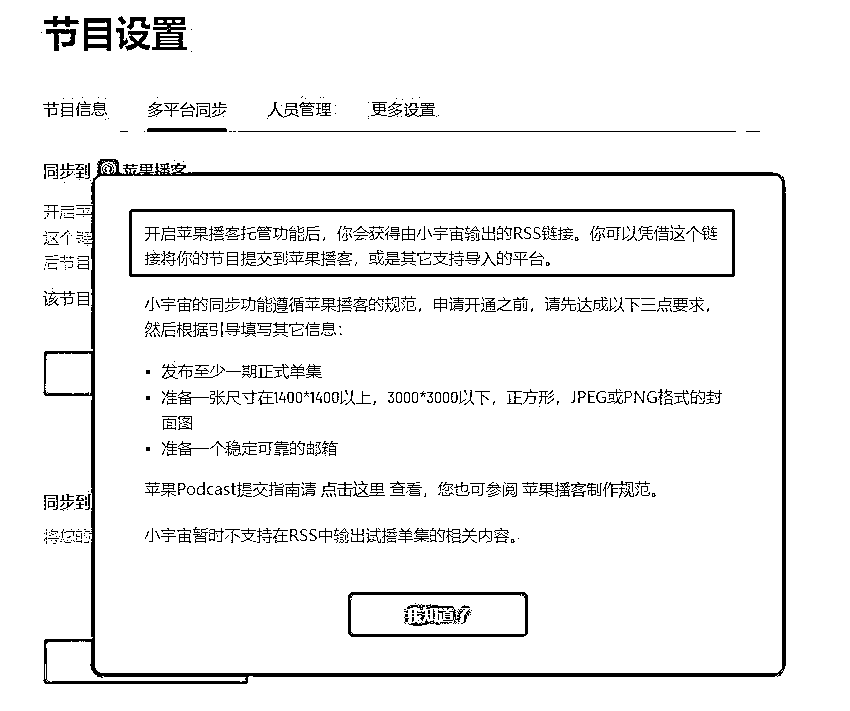

# 第六步：运营打磨与持续优化

## 6.1 账号数据怎么看

数据入口先记好：

小宇宙登录网页端，在左侧数据面板查看；喜马拉雅进入网页端创作者中心。

指标不用贪多，重点盯三项：

1. 完播率：新手先看 30% 以上；45% 算过关，50% 算好，60% 很亮眼；
2. 评论数：节目类型不同，没有统一标准。建议先积累几期，再拿自己往期均值作参照；
3. 转发数：同理，没有固定答案，和自己的历史表现比更有意义。

## 6.2 涨粉路径有哪些

平台编辑推荐、运营策划选题导流之外，目前做播客涨粉主要有三条线。

以小宇宙为例，别指望平台主动给新人灌流量，能主动做的是：

- 熟人圈扩散加冷启动：发朋友圈、发群，号召大家关注并收听。注意，只有在小宇宙 App 内点开才计入播放，🛰️里收听不算数据；
- 公域曝光：去即刻、📕等平台搜“播客”，看看同行怎么宣发；
- 平台侧入口：小宇宙有三个榜单，新星榜尤其值得新人关注，另外两个是最热榜和锋芒榜。

最热榜：呈现当下关注度高的内容，通常是大号常驻；
锋芒榜：聚集有潜力的优质内容，新节目表现好也有机会上榜；
新星榜：挖掘近期新播客的亮眼内容，是新节目最该冲的榜单。

榜单每天零点更新，按前一天单集表现由算法刷新。计算会参考内容热度、话题新鲜度、互动氛围等多个维度，规则不公开且会调整，所以把节目和互动做好才是可控项。

有一个动作可以试：尽早发布，比如零点上传。

新星榜按自然日结算，越早发越能把当天流量吃进上线首日的单日播放。周更前提下，两个月做到 2—3k 关注、五六个月到一万关注，已经不错；若想再往上，在选题和节目质量稳定时提高更新频率。

## 6.3 运营方法一：上传时间怎么选

零点发布。

新星榜按自然天计算，零点上传能把全天流量计入上线首日，冲榜更有优势。晚上 11 点发，只剩 1 小时进算法，很吃亏。除非账号漏斗很大、属于强势大台，什么时候发都稳；普通新号别照搬。新手期建议零点发，吃满一天流量。

周几发更合适？

周一：别发。大家事务堆积，听节目意愿低。
周二、周四：适合知识类、职场类。有研究称，这两个晚上大家学习新知识的意愿较高。
周三、周五：适合轻松内容。周三被叫作小周五，一周过半，适合放松。

这套思路可以套用到自己频道。比如珂珂老师的厂牌：周四上《消费圈内人》，行业垂直，契合周四学习预期；周三、周五上《末日狂花》这类轻松节目，匹配摸鱼心态。

另外，避开大号固定档期。看榜单会发现成熟台有稳定发布时间，比如《消费圈内人》每周四上线且数据稳，可能占掉锋芒榜位置，换日期发反而能捡到流量。

## 6.4 运营方法二：把 IP 社群经营起来

想让播客活得更久、变现更稳，IP 社群是关键。

以《末日狂花》为例，13 个听友群、近 6000 人，入群率很高。怎么做的？

### 6.4.1 设计进群诱饵

要让人进群，得给一个强理由，诱饵设计很关键。

可以从节目类型找兴趣点：

- 知识类话题广，学习清单、书单都能当诱饵；
- 闲谈类可以用好物清单吸引人进群。

也可以从听众画像找需求：

比如听众自我提升意愿强，就放书单、问题清单等学习型抓手。

还可以在节目里直接介绍社群：告诉大家入口在哪、群里有什么特别，先勾起期待。

《末日狂花》做过好物分享，主播整理清单，进群可领，那期加群人数明显多。后来聊风水，又准备风水书单，对进阶感兴趣的人进群领取，至今每天仍有人为此加群。清单或书单是有效诱饵，能给人加群动力。

### 6.4.2 拉新与筛选

平台订阅数只是数字，进群后才是可反复触达的活跃用户。

先利用群公告：公告里放二维码，节目公告也提群入口；节目简介（Show Notes）里可以写加群方式，但别直接贴二维码，200 人上限很容易满。

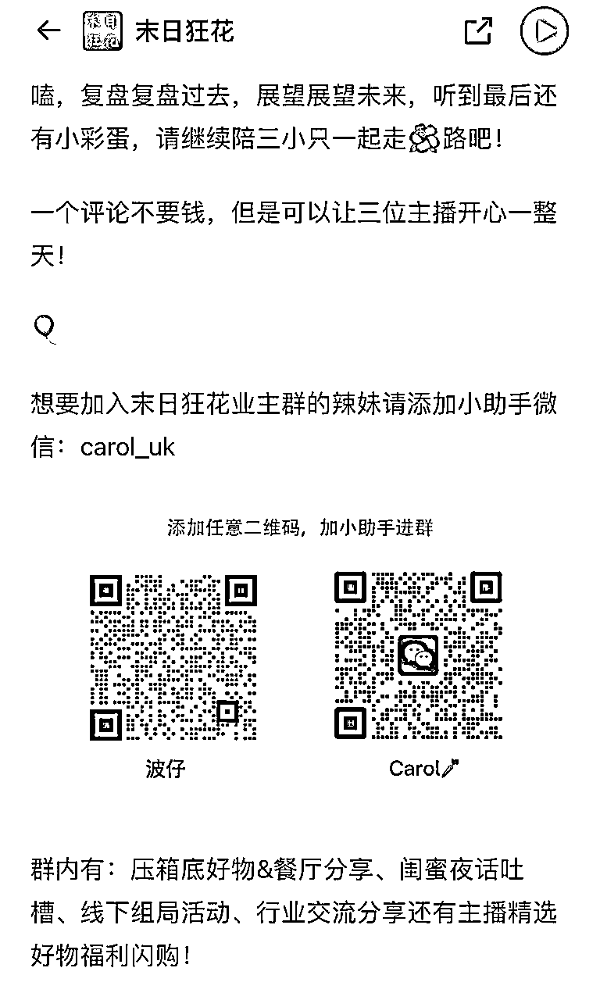

群要有调性，拉人就得筛。

《末日狂花》定位约九成女性用户，为保护基本盘，不熟悉的男性一般不拉，除非长期认识且可靠。

《消费圈内人》每个群成员都由珂珂老师亲自拉，先问：请介绍你自己和当前负责的业务。这样能拿到实名、公司、业务信息；不是消费行业的不通过；同是业内，也要控制供货商比例，避免服务商把群当获客渠道伤害核心用户；学生党暂不拉，等入行再加。

门槛高换来人群准、质量高。

社群运营关键是清楚大盘用户是谁，所有动作维护大盘利益。拉群两个要点：

- 按 IP 需求筛核心用户，明确核心资源、核心用户和大盘；
- 注意社群安全，可能让核心用户不舒服的人不拉。

另辟蹊径：用嘉宾在群里做吸引，很多人想进群链接嘉宾。但嘉宾是最宝贵资源，不能让人直接触达，由主创筛选对接。例：《消费圈内人》给嘉宾做完节目后留口子，合适的品牌可加主创🛰️对接，不合适提前回绝。

### 6.4.3 让群友更有归属感

方法一：群名要有趣。

《末日狂花》听友群不叫听友群，而是豪宅业主群。群名有梗，群友在电脑🛰️被同事看到会被问“你怎么是汤臣一品业主”，真发生过。另一方面，群聊承担社区团购功能：选品偏高端、轻奢、小众，运营组让群氛围匹配调性，让用户觉得进来就是富姐富哥，要买配得上生活品质的东西。若卖 9 块 9，群名就会土一点或直接叫团购群，目标明确。

前面说过，关注数不是第一重要：品牌主只分一万以上/以下、十万以上/以下，做到一万关注就能商业化，算大播客；之后重点精细化运营用户、做社群、维持活跃，并以此设计更多变现方式。

方法二：群规维护氛围。

和普通群差不多：不发违法乱纪内容；不问可能导致封群的内容；少发互点链接等。

《末日狂花》主创松散看群，每条都看，了解大家关心什么，但不过度干涉，让听友知道主创在群里陪伴；话题跑偏才适当引导。

这个群最大感受：大家分享自用好物但无广告感，能看出是基于真实使用经验推荐，所以筛人很重要；有人提到主创，珂珂老师会闪现，既拉近距离，也能了解需求、反馈和话题。

方法三：双赢团购。

社群有团购属性可推活动。《末日狂花》供应链和价格机制好，听友信任主创选品，群像线上买手店；选品高端轻奢小众，氛围匹配调性，让用户觉得要买配得上生活品质的东西。用户买到喜欢且价格合理的产品，主创也有盈利，双赢。但团购别超能力范围，选品谨慎，否则伤 IP 信任，得不偿失。

### 6.4.4 用剧透拉期待

提前剧透是为拉高期待、抓注意力，提升播客数据和群活跃。

《末日狂花》有两个动作。

① 先说请到厉害嘉宾，问大家想问什么，群里接龙。

13 个群能收 80—100 个问题，分类筛选后留下二三十个精准问题，作为提纲重要来源。自己写提纲容易不知道听众真正关心什么，把决定权交给听友是双赢。

② 上线前一天在群里投票标题/关键词，预告内容和嘉宾，增加参与感。

听友会想：我选了 1 和 2，明天看哪个比重大？还能引发讨论，比如为什么 1 好、2 好在哪，正面讨论带热度。

标题发群里也有好处：不同标题、关键词代表不同切入点和兴趣点，大家看到就知道明天有没有自己感兴趣的，投票过程已产生期待。

好社群不必天天热闹，需要时大家能及时反馈即可；闲聊太多反而让人不想点开，最后群被折叠。

