# 2023.08 出海实战：ChatGPT 工具站手册

> 来源：[`remhu1p2pr.feishu.cn/docx/DJHbdiAekoVQASxiaQhctohbnxh`](https://remhu1p2pr.feishu.cn/docx/DJHbdiAekoVQASxiaQhctohbnxh)

出品时间：2023 年 8 月 18 日

阅读提示：这份文档想带你看见一个项目更多的可能，也方便你理解后动手实操。

小建议：想快速找到某块内容，可以用 Ctrl+F（Mac 用户按 Command+F），直接搜关键词定位。


## 开篇：先定个 21 天的小目标

各位好，欢迎翻开这本 ChatGPT 出海实战手册，接下来我们估计会在这里碰面很多回。

这 21 天的目标很清楚：摸清海外市场有哪些打法，重点放在 ChatGPT 这条线上，亲手把自己的出海工具站跑起来。

先交代一句，这份文档是在 5 月那一版的基础上迭代而来。新加的内容，主要是上一期高手们的分享，以及最近冒出来的 ChatGPT、AI 案例。因为体量不小，所以分成了上下两部分：上半部分聊工具站，下半部分看案例。老船员可以直接跳到案例部分。

出海能玩的方向太多了，想用一两个分类就把人教会，不现实。所以我们更愿意把一堆案例摆出来，让各种思路自己说话。在英文站开发上，我们摸到了一条比较具体、新人容易跟上的路子：先用 MVP 做验证，再让 ChatGPT 参与开发，试着用最低成本验证一次创业想法。

这次新加的章节，点下面就能跳过去：

- 7.3 深度解析 ChatPAN：基于语料的 AI 聊天工具的设计与落地过程
- 八、如何利用工具快速完成产品上线
- 13.2 其它 ChatGPT 相关案例
- 13.4 其它 AI 新增案例

挑这些新内容时，我们的判断很简单：ChatGPT 和 AI 正当红，要是能借这股力做点东西，做事效率会高很多，也更容易赶上风口、把成事的概率抬上去。

做法跟早先那本航海手册一脉相承：先从龙哥盟的知识星球里搜罗同主题的好帖、干货和高手的分享，再拆开重新组合，最后编成这份实战手册。

这么安排，是想尽量把这个项目里藏着的空间摆出来。大家读完圈友们写下的实战记录，能从好几个方向、不同人的眼光去理解它，也会更明白一个项目从零起步有哪些路可走。

总的看，这次加入的案例数量过百，写得不算细，其中 69 个和 ChatGPT 沾边，84 个与 AI 有关，供大家翻翻，希望能带来一些想法。

这份文档怎么用？

前面提过，它的用处是帮你找到海外市场里有付费意愿的需求，并理顺工具站开发的思路。所以，一方面你得揣着「做出一个年营收百万级的英文工具站」的念头，在各个板块里捡趁手的方法和思路；另一方面也要亲自上手，用 MVP 思维配上提效工具，真正做一个能跑的站，尽量把验证闭环压短，尽快把用户和市场的反馈收回来，让收入真正落地。

里面收录的多为要点，替大家筛掉了无关信息。每块内容也都标了出处链接，点回去就能翻到原帖找细节。

正文由龙哥盟与圈友共同完成，只留给航海船员和龙哥盟知识星球的圈友学习。

圈友们如果在实操中发现问题，随时反馈，和我们一起把这份文档改得更好。有建议可以找鱼丸（yuwan387）～


# 上篇：工具站入门

# 一、出海工具站基础

💡 本章要讲什么

工具站，英文里通常写作 Web Tool（或称 Web SaaS），本质是拿网页当载体，提供某种在线工具或服务。

这一章会从三个方向切入：网站都有哪些类型、工具站有什么特点、分几类，以及为什么优先从英文站切入。

为什么挑工具站？道理很简单：从挖需求、找定位到最终收钱，它能装下一整条链路。这中间要练会几件事：找到需求、切出细分的且有差异的产品、把流量做起来，最后把产品价值变成收入。


## 1.1 网站都有哪些类型 @ChatGPT

以下内容由 ChatGPT 协助梳理：

概括来说：

- 工具站：围绕某个工具或服务展开，搜索引擎、网盘、翻译器都属于这一类。
- 内容站：以文字、图片、音频、视频为主，新闻门户、博客、社交平台都是。
- 电商站：卖货或卖服务，独立官网、线上商城这类。
- 社区站：核心是让用户互相连接、交流、分享，论坛、社交网络、博客平台都算。
- 教育站：提供课程、学习资料和教学工具，在线课堂、教育博客、机构官网都归这里。
- 娱乐站：内容以娱乐、游戏、视频为主，比如在线影院、小游戏站、音乐平台。
- 新闻站：发布最新资讯、事件与评论，新闻门户、博客、媒体网站是典型。

……

上面这些站点日常都能碰到，不过本次实战只盯工具站。原因在于，它能装下从找需求、定方向到最终收钱的整条链路。


## 1.2 工具站长什么样、分几类 @ChatGPT

以下梳理借助 ChatGPT 完成：

大体上，在线工具站想同时拿下收入和口碑，有几件事躲不掉：

- 摸清需求：搞明白用户缺什么，功能设计围着它转。
- 体验顺手：页面别花哨，操作路径要短，用户上手就会。
- 功能够硬：解决问题的能力要实在。
- 技术托底：底层用稳定高效的方案，别三天两头挂。
- 数据安全：把用户信息和隐私看紧一点。
- 获客推广：靠有效的营销手段把人拉进来。
- 售后支持：用户遇到问题，有人能及时接住。
- 数据复盘：看用户怎么用、偏好什么，反推网站怎么改。

做产品，开头永远是弄清楚用户要什么。这份文档第三章会重点讲：怎样系统地挖出英文站的需求，方法、操作、工具、小窍门都给到。

说到底，工具站就是拿一个趁手的工具替用户把事办成，个税计算、日期换算、IP 属地查询都算典型。

具体分类可以这样举例：

- 邮件营销：Mailchimp 是常客，Constant Contact 与 AWeber 也常被选用；
- 项目管理：Asana 与 Trello 都常见，Basecamp 另有一批拥趸；
- 网站分析：Google Analytics 用得最多，Mixpanel、Heap Analytics 也是常见选项；
- 在线收款：PayPal 是老大，Stripe、Square 紧随其后；
- 图片编辑：Canva 最常见，Piktochart、Visme 也能打；
- 文档协作：Google Docs 之外，Microsoft Office 365 和 Zoho Docs 都有人用；
- 在线客服：Intercom 用得多，Zendesk、Freshdesk 也常见；
- 表单收集：Typeform 是代表，Google Forms 与 JotForm 更轻量。

上面列的多是成熟品牌。对单人开发者或小团队来说，真正该盯的是细分需求，也就是常说的 Micro SaaS——一种轻量级 SaaS 产品，形态简单、上手容易，专攻某个具体业务场景。

它与传统 SaaS 的区别在于：范围更窄，只解决一个点，定价也更容易接受。做这类产品的核心，是先弄明白用户要什么，再给出轻巧好用的方案。

这类站点上线之后，维护成本不高，基本能自动跑。只要工具真的趁手，用户自然会记住域名，或者把它收藏进浏览器书签，下次直接来。


## 1.3 为什么先从英文工具站做起 @刘小排

为什么先做海外站点，也就是英文工具站？

没别的原因，就是快。其他做法在速度上很难跟它比。

手机 App 的周期长得多。两个平台分别写，比网页复杂，技术门槛也高；完成后要打包送审，一旦被驳回，前面的工夫全打水漂。

若目标放在国内，拖得更久：软件著作权登记大约要等九十天，拿到后才允许在各大商店上架。

改缺陷更折腾：哪怕只动一小处，也得再发一版，用户必须自己更新后才用得上，修复效率被拖得很惨。

本土站点也快不到哪去，先过 ICP 备案这一关。顺利的话等上一到三周；若注册地审核严格（比如北京），材料退回来重填也不稀奇。

小程序稍微好点，但也没快到哪去。问题出在🛰️的开放生态里，现成可借的开源积木不多，不少底层模块要自己写，想直接靠开源代码提效挺难。

换成海外站点，这些负担就没了：软著不用办，域名备案也能跳过，各家应用市场的审核也能避开；发布新版时，用户那头不用重装。把代码托管到 GitHub，配一条 Actions 流水线，每次推送即可自动部署，整套开发过程相当顺滑。

话说回来，以网站开局，不等于产品永远只能停留在网页形态。MVP 阶段先用网页跑通，等攒下足够用户数据和反馈，再去做小程序或原生应用，时间完全够。

内容来源：《写给独立开发者：如何快速做出产品 MVP》


## 1.4 出海工具这二十年 @非洲水手

最近把吴晓波那本《激荡四十年》翻完了，有点想法，索性带各位回看一遍出海工具这二十载。粗略分下来是四段：萌芽期与起始期，接着扩张期，最后转型期。

1、萌芽期

1998 到 2007 年，国内互联网尚在襁褓，Copy to China 是主流玩法。周奕被很多人看作工具出海的拓荒者，他捣鼓出 MP3 CD Maker，出海圈第一次瞧见了亮光。

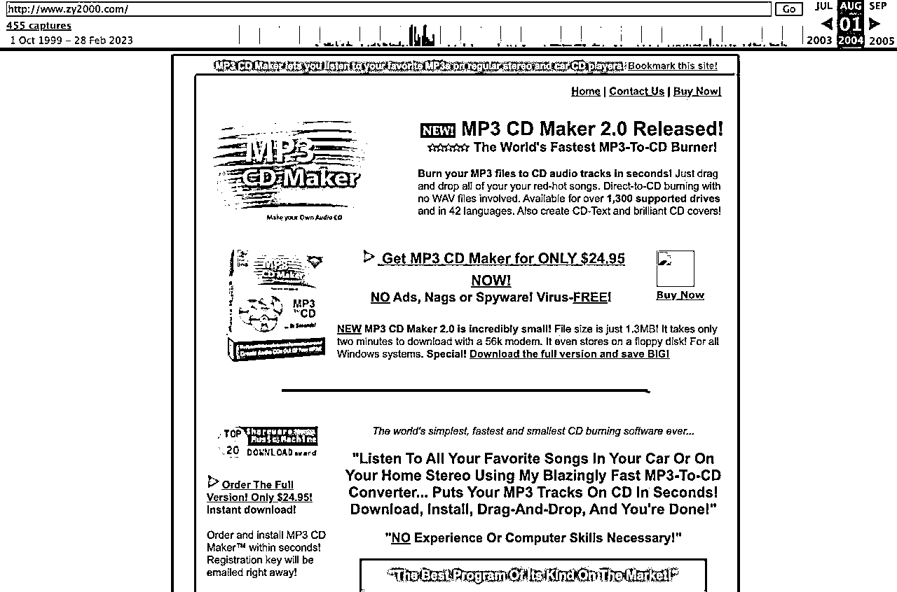

2、起始期

到了起始期，圈里人逐渐悟出一个道理：工具型产品能越过中外文化那道坎。2007 年，第一代 iPhone 和 App Store 一起登场，移动互联网的大门被推开。久邦和百度，加上 360、UC、金山这些本土厂商，纷纷跑到海外悄悄铺开，闷头赚钱。

3、扩张期

2011 至 2016 年，移动出海步入扩张期。工具赛道按场景越切越细：手机管理跑出了 Clean Master，图像处理有美图秀秀，桌面启动器有 Solo Launcher 与 Go Launcher，浏览器则是 UC、海豚等。那会儿买量单价不到一美分，装机量却能到数亿甚至十几亿，资本闻着味道就扑了上来。

这几年里，一批广告代理公司冒了出来，Yeahmobi、Mobvista、Avazu 是其中代表；也有猎豹 CM 这样亲自做代理的。我恰好也在同一阶段入行，给不少当年的爆款产品做过服务，算是看着出海最风光的一段走过来的。

4、转型期

时钟拨到 2017 年。日子舒服几年之后，出海工具的路子越铺越宽，赚钱手法也愈发老练，甚至有些过火。另一边，海外流量红利见顶，各家产品面貌趋同，Facebook、Google 两家的规矩越卡越死。

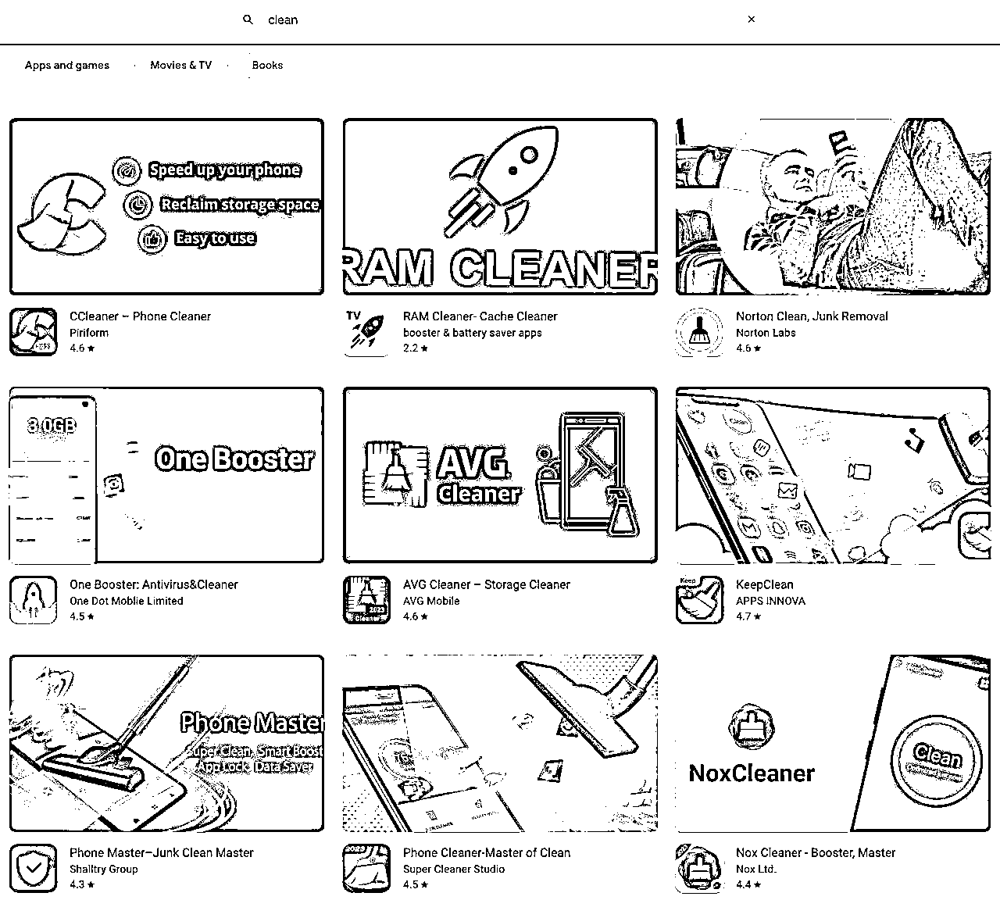

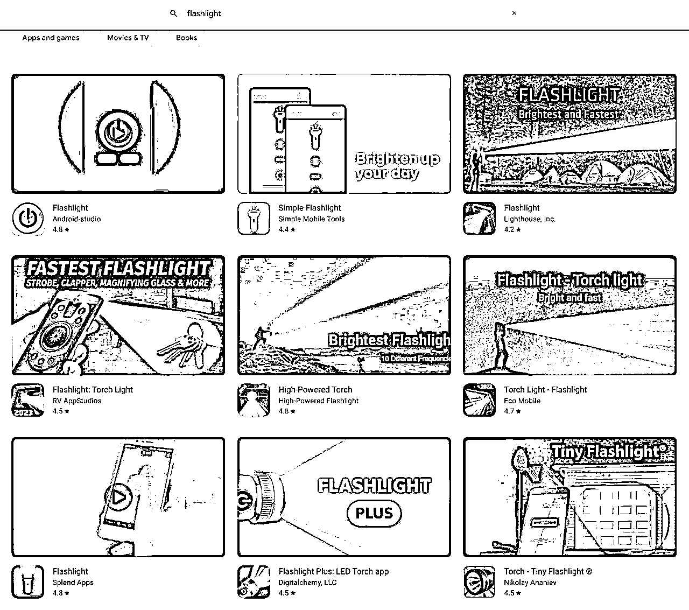

久邦的股价被砍半，最后从交易所消失；Google 和 Facebook 先后拿锁屏弹窗广告开刀；Facebook 暂停过中国区工具类广告客户的下单；Google 一次下架 iHandy、猎豹等团队的一百多款工具。唱衰声铺天盖地，利润被一层层削薄，出海工具这门生意只能调头。

中国出海工具会就此熄火吗？翻到后面就知道了。

内容来源：3 月 6 日《关于出海工具产品营销推广，我的几点经验分享》@非洲水手


# 二、英文工具站怎么挣钱

💡 本章概览

英文工具站靠什么收钱？工具型产品（包括 App 在内）的路径大致四条：第一条只靠广告；一条是广告加订阅；一条先白送再收钱；还有一条走资本运作。

到了 ChatGPT 出海工具站这里，常见做法通常收束为两类：做流量生意，或者把产品本身卖出去。

下面借用工具型 App 的案例，说说海外市场变现的几种路子。


## 2.1 全靠广告吃饭 @龙哥

工具类产品有个天然短板：用户使用频次低，单次停留也短，跟娱乐型产品没法比。几年前 Google Play 还没管得这么严时，只做工具的产品几乎把广告塞满每个角落，刘鹏老师曾在公号里称之为「饱和式变现」，这个总结很到位。

具体做法是：广告嵌进用户操作的每个环节，同时靠后台保活来「造」出使用时机，不用真的打开 App 也能被动触达功能与广告，把曝光次数做高。

典型玩法有三类：充电、锁屏时弹广告；引导用户给常用软件设一道密码，解锁瞬间弹出密码盘与广告；接打电话时也能插广告。

这种蛮横做法，2018 年 Google Play 收紧规则之后就玩不转了，只做工具的出海军团尤其难受，好几家公司还因此被平台下架。

补充一点：如果 Google Play 决定封掉某款应用，想在海外安卓市场基本没有机会。平台有办法识别开发者换壳重来的马甲号，然后按「关联违规」处理，直接封停账号。产品没了，AdMob、Facebook 这些大广告平台也会停止回传，进账说没就没。

于是很多公司海外碰壁之后，2019 年开春转头回国内，把这套玩法整个搬回本土。少了 Google Play 那样的盯梢，类似套路在本土市场一样吃得开，甚至过得挺滋润。


## 2.2 广告和订阅两条腿走路 @龙哥

Google Play 收紧规则之后，「广告 + 订阅」的组合在世界各地逐渐成为主流。逻辑不复杂：让肯掏钱的人买单，不肯掏钱的就继续刷广告。

刚起步时如果连用户长什么样都没摸清，根本判断不了谁肯付钱，那就用笨办法：先让所有人先走一次付费关卡，不愿付的再引到广告环节。这么干多少会损害体验，之后再靠 A/B 实验一点点调，把 LTV 推到最大。

广告这一端，可以靠聚合系统筛出回报居前的来源，每一次曝光都挑 eCPM 更优者，让填充率上去，进账自然跟着涨。

订阅这一端，LTV 大致等于新增用户数乘订阅率、支付率，再乘续费次数。Google Play 和 App Store 其实早就盼着开发者走订阅路线，只是中国出海团队真正动起来，也就这两年的事。工具型产品不妨走订阅制，理由有两个：

第一，试用期免费能拉低尝鲜成本，让用户先摸到价值，最后留下更多肯掏钱的人；第二，跟一次性买断相比，每期掏的钱更少，但后台每期会自动划走一笔，算总账，LTV 通常高出一截。

内容来源：《龙哥盟 #轻享栏目：出海工具怎么玩》

前面聊过订阅，龙哥早前还专门写过一篇解释，这里节选过来，想看完整内容可以翻原帖。

时至今日，订阅早已突破最初那个很窄的框，在商业各细分领域都能派上用场。出海圈里，不少工具型产品拿它做变现。五家增长之星里，喜马拉雅与蓝城兄弟，再加上 WPS Office，都选了订阅路线。具体执行各有不同，但订阅确实让它们的产品外延宽了不少。

拿 WPS Office 来说。其首席运营官章庆元在接受 Morketing Global 专访时提到，付费会员制已经是 WPS 日渐依赖的收入支柱；支撑它的是不断扩大的用户盘子，以及贴合各地用户口味的内容运营。WPS 在海外正试着做模板、H5 海报这类轻量编辑功能，并认为方向没错。作为办公工具，文档编辑、表格与图表制作等基础能力对所有用户免费。可如果业务只围着基础能力打转，很容易掉进工具型产品的老坑——用户留存不足，变现空间被卡死。订阅恰好补上了这一块：WPS 在订阅包里塞了大量模板素材和轻量编辑功能，让用户肯花钱，使用频次和方式也随之改变。关系建立起来后，WPS 还能做社区运营，奖励高质量内容的贡献者，进一步拉宽产品外延。

内容来源：《订阅模式让出海工具获得新生》


## 2.3 免费聚人，再谈收钱 @静水流深

先用免费服务把人群聚拢，再想办法转化，下面这个站点就是例子：

https://realfavicongenerator.net/api/

有人会问：一点广告都没有，还完全免费，它靠什么活？答案藏在 API 上——申请接口需要留邮箱，事后能通过邮件触达，顺带推荐别的服务。


## 2.4 资本路线 @静水流深

# 出海变现，先想清两件事

把海外流量当正经生意做，AdSense账号基本就是压舱石，少了它，收入盘子总觉得不稳。打算长期干的，就认认真真把公司注册起来；说到底，真正赚大钱的动作常常不是靠业务本身慢慢盈利，而是让公司整体被卖掉——这就是资本市场的逻辑。

BLOCKCHAIR这家网站，专门服务加密货币用户，技术过硬、体验也顺，却一直不收钱。它图什么？先用口碑把用户规模做起来，再拿公司的股份去市场上融资。只要用户数一天天变大，谁都不会怀疑它赚不到钱，投资人自然追着投。

再看另一个样本（IP数据定位与服务）：前期用免费功能持续积攒大规模数据，后期把数据盘活，做成定制化的商业服务来收费。

内容摘录自《英文工具站，你没见过的那些案例》


## 2.5 ChatGPT海外工具站的商业打法@子木

做这门生意的抓手就两个：流量和产品。别光顾着开发产品，还得确认它有办法带来收入。ChatGPT海外工具站，也基本分成吃流量和卖产品两条路。

### 2.5.1 吃流量路线

思路是提供ChatGPT相关的免费工具站来攒访问量，像 https://decompilertool.com/ 、https://sharegpt.com/ ，靠页面广告挣钱。

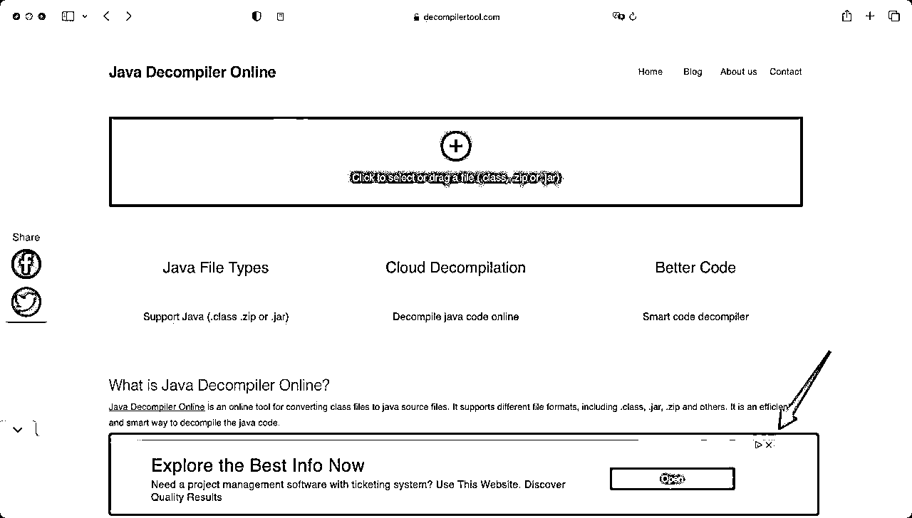

这类站点的头号特征是：用真正有用的免费工具换来流量。变现方式很丰富：广告位、分销、联盟广告、Affiliate（联盟推广）、给其他产品引流等等。最简单的，用ChatGPT免费工具站拉人后，再靠ChatGPT账号自动发卡来收入。

### 2.5.2 卖产品路线

思路是做成ChatGPT相关的付费工具站。例如 https://www.proseoai.com/ （圈友做的谷歌SEO获客内容工具），让用户先试用，再转化成付费客户。

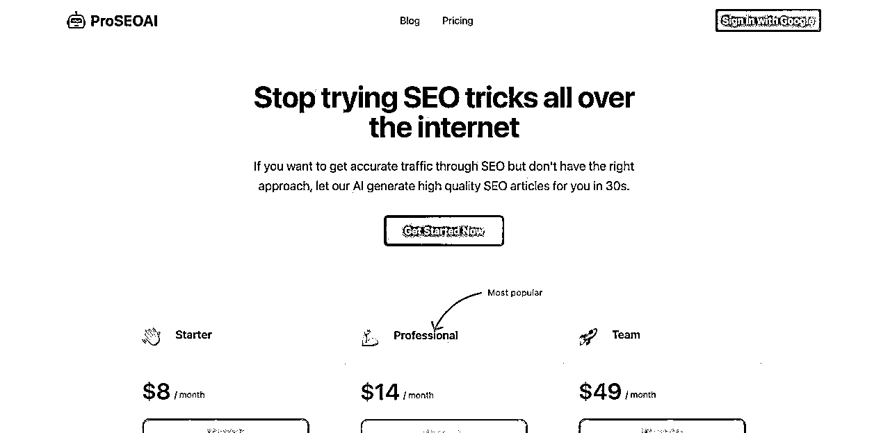

这类站点的头号特征是：工具本身有值得付费的价值。链条长得多：引流→转化→客服逼单→售后处理，整套销售流程都得配齐。

流量和产品能同时做吗？当然能。只要手里有流量，自己的产品和别人家产品都能卖，前提是两者相关、受众一致，这样就能拿到双份收入。

内容选自 5 月 25 日《普通人能做 ChatGPT 相关海外工具的 IDEA 方向》@子木


# 三、英文工具站需求怎么挖

💡

章节速览：如何找到需求、怎样在现有英文工具站里挑出适合自己的方向、怎么判断一个需求能不能赚钱、怎么锁定ChatGPT相关的需求。这些正是本次航海要重点琢磨的核心课题。

为了让每个人的找需求之路都有迹可循，我们请来了星球里几位擅长此道的高手，把他们的方法整理了出来。刘小排的观点是：高成功率的idea要具备三个条件，他也因此归纳了五种玩法，并标出了对应的成功概率。本章沿用了他的分类框架，又补充了别的玩家的心得，所以数量比五种更多：

✅原始idea ★★★★★

✅抄竞品再做出差异 ★★★★

✅用关键词找需求 ★★★

✅用痛点找需求 ★★★

✅围绕平台找需求 ★★★

✅围绕自身的需求做延伸 ★★★

✅靠排行榜找需求 ★★★★

✅个性化需求定制 ★★

✅重点关注：ChatGPT相关工具站需求挖掘

希望这些角度能让你找到一个能赚钱的英文工具站，更进一步，是帮你发现海外市场上值得做长期主义的赚钱机会。


## 3.1 高胜率idea的三个门槛 @刘小排

按我的标准，一个高成功概率的产品idea，要跨过三个门槛：确实存在真实需求；你是这个领域的行家，就算直接面对竞争，也能比对手做得更好；你能撑下去，特别是在早期没什么正反馈的时候。

基于这三个门槛去找产品idea，我一共总结了五种方法，成功率递减（个人观点）。

分别是：

1）原生 idea ★★★★★

2）抄已经跑通的竞品，再做差异化价值 ★★★★

3）拆解搜索关键词，找到还没被满足的需求 ★★★

4）有人愿意预付费用找你定制某个需求，再产品化 ★★★

5）凭空造出来的 idea ★

内容选自《如何获得产品 idea》


## 3.2 方法一：原生 idea ★★★★★ @刘小排

英文叫“organic idea”，是硅谷创业圈最受追捧的思路，科技界和创投圈的大佬都认这套。

它的含义是——去解决你自己撞上的问题，因为你就是用户，你会天天打开自己的产品。

这个词的出处可以追溯到 Paul Graham 的文章。他在里面说，构思产品idea时，动词不应该是“想出来”，而是“注意到”。YC 把那些从创始人自身经验中自然长出来的点子叫作 organic startup ideas，而且最成功的创业公司几乎都是这么起步的。原文那句是：The verb you want to be using with respect to startup ideas is not "think up" but "notice." At YC we call ideas that grow naturally out of thefounders' own experiences "organic" startup ideas. The most successful startups almost all begin this way.

换句话说，应该是“我注意到了某个问题，能这样解决”，而不是“我想到了一个创业idea”。

类似的表述还有那句传遍硅谷的老话：eat your own dog food，吃自己的狗粮（意思是，你自己得先当你产品的用户）。过去 50 年里，这话被无数公司和牛人反复引用。

顶尖独立开发者 Peter Levels 在《Make》里也强调：最重要的就是通过解决自己的问题来找idea。他还建议大家每天记下 3 个自己遇到过的麻烦，一周下来，你就有了 21 个产品idea。

很多创业赢家都出自这套路径。苹果靠组装个人电脑起家，做给谁用？做给自己，那是沃兹的个人兴趣。Facebook 最早是小扎自己想要的一个网站，功能是给学校女生打分，当时叫“hot-or-not”。AirBnB 更是被房租逼出来的——创始人没钱交租，开始做出租床位的生意，提供气垫床（Air Bed）和早餐（Breakfast），AirBnB 的名字就是这么来的。BuiltWith 最近热度很高，全公司就 1 个人、年入 1400 万美元，它同样是创始人自己需求催生的：老想看别人产品用了什么技术栈，干脆自己造一个工具来解决。

再说个更近的。龙哥盟最开始是因为龙哥想找个创业者交流的社区，找不到，于是自己搭了一个。

再来个接地气的：nomadlist.com 。Peter Levels 自己是数字游民，想知道全球哪些城市适合数字游民，就做了个 Excel 表格。后来他发现表格被人疯狂传阅，才认真把它产品化。再后来，无数创业公司拿着更多预算、更多人手想来复制它，但都没能撼动它。因为 Peter 就是最懂数字游民的人，这个产品就是他自己要用的。

这套方法的成功率为什么高？因为它把前面三个门槛都踩实了：

需求是真实存在的，因为需求就长在你身上。你是这个领域的专家——你被问题折磨过，花了大把时间研究，发现市面上的选项都不行，所以你比任何人都清楚该怎么做。真有天有人来抄你，你作为专家也不用慌。

你能坚持下去。为什么？因为你自己就是产品的用户，你发自内心想让它更好。

当然，这套方法也有软肋，最大的问题是：你怎么确认你的需求别人也会有？这个问题没有标准答案，本来就不存在是百分百赢面的创业方法。只能说，用这条路，成功概率会比别的方法高一些。

内容选自《如何获得产品 idea》


## 3.3 方法二：抄竞品做出差异化 ★★★★ @刘小排

对大部分龙哥盟圈友来说，这是我最推荐的做法。它的好处是：跑通的竞品已经替你验证了市场存在、这条路能通。龙哥盟就是创业案例的宝库，里面充满了实战经验，大家完全可以先模仿，再慢慢优化、做出自己的差异化。

“抄”这个字听起来不够漂亮，但漂亮又不能当饭吃，好使就行。

看几个成功公司的例子。Google 是全世界第 11 个搜索引擎，它先把别人的搜索引擎抄过来，再引入 PageRank 算法，让搜索排序更科学，差异化就这么立住了。百度是抄 Google 的，然后做了差异化，比如最早的定位是“更懂中文”。腾讯抄的是当年很火的聊天软件 ICQ，改了个名叫 OICQ（后来改名 🐧）。🐧 比 ICQ 多出来的差异化价值可太多了，光产品体验就比原版 ICQ 好一大截，大家可以自己去查。再后来腾讯做了🛰️——各位应该都知道，🛰️这个 idea 也不是原创的。

还有优酷、滴滴、🧣、淘宝、抖音……全是从“抄”开始，再做差异化，然后走上巅峰。例子太多了，举不完。

这套方法的优点一目了然，缺点也同样清楚，至少两点请注意：

你的差异化价值是什么？（这是最容易被无视的部分）

你抄原版，能不能比原版更懂用户？你能不能像 🐧 那样，做出比原版 ICQ 更好的体验和流量渠道？

内容选自《如何获得产品 idea》


## 3.4 方法三：通过关键词挖掘需求 ★★★

用户的需求会以关键词的形式，绕个弯露出来。比如：我在某个平台上吐槽一个产品；我在搜索引擎里输入一个问题；……这些行为都会在网上留下痕迹，数据层面也能看出用户的隐性需求。那么，怎么站在用户的角度看关键词？

可以从两个维度切入：

用户的关键词是怎么冒出来的，他们通常会在哪里留下这些词？

用户是用什么方式搜索的（或者说，他们带着什么心理去搜）？

知道这些之后，搜索引擎就绕不开了。那搜索引擎有没有什么技巧，能帮我们快速捞到有价值的关键词？

1、关键词是怎么产生的

互联网上，只要有用户交互，就一定有痕迹留下，不管是被动还是主动。从需求挖掘来说，这些有痕迹的地方就是我们应该关注和挖掘的矿点。

拿 Amazon 举例：用户搜了一个词，Amazon 会记住，下次打开页面，Amazon 会直接给他推同类产品；用户浏览或收藏了某件商品，也会被记录，方便以后分析偏好；用户下单或给了评价，照样会被记下，后续 Amazon 可能给该 listing 更多流量；Amazon 还会抓用户的地理位置等信息来做推荐。

上面这些用户路径，就是我们分析用户需求的依据。Amazon（或其他第三方工具，比如卖家精灵）都会把这数据给我们，我们要做的就是从数据里抽丝剥茧，用不同维度的指标验证目标需求到底存不存在。

内容选自《航海实战｜Google | 付费插件｜实战手册 》


2、用户怎么搜关键词 @Tiger

站在普通用户的角度，他们一般不会直接敲核心大词，更多的是描述需求（也就是包含核心词的长尾关键词）。

比如我想搜“送给父亲的礼物”，通常会这么打：适合送给父亲的礼物有哪些？送父亲什么（烟、酒、手表、剃须刀等）比较好？给退休父亲的生日礼物送什么好？

这些都是在用需求视角来定搜索词。有个相对万能的公式可以参考（顺序随便打乱）：核心关键词+需求动词（名词）+疑问词

而要拿这些长尾需求词，除了第三方工具，还有个最省事的方法：看搜索引擎的下拉框和页面底部的相关搜索，都是用户需求最直观的投射。

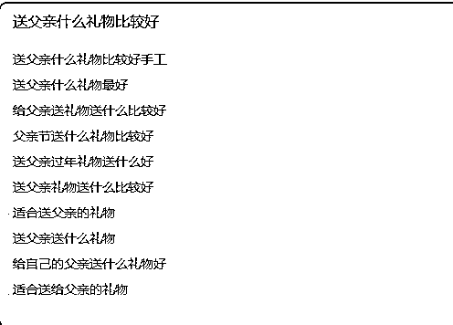

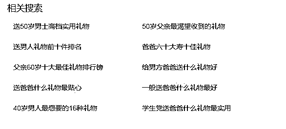

内容选自《Google 搜索 技巧寻找潜在商机》


2、关键词挖掘的具体实操 @三林@Tiger

1）简单上手关键词挖掘

分享一下我的经验。第一步：框定母词。

先根据研究对象：TikTok，还是 YouTube，还是 Tesla 等，定下一组母词。比如研究 tiktok，我会选：tiktok video、tiktok live、tiktok shop、tiktok fans 这些词，把大范围圈住。

然后：

第二步：拓词！用『 谷歌关键词规划师』等第三方工具，找相关的搜索词。

第三步：清洗，再拓词。再查一次关键词的流量。

第四步：把搜索结果二次分组，统计哪些「关键词」的流量更有代表意义。

第五步：筛出有价值的关键词，定向研究这些词用什么产品/服务去承接。收进自己的「项目库」或「需求池」。充分调研、评估完之后，再决定要不要做相关产品。

2）有哪些好用的拓词方法

通过下拉框找关键词 @TIGER

有时在 Google/Youtube 搜词时，会出现下拉框，这是挖热门词和长尾词的好渠道。这些数据被 Google 算法筛过，相关性强，热度也高。用来扩展新流量业务，是很好的选词入口。

这次拿 Google 举例，放回国内也有多个场景能套用同样思路。

技巧：在目标关键词前加星号（*），它的效果类似“通配符”（“wildcard”）。能搜出更多相关词，竞争小但搜索潜力很大。（在 Youtube 里直接以 * 开头会被无视，要先输入关键词，再在前面加 *）

如图是我用“TikTok”演示怎么找潜在热门搜索词。

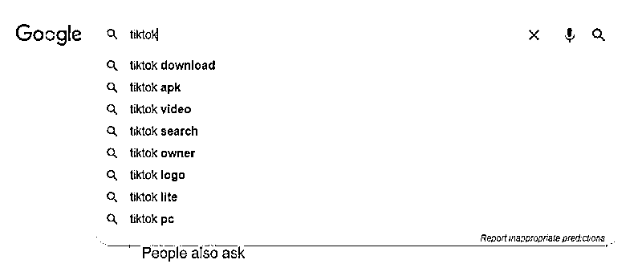

按这个方法在 google 搜相关热门词之后，第一条结果是：How to go live on TikTok（如何在 TikTok 上开直播）

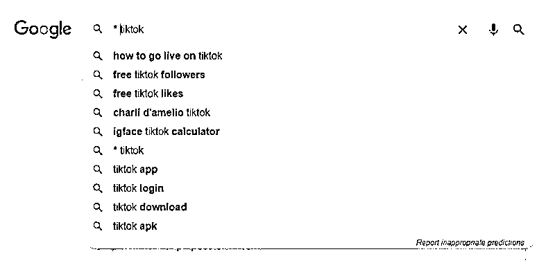

这个词搜完以后，首页出来一堆同名的教程视频，标题就是原封不动的搜索词。

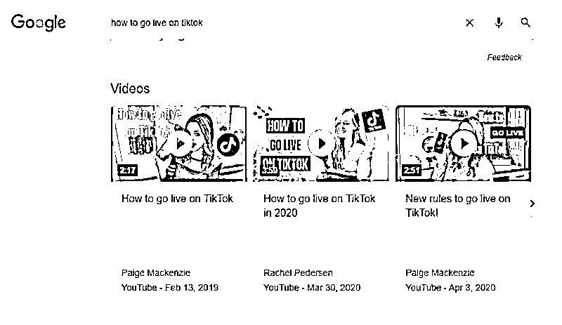

点进去看，这支视频播放量有一百五十万次。


再点进博主主页发现，她平时的视频流量也就几万，而这个一百五十万次观看的视频是她最大的爆款。她的粉丝大部分都和这支视频的引流有关，现在这位博主也涨到了二十多万粉。

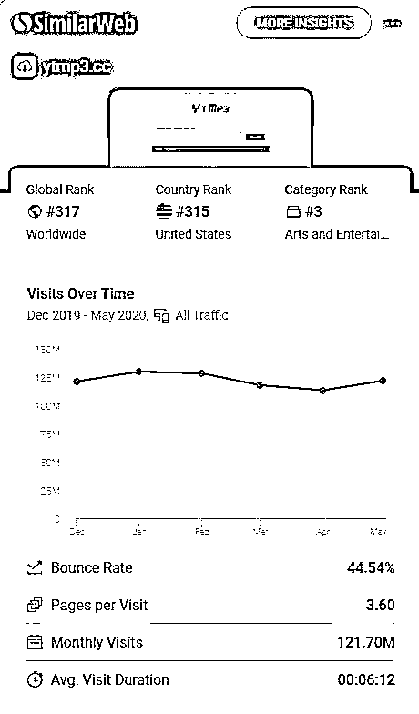

这样一来，通过拆解搜索词，我们挖出了一个靠搜索流量火起来的 Youtube 频道主（当然她也有从 TikTok 引流）。上面这个案例，就是用这种搜索技巧来找需求、找别人成功案例的一个演示。

内容选自《Google 搜索 技巧寻找潜在商机》


拓词工具之 Google 关键词规划师 @三林

这是 Google Ads 谷歌广告平台的后台功能，直接拿谷歌账号注册，免费开通，菜单「工具和设置-规划」里就能到「关键词规划师」。

进去以后有两个入口：一个偏「拓词」找新词，一个偏「查词」看流量。

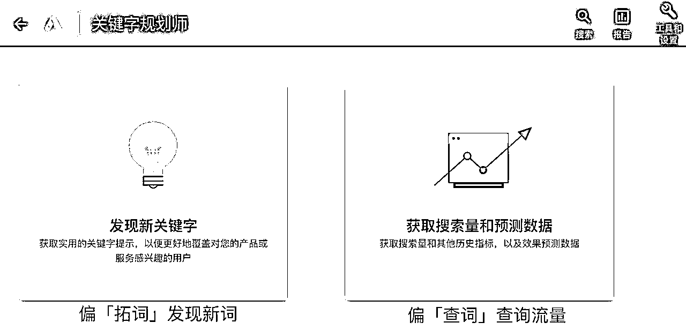

在「发现新关键词」板块，输入一个「关键词」，它会生成大量相关词，还有每个词的月搜索量、广告点击出价预估等。（这个功能最终是给广告投放用的，但我们拿来当需求调研工具也一样好使），如下图所示：


这就是「拓词」。初筛之后再做一轮拓词，也就是「二阶拓词」。通常一个母词能拓出一千左右的词，一两千个核心母词，扩展出上百万个有搜索量的词也不奇怪。

拓词工具之 Ahrefs 关键词查询 @三林

Ahrefs 在海外站点的 SEO 领域很能打。它也有关键词发现（keyword explorer）栏目，不过和 Google 关键词规划师不一样，它更擅长精准匹配，针对某个具体关键词做定向研究，数据颗粒度很细。比如 tiktok video downloader 这一个词的数据概览：

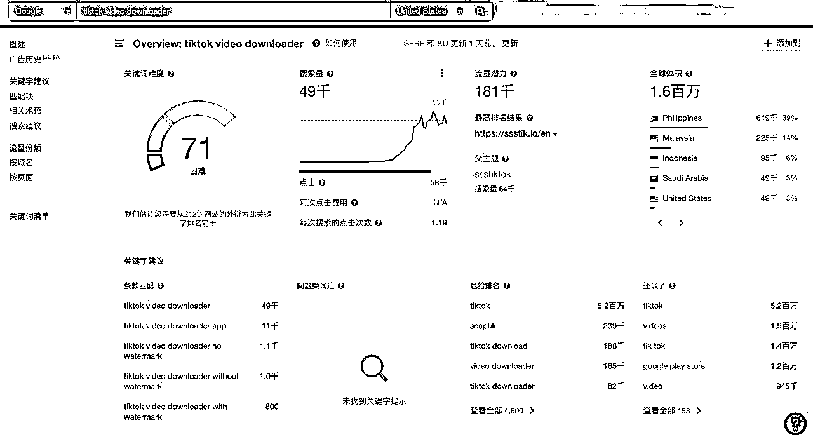

它也会列出「直接匹配」的相关词：

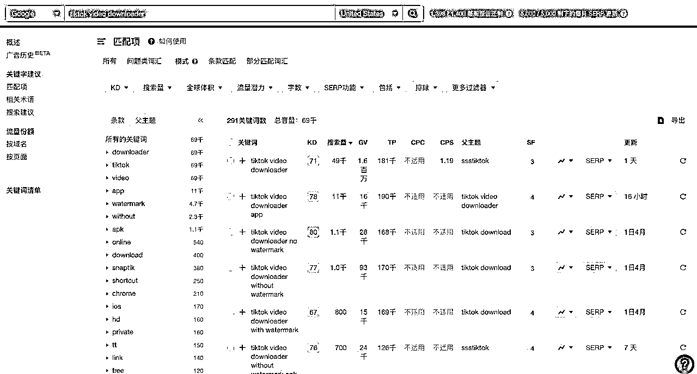

# 搜索词与痛点：海外需求挖掘的实操指南

先补充一个小提示：遇到搜索需求相近的词，可以导出下载，再把它们当作种子词去扩展新词。

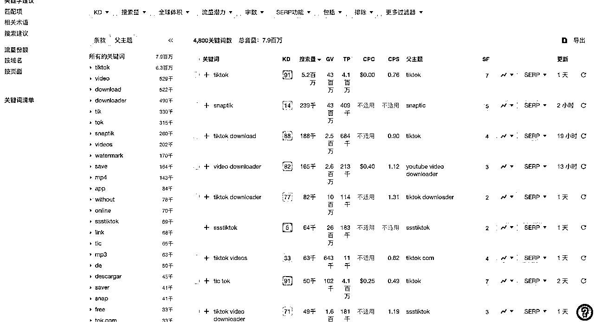

Ahrefs 的专业程度早已被认可，想低成本快速体验，就去某淘租一个共享账号。另一款 SEO 工具 SimilarWeb 也有词分析功能，但数据量偏少，日常体验一般；不过要评估一个站点的流量，SimilarWeb 的数据质量优于 Ahrefs。

拓词工具里，光年实验室出品的「光年-谷歌关键字分析工具」不错，@三林 提到它的强项是批量查询和多维数据导出。如果词量巨大，网页版会撑不住，需要申请 Google 的 Keyword API；这款工具与 Google 关键字规划师同源，数据来源也是一样的。需要提醒：这一 API 眼下很难申请到。

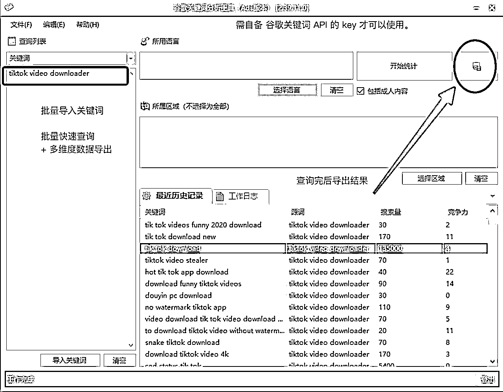

出处：《拿 TikTok 来说，怎么找到海外产品的赚钱机会？》


3）拿到热词后怎么处理 @TIGER

觉得一批热词靠谱之后，一般分两步：先看被搜次数，再看竞争强度。

先说频次。像 YouTube 这种月搜索次数亿级的大词，会带出大量衍生需求，比如 Youtube to mp3，单这一个子词的搜索次数就高达每月千万。靠前的几个轻量工具站，纯粹靠 SEO 就能拿到月均过亿流量。反过来，如果主词本身的搜索次数不高，想靠走量来做，商业价值可能有限。查数据可以用 Google Ads Keyword Planner，也可以用 Ahrefs、Semrush、Keywords Everywhere 等第三方工具。

再看竞争。值得做的机会，不是流量最大，而是流量大且对手不强。不管你想做新网站还是新 YouTube 频道，先得评估对手实力；你看到的热词，别人也不瞎。做频道，就看看这个词刷出来的几个频道，对比它们的粉丝数和内容水平。做独立站，就分析 Google 首页前十里每一家的外链量和域名权重，判断自己能不能打得过。

这里有个查外链的小窍门：在 Google 的检索框直接输入 `link:目标域名`，就能看到该站的大部分外链；想要更精确的数据，再借助 Ahrefs 查一遍。

出处：一篇讲 Google 检索技巧与潜在商机的文章


4）挖掘词的补充技巧 @三林

母词既要多，也要准。数量最好达到四位数，数千个母词能拓出几十万甚至上百万的词；但精度不达标，会掺入一堆无关结果，后期筛选很费劲。比如「Tiktok」很容易拓出一批大网红的名字，这类词在拓词前就要清理掉。

母词去哪儿找？三个途径：第一，从目标网站人工整理，例如首页、关于我们等页面的 Slogan、页面描述、Metawords、底部导航菜单名，凡是能描述业务的词汇，尽可能收全。第二，从所在行业头脑风暴，直接相关、行业相关、客群相关的词都算。第三，拿广告投放词做母词，效果出奇的好。Ahrefs 新推出的「付费词」功能，能查询一个网站投了哪些词，这太强了——愿意按点击付费的词，精准度能差到哪去？以 Shein 为例，Ahrefs 显示它共有 7.4 万个词，可过滤导出再慢慢筛。

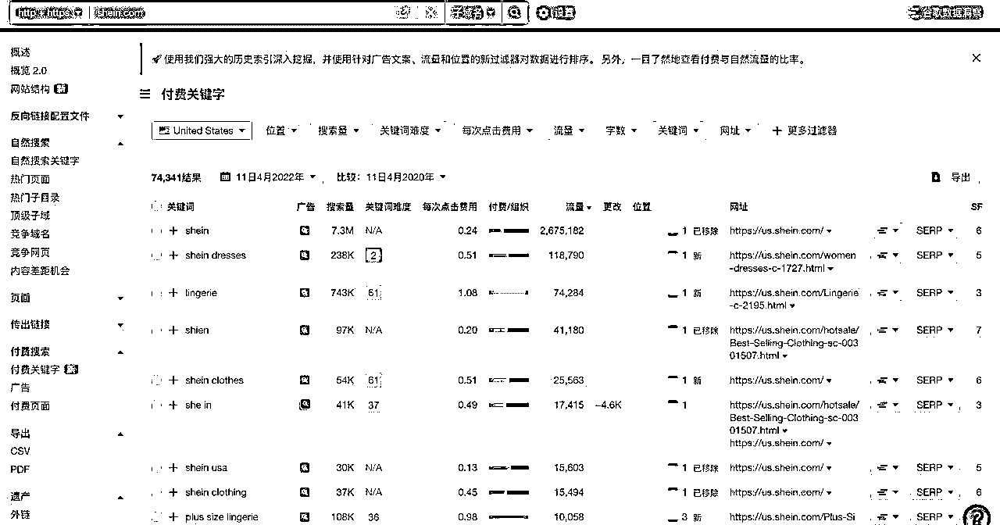

做个总结：Google 积累下来的搜索行为数据，几乎就是用户真实需求的投影。把一个行业吃透，需要耐心、全面地挖词和选词；上面讲的是用工具快速上手的路线。TikTok 如此，其他产品也类似，比如传闻估值 1000 亿美元的 Shein，周边会有什么机会？平台会变化，但用户需求延续性很强，谁能在新平台提前布局服务，谁就能抓住一波红利。Instagram/YouTube 下载站那套做法，完全可以在 TikTok 重来一遍。我把这种通过搜索词研究来发现需求或产品机会的方式叫「赚钱机会」。词的研究很有意思：你会意外地发现有人在这样搜一个词；再顺着这些词搜下去，会惊奇“居然还能这样玩”。它的用法远不止需求发现和 SEO/SEM，还能用于内容选题、广告投放、舆情监测、寻找 KOL 等。

出处同前：《拿 TikTok 来说，怎么找到海外产品的赚钱机会？》


## 3.5 第四种方式：以痛点找需求 ★★★ @龙哥

找痛点可以从自身的实际需求切入，也可以从自己所在行业或关注的话题出发，还可以绕着互联网大厂转。手里资源有限时，我更习惯从巨头产品的周边找机会。任何一款大型互联网产品，周边都有若干未被满足的需求点：一是巨头权衡后不想做的，例如🛰️👸号的数据服务（新榜）、🛰️小程序的导航（爱范儿）；二是巨头压根没意识到的，就算意识到了也不愿意为了 1% 的用户去牺牲 99% 的体验，比如在一台手机上同时开两个🛰️。这些被有意或无意漏掉的需求却是真实存在的，谁能满足，谁就能拿到这批用户，规模不一定小。几乎每个互联网巨头周围，都养活着不少产品和公司，甚至跑出过上市公司。这次以 Instagram 为例说如何找到真实痛点和产品机会，换到 Facebook、WhatsApp、Bitcoin、Snapchat、🛰️、🧣上也同样适用。

1、怎么找痛点。先在 Google 中查一下 Instagram，注意搜索框下拉和推荐词，会看到下面这些：

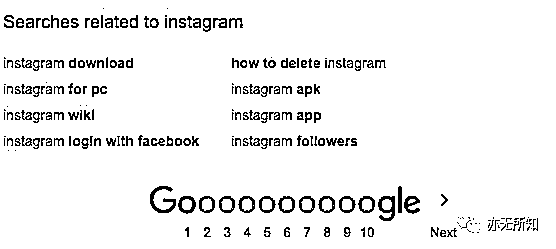

除了 instagram download，其他词看着都挺一般。

再拿这个词去 Google 查询，看能发现什么机会，结果出现这几组词：

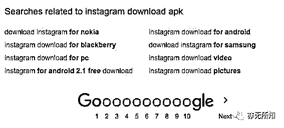

除了最后两个「instagram download video」和「instagram downloadpictures」，其余需求官方基本都已满足。

2、验证一下痛点是否成立。在 Instagram 下载图片和视频真有未被满足的需求吗？确实如此——网页版 Instagram 无法通过右键保存别人上传的图片，另存为被屏蔽。这种限制并不少见，知乎等网站出于版权考虑也不允许直接复制或存图。好比🛰️收到朋友的语音想转发给别人，却发现不支持。这个设置可能让超过 90% 的普通用户犯难，但下载图片和视频的需求真实存在，痛点成立。至于有没有好的解法、能不能赚钱，还不确定，接着用 Google 往深处挖。

3、看看市面上已有的产品。继续搜「instagram download pictures」，搜索结果第一页就有 6 个针对这个痛点的小工具。

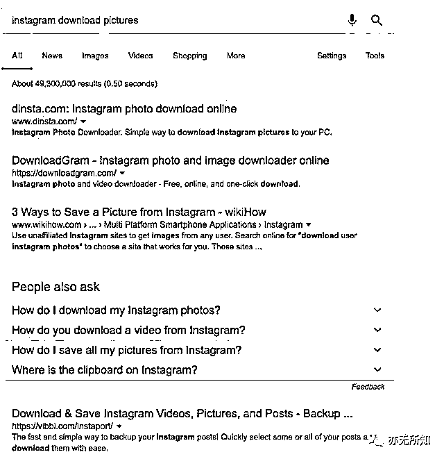

4、拆解商业模式。点开排名第一的网站，功能和模式都很简单：贴入图片链接即可下载图片，收益来自 Google 的广告联盟。

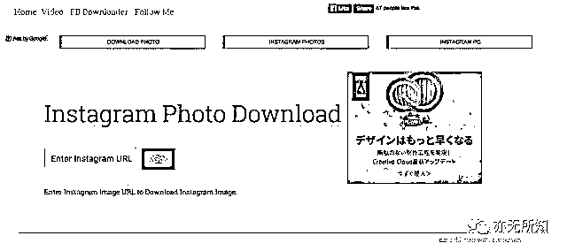

再用 SimilarWeb 查它的数据：月访问 120 万人次，日访问 4 万人次。按每千次浏览 2 美元计算，日收入约 80 美元，月收入 2400 美元，年收入 28800 美元，折合人民币约 20 万——够一个白领挣一年了。

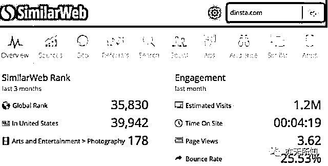

挖到这儿，可以判断：痛点真实、需求不小、已有成熟产品，这是一个不错的机会。

出处：《借助 Google 挖出一个细分市场》


## 3.6 第五种方式：围绕平台找需求 ★★★ @Seep

看了龙哥老师那篇找细分市场案例的文章，我照着做了一遍，找到一个靠 Instagram 周边赚钱的例子。主角是 linktr.ee，创始人 Alex Zaccaria 靠这个并不复杂的网站，每年大约赚 200 万美元。据 Alex 透露，产品上线时没花一分钱推广，全靠自然传播获客。Instagram 有一条「one link policy」：帖子或内容的任何位置都不能放链接，唯一能放的链接是个人主页的 website 栏。这意味着，想通过不同链接把粉丝送到不同落地页是不可能的（FB 广告投放除外）。这对很多 IG 网红和商家很不友好——商家有自己的 Amazon 店铺、独立站，网红要给不同雇主带货宣传，都希望粉丝能跳转到不同地方，政策却把路堵死了。linktr.ee 正好解决了这个痛点。它本质上是落地页生成工具，帮你搭出一个中间页，把各个跳转链接集中放在上面，粉丝点击就能去往不同站点。PRO 版则增加了完整的数据追踪和页面装修功能，让 IG 用户可以看清链接效果、突出自己的品牌。linktr.ee 没有其他盈利渠道，所有收入都来自 PRO 版订阅。

出处：《围绕 Instagram 赚钱的案例》


## 3.7 第六种方式：从自身需求往外拓展 ★★★

1、Dropbox 空间升级案例 @真武：空手套白狼，靠做 Dropbox 的容量扩展赚了 1 万美元。Dropbox 是国外最早的同步盘工具，注册一个新账号送 2G 空间。每邀请一位好友注册，两边各得 1G，上限 18G——换言之，要邀满 16 个朋友。但很多人不愿意麻烦人。@真武 自己也有扩容需要，就去淘宝花了几块钱买扩容服务，其实商家是用虚拟机全自动完成的。他转念一想：我的需要也可能是别人的需要。国内竞争激烈，干脆去海外。fiverr.com 上绝大多数服务标价 5 美元，平台抽成 1 美元。他把空间升级和出售现号挂上去，标价 5 美元，成本仅几块人民币。接到订单后转给淘宝商家操作，一单能赚 20 元左右，每天轻松接几单。

出处：《用 Dropbox 空手套白狼赚 1 万美元》

2、手机解锁案例（simunlock） @静水流深：手机解锁在海外生活过的人都有体会。国外买手机一般要签运营商合约，国内也有类似机制，但差别很大：国内是返话费，手机可插任意支持制式的卡；国外是低价拿手机，但要签两年左右的合同，每月话费有最低要求，而且只能用对应运营商的 SIM 卡，插别的卡直接变砖。两年后提交 IMEI 给官方，才能解锁。解锁后才能随意换电信卡，也可以转网、结束合同或签新约，然后换新手机继续循环。记得 iPhone 4 刚出时，媒体老说美国才 99 美元、中国要五千块，这是断章取义。当时背后的套餐普遍是每月 50 美元起、24 个月合约，算下来谁便宜还真不一定。正因为这种机制，才催生了“手机解锁”（simunlock）这个行业，这个词在 Google 里被频繁搜索，商家投放广告也不少：

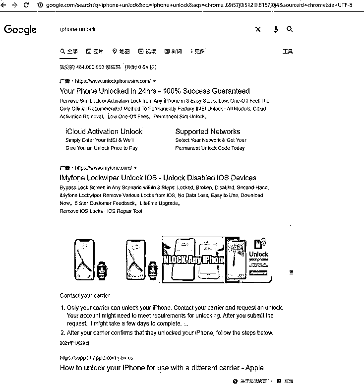

我找了一家以前用过的 iPhone 解锁服务商，确认他们做的是真解锁，拿主流的 iPhone 12 测了一下，报价如下：

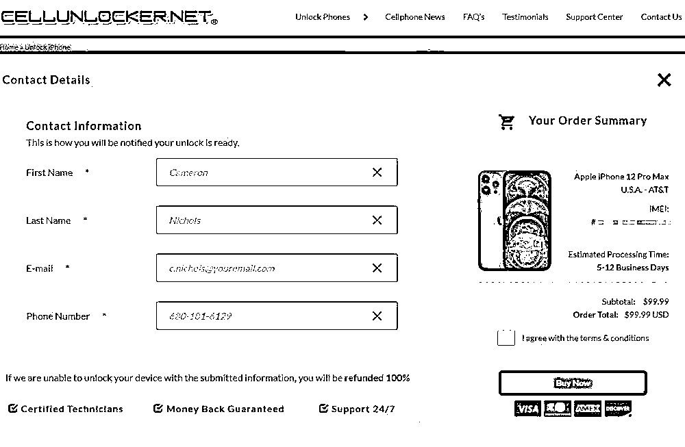

解锁价格 99 美元；去闲鱼或国内其他渠道，价格远低于这个数（不过闲鱼上标得太低的多半不是真实成交价）：

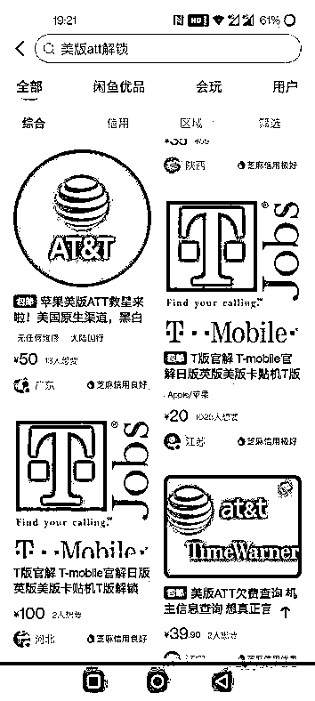

看到有人投谷歌 Adwords 竞价广告，就说明这生意存在且有钱赚。再加上这么大的价差，做跨境生意的朋友应该能想到：用 Shopify 搭一个简单的站点，就能复刻那些解锁网站的功能，把它当作虚拟服务商品来跨境卖。

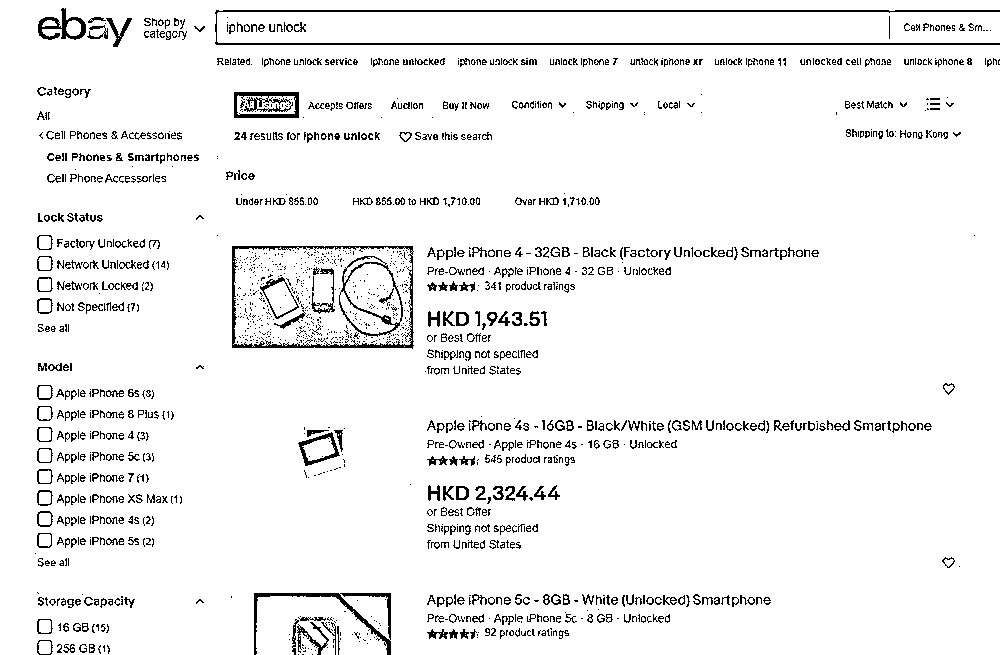

Fiverr 上更极端，要么没有，要么 150 美元：

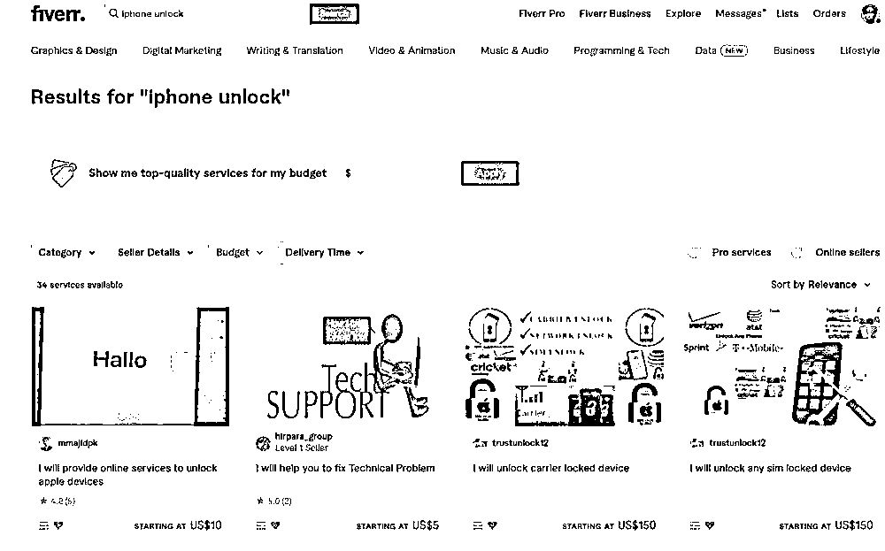

把解锁服务挂成商品，标题里写上相关搜索词，靠自然流量就能获客，一分钱推广费都不用花。接到老外的单子，再找国内解锁服务商处理，赚取差价。万一解不了，退款了事，自己零损失。多数情况下，收益能翻倍。国内服务商怎么找？多逛逛闲鱼和淘宝，包括知名的找果科技。但前提是自己亲手跑一遍流程——任何项目不去动手，再好的机会也是零。

出处：《3 个单人就能做的赚钱案例，教你如何通过互联网在海外淘金？》


## 3.8 第七种方式：借榜单找需求 ★★★ @非洲水手

榜单是需求挖掘的重要参照，一定要多看，别靠瞎想。榜单呈现的真实情况，比自己拍脑袋靠谱得多。列出几个值得常看的榜单，好好开拓一下视野：

https://www.ycombinator.com/companies

https://toolify.ai/

https://chrome-stats.com/

日榜、周榜、月榜排名靠前的，也值得研究：https://www.producthunt.com/

看 AppAnnie 2023 年 1 月的非游收入榜，能发现几个有意思的方向：

1、娱乐产品仍然最吸金，收入榜前三全是娱乐类。顺着这个思路，可以想想它们周围有没有刚需工具，比如视频去水印下载、Bio 链接跳转？或者 Instagram 里流行的小工具，能不能平移到 TikTok、Bigo、Kwai 这些平台？

2、产品力加经年累月的打磨，能造出无可撼动的王牌产品，比如扫描全能王、美图秀秀。选一个领域深耕，坚持长期主义，回报可能远超预期。

3、收入榜前十里居然有赚钱社群无人不知的老照片修复项目！说实话我也没想到，这必须认真反思。

4、AI 类除了老照片修复，还有识别动植物的应用，🛰️上也有个很火的小程序“识花君”。类似爆款，海内外用户接受度都很高，比如“蚂蚁呀嘿”就能全球同步走红。

5、从品类出现频次看，主要集中在娱乐社交、照片/视频编辑、阅读、AI、健身、办公等方向。有的方向需要资源池，但社群里已经有不少对接资源，只要有心，总会有门路。

6、榜单里没出现的《Hallow》也值得一看，这是面向天主教徒的祈祷冥想应用，原型是 Calm——冥想应用里估值极高的明星产品，只是把人群切得更细。今年 2 月 24 日它一度冲到美榜前三，可见宗教移动市场潜力不小。再联想到之前把《Holy Bible》做成矩阵电子书的玩法，两个看似不相干的品类交叉，也能爆发出惊人的效应。

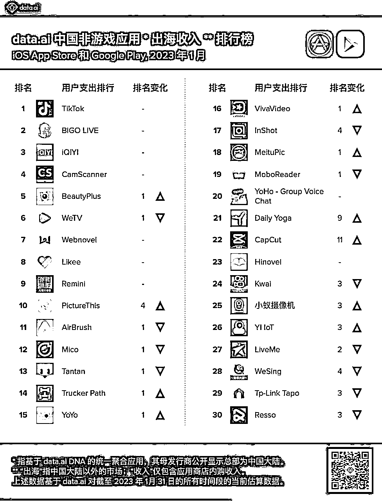

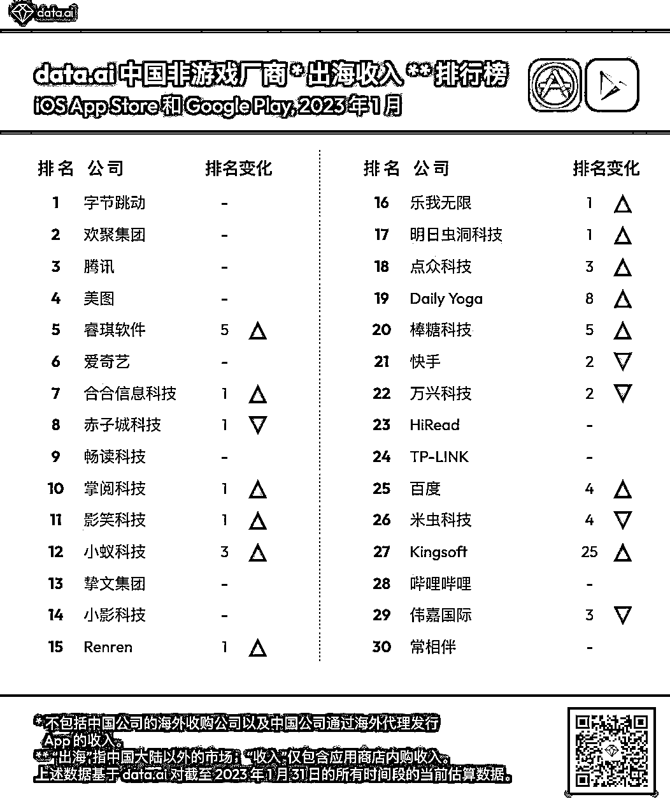

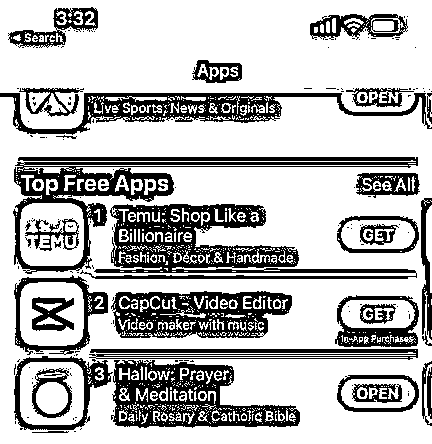

出处：3 月 6 日《关于出海工具产品营销推广，我的几点经验分享》@非洲水手


## 3.9 第八种方式：承接定制需求 ★★ @刘小排

有人愿意预付费来请你做定制需求，这是很好的生意模式。码叔在龙哥盟分享过他的打法：从 6 月开始自学 Chrome 扩展开发，半年变现几十万，这套方法可以复制。他从不凭空发明 idea，永远从定制需求出发。某人需要某个功能，知道他会编程，就付钱让他开发；接下来码叔会想办法产品化，卖给更多有同类需求的人。

十年前我在一家软件外包公司待过，公司主要接欧美外包，但老板很早就明白一个道理：既然客户愿意花钱请我们做，为什么不尝试标准化，再卖给其他客户？他们因此捣鼓出一些小 SaaS，有的也做出了一点成绩。（公司叫重庆诺怀软件科技有限公司，到今天仍在运转，我是小股东。）

国际上更著名的案例是 Typeform 和 Basecamp。两家最早都是软件外包公司，后来从客户需求中找到共性，再做产品化。创始人是这么说的：

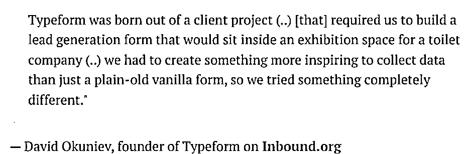

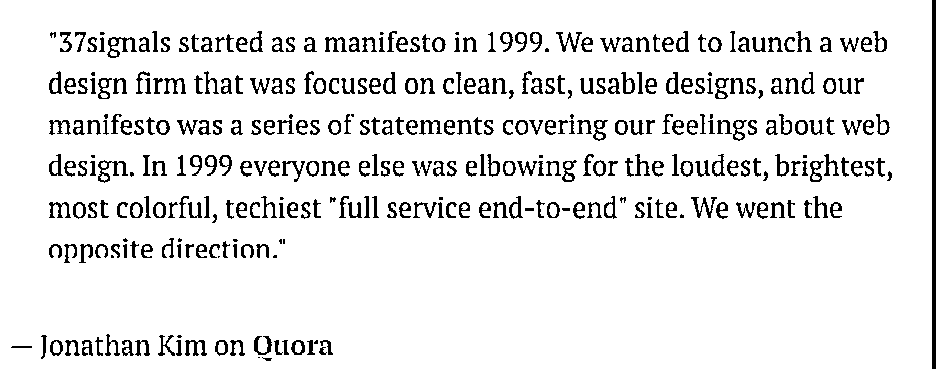

龙哥盟聚集了一批独立开发者，付费定制的单子并不少见。与其各自接活，不如抱团梳理这些需求，看看哪些能沉淀成标准化产品。

先提醒一句：拍脑袋造出来的需求，多半是坑，也别把它当成可靠方法。靠生造点子做起来的公司，真的没几家。写在这里，就是给大家提个醒。

以后脑子里突然闪过“这个点子绝了”的念头，先别激动，追问两句：用户在哪？谁掏钱？最容易骗过的其实是自己。人很容易被自己编出来的想法点燃，所以别太快对自己的创意上头。

素材出处：《如何获得产品 idea》


## 3.10 盯住 ChatGPT 工具站需求 @三林 🔥

AIGC 的迭代速度简直离谱：ChatGPT 4.0、Midjourney 5、谷歌新 LLM、微软 Copilot、百度文心一言……AI 领域一周一变，哪用等一年？web3 看了只能自嘲一句（txtx）。详细内容可读极客公园这篇：https://mp.weixin.qq.com/s/5fhzpYmLKQhx9FEIT0wssA

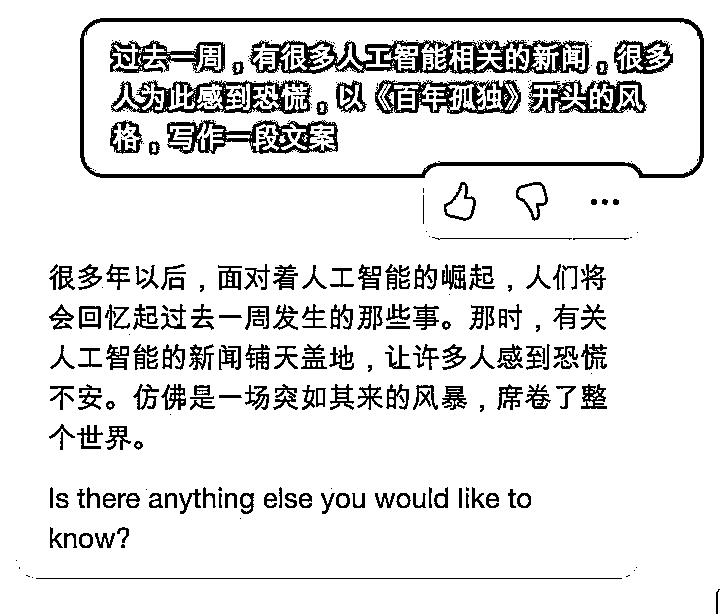

说回 ChatGPT。API 一开放，围绕它的应用大概率会成批冒出来，生态会迅速热闹起来。其实在 API 还没开放时，已经有人抢跑了：国人开发者 Lencx 做的 ChatGPT Mac/Win 客户端，还有出圈的浏览器插件 ChatGPT for Google，安装量已经到百万级。

下面挑几款第三方浏览器插件，聊聊它们怎么找定位、体验上有什么可借鉴。

发现入口也简单，在 Chrome 应用商店搜“ChatGPT”：https://chrome.google.com/webstore/search/ChatGPT

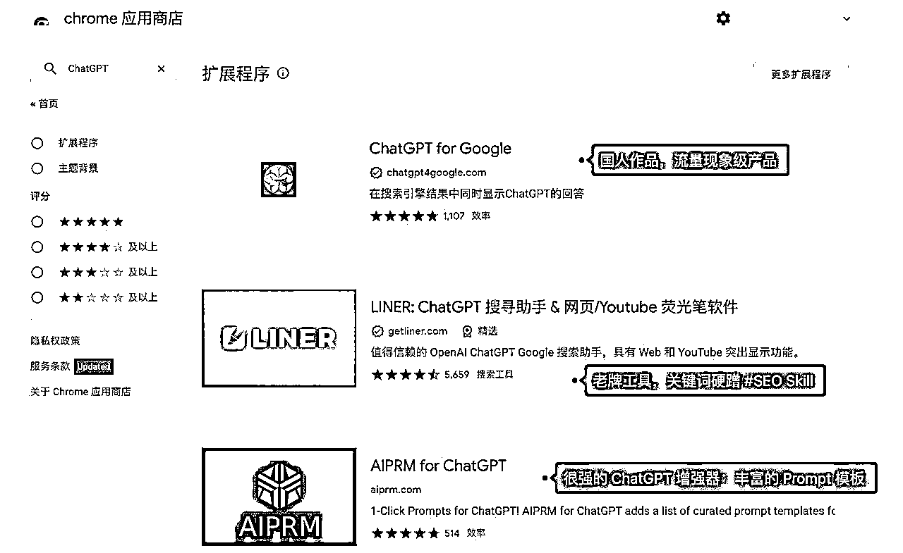

1、先看 AIPRM：可能是最顺手的 ChatGPT 插件

想让 ChatGPT 输出更好，前提是输入够好，提问方式很关键。高质量提问本身是个难题，于是有一批工具专门优化提示词输入，让好问题更容易写出来，AIPRM 就是其中表现很亮眼的一个。

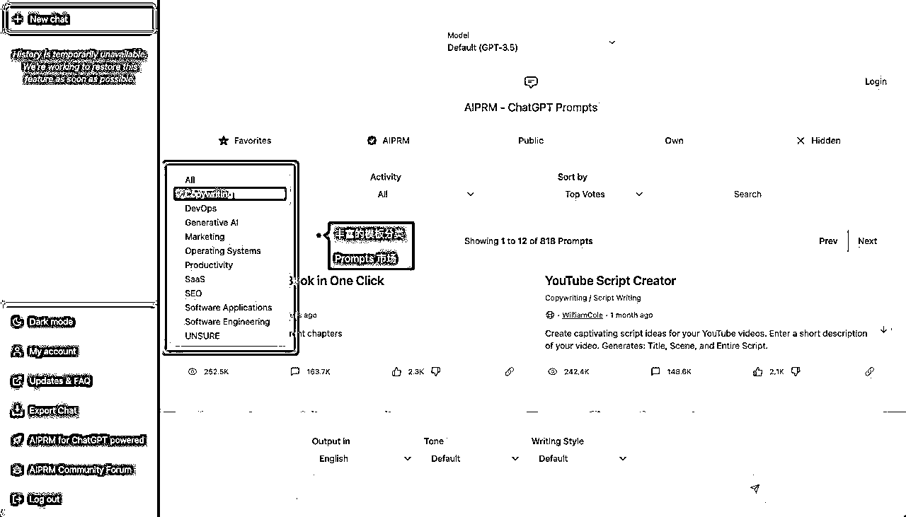

AIPRM 把提示词模板市场直接嵌进 ChatGPT 页面，用户写问题更省事，结果质量也更高。我比较喜欢它可指定输出语种和风格：哪怕我输入中文，只要设成英文输出，返回内容就会自动变英文。

传播上，开发者本身懂 SEO，所以 AIPRM 先在海外 SEO 圈子打出名气，比如这条推文。现在安装量超过 60 万，Chrome 商店里能看到各地用户的好评。

它也开始商业化了：免费版限制不少，精选 Prompts 要付费（最低 20 美金/月）。想找替代品，可以看看 ChatGPT Prompt Genius。

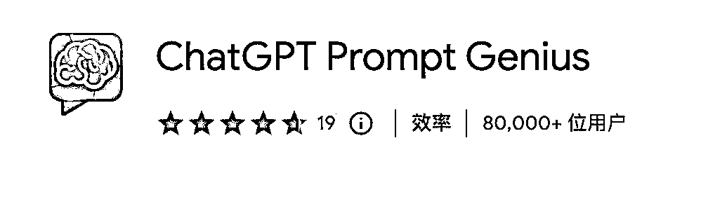

2、ChatGPT for Google：搜索场景的代表

这是国内开发者做的产品，很早就切入 ChatGPT 浏览器插件方向。用法很直接：你在 Google 搜索时，它会把 ChatGPT 的答案同步展示出来。

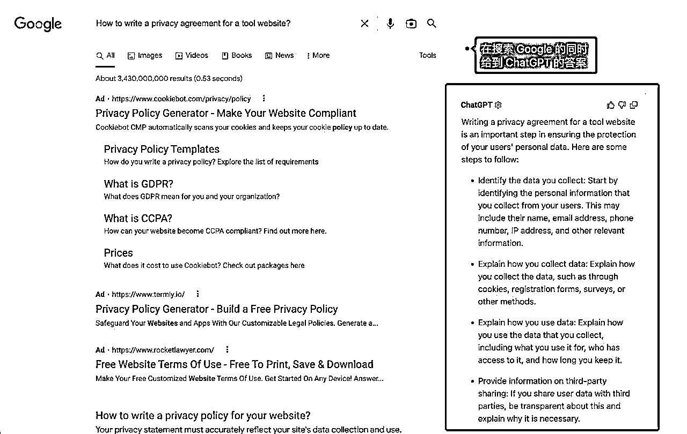

它在即刻社区传开后，增长很猛，目前是同类第三方工具里用户规模最大的，安装量已破 100 万。而且它开源，支持二次开发（重点）。

判断一个工具的能力，我通常看两处：一是 Setting 设置项，二是 Pricing 价格页。

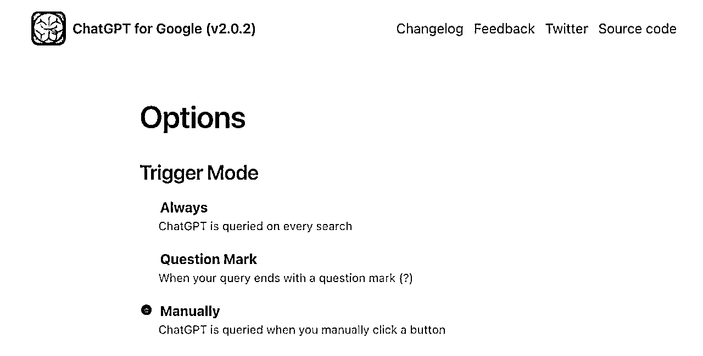

它的设置里有个 Trigger Mode（触发模式）：

Always：每次谷歌搜索都触发查询；
Question Mark：只有输入带问号“？”时才响应；
Manually：默认不动作，需要时再手动点一下。

这个细节很能说明它的核心交互。我特意拎出来讲，因为早期争议点就在这里：若每回检索都查一遍，无效请求会暴增。触发模式把决定权交还给用户。

3、ChatGPT Writer：咬住核心场景，起量很快

大语言模型最擅长的就是文本处理。做 ChatGPT 相关产品时，顺着这项核心能力走，通常更容易出效果。

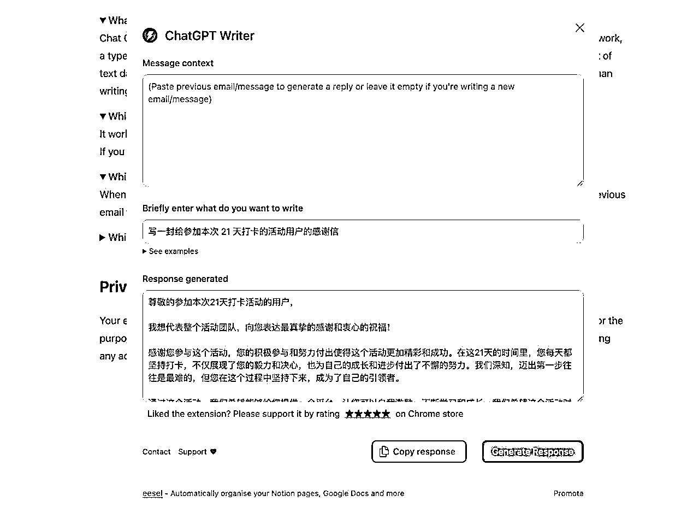

ChatGPT Writer 是写作辅助插件，定位很准：既能随时发起创作，也会嵌进具体场景，比如贴在 Gmail 写邮件的地方。如今安装用户涨到 30 万，名字起得好也许真有点功劳？

同类产品还有：

YouTube summary with ChatGPT：一键总结 YouTube 视频。做法不复杂——抓字幕，再跳去 ChatGPT 生成摘要。我看它只用了单个提问 Prompt，一条 Prompt 就顶一个小工具。

后起之秀 Monica - Your ChatGPT Copilot in Chrome 是国人团队的出海产品，设计做得挺精致，交互像 New Bing 的侧边对话栏；但生成内容质量偏弱，我怀疑背后还是 GPT-3，而非 3.5 或 4。

4、补官方短板：以 ShareGPT 为例

这个插件我用得很频繁：把 ChatGPT 对话一键变成可对外分享的链接，比截长图舒服多了。

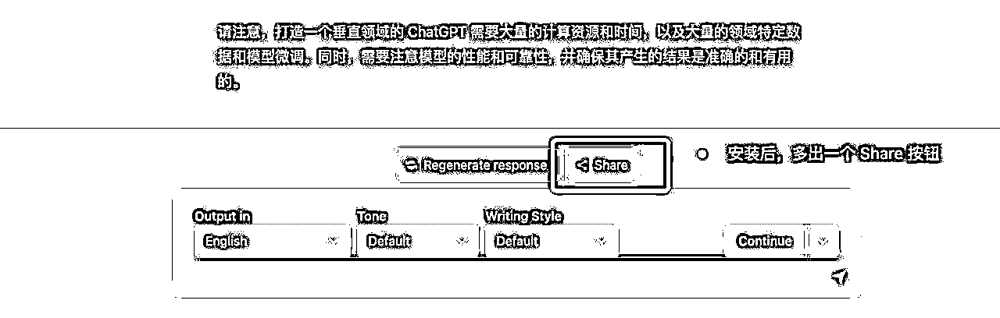

同样在补官方缺口的，还有这些：赚钱圈友 @码叔编程 做的 AI 会话存档插件，可把对话导出成 PDF 等多种格式存在本地；

赚钱圈友 @啊洛 开发的 ChatGPT to Notion，一键把会话存进 Notion；再如 ChatGPT Master，主打划词快捷键提问，鼠标右键可自定义，支持多套模板。交互有点像 Notion AI：选中文本后让 ChatGPT 继续加工，优化、翻译、缩写、扩写都能配。

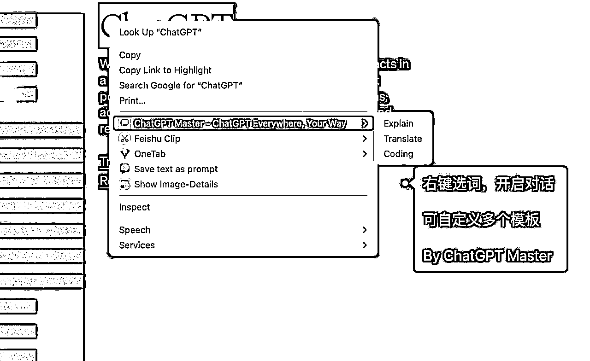

还有调用浏览器语音能力的 Voice Control for ChatGPT、Speak to ChatGPT，适合和 ChatGPT 直接语音交流。用途也很明确：练口语、练听力。

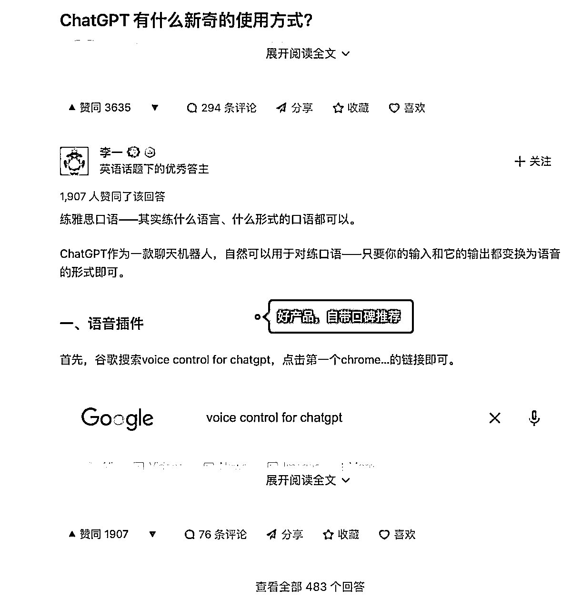

5、ChatGPT for Amazon：给老业务加一层 AI

这是国内创业公司 Shulex VOC 的产品，面向亚马逊商家做评论分析 SAAS，靠数据挖掘和垂直行业分析来理解消费者与市场。ChatGPT 出现前，它对主要大类目研究很深，但全品类覆盖有难度；ChatGPT 来了之后，NLP 不再是门槛，服务更多商家变得可行。

Shulex VOC 本来在电商评论分析上就够深，ChatGPT 又把它往前推了一步：更快产出多维度评论洞察（优缺点、消费者期待），Listing 优化结果几乎秒出，体验明显提升。营销端，它借 ChatGPT 热度和跨境圈红人视频造势，增长势头很猛。

这种底层技术变化，让我想到赚钱圈友强哥那句话：研究 NLP 家破人亡，用好 NLP 鱼翅拌饭。

类似路径还有产品「Glowe 阁楼」，用 ChatGPT 底层技术做心理咨询赋能，刚拿到新一笔千万级融资。

龙哥盟这边，AI 教练、AI 鱼丸，甚至 AI 龙哥也在开发中。说不定下一期航海，就由 AI 教练陪着你走。

这些都是我身边的例子。

——

上面这些插件可以归分类：

提示词增强：AIPRM、ChatGPT Prompt Genius 等；
文本处理见长：ChatGPT Writer、YouTube summary with ChatGPT、Monica；
效率工具：ChatGPT for Google、ShareGPT、ChatGPT Master、ChatGPT to Notion；
给原有业务赋能：ChatGPT for Amazon 等。

小结一下：浏览器插件生态已经有玩家了。从去年 12 月初到现在约 4 个月，手快的团队足够做出像样产品。不过我相信，真正爆发还没到。

回到开头的问题：为什么选浏览器插件？

因为 ChatGPT 官方就是网页版，插件能直接增强网页，在用户已经熟悉的场景里做体验升级，贴合习惯，用户也更愿意用。它补了原生产品的不足，相当于借巨人的力。

以上只是我观察到的部分产品和服务，接下来肯定还会冒出更多有意思的东西。

我总结几条认知：

1）开发范式要从“面向 Google 编程”转向“面向 ChatGPT 编程”，开发者应该体会很深。
2）ChatGPT 像个魔法百宝箱，打开它的钥匙是 Prompts；它既是流量密码，也是财富密码。
3）浏览器插件只是形态之一，API 开放后空间更大。单条 Prompt 能撑起一个 Mini tool，把多条 Prompts 串起来，就是一套 Mini SAAS。
4）先想清楚自己业务里哪些场景能用，再大胆让 ChatGPT 给自己和业务加 buff。
5）最后也最重要：考虑到原生体验和内容安全，创业者更适合出海，这也是我们做英文工具站的价值所在。

素材出处：《ChatGPT 应用生态之浏览器插件观察》

现在 ChatGPT Plus 逐步支持联网，还接入了 70 多个第三方插件，覆盖教育、电商、娱乐、新闻、投资等领域。圈友 @黄小刀 整理了这些插件的功能。除了上面提到的工具，插件功能描述也许能给你一些灵感：《ChatGPT Plugins 清单 @黄小刀》。

另外，龙哥盟里与 ChatGPT 有关的风向标也藏着不少可挖的需求，同样涉及教育、电商、娱乐、新闻、投资等方向。


# 四、拆解英文工具站

💡本章速览

做英文工具站，有两个问题绕不开：流量怎么看，定价怎么想。

流量部分会讲清流量、流量来源、跳出率、转化率这几个概念。

流量，就是用户来访问的情况；流量来源分四类：搜索、直接、引荐、社交；

跳出率，指用户进网页后没做任何操作就关掉的比率；转化率，指从进站到完成设定目标的用户占比。

定价部分给 5 条思路，没有先后顺序，只作参考：

按用户价值定价，而不是按自己的成本；
服务好 20% 的用户；设一个价格锚点；
订阅模式有点“黑”；涨价往往是最好的增长方式。

这些是圈友的个人经验，实操时还得看具体情况。数据分析和定价分析都不止一种逻辑。


## 4.1 看懂网站流量 @Leevege

衡量网页表现，通常先看四个指标：流量、来源、跳出率、转化率。更细的维度基本都由它们延伸出来，下面逐一拆。

### 4.1.1 流量指标

流量常分 PV（页面访问量）和 UV（独立访客量）。同一用户看了多个页面，会记成多个 PV、一个 UV，所以 PV 永远不低于 UV。Similar Web 里的“平均访问量（每次访问页数）”就是 PV/UV；它和平均页面访问时长一样，可作为用户粘性的参考，数值越大越好。

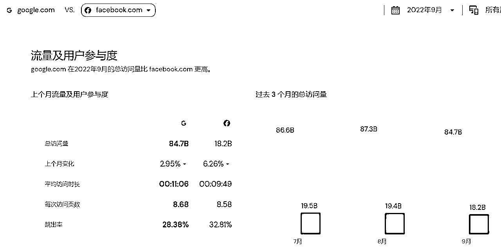

看 Similar Web 对 Google 的分析会发现，用户访问谷歌往往目的性很强。有意思的是，Facebook 作为社交媒体，在访问量、平均访问时长、每次访问页数、跳出率这些维度上，和 Google 并不一样。做竞品分析时也可以拿这些维度对比；如果相似指标能做得比对手好，流量就只剩推广投放的问题了。

若要做精细化运营，还可以看分时段的流量统计。但时差摆在那儿，通常得把统计时间换算到目标用户所在时区，结果才符合出海网站用户的浏览节奏。页面明细也值得看：某个页面被同一用户反复浏览（PV 高），说明用户更偏爱它。

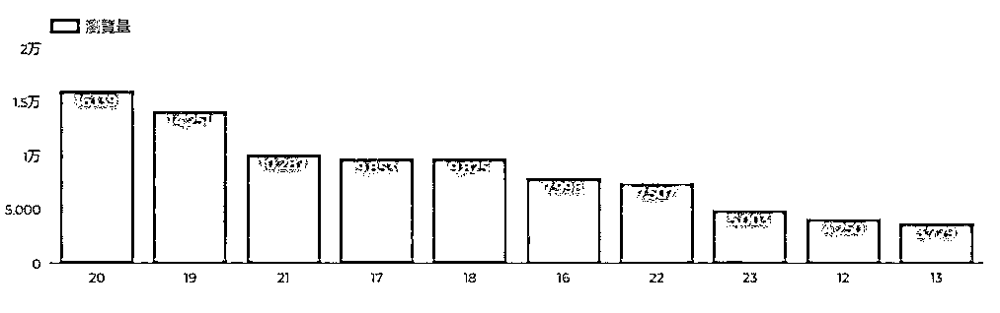

某网站的用户浏览数据，这里按美国时间统计。横轴是开始浏览后 1 小时内的时点，20 代表晚上 8 点到 9 点。能看出用户活跃高峰在美国时间下午 5 点到晚上 10 点。若做内容站，在这段时间引流推广，效果通常会比早上更好。

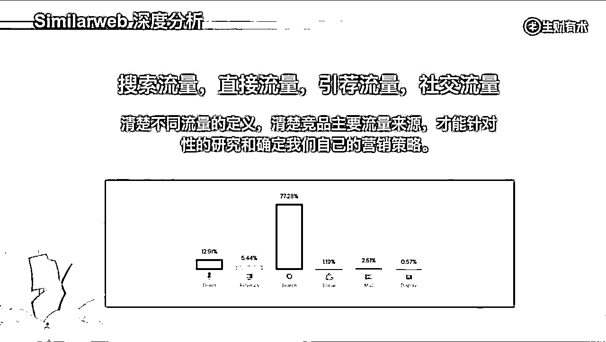

### 4.1.2 流量从哪来 @阿彪

来源分类跟需求有关。开发和运营网站的人要主动盯数据、做复盘：一旦出现异常值，就查原因；如果异常带来了流量上涨，就把导致异常的那个特性放大投入，流量大概率还能再爆一波。

先弄清四个主要来源：搜索、直接、引荐、社交。理解各自定义，再看竞品主要靠哪类流量，才能有针对性地定自己的营销策略。

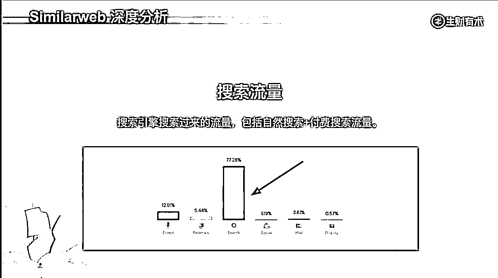

#### 4.1.2.1 搜索入口

搜索流量，就是从搜索引擎过来的访问，分自然搜索和付费搜索两种。

图中红色柱是 77.28%，代表搜索流量占比。但别急着把它全算成自然搜索，里面很可能有一大块是付费搜索。

理论上，别人能靠付费搜索排上去，你也可以。用户没用过产品之前，体验都像开盲盒；只要 ROI 能打平，你就有机会。

看个例子：PDFfiller 做在线 PDF 编辑，月流量 13.7M，搜索流量占 77.28%。

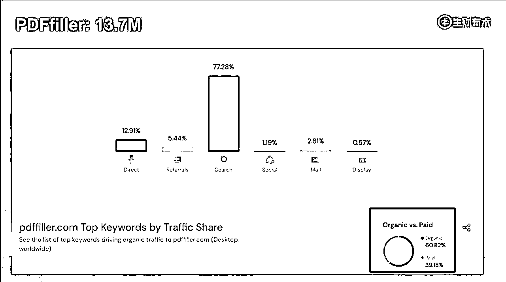

右下角显示，organic traffic（自然流量）占 60%，paid traffic（付费流量）占 39%，也就是说付费搜索占了 39%。

这比例相当高。粗略算：月流量若按 1400 万算，70% 差不多 1000 万搜索流量；其中付费占 40%，就是约 400 万付费搜索访问，量级很大。

这提醒我们：对手在投广告，我们也可以研究怎么用广告。哪怕只会投放，也能从中切一块；400 万里拿 100 万，就够养活自己了。这就是流量分析的价值。

另一个站 Top10.com 月流量 3M，90% 来自搜索，基本可以视作搜索驱动；其中 60% 又是付费，说明它主要靠广告。感兴趣可以去看，它本质上是个广告套利站。

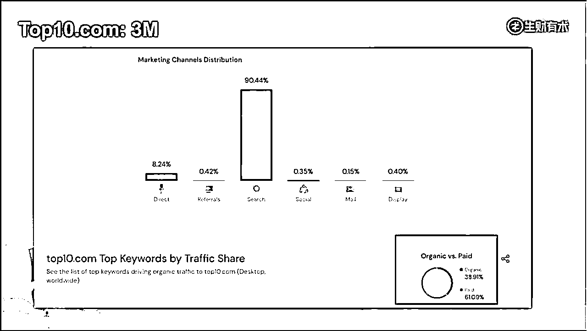

怎么运作？它自己做榜单，比如“十大域名服务商”“十大主机商”之类，然后从谷歌买广告，靠卖代理产品拿佣金。佣金盖过付费搜索成本，就赚钱。

生意不小：月流量 3M，付费广告 180 多万，单次访问至少 0.5 美金，一个月广告费就是大几十万美金。

再看 PDF editor online：流量 180k，60% 是付费。如果做一个类似站点，有对应功能，靠广告投放就能变现。只要 ROI 打平，这事就很划算，因为投放确定性高、响应也快。

当然，在线 PDF 编辑目前做起来仍有难度；但若能做出来，靠广告投放打平，生意还是不错，研发投入也没有想象中那么吓人。

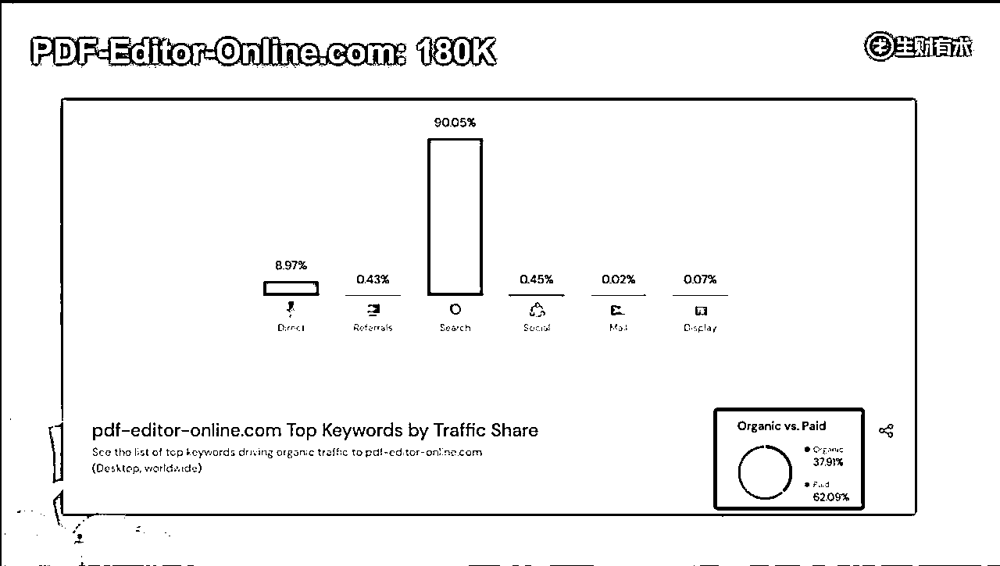

#### 4.1.2.2 直接访问

直接流量，一种来源是手动敲 URL，或者通过收藏夹、插件进入。英美用户有直接输网址的习惯；中文是象形文字，而互联网世界以英文为主，英文字母对他们来说就是母语，所以不少人会直接敲 google.com。国内用户则不同，很多人不会直接输 google.com，而是先搜“Google”或“Apple”再点进去。

# 先看懂流量来源，再看跳出率和转化率

浏览器判断不了访问从哪儿来时，会把一切归到“直接流量”。实际生活中，这类入口很多：桌面软件里的跳转链接，比如视频剪辑工具、修图工具、文档编辑工具；聊天软件里的链接，像 Telegram、WhatsApp 中点开的网页。对浏览器而言，从这些地方进入和手动输入 URL 没有本质差别。以 Adobe 为例，它和 Chrome 是完全独立的两个生态，用户从 Adobe 客户端跳出去，浏览器找不到“上一个页面”，于是只能当作一次全新访问。也就是说，桌面软件或 App 公司网站若出现大量直接流量，很可能来自自家客户端而不是广告。

Web3 和区块链项目也有类似特征：社群是主要传播阵地，Telegram 里随手扔出的链接被反复点击，网站流量自然高。如果只看到流量高就想着做 SEO，可能一开始方向就错了，对方的核心运营其实在社群。PDF 也算一个常见来源：免费或付费 PDF 中放置网站链接，用户在 Adobe 或其他桌面 PDF 阅读器里点击，浏览器同样无法识别来源，从而计入直接流量。另外，带 noreferral 标签的链接也会被归入这一类，广告跳转、网盟和弹窗广告里大量存在。
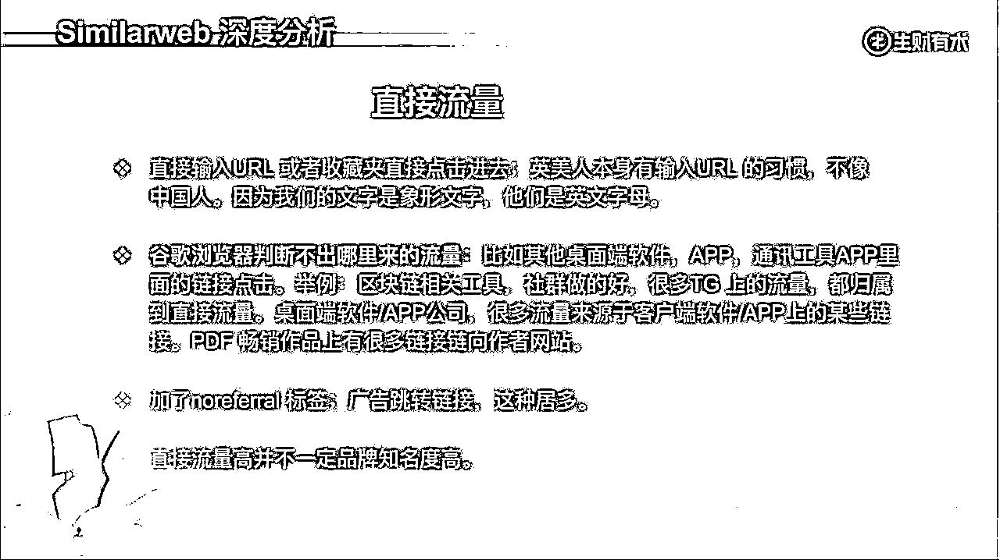

#### 4.1.2.3 引荐流量：谁在帮你把客带进来

引荐流量指的是从其他非社交网站跳转而来的访问。引荐流量偏高，往往来自这些形态：马甲站、子工具站、子品牌站或者直接买来的站点。马甲站只是换了一层壳，功能基本照搬；子工具站则是把一个产品拆成很多微小功能，每个功能单独建站后统一引流到主站；子品牌站则是主品牌矩阵里的另一个品牌。多语言站点靠不同域名后缀区分。代理商网站多为品牌方主动发展出的 Affiliate 渠道。还有付费发的高质量软文，以及支付通道服务商——例如网站接入 PayPal 收款，用户跳去 paypal.com 时也会顺带为它贡献流量。


需要提醒的是，对目前 80% 的常规玩家来说，靠软文做出高引荐流量并不现实。A 网站想给 B 网站贡献流量，10% 基本是天花板，3%-5% 已属不错。假如一个页面每月能给另一页面带来 1 万访客，它自己的月访问量至少要有 10 万，这种页面很难得。反过来，通过 Top Referral Sites 可以看清对手的策略：它有哪些代理商、马甲站、多语言站点，都能从这里找到线索。


先看到的是免费版截图，接下来换成付费版数据。


以 pdffiller.com 为例，6 至 9 月给这个在线 PDF 编辑网站带来了 200 多万引荐流量。红色框右侧列出具体来源，中间 traffic share 列可看到 https://pdf-editor-online.com 三个月贡献 393k。往下翻，这些来源站 logo 几乎一致，明显是子工具站矩阵——把众多子功能拆成独立小站，再统一导给主站。它们的流量来源，可能有 60% 甚至 80%-90% 来自付费广告。主站投、子站也投，最终全部汇向主站，这就是整套打法。这家公司在 SEO 玩家里能排进 top 3，产品覆盖 Web 端、客户端、App、浏览器插件，属于全生态全终端布局，也因此拿到了数千万美元投资。

再看 shopify.com，它的引荐名录中大部分是多语言站点，第四名 https://usefulcharts.com 带来 77.7k 流量，原因只是它用了 Shopify 的购物车与支付系统。第六名 Oberlo 带来 55.9k，仔细看就是代理商网站。


PayPal 的 Top Referral Sites 也能变成选品情报。支付通道的命脉是收单，谁把最多用户送过来，通常意味着谁在大量成交。把 Top 10000 或 Top 1000 的来源站导出来逐一筛查，看到自己感兴趣的，且能力范围内能做的，就可以跟进。排名第一的电商站点单月贡献 21.6M，毕竟它本身就是电商平台；下面那些知名大站也不适合个人直接模仿，但思路可以借鉴——多留意排名靠后的来源。例如我做 Shopify 或工具站，看到同类工具站给 PayPal 带来很多单量，说明这个方向赚钱，可以考虑入局。


#### 4.1.2.4 社交流量：从社交平台涌进来的访客


社交流量很简单，就是从社交平台进入网站的访问。它占比高，通常对应三种情形。

第一，社交平台广告投得很猛。尤其是跨境电商独立站，几乎靠 FB 等平台的信息流广告撑起社交流量。自然帖子带来的量其实很有限：一个 500 万粉丝的大号发帖，能被 5% 的人看到就不错，这 5% 里再产生 5% 的点击，已经算很好。大 V 的社交流量并不是靠发帖堆积出来的。

第二，产品本身就依托社交平台。比如工具会自动转发 Twitter，并在消息后面带链接，用户点击后到达开发者网站，这种也算社交流量。

第三，YouTube 的引流价值不容小觑。它本身是全球第二大搜索引擎，视频有播放量后，下方链接会持续带来访问。而且从曝光成本看，社交流量非常划算：若点击率是 5%，带来 1 万次访问的同时，相当于品牌曝光了 20 万次；想通过搜索买到同样曝光，花费会高很多。展示广告未必能达到同样效果，成本也往往更高。所以要做品牌曝光，社交广告或信息流广告更值得考虑。

usefulcharts.com 是个好例子。它给 Shopify 带来不少引荐流量，自己的社交流量占比也高达 37%，9 月更到了 42%。拆开看，94% 来自 YouTube。它的频道订阅量过百万，多个视频播放量也到几百万，视频下方链接自然能源源不断带来访问。到这里，整套分析闭环就清楚了：先发现它给 Shopify 导流，判断它用了 Shopify 购物车；再看社交流量高，追到 YouTube；最后找到账号和内容，解释流量从何而来。


出处：《直播回放：简单聊聊出海工具，流量和支付的一些事》


### 4.1.3 跳出率：页面留不住人的信号

跳出通常指用户打开页面后没做任何操作就关闭，也有把返回上一页视为跳出的定义。跳出率就是这类用户在全部访问者中的占比。高跳出率往往代表页面不符合用户预期，或者体验糟糕、用户误入。案例里，一个商家页面的跳出率比其他页面高出一大截，可能装修粗糙，也可能可选产品太少，最好点进去和同类页面逐项对比。单个页面跳出高不会直接拖垮全站，但用户一旦因为这一页体验不好而流失，损失依然存在。


### 4.1.4 转化率：用户有没有按你期望行动

转化率衡量进入网站的用户中，有多大比例完成了你设定的目标。目标不一定是付费，发帖、看完视频、留存一段时间都可以算。对大多数不靠直接销售赚钱的网站来说，更常看组件点击率或广告观看率。

后台面板能看到每个页面的转化表现。一个简单计算方式是：用该页面的互动转化操作数，除以页面上所有非互动操作数。案例里转化率偏低，是因为 Google 统计时把 sending_request、receive_response 这类事件也算进去了。分析时可以做横向比较，找出明显偏低的页面；也可以针对单个组件埋点，再做精细统计。

但并非所有网站都适用“流量越高、跳出越低、转化越高越好”。分析海外网站前，得先明确业务目标。工具站看重付费，内容站看重分享和广告点击。工具站还要考察流量渠道是否精准。

拿我们正在做的海外餐饮 SaaS 来说，用户消费和所在城市强相关，所以投放广告、做裂变都要盯住用户的地理属性。若用户来自本地化投放、老客转发，或通过已下单用户的即时沟通工具传播而来，付费转化的可能性更高；其他渠道来的访客，大概率看看就走。渠道和用户标签不匹配时，流量越多，浪费越严重。

城市和地区也可以当作来源渠道。如果链接被目标地区以外的人大量点击，要赶快找出具体链接以及被点击的原因，否则推广力度越大，亏损越多。也有例外：案例里的网站面向全球，却在内罗毕有大量浏览，此时可以做交叉分析，看看当地用户是什么人、看了什么内容、价值有多高。

内容站就不一样了，重心应该放在用户分层与留存。持续活跃的用户会带来更多新用户，甚至成为自发推荐网站的自来水。此时考核指标不再是流量来源，而是 DAU、MAU 等留存数据。

用谷歌统计工具可以直接算出留存。比如案例中的网站如果以内容为主，第三天 4.2% 的留存率确实偏低，需要回到上一步排查哪些页面跳出太高。新内容站里，每个用户的内容曝光机会相对平等；对于高活跃用户，运营者会去观察其他人浏览其内容的次数。单条内容的 PV 越高，说明它对社区越有价值，也就越值得激励。用户分层做好后，跳出率会自然下降，帖子被查看的比例也会提高。这时候就能对高转化内容做变现，例如给想看这类内容的用户插入嵌入式广告。YouTube 网红们就是这么做的。

只要没装 Adguard，YouTube 的千人千面广告几乎必现。粉丝为了支持喜欢的创作者，通常不介意看完广告；如果广告又正好击中他们的需求，点击和购买都可能发生，广告商自然更愿意投放。

那要怎么看自己网站的数据？出海网页和 App 都可以通过 Google Analytics 追踪，链接是 https://analytics.google.com/analytics/。埋点可以用 Firebase，也可以用 Google Tag Manager（https://tagmanager.google.com/#/home），后者上手更容易。

GA 是免费工具，也提供 Demo 账号试用，2023 年之后会全面切换为 GA4。

GTM 能用最少代码完成埋点，数据也更便于 GA4 使用。给网页链接做基础分发埋点，一般用 Campaign URL Builder（https://ga-dev-tools.web.app/campaign-url-builder/）。

埋点设置好之后，结合 GTM 就能做最基础的用户分析。想可视化，可以对接 Looker Studio（原 DataStudio，https://datastudio.google.com/）。前面展示的图片，一部分出自 GA，另一部分就来自 Data Studio。这个服务此前对中国区用户不太友好，现在似乎重设国家后能正常用，有兴趣可以试试。

Looker Studio 内置多种模板，从使用教程到国家地区用户分布都能直接套用。谷歌生态还有一个好处：官方文档基本能解答所有疑问。

总结：看网页表现，抓住四个维度就好。第一，流量体量，即来了多少人、看了多少页面；第二，流量来源，即用户通过什么渠道找到你；第三，跳出率，即多少人没做任何操作就离开；第四，转化率，即多少人完成了你期望的动作。

出处：高手分享 - 10 月 17 日《海外网站数据分析需要关注的几个点》


## 4.2 定价策略复盘：涨价后反而留下更铁的用户 @壹树

在小众市场里，价格是产品价值最直接的表达。价格越高，用户对它的预期也会越高。我把价格从 4.99 一路提到 9.99，用户留存数据好得出乎意料。Shopify Product Scraper 也做了相同测试，定价从 6.99 逐步升到 $9.99。截图里标注的时间点，就是每次调价的时刻。

价格上涨并没有吓跑用户，高价位用户的留存甚至比低价位更好。我最后悔的是没早些这么干：不需要优化产品，只调整价格，利润就出现了明显增长。后来收到一位付费用户的邮件，这种正面反馈比金钱更让人满足，也证明产品对他而言确实很有价值。

调价过程中，我一次次从技术和产品里跳出来，回到运营层面复盘价格与小众市场的关系。最终落到一句话：为价值定价，而不是为成本定价。

### 4.2.1 定价的锚点应该是用户价值，不是自身成本

做公司项目或接外包时，大家习惯盯着成本：想提高利润，要么压缩成本，要么把商务谈判能力用到极致。

### 4.2.2 先照顾愿意掏钱的那批人

在小众赛道里直接面对终端用户，定价常常最让人头疼——你做的工具，目标客户未必就是你自己。我当年做 Youtube Comment Bot，第一版标价只有 $1.99。原因很直接：这东西对我个人价值不高，开发投入也不大。后来才慢慢转过弯来：价格应该围绕用户能获得的价值来定，而不是围着自己的成本打转。把数字明明白白摆出来，谈钱并不伤感情。

一个小众产品，怎样让用户最快建立价值预期？靠功能清单？靠 FAQ？靠七天免费试？靠全天候客服？靠装机量或评分？都不是。更直接的做法，是给出一个清清楚楚的价格。用户看到这个数字，心里就会自动匹配相应的价值判断。

价格高一些，确实会筛掉一部分潜在买家，这很正常。按 80/20 法则，少数核心用户往往撑起大部分利润，优先把这些人服务好更划算。真正懂产品价值的人，提出的想法质量更高，也更能推动产品迭代。

### 4.2.3 给价格找个参照物

价格锚点，说到底是商品价格的对比标尺。商家常通过锚点、对比和暗示，影响消费者对货币价值的判断。在买家眼里，价值是“比出来的”：贵不贵、值不值，都要有参照标准。锚点就是商家提前摆好的那把尺子。

比如 99 元/年可以先当锚点，有了它，后面的价格看起来就顺眼。


配图是优酷会员收费，套路不少。季度 VIP 56 元可视为锚点。新用户前 3 个月 6 元/月，第 4 个月起 15 元/月，老用户 15 元/月。正常买季度 3 个月会员，最多 45 元，却标 56 元季度 VIP，这到底图什么？:P


### 4.2.4 自动续费背后的灰色账本

国内视频平台常见包月、包季、包年，用不同价位覆盖不同用户；但自动续费在国内推进不易（App Store 评论区可见），用户被扣费会找客服，人力成本高，所以国内更多是一次性付费（严格说不算订阅）。国外订阅制很普遍，用户接受度高，工具软件常用。通常按月，也有季度、年，甚至更多选项，并突出推荐（Most popular）一款，订阅越久价格通常越低。


为什么说订阅有点“黑”？因为用户订阅后很可能忘记取消（取消入口也可能不显眼），用着用着忘了，过段时间删掉工具也彻底忘了。结果就是继续扣费；不主动取消，或不去发卡行申诉，基本等于白花钱（偶尔收到取消邮件，对方已删扩展，但基本不会要求退款）。

我的小产品也采用这种模式，不判断用户是否还在使用（其实可通过日志判断，长期不登录自动取消）。这是行业心照不宣的做法，视而不见，钱来了就让它来。当然也有用户向银行申诉，但概率小，目前我只遇到 10 来次。下图是 Stripe 中有争议的订阅收费。


理由（REASON）写欺诈（Fraudulent）的，大概率是信用卡被盗刷。争议交易中收款方也能申诉，提交邮件往来、使用日志等；不过我通常不愿花这个时间，退就退了。

### 4.2.5 提价也能变成增长按钮

标题可能引发争议，但对我们来说值得一试。做产品本就是连续试错，尝试不同方法冲不同增长目标。在小众市场，负责人决策要果断，能想到的环节都可以优化；涨价过程有点像温水煮蛙。

老订阅用户影响不大，未必感知到涨价；新用户看到装机量会产生错觉，以为老用户也按这个价付费。看下面的涨价表：若每月新增 1000 用户，付费转化率因涨价下降，哪怕只降 0.90%，总收入仍高于从前。


收入当然还看流失率，但不会因涨价立刻流失，因为老用户不受影响，属于自然流失，相对稳定。

注：小众市场里，付费率掉 1% 已经算大动荡。小众生意讲究细水长流，一般不会大起大落（除非被下架）。我们既要站在用户角度解决问题，也要站在用户角度评估价值，按价值定价。大胆把产品价值标成明码实价。既然帮用户解决了问题，就可以理直气壮拿报酬。


# 五、竞品夹击时，怎么错位突围 @Cathy

💡

章节概要：上一章讲了 MVP 方法论，解决“如何快速做出来”。这一节要回答：怎样做出有差异、有竞争力的产品，并切入市场？这里给出 2 个思考角度和 2 个案例。

两个角度：产品研发、运营推广。

研发角度：除了产品经理自身能力，多看竞品评论和社群，多和竞品用户聊，重点找未被满足的需求；需求有大有小，个人团队抓住一个极小的缺口，也可能撬动市场。

推广角度：差异点落在降低运营成本、推广成本上。两个案例也从推广角度展开。

差异化的要领是“人无我有，人有我优，人优我特，人特我转”，有时一个细微差别，就是整场竞争的杠杆解。


找到一个需求后，常会发现市场已有竞品。怎么竞争、怎么找差异点并切入？要找别人看不起、看不懂或者追不上的差异点。

以 App 为例，做差异化的思路对英文工具站同样适用：对 App 来说，最重要的是产品和运营推广两个角度，其中产品尤其关键。

## 5.1 研发侧：把体验做出落差

在研发能力能追上竞品的前提下，要问自己：产品能否在体验、功能上胜出，能否找到有需求的差异点。

怎么找？除了产品经理自身能力，多看竞品评论和社群，多和竞品用户聊，重点看哪些需求没被满足；需求有大有小，个人团队满足一个极小的需求，也可能撬动市场。

以我负责过的 HD Wallpapers 为例，研发投入很小，1 个研发加半个产品两周就能搞定，很适合个人小团队借鉴。调研时发现，竞品壁纸资源很丰富，但高清度不够、体验不好、也不够美观。我们有信心把体验做好几倍，所以在图片质量、UI、用户体验上严格把关，并按不同手机型号推荐不同分辨率，保证速度和体验。发布后完全没有付费推广和导量，日安装最高 14 万（被 Google 推荐），平均日安装 10 万，一个月日活达到 100 万。不过这个产品护城河不高，个人做做赚点零花钱可以，大公司不宜投入太多。


## 5.2 推广侧：把获客成本压下来

如果你找到一个 ROI 很高的 App 方向，产品研发实力也跟得上竞品，但暂时没找到特别大的差异点，可以从运营推广角度试试。

运营推广的差异点，就是尽量压低运营成本、推广成本。

接下来讲我负责的两个产品案例。


## 5.3 案例一：CM Launcher

这款产品推出时已有不少竞品。公司有强大的流量池，也想进去分一杯羹，但上线后变现和留存不行，公司便停止强推，新安装从 70 万降到 5 万。这是典型调研不足造成的，因为竞品的付费流量与免费流量比例很不健康，不能只看表面繁华。

我加入后，通过主题 APK 带量，把推广成本压到接近免费，产品 ROI 逐渐打正，团队也随之扩大；产品有了微创新后越来越好，日安装回到 70 万左右，日活从第三梯度逐渐追赶竞品并远远超越。中间细节可以看我的另一篇文章。这个产品能脱颖而出，原因是运营推广比别家强：竞品用真金白银砸流量，我们细水长流慢慢啃食，直到一年后建立运营推广护城河，竞品再也追不上。这真正属于别人看不上、看不懂也追不上的差异点，值得大团队投入。


## 5.4 案例二：vvv

这款产品是我和研发朋友两个人做的，包含免费连接和付费内购功能。经过两年沉淀，在 Google Play 全球下载量进入前 50。

当初是被高 ROI、低成本吸引而决定做。弊端是竞争压力大，GP 市场有几万款同类产品，产品上很难找到差异点，所以我们主要从运营和推广形成差异化。

1、运营方面

vvv 最关键的是免费连接稳定性。竞品对付费内购用户通常很用心，但免费服务器完全没跟上；我们在高 ARPU 值目标国家服务一致，而且用户可以一直免费用。因此评论多是“别家连不上或经常断，我们家很稳”之类，广告也少而精：连接前不放广告，连接后放高价值广告，在同行服务中数一数二。

2、推广方面

免费 3v 是强需求产品，不缺流量，只是多少问题。为了获取更多流量，我们在 ROI 能打正的情况下每天花不到 10 美金付费推广。做 CM Launcher 时积累的经验是只花极少钱投长尾关键词。大家都花更多钱抢更热的词，我们平均每天不到 10 美金把长尾关键词吃透。查长尾词可以用 SensorTower 和 App Annie，不过这类产品投放仅限 Google 广告。

这个案例符合“看不起、看不懂、追不上”三条中的第一条。虽然总收益每月不到 5 万，但作为维护成本低的睡后收入非常棒。

内容来源：《Google Play 赚钱机会：对于小型技术团队/个人开发者，如何判断一个 App 是否值得做、引流及变现方法论分享》


# 六、产品从生到退，节奏怎么踩 @Cathy

💡

章节概要

产品做出来后，一般会经历三个时期：测试期、推广期、衰退期。

测试期的目的是获取用户反馈，并决定是否推广。

进入推广期，说明用户接受度不错，有一定自增长，或者有资源可以大推；这阶段关注持续获取用户和变现的能力，主要指标是新增、活跃、留存和收益，服务对象从一个个用户变成数字，所以推广期前就要把数据统计平台加上。

产品进入稳定期或衰退期，可能是市场因素，也可能是用户变了；这时期主要目标是实现第二次用户或收益增长。需要回头把主要精力放回用户身上，寻找当前用户的真实需求。

从测试到推广到稳定或衰退，是所有产品的生命周期。按规律办事，才能事半功倍。


产品（适用于所有产品、工具站、内容站、APP 等）做出来后，一般会经历三个时期：测试期、推广期、衰退期。这里以圈友 @Cathy 做过的 App 举例。

## 6.1 测试期

目的：

获取用户反馈，以及决定是否推广。

时期：

为期一个月，分为四个阶段。

第一阶段：

先让同事和身边朋友试。直接给未上线的 APK demo，看他们怎么操作。因为前期他们知道你要做什么，所以重点看 Bug、易用性和需求匹配度。

第二阶段：

找前期吸引住的最核心种子用户，几个就够了。重点看需求匹配度、Bug 和建议。

第三阶段：

在应用商店上线 Beta 版本，并在论坛社区邀请用户加入 Beta 计划。重点仍是需求匹配度、Bug 和建议。

第四阶段：

在应用商店上线正式版。这时可以在社群里发邀请，把前期积累的用户请来体验；如果用户不够，就去非专业论坛和 App 评测网站发帖，比如 XDA Developers（最好提前多养几个号）、Quora、Making Money with Android、Droid Forums、Facebook Group、AppAdvice、App Store Apps、148Apps 等。

应用商店包括 GetJar、SlideMe、Opera Mobile Store、AppsLib、Amazon Appstore、AppBrain。如果觉得产品不错，还可以去 Kiip Build Fund、The mobileys、Appy Awards、Best App Ever Awards、AppCircus Competition 等网站申请榜单，甚至申请 AppStore 和 Google Play 的推荐。

在猎豹负责的一款 App 靠推荐获取了超百万的初期用户。想快一点，可以通过 Facebook、Google 等渠道推少量精准量，但这时最该看的是用户反馈和自增长能力。这也是判断 App 生死的关键时刻；如果反馈和自增长都不行，那方向或路径总有一个出了问题。

不同 App 的测试期在第三、第四阶段会稍有差别。以我负责过的 App 举例如下。

社交型 App：在第三、第四阶段，来自外部社区的测试非常重要。我参与过朋友的两个社交型 App，一个是游戏语音交友，一个是匿名交友。我的方案是多准备几个马甲，进入对应类型的 Facebook Group、XDA Developers、竞品社区放钩子。

工具型 App：测试要短平快。以我们团队监控到大量竞品 App 下架、快速产出一款短期获利 App 为例，在包名、名字、描述等素材里优雅放入竞品关键词，不花一分钱就获得大量测试用户，为打磨产品和推广提供了充分测试数据。

所以测试期除了看用户反馈，还要抓 ASO，它能在推广时起到四两拨千斤的作用。包名、名称、Logo、短描述、长描述、关键词、宣传图、Page 页、视频内容、评论，每个模块都重要，最基础的东西往往最关键。

另外一款前面提过、竞争压力很大的 App，则需要用付费推广拉一些精准用户来测试，通常一天不到 100 美金即可。对于有同类型产品的大公司 App，一般通过导量方式获取测试用户。

订阅型 App：通常是两种流量结合。以我参与过的 TikTok 付费型工具 App 为例，测试初期大部分流量来自 Quora 和 Google，我们在所有问答后面都留了产品名称或链接；这个品类竞争压力也大，所以测试期还搭配了每天 20 美金左右的 Google 流量。因此，个人团队很有必要开通 Facebook 广告和 Google 广告，能花小钱办大事。


## 6.2 推广期

进入推广期，说明用户接受度让大家都满意，有一定自增长，或者有资源可以大推。这阶段关注持续获取用户和变现的能力。

主要指标变成新增、活跃、留存和收益。服务对象从一个个用户变成数字，所以推广期前就要把数据统计平台加上。

推广分免费和付费：

免费推广需要持续维护；付费推广没什么窍门，总结成两个字就是“细节”。需要做预算和推广规划、渠道拓展与维护、质量监控和数据分析。不同产品对付费渠道的选择不一样，主流付费渠道有社交媒体、Google、网盟。

新产品建议先尝试社交媒体，质量稳定。不知道投什么渠道，可以看竞品在哪些渠道推广，先复制一波测试。最终选择一两个 ROI 最好的渠道长期做。

这个时期除了自增长特别好的 App，一般都需要付费推广。以我以前负责的 App 举例：我有 2 款工具 App 没有付费推广，原因是整体行业受 Google 压制，而这两款靠着竞品关键词可以生存下去，如果推上去反而会被枪打出头鸟，所以一直苟活着。

上文提到的两款小 App，3V 以及美化类 App 竞争压力大，ROI 还可以，所以付费推广一直持续。这两款 App 的付费推广经验是只投竞品看不起的 Google 长尾流量，在推广成本上做到差异化。

而在猎豹期间做的桌面产品，大部分流量来自免费流量，具体做法是通过大量主题 APK 铺大量长尾关键词。

不管免费还是付费推广，都需要关注 AARRR 模型，这个模型始终贯穿整个用户链路。从用户看到素材到最终使用，每个环节都会经过无数次 AB testing。比如我们的 Top 主题产品，每周都会分语言测试图和文字，以便吸引看到的用户点击下载；下载用户到下载成功，则会优化包大小，在质量和包大小之间找平衡；下载成功的主题到点击应用主题，则会 AB testing 应用按钮颜色、样式以及推荐主题；应用成功下载到桌面，则会优化包大小、对应图片和文案；下载成功到使用，则会根据用户特征（国家、机型等）在第*天推荐类似主题或 Top 主题，提升用户使用率、留得更久。


## 6.3 稳定期或衰退期

产品进入稳定期或衰退期，可能是市场因素决定，也可能是用户变了。这时期的主要目标是实现第二次用户或收益增长。需要回头把主要精力放回用户身上，寻找当前用户的真实需求。

我负责的桌面产品曾经实现过非线性增长，关键在于当时市场上仍有一批用户需求没有被满足，而我们通过有针对性的运营和推广，成功触达了这些潜在用户。

不过，我个人开发的大多数 App，如今已经进入成熟期或衰退期。处于成熟期的产品，用户需求相对稳定，现有的服务与推广能力也能够覆盖，因此会继续投入维护。

至于进入衰退期的 App，它们从一开始就是为了获取阶段性收益。此时继续投入资源，往往不但无法带来更多回报，反而会成为拖累。既然如此，放弃也并不可惜。

内容来源：《Google Play 赚钱机会：对于小型技术团队/个人开发者，如何判断一个 App 是否值得做、引流及变现方法论分享》


# 七、怎样更快做出工具产品

## 7.1 快速完成工具产品 MVP @刘小排

💡

章节概要

在了解了需求发现、市场分析、产品差异化以及生命周期之后，下一步就是动手打造自己的英文工具产品。

为什么要强调“快”？因为新产品本来就有极高的失败概率。想提高整体成功率，不能只押注一个项目，而要尽可能增加尝试次数。这也是所有创新者都会遇到的现实问题。

我们整理了几套快速做产品的方法。在精益迭代的竞争中，如果你一年能够推出 12 个 MVP，而竞争对手只能推出 3 个，那么你的尝试机会就是对方的 4 倍。


独立开发者 Peter Levels 就是一个典型案例。他在今年 10 月发布了 avatarai.me，上线当天收入达到 1 万美元，十天后累计收入突破 10 万美元。

他的秘诀并不复杂：做得足够多。

过去大约十年里，他一共完成过 70 个产品，但真正成功的只有 4 个，成功率大约是 5%。要知道，他已经是全球最顶尖的独立开发者之一，成功率仍然只有这么高，更不用说普通开发者了。


所以，更现实的策略是：

把自己想到的每一个靠谱 idea 都做出来；

尽量采用最省力、最快捷的方式完成并发布，甚至可以把周期压缩到一个周末；

产品上线之后，用真实用户数据判断它是否值得继续投入，而不是一开始就凭感觉重注。

如何寻找产品 idea，前面的需求挖掘部分已经介绍过。下面重点说说，如何把它快速变成 MVP。

### 7.1.1 两天完成一个 MVP

对于海外工具网站的 MVP 来说，最重要的其实只有两件事：

第一，页面必须足够精致，让用户第一眼觉得专业、可靠；

第二，最核心的功能要能够正常使用。

围绕这两点，最快的做法也很明确。

先说界面。不要从零开始设计，直接购买一个成熟模板。

我当时使用的是这一款：

https://tailwindui.com/templates/salient

你可以把它和前面提到的 https://keywordsea.com 放在一起比较，两者的视觉风格是不是非常接近？

当然，Tailwind UI 的价格不算便宜。如果想节省预算，可以去 themeforest.net 浏览，里面的模板选择更多，通常 10 到 50 美元就能买到。

再说核心功能。核心原则是：只实现一个函数。

这个函数就是产品的主要价值，其他功能全部暂时放下。只要是合格的程序员，在开源项目和社区资料的帮助下，通常都能在 8 个小时以内完成一个核心函数。

例如，你想做一个“下载 YouTube 视频”的工具，只需要先确定输入和输出：

- 输入：视频 URL；
- 输出：视频文件。

然后去 GitHub 搜索已有代码，做一些调整，通常一小时左右就能跑起来。

整体时间可以这样安排：

- 购买模板：1 小时；
- 注册域名：1 小时；
- 撰写页面文案：1 小时；
- 修改模板：2 小时；
- 完成核心函数：8 小时，很多时候用不了这么久；
- 部署上线：2 小时。

两天时间基本足够。

产品发布之后，可以把链接提交到 Product Hunt 等 Startup 社区，然后开始观察市场反馈。

具体看哪些指标？如果产品是免费的，建议重点关注自然流量的变化。自然流量的增长，往往意味着用户正在主动传播产品。常见的来源包括：

- 社交平台流量；
- 搜索引擎流量；
- 外部网站或社区的引荐流量。


### 7.2.1 半天做出一个 MVP

仔细拆解上面的流程会发现，最耗时的部分主要是两项：

- 编写核心功能；
- 购买并修改前端模板。

这两部分加起来，通常占据整个 MVP 制作时间的 70% 以上。

如果这两件事都暂时不做，是不是还能更快？

答案是可以。尤其对于付费产品来说，你甚至不需要先把产品完整开发出来，因为当前最需要验证的，不是功能，而是用户是否愿意付费。

验证付费意愿的有效方式，就是预售，也可以理解为先“卖空气”。

操作步骤如下：

1. 先写好产品预售页的营销文案；
2. 明确指出产品要解决的问题；
3. 提炼出最重要的 3 个卖点；
4. 使用工具制作 Landing Page；
5. 接入支付功能；
6. 通过广告获取访问，并观察转化率。

制作页面可以使用 carrd.co、Webflow 或 Framer。把准备好的文案填入页面，再通过 Typeform 接入 Stripe 收款。

可以购买 Google 关键词广告，把真正有相关需求的人带到页面，重点观察他们是否愿意填写信息或完成付款。

carrd.co 和 Typeform 的操作都比较直观，这里不再逐步展开。

在 carrd.co 中制作 Landing Page 的界面如下：


在 Framer 中制作 Landing Page 的页面如下：


在 Typeform 中配置收款功能的界面如下：


下面再看几个例子。

以下两个产品的 Landing Page 都是用 carrd.co 搭建的，整个过程不需要编写代码：


另一个链接则是使用 Typeform 加 Stripe 完成的“可收款问卷”，同样不需要开发。把这个问卷链接放到 Landing Page 上，一个最基础的 MVP 就完成了，之后便可以开始测试页面转化效果。

大家也可以打开链接自行体验：

https://template.typeform.com/to/zDzdJ3Me


内容来源：《写给独立开发者：如何快速做出产品 MVP》


## 7.2 借助 ChatGPT 搭建工具产品 @AUDI 🔥

💡章节概要

从某种意义上说，制作 MVP 本身就是精益创业的实践。而要真正缩短开发周期，还可以借助 ChatGPT 这类提高效率的工具。

ChatGPT 的能力发展非常快，它既像一个随时可以咨询的技术顾问，也像一个能够提供实施方案的智能教练。无论是思路梳理、代码生成，还是问题排查，都可能给出相对具体的帮助。

下面以一个简单的 AI 文本生成工具为例，介绍如何利用 ChatGPT 完成产品雏形。


假设我们要制作一个预置 Prompt 的 AI 写作工具，灵感和参考来源于 aicodehelper.com。

第一步，让 ChatGPT 生成代码。

描述需求时要尽量具体，说明页面有哪些元素、每个元素承担什么作用，以及用户操作之后应该发生什么。例如可以这样提问：

“请用 Python 和 HTML 编写一个名为‘作文生成器’的程序。页面第一行显示产品名称，第二行显示标题‘请输入作文主题’，下一行放置文本输入框，并在右侧设置‘确认’按钮。用户点击确认后，把‘请以下列内容为主题生成一篇作文：\n\n’与输入框内容拼接，再发送到 OpenAI 接口。页面下方增加一个输出框，用于展示接口返回的结果。请提供完整代码，并使用清晰的中文注释。”

第二步，获取完整代码。

ChatGPT 通常会分别生成 Python 和 HTML 代码。如果内容中途被截断，可以继续输入“继续”，让它补全剩余部分。

第三步，配置 API Key。

阅读 OpenAI API 文档，并对照生成的 Python 代码可以发现，程序需要使用 Key 才能正常调用接口。登录相关平台生成自己的 Key，再把代码中的占位内容替换掉：

```python
# 设置 OpenAI API 密钥
openai.api_key = "XXXXXXXXXXXXXXXXXX"
```

将代码保存为 `.py` 文件后，便可以在本地运行。具体的运行方式也可以直接询问 AI。

第四步，部署成网页服务。

如果希望把工具部署到服务器上，需要把 HTML 文件保存为 `index.html`，并放进 `templates` 文件夹；Python 文件则与该文件夹处于同一级目录，然后再上传服务器运行。

这一步很容易因为目录结构不正确而报错。实际操作中，我也是遇到问题后再询问 AI，才知道正确的部署方式。由于之前有搭建博客的运维经验，部署过程中的一些问题能够自行处理，其他问题则可以继续交给 AI 协助排查。

当然，ChatGPT 生成的产品通常还比较粗糙。受时间限制，这里没有把完整配置全部写出来，文中的案例和图片主要用于说明，不一定代表最终实际效果。大家可以自行尝试，开发和折腾本身也是一种乐趣。

后续还可以继续让 ChatGPT 优化 HTML 样式。示例中的页面，就是让 AI 简单调整排版后的结果；如果继续提出要求，也可以加入更复杂的样式和动画。

此外，还可以使用 OpenAI 自带的 Playground 优化 Prompt。Playground 甚至支持根据 Prompt 直接生成代码，生成的内容可以用来替换程序中的原始 Prompt。


内容来源：

《ChatGPT 火了，我如何抓住机会，打造了一个有用的工具站？》

《0 编程基础搭建属于自己的 AI 产品》


## 7.3 ChatPAN 深度拆解：基于语料库的 AI 聊天工具如何设计与落地 @大铭

### 7.3.1 应该研究 Prompt，还是直接研究 API？

在上一次参加航海活动时，我才正式开始研究 ChatGPT。当时我觉得自己入场已经有些晚了。

那段时间，很多人开始制作基于 ChatGPT 的 Prompt 套壳产品。这种方式开发简单、上线快，也能把大模型能力应用到具体场景。

但我认为，这类产品的技术壁垒相对有限，而且通常一两周就可以完成。因此，我没有把重点放在 Prompt 本身，而是直接研究 API，试图寻找更有延展性的机会。

在我看来，API 更灵活，也更有深度。通过 API，可以对 ChatGPT 进行更自由的集成和定制，进而构建出与普通 Prompt 套壳不同的产品。

### 7.3.2 技术验证与产品需求探索

#### Fine-tuning 与 Embedding

最初想到的是 Fine-tuning，也就是通过数据微调模型。我做了一些测试：大约 1 万字数据需要花费 3 到 5 美元，但训练出来的效果并不理想。

问题在于，Fine-tuning 需要规模较大的验证集。除非验证数据能够覆盖真实业务中的各种情况，否则很难判断训练结果是否可靠，而个人开发者通常很难准备这样完整的验证集。

之后，我开始研究 Embedding，并尝试使用数据库工具在本地保存向量。虽然过程中踩了不少坑，但这一阶段最大的收获，是对 API 调用和底层机制有了更深入的理解。

#### 从客服需求出发

观察当时市场上的 AI 工具后，我发现 ChatPDF 等产品已经出现。它们的核心逻辑，是让用户围绕一个文件进行问答。

如果把“单文件问答”扩展为“支持多个文件”，就可以形成一个客服工具的雏形。

需求通常来自以下几个方向，这里也感谢 @刘小排 的整理：

💡

✅原生 idea ★★★★★

✅参考竞品并做出差异化 ★★★★

✅通过关键词挖掘需求 ★★★

✅围绕用户痛点挖掘需求 ★★★

✅围绕平台寻找机会 ★★★

✅从自身需求延展产品 ★★★

✅为特定用户提供个性化定制 ★★

✅重点关注：ChatGPT 相关工具站的需求挖掘

我当时经营的是母婴服务业务，手上有比较明确的潜在用户：

- 公司旗下 5 家月子中心；
- 1 家月嫂公司；
- 朋友合作的 20 到 30 家月嫂联盟。

这意味着产品做出来之后，至少有一批基础用户可以尝试。因此我能判断，这个应用场景既真实，也不算狭窄。

随后，我对产品能力进行了抽象：先处理特定语料库，再把相关内容与 Prompt 结合，交给 ChatGPT 完成后续回答。

凡是需要基于自有资料进行问答或处理的场景，都可能使用类似技术。

不过，完成技术抽象后，我又遇到一个许多开发者都会遇到的问题：产品虽然具备解决问题的能力，但用户未必知道它能做什么，更不一定会正确使用。

站在开发者角度，企业知识库问答、客服系统、名人角色扮演，看起来都是“语料库加特定 Prompt”的不同应用。但用户并不会自然理解这种技术能够延伸到哪些场景。

如果不把具体使用场景展示出来，用户就很难建立认知。

换句话说，只给用户一项技术能力是不够的，必须把它包装成用户熟悉、能直接理解的应用。

用户更容易理解自己见过的东西，并在此基础上做变化。面对一个功能很多、边界模糊的工具，用户反而不知道从哪里开始。

这就像：

- 你把乐高拼成一个变形金刚交给用户，用户会觉得有趣；
- 你给他一堆零件，再附上一份说明书，只有少数人愿意动手；
- 你只给他一箱积木并说“发挥想象力”，很多人只会疑惑这到底能做什么。

所以，技术最终必须落到清晰的使用场景上。而这，也正是我当时仍在寻找的方向。

### 7.3.3 实验性代码的几次尝试

#### 尝试一：使用微调数据训练

最先尝试的是 Fine-tuning，但结果失败了。

💡Q：到家月嫂提供什么服务？

A：到家月嫂是一项非常纯洁的工作。

训练过程中暴露出两个问题：

- 需要准备较大规模的验证集；
- 每 1 万字数据大约需要 3 到 5 美元，但无法确定究竟需要训练多长时间。

#### 尝试二：参考 How ChatPDF works

后来，我在 GitHub 上找到了许多相关项目，例如 Naval GPT：

https://github.com/mckaywrigley/naval-gpt

这是一个围绕 Naval Ravikant 的 Twitter 内容以及《How To Get Rich》进行 AI 搜索和问答的项目。

通过这个项目，我接触到了 OpenAI Embedding 和 pgvector。

Embedding 可以理解为把文本转换成向量，再通过向量之间的距离判断语义相似度。

例如：

- 汉堡和热狗在语义上更接近；
- 它们与桌子的距离则相对较远；
- “国王 - 男人 + 女人”得到的结果，可能接近“女王”。

也就是：

国王 - 男人 + 女人 ≈ 女王


此外，我还研究了 Gensim 中的 Word2Vec，它可以用于构建单词嵌入模型，包括使用预训练模型和自定义训练模型。

原文：https://juejin.cn/post/7120088845604880421

其他参考项目还包括：

- Gpt-index；
- Langchain。

这些项目给了我不少启发，也帮助我验证了部分原本不确定的技术。

有人经常问 ChatPAN 是否使用了 Langchain。答案是否定的。开发 ChatPAN 时，Langchain 还没有发展到现在这么成熟，而且我也希望把最关键的技术环节掌握在自己手里。

#### 尝试三：制作 ChatWangchuan

为了把前面零散的技术点串起来，我需要开发一个完整 App，验证整体方案是否可行，于是做了一个 AI 版本的“Chat WangChuan”。

王川是一位硅谷投资人，长期在公开平台发布内容，因此可以比较容易地收集到他的资料，包括：

- 🧣；
- Twitter；
- 博客。

我整理了这些渠道的公开内容，总量约 200 万字。随后在本地进行 Embedding，将向量存入 SQLite 数据库，再通过代码完成相似度计算。

虽然这种方式效率不高，但足以证明方案能够跑通。


这个过程中，我总结出几条经验。

经验一：语料如何切分？

王川的文章经常使用“1、2、3”这样的结构，因此按自然段拆分，实际效果还不错。但换成其他类型的文档后，效果就不理想了，因为单个片段包含的上下文太少。

经验二：命中的语料是否真正有用？

王川的资料里经常出现“参考我的文章 XXX”之类的内容。当用户提问“摩尔定律”时，系统可能只命中一堆“参考我的文章 XXX”，这些内容对回答问题没有实际帮助。

这说明，语料不能简单导入系统，必须经过人工清洗和整理，才能得到比较好的结果。

但在很多通用场景下，我们无法针对每类业务进行人工切分，因此只能采用按固定字数拆分的方式。ChatPDF 以及许多类似产品也会采用这种通用策略。

另外，这次项目还得到了王川本人的转发，在🧣和 Twitter 上被提及，体验非常不错。


### 7.3.4 从实验代码走向 ChatPAN

基于自有语料进行提问，本身就是一个明确的需求。虽然当时还没有完全确定最终落地场景，但我还是决定把 ChatWangChuan 通用化、产品化。

产品的基本设想是：

1. 用户上传自己的资料，理论上不设置固定上限；
2. 用户可以针对这些资料提问，并得到相关回答；
3. 同时探索实际应用方向，例如：
   - 客服；
   - 学习助手；
   - 企业知识库；
   - 其他基于内部资料的问答场景。

先把产品做出来，再继续验证方向，于是有了 ChatPAN 0.9.0。


从实验室代码变成真正面向用户的产品，中间还有大量工作。

首先是稳定性。

在实验环境中，可以随时改代码、调参数，即便偶尔崩溃也无所谓。但正式产品必须能够在各种情况下持续运行，不能轻易报错或退出。

其次是异常处理。

实验阶段可以忽略一些边界情况，产品上线后则必须考虑输入异常、接口异常、数据异常等问题，并提供合理处理，而不是直接让程序崩溃。

然后是性能优化。

实验室里只验证功能是否可行，速度慢一点可能也能接受。正式产品则必须尽量降低等待时间，提高处理效率，才能满足用户的实际使用需求。

最后是用户体验。

产品不能只追求“能用”，还要让用户能够理解功能、顺利完成操作，并在使用过程中获得较好的感受。

在这段过程中，我还得到一个重要经验：

如果你发布第一个版本时一点都不觉得尴尬，那通常说明你发布得太迟了。

Reid Hoffman（LinkedIn 联合创始人）留下过一句提醒：首版产品若毫不可羞，多半说明你出手太晚。原帖在此：https://twitter.com/reidhoffman/status/847142924240379904 。正因如此，我这次不再磨蹭，先把东西放出去；早期体验不理想，就用“免费”这层缓冲垫接住。

上线带来的价值，不只在曝光。其一，能检验关于客户的假设——不少我们以为成立的需求，落到真实场景里未必成立；其二，能收拢大量用户诉求，为下一版打磨提供依据。开发过程不铺开，详见《扩展 ChatPan（0.9.2）》文档。眼下我给 ChatPAN 的角色是“后勤支撑”：先帮各位长官把收入做大，等大家赚到大钱，它跟着蹭一口汤水。

内容出处：6 月 7 日《深度解析 ChatPAN：基于语料的 AI 聊天工具的设计与落地过程》@大铭


# 八、借工具，让产品更快上线 @do 小鱼

## 8.1、早推出，能换回什么？

一、先检验设想。起步时往往只是一个点子，或某个能解决小麻烦的功能；市场认不认，得让真实用户来投票。尽早放出，让有兴趣的人试用、挑毛病，再据此决定继续做还是及时收手，省得把大把时间砸进没人要的东西。

二、找到更精准的客群。看使用数据和反馈，把目标市场与用户画像描得更清楚；同时把共创者、推广伙伴等链条上的人拉进来，让后续营销更聚焦、更划算。

三、保持小步快跑。先把最要紧的能力做出来，上线后跟着市场风向随时拐弯，边跑边修。

四、把从生产到交付的整条路走一遍。憋点子时，人容易抠无关痛痒的细枝末节；真把产品推出去，要面对的不仅是功能，还有获客、传播和交付。

以上就是我眼中 MVP 的关键处。

今年 2 月航海期间，我把一个念头做成了 MVP，随后收到不少回声；综合这些回声，我按下了暂停键。原因很直接：我画不出一张清晰的用户画像，即便功能全做完，也不知道该去哪里把人找来推广。换句话说，点子看着有趣，一验证却发现需求偏软，不是非用不可；等热度退下来，自己的劲头也淡了，于是后续开发就先搁置。

不过这段没走完的路并非白费：我完整摸了一遍产品从无到有的流程，也弄懂一件事——成败不只靠灵光一现，更在于你清不清楚用户藏在哪、用什么方式和他们搭上线。因此，我更看重把想法尽早晾到太阳底下：别关起门来造车，先让它“出生”，再一点点修。船上的伙伴不少是开发、产品、设计等岗位的老手。在公司里做项目，大家通常守好自己那块专业领地；而自己把产品推到线上，等于把整条链路都走一遍，每个环节的麻烦和坑都能亲身碰一碰。

## 8.2 用工具把上线流程缩短

今天分享我在本次航海中的一些实践：作为非开发人员，怎样借工具和资源，把产品更快推到线上。

### 8.2.1 先盘活开源素材

小排老师那篇《写给独立开发者：如何快速做出产品 MVP》：https://t.zsxq.com/0eIswqav8 ，我常隔阵子翻出来对照，看看自己有没有照做。每读一遍都像再敲一次钉子，也推荐大家按文中步骤亲手跑一轮。

航海期间我推上线的第一个小东西，是 #小程序：手写签名签字板。由头很生活化：开航前，我妈连着几天问我电子签名怎么弄。需求就在身边，又足够具体，小程序这个壳正合适；同时我也想拿它练练 GPT 辅助写程序。主力帮手是 GitHub Copilot：https://github.com/features/copilot ，它由 GitHub 与 OpenAI 联手打造，能给编程打下手。

一开始我图省事，想让 Copilot 全包，结果碰壁：小程序文档更新快，它给出的部分函数已经过时，来回改多次仍不对，只好放弃从零让它写。随后换路子——照小排老师文中说的，先去开源资源库 https://ext.dcloud.net.cn/ 翻功能相近的代码，再动手改。提醒一句：Copilot 要配绿色图标的 VS Code Insider 版，安装方法自行搜索即可。下面说说我具体怎么使唤它。


#### 8.2.1.1 当作对话助手

装好之后，VS Code Insider 版里会出现一个小图标，点开就能和它直接聊。


#### 8.2.1.2 让代码说人话

拿到开源代码，碰到看不明白的段落，选中后让 Copilot 用人话解释含义。


#### 8.2.1.3 定位功能入口

因为是在开源代码上做二次修改，难免有些功能多余或根本用不上。可以指着前端页面上已有的按钮或模块，让它去找对应的功能函数，再决定怎么动。


#### 8.2.1.4 按需改代码

把你的需求讲清楚，让它调整代码：比如砍掉某个功能，或添入新能力。


#### 8.2.1.5 排查报错

编译时一旦报错，让它分析原因，并辅助把代码纠正过来。


有 Copilot 小助手搭手，二次修改很快收尾，前后 5 个小时，产品就上线了。

### 8.2.2 借成熟平台搭积木

我不是开发出身，碰到“用什么技术、什么工具实现”没思路时，会先找优秀同行做拆解，看人家怎么落地。航海手册里案例不少，挑自己感兴趣的深挖，常有意外收获。


我自己偏 non-dev，所以更留意 low-code / no-code 的路子。手册里《卖 notion 模板赚了 5w 刀》一下抓住我。我按三条线拆：一，用了哪些工具与技术；二，主人公怎么拉新、怎么留存；三，钱从哪几个口子进来。

她的产品站是 https://brainpint.com/ 。若网站由第三方平台搭成，页脚通常会留技术支持痕迹。把页面拉到底，能看到它出自 Carrd。


Carrd 是单页建站工具，做落地页很快。首屏摆着邮件订阅入口，这个动作很关键——能直接把访客信息留下来。


点 read previous issues，会跳到往期简报索引。


随便打开一期，拉到页脚，能看到该功能由 Mailerlite 提供支撑。


顺手查一下，它是做数字营销的工具。


视线回到网站第二块，主人公说她做了 2 个 app。


点开一看，app 同样托在三方平台上。


再往里摸，发现背后是 no-code 平台：https://www.glideapps.com/ 。


网页第三块，是她售卖的 notion 模板——也就是手册里那个案例产品。


点进去，独立域名，同样用 Carrd 制作。


按 Get it Now，会跳出 Gumroad 的第三方页面，支付环节直接闭环。


右下角还挂着 Buy xx a coffee，也是第三方打赏入口。


至此，她这套站所用的工具和生意模式就看得比较清楚了，可以整理成下面这份清单：

- Carrd：零代码网页搭建平台，主打精美单页与落地页；本案例用它做产品落地页（https://brainpint.com/ 、https://newsletteros.com/ ），并接入其他第三方能力。
- Glide：无代码应用开发平台，不写代码也能快速生成自定义移动应用；本案例用于 App 开发。
- Mailerlite：轻量邮件营销工具，邮件列表管理、自动化邮件、模板设计等功能齐全，适合中小团队；本案例用来收集邮箱、投递邮件简报。
- Gumroad：数字内容交付与交易平台，方便创作者卖虚拟产品；本案例承担发布、交易与支付。
- Buy me a coffee：创作者打赏平台，粉丝可请作者“喝咖啡”；本案例用于现金支持。

拆解同行，能顺藤摸瓜看见对方用了哪些第三方技术，反过来搭自己的产品。除了从网页边角找线索，也能用 www.builtwith.com 查站点技术栈；遇到不认识的，点蓝色链接继续挖。


拆案例不只能挖工具，还能看到拉新、留存和收钱的路数。以“Notion 模板”为例，主人公在公域社交平台（Twitter、ProductHunt）发内容，把感兴趣的人引到自己的站，再用邮箱收集加邮件简报提高黏性。变现口子有三：卖 Notion 模板、邮件简报广告位、打赏。

拆完我脑子开了几扇窗：一，海外产品形态很杂，不只软件、插件，邮件订阅、模板、教程都能成产品；二，变现也不止买断，赞助、打赏都算路；三，搭产品的工具很丰富，很多第三方平台能让人轻装上手；四，用户资产最关键——公域引流，独立站承接，再卖各种东西；用邮件订阅把用户信息握在手里，后续做营销和唤醒。

这套打法，能不能挪到我们自己的产品上？所以起念时，别一上来就想着从零自建，先看看有没有现成第三方资源能托住想法。比如我想做个内容站，素材平时都堆在 notion，就琢磨：有没有工具能把 notion 内容直接变网页？省时省力。谷歌里敲下 notion to website，super.so 就冒出来了。


用不用它，得拿自己的目标当尺子，逐条对功能。我的需求对应情况是：一键把 notion 内容发布到网站——满足，改 notion 即同步前端；学习成本低，不额外花精力搭服务器——满足，no code，点几下配置即可发布；价格压在 10 美金内——部分满足，可免费使用，年订 12 刀/月，单月 16 刀/月；国内可访问——不满足，免费域名国内打不开，得买域名。

免费版体验尚可，偏偏域名国内不通，一看它指向 vercel。我又用“notion vercel 博客”这组词搜，找到一套免费开源方案，只掏域名钱，就把站搭起来了 👉 https://www.solopilot.xyz/ 。Notion 模板案例提醒我：留下用户信息很要紧。于是照主人公的路子，用 Mailerlite 把邮件订阅接上。往后内容有更新，可直接走邮件触达，把用户引回站内；变现也能借鉴案例里的做法。

内容出处：6 月 8 日《如何利用工具快速完成产品上线？》@do 小鱼


# 九、英文工具站：获客与破冰起步

💡本章提要：英文工具站做好后，第一步是弄来流量、完成冷启动。一来检验它能不能被市场接住，二来攒一批种子用户帮你试错、打磨。冷启动可以怎么加速？最对路子的通常是做引流内容去钓目标用户，渠道包括但不限于：社交平台（TikTok、Facebook、Instagram、YouTube 等）、评测站点、自建博客、Google 流量、网盟。除了内容引流，投流等方式也能买流量。


## 9.1 玩法一：靠 TikTok 拉新 @Harevy

TikTok 眼下是块巨大的流量池，把它玩顺，产品冷启动能省很多愁。新手从哪下手？拿圈友 @Harevy 推一款海外交友产品的实操当样本，拆一遍全过程，或许能给你一点启发。

1、开号，套上美女外壳。注册 TikTok 后，把昵称、头像、简介都往美女人设上靠；再搬 3—6 条美女短片撑真实感，播放量不必死磕。


2、锁定目标地区的美女号。这些号下面成群男粉，正是要触达的人。台湾、欧美、中东、东南亚我都试过；看文案或简介语言能大致判断地区。目前欧美充值率最高，仅作参考。

分享两套可无限裂变找对标号的办法。法一：①先关注一个目标地区美女号；②点“Follow”右侧小箭头，会冒出相似推荐；③点小字“See all”，得到一批相似博主；④重复前三步，就能不断裂变。法二：①关注一个目标地区美女号；②进它的粉丝列表，基本是男粉；③顺藤摸瓜看这些男粉还关注了谁，会发现一大片新账号；④最后筛一遍。

3、去关注对标号的粉丝。老外本来就有回关习惯，加上美女人设包装，整体回关率大概能到 30%。

4、私信导流。把提前编好的话术发过去，引对方点链接下载 APP，这一步就算完成；之后用户在 APP 内消费，你拿分佣。


当然，除了甩链接，也能把人引到 Whatsapp 上细聊转化。话术到位，转化不差，短板是效率偏低。等账号攒出一点权重，可转商业号，在主页直接挂链接，多一个触达口。

为什么说这套玩法不必死盯播放量？这其实是在被动流量和主动流量之间做取舍。过去做基金、带货，常靠优质视频冲高播放、涨粉后再变现；这条路受环境影响大，流量被动且难控。爆视频当然痛快，但长期 0 播、低播的煎熬，不少人也尝过。靠关注—回关，既不用把精力砸在精品视频上，也能绕开环境造成的 0 播低播，把流量主动权攥在自己手里——稳，才是硬道理。

这套玩法还能升级，也能挪到别的场景里用。

# 海外获客六招：社交平台、测评媒体与买量投放的实战拆解

这套打法的根基并不复杂：某个 TikTok 账号背后，往往站着一群兴趣高度重合的人。围绕产品，对这群人做定向沟通、种草与成交，路径就成立。由此推演，许多项目都能借用同一套逻辑。

更宽的一种变形，已经有人在跑：

**门面号立专业感，辅助号去留言区找人**

拆开看：

1、先起一个主号，锁定品类，比如箱包。昵称、头像、个人介绍按这个方向统一包装，独立站链接或 WhatsApp 放上去，让访客一眼觉得靠谱。


2、做产品短片，把外观、做工、价格等卖点放进画面；再用图示和箭头，把下单步骤标得明明白白。


3、筛出与箱包受众重合的账号，比如品牌号、测评种草博主，用工具把其粉丝昵称批量导出。

想找更准的对标号，也有一个办法：

TikTok 自带创作者广告平台 https://creatormarketplace.tiktok.com/ ，用公司资料激活后，筛选条件可免费调用。按粉丝规模、性别、年龄、地区、兴趣等条件，就能缩小目标。

4、准备若干辅助号，在产品短片下面集中 @ 已导出的用户。对方一登录，消息提醒里就能看到，点开即进入产品展示页。


精准人群撞上对路的产品、能接受的价格，再加上不绕弯的下单路径，成交概率自然会抬高。

5、跑顺之后，把“导粉丝+做触达”复用到更多场景。跨境卖家尤其值得试：它可能成为获取准客户的抓手，把流量引向独立站或私域，做长期复购。

面向年轻女性，可推美妆、箱包、鞋履；面向家庭主妇，可推家务用品，也可配合平台好评活动（利用占便宜心理）；面向有孩家庭，可推玩具、游戏推广……

此外，CPS 项目、付费课程、其他品类，都有操作余地。

出处：《TIKTOK 如何利用海外 CPS+工具 0 粉丝变现月入过万》


## 9.2 第二招：让测评媒体替你带客 @龙哥

海外有大量测评站和 how-to 站，类似国内 36kr、小众软件。它们盯着用户使用大平台时的麻烦，再评测能解决麻烦的工具，从中导流。若你的站点被这类大站写进测评，初始流量就有了入口。

我用 ahrefs.com 查过一个竞品 https://vibbi.com/instaport/ ，在 top referring content 页面里


能看到 mashable.com、lifehacker.com、makeuseof.com、pcmag.com 等大流量站点都推过这个小工具，给它送去了可观的访问量。

这些大站显然也看到了“下载 Instagram 图片”这个真实需求，只是用了更轻的方式：靠内容给用户指路，而不是自己做产品。用户被内容引导，最后落到工具站。

所以动作很明确：把报道过竞品的站点列出来，逐个联系，请他们做测评。这像打开一道闸门：几家大站点头后，流量会持续渗进来；之后即使不推，也会慢慢出现测评站主动链接工具站的情况。

出处：《通过 Google 挖掘细分市场的一个案例》


## 9.3 第三招：Instagram 起量 @aWu

Instagram（下称 ins）是海外主流社交平台，也适合冷启动。这里整理圈友 @aWu 的 ins 流量思路。部分做法可能已不新鲜，但重点不是照搬，而是理解“在 ins 上怎样把人引过来”的思维。

若你按顺序读到这里，会发现它和前面的 TikTok 案例骨架相近，只是换了阵地。这说明打法可迁移，思路能复用。

### 9.3.1 多号矩阵触达法

做法是准备多个账号，在 ins 上成批关注用户。ins 的提醒机制会让被关注者看到“谁关注了我”，不少人会点开主页；此时资料里留下🛰️或 WhatsApp，有意向的人就会来加。

我偏爱这种方式：直接，效果也不差。但它需要资金和技术垫底：软件、账号、代理都要花钱。平台风控越来越紧，难度只会上升，不过眼下仍有空间。我知道有工作室月流水做到百万级；具体卖什么，自己注册个 ins 刷一刷，大概就有答案。

批量离不开工具。常见选择里，Jarvee 和 GMT 比较有代表性：前者功能全、能力强，价格也高；后者便宜些，能力稍弱。

更关键的是代理节点。ins 上垃圾号多，大多走机房 IP，导致机房代理质量下滑：有的刚登录就废，有的撑几天也被封。现在相对有效的办法是找移动基站类代理，能缓解不少，代价是更贵。

### 9.3.2 关注点赞涨粉法

用一个账号去关注别人，对方大概率会注意到你，这是最直白的涨粉方式。与批量撒网不同，精心运营的号去关注人时，要盯回关率，所以得找真正可能对产品有兴趣的人。怎么找？

我的经验是挑粉丝少于五万、帖子互动却很活跃的小 V，回关概率更高。有人问，为何不找几十万、几百万粉的大 V？我也试过，回关的多是机器人或营销号，真人很少。后来看前辈经验才明白其中门道，所以尽量从小 V、小小 V 的粉丝里下手。

关注之后还有个小动作：给对方一个月前的帖子点赞。对方会觉得你认真翻过内容，回关意愿会更强。

### 9.3.3 主辅号配合涨粉法

ins 审核趋严，过去一天关注六七百人的做法很容易触发检测，轻则操作被拦，重则号被封。于是有人把批量号与精品号结合，做出“主号+辅助号”的组合。

主号正常运营，重点做内容质量。辅助号去关注可能感兴趣的人，再把这些关注辅助号的人，引向主号。这样主号风险降下来，单日涨粉上限却被抬高。

辅助号的设置要花心思：它是诱饵，还要完成“把人引到主号”的动作。

头像常用美女图，也可按领域选。用户名和全名要改得像真人：买来的号若用户名乱码，一眼假；全名也建议填写，因为它最显眼，可加表情、换字体。做批量引流时，我常在这里直接放🛰️号或电话。辅助号名字可与领域相关，也可直接写引导语。

简介是重点。以前在简介里直接 @ 主号问题不大，现在检测严，大量辅助号同时 @ 主号，很容易成批阵亡。

可用两个办法：一是金字塔标签，辅助号 @ 另一个辅助号，再由它 @ 下一个，层层指向主号；二是买便宜域名做个网页，点链接直接跳到主号。这样能降低 ins 对账号的杀伤。

辅助号日常可做四件事：关注点赞后，对回关者私信引导关注主号；发帖时 @ 主号；在图片上 @ 主号；到同行帖子评论区 @ 主号。

别做太猛，原则是像正常用户。内容和私信不可能逐条手写，可用 spintax 语法做模板，带该功能的批量软件会按模板生成不同句子，降低重复与风险。

出处：《Instagram 的流量江湖》


## 9.4 第四招：教程与工具视频引流 @Muthon

一篇教程或一个教学视频，若能带来每月上万的长期被动收入，确实诱人。

而且内容未必非要原创。海外有大量英文、繁体中文的视频和文字教程，照着整理改写即可。发到国内平台，尤其 B 站，或投百度、知乎广告做套利。像 Clifunnel 这类关键词，搜索者往往已了解软件且有需求，转化率通常不低。

类似工具不少。再比如 Vidnami：很多人做抖音、TikTok、B 站，却不知道海外这款流行工具。它自带大量视频素材库，输入一段文字就能生成对应高清视频，是做 YouTube 变现者的常用工具，也能用于 TikTok、B 站、抖音视频。


出处：《从一套课程衍生出来的月入万刀生意，每个人都可以操作》


## 9.5 第五招：搜索排名引流 @Lebron @小孟*

SEO 是“Search Engine Optimization”的缩写，也可指提供优化服务的角色。通俗说，就是通过关键词与内容布局，从搜索引擎拿流量。

它在海外获客渠道里很常见：Google、YouTube、独立站都能做 SEO。网上教程很多，这里不重复造轮子。圈友 @Lebron @小孟* 整理过一批优质 SEO 博客，摘录在此供学习。

出处：《海外营销、SEO 博客汇总》


## 9.6 第六招：工具类产品买量 @非洲水手

### 9.6.1 可选的推广手段

海外数字营销常见手段如下：

① 自然搜索优化：优化网站技术与内容，提高搜索排名，带来有价值的访问；成本相对低，效果更稳、更持久。

② 应用商店优化（ASO）：提升应用在商店的排名与曝光，从而增加下载和转化；成本较低，抓手包括关键词、素材、评价管理与商店广告。

③ 搜索竞价广告（SEM）：在搜索结果页按竞价展示，适合多数投放场景，例如 Google Ads、Bing Ads。

④ 社交平台广告：在社交平台做投放，通过人群定位与细分提升效果，例如 Facebook Ads、TikTok Ads。

⑤ 移动应用内广告：在 App 内通过 DSP 竞价，以效果广告为主，电商旺季也会有品牌曝光。

⑥ 邮件营销：向潜在或老客户发送有价值的信息与优惠，提升转化与留存，电商产品常用。

⑦ 红人营销：借有粉丝和影响力的创作者做品牌推广，如赞助推文、视频、图片，或邀请参与活动、拍广告，提升吸引力与转化。

⑧ 社群营销：运营垂直论坛、电报群、Facebook 群组等在线社群，靠成员互推与口碑扩散，放大品牌影响和销售机会。

⑨ 再营销：借助分析与追踪工具，对访问过网站或 App 的人再次定向投放，提高转化与忠诚度。

还有一些更适合英文工具站的手段，这里不展开。手段再多，也要匹配自身产品方向。

想做长期品牌，可以组合出拳：官网自然搜索与竞价保住关键词入口，红人和社群加深认知，视情况用效果广告拉订单，慢慢磨出适合自己的媒体矩阵。

但对多数中小开发者，最直接有效的仍是效果广告，主要是搜索竞价与社媒投放；只要商业模式成立，就通过买量快速放大。

国内渠道常见百度系、腾讯系、头条系；出海则接触全球流量池。大媒体主要是 Google 和 Meta（Facebook），TikTok 也被视为新的大媒体。此外还有 Twitter、Reddit 等，需按产品类型匹配。

广告名词可先扫盲：https://www.yestupa.com/facebook-ads-glossary.html

### 9.6.2 投放前准备

方向定了，产品完成度有八成以上，就进入买量环节。下面以 Facebook 为例说 App 工具投放流程。

先解决开户。人在大陆，不建议走个人户，基本只会碰壁。

有营业执照，Facebook 大陆账户开户可谈返点，比例看商务能力。

Google 大陆户返点现在很少，海外户还能拿到 10～20（FB 也有），少数源头甚至可能 25+。

TikTok 大陆户返点更少，但海外户逐步开放，返点可做到全球统一。这块展开很多，以后有机会再聊。

Google 侧重算法智能投放（UAC），可调的属性选项少；Facebook 给的定位和测试空间更多，所以这里主要讲 Facebook 基础流程。

投之前要备齐四件套：投放账户；商务管理平台 BM；公共主页；以及已经上线的应用（安卓市场、苹果商店）或网站（Shopify 店、工具站都行）。通过代理商开户的话，这些通常已经具备。

新户别玩货不对板：拿甲类目申请下来的账户去推乙类目产品，是平台严令禁止的。2017 年前的老户或许例外，但这种资源像行业熊猫，越用越少。

账户就绪后，先做投放前设置。第一步，开发者授权：

登录 Facebook 开发者后台 https://developers.facebook.com/ ，填入广告账户 ID，把 App 绑到广告前端。


第二步，三方 MMP（App）或 GA（网站）设置：

以 Appsflyer 为例，其他平台同理。打开 Meta 渠道开关，填上面的 FB App ID，归因窗口用默认值，添加关键应用内事件，保存。


接下来进入正式投放，按步骤操作即可。

### 9.6.3 具体投放流程

第一步，进广告账户点新建。推应用选应用推广目标，推网站选流量或销售目标。新手可先用 Advantage+ 应用广告系列；想细调就选常规应用广告。


第二步，在广告组层级选择已绑定的 App。地区建议用“居住在该地区的人”。示例里定的是近期居住美国、18-35 岁女性、喜欢摄影但不喜欢柯达胶卷，也可加 Beauty 等词，这类人群适合推图片编辑应用。


第三个环节，是把出价方式、优化目标和展示位置定下来，这里我多聊几句。

Meta 后台的优化方向可以拆成递进的三个档位：先盯安装，再盯付费动作，最后盯 ROAS。别一上来就冲最难的，按这个顺序把量跑起来、把数据攒厚，再往下一档走。

预算与出价方面，我通常先挂 Lowest Cost 自动出价，拿十几二十美金试水；跑出来的 CPC、CPA 跟预期对一对，差得远的话，就在实测数据附近挑一个能扛住的价位（乘个 0.85 一般也稳），再切到 Bid Cap。代价是起量会慢一些，好处是买量成本被框住了。

再啰嗦一句：IAP、IAA 还是两者混着做，本质上每个产品都有一本自己的账——一个用户究竟能留下多少钱，这事在开投之前就该算清。换句话说，你打算赚多少，反向就决定了你肯出多少。把预期利润从 LTV 里减掉，余下的部分才是你能拿去获客的钱。如果这个余量很窄、甚至成了负数，那得先怀疑商业模式本身：连买量空间都没有的生意，很难成立。

版位方面，Audience Network 建议先空着。它属于 Meta 体系外的第三方流量，等真的缺量了再打开。


第四个环节是主页与素材的准备。文案交给 ChatGPT 起草、连出图的 prompt 一起让它写，再丢给绘图模型生成，我认为完全可行。没灵感的话，Facebook 的官方广告库值得翻一翻：https://www.facebook.com/ads/library/ （补充一句，这个库也提供开放接口。）


### 9.6.4 数据复盘与监测

广告跑起来之后，数据得盯紧。我一般分两块看：一是投放过程的监控，二是竞品的动向。

1、投放监控。先讲几个平时容易忽略、却不能不看的数据：

1）频率 Frequency=Impression/Reach。它衡量的是同一个人平均撞见你广告的次数。当点击表现走弱、花钱速度降下来时，就该回头看这个值。一般认为控制在 2.5～3.5 之间没问题；一旦越过 5，别犹豫，停掉或者换一套素材。


2）CTR 与 CVR。如果有代投团队，不妨问问他们同类产品的均值，拿来当参照。

CTR 高、CVR 低：素材本身够抓眼球，这种素材立刻归档，作为后续方向。先确认 CPM 有没有异常——CPM 明显不对劲，说明广告跑歪了；CPM 正常而转化上不去，就往下拆性别、年龄、版位这些维度，看看是不是素材把不该来的人勾进来了；如果这些都解释不了，复制一条，换个兴趣包或出价再试。

CTR 低、CVR 高：重点看最后的成本。成本能接受的话，哪怕点击率只有 0.05%，它依然算得上好素材。

CTR 低、CVR 也低：受众选错、素材疲软、频率偏高，都可能是原因，建议换一个方向重新找量。

3）版位。Meta 体系里常见四块：Facebook、Instagram、Messenger、Audience Network，再细的分法可以自己研究。前三个属于平台自有流量，AN 则来自第三方开发者（比如我们自己靠 Facebook 变现的那部分）。成本或消耗出现异常时，可以到这里排查。


4）广告质量排名。这项了解即可。系统会综合素材质量、转化排名、互动排名，决定给你加速放量还是压低速度；真想立刻改善，加价也能解决。


日常要盯的核心是花费、主要的 App Events，以及收入（据此算 ROAS）。数据可以从 MMP（比如 Appsflyer）、后台直接导出，或者自建 BI。收入数据敏感，未必愿意交给 MMP，那就自己搭一套看板（写代码这种事，交给 ChatGPT 就好了）。


嫌麻烦的话，Google Data Studio 也能直接用。它支持自定义数据源，所以这套看板不限于广告，SEO、产品转化路径之类的都能放进去。


2、竞品分析。竞品怎么做，星球里的帖子已经不少，我不重复。今天只讲一个笨但极管用的方法：自己动手刷。

别嫌它低效。再贵的 Spy 工具，在时效性上都比不过你亲手刷出来的信息流，尤其是那些点赞评论成堆的广告。看到就互动：点赞、留言、收藏，顺手把商品加进购物车——说不定对方下次跑相似人群时，预算就落到你头上了。

所以，从今天开始：备一台干净的手机、连一条干净的线路，装好 Facebook、Instagram、TikTok，再去 GP 免费榜挑几个评论区骂“广告太多别下”的 App。这就是你手里最好用的侦察工具。

内容来源：3 月 6 日《关于出海工具产品营销推广，我的几点经验分享》@非洲水手


# 十、用户收益模型：先把账算清 @罗玲（：D）

💡 章节概要：工具类产品的底层逻辑，说到底是两件事——把用户量做起来，把流量变成钱。写成公式：利润规模＝（单用户 LTV－单用户 CPA）×新增量级×精准选品×产品矩阵数量。

用户获取这一环，前提条件落在“只有当 CPA”这个判断上。本节整理了圈友在广告收益建模、用户收益判断、量级扩张与选品上的心得。

这些内容构成了英文工具站增长的第一块拼图，也是绕不开的一块；只有把它补齐，整条增长链路才算闭合，后面才谈得上跃迁。


1、广告收益模型搭建：把各广告平台回传的数据，与客户端采集的行为数据放在一起建模。要注意，不同平台结算口径不一样：Meta 侧多半按 CPM 结算，Google 系常用 CPC，视频类渠道则偏向 CPI。做法是顺着广告主端的出价方式反向推导、逐层拆解，最终算出每个渠道实际贡献了多少收益。

2、用户收益模型判断：订阅付费这块相对好办，用 Android ID/IDFA 追踪单个用户的付费情况即可。采用订阅制时，唯一要花心思的是续费率的预估——用真实续费数据不断修正模型。

3、用户量级：这里不细展开，核心还是盯住“一旦 CPA”这个判断点。

4、精准选品：从“找到 CPA”出发，然后进入市场发现。

发现市场：多借力第三方工具。做 App 的话，APPAnnie、Sensor Tower 之类能看下载量和排名，据此判断当下用户偏爱什么，从而划定要切入的赛道。

分析用户：选定赛道后，接着要弄清用户从哪来。

* 靠投放买量：借助第三方广告监测平台，或通过商务渠道打听，摸清对方的投放体量、素材打法和 CPA 水平。
* 靠非买量途径：例如 ASO、用户自发传播、网红带货等。

拆解产品漏斗：弄清来源之后，把产品的转化路径拆开，亲自体验功能，理清它的商业模式，估算 LTV，再综合判断值不值得进场。

就我个人体会，工具类产品在海内外的差别没想象中那么大。海外跑通的需求，搬回国内照样有人用——猎豹那批以清理工具起家的公司，在国内同样做得有声有色。反过来，国内常见的“做任务领奖励”类 App，换个市场也能活：去 Google Play 搜 lucky money，同类产品一大把。很多人以为这类模式只在消费力偏弱的地区成立，比如国内下沉市场或东南亚，实际上一搜会发现欧美照样有人买单——人性这东西，不按国界划分。

内容来源：《工具类出海产品怎么玩？》


# 十一、广告收益的三个切面 @哥飞

💡 章节概要：上一节简单提过广告收益模型——把平台数据和客户端行为数据合起来建模，再顺着广告主的出价方式反推、拆解，得出各平台的收益贡献。

这一节往下拆，从广告形式、计费方式、定位逻辑几个角度细看。

Adsense 的产品形态有两种：PC 端内容广告与移动端内容广告。按 PRM（每千次搜索产生的广告收入）看，美国、澳大利亚、英国、加拿大这些地区的收益更可观。

计费方式上，贡献收入最多的是按点击；定位方式上，排第一的是个性化广告，其后才是内容相关。

若以每 100 万 PV 的广告收入衡量，不能笼统地说中文站单价低、英文站单价高。关键还是内容和人群：内容离交易越近，报价越高；用户购买意图越强，报价也越高。


## 11.1 Adsense 的两种形态

Adsense 分 PC 网站内容广告与移动端内容广告两类。以圈友 @哥飞 的站点为例，PC 端内容广告的变现效率更高。

从千次展示收入看，文字类广告居首，图片类次之。所以建广告单元时，类型选默认的“文字广告和展示广告”即可。

## 11.2 哪国流量更值钱


圈友 @哥飞 的网站收益截图

按 PRM（每千次搜索带来的广告收入）衡量，美国、澳大利亚、英国、加拿大等地更值得争取。换成千次展示收入口径，排在前列的依然是这几个国家。

## 11.3 计费方式与收入

每次互动计费的千次展示收入是最高的，但它要求用户与页面广告产生交互——比如鼠标在广告上停留几秒，会弹出一个更大的浮层——因此总量反而上不去。真正贡献收入大头的是按点击计费：用户点了、进了落地页，广告主才觉得钱花得值。

## 11.4 定位方式怎么挑

所谓内容相关，指的是页面展示的广告与广告代码周围的文字主题匹配。个性化则是依据用户在其他站点的行为，为其定向推送。个性化之所以收入更高，原因很直白：这类人本身就有消费倾向，广告主为了促成下单，愿意多掏钱。

## 11.5 每百万 PV 的收入

以每 100 万 PV 产生的广告费计，圈友 @哥飞 几类站点的数据是：瀑布流商品图站 1656；趣味测试站 970；Code4App 中文站 204。

所以别轻易下结论说中文站单价低、英文站就一定高。归根结底看内容与人群：内容贴近交易，价格就高；用户购买意愿强，价格也高。

内容来源：《龙哥盟 #轻享栏目：做 Adsense 网站赚到 3 万美金的实操经验》


# 十二、英文工具站的避雷清单

💡 章节概要

出海淘金，机会和风险是一体两面。做一个英文工具站，踩坑甚至折戟都很常见。

这一章汇总了圈友们在实操中留下的经验与教训，把产品开发阶段容易出问题的地方列出来，包括：

✅ 招人 ✅ 业务流程

✅ 支付（重灾区）

✅ 图标与图像

✅ 推广

✅ 技术永远服务于思路 ✅ 反复失败怎么办

希望能给你一些提醒。


## 12.1 招人这一步的坑 @颜过

需求还没想清楚就急着找人，而且找的是海外平台：fiverr、upwork 这类自由职业者市场。

很多事只有亲身做过，才知道水有多深。就拿 Chrome 插件 PDFXYZ 来说，表面不复杂，实际有几个技术难点，需要有一定经验、能自己推动问题解决的人才搞得定。

跟海外开发者合作，你得把实现路径一条条列清楚，1、2、3、4、5……拆到最细。否则加上时差、加上对方对你所用技术栈不熟（我的编程语言和算法知识基本都还给老师了），沟通一个来回就更费劲。

如果确实要找海外的人写代码，务必先把需求写细，直接让他按需求落地。不然工期和进度会把你拖垮。另外，多找几个人比一比，多磨合几轮，才可能遇到合适的。

对小工具而言，开发周期本身就是个陷阱。时间拖得越长，投入只增不减。这中间也是彼此磨合的过程；开发终究由技术能力说话，差一口气，就只能靠时间补，没有捷径。


## 12.2 业务流程上的坑 @颜过

做小众市场，要遵循先行原则：先找那些已经有人赚到钱的需求，再往深处做。最直接的办法是翻差评，看看哪些抱怨还没被解决，离变现就不远了。

有句话讲，想学游泳总得先下水，岸上动作再标准也没用。先行原则前面说过：PDF 这类基础工具周边衍生需求很多，用户盘子也够大。先把种子用户攒起来，能收到第一笔钱更好，然后再往外扩需求，盈利是早晚的事。

下水的方式就是先模仿，把核心功能做出来，支付环节尤其不能少（Chrome 插件早期还能用 Google Pay，如今官方通道已关，但可以接第三方，这个坑下面细说）。

以 PDFXYZ 为例。核心功能上，朋友 L 走的是中间服务器方案，PDF 基本能做到无损呈现（也就是清晰度，因为 PDF 内容无非文字、图片或二者混合），确实满足了用户的真实诉求。但随之而来的是上传下载的耗时问题，以及文件体积的天花板：文件越大，等待越久，插件会卡住不动，体验极差，所以只能把上限压到 10M。

朋友 Y 则直接用 JS API 实现，代价是下载下来的文件会变糊（核心需求打了折扣）。上传下载的问题同样存在，不过体积上限可以放宽到 30M。


## 12.3 支付：真正的重灾区 @颜过

海外工具类产品或需求，变现路径除了广告（Google Adsense），常见还有：捐赠（Paypal）、通过内容分享做 affiliate 分销拿佣金，以及最直接的——向用户收费。

Chrome 插件多数情况下只能二选一：捐赠或直接收费。问题是，现在的 Paypal 账号体系下，国内主体做捐赠这条路走不通。

直接收费这边，Google Pay 官方通道已经停掉，但允许接第三方。第一反应可能是 Paypal，可惜虚拟产品它并不支持（据说大型软件有白名单）。剩下的选项比如 Stripe，申请门槛高得离谱，就算批下来也有被封的风险。

目前我们先用 Sendowl 收款（它可以再转到 Paypal；实测几十美金通过 Sendowl 的付款链接支付，Paypal 那边能直接到账）。

由于 Sendowl 是网页端支付，插件这边还需要一个支付回传（webhooks）来确认用户已付款。在不做登录体系的前提下，可以在本地生成一个唯一标识 Key：用户付完款就生成 Key，存进数据库（或写入用户本机缓存）；最好再自动或手动给付款邮箱发封信，把 Key 告知用户。这样即便用户卸载了插件，也能凭这个 Key 找回身份。

另外，插件内部是不支持回传确认的，如下图，页面会一直卡着，因为拿不到“支付成功”的信号。朋友 Y 的做法是单独开一个浏览器标签页，让用户在 Sendowl 网页里完成付款。


## 12.4 图标与图像侵权 @颜过

这个坑，多数独立开发者要等某款小工具真正跑起来之后才会意识到——而那时，如果构成侵权，赚的钱可能一次被扣光。

你可能觉得没碰上过，看到这条会觉得有点夸张。

真不夸张。想起多年前第一次做私模，做的是硅胶汉堡制作工具，结果一家加拿大公司把这个细分品类的常用词全注册成了商标，导致当时亚马逊仓里的货、在途的货、工厂正在产的货，全都要换包装（还是彩盒），产品上的 LOGO 和词也得去掉。这么一折腾，小几十万就没了……


## 12.5 推广渠道的坑 @颜过

虚拟产品有个限制：Chrome 插件的网页地址可以直接投 Google 搜索广告，但联盟广告走不通，得另外建站。可 PDF 这个需求恰恰非常适合联盟投放，尤其是定向到相关网站。此外也试过 native ads（zeropark、propellerads）、Google Ads（插件网页可投搜索＋智能广告）；Bing Ads 被否，Quora Ads 也被否。

目前还处在盲测阶段，没装统计代码（插件和网页不同，具体可参考 https://developer.chrome.com/docs/extensions/mv2/tut_analytics/），Google Ads 也只做了些基础设置：地域直接精确到城市、设备排除非 PC 端、关键词用精确匹配…….

先看一组实际跑出来的数据：目前转化最好的市场在新加坡，每次安装成本大约 0.5～0.7 美元；如果再做精细化优化，这个成本至少还有望再压一半。卸载率在 30% 左右（不过样本量不大）；另外，同类竞品在功能相近的情况下基本免费，PDFXYZ 这个小工具的性能也需要进一步打磨。安装率约 45%，相当于每两个人看到就有一个人安装——说明需求真实存在，流量也足够精准。

再参考 2020 年国外的一份统计表，可以帮你判断 Chrome 插件初期到底该准备多少预算。用户数做到 1000，基本就算跑出来了；当然，到了 2021 年，这个标准也水涨船高。按前面“简单优化”下的 0.5～0.7 美元/安装来算，至少要准备 500 美元做推广试错。这么一看，是不是突然觉得这事有搞头？

内容出处：《Chrome 插件从 0 到 1 的试错经验》


## 12.6 连续失败怎么办 @刘小排

答案其实很积极：这没什么不好，你要做的是把失败速度提上去，然后接着试。

我特别爱玩德州扑克。

最开始，我把扑克当成数学题：算概率，赔率合适才下重注。

一年后，我发现概率只是基本功，人人都会算；于是我又觉得关键是“meta game”，靠察言观色找到隐藏线索，精准读出对手底牌。

https://www.thepokerbank.com/strategy/psychology/metagame/

又过了两年，我才真正想明白：取胜核心其实是“Mental Game”——在漫长对局里稳住情绪，比什么都重要。

https://howtoplaypokerinfo.com/poker-mental-game/

想做到情绪稳定，就得打“没有记忆的牌”。

连着被几手冤家牌打爆，就容易急躁；连着赢几把，手就开始松，不再把筹码当筹码。这些都是业余选手最常见的毛病。

已经发生的事，无论好坏，都改不了；眼下这手牌，无论好坏，也换不掉。我们唯一能控制的，是忘掉过去、不抱怨运气，把这手牌尽量打到最好。

做产品，不也正是如此吗？

有人做出过几个成功产品就飘了。这太常见了——你能随口报出几位连续做成多个产品、连续多次成功的人？寥寥无几。就像一些 rapper，没红的时候作品惊艳，走红、搬进大房子之后，反而写不出好东西。

也有的人连续搞砸几个项目后，开始怀疑自己，甚至陷入抑郁。这种情况在龙哥盟里并不少见。

他们都没学会“打无记忆的牌”。

所以，如果你已经连着失败好几个产品、好几个项目，该怎么办？答案是从失败里提取教训，然后继续干。像 Peter Levels 那样，像职业牌手那样。

内容出处：《写给独立开发者：如何快速做出产品 MVP》


# 后半篇

# 十三、英文工具站案例拆解

💡章节概要

读完前面 11 个模块，英文工具站的基本打法和思路，你应该已经有整体印象了。

为了让你对不同项目有更直观的感受，我们在星球里挑了 18 个较完整的案例，其中 ChatGPT 相关 4 个，其他类型工具站 14 个。

还有 100 多个颗粒度更大的案例：赚钱风向标里的 ChatGPT+海外工具案例库有 59 个，圈友提供的 ChatGPT 相关案例 10 个，AI 类型案例 84 个，都可以点链接查看、借鉴。

这些案例覆盖扫域名、代码聚合、图片、导数据、PDF 小工具、旅游、清除数据等方向，希望对你有所启发。


## 13.1 跟 ChatGPT 相关的工具站案例

案例一：航海实战里挖出 ChatGPT 工具需求 @AUDI

航海结束后，我保留了每天刷📕的习惯。内容一路从虚拟资料刷到转码、论文神器、好用工具，再刷到 Python；也是在这个过程中，我刷到了不少 ChatGPT 相关帖子。那时候 ChatGPT 还没大火，但我在龙哥盟风向标共创群里耳濡目染，直觉这是个巨大的信息差，迟早会爆。于是我暂时放下手头工具站，开始琢磨怎么蹭上这波热点，做一个真正有用的工具。

因为看到很多 Python 作业求助帖：改 bug、代写作业、求指导、求带，我萌生了一个想法——做一个能帮学生学代码、写作业的工具。这就是 AICodeHelper 的雏形。

1）冷启动

因为 2017 年做过小程序开发者论坛，积累了一些 SOP，所以做 AICodeHelper 时，我自然沿用了一套打法：

第一步验证需求：我去📕 Python 作业相关的帖子下面看留言、互动、私信。很多人一私信就问“多少钱能帮我做”，既然主动来问价的人不少，我判断这不是伪需求。

需求验证后，我在评论区做引流，说可以免费代做 Python 作业。确实有不少人加我，发来作业，还主动问怎么收费。我顺势用了《ChatGPT 很难么？师兄出战帮你搞定》这个钩子，同时把群聊挂了上去。

产品形态上，我考虑过 App、小程序、网页和 Chrome 插件，最后还是觉得单页网页最快。于是元旦那天，花了一天时间调教 ChatGPT 写出前后端代码，直接上线。网址是：https://aicodehelper.com


调教方法的参考链接在这里：和我的做法基本一致——《0 编程基础搭建属于自己的 AI 产品》。

产品上线后，我马上加了 Google Analytics 和百度统计，提交了 Google、百度的网址收录；随后在即刻 App 做第一波冷启动。为什么选即刻？因为它发帖能带图带链接，还有用户兴趣圈子，简直是天生的冷启动平台。

SEO 和外链基建围绕主产品词展开：我会在 CSDN、简书、博客园发博客，标题直接用产品名，正文做介绍并附上网站链接。这样用户之后搜索产品时，有内容能接住流量，链接也能导回 AICodeHelper。

更详细的经验可以参考我 2017 年的分享：《小程序开发者论坛复盘》。

想给的建议是：一上线就要马上开始铺 SEO。我实测即便做了，百度和谷歌一般也要一周多才搜得到；不铺的话，周期只会更久。

4）及时蹭热点

这个阶段主要在📕和即刻发帖，在自己帖子下面引流，并把产品名置顶到评论里（不是直接放网址，而是产品名），同时去别人的帖子下截流。从用户来源看，这些渠道确实有效。

2 月 10 日之后，ChatGPT 热度突然爆发，朋友圈、👸号全在刷屏。我察觉到这个异常信号，而且当时同类网站很少，于是赶紧复制页面做了一个 ChatGPTHelper，主要解决不少人“不知道 ChatGPT 是什么、却又想试试”的需求。

5）流量变现的思考

流量涨得稳定但不算多，我一直没怎么认真想变现，觉得靠 Google 广告费自动赚点、为爱发电也行。后来流量变大，网站经常卡，需要更多资源，才真正动了变现的念头，注意力也开始转向能带来收入的内容和思路。

我试过这么几条路：
① 分销别人的 AI 内容专栏赚佣金；
③ 自己写专栏做知识付费；
④ 私域变现；
⑤ 出售源码。

如今 ChatGPT 的应用产品越来越多，大家也能直接登录官网使用，泛流量需求基本被竞品和官方分散承接了。

6）回归长期，专心做产品、铺流量

目前分场景的应用还不多，这就是机会。

① 持续做细分产品：翻译、口语练习、语法润色、周公解梦、情侣昵称、起名、周报生成器、自动化测试脚本生成器、SQL 生成器、一键总结视频概要、智能客服 SOP 机器人等；
② 继续把 SEO 基建做扎实，流量始终重要。

7）遇到过的坑

① 产品形态：当时“完成优先于完美”，决定先快速上线再说。
② 变现：用流量做专栏分销，前期效果不错，后面越来越差，因为访客有新有旧，需要定期测试、换品。
③ 专栏：不建议自己写，很容易陷入交付的坑，售前售后会耗掉大量精力；更推荐分销别人的专栏。
④ 流量：之前只做了核心关键词的 SEO 基建，长尾词流量一直没碰，这块需要持续补上。

内容出处：《ChatGPT 火了，我如何抓住机会，打造了一个有用的工具站？》


案例二：用 ChatGPT 从零上线一个 Chrome 插件 @易焘

3 月份，我第三次参加英文工具站航海。这一次，终于靠着 ChatGPT 上线了自己的第一个 Chrome 插件。

插件可以把对话记录以文件格式保存在电脑本地，不用分享、也不用存到线上，不必担心隐私泄露。另外，我还让 ChatGPT 写了一个 WordPress 插件 API，让 Chrome 插件能读取远程站点上指定的文章列表。

插件地址：https://chrome.google.com/webstore/detail/ChatGPT-save-data/

最近 ChatGPT 封号挺严重，这个插件至少能帮大家把调教记录尽快存到本地。账号不值钱，但你和 ChatGPT 的对话记录、创意灵感是无价的。

整个开发就是和 ChatGPT 不断对话的过程：先从最简单的“读取当前网页 HTML 并显示”开始，再到把代码存成 TXT；接下来在保存前对 HTML 做处理和优化，再升级成保存为 HTML、PDF、PNG；最后改成多语言版本，一个功能一个功能地堆出完整插件。这十几天的开发里，我每天和 ChatGPT 一起聊 8 到 10 个小时，中间踩过不少坑，也一个接一个地突破。

结果，准备提审前才发现，我被 ChatGPT 领到了 Manifest V2 上。可 Chrome 应用商店从 2023 年 1 月 1 日起不再接受基于 Manifest V2 的新插件，只能再让 ChatGPT 一步步改成 V3。提交审核后又遇到不少问题，我还是把它们一个个丢给 GPT，它全都接住了，连插件商店里那段简介，也是让 ChatGPT 按 PAS 模型代笔的。昨天，插件终于正式过审上线。

虽然如果做二次开发，可能更快实现同样的功能；但作为一次全新尝试，这个插件验证了 GPT-4 的实战开发能力。用 ChatGPT 写项目，有几点必须注意：

1）切入点一定要小。

别指望把整个项目需求一下子丢给 GPT-4，让它一次性写出全部代码。GPT-4 再聪明，只要项目稍微带几个功能模块，它也不一定能完整落地。一开始必须拆出最小功能点，小到 GPT-4 能直接给出一个可用的初始版本。

就拿这个插件来说，我的第一步不是让它实现“处理网页代码并保存成各种文件”，而是先写一个最简单的 Chrome 插件：读取当前网页源码，并显示在 popup 页面里。这一步跑通后，我再一步步往上加需求。

2）别让 GPT 一口气写太长。

GPT 输出经常中断，有时候靠“继续”“继续写”“继续输出代码”能接上，但不是每次都灵。程序是上下文强关联的东西，前后逻辑一旦接不上，就会出问题。所以我试着让 GPT-4 分模块输出，先让它说出实现某个功能需要哪几个模块，再逐个生成。

3）每加一个功能前，都和 ChatGPT 确认已有代码。

GPT-4 的输出偶尔会前后对不上。所以我在加新功能之前，都会让它重新确认需求，并把它之前的代码再交给它检查一遍，看有没有问题。

4）适当深入代码，给 ChatGPT 带路。

GPT-4 虽然强，但有时会卡在某个功能的某一种实现方式里，一直原地打转，给出来的代码就是不对。这时候需要你下场，引导它换一种思路去实现。

插件从开发到审核，一路波折不断，但每个问题都是我和 GPT 一起解决的。ChatGPT 不只是工具，更像一个帮手、一位同事；你得用“对接同事”的方式和它讨论、拆解、推进。

这个插件功能并不复杂，但它的上线说明了一件事：英文工具站完全可以靠 ChatGPT 辅助开发出来。未来空间很大，我们和 ChatGPT 一起创造。


内容出处：《通过 ChatGPT 开发上线第一个 Chrome 插件，实现保存 ChatGPT 对话记录》


案例三：全自动、真批量——ChatGPT 超级写手机器人 1.0 @渣渣浩

1、开篇

1）ChatGPT 的常见痛点

ChatGPT 是功能很强的大模型，基于深度学习训练而来，能在很多场景里使用，内容创作就是其中之一。

具体到内容创作，ChatGPT 能做的事包括：
① 自动写文章：学习已有文章的风格、主题、句式，生成相近内容；
② 内容推荐：根据用户兴趣、历史行为等信息，推荐相关文章；
③ 多语言翻译：把一种语言的内容译成另一种；
④ 内容摘要：提炼文章重点，用简洁方式呈现；
⑤ 内容分类：把文章按主题、领域归类。

总之，ChatGPT 在内容创作上的用处很广，能明显提升效率和质量，帮用户更快拿到想要的信息。

这段介绍看起来有点像水文，但后面会用到，绝对强。

后面的机器人正是靠这个能力拿到大纲摘要，才真正做到全自动化，而不是半自动。

但真拿 ChatGPT 写东西，痛点也不少：
- 写一段就停，写不完；
- 让它“继续”，上下文经常接不上，甚至毫不相关；
- 提问、回答都要靠手动复制粘贴；
- 问题一多，整理问答很麻烦；
- 提问次数有限，不能太多也不能太快；就算用多账号、多浏览器绕过限制，也得有人一直盯着处理中断问题。

模型再好，如果大量操作都依赖人工，就成了巨大的使用门槛。


2）ChatGPT：AI 时代的底层设施

如果放在历史里看，蒸汽时代有蒸汽机，电气时代有发电机，信息时代有计算机和互联网；而人工智能，正是又一个被反复提及的“新时代基础设施”。

很多公司早就投入 AI 研发，他们有强大团队和雄厚资金，做的 AI 产品确实是真正意义上的自动化，不太需要人手动干预。

可 ChatGPT 作为第一款面向普通用户的 AI 模型，反而离不开大量重复、机械的手动操作。大企业当然不是问题，他们有程序员、有开发团队，做自动化很轻松。

只有把 ChatGPT 和其他工具产品组合起来，它才称得上真正的自动化利器。

但对刚接触一两个月的普通人来说，我们没有程序员团队，也没有开发预算，怎么让 ChatGPT 看起来像智能产品，而不是一个蹩脚的小可爱？

3）RPA + ChatGPT：创作实现全自动真批量

市面上到处是“ChatGPT 批量制作 500 篇📕文案”“1000 篇抖音文案”的宣传。但那些方法不提别的，光让你手动复制粘贴 50 次，就累得够呛——所以他们绝不敢说自己“全自动批量”。

2、手把手配置你的第一个 RPA 机器人

其实花几分钟就能学会 RPA 机器人的配置和使用。

1）安装 uibot：uibot 软件安装教程（龙哥盟）
2）使用你的第一个 RPA 机器人（批量联系🛰️好友）：按教程操作即可。

3、ChatGPT 超级写手机器人 1.0 怎么用

1）源码：https://t.zsxq.com/0cC5e4Pkn

2）全程复制粘贴，不需要懂编程、懂代码：
① 把机器人压缩包复制到常用位置并解压；
② 用 uibot 打开机器人文件夹；
③ 用 listary 打开 ChatGPT 内容工厂模板文件；
④ 根据根目录里的说明继续操作。


RPA 机器人用起来都非常简单：复制粘贴，不需要编程经验。如果还不清楚怎么用机器人压缩包，可以回头看上面的教程《使用你的第一个 RPA 机器人（批量联系🛰️好友）》（龙哥盟）。

功能包括：
- ChatGPT 文章自动生成；
- 自动续写，不用等待；
- 续写完成后，自动把提问和回答保存到 Excel 表格。

虽然比 3.0 版本差点，但也足够强大了。

关于 ChatGPT 超级写手机器人的各版本介绍，这里就不多吹了，毕竟写再多，大家看下来也就是一个目的。按 RPA 帮的定价，50 个机器人不到 500 块，折合一个差不多 10 块，真没什么好强调的。

3）视频演示：4 月 7 日《RPA 帮内容工厂 chatgpt 超级写手 1.0.mp4》【在线播放】


4、ChatGPT 超级写手 1.0 实战演示

拿《如何利用 Google 挖掘细分市场，实现推广和赚钱》这篇文章来演示，让 ChatGPT 基于它重写一遍。

第一步：用 chatpdf 提炼大纲：www.chatpdf.com


第二步：把提炼好的大纲交给 ChatGPT，让它按大纲重写文章。


到饭点了先撤，没来得及再跑一遍看 ChatGPT 优化后的实际表现；这里放的只是示范模板，大家用的时候按自己的场景调整就好。

还有一点得提醒：不少人图省事，想让模型一口气吐出整篇长文，而不是分段搭积木。可这么做未必划算——ChatGPT 经常会出现前后文对不上、逻辑接不上的情况，真混成一大篇，改起来连从哪下手都难找。


录屏演示

4 月 10 日 chatgpt 超级写手机器人实战案例-谷歌挖掘细分市场.mp4【在线播放】5、结束语

上手这个“超级写手机器人”后，最直观的变化是：我的 ChatGPT 终于不再像个呆萌摆设，也不再是那种得天天哄着、慢慢调教的电子宠物。

这次放出的是 1.0 版。对大约 99% 的创作者来说，1.0 已经够打。开发者、赚钱圈友阿愚呱呱也提到，后面还会做其他版本；这些升级可能更适合规模大一点的团队，至于单打独斗的小个体是否用得上，暂时不好下结论。

正文如下


案例 4：出海小工具怎么找赚钱点子——@子木


可以先这样理解：人类大脑像信息仓库；OpenAI 在 ChatGPT 里提供的模型能力，则像一颗会存也会造的大脑，既能产出文字内容，也能生成图像内容。

但说到底，ChatGPT 本身只是一个站点，是 OpenAI 的一项应用。那它怎么被用来做出海工具站？我们公司眼下有几种用法：

- 用模型能力批量产出符合谷歌 SEO 要求的内容。圈友二两的 https://www.proseoai.com/ 就是这类工具，主打自动生成获客内容。
- 优化 SEM 广告语和落地页文案。
- 提高社媒传播型文案的产出效率；需要配图时，再让绘画模型补图。
- 其他场景。

产品侧：我们做在线会议，其中头脑风暴环节可以用 AI 拓思路，会后还能自动整理纪要。研发同事会拿 ChatGPT 辅助写代码、出技术方案；碰到大型 SaaS KA 项目，也会让它参与方案设计。

接下来是重点：普通人能切入的 ChatGPT 周边出海工具，有哪些点子？

拆这个问题，先看几个必要条件：

- 与 ChatGPT 有关：要么市场需求贴着 ChatGPT，要么用 OpenAI 的能力能更快、更省地解决。
- 普通人也做得动：成本、实现难度别太高。

归纳一下：说白了，就是相对小众的利基市场，靠信息差或认知差，竞争者还没那么拥挤。沿着这些条件，我分享几个思路：

思路一：给 ChatGPT 这类巨头做“补位型”小工具

ChatGPT 是新晋超级应用，但周边仍有很多细分需求没被满足，即便有插件也未必覆盖。围着它的用户群，做特定人群的小需求，机会是存在的。

比如语音对话：有人嫌打字慢，想直接开口和 GPT 聊。实现上无非是把语音转文字、再把文字转语音，补上输入/输出通道。延伸想：翻译、接 Siri、打通🛰️语音，是否也能做？

再比如 ChatGPT to Notion：会话虽然会留档，但它不是知识库。要做的是打通知识库应用的 API，给一个模块，把内容一键归到对应分类，还能打标签。本质是把输出端最终利用起来。类似地，可延伸到印象笔记、飞书等。

再比如 AIPRM：用户需要 prompt 模板，让输入更省心。做法是建一个高质量、可分类、可检索的 prompt 库，https://sharegpt.com/ 也是同一逻辑。它解决的是“怎样把 ChatGPT 用好”。再往下想，绘画 prompt 有需求吗？有，https://promptheroes.cn/ 目前月 UV 1 万；更垂直的人群、更专业的模板、中英双语 prompt 呢？

这些需求怎么找？航海文档里讲了不少；我自己的办法是在谷歌插件里搜关键词：ChatGPT To xxx、Xxx For ChatGPT。

思路二：拿 OpenAI 能力做具体场景的 ChatGPT 工具站

比如面向邮件的工具：老外邮件多，可以让 ChatGPT 按主题生成完整邮件/消息，最好嵌进 Gmail。实现就是基于 Gmail 做插件，按用户 prompt 输入 topic 后自动填充。它解决的是每天写邮件、回消息的痛苦。延伸看：社媒平台（Twitter、Facebook）、视频平台 YouTube 是否也能做？

再如用 ChatGPT 做亚马逊、Shopify 的评论分析、listing 优化，以及 Shopify 评论生成。延伸看，for xxx 大多有需求：国内可 for 📕内容生产，国外 Amazon 也快有种草内容平台。

我如何找到这些需求？其实就是搜 chatgpt for xxx。

出处：5 月 25 日分享《普通人能做 ChatGPT 相关海外工具的 IDEA 方向》，讲者 @子木

## 13.2 ChatGPT 周边案例补充@MoneyHunter

1. 名称：WhatsApp 版 ChatGPT 插件。适合想要多功能合一的人，聊天、绘图、转移等集中在一个入口。月流量 40 万，月增速 40 万。地址：略。

2. 名称：机械佛（与菩萨聊天的 ChatGPT 佛主版）。面向心里有疑问、想向佛祖/耶稣等信仰对象倾诉的人，可针对不同国家信仰做差异化。上线没几天，已为 222492 人解答。变现靠社交裂变。产品入口：https://hotoke.ai/?id=222445

3. 名称：AI SQL 语句工具。底层用 OpenAI GPT-3。服务需要写 SQL 的人。时间约 2023 年 3 月。月收入 2000 美元。地址：https://www.ai2sql.io/

4. 名称：漫画图片翻译器。面向漫画爱好者。变现：开源翻译器+漫画出海。地址：https://github.com/zyddnys/manga-image-translator

5. 名称：Mac 版 ChatGPT 插件。介绍 76K；月增速 76K；价格 0 元起；下载量 134036；变现为付费增值。地址：https://www.macgpt.com/

6. 名称：GPT 3.5 套壳。玩法偏打榜：用 1 元冲付费榜，再做订阅。每天订阅转化 7%-10%，28 应为周订阅。日下载 1378。变现：打榜+订阅。地址：https://www.qimai.cn/app/downloadEstimate/appid/1670286468/country/cn

7. 名称：ChatGPT 文案生成 + Canvas -> affiliate。通过 AI 内容抓流量，再导到返利。流量 133337。变现：抓流量->返利。地址：略。

8. 名称：ChatGPT 繁体插件。用户 3 月 22 日 1000+，5 月 19 日 32285。付费率约 5%，有几千付费，收入尚可。地址：https://chrome.google.com/webstore/detail/chatgpt%E8%87%BA%E7%81%A3%E7%B9%81%E9%AB%94%E4%B8%AD%E6%96%87%E7%89%88/codimfnjmclmdlbbjblecaahhpjdkcjf

9. 名称：GPT 地图。分类 AI 工具，月流量 4 万。功能：AI 生成地图。变现：问哪里好玩、做攻略、生成旅游攻略。地址：https://www.mapsgpt.com/

10. 名称：Buzz（ChatGPT Whisper 工具）。开源地址：https://buzzcaptions.com/；Windows 地址：https://github.com/chidiwilliams/buzz/releases。介绍：在自己的电脑上离线转写、翻译音频，由 OpenAI Whisper 支持。想法：做自媒体、写博客都很顺手。


## 13.3 工具站案例补充

案例 1：程序员代码聚合站@哥飞


把时间拨回 2012 年。秋玉米上线满一个月后的 4 月 6 日，Code4App.com 正式露面。它服务 iOS 开发者，提供源码下载。起因是我搭档本身做 iOS，早年在 Oracle 写 Java，iOS 属于边做边学。

学习过程中，他攒下 100 多份源码，有的实现功能，有的做界面特效。他发现，找某个功能的代码只能靠搜索或论坛，下载前不知道能不能用、适配哪个系统，用法还得自己摸。于是他想：如果把每份源码都跑一遍，用自己的话写清作用、用法，再附运行截图，对别的开发者就是省时间的好东西。后来一位实习设计师做了首版视觉。我们花两周多把站搭起来，把 100 多份代码放上去，初始内容就有了。随后在 V2EX 发帖，反馈不错，站长 Livid 还帮我们在 Twitter 转发。

7 月我们推出英文版 Code4App.net，没做推广，只在中文站底部挂了链接。后来 Google 逐渐收录，iOS 开发者从搜索进来，用顺手后成了回头客，还会在 StackOverflow 回答问题时贴上英文站链接，外链越积越多。

中文版为体验克制广告，只短暂测试点击；发现收入不多就撤了。后来有人收购，价格合适就卖了；当时没分析英文站广告数据，把 .net 也一起卖了，现在看有点傻。中文版广告期累计 PV 约 530 万，广告费仅 1250 美元；英文站从上线到卖掉总流量约 480 万 PV，广告费却 4670 美元。


再来一个赚美元的案例。老英文站长对 prnt.sc 可能不陌生，Skype、Twitter 上常能见到。它让用户用链接在社交网络分享图片，思路类似国内美篇：多图上传生成图集，绕开朋友圈九张图限制。功能不复杂，却做到每天 100 万访问、200 万 PV。现在每天约进账 4000 美金，月入约 12 万美金，几乎躺赚。更妙的是产品自带裂变：生成的图片链接被转发到社交网络，又会带来新用户。当然也有人吐槽：不能批量上传生成分享链接，不能上传后生成二维码等。

出处：《龙哥盟 #一起赚美元专栏：prnt.sc》


案例 3：一键导出 Shopify 店铺数据、再开新店的插件@壹树

新店需要一些评论撑场面，看起来才真实。于是有插件能一键导出 Shopify 店铺数据，再复制一个新店。技术不难，但赚钱能力你猜？具体数字我知道个大概。【目前已下架】插件地址：https://chrome.google.com/webstore/detail/shopify-product-scraper/deinfjdkjobfkjkgdonefkeegfkeekje

不过在 Chrome 商店搜 Shopify Product Scraper，还能找到其他替代品。到 2019 年，用户 2.6k，价格每月 $9.99，付费率约 5%。这类电商小插件留存比想象中好。

出处：《浏览器插件》


案例 4：围绕 PDF 做小工具@颜过

先把第一个小产品做出来，手感会慢慢上来；如果天天只想不做，大概率就没有下文。这次选品也走过弯路：最早想电商小工具，或 WP+Woo 小工具，但都落不了地。最后是一位美国做物流的朋友提了个 PDF 小需求，她付了费，半买半送。后面相关的 PDF 需求（PDFXYZ，名字先隐去，后面会公开，因为上架有一阵了），都会免费送她整套小插件。她付了两笔 49.99 美金，钱不多，但正向反馈最重要。


最终选 PDFXYZ 这个细分，还有几个原因可以细品。尤其想试新市场时，先找细分点小成本跑通流程，“完成大于完美”，一拖成本就上来。

另外 PDF 需求在 GitHub 能找到实现源码，虽然语言不同，但 Chrome 插件可复用，等于借前人的轮子加速。

PDF 在国外市场很大，Google 一下有 250 多亿条结果。软件有边际效应，开发后维护成本低。这个需求也适合先试 Chrome 插件市场，同时攒第一批 PDF 种子用户，因为周边可拓展的子功能太多了，每个都能单独做产品。


出处：《Chrome 插件从 0 到 1 的试错经验》


案例 5：Instagram 的中间件@Seep

网站叫 linktr.ee，创始人 Alex Zaccaria 靠这个简单产品每年赚不少，用户几乎全靠自然传播。

IG 有“one link policy”：帖子里或其他位置不能放链接，只有个人 profile 的网站栏能放。于是网红和商家很头疼：商家有 Amazon 店、独立站，网红要替不同雇主带货宣传，都希望粉丝能跳到不同地方，可 IG 限制住了。linktr.ee 正好接住这个痛点。

它本质是一个 landing page，帮你生成中间页，页里放多个跳转链接，让粉丝去不同网站。PRO 版提供更完整的数据追踪和页面装饰，帮 IG 用户看链接效果、突出品牌。

它没有别的盈利方式，收入全来自 PRO 版。2020 年 10 月融资 1070 万美元；2021 年 3 月融资 4500 万美元（Linktree raises $45M Series ...）。

案例 6：酒店协议代码集合站@静水流深

先说 Adsense：它是谷歌版百度联盟，但好用 N 倍。主流玩法是站内嵌谷歌广告，把流量卖给谷歌。谷歌广告省心，一段自动代码会放到媒体最佳位置，广告内容按用户画像生成。还有流量套利等玩法，这里不展开。简单理解就是“谷歌版百度联盟”。

放几张 Adsense 截图：


收入才 5000 人民币一个月？但这项目总共花两小时做出来，之后没怎么管，就这状态。每年成本只有域名 5 美元，没别的。我只需信用卡付费用，银行接收谷歌 Adsense 每月付款，设置自动还款，就是一台自动赚钱机器。上面只算 Adsense，还有其他广告联盟收入，加起来平均每月 $1000 美元，持续几年了，未来也一样。网站：https://hotelcorporatecodes.com；中文版：https://xieyidaima.com

出处：《3 个单人就能做的赚钱案例，告诉你怎么通过互联网在海外淘金？》


案例 7：Dropbox 同步盘扩容，做中间商@真武

空手套白狼，靠 Dropbox 赚了 1 万美元，这是我几年前做的项目。

Dropbox 是国外早期同步盘，注册有 2G 免费空间。邀请一个朋友注册，你和朋友各得 1G，总容量上限 18G。也就是说，要邀请 16 个好友。

# 小需求，大生意：8 个真实案例

很多人碰到麻烦宁可自己扛，也不好意思开口找朋友。我恰好需要给网盘加容量，就在淘宝花几块钱买了个代劳服务——后来才知道，卖家不过是让虚拟机自动跑一遍流程。

念头一转：我有这个痛点，别人多半也有。国内卷得太厉害，我便把目光投向海外，发现了 fiverr.com 这个平台——上面大多数服务统一定价 5 美元，平台每单抽走 1 美元。于是我挂出两项业务：Dropbox 容量扩充、成品账号出售，统一定价 5 美元。来单后去淘宝下单，成本几块钱，每单净赚 20 元上下，一天接上几单并不难。

后来我干了件糊涂事：发现某海外站点有漏洞，就用工具狂发上千万条私信，给自己的 fiverr 商品导流。结局是服务器被封，商品链接也被举报下架。等我想回去重做，才发现路已经堵死——对手把价格定在 25 美元，你若挂 5 美元，对方就会用下作手段让你的链接和账号一起消失。复盘下来教训很直接：商机抓到了，可获客渠道没搭起来，几乎全靠平台自然流量。原文出处：《空手套白狼，使用 dropbox 赚了 1 万美元》。


换个方向，来看邮件工具 GMass。常用 Gmail 的人或许对它有印象。我在 StarterStory 读到创始人的自述：产品如今每月进账 20 万美元。十年前，他把自己创办的公司卖掉（被收购），账上有了余钱，正物色下一个方向。恰好 Gmail 放出可加速回信的接口，他顺手给自己写了个小插件提升效率——这就是 GMass 最早的雏形。实现门槛很低，他把大部分技术活儿外包，两周不到就跑通了初版。

最初的功能点很简单：群发时允许正文里嵌入变量，比如放入 {First} 占位符，每个收件人看到的便是带自己名字的专属内容。做初次触达、活动通知时，这个细节很讨巧。它服务的人群很明确：让创业者和销售团队更省力地群发开发信与活动通知。他在 ProductHunt 上贴了段说明，随后把插件挂上 Chrome 商店。当时赛道上还没有打磨得这么细的对手，先发即壁垒，上线后反响不错，这也让他下定决心，把玩票性质的项目转成正经生意。

早期做内容，他刻意不碰 SEO 那套，只求质量过硬、自己读着有意思。彼时他觉得，给文字套 SEO 框架是花架子，反而稀释内容价值。如今他坦言“真香”：高质量与搜索优化并非对立，两者可以兼得；自己腾不出手，就交给别人执行。内容之外，他多年来盯紧的另一件事是买量。每月流水里固定切一块投广告——眼下 20 万美元月营收，至少一成回流到投放，拉长周期算总账，反而更划算。比盈利更值钱的是数据资产：几年下来，经这个工具投递的邮件累计破十亿封，沉淀出的邮件结构样本、各行业打开率、收件端设备分布等信息，对做邮件营销的人来说就是一座金矿，用户画像几乎一眼看穿，如同开了全图视野。撑起这个体量的团队约 20 人，全员远程，散落在全球各地。原文出处：《龙哥盟 #一起赚美元 栏目：GMass 定制化邮件案例》。


## 案例九：帮人删掉社交黑历史，月入 3800 美元

这个项目出自 @麻瓜小小 的分享。Scrubber 做的事是替人找出并抹掉社交平台上那些“见不得光”的痕迹——自己发的帖子、自己留在他人的评论、别人写给你的留言、以及旁人提到你的内容，统统在扫描范围内。它还允许设置关键词，把涉及某个人名、岗位或机构的信息单独标出。这个服务每个月带来 3800 美元进账。

选题本身自带传播点，用户乐意转告朋友，媒体也爱追这类故事——Cosmopolitan、华尔街日报、Good Morning America 都先后写过它，对项目起步帮助极大。

收费方式分两层：注册免费，系统扫出问题内容后，用户可自己登录对应平台逐条删除；若嫌费事、或数量太多，就付钱让 Scrubber 给出直达链接，省去翻找的功夫。此外，若希望每次版本迭代后重新体检一遍，得按月订阅。实际数据是，多数人付一次钱扫完就离开了。

之所以把删除动作交回用户手里，大概率是因为 Facebook 等平台并未开放第三方删帖接口。这其实是做 MVP 时的常见取舍，即便产品做到成熟阶段，也未必需要把所有环节都自己包办——识别出痛点，不等于什么都要从头做到尾。

念头从哪来？作者当年玩过 4SquareAnd7YearsAgo（后更名 Timehop）这款应用，由此对“数字足迹”这件事上了心——他设想几十年后，每个人在网上的历史会有多庞杂、多难打理。他把点子讲给女朋友听，对方非常买账：她正在读法律，觉得这类服务迟早会进入自己的执业范围。受到鼓励，他当天就在笔记本上搭了个 demo 给朋友们试用，评价不错，可正式上线又拖了整整一年。

一年后站点终于面世，一位 Cosmopolitan 的撰稿人偶然撞见它，顺手写了篇稿子，一天内涌进一万名用户，Scrubber 就此进入大众视野。上线时间 2017 年；推广渠道：Clean up embarrassing posts from your Facebook、Tw...；流量方面，2018 年 6 至 8 月平均每月 5000 UV，其中六成来自老访客；营收能力为 3800 美元/月（2017 年 4 月）。延伸阅读：Growing to $4,000/mo by Scrubbing Embarrassing Con...

## 案例十：一套 Notion 套件，卖出五万美元

项目来自 @infinity 的分享。想用某个软件品类去框住 Notion，几乎不可能——它同时装着笔记、数据库、看板、日历，还能拉上多人一起协作。与其硬给它贴标签，不如把它看成一个信息中枢：记录、整理、归集、跟进、展示，都能在里面完成。而所谓 Notion 模板，本质是把这套信息结构固化下来：简单可以是纯文字日记，复杂则能撑起一个产品从立项到交付的全流程管理。下面看看它实际长什么样：


以上只是入门级的几个样例。本文重点不在科普 Notion 本身，进阶玩法各位可以自己搜，B 站、知乎上聚集了大批 Notion 深度玩家。

接下来看那个卖到五万美元的案例。先上几张图，认识一下这款名为 Newsletter OS 的产品：


背后用了哪些工具？成本几何？内容全部跑在 Notion 上，免费；设计靠 Figma，免费；图标取自 Flaticon，免费；域名走 Gu，一年 8 美元。

产品上线两天，收入已过千美元。她踩对了哪些点？

其一，名字起得巧。注意这款产品叫什么——Newsletter OS。若直白地叫“模板”，立刻掉价，愿意掏钱的人少，单价也上不去。她偏要冠上“操作系统”四个字，买家买到的就不只是一份文件，而是某个细分领域的“标准打法”。再者，Newsletter（邮件简报）在海外是建立个人品牌的主流形式，和博客相近，但更强调订阅关系，作者能直接推送到读者邮箱——功能上有点像👸号。

其二，疫情送来了东风。2020 年新冠蔓延，大批人失业居家，动起了线上创业的念头——开网店、做 Instagram 或 TikTok 博主，而写简报也是热门方向之一。她正好站在风口上：有意做简报的人看到这套东西多半愿意下单，况且定价不高，在合理区间。

其三，产品本身能打。疫情顶多算助推器，真正的主体是产品；火箭升空后半途炸掉的例子不少，助推器再猛也白搭。在 Gu 分成。


我敢说，如今 Newsletter 这个圈子里，新人只要发帖问一句“从哪下手”，底下十有八九会有人甩出 Janel 这套系统的链接。

其四，销售页极具说服力。我把 Janel 的页面结构扒了下来，几乎把买家可能冒出的疑问都提前答完了。链接：https://janel.gumroad.com/l/newsletteros。平台不公开销量，所以她开篇直接甩出亮眼的业绩数字；“Why did I create this?”这一栏讲的是做这套“操作系统”的动因——她本人深耕 Newsletter 多年，动机自然可信，买家的戒心也随之放下。“I've spent 150+ hours working on it, so you don't have to spend time building it yourself.”这句话堪称点睛：潜台词是——我烧了 150 多个小时把它磨出来，你付钱，就省下了这 150 多个小时。“You'll benefit from this if:”——明确圈出几类适合的人，等于替用户做筛选，而不是妄想卖给所有人。“What's inside:”——清单式罗列，数字和赚钱点优先，例如 130 种创作工具、20 种变现路径。“What are people saying?”——精选买家反馈，每条都挂着评价者的主页链接，可信度多少，用户自己点进去掂量。FAQs——把退款规则之类的小疑问一次性交代清楚。

其五，趁热打铁、持续运营。产品够硬，圈内不少大 V 主动替她站台。在 ProductHunt 上首轮拿到 400 多个赞，累计已超 800；这个数字相当亮眼，毕竟无数产品发上去连个水花都没有。数据好看也不代表可以躺平，她趁势加码曝光，让更多人接触到这套 Notion 套件，收入随之水涨船高。她还陆续上了不少访谈和播客节目，借对方已有的听众把产品名声再往外扩一圈——而这些曝光，一分钱没花。

再回到这套产品的起点。最初她的推文是清一色的零赞、零评论、零转发。2020 年 4 月，她头一回推广自己免费的简报（并非本文说的这套付费套件），结果惨不忍睹：1 个赞、1 条评论，评论还是自己补的。


但至少迈出了第一步。此后半年，她雷打不动地更新简报，同时把内容同步到 Twitter 和 IndieHackers 之类的社区。半年下来，订阅数慢慢爬到 500 多；收入基本可以忽略，只有零星赞助，却攒下了一批关注者和订户。她的 Twitter 不只发简报正文，还晒运营数据：


偶尔也放点实操心得：


肉眼可见，她的帖子热度在往上走。虽然缺少当时的粉丝数做参照，但从点赞和互动来看，个人品牌算是完成了从 0 到 0.5 的积累，也为后来产品的爆发铺好了路。

选题、调研、写作、分发——这套流程她摸得透透的。连续更新六个月后，她忽然想到：自己踩过的坑、攒下的方法，对其他做简报的人或许很有价值。于是她把自己日常用的 Notion 体系补上更多内容和常用资源，打包成商品，随后在 Twitter 上吆喝。


这一回的热度，连她本人都没料到：


后面的故事前面已经讲过：开卖两天进账破千美元，产品顺利跑完从 0 到 1。原文出处：《卖 Notion 模板也能赚个 5 万多美元》。


## 案例十一：旧数据做成网页，接住搜索流量

案例整理自 @阿杰。国平老师在那篇《我以前在阿里巴巴的流量方法论》中有一段话，值得反复琢磨：“如果你的行业里存在一批能从既有数据库查到的信息，那就把它们做成网页，去接住搜索关键词带来的流量——这些流量最终都属于你。”

后来真有人把 🐧 号、邮编、手机号、天气查询之类挨个做成页面，流量都相当可观。比如 company.com、twzipcode.com；又比如 https://twedr.com/scmh/，它把分散各处、原本难读的医院门诊时间、医生排班、候诊进度、交通指引汇总到一处，同样吸引了不少访问。另外，以 API 作为内容源来搭站点，也是一条很值得尝试的路子。原文出处：12 月 2 日《在龙哥盟开启月入过万的工具站之旅》@阿杰。


## 案例十二：用海量长尾词喂出一个流量站

小排老师写过一篇《0 资源，做出 3 个日 UV 过十万、7-8 个日 UV 过万的网站》，专门拆解如何把流量做到没有天花板；没读过的朋友建议找时间看看，干货很多。在我看来，一个站点的流量天花板取决于两件事：能覆盖多少关键词，以及每个词背后有多少搜索量。公式很直白——总流量＝关键词数量×单个词潜在流量。所以内容要成规模地铺。

下面举两个流量近乎无限的例子。重点看思路，不必照搬爬取他人资料的做法——毕竟未经许可搬运内容，多数站点是不会答应的。

网站农场：


kknews 的打法可以拆成几点：发布前把简体转成繁体，对搜索算法而言就成了“首发内容”；篇与篇之间用内链串起来，关联紧密；不少文章图文并茂，质量在线；选题面铺得极广，关键词几乎全覆盖。

另一个方向是围绕 PTT 做站，地址 https://www.ptt.cc/bbs/index.html，系列站点合计流量已破千万。PTT 由台大运营，几十年前就已起步，至今仍是台湾地区规模最大的网络论坛之一，地位类似美国的 Reddit。每天都有海量用户在各个版块提问、回答。做搜索也好、做站点也罢，本质都是在回应“问题”，PTT 上沉淀的问答因此格外有价值。于是有人动手：按版块分类抓取，让内容聚焦在单一主题上，对搜索表现更友好；同时梳理帖子之间的关联，补上内链。后来市面上冒出不少 PTT 镜像站，背后是不同的人在运营，其中很多月访问量都过了百万 PV。


## 案例十三：多语言工具，闷声收广告费

案例同样来自 @阿杰。先看一个多语言工具站：


在我看来，工具类站点有几个天然优势：一是关键词竞争没那么激烈，毕竟既懂开发又懂搜索的人不多；二是能靠多语言版本放大流量，很多工具全球用户都用得上；三是不太容易被 Google 的零点击策略波及；四是广告报价往往高于内容类站点——页面交互多，可点击的区域和广告位也更丰富。

工具站里我最常举的例子是 piliapp.com（工具邦），月 PV 同样在数千万级别；这类站点往往比普通内容站更容易做出高收入。工具邦的流量固然让人眼红，但更关键的在于：这样的成绩并非一日之功。我几年前就断断续续关注它，那会儿访问量已经很高；最近再去看，发现它居然还在持续调整界面和底层结构。换成别人，这类工具站大概率就放着吃老本了。我猜开发者月入早已突破十万美元——欧美流量占比不低，单价高；可他仍在不断迭代，连一些冷门小词都不放过，比如台湾捷运查询、数字大小写转换。


## 案例十四：做海外折扣信息站

案例来自 @比浪 Belone。

# 两年没打理的三页小站，后台竟攒下848美元

1）事情的开头很随意：公司当时要推一个主项目，我们顺带弄了个面向海外的折扣商品陈列站。整套东西就三个页面——首页、分类列表、商品详情，视觉上也没花心思，两天就传上去了。没有会员体系，也没有留邮箱换码之类的钩子，更别说发折扣码的模块，纯粹把商品摆出来给人看。

后来觉得扔着可惜，就去开了亚马逊联盟账号，把追踪ID塞进每个商品的购买链接。访客点过去在亚马逊下单，我们就能分到佣金。再往后公司自家商品业务一忙，这个小站就没人管了。

那阵子大概赚了一百多美元。2019年提现不像现在方便，我也懒得研究，亚马逊后来把这笔钱转成礼品卡兑换码发过来了。当时的心态很直接：取不出来，就更不值得投入。隔了一段时间收到邮件，说联盟账号被停掉了——原因大概是连续多少天销售额没达标，具体门槛记不清了。而且其他国家的站点也一起被关，我们没再重新申请，等于到今天少了一笔收入，哈哈。

后来换了个新的亚马逊美国站联盟ID，仍然没怎么管。

到了2022年2月底，我随手登进亚马逊联盟美国站后台，发现余额有848美元（见图）。


这才开始琢磨怎么把钱拿出来。正好亚马逊联盟已经接入了派安盈P卡的提现通道。我注册、绑定收款账户，在2022年2月28日完成了第一笔联盟提现。


换成人民币大约6000元，但我还是没怎么上心，哈哈。原因也简单：这跟公司主业不搭边，手头杂事一堆，没精力围绕它做计划。唯一的变化是看后台勤了一点，差不多每周扫一眼。到2022年11月，那个月还有186.21美元进账（见图）。


## 成绩 2）月独立访客4.3万，这个促销站碰对了什么


说起来有点不好意思，我当时没系统学过SEO，只读过几篇入门帖子。做的事无非是：每个商品页单独写TKD，商品链接里嵌入商品名（比如*-mechanical-gaming-keyboard-），再让页面定期生成并提交给谷歌。别的真没做。时间隔太久，又没用心，现在只能对着网站和代码回忆，肯定不完整。以前压根没把SEO当回事，现在才刚开始补课。

## 3）需求是怎么撞上的


这站完全是误打误撞。不过要聊“找需求”，我能想到的是：打折促销属于大众需求，总有人需要，尤其现在经济环境偏紧，海外消费者也精打细算，能省则省。拼多多海外版TEMU上线才几个月就那么火，就是例子。但大众需求也意味着竞争激烈，促销类网站大大小小确实很多。

好在促销站日常维护不重：定期尽量多地更新商品（基本能一键操作），持续优化就行。新手有精力可以试试。它表面像内容站，实际更接近工具站，内容添加能用不少自动化办法。做SEO拉流量的同时，有余力也可以多花点精力做海外社媒。等后期流量起来，如果有一键代发的自有商品、利润空间更大，再考虑谷歌等广告投放也未尝不可，纯属畅想，哈哈。另外流量大了，还能帮卖家做站外推广赚中介费，之前看龙哥盟里也提过。

## 4）踩过的坑与攒下的经验

当时系统设了商品30天后自动下架不展示，结果商品数量掉了很多。加上站点没人管，证书过期了也不知道，老用户流量下滑不少，付费转化也跟着减少。本来流量已经起来了，结果直接腰斩（见图）。


其他国家站点最初被统一封号后，我只重新申请了美国站。这里提醒：要留意自己所有其他国家站点的联盟ID，一旦失效尽快补上；除非你不做那个国家的生意，否则多挂几个站就多几个赚钱机会。SEO优化也做得不足，我没系统学过谷歌SEO，当时只看了几篇文章，以为把TKD做好就万事大吉。网站没做多语言，对小语种国家用户不友好，转化估计难。应该加上博客功能，写一些商品类别排行榜文章，尝试模板化，更方便谷歌收录和获取流量。还可以注册一些一键代发平台，上架那种商品，相当于卖自己的货，应该能多赚些。后续可以用邮件营销唤回老用户复购。

内容来源：12月5日《海外促销折扣站案例分享》@比浪 Belone


## 13.4 其它 AI 新增案例@MoneyHunter

下面这部分是 MoneyHunter 整理的 AI 新增案例，共49条，编号、链接和关键数据都保留，换一种说法呈现：

1. Buzz：能在本地电脑离线把音频转成文字，也能给视频配字幕，适合长期做SEO内容。源码在 https://github.com/chidiwilliams/buzz ，可以想想国内版怎么做。
2. AI工具导航：站点是 https://aitools.fyi/ ，赚钱方式参见 https://aitools.fyi/deals ，每月访问约324.0K（才运营两个月）。思路：复制到中国，或者做其他语种版本。
3. 卖AI资料：类型是AI教程，视频号“ChatGPT星球”通过小鹅通做知识付费，每天纯利4000—8000元，39.9元×200份约等于8000元。灵感：买一套同类资料重写，再按同样套路卖。
4. AI课程变现：视频 https://www.youtube.com/watch?v=-IBxIXBaei8 ，把它用中文重做一遍。赚钱路径：视频网站引流卖资料、小鹅通卖资料、网易云课堂等平台卖课、抖音。
5. AI备课助手：http://www.srxbkzs.com/ ，3天有5000名老师使用。收费方式：订阅、按次、资料下载。流量入口：裂变导入抖音视频、垂直领域导入。
6. AI换发型：做应用帮普通用户筛选发型，核心逻辑是社交和裂变。
7. myGPTReader：读取电子书和网页并快速总结。入口 https://twitter.com/madawei2699/status/1638554382878015488 。功能包括：在线读取任意网页并总结回复的Slack机器人；读取多种格式电子书并围绕内容讨论；定时发送每日热榜新闻；支持prompt模板；能结合消息历史上下文回答。延伸：可以做成Google插件等。
8. AI资源导航：一个月流量涨10倍，入口 https://openai.wiki/ 。收入方式：卖资料、广告、卖教程、卖会员。思路：复制一个中国站。
9. ChatGPT插件市场上线，务必重视。入口 https://openai.com/blog/chatgpt-plugins 。定位：未来的AppStore。
10. AI对话细分：http://character.ai/ ，每月访问860万，本质仍是ChatGPT加前缀。灵感：做应用和小程序，让李白教写诗、貂蝉陪作曲。
11. 漫画图片翻译器：垂直细分领域，模型在 https://github.com/zyddnys/manga-image-translator 。思路：开源漫画翻译器，帮漫画出海全球。
12. AI小说生成：入口 https://appintro.io/ai-story-generator-novel-writer 。思路：小说最容易让人沉迷。
13. AI做PPT：类型是AI工具生成，每月访问300万、月增2倍，入口 https://www.beautiful.ai/ 。看法：属于slide细分，可研究但不一定做。
14. 图片去背景：https://www.erase.bg/ ，每月访问200万。思路：国内推广Affiliate，API封装、affiliate。
15. 抠图工具：https://www.unscreen.com/ ，每月访问100万。思路：API封装。
16. 广告素材生成：每月访问100万（月增2倍），入口 https://www.adcreative.ai/ 。思路：国内做壳。
17. 发型试用：https://www.hairstyleai.com/ ，每月访问10万，收费为40个发型14美金。思路：国内做应用。
18. Prompt交易站：https://promptbase.com/ ，每月访问150万（月增1倍）。思路：把卖得好的买回来再卖一次；把自己觉得好的Prompt或教程挂上去卖。
19. 室内设计AI：https://dreamhouseai.com/ ，每月访问3.7万。思路：国内搞一个，引流到装修公司；做应用。
20. 菜谱AI：https://www.chefgpt.xyz/ ，每月访问40万（3个月引流40万），收费靠订阅。思路：做应用、小程序。
21. 卖资料：https://shushantlakhyani.gumroad.com/l/midjourney-AI-art-generator ，几天卖了300多份。思路：买回来再卖一次；在Gumroad用同样方式再卖一次。
22. AI工具导航：https://www.vondy.com/ ，每月访问15万（从0到15万花了3个月），导航类收费方式很多。流量来自Twitter。思路：做中国版、做其他语言版。
23. AI简历工具：https://www.resumai.com/ ，访问量50万（3个月增长50万），收费为订阅或购买，月入几万美金是有的。流量来自Twitter。同类还有Resumaker.ai、Kickresume.com、Rezi.ai。看法：简历是刚需。
24. AI股票教程：入口 https://twitter.com/reachvaldo/status/1639872380217487360?t=9A6F01MrD3VrIm1mjWoC1Q 。已售2969份，靠卖教程赚钱。思路：买回来重新卖。
25. 公司名生成：https://namelix.com/ ，每月访问250万。灵感：做成应用或小程序，换个语言再做一次。
26. Prompt出售平台：https://prompthero.com/ ，流量月增2倍，引流渠道有Twitter、PH、裂变。思路：做一个C2C市场，国内搞一个，把它变成应用或小程序。
27. AI面试记录分析：https://www.metaview.ai/ ，每月访问2万，月增3倍。灵感：做一个小SaaS应用，垂直细分SaaS很赚钱。
28. 邮件助手：https://koala.sh/ ，每月访问1万，增长在第一个月。思路：做一个同样产品，这类垂直产品付费率高。
29. AI网页转邮件：类型AI工具，每月访问3万，流量来自PH，月增1倍。功能是把一个网页内容用AI生成各种邮件。思路：电商运营等必备插件。
30. AI生成Figma UI设计图：https://www.usegalileo.ai/ ，访问量160万，引流靠Chat To UI。看法：成本大，适合观望。
31. AI源码的GitHub仓库：https://huggingface.co/ ，每月访问1500万。思路：从里面找能封装的仓库，做一个国内项目推荐。
32. AI内容转视频：https://www.steve.ai/ ，每月访问100万。思路：用工具批量生产内容做自媒体；把热门博客做成内容卖。
33. AI生成LOGO、书籍封面等：每月访问100万，3个月增100万，入口 https://twitter.com/stockimgAI 。这个工具的玩法是教人如何利用它的工具赚钱来引流。灵感：国内小说封面有市场，可以去Logo接单平台试；用同样方式引流。
34. 视频标题优化：https://morise.ai?via=z4pq34d7flxjxclb239f ，每月访问5万，月增5万。功能：根据你给的Channel自动生成爆款标题、描述、tag；也能模仿或生成新视频Idea。思路：同类视频直接用后流量暴涨，模仿一个同类博主，把内容用这方式再做一次；做affiliate，再做一个，这个小工具很有用。
35. AI生成产品介绍视频：https://app.movio.la/guest/templates?cid=29e68db2 ，这个新产品每月访问100万。直接用AI生成一个人对产品做介绍或反馈，电商可用，有各种template。思路：有实力的上，确实是电商或广告场景，后期调好语音节奏，估计很多人买单。
36. AI Logo生成：垂直工具，https://makelogo.ai/ ，每月访问18万。这个AI Logo maker与其他家的差别在landing page上多了展示的Logo，感觉品质更高。灵感：其他国家多种语言都可以上一个，接单时说出你的想法。原因：现在关键词都是英语，其他语言关键词有延后性。
37. AI对话生成3D游戏场景：https://opus.ai/ ，每月访问7万。可以根据文本描述自动创建3D游戏场景，堪称元宇宙生成器，多半接入了ChatGPT。思路：游戏公司可以先尝试，毕竟是改变行业的先驱。
38. AI优化Amazon产品list信息：每月访问10万。对Amazon卖家很有用，能快速优化关键词，让自然流量更多。灵感：有没有优化拼多多的。
39. AI Prompt站点：类型AI导航，每月访问200万，月增100万，51%搜索流量来源，说明每个Prompt都做了SEO title优化，相当于UGC。思路：做一个垂直Prompt站点，做一个地域垂直或国家站，做一个付费增值版本。
40. AI壁纸：每月访问2万，月增2万。灵感：增加生成存档，做SEO，壁纸和铃声是刚需。
41. AI电商Prompt：垂直导航，每月访问6万，月增6万。介绍：ChatGPT Prompts for the Ultimate eCommerce Marketer。思路：垂直做一个中国版试试。
42. AI生成音乐：类型AI内容生成，访问量66万，月增1.5倍，Google Play下载873084。AI生成音乐、无版权音乐用处很多，但存在5年左右没跨过那道坎；如果再结合LinkedIn数据，就能推断是赚钱还是亏钱。思路：先封装API试试，无版权音乐也是刚需。
43. AI画图Prompt站点：类型AI Prompt，每月访问15万，月增1.5倍。就是一个AI画图的免费Prompt站点。思路：照同样的垂直站点再来一个。
44. AI Prompt工程培训资料：类型AI资料，入口 https://learningprompt.wiki/ 、 https://learnprompting.org/zh-Hans/ 。免费Prompt工程师入门教材。灵感：改成付费AI Prompt工程师教材，只要9.9元。
45. TikTok引流：账号 https://www.tiktok.com/@sincode.ai?lang=en ，AI站点 https://www.sincode.ai/ ，每月访问60万。通过TikTok视频引流进来。思路：这种方式引流到应用落地页也可以，转到付费壳里也可以。
46. AI Meme音乐生成：https://www.voicemod.net/text-to-song ，访问量330万（整个网站）。Meme图片生成已经看到巨大流量，这次Meme音乐又来了。灵感：做个应用，这个必须做应用（两次看到这个垂直niche场景）；通过网站引流到应用做订阅。
47. AI换衣：https://www.outfitsai.com/ ，每月访问23.5万，最低版29刀/月。通过AI换衣看看今天适合的出门装，电商场景。思路：这个访问量、这个简单页面，说明人们对AI换衣需求很大。
48. AI YouTube内容生成：类型AI内容生成，流量未知。把YouTube内容生成文章，再把文章生成爆款Twitter，然后引流或做SEO。灵感：这东西好，直接把YouTube生成内容后优化，做SEO，然后直接生成。
49. TikTok AI卖课：类型AI卖课，入口 https://www.tiktok.com/@createwithsean ，粉丝群4718。

# 35个AI搞钱路子，我整理成了这份清单

最近翻到一份AI掘金笔记，里面记录了大量真实案例和操作思路，从工具站到套壳APP，从小语种到细分插件，信息量很大。我把它重新梳理了一遍，核心逻辑不变：哪里有流量，哪里就能变现。下面是全部内容，建议收藏。

50. 引流与变现：币圈热的时候聊币，AI热的时候聊AI。但关键在于，不要只给观点，要给出“诱饵”——比如整理好的资料包，用这个钩子把人引到私域，最终靠卖资料赚钱。

51. AI写作龙头（writesonic.com），三个月流量300万。观察很久，这个增速和产品成熟度说明它确实有用。如果做，建议从小语种切入去试。

52. AI生成YouTube封面，月流量4万。思维延伸：做YouTube封面的人也需要TikTok素材。这个市场非常垂直，如果能把YouTube标题一起生成，就能形成一个完整的细分niche。

53. AI制作广告素材（adcreative.ai），3月24日流量100万，不到一个月涨到130万，推测月流量能到140万左右，付费率应该上来了。想法：能不能复刻一个，专门服务某些特定行业？或者套个壳，上一些细分市场？

54. AI视频生成（elai.io），月流量90万，每月增速30万。这是模拟真人出镜的视频工具，ChatGPT3.5能生成电商视频、博客视频。做电商的小伙伴可以试试，这套东西能形成闭环。

55. AI生成Excel公式（excelformulabot.com），域名去年7月注册，AI功能上线不到一年做到月流量百万，订阅收入肯定不错。思路：国内做一个，其他语言再做一个。

56. 国内AI Excel插件（chatexcel.com），月流量80万，增速也是80万/月。这个插件增长非常猛。启发：如果能连续做出几个插件放到Google Workspace或其他工作台，肯定有流量。另外这些AI插件不能只做教程，要导流做返利，多语言再来一份。

57. AI生成文案并维护社交平台（原文未给具体地址），月流量220万，增速140万/月。原理是用AI生成或抄袭文案，甚至生成你的品牌视频，定时发到社交平台。想法：做细分领域的社交插件应该能火，这增长速度实在太爆炸了。

58. 关键词引流法（来源链接见原文），流量25万，靠“ChatGPT注册教程”这类词上线引流。思路：AI的长尾词和联想词流量应该也很好。

59. AI把2D图片转3D模型，流量13万。这是游戏行业需要的，从2D直接转3D，其他没有3D建模人员的相关行业也需要。想法：直接用起来，提高生产力。

60. AI套壳APP（app.diandian.com上的AiChat），下载量127万，上架于2023年1月21日。其他小语种市场可以试试，蹭自然流量也有量。

61. AI根据LinkedIn资料写邮件（finalscout.com），月流量10万。功能是根据LinkedIn个人资料生成定制邮件，号称98%送达率。对HR来说太实用了。其他国家有没有类似场景？可以搞一个。这个产品付费率应该很高。

62. AI导航博客（easywithai.com），月流量15.3万，增速12万/月。玩法：用传统Top列表做AI主题，吃掉AI周边所有关键词。变现靠联盟佣金、订阅发送广告、或直接放广告。思路：搬一个中文版或其他语言版本，谁火就把谁的长尾词全吃一遍。

63. Prompt Daily订阅（neatprompts.com），月流量60万，变现靠广告和卖课。已经看到两个类似项目了。思路：这种可以跟着做一波，用Twitter引流。比如我可以做一个电商Prompt订阅，或者游戏Prompt订阅。

64. AI工具站（zmo.ai/aimodels），月流量240万，增速80万/月。做了一系列工具都挺实用，电商需求也大。如果能做返利，我直接加入返利。这种model能力很强。

65. AI歌手/AI孙燕姿（B站搜索相关），视频播放量百万级。思路：卖教程、做引流然后卖教程。想想让孙燕姿为你唱首歌，这个需求很强。

66. OpenAI长视频自动裁剪成短视频（opus.pro），流量61万，增长57万/月。这个工具把长视频剪成短视频。这玩意儿用来做短视频引流很好。能不能做电影号？可以尝试。也可以用作短视频洗量。

67. AI套壳APP（七麦数据上两个美国区应用），日下载量分别25万和11万。思路：把前面觉得有意思的、有API的都套壳一遍。

68. 日本AI教程站（blogcake.net），流量200万/两个月。用谷歌翻译看内容，就是赚翻了。思路：小语种竞争没那么大，转载翻译抄袭就行。

69. AI论文解释/翻译/提问/总结（typeset.io），月流量170万，增速20万/月。可以提出后续问题并获即时答案，还能不用关键词直接搜索相关论文。这类后期有巨大付费空间，因为是垂直niche，付费率会很高。

70. 海外AI日报（therundown.ai），4月11日月流量67万，5月30日110万，每月增长6倍。想法：我也要做一个海外版的。

71. AI导航（topapps.ai），6月23日月流量10万，7月11日37万。这个导航一进来就弹大框让你订阅邮箱，用法很好。感觉可以每天做一轮Email Marketing，这个弹框真不错。

72. 卖AI绘画Prompt（bestaiprompts.art），月流量10万。思路：接着用DM或profile页面导流，导入到付费平台。

73. AI电商应用（weshop.com），蘑菇街旗下电商AI应用才上线，这是电商小伙伴理想中的整套AI应用。如果是创业公司，这个用这个应该能跟天使轮聊聊了。

74. AutoGPT套壳（godmode.space），2023年6月9日月流量220万。国内似乎还没有。还有一个相关案例，从0做到月入37万刀（建站一个月的WordPress站）。思路：仔细看关键字，吃掉它；套壳上APP；吃一个相关网站，3个月200万流量，比如autogpt.net月流量540万。

75. AI给社交图片加标题（imagetocaption.ai），月流量40万，增速40万/月。起源：一位摄影师厌倦了给Instagram婚礼照片写标题，找不到现成工具，就自己建了它，由ChatGPT驱动，免费且永远免费。思路：再套壳做一个，引流到APP；或者做一个摄影师专业工具，然后付费升级。

76. AI工具站（summarist.ai），月流量10万，收入来自广告和Amazon返利。看起来每月躺赚几千美金没问题。类似的源码、思路和流量方法可以参考theresanaiforthat，从HuggingFace上的模型也能找到灵感。这站靠导航站刷一波就能起来。

77. AI助手（monica.im），月流量390万，Chrome插件70万+，Edge插件10万+。思路：在差异化市场总能发现机会。比如看它的关键词、增长和竞争，直接上一个博客页面吃掉这个关键词，就是流量。

78. 淘宝卖AI提示词：淘宝搜关键词按销量排序，销售额1万+，月收入10万+。这里可能不止，因为MJ共享会员需要持续付费。思路：上去试试，要不拼多多也整一个。

79. AI照片变清晰（restorephotos.io），月流量70万。思路：做成多语言网站，有源码做APP试一试。

80. AI创业想法生成（ideasai.com），月流量17万。这是AI生成创业想法，相当于创业导师，本质是GPT套壳。有人问怎么赚钱？看它的订阅量，相当于私域有4万多人。

81. 小语种AI站（wowokurage.com），月流量27万。这是最简单的赚钱方式：搭一个WordPress，把搜集的AI资料放进去，每月广告加返利妥妥几千刀。具体操作：用火车头采集国内金色财经、8btc等，然后插件自动翻译成英语。当时采集做的不好，但一个月也有2万IP。现在的方式是重新写一整套SaaS。

82. AI论文写作（原文未给具体地址），月流量52万。AI论文写作已经看到3个站点，流量都不错，没到百万但几十万有了。论文润色、论文格式都是不错的niche。

83. AI Meme生成（supermeme.ai），3月10日月流量70万，用户30万+。它应该赚钱，因为它升级成多语言了，而且更正规化了。流量有增加，做成小工具很香。可以API套壳，也可以做插件。

84. AI伴侣/源码工具包（github.com/a16z-infra/companion-app）：设定个性、背景故事和能力，用这个框架训练和部署。步骤：1.选主题，设定背景（个性和知识基础）；2.写对话脚本；3.训练；4.测试；5.发布。具体教程见Twitter链接。

