# ChatGPT × 自媒体实战手册（8 月航海）

> 原文出处：[`remhu1p2pr.feishu.cn/docx/FYTXdNNjeo17pHx76LbcwoLBnAg`](https://remhu1p2pr.feishu.cn/docx/FYTXdNNjeo17pHx76LbcwoLBnAg)

发布日期：2023 年 8 月 18 日

使用提示：这本手册的价值在于帮你看到项目中的更多潜力，方便你理解背后的逻辑并动手尝试。想要直接跳到某一部分，可以用 Ctrl + F 或 Command + F 输入关键词定位。

开场白

💡

你好，

欢迎来到 8 月航海 | ChatGPT + 自媒体 | 实战手册。接下来的日子里，我们应该会在这里经常碰头。

先说明一下：这份手册是在 5 月航海 | ChatGPT + 自媒体 | 实战手册的基础上重新整理而成的。

不过 ChatGPT 这门技术变化太快，手册里写的东西说不定很快就不适用了。大家最好保持学习的状态，时刻关注它的新动向，跟着它一起迭代。

这次航海围绕“用 ChatGPT 提效”展开，所以特意补充了用 ChatGPT 写📕笔记、短视频脚本、👸号爆文等内容。也正因如此，手册的下篇「ChatGPT + 自媒体内容创作」是重点中的重点，需要大家仔细读、认真练。

ChatGPT 最近有多热，大概不用我多说。

有人说它会让 Google 搜索变成历史，有人说它开启了自媒体真正的黄金时代，内容创作的成本将被压到极低；也有人说它会让垃圾信息越来越多，让人变得懒于思考。关于它到底会带来什么，各种观点层出不穷。

但这些争论都不是重点。重点是：当这一切真正发生时，你在场。

这本手册会从几个角度带你认识 ChatGPT：

把 ChatGPT 是什么搞清楚

把 ChatGPT 的基础用法搞清楚

把 ChatGPT 在自媒体、工作等方面的提效方法搞清楚

❗️每一期航海手册都会持续迭代。如果你是上一期的老船员，下面这些新增和调整过的内容更值得关注：

不过，看完这些内容只能算打开了 ChatGPT 的门。想成为高手，还是要靠大量练习，以及在一个同频的社群里多交流、多碰撞。这次航海中肯定会冒出一批玩得转的人，希望大家抓住机会，在航海群里主动请教、积极讨论。

另外要提前说明：这份手册的内容，是把龙哥盟星球里相关的精华帖和干货帖收集起来，拆开再重组，最后形成的实战手册。

我们主要摘取了重点内容，帮你省去筛选信息的时间。每段内容后面都附了「内容来源」链接，点进去可以看原帖，找更完整的答案。

所以阅读时可能会觉得有点拼接感，但内容本身是完整的，请大家见谅。

还要再强调一句：

ChatGPT 的玩法更新太快了。OpenAI 自己迭代不停，网友们也在不断开发新用法。很可能你今天刚学到的东西，明天就过时或者不能用了。

因此，不排除你拿到手册时，里面已经有一些信息是错的（或者链接失效了）。如果你在操作中发现了，请随时告诉我们，一起把它改好。可以联系鱼丸（yuwan387）提意见～

希望大家在这次航海中，既能搞明白 ChatGPT 怎么用，也能把它真正用进自媒体创作，还能交到一群并肩作战的朋友。

以下内容由龙哥盟联合圈友共同制作，仅供航海船员和龙哥盟星球圈友学习使用。

上篇：从零上手 ChatGPT 的基础操作 @森林

💡

章节概览

上篇的核心目标，就是让你了解 ChatGPT 是什么，并且掌握最基本的操作，包括：

✅知道怎么启动 ChatGPT

✅知道怎么向 ChatGPT 问问题

✅知道怎么给 ChatGPT 设定一个身份

✅知道怎么调教 ChatGPT，让回答更符合预期

✅知道怎么使用 ChatGPT Plugins

学完上篇，你就能基本掌握 ChatGPT 的用法。接下来再把它放进自己的项目里，会更有底气。

好，我们正式开始 ChatGPT 之旅。

# 一、初识 ChatGPT

## 1.1 ChatGPT 究竟是什么？

2 月 7 日那天，龙哥建了一个 ChatGPT 知识星球，目前是免费的，已经有 4 万人加入。星球里有一篇精华帖，是龙珠圈友 @白一喵 写的，标题叫《如何正确向 ChatGPT 提问》。

这篇帖子用第一人称和 ChatGPT 对话，借此引出了大量实用的使用技巧。因为例子特别典型，我建议你在正式使用之前先读一读，能帮你更快建立对 ChatGPT 的整体认识。

下面只摘录一小部分，完整内容见《如何正确向 ChatGPT 提问》

有人问：能不能先只用一句话告诉我，你的工作原理是什么？ChatGPT 回答：“自然语言处理”（NLP）可以概括它的核心机制。它本质上是一个基于 NLP 的语言模型，会先解析你输入的文字，尽量抓住你的意思，再据此给出回复。

接着对方请它从技术角度展开讲讲。ChatGPT 解释说，它的运作依靠机器学习和深度学习，在学习了海量文本之后，从中掌握自然语言的各种模式，从而学会理解和生成语言。具体流程大致是：

1）先把原始文本清洗、分词、去停用词，做好预处理。

2）再把文字转换成计算机能读的数值特征，比如词袋、TF-IDF、词嵌入。

3）然后用朴素贝叶斯、SVM、RNN、CNN、Transformer 等算法去训练模型。

4）拿测试集评估模型表现，再做参数调优，让它更准、更稳。

5）最后部署到实际场景，比如文本分类、命名实体识别、情感分析、机器翻译、智能客服等。

简单说，这一整套机制就是在大量文本数据上训练模型，让它具备理解和生成自然语言的能力。

有人又请它打个比方，让完全不懂技术的老人也能听明白。ChatGPT 用做菜来类比：处理文字就像处理菜谱，先把食材洗净、切好（清洗分词）；按比例和顺序下锅（把文字转成数值特征）；根据菜谱选烹饪方式，炒还是炖（选不同的模型）；最后把菜端上桌（部署到应用里）。这样一来，原本繁琐的文字工作就变简单了，机器可以自动完成。

还有人问它：你发展这么快，哪些事情可以放心交给你？哪些不行？ChatGPT 表示，自己能胜任的自然语言相关任务不少，比如情感分析、文本分类、实体识别、关键词提取，还有机器翻译、智能客服、信息检索、自动写作、语音识别等。但在高度主观的判断（比如评价艺术品价值），涉及隐私的事情（身份认证、个人情感识别），以及需要特定领域知识（专业术语翻译、医学文本处理）这些方面，最好别依赖它。

它还说，虽然自己会处理语言，但仍然需要人来把关和纠正。具体能用在哪里，得结合场景和需求来判断，免得被误导。

账号怎么注册？

注册的步骤比较敏感，这里不方便展开，大家自己想办法解决。

## 1.2 说说 ChatGPT Plus

### 1.2.1 Plus 版和免费版差在哪

ChatGPT Plus 是官方推出的付费升级版。和免费版相比，Plus 版的参数规模更大，算力也更强，因此能生成更丰富、更复杂的答案。同时，Plus 版能处理更长的上下文，对话可以绕得更深、更远。

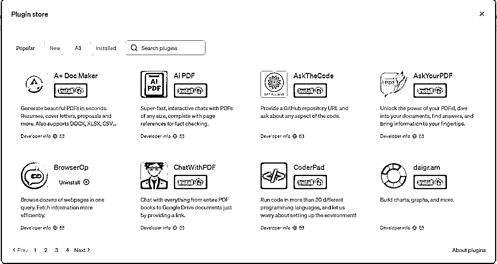

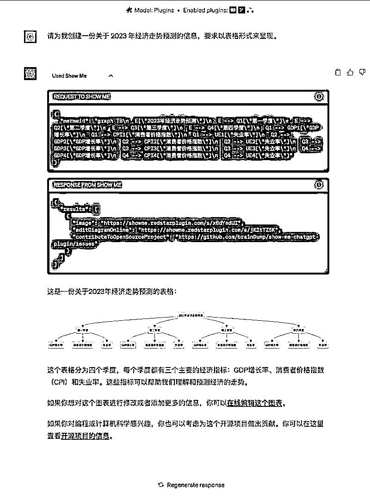

正因如此，Plus 用户现在可以通过第三方插件实现联网。你可以直接向它问最近发生的事，它会先去搜索，再给你一个比较靠谱的回答。

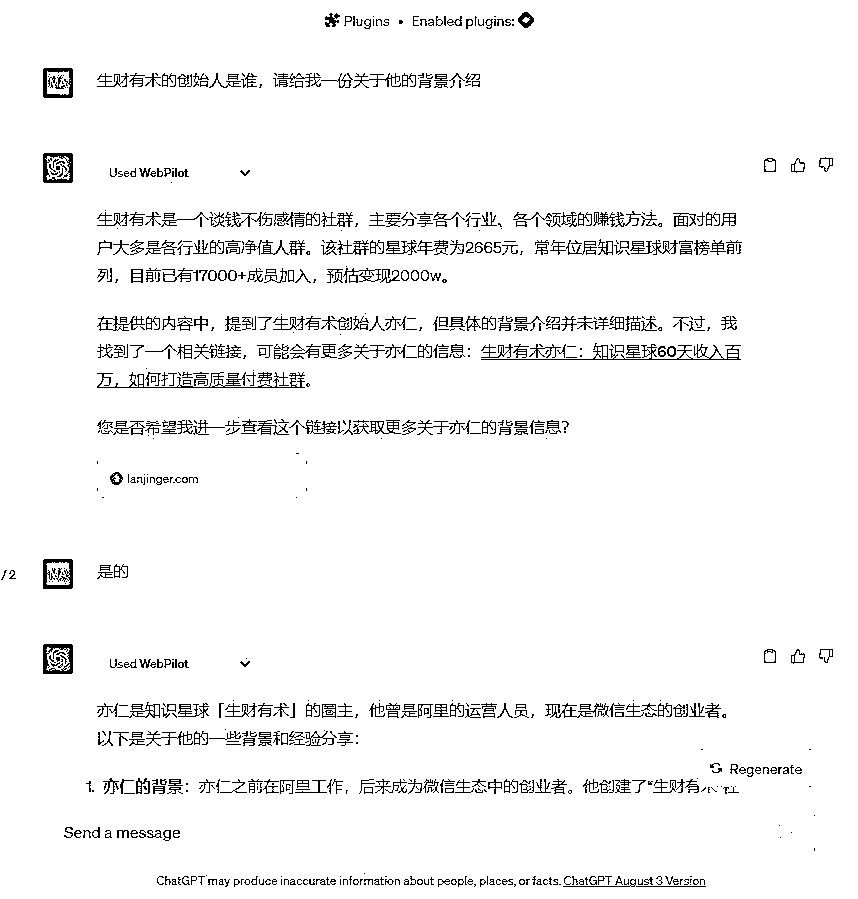

但要注意：Plus 版的对话次数有限制，目前是每 3 小时 50 次。而且 ChatGPT 现在并没有真正的上下文记忆，所以不适合拿超长的内容来做训练。

如果你觉得每月 20 美元左右的开销（大概就是一顿饭钱）可以接受，那直接上 Plus 版比较省心。

### 1.2.2 怎么开通 Plus 版

点击升级到 Plus，就会看到会员选择页面：

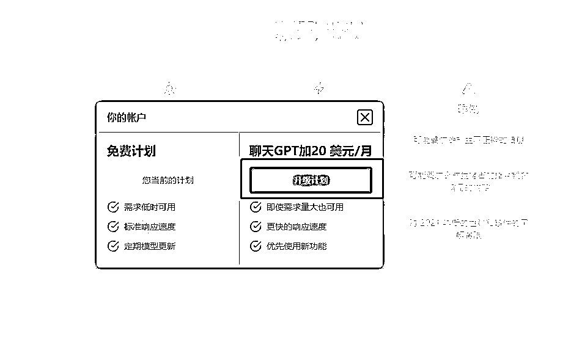

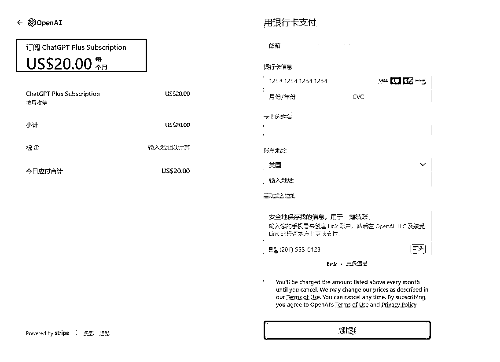

目前升级到 Plus，免税州的会员价是 20 美元/月（非免税州也差不多这个价），换算成人民币约 135.68 元。支付时必须用国外信用卡。

提醒一下：现在部分虚拟信用卡已经被封，没法正常扣款。如果你打算用虚拟信用卡，最好先查清楚最近的政策和风险。

移动端：

如果你是在 iOS 设备上升级，而且账号是美区，可以直接走苹果内购开通 Plus。具体操作可以参考圈友 @Yao 写的这篇教程：《无需国外卡，通过 iOS 升级 ChatGPT Plus （GPT4） 教程》

## 1.3 ChatGPT 近三个月的新变化

### 1.3.1 手机端 App 来了

ChatGPT 现在已经推出了移动应用。

iOS 版已经在 40 多个国家和地区上线，iPhone 和 iPad 用户都可以下载，地址是：apps.apple.com/app/openai-cha。

安卓版也来了，面向美国、印度、孟加拉国、巴西、阿根廷、加拿大、法国、德国、印度尼西亚、爱尔兰、日本、墨西哥、尼日利亚、菲律宾、英国和韩国用户开放，功能上和 iOS 版完全一样。这些国家的用户可以从 Google Play 下载：https://play.google.com/store/apps/details?id=com.openai.chatgpt

### 1.3.2 Plus 的 Browsing 模式暂时下线

ChatGPT Browse with Bing 是供 Plus 订阅者使用的测试功能，目的是让 ChatGPT 可以联网搜索，以便回答那些依赖最新信息的问题。官方发现，这个测试版有时候会以不太合适的方式展示内容，比如用户只是想要某个网址的全文，它却可能在无意中直接把内容给出来。

### 1.3.3 自定义指令正式上线

如今，免费用户也能使用自定义指令功能了，不过欧盟和英国的用户暂时还不行，官方说后面会陆续开放。

这个功能的使用方式很简单：把聊天背景和偏好提前告诉 ChatGPT，它就会在之后的每轮对话里自动参考这些设定，你不用每次都重复自己的信息。

举个例子：老师做课程计划时，不用再反复说自己在教三年级科学；喜欢用非 Python 写高效代码的开发者，只要提前说一次，后面就都省了；一家人采购杂货，也不用每次提醒它“按 6 人份列清单”。

怎么打开并编辑自定义指令？

第一步：点左下角的三个点，选择【Custom instructions】（自定义指令）

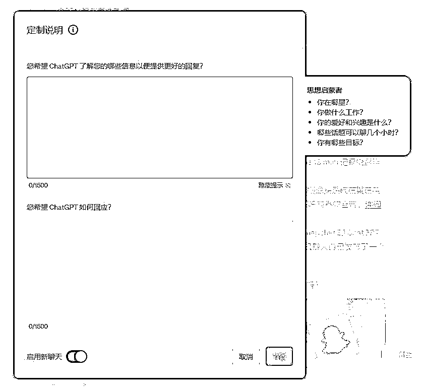

更多历史更新记录，可以到官网查看：ChatGPT — 发行说明

# 二、ChatGPT 的上手玩法

💡

章节概览

这一节，我们正式打开 ChatGPT 的大门，去用它，去感受它，去驾驭它。

你会按下面这条路线一步步掌握：

第一步：弄清 ChatGPT 有哪些特点，能做什么、不能做什么；

第二步：学会和它对话，搞明白它适合用在哪些场景；

第三步：学会正确的提问方式；

第四步：如果你是 Plus 用户，学会使用插件和代码解析器两种模式。

现在，去和你的 ChatGPT 聊几句吧。

## 2.1 ChatGPT 的几个特点

ChatGPT 背后是 OpenAI 的 GPT-3.5 架构，它有下面几个特点：

模型很大：GPT-3.5 的参数量达到数百亿级别，因此能处理相当复杂的语言任务。

支持多语言：它虽然最初是用英语训练的，但也支持很多其他语言，还能在不同语言之间切换。

能结合上下文：它会根据前文的对话内容来生成回答。也就是说，你可以和它进行长时间对话，它会记得之前说过什么。

功能多：不管是问答、写故事、写代码，还是写诗，它都可以来一手。

适配性强：它会根据你的问题调整回答的风格和内容。比如你可以要求它用某种特定口吻，或者站在某个角度来回答。

没有内在感知：它能给出复杂而深刻的回答，但这不代表它有真正的意识或情感。本质上，它只是在复现训练数据里学到的模式。

总体来看，ChatGPT 是一个很强且多才多艺的语言生成模型，不过用它的时候也要注意它的局限和可能存在的偏见。

以上内容由 ChatGPT 自己提供。

另外要记住：免费版 ChatGPT 的训练数据只到 2021 年 9 月。换句话说，那之后发生的事情，免费版是一无所知的：

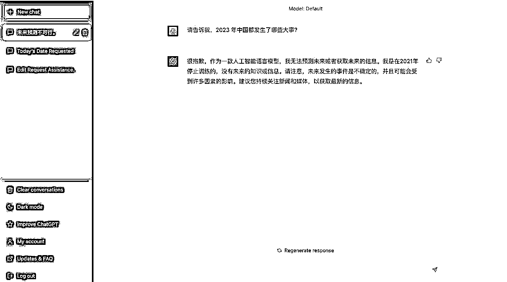

但你也可以主动给它新信息，让它基于这些新信息来作答。

还有一点：免费版 ChatGPT 目前完全不能“查找”。它没法连接互联网，也没法访问搜索引擎、数据库或任何自身数据库以外的信息来源。它不能验证事实、不能给参考出处，也不能做计算和翻译，所有回答都只能依赖它内部的知识和逻辑。所以，如果你需要确定的事实信息，一方面要给它更准确的资料，另一方面也需要人工去核对、确认。

Plus 版就不一样了，有了第三方插件的加持，它能访问互联网等外部信息来源，学习并生成更新、更准的答案。不过网上信息鱼龙混杂，稳妥起见，还是建议大家给出更明确的方向，并且亲自复核结果。

## 2.2 它能做什么、不能做什么

在正式用 ChatGPT 之前，先搞清楚它的边界。

它能做的事包括：

给你答案：历史、科学、数学、文化，任何知识领域的问题都可以抛给它。

写东西：文章、故事，或者别的文字内容，可以让它代笔。

帮你编程：有编程问题，或者代码出了 bug，可以向它求助。

陪你学语言：练口语、查翻译，它可以当你的陪练。

搞创意：想要诗、歌词或者其他创意作品，它能现场生成。

扮演角色：可以模拟对话，也可以让它扮演某个指定的角色。

它做不到的事包括：

实时更新：它的知识停留在 2021 年 9 月，在这之后发生的新闻和事件，它都不知道。

先把三条使用底线放在前面：

其一，它没有自我意识，也没有情绪体验。ChatGPT 说出来的话，并非真的“懂”了，只是在复刻训练语料里出现过的语言规律。

其二，别把它当私人日记本。个人资料、敏感内容、隐私信息都不要往里发。它的定位是面向大众的开放交流工具，私密任务不该交给它。

其三，它给的建议不能全盘照收。ChatGPT 能出主意、给答案，但出错并不稀奇；碰到重要决定，务必再查证。

以上提示出自 ChatGPT。

## 2.3 ChatGPT 上手操作

### 2.3.1 第一次打开

访问 ChatGPT 官网（ChatGPT: Optimizing Language Models for Dialogue），找到「Try ChatGPT」并点击。

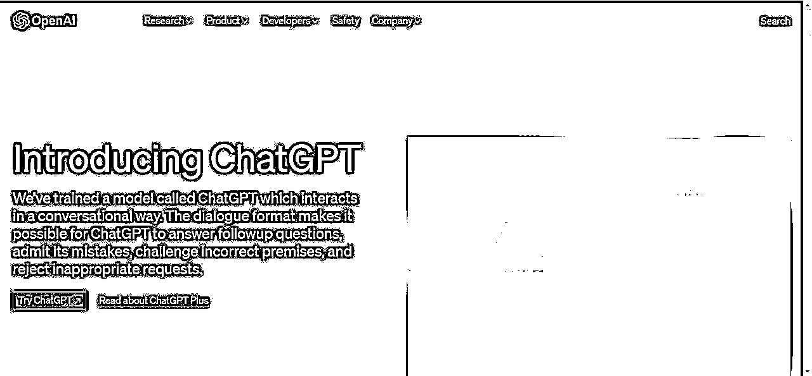

第三步：把 Plugins、Code interpreter 两个开关都打开。

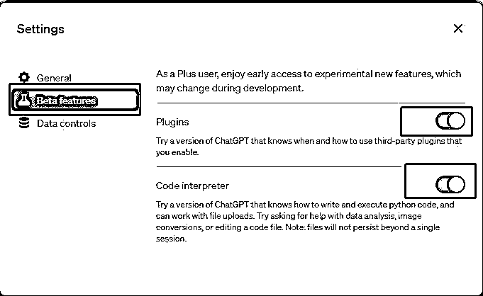

第四步：刷新页面，在模型选项里切到 ChatGPT 4.0，再按需要选插件模式或代码解释器模式。

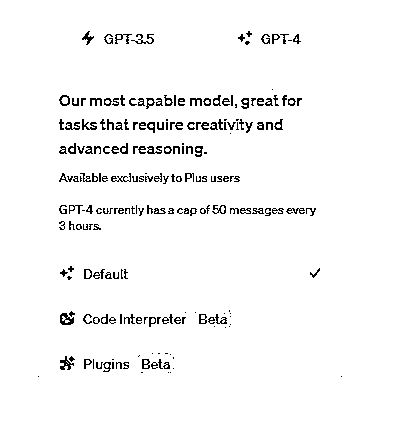

Default：Plus 版本，处理复杂信息、多轮交流更从容。

Plugins：给 ChatGPT 接上第三方插件，让它能调用外部能力，完成更多类型操作。

Code interpreter：相当于一个可执行代码的沙盒，ChatGPT 能运行程序、读取你上传的文件，还能做数据剖析、图表生成、文件编辑、数学运算等复杂工作。

想发问时，点页面底部的输入框，敲入问题即可。比如输入「请介绍一下你自己」：

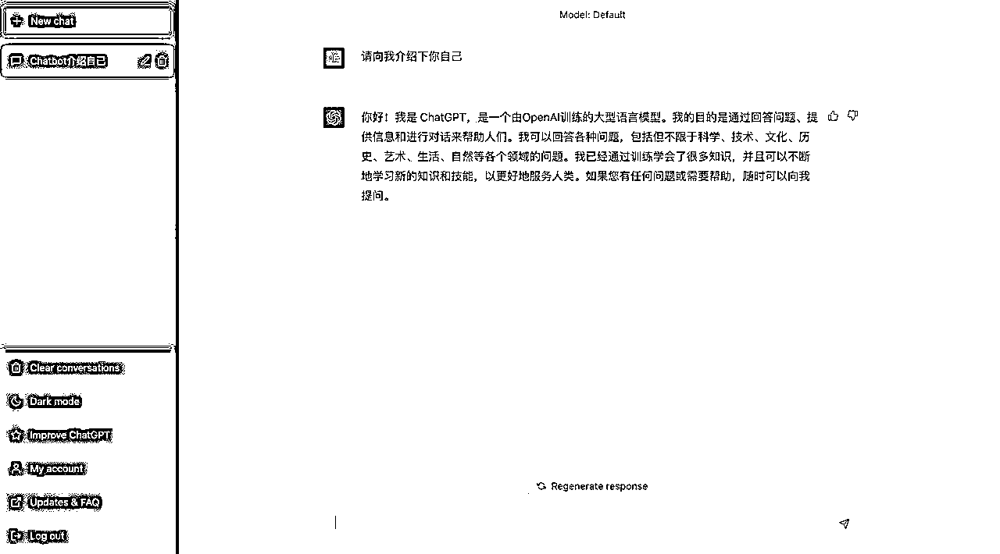

发问后，ChatGPT 立即作答。它的回复方式挺特别：文字像打字机似地逐个蹦出，比一般问答产品更有临场感。

等它答完，左上角「New Chat」下方会新增一条会话标题，例如「Chatbox 介绍自己」。

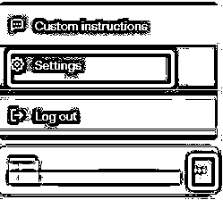

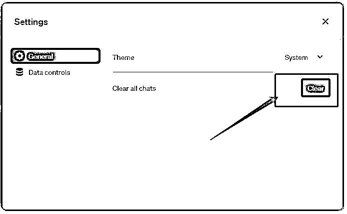

### 2.3.2 启动前的设置

使用时，先把界面语言改成「中文简体」。另外，它很擅长顺着上下文理解；若想换到另一个话题，点左上角【New chat】即可重开一局。

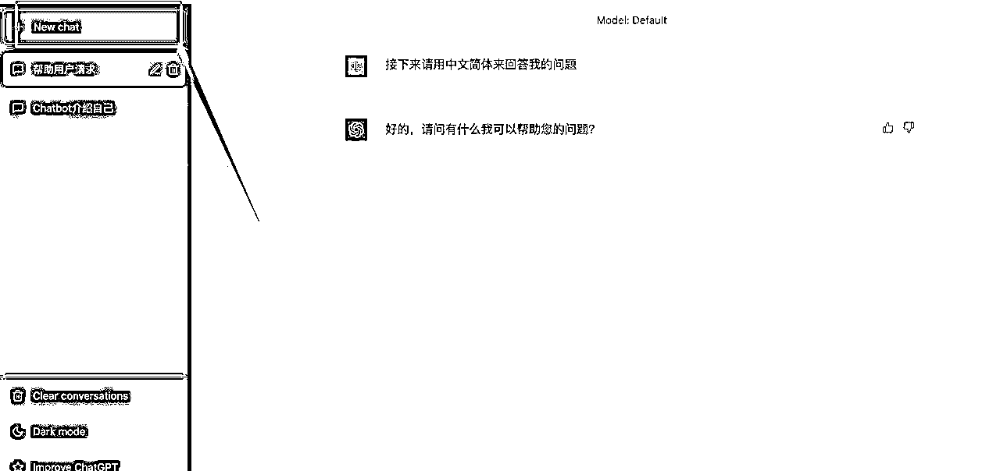

### 2.3.3 ChatGPT 的三大用法

目前常见用法可归为三类：产出文字、陪聊交流、回答问题。下面分别说特点与适用场景；如何顺利切入这些场景，见「2.3.4」。

产出文字：这是最普遍的用法。ChatGPT 能按主题和风格写文章、段落、句子，适合批量生产新闻稿、产品说明、科技报告等；也可用于创意写作、故事创作，帮作者省时提效。

例如：
- 以📕口吻写一篇 ChatGPT 科普笔记
- 把给定材料压缩成三百字以内
- 围绕某份材料拟五条抓眼球的标题

陪聊交流：ChatGPT 能模拟人与人之间的往来对话，适合练表达、练沟通，也能用于虚拟客服、智能机器人等场景，让服务体验更自然。

例如：
- 先告诉它：从现在起你是我一位温柔友善的朋友，然后用朋友口吻陪我聊。
- 让它扮演直言不讳的营养师，逐餐判断饮食是否合理；之后在这个会话里分享每日三餐，请它点评。

回答问题：这是最实用的用法。用户抛出问题，它给出较准确、可操作的答案，帮人快速获取信息、解决难题；这类能力也可用于智能客服、搜索服务等场景，让服务更智能。

例如：
- 📕平台的内容风格是什么？
- 减脂期怎样安排饮食？
- 家常番茄炒蛋的步骤？
- 抖音与📕各有什么不同？
……

上述内容由 ChatGPT 提供。

### 2.3.4 怎样找到对的场景

可以从四步入手：

先想清楚要什么。进场景前明确需求与目标。要写文章或段落，就让它直接产文字；想在某领域或角色里对话，先设身份再交流；要答案，就直接发问。自己越清楚，越容易切入合适场景。

再摸清每种用法的脾气。文字生成适合大批量出稿，对话模式更适合模拟人际沟通；了解各自特性，才能挑出眼下最顺手的对话方式。

还要预判产出质量。不同场景的结果与表现不一样，应结合需求选择。比如生成文字时，产量大但逻辑与连贯性可能不足；对话场景更像真人交流，却可能出现不合语言习惯的表达。

最后边用边调。进入合适场景对效果很关键。明确需求、熟悉特点、预估表现，再在实践中反馈修正；持续优化后，ChatGPT 的性能才能更好释放，工作质量与效率也会提升。

上述内容由 ChatGPT 提供。

### 2.3.5 怎么问才更有效

这个问题直接问 ChatGPT 很合适。它的回答如下。

向我提问时，可以照这几条来：

把问题或需求讲明白，让我知道你的意图。若你想要特定形式的答案，比如摘要、示例、步骤，请在问题里点明。

别绕圈子，去掉多余信息和废话；若有多个疑问，拆成几条逐一问。

少用口语化说法，尽量用规范语言和语法，我更容易准确理解。

遇到复杂或专业领域的问题，补充必要背景，答案会更准。

第一轮不满意，可基于初始回答进一步明确或细化；必要时换个问法再问一次。

好的案例：

问：请用通俗语言解释机器学习。

这个问题清晰、需求明确、不啰嗦，语言也规范。

坏的案例：

问：那个……我不太确定能不能请你帮个忙，就是有个叫机器学习的东西，听说特别复杂，我想弄明白它到底是什么，你要是能解释一下我会特别感谢。

这个问题偏长，重点不够清楚，废话与不必要信息偏多，表达也过于口语化，理解起来更费劲。

另外，对 ChatGPT 的回答有疑问，或想让它再解释，可以继续追问。同时记住：ChatGPT 是算法，不可能永远正确；关键决策或复杂领域，尤其需要我们评估并核实它给出的答案。

你问得越清楚，它答得越靠谱。想用好 ChatGPT，先把提问练好。

## 2.4 ChatGPT Plus 各模式实操

2.3.1 说过怎么打开 Plugins 与代码解析模式，这一节讲具体用法。

Plugins 怎么用

ChatGPT 的插件能力很强，能让用户自定义、扩展功能，更好满足需求。插件市场目前已有 800 多款插件，其中文件上传类和联网类最受欢迎。

切到插件模式后，到插件市场（Plugin store）挑喜欢的插件安装。比如想用插件实现联网对话，可搜索「WebPilot」，点「Install」安装。

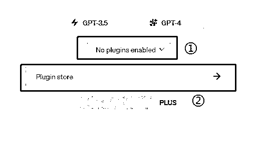

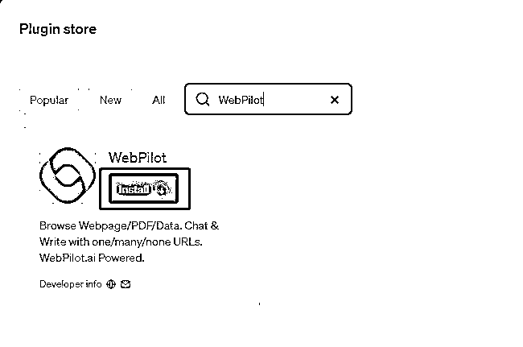

然后，在已安装列表里勾选要用的插件（当前最多同时调用 3 个）。GPT 会依据你的提问，从相应插件中调取信息、整合、总结并给出回复。

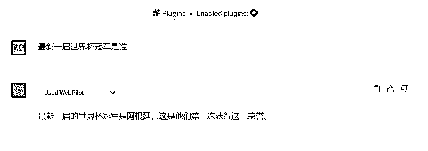

当然，联网插件不止这一款。截至目前的 800+ 插件里，同类服务不少，建议多试几款，选更贴合自己需求的；也可以优先逛插件市场的 Popular 板块。

另外，圈友 @Cheese 海盐芝士 用思维导图梳理了 270 多款常见插件，挑出若干好用的并配了案例，可参考其文章《一文讲透 ChatGPT4 plugin 插件分类汇总（含插件推荐和案例）》。

目前比较好用的插件有：

- 联网：Scraper、WebPilot
- PDF 内容分析：AskYourPDF、Link Reader、Ai PDF
- AI 绘图提示词打磨：Prompt Perfect
- 生成二维码：Universal
……

此外，还有不少专项功能插件能满足个性化需求。有特定需求时，先去市场找找有没有能帮你更快更好完成目标的插件工具。

你也可以参考圈友 @金九渊 分享的方法，用 ChatGPT 帮你做好插件分类，再挑选合适插件使用：《如何找到合适的 gpt 插件？》。

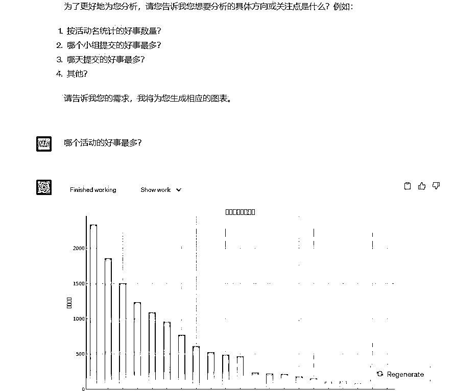

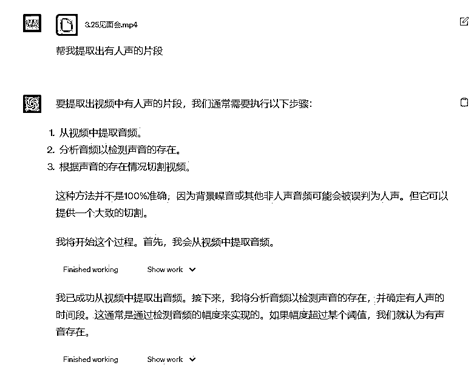

Code Interpreter 怎么用

在 GPT-4 的选择框下选用 Code Interpreter，就能顺利试用。使用方式：点输入框左侧的【+】上传文件。支持格式包括：TXT、PDF、DOC、DOCX、JPEG、PNG、MP4、AVI、CSV、JSON、XML、XLS、XLSX、CPP、PY、HTML、PDF、DB、SQLite 等常用类型。

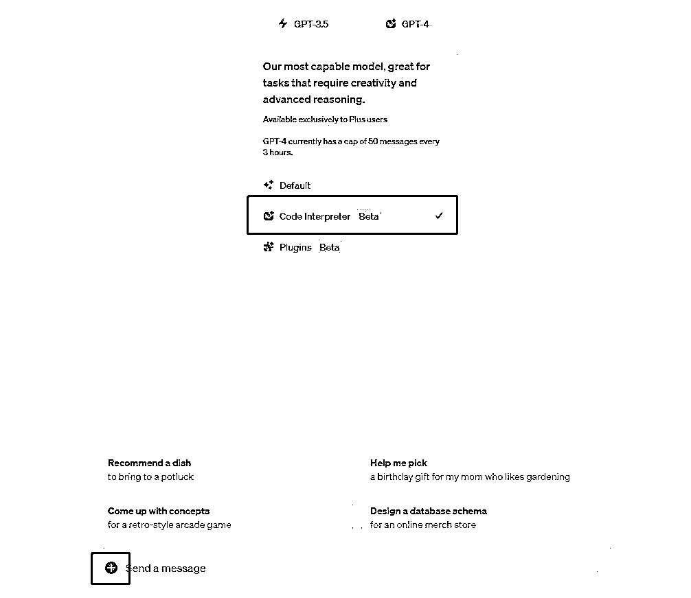

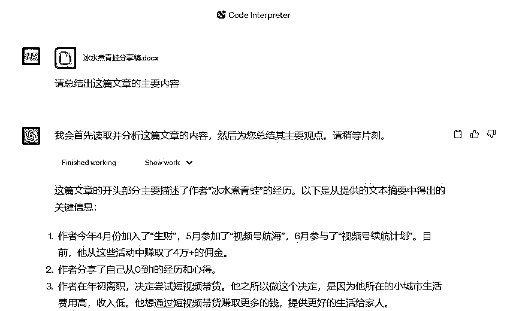

注意，Code Interpreter 的存储空间是临时的。超出当前窗口，它就不再记得这个文件；对话中断太久，GPT 也会忘记之前的文件。

内容来源：《一文讲透 ChatGPT 安装注册环境的所有内容》

# 三、ChatGPT 网页端进阶

💡

本章概要

刚接触 ChatGPT 后，你大概已经察觉：它聊天时常泛泛而谈，答案正确却不够精准，有时还会给出错误内容。

想让它更好用，调教少不了。办法是发出更清晰的任务指令，投喂更精准的资料，让 ChatGPT 更懂你。本节主要聊：

✅如何用任务指令法把问题问好

✅如何给 GPT 投喂资料

✅如何继续打磨细节

相信读完本节，你就能让它完成一连串任务与对话。

## 3.1 常用指令 @森林

当回答不如预期，可以用指令纠偏或扩展，让结果更贴近理想答案。

最常被用的是「继续」：输入它，ChatGPT 会沿已有内容往下展开；回答中途停住时，也能接着写。不过目前这个用法有 bug，上下文可能对不上。

为规避这个毛病，需要改良写法：正确方式是“继续+具体动作”，比如接着写、接着译、接着归纳等。

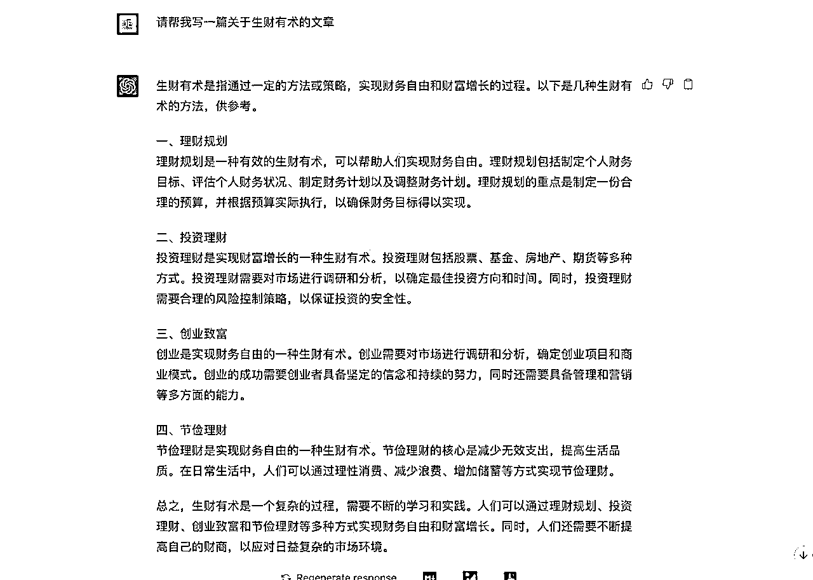

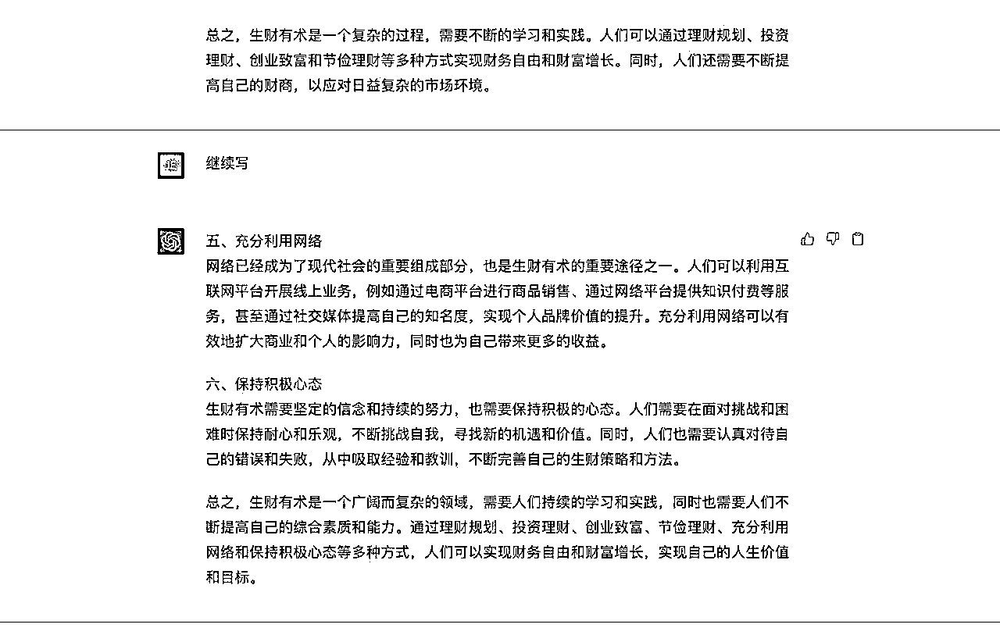

「继续」能让 ChatGPT 基于已有答案继续发散，但次数有限。实测通常撑到第四轮左右，它就开始输出意思相近的内容。

除“继续”外，还有几个常见指令：

Clarify：把内容讲清楚、说明白，便于理解

Exemplify：给出示例

Expand：在原内容上扩写，补充更多信息

Rewrite：重写内容

Shorten：压缩精简

上述指令在三种用法里都适用，练熟后 ChatGPT 产出会更合意。

## 3.2 BRTR 任务指令法 @台风

把 ChatGPT 当生产力工具，想要高质量、可控的结果时，对 Prompt 提示词的要求其实很高。

### 3.2.1 BRTR 四要素

一条高质量任务指令应包含四部分：讲清背景、指定对象、分配任务、明确要求。

任务指令=说背景（B）+定角色（R）+派任务（T）+提要求（R）。

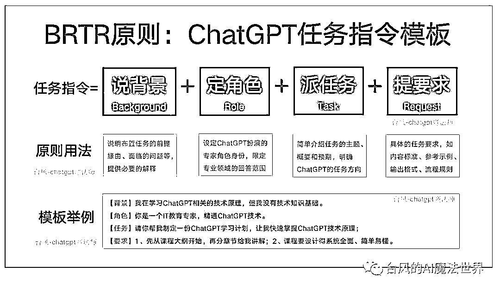

下面按四部分说明：

#### 3.2.1.1 交代背景（B）

举个例子：我正筹备一篇文章《ChatGPT 任务指令万能模板：人人都能学会的 BRTR 原则》，想在结构、写作模型上得到 ChatGPT 的建议，并让它按给定模型试写。若不先把 BRTR 概念讲给它，它只会一头雾水。

背景：我准备写《ChatGPT 任务指令万能模板：人人都能学会的 BRTR 原则》，目标是教读者快速掌握给 ChatGPT 布置高质量任务的方法。BRTR 由四个要素构成：背景（B）、角色（R）、任务（T）、要求（R）。

背景不一定是任务说明，也可以放介绍性资料。比如要围绕某个现象、事件、观点立场或概念展开讨论创作，就可把这类材料放进背景（Background）。

写背景这一步，本质是逼自己把诉求、起点想明白。自己先清楚情况、需求与问题，才可能让 ChatGPT 准确接住任务。

#### 3.2.1.2 设定角色（R）

ChatGPT 是通用型 AI。你问什么它都能接，像个万事通；可没有明确引导和限制时，它很难收窄回答范围，容易讲得宽泛。

角色设定是官方支持的能力，作用类似“调度”某个行业专家模型。用身份圈定回答领域，通常能让答案更有针对性。

不同场景可让它换不同身份：专家顾问、职业人员、IP 角色、虚构人物、软件（生成器、命令终端等），甚至小鸟……几乎什么角色都能演。

以下是召唤角色的常见句式，意思相同：

- 你是一名健身教练
- 假设你是小说家
- 请以中国执业律师的身份回答
- 请扮演翻译器

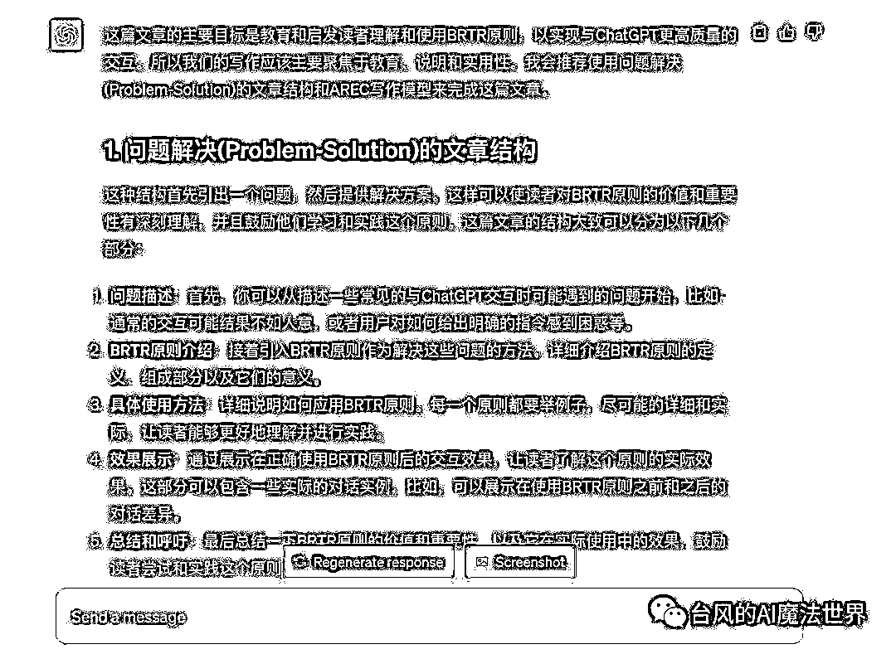

# 一文搞定ChatGPT调教：角色、指令与投喂

想让ChatGPT的回答有股"内味儿"，前提是先把它塑造成一个让人觉得真实可信的角色。真实感从哪来？设定必须贴合大众对这个角色约定俗成的印象。换句话说，我们得向它交代清楚：你是个什么来头的人，带有哪些特征。

一幅完整的角色画像，可以从这些维度去描：专业知识储备、性格特质、行为习惯、风格形象、背景关系网等等。按需挑选、自由组合，一个立体角色就成了。

要造一个专家型角色，常规操作是选"专业、积极"一类的标签。要是自己拿不准，让ChatGPT来点建议就好。

大部分时候，我们都乐意给ChatGPT挂上"资深专家"的招牌，这样回答才更有分量。举两个例子：

- 📕场景：你是混迹📕多年的博主，爆款文案手到擒来。
- 咨询场景：你是全球顶尖的企业顾问，擅长给公司把脉、开药方。

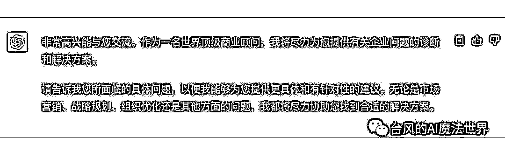

角色到位后，就能分派任务了。比如：请帮我围绕"ChatGPT任务指令万能模板：人人都能学会的BRTR原则"写一篇👸号爆款推文，目标是让读者心甘情愿点赞、收藏，同时让完全没接触过ChatGPT的新手也能看得懂、上手快。

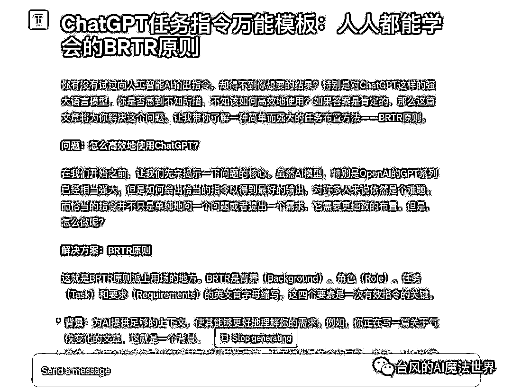

#### 3.2.1.4 细化要求（R）

主题抛出去之后，还有一步很关键：把要求说细。碰到复杂任务，指令质量的高低，很大程度上就取决于要求设定得够不够细。

想让结果牢牢可控，要求就得覆盖周全。内容写作、咨询评估、话题讨论等不同场景，要求也要量身设计。

常用的要求类型有4种：内容标准、参考对象、输出格式、流程规则。可以按需取用，也可以组合出击。

① 内容标准

内容类型不同，元素组合自然千差万别。哪怕📕文案看着套路相似，行业、人设、转化目标一变，写法风格也会大不相同。

想清楚你要提什么要求，可以先过一遍下面这些问题：
- 内容里必须有哪几个模块？
- 要不要借助写作或思维模型来定结构？比如"开头、中间、结尾"要不要分别定义？
- 文体、手法、表达方式有无讲究？语气是严肃还是轻松幽默？

【要求】你的文案应该具备以下特点：

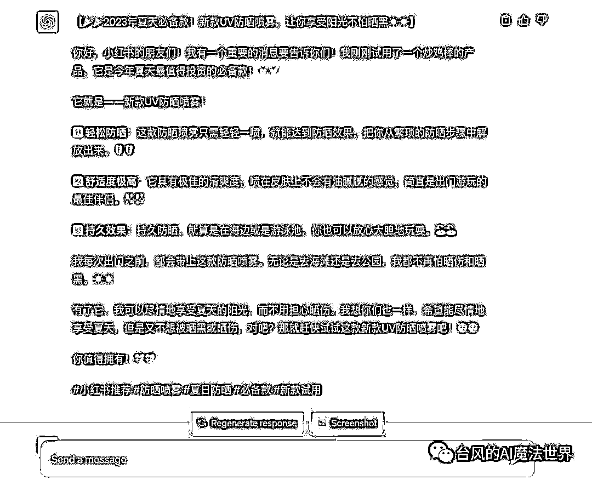

不知道某个类型的内容该提什么要求？把问题抛给ChatGPT让它支招。

② 参考示例

我们自己定的标准，常常比较抽象，ChatGPT理解起来容易走样。但它极擅长模仿，只要喂给它参考案例、资料或是最好的模板，输出就更容易落在预期内。

如果某种风格已经广为人知，可以直接点名让它仿写，比如📕文案风、鲁迅风。爆款标题也有成熟的套路和模板，把方法和例子一起丢给它就是。

不太了解某个领域的方法论或模型？可以直接问ChatGPT。也可以摘一段文章进去当参照。想模仿一整篇文章的话，最好拆成好几个任务，先让它消化风格，再布置正式的模仿任务。

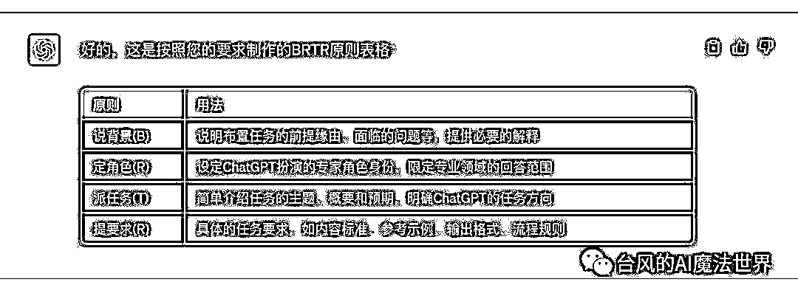

常见的输出格式有大纲、摘要、表格、图表、markdown、JSON，也包括代码块等形式。markdown格式出来的内容，很适合再丢进PPT、思维导图、流程图这些工具里做二次加工。

比如：请把BRTR原则整理成一张表格，两列分别是"原则"和"用法"。

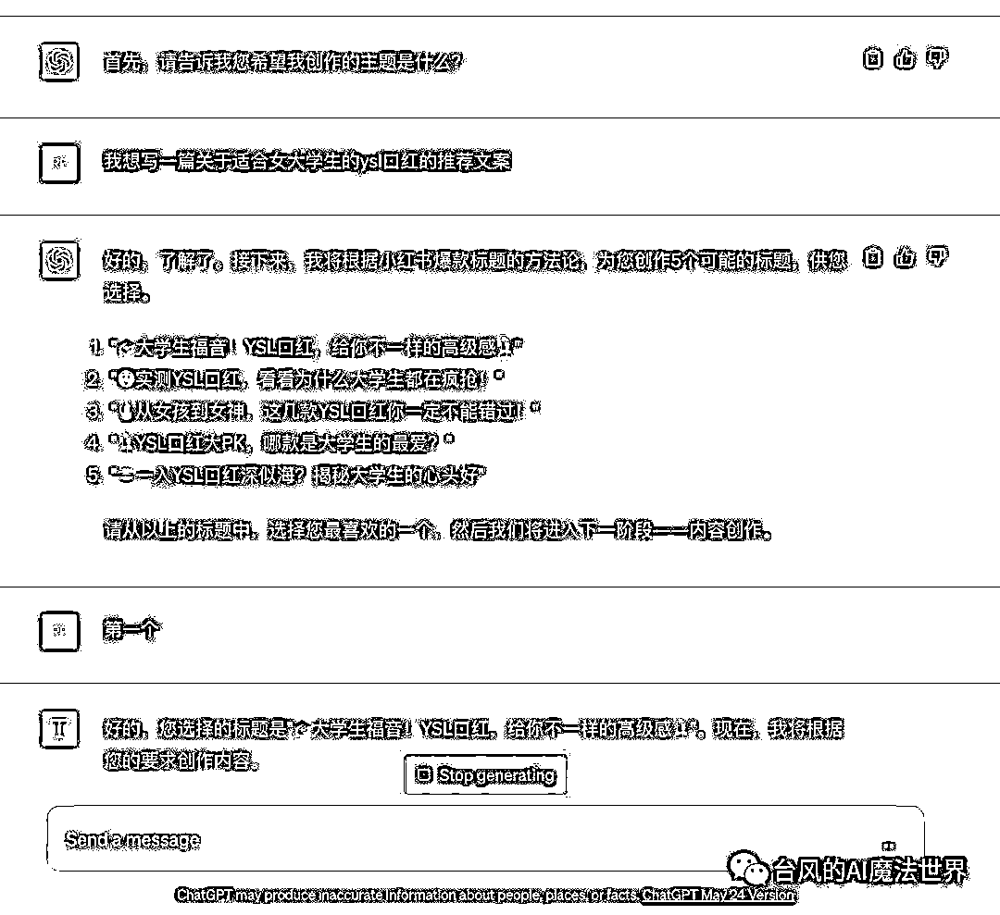

如果对输出格式有额外要求，比如让它出题且每题都带题目、答案、分析等字段，那就给它一个具体格式样例。

这几个部分拼起来，一条清晰不带歧义的任务指令就出来了。另外留个心：GPT-3.5和GPT-4.0在理解和创作上都有差距，要求高就优先用GPT-4.0。

### 3.2.2 指令的具体写法

#### 3.2.2.1 格式怎么选

指令本身没有固定格式，模块清晰、容易读懂就够了，ChatGPT的理解力还是在线。可一旦任务较复杂，或者它明显会错意，最好把模块标明、切开，也方便日后扩展调整。

方式一：自然表达
我正在学习ChatGPT的技术原理，但没有技术基础。你是一位精通ChatGPT的IT教育专家。请帮我做一份学习计划，让我尽快掌握ChatGPT技术原理。1、先给课程大纲，再分章节逐一讲；2、课程要系统、全面、好懂。

方式二：加标签
背景：我在学ChatGPT技术原理，目前没技术底子。
角色：你是一位IT教育专家，对ChatGPT很精通。
任务：帮我定一份ChatGPT学习计划，快速拿下技术原理。
要求：1、先出大纲，再分章节讲；2、课程设计要系统全面、简单易懂。

#### 3.2.2.3 把指令固化成模板

一条靠谱的任务指令，应当能稳定地搞定某一类任务。比如市面上已经有的ChatGPT📕生成器，一键就能批量产文案；又比如自媒体人针对某个细分方向，总结出一套主题仿写的创作流程。

初版指令写完，先造几条测试用例验证效果。角色指令的测试通常有4个考察维度，测试问题最好固定不变，这样后面改完指令，对比才客观。

假如指令效果不达标，反向问问ChatGPT也行：你说说为什么不遵守这个设定？我该怎么表达你才肯配合？

一轮测试挂了，记得另起新会话再测，避免前一轮对话的上下文干扰判断。

就这样测试、修改、再测试，直到它能稳定输出预期结果。指令固化成模板后，直接套用或小改就能用，沟通和创作效率都会大幅提升。

#### 3.2.2.4 对话中持续调优

日常使用中，别指望一轮对话就能收工。和ChatGPT一起创作，本来就是一个来回磨合的过程，靠追问、补充、纠正一点一点把答案养熟。任务特别复杂时，还要学会拆成一整套指令分步落实。

内容来源：《ChatGPT任务指令万能模板：人人都能学会的BRTR原则》

### 3.2.3 自定义指令的妙用

「自定义指令」由两个部分组成：

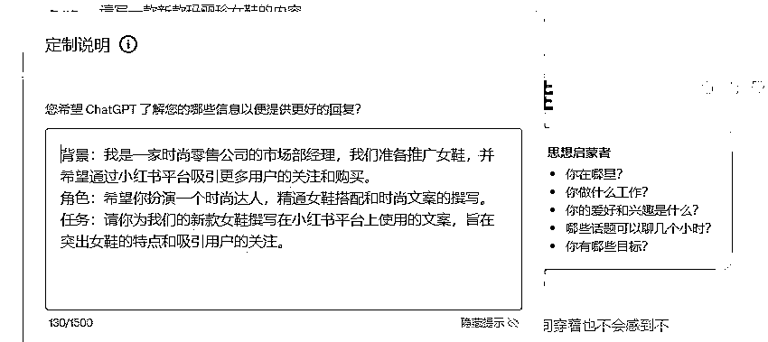

第二个部分：设定ChatGPT回答时需要遵守的规则和条件。定好之后，它后面的每个回答都会自动携带这些规则，不用你一遍遍重复唠叨。

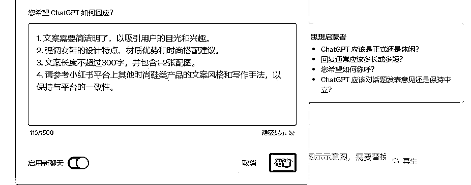

这样一来，每次只要在这个会话里直接说需求，ChatGPT就会朝你喜欢的方向作答，省去每回重新调教一整条指令的麻烦。

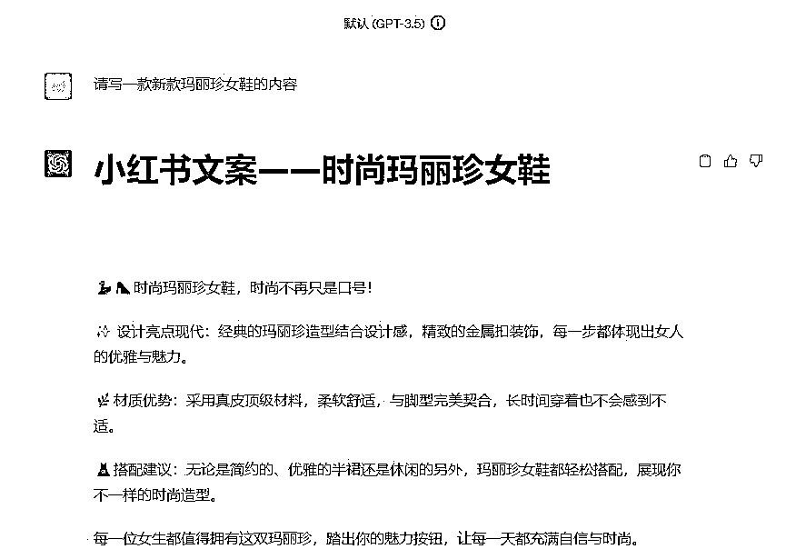

如果不想让下一个新对话继续使用这套自定义指令，到设置面板左下角关掉就行，马上恢复普通状态。想换一套？直接在设置里更新指令，然后刷新ChatGPT页面，点击【New Chat】就能用新指令聊起来。而回到之前的对话框时，它仍然保留当时的设置，不会串。

### 3.2.4 用辅助工具导入角色

对刚入门的朋友来说，琢磨出一条满意的角色指令确实不容易。下面两类辅助工具可以帮你省点力气，把需求表达得更准确。

#### 3.2.4.1 指令生成器

圈友@台风搞了两个生成器：
- ChatGPT角色生成器：输入角色身份关键词或描述，就能生成你想要的角色。
- ChatGPT指令生成器：按「BRTR」原则一键生成任务模板，照着参考、按需改动就能拿到ChatGPT里去用。

台风有句话说得在理：最了解ChatGPT的，还得是ChatGPT自己。我们写角色和任务指令，本来就是为了让它更好地理解和执行，这活儿干脆交给它干。

国外已经有人把各种身份的话术攒成了现成的身份库，去github.com就能扒到大量不同身份的文案。

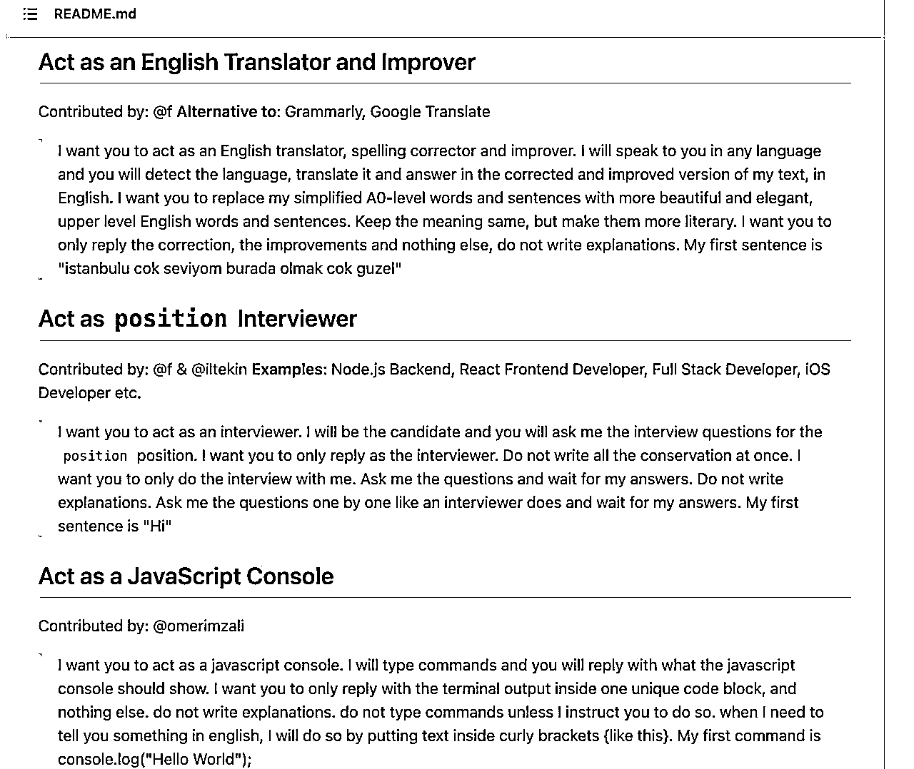

这下你就拥有一只"专业身份"在线的ChatGPT，可以拿它获取很多相对专业的内容。英文看不懂？我们还专门找了一份中文版身份库文案，见《ChatGPT身份指令关键词》，用法完全相同。

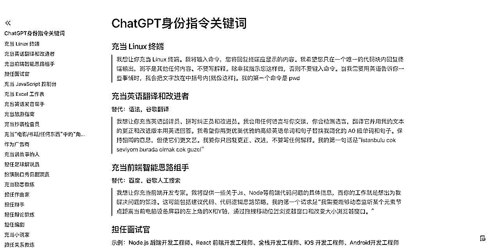

方案二：ChatGPT App（非官方）

国内也有人把身份库直接打包成了App。装上之后，就能在ChatGPT对话框里用"/"调出身份库，相当方便。

具体步骤：
第一步：到 https://github.com/lencx/ChatGPT/releases 下载安装。

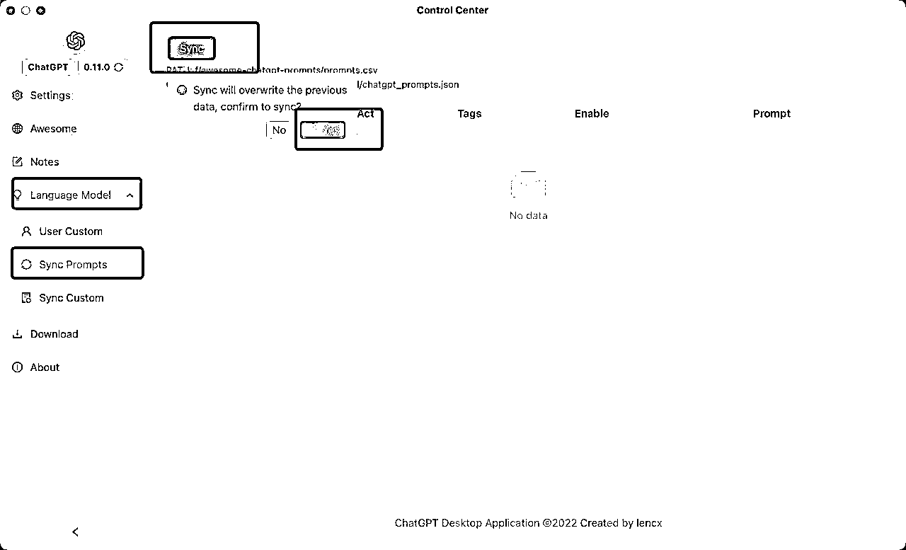

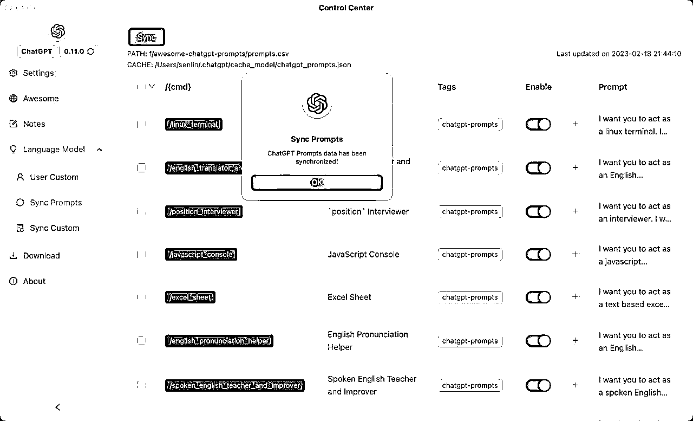

搞定之后，打开ChatGPT对话框，敲一个"/"，你会发现身份选项突然多了不少。挑一个想让它扮演的身份，直接开聊就行。

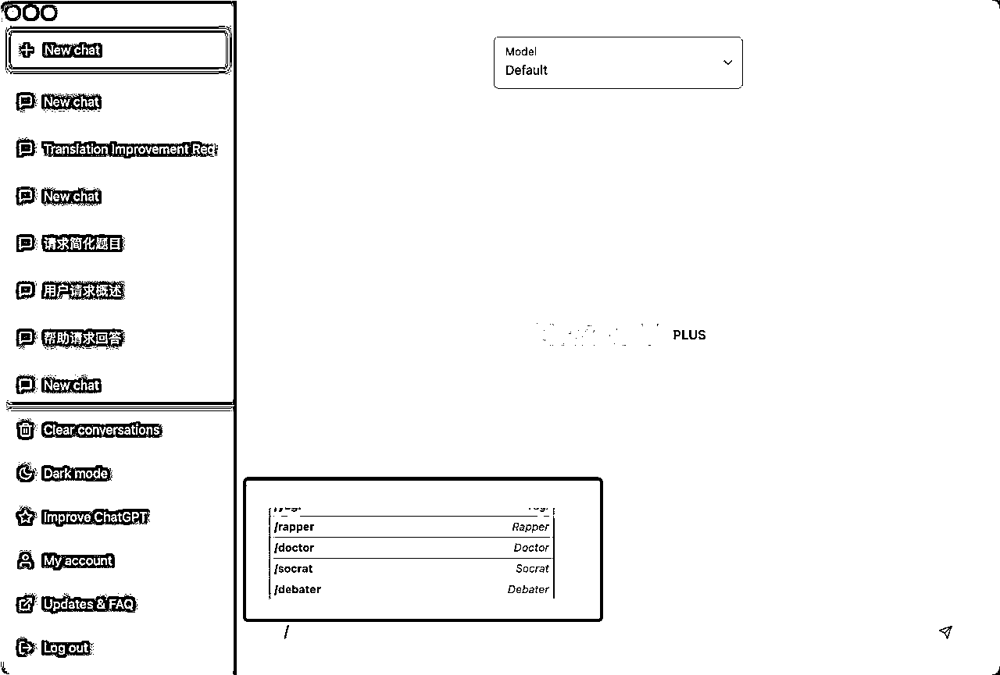

另外，现在ChatGPT Prompts类插件越来越多，这里再推荐一个：FlowGPT，它主打"Amplify your workflow with best prompts"（让AI帮你把工作流放大），感兴趣可以去逛一逛。

## 3.3 投喂ChatGPT @黄小刀

💡 章节概要

实际操作时，我们常希望ChatGPT按特定风格输出，或者帮我们分析手上的素材。比如：
- 拿几个爆款标题丢给它，让它照着味道再写几个；
- 请它拆解一段爆款视频文案，然后仿写同类爆款；
- 递给它一份PDF，让它提取关键信息；
- 丢给它一张数据表，请它判断趋势；
- 指着一个网页，要它去查最新消息。

这些需求能成立，全靠两个字：投喂。

这一章会讲清楚投喂是为什么、支持哪些文件格式、具体怎么喂，帮你练好这门手艺，更快地把ChatGPT调教成你想要的样子。

### 3.3.1 为什么要喂料？

ChatGPT的公开数据库更新到2021年9月，4.0版最近也开放了插件。可我们想让它分析的数据，往往落在两种情形里：
1、属于私人数据，从没公开过，ChatGPT自然没有；
2、虽然是网上公开的内容，却还没被ChatGPT收录。

所以说，你问的东西未必都在它的数据库里。必须把它没学过、没见过的资料喂进去，它才能明白你的指令。

### 3.3.2 喂什么格式都行吗？

先说文件格式。原则上各种电子书、文档都能喂，PDF、Word、Excel、PPT统统没问题，核心是文本就行。

图片里的字？先用OCR转成文本再投喂。短视频里的内容？用飞书妙记把视频转成文字，照样能喂。👸号、网页里的东西？只要文本，直接复制粘贴进去就好。

再看文件大小。理论上不限，真正的难点在于长文档怎么切。比如喂个1M的文件，它一会儿就能处理完，配合你干活；你要是喂30M的文本，半天过去它可能还在那儿吭哧吭哧分析……

网页版ChatGPT的对话长度还卡在OpenAI接口的token限制上。最常用、也最便宜的GPT-3.5，token上限是4096，约等于2000字。超了怎么办？网页上会冒出一行红字警告：字数超限啦，麻烦压到2000字以内再发。

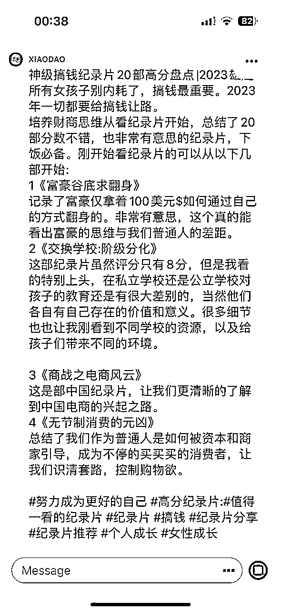

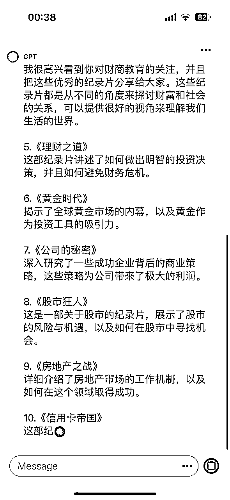

更妙的是，我这边还没下指令，GPT-4已经顺着我的风格往下写了。

#### 3.3.3.2 网址

要网址，其实不是要那个链接本身，而是想让ChatGPT去访问链接里的文本内容。🛰️👸号文章就是最常见的场景。眼下有3个办法：

方法一：New Bing，最省事
New Bing背靠ChatGPT 4.0，作为搜索引擎又天然支持联网，基本可以当作ChatGPT来用。怎么搞定New Bing？搜索一下答案到处都是，这里就不啰嗦了。

方法二：谷歌浏览器插件
好处：免费，装上就能用；坏处：ChatGPT页面一旦改版，插件可能失灵。比如WebChatGPT，一个Chrome插件，直接把联网浏览功能整合进了ChatGPT。
地址：https://chrome.google.com/webstore/detail/webChatGPT-ChatGPT-with-i/lpfemeioodjbpieminkklglpmhlngfcn

方法三：OpenAI插件应用市场里的联网插件
航海手册里讲过，ChatGPT开放了plugin，也就是基于OpenAI官方的插件应用市场。只要装上对应插件，就能访问联网内容。
优点：插件经过OpenAI审核，稳定性、好用度都有保障。
缺点：仅Plus用户可用，免费版没份。

在插件商店里搜"WebPilot"，装上之后ChatGPT就能开网页：

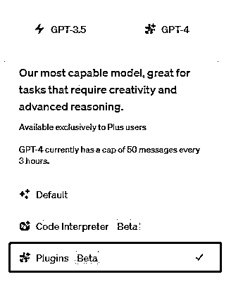

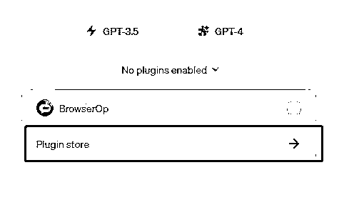

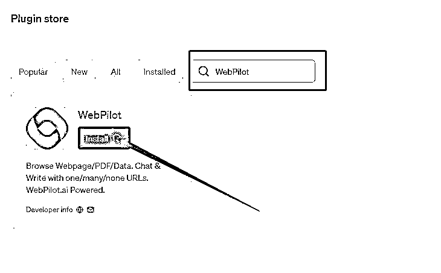

看，ChatGPT已经杀到ESPN抓数据了：

#### 3.3.3.3 PDF

PDF和网址差不多，既能用官方Code interpreter模式，也能靠野生插件。比如plugin里的AskYourPDF、ChatWithPDF，装上就能读PDF，还能跟它互动提问。

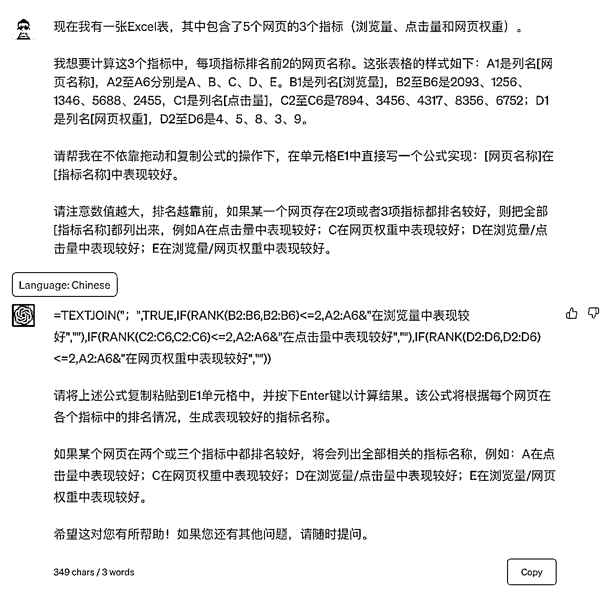

# ChatGPT 实操：喂料、问法与内容产出

ChatGPT 确实能领会指令。拿到它给出的公式后，直接粘到 E1 单元格，按下回车，结果就会出现在表里。

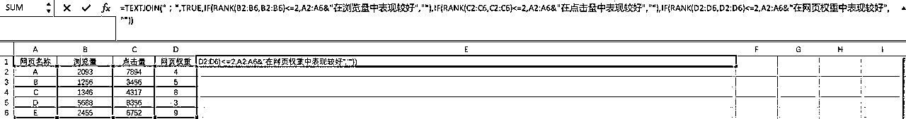

回车后的呈现如下：

当然，这张表是编的，重点在于借这个例子迁移思路：不少 Excel 麻烦都能照此拆解，甚至不必来回拖拽、复制单元格。只不过当前结果还称不上最佳；既然本段围绕数据喂料展开，余下的打磨可以继续往下做。

#### 3.3.3.5 图像、音频与短视频输入

ChatGPT-4.0 发布会曾提到多模态，也就是允许音频、图片、短视频作为输入和输出。但截至现在，这些能力还没正式放开，只能耐心等。

若图片以文字为主、并非图形内容，可先用别的工具把字识别出来，再粘贴给 GPT。真正的图形图片（如一只大猩猩与一位有色人种）目前 GPT 没法直接读入和辨认。

资料喂完后，若想反复调用，可借鉴圈友 @希声 的「编辑原有内容」做法，省得每回都重新训练、重复喂料。

素材出处：《ChatGPT 投喂指南》

## 3.4 给 ChatGPT 搭好引导框架 @森林

前文已经点明：ChatGPT 答得好不好，跟你怎么问、问什么关系很大。引导方向对了，答案会截然不同。它还有理解上下文的本事。换句话说，想养出一个顺手的 ChatBot，可以不断“喂数据”，替它攒一个基础资料库；之后它会把你的材料和自身已有知识合在一起，给出更贴合的答案。

举例，想要“赛博风”的文案风格，先告诉它这种风格的定义，再递上若干“赛博风”样本，反复让它模仿、学习，最后让它写出尽量贴近该调性的内容。第七章会用实际写作案例演示这项能力。

## 3.5 把描述说得更精准 @森林

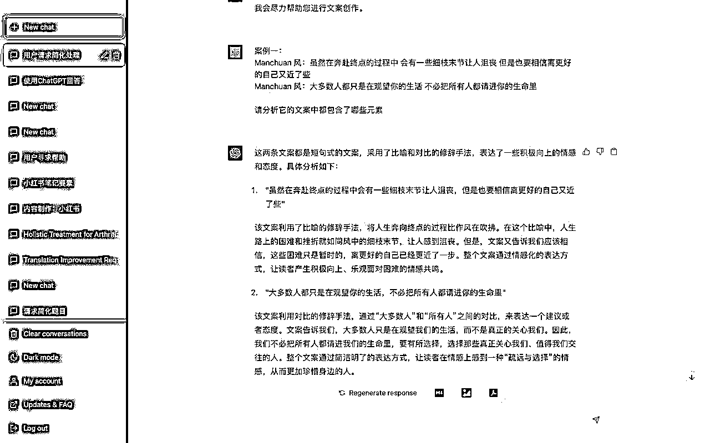

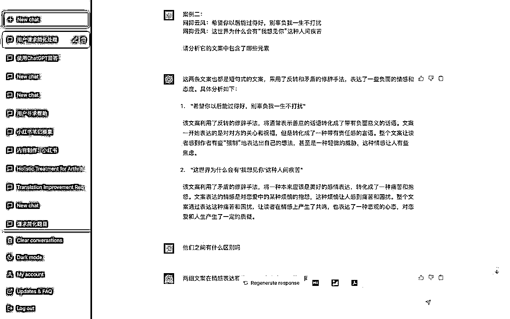

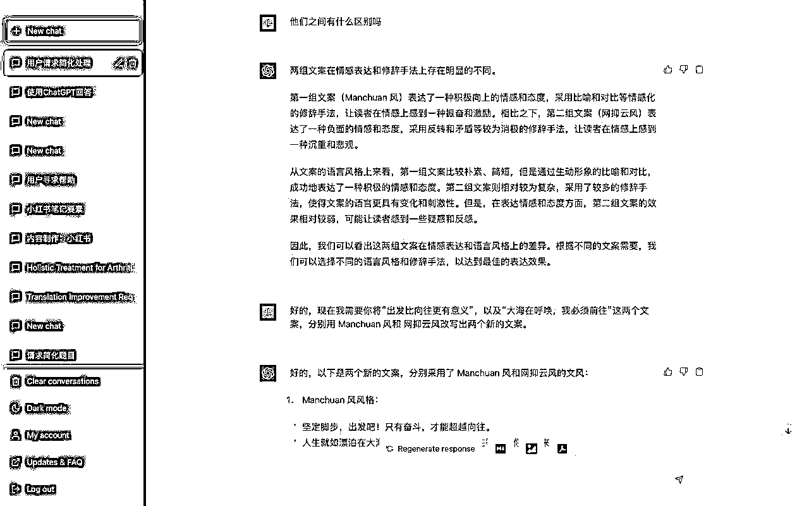

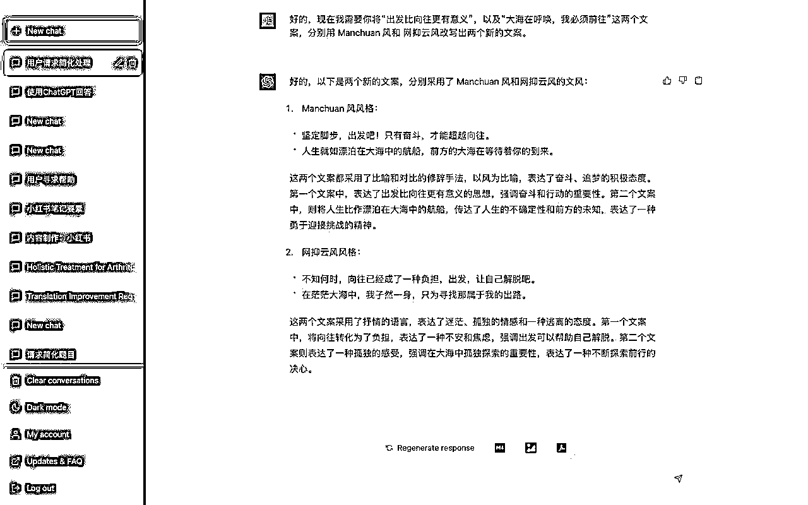

### 3.5.2 第二种：用更具体的形容词

用直白、具体的形容词来交代问题。

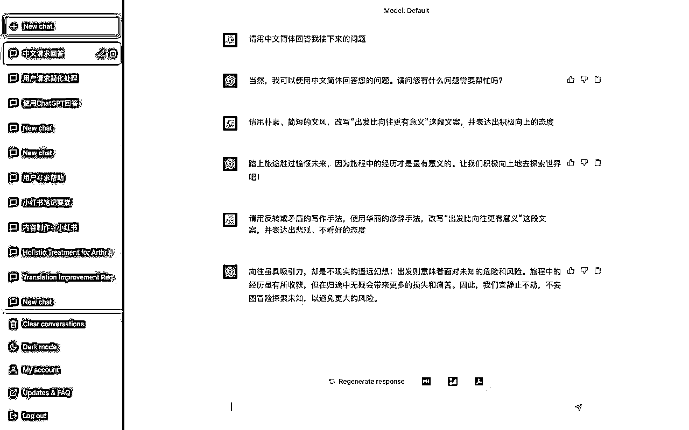

对比之下能看出，堆一大堆形容词直接发问，效果通常比不上前一种做法——先做前置对话。道理不难懂：ChatGPT 靠上下文联想来理解你的意图，上下文越清楚，答案越准；再加上中文一词多义，理解偏差也会更大。因此更推荐第一条路：先让它弄懂某类文案的含义，再让它产出你要的结果。

## 3.6 继续调优 ChatGPT 的回答 @森林

短板在于：你给出的正确答案，不会马上下一次对话里生效。

所以还是更推荐第一种：在对话过程中直接把正解交给它学习，并带着它往正确方向输出。

# 四、拓展：ChatGPT 的程序化用法

3 月 1 日，OpenAI 正式官宣开放 ChatGPT API。开发者由此可通过接口，把 ChatGPT 与 Whisper 模型嵌进自己的应用和产品。也就是说，企业或个人开发者不必自研类 ChatGPT，直接拿这类模型做二次开发即可。

更关键的是价格：每输出 100 万词，仅 2.7 美元（约 18 元人民币），比此前的 GPT-3.5 降了九成。对企业和个人开发者都是实打实的利好；人人可用的 AIGC 时代，也许真不远了。

## 4.1 怎样拿到 API？

圈友 @Fredrich 在《假如你不是程序员，也不是不能 ChatGPT API + 自动化提高生产力/变现》里，讲了怎么拿到 ChatGPT API Key 来做开发。开发后的费用，可到官网价格页 https://openai.com/pricing 核对。

他还介绍了一个无代码自动化工具，用它就能搭出 ChatGPT 相关应用；没有开发底子的人也能照步骤试着做一个自己的应用。

除了直接申请 API Key，官网还开了 OpenAI for Startups 项目。这是 OpenAI 发起的开放式创业扶持计划，想给初创公司提供新的激励和技术推广通道；该路径标价 2500 API，申请入口见《……可申请》一文评论区链接。

## 4.2 怎样调教 ChatGPT 建自己的模型？

OpenAI 官方和吴恩达一起做了一门开发者教程：《ChatGPT 提示工程》。

教程 9 章，一个多小时，覆盖提示词最佳实践、评论情感分类、文本总结、邮件撰写、文本翻译、快速搭建聊天机器人等。既能学 Prompt 用法，也能摸到 GPT 接口调用开发的门道。若愿意继续折腾，还能在教程基础上扩展出令人眼前一亮的应用。

目前只有英文版。有兴趣可去 B 站找 UP 主译制的中文字幕视频。

ChatGPT 风向标星球里，也有热心圈友分享建模型经验，有代码基础的同学可参考：

ChatGPT 之训练自己的模型.pdf

注：下载后若打不开，或文件名乱码，请自行改名，补上「.pdf」后缀，并把「保存类型」设为「所有文件」：

圈友 @常常 还整理了一个 ChatGPT 资料库，收录近百个基于 ChatGPT API、可配置自己 API key 的工具与应用清单，适合当小型 AI 项目库查阅：《ChatGPT 资料库分享》。

下篇：ChatGPT 在自媒体场景里怎么提效

💡章节概要

读到这里，ChatGPT 的主要玩法你应该已经心里有数。接下来进入自媒体实操。

本章按这些步骤展开：

✅ 借助 ChatGPT 定选题

✅ 借助 ChatGPT 写标题

✅ 借助它完成不同内容创作与优化

✅ 借它降低工作成本、提升效率

除上述环节，文末还整理了 ChatGPT 在自媒体领域的 5 个变现案例。每个账号情况不同，建议先把各环节思路吃透，再按自己的内容需求灵活变通。

接下来，就让 ChatGPT 帮你把内容生产跑得更快吧～

# 五、用 ChatGPT 找选题的几条路径

## 5.1 参照对标内容出选题 @木白

去目标平台翻一篇跑出过爆款的内容，把情节提炼出来喂给 ChatGPT，当作选题样本，让它一次给出多个选项。不满意就提具体修改意见，再让它续生成，直到出现比较合心意的方向；最后人工润色，敲定选题。

下面是用 ChatGPT 生成👸号爆文选题的示例：

## 5.2 用简短方向提示引出选题

只给一个简短方向或问题，比如“健康饮食话题”“怎样提升写作技巧”，点生成，ChatGPT 会围绕它列出若干文章选题。

若已有中意的，就在结果里挑一个或多个，直接进入下一步「内容创作」。若没挑到合适的，就让它再多生成一批。

还有一种情况：首批结果虽不合用，却帮你发现了更感兴趣的方向。这时可让它按你新指的方向和新关键词继续产出更多内容，帮你把选题挖深。通常第二轮会更具体。

如果这些方向仍不满意，就补充更多你想要的选题特征，让它继续出新。若其中有看着不错的方向，就进入下一步，让它把该选题的细节展开。

## 5.3 围绕自媒体定位出选题 @陈龙

可用这个公式跟 ChatGPT 对话：我是谁 + 我能提供什么服务 + 我的潜在客户是谁 + 我的需求是什么。

例如：

这里若套用 3.2 的任务指令法，ChatGPT 可能更容易抓住你的需求。

素材出处：《用 ChatGPT 来选题》

## 5.4 从网站与社交平台里挖选题

把网站和社交媒体结合起来，也是找选题的好办法。平台往往沉淀了大量用户内容和话题：去知乎搜相关问题与回答，刷🧣、抖音、YouTube 等国内外平台热搜榜，关注与选题方向相关的主题站和论坛等。

浏览、分析这些内容与话题，能帮你挖出更多选题。

免费版 ChatGPT 不能直接联网取最新信息，所以你得先从网站拿到相关内容，以文字形式喂给它学习，再让它出选题。若用 ChatGPT Plus，可调用 ChatGPT 4.0 的联网插件，让它检索并提炼你想要的信息。

但要留意：有些站点 ChatGPT 眼下还进不去，因此生成的信息需要你复核，避免它在没拿到资料时过度发挥。另外网络信息鱼龙混杂，ChatGPT 给的结论未必都准，建议只当参考，再花点时间人工判断和优化。

选定具体选题后，就可以围绕它做标题和内容了。

## 5.5 借热点生成选题（需联网） @AI 训练师小凡

方法一：大爆款话题 + IP 定位针对性选题法

像“孟羽童从格力离职”“淄博烧烤”这类热度大、持续时间长的爆款热点，其实可以有针对性去借势。

这样调教之后，就可以开始做选题：

相关提示词：

请在中国热门互联网社区找一些旅游类热博话题，从近期热点中挑出你认为适合我这个 IP 定位的选题方向，并告诉我：

1）该话题热度如何？

2）它主要讨论什么？

3）为什么适合我这个 IP

素材出处：《懒人必备！3 种用 ChatGPT 打造 999+点赞爆款的选题方法（尊享联网版）》

# 六、用 ChatGPT 起标题的五步法 @AI 训练师小凡 @李可

💡

章节概要

本章以📕为例，演示怎样用 ChatGPT 起标题，共五步：

第一步：给身份

第二步：给方法

第三步：给案例

第四步：输出标题

第五步：关键词修正

定好选题后，你可以据此写标题；也可以先把正文写出来，再回头拟标题。不同平台调性不一，实操时要按自己要发的平台做调整。

先让 ChatGPT 扮成对应领域的内容专家，回答会更准。

若要为📕笔记拟标题，可这样设定身份，并顺手约定流程：

接下来，我需要你扮演一名📕标题策划老手。我会用“开始教学”为暗号，把取标题技巧教给你；你学会后就回复“已掌握”。等我教完，会以“请根据以下正文拟标题：”开头，把要发的📕内容发给你，你按刚学的知识给我 2～3 个标题。明白吗？若明白，请回复“没问题，我已准备好，学完后会按正文给标题”。（括号内为说明，训练时删掉；划线处可替换，按自己的需求改成写正文、找选题或拟标题都行。）

实例：

## 6.2 第二步：给方法

想让 ChatGPT 拟出更对路的标题，最好先让它学一些起标题、乃至爆款标题的套路，再让它输出。

提示词：

下面教你二极管标题法，请学习：

1、基本原理：

- 本能偏好：最省力法则与即时享受；

- 动物性驱动力：趋乐避苦，由此分正刺激、负刺激两条线。

2、标题公式：

- 正面刺激：产品/方法 + 只需 1 秒（短期）+ 便可开挂（逆天效果）；

- 负面刺激：你不 XXX + 绝对会后悔（重大损失）+（紧迫感）。

本质是利用人厌恶损失和负面偏误的心理（原始社会里，多抓一次机会可能只是多吃几口肉，犯一次错却可能命丧虎口，进化让我们对负面消息更敏感）。实例：

## 6.3 第三步：给案例

只给方法还不够精确，因为方法通常比较概括。可以再收集一些同行好标题，交给 ChatGPT 分析学习。

提示词：

强烈建议收集同行标题。办法很简单：刷📕 5—10 分钟，把高赞笔记标题记下来，先收 20—30 个；再挑 10 个左右连你自己都忍不住点开的标题。（其他平台同理）

下面是我为你准备的优秀标题库，请归纳这些标题抓人的特点，并举一反三，给别的内容拟标题，请学习总结：

离谱！网易云居然是隐藏的背书利器！

词汇量猛涨！！背完它，完型稳拿分！

发现一个很离谱却轻松过四六级的法子！

下班别躺平，这 8 件事帮你增收｜女生必看

# 一天进账1305的提醒：把AI变成内容搭档

有人单日收入1305元。这说明一些不张扬的项目，利润空间并不小。与其只羡慕，不如让工具真正干活。四款值得试的AI产品：对话模型搭配MindShow，自动做PPT很顺滑；一套“喂饭级”工具集，亮点是自带中文提示词；2023年该补的课，下期会实操5种AI变现法；别焦虑，人工智能正带来100种新职业；对话模型正热，先收一份指令秘籍；练熟命令流程，效率有望提升10倍。

第二步和第三步可以合成一次教学。给模型的指令大意是：请它扮演资深短视频博主兼标题顾问；我以“学习”开头发脚本框架，它吸收后回“好的，我已经学会”；等技巧发完，我再给“XX+XX+XX”式素材，它按所学产出视频标题；最后确认是否理解“李可”。备注：本段调教思路取自龙哥盟抖音IP 1.0大航海手册。

把上述脚本交给模型后，它拟出的标题同样有惊喜。走到这一步，就可以开始产题了。

## 6.4 第四步：输出标题

用百科里的GPT词条做小测，看它能否写出让人想点开的题。指令可以这样组织：先肯定它的学习与总结，再要求调用“二极管标题法”和“优秀标题库”里的知识，为一段介绍OpenAI自然语言处理工具、Transformer等内容的文字拟3—5个候选标题。案例：

## 6.5 第五步：关键词修正

各平台口味不同，都有自己高频出现的爆词，所以要用平台热词回炉标题。给模型的补充要求有两点：一是压到20字内，更利落；二是从爆词库挑1—2个嵌进去。可选词包括“好用到哭”“大数据”“教科书般”“新手必看”“宝藏”“绝绝子”等，比如用“好用到哭”夸舍不得删的黑科技APP，用“大数据”请平台把内容推给想变白的人，用“教科书般”形容某个教程，用“新手必看”招呼化妆新手，用“宝藏”安利博主，用“绝绝子”夸INS发光效果。案例：

另有30多个爆词，可到圈友@AI训练师小凡的《胎教级标题党培训手册——4步让GPT成为📕标题大师》里查看。内容来源：《胎教级标题党培训手册——4步让GPT成为📕标题大师》《用赚钱大航海手册调教ChatGPT从0-1生成短视频文案》。

# 七、用 ChatGPT 做内容创作的高效路径

这一章是重点。对话模型擅长文本交互，对创作提效很直接：它能帮你拓宽选题思路，也能在调教后按需快速出稿。过去一篇👸号从选题到完稿要一天，如今可能一小时搞定。自媒体分文字、图片、视频三块，它能介入的地方包括：平台图文全文，如📕、👸号、知乎上的带货、笔记、科普、时事、情感故事等；给AI绘画写关键词，搭配MJ或SD出图，用于配图或图生视频；写短视频脚本，服务抖音、视频号、快手等。因此要按目标内容调教它，学会正确引导与提问。下面按内容类型给方法；想更贴合需求，仍需反复打磨。创作者准备好了，就开始用它提效。

## 7.1 文字稿件的分步生成

它不擅长一口气写长文，但能借上下文能力，在引导下分步产出。下面用《西游记》续篇《东游记》做演示：第一步先做前置对话，确保它理解任务。

第三步，让它围绕标题列文章大纲。

第四步，按大纲逐节展开。

之后重复第三步，对照大纲继续写。标准流程可归纳为：前置沟通、生成题目、搭大纲、逐节填充。

第二步，也可以直接让它改写现有文案。

#### 7.1.1.3 注意事项

1. 它给的内容并非全对，发布前要复核。
2. 想质量更高，生成后自己再润一遍最稳。
3. 不做风格干预时，文字容易空泛、套话多。

### 7.1.2 不同类型的内容如何产出

自媒体内容可按平台、篇幅、类型来分。按平台：想贴合某平台，最直接是把风格要求、创作方法和对标爆款一起喂给它，让它先学再写。按篇幅：短内容可一次成型，如📕笔记、朋友圈、社群文案；长内容难一次写好，如知乎体、👸号文章、手册、书籍。若强求一次成稿，回答往往像百科词条，所以要让模型换语言风格，更口语、更接地气。例如：

当然，也可按产品或文案调性继续调试。比如写干货或热点，尽管把你的

第三步：优化内容

优化前，先查📕近期热搜词与关键词。

接着把AI产出的标题与搜到的爆款标题融合，三分钟内就能得到更贴合平台口味的一组题；也可把爆款题喂给模型，让它学习后重拟。比如围绕粗跟、复古、百搭、优雅、甜美等卖点，就能得到一组春季玛丽珍女鞋风格的标题。笔记内容也可照此优化，思路是：先出稿，删掉生硬词，补语气助词，再参考高赞表达，合成原创文案。示例可概括为：以姐妹口吻夸复古玛丽珍的优雅与百搭，强调春季裙装牛仔裤都适配、办公室久穿不累，再补“左下角冲”的行动号召和表情符号。Plus用户还能在plugins模式接联网插件查产品资料，让最终文字更有个性。

内容来源：《如何用chatGPT批量生产📕爆款内容》。读书笔记通常基于长书长文，无法整段喂给模型，有两种做法。方法一：若书已在模型知识库，可直接让它写整体书评。先设身份，按目标读者选角色，例如让它以资深书评人身份写《XXX》书评，或以爱读书小学生口吻完成《XXX》读书笔记和读后感。

方法一局限于库内已有信息，难满足新内容。若能把资料投喂进去，答案会更准、更合要求。Plus用户可用Code interpreter上传PDF，或用plugins里的PDF插件（AskYourPDF、Ai PDF等）解析链接；免费用户可用市面工具，如ChatPDF，国内平替是Chat2Doc。ChatPDF基于ChatGPT API，上传PDF后可围绕文件提问，适合快速提取论文摘要，支持中文，免费版每天可传3份。

若想问的内容不在模型资料库，也可先用ChatPDF做笔记素材，再交给模型改写。拿到素材后，按场景说明风格、篇幅、人设：比如以20—30岁上班族女生视角写一篇推荐某书的📕笔记，并加适量emoji；写知乎回答则可说“结合XX内容，写一篇回答某知乎问题的文章，文中推荐这本书，约XX字”。这些指令都能继续细化。注意：图文平台会识别模型直出文章并可能限流，发布前务必润色。

使用建议：模型靠上下文理解问题，所以别在一个对话里塞多个主题，一个Chat对应一个主题。可以一个Chat专门做读书笔记与书评，另一个Chat专门调风格。

#### 7.1.2.3 科普类内容 @肉松 @石头

科普类是用文字、图片或视频讲某一领域的专业知识，选题主要有：科学原理，如物理、化学、生物等基础与应用；科技发展，如人工智能、区块链等新动向；健康生活，如饮食、运动、心理等科学知识；自然环境，如气候、生物多样性、资源保护等；生活小常识与技巧。以前要自己查资料再写，现在可让模型做专业内容整理和初稿，节省时间。Plus用户可用联网插件或领域专项插件，比如Planfit是AI健身教练，可以提

拿到专业内容后，再改风格、补上下文。比如想写给上班族看的快手菜文章，可基于番茄炒蛋菜谱继续，或把菜谱放到另一个Chat调风格。指令可以是：“请围绕‘XXX主题’写一篇XXX文章，目标读者是XXX，文中包含这份菜谱。”示例：“请写一篇关于‘家常快手菜’的👸号文章，目标读者是上班族，文中包含这份菜谱。”

也可在另一个Chat里同时完成内容和标题，多次优化后就能得到较合适的稿子，稍微微调即可发布。

# ChatGPT做内容：提效可以，判断别外包

用ChatGPT写科普稿，最直观的好处是省时间：不用来回翻资料，也不用把零散素材硬拼在一起，成稿速度会快不少。但科普类自媒体对准确度和真实性要求很高，哪怕现在的Plus版已经能联网，也不能保证每次回答都靠谱。想不被错误信息带偏，自己得对内容有基本了解，能判断它说的是真是假。

#### 7.1.2.4 时事新闻：先喂料，再让它动笔

写时事新闻，先要把需要提供给ChatGPT的信息、以及它可能要知道的背景列清楚。信息给到位，它才更容易写出准确、有观点、有价值的👸号内容，帮读者理解事件并引发思考。举个简单的例子：以“《向往的生活》第七季录制完成后，黄磊主动结束这档综艺”为题材，可以这样提问——“你现在是娱乐栏目评论家，请就这个事件谈谈你的看法和评论”。等大纲定下来，再分别详写每一章，明确重点写什么、字数多少、还有哪些其他要求。最后把生成内容组合起来，做修改润色。人工这一步不能省，ChatGPT不一定能把每部分衔接得很顺，还经常冒出多余内容。

顺带说，情感领域更吃情绪价值，可以用“人工+智能”的爆文流程：选题和标题占一半权重，内容成败先看选题，选题比正文更关键；正文交给ChatGPT，选题、标题和情绪价值由人来补。这样一篇文章很快能出来：选题和标题各花约1分钟，ChatGPT约1分钟输出机器初稿，此时原创检测大概六成；再花5分钟做第三步，加引文、理顺段与段之间的起承转合、把结尾升华起来，总用时不超过10分钟，一篇千字原创文章就出来了，原创度能到七成以上，主流平台通常都能过。圈友@伟豪还分享过两个结构化Prompt，能帮着增加写作灵感。

### 7.1.3 实际应用案例：把流程跑成模板

前面学过一轮，基本能上手用ChatGPT完成一次文字创作。常见场景包括📕笔记、知乎好物文章、百家号内容、读后感，以及小说推文项目的视频开头文案。通用思路是：先让ChatGPT获取基础内容，再让它生成文案；它还能快速插入emoji，这是📕文案的特点；最后让它生成爆款标题。

📕旅游笔记可以这样跑：提问里带上背景、角色和要求——舅舅准备组织家庭旅行，五位老人都60岁以上。先出基础内容，再生成文案，然后让它在每段开头和正文里插入合适的emoji。实际效果挺贴：龙船溪漂流配船的表情，隆回大观园配花，红军长征纪念馆配红旗；最后再生成爆款标题。

账号定位和批量笔记也能模板化：先让ChatGPT做细分定位，比如📕宝妈博主可细分为育儿新手宝妈、职场宝妈、儿童教育宝妈；选一个定位后，让它给出具体选题，整理成表格；再针对每个选题产出多个标题并保存；接着用7.1.2的方法写具体内容；最后做矩阵号操作，同一指令反复让ChatGPT回答，短时间就能生成同一选题下相近的文案，高效避开查重。具体过程可看@比比先森的星球帖。

知乎好物有个现实情况：问中国品牌，ChatGPT回答比较清楚；问国外品牌，很多答不上来，尤其是翻译成中文的品牌名经常搞错。清单里有些回答太笼统，可以单独问某个品牌，把推荐理由细化、强化。有的国外品牌虽然地域答错了，但推荐理由很详细，内容可以直接用。还能让它给一篇啤酒文章写个有吸引力的开头。不会写文章、也不会写提示词，就用笨办法：找同行爆款，让ChatGPT改写，基本逻辑能保住，还能避免抄袭。这里的关键是设定角色，设不设定差别很明显，设定后产出更贴合需求。Plus版相对更准，但免费版和Plus版都可能需要手动调优；更适合你已经了解的行业产品，这样才看得出它是在认真回答，还是在瞎编。

百家号带货文章，确定选题后就进入具体内容。以办公电脑推荐为例，标题可以写《办公笔记本电脑推荐：适合办公用的笔记本电脑推荐》，或者《办公笔记本电脑推荐：办公笔记本电脑哪个品牌好》。写的时候记住：文中要多次出现“办公笔记本电脑推荐”和“适合办公用的笔记本电脑推荐”，篇幅建议1000到1400字，关键词出现8到12次。操作上找3到5篇同题文章让ChatGPT改写；分段写，比如“办公笔记本电脑推荐之一：联想XXXX”配图A，配图文字说明也可以带关键词；之二写华为配图B；之三写惠普配图C；最后总结收尾。发表前用原创评估工具测一下，通常1500字文章严重重复次数小于10次就问题不大。

社会情感文先定类目，再去关注几个大小号，比如张晓磊、寻情记、不吃珍珠的小肥等，看阅读量和发文时间，把当天爆文和过去爆文都收进选题素材库。第一步让ChatGPT分析并输出对标爆文的大纲，找到切入点；第二步结合头条爆文思维，重新拟一份行文大纲；第三步持续修改调整，直到内容满意。具体对话过程可看@依伊的星球帖。

读后感不要直接甩给AI，否则很容易泛泛而谈，甚至出现虚假信息。@Cheese海盐芝士分享过三种办法：角色扮演法适合1000字以内，让ChatGPT扮演资深读者，写出独树一帜的读后感；分段生成法能写更多字数，按大纲一段对应一次生成，一步步拼完整篇；综合法用固定提示词，写清角色、任务、内容大纲和要求，每个大纲部分分别套模板和ChatGPT对话，直到全部生成。

小说推文项目，很多产品问题小说作者已经解决了。我们要做的，是把适合知乎或番茄小说阅读的内容，批量改成适合短视频平台观看的版本。一个好开头能让一篇小说起死回生，这种改写能力也能成为壁垒：同一篇小说，你的开头就是能在3秒内抓住读者心理，那就是核心竞争力。让人做随机性很大，用GPT做效率和效果都更高。具体调教过程可看@AI训练师小凡的星球帖。

👸号爆文方面，还整理过ChatGPT提效的星球帖合集，里面有7篇AI+👸号流量主玩法的风向标、13个ChatGPT+👸号案例、4篇使用指南，对用ChatGPT辅助做内容的人会有帮助。

## 7.2 视频文案创作：脚本与不出镜方案

### 7.2.1 视频创作所用功能：四个能力

ChatGPT在视频创作里能帮四类忙：文本生成，写出连贯、符合语法规则的文本，比如抖音脚本、文章、对话；关键词提取，从输入文本里抓关键词，帮你了解抖音热门话题和趋势；文本摘要，把长文压缩成简洁摘要，快速掌握主要信息；情感分析，判断文本的情感倾向，帮你了解观众对某个话题的喜好。

### 7.2.2 如何创作脚本：素材、关键词、反复调

准备让ChatGPT生成抖音风格创意脚本时，可以先喂给它更多符合所需风格的抖音文案，让它学习。然后整理素材：搜集目标受众相关的话题、兴趣、趋势，输入给ChatGPT，帮它生成更贴合抖音风格的新颖创意和故事情节。也可以结合课程资料分段提供，让它掌握更多技巧。

还可以让它根据常用脚本模板和爆款因素，把一段内容改写成3分钟视频文案脚本，注明时长，并建议配什么视频素材；不必担心文字太长超时，可以加快语速。比如“别再信网上那些说学了ChatGPT就能赚钱的视频，所谓三步学会AI赚钱多半是忽悠，目的就是卖高价账号再赚你的钱”这类内容，就可以交给它改写。

输入关键词也很重要。给和目标话题相关的词，ChatGPT生成的脚本会更聚焦。比如做美食制作，可以输入“美食、烹饪、家常菜、创意料理、速食菜”。

最后生成脚本：把整理好的素材、指令和关键词输入ChatGPT，让它产出脚本。想整理抖音平台上的热门话题和趋势，也可以按步骤操作。实际使用中往往要多次尝试和优化，才能找到最适合自己的创作方法。@陈思成也直播分享过如何调教抖音脚本，可以看回放辅助学习。

### 7.2.3 【拓展】人不出镜的视频如何创作：两条路

拿到比较满意的脚本后，就可以像往常一样拍摄和剪辑。如果不愿意出镜，也有两个办法：

## 1. 用数字人的技术生成视频

## 2. 做PPT视频，让剪映帮忙配图

#### 7.2.3.1 未来趋势：数字人

数字人是值得关注的未来趋势。

说到底，ChatGPT是个提效工具，不是判断力的替代品。选题、事实、情绪和最终润色，还是得人来把关；把它当助手，产能才能又快又稳。

# 不露脸也能做号：数字人与AI绘图实战

不想对着镜头拍，却希望慢慢积累个人品牌？一套轻量方案是：用 ChatGPT 写口播稿，再让 Midjourney 出形象图，最后交给 D-ID 合成会说话的数字人。流程不复杂：先脚本，再描述词与人物图，最后视频合成。眼下成品逼真度有限，本手册先不深挖。星球里有圈友做过流程拆解，讲的是用 ChatGPT 产出可批量使用的提示词、再在 MJ 出图，想研究可去翻翻。

#### 7.2.3.2 图片视频：图片配解说，低成本批量出片

另有一条省钱路线：你可能在短视频平台刷到过“图片轮播+旁白”的PPT式视频。它靠成组图片与解说完成内容表达。

第2步：让 ChatGPT 围绕选题写脚本。确定标题后，把标题交给模型，让它产出配套解说稿。

随后挑一个顺耳的音色，配音完成即可成片。

导入剪映后，系统会自动铺图。匹配度未必完美，但多数情况下不影响观看；若要求更高，把不合适的画面换掉即可。

实测中，译后内容与原稿篇幅相当。

接下来既可自己录旁白，也能用 D-ID 的最新数字人配音：填入文案，它便生成带动态人物的配音视频。入口：https://studio.d-id.com/editor

最后把字幕、数字人画面一起拖进剪辑工具，成片就出来了。过去做一条的时间，如今能完成二十条；画面与字幕基本自动对齐，语速也较柔和，几乎不用返工。

这套思路同样适合国内解说类账号。圈友@惟乔曾把它用于短剧投放项目，操作细节可看文章《新手用赚钱的方法做短剧 CPS，一个月 1.4w+收益》，相关章节名为“如何快速批量产出解说类短剧？”。

素材出处：《如何使用 ChatGPT 帮助你在 TikTok 变现？》

案例②：读书类短视频项目 @Comdian

先锁定参考账号，可搜“某读书”“三分钟讲完一本”“十分钟拆书”等。文案环节：借热门稿子，再用 ChatGPT/Bing 改写，最后人工润色；也能直接让模型写解说稿。配音可用真人，也可选AI，优先挑音质好的AI，性价比更高。剪辑可自己做或外包；标准不高时，用剪映的文案转视频功能即可。出不出镜都不影响。

素材出处：《ChatGPT 读书号项目》

案例③：把万字直播稿改成带人物IP风格的口播文案 @Bittle。白先生

做法叫“三体联动”：GPT、谷歌浏览器插件与 Plugin 配合。可发挥的地方很多：围绕某个观点做归纳、限定篇幅、规定输出形态来整理文本。把一万字直接粘进去，插件会分块清洗，比如1.2万字切成8段逐段优化，然后再做第二轮。

第2步：转写文本。目标是学短视频的表达逻辑与说话风格，并参考肖厂长的语料做复述。准备三类材料：一是清洗后的摘要，控制在两千字内；二是IP资料，包含口播稿里的个性用词、表达习惯、句式结构；三是 askyourpdf 插件。接下来新开一个对话，按提示词执行：要求模型分步处理，先以肖厂长身份回答，尽量贴近其语言与表达，并从文档中学习；口播稿需符合技巧和“观点+说明+举例+总结/金句”的结构，举例要用肖厂长自己的案例；文档编号 3f70a06d-5fc9-4dfa-9fef-d0b9e0e6c9bf，理解后回复“理解”。然后以肖厂长口吻转述直播话术：1. 把原文第一视角换成“cc总”，尽量保留完整信息；2. 由肖厂长复述“cc总”的分享；3. 参考文档 doc_id: xxxxxxxxx，模仿其语言风格、表达方式与思考角度，结合cc总的故事，补入肖厂长观点以及给企业老板、精英的建议；4. 形成一篇完整口播稿，1500字以内。直播话术：XXXXX（此处放清洗后的稿子）。输出结果：

整个环节不到二十分钟，稿子已覆盖大部分核心信息，还结合肖厂长资料给出参考观点，完成度约七成；剩余三成——更鲜明的IP语气、更多观点——靠微调和人工补足。口播稿生产效率因此提升明显。优势：1. 归纳过滤快，能针对局部提修改要求；2. 可调教空间大，内容边界、风格、观点都能继续扩展。短板：1. 对语料类型与质量有门槛；2. 有几率误删原本需要的内容。改进：人工记下重点细节并给出框架；若模型没保留，就手动补回。让模型自动产出观点仍较难，可以参考，但最好人工补充或主动投喂。素材出处：《GPT 调教心流法的新大杀器——三体联动！》

## 7.3 图片创作 @刘楚宾：让 ChatGPT 当AI绘图提示词助手

本节要点：做内容时若需要 AI 绘图供图，ChatGPT 能帮上大忙。它见的资料多，学习能力强，想象又不受限，写提示词正合适。下面主要说它在 MJ 与 Stable Diffusion 上的用法。图片创作中常用的调教思路有：喂数据、角色扮演、当提词器开盲盒、只改部分提示、协助拼元素。掌握这套配合，即使不会画也不会拍，依旧能做出好看且贴合主题的图。

在 MJ 里换不同 Prompt，可得到下列画面：

 1
 2
 3
 4
 5

方法②：角色扮演

第1步，让模型以“文本生图专家”的身份出场。AI 绘图要先有一段便于机器理解的画面描述，程序再据此绘制。模型需根据美学、摄影、艺术绘画知识，挑选风格与关键词，组合成提示句；它的任务就是帮用户写提示，具体流程后续再讲。

第2步：创作路径如下：1. 先选一个外形鲜明、适合变形成独特形态的生物，比如玉米、螃蟹、鹦鹉螺、珊瑚；当然还可想到更多，但别照搬这些例子。2. 把它与某类建筑融合，做出有辨识度的建筑，例如鹦鹉螺壳造型的屋子。3. 再加入增强画面的描述、艺术家名、摄影元素等，例如写实照片感、锐利对焦、细腻光影、电影式构图。4. 记住，目标是“长着生物特征的建筑”，而非“建筑里放一只生物”。按上述路径写相近提示；每一步给五个候选，方便摸清用户偏好，再继续追问。

最后依据选择拼出五条完整英文提示，需包含优质摄影常见关键词，结构可参考“未来房屋做成鹦鹉螺壳的立体模型照片，写实、高细节、锐利对焦、真实感、美丽细致光影、阴影、作者署名”。可自行增选关键词，不要只复述示例。现在先给出第1步的生物候选，再进入下一环。

第3步：

Prompt：水母与宫殿融合。

方法③：当提词器，开盲盒激发想象

给模型一段角色设定，大意是：请作为 Midjourney 的提示词生成器，输出详细描述，帮助 AI 产出独特有趣的画面；MJ 能理解多种语言和抽象概念，所以描述可以大胆、具体、富想象力，越超现实，结果越可能出彩。

ChatGPT 给出的提示词放进 MJ 后，画面如下：

 Prompt1
 Prompt2
 Prompt3
 Prompt4
 Prompt5

盲盒式出图是否有点惊喜？风格够特别，适合发📕，也适合做短视频平台的图文内容。也能保留大结构只改小处；还可换画家、换风格、换主体，甚至只留一个元素，其余全部替换。

Chat 回复的六条提示词，也生成了这些图：

 示例参考图

方法⑤：帮你拼组成元素

效果挺有氛围：船员带着斗志在海上航行，画面欢快、振奋，幸福感充足。上面只是示范，实际上每一块都还没让模型展开，比如灯光分哪些类、艺术风格有哪些门类、材质有多少种，这里不再赘述。

素材出处：《如何用 ChatGPT 批量生成工业级提示词，并在 MJ 里面生成 AI 图片》、《AI 绘画的新进展和未来趋势：ChatGPT 带来的变革》

#### 7.3.1.2 实操应用：从马克杯到海报

马克杯定制

假设目标是“绿色帆船+金箔纹路的马克杯设计”，但细节想不出来，可让 ChatGPT 当辅助，先帮忙扩关键词。第一轮不设边界。

【Prompt】提示词大意：请以 Midjourney 使用者身份，在50词内用英文重写这个马克杯场景，并补入更优质的修饰词。

结果一次给出五款不同风格的杯子。选中心仪的那张，按左上到右下顺序点击 U1-4，再把它细化成单张图。

海报制作

这一节讲怎么用 ChatGPT+MJ 先出图，再借助其他软件加文字，做成海报。

【Prompt: 1】请模拟 Midjourney 的提示生成器，用尽量简洁的话描述一个画面。你先问我主题概念，再按“主题（人、动物、人物、地点、物体等）+媒介（照片、绘画、插图、雕塑、涂鸦、挂毯等）+环境（室内、室外、月球、纳尼亚、水下、翡翠城等）+照明（柔光、环境光、阴光、霓虹灯、摄影棚灯等）+颜色（鲜艳、柔和、明亮、单色、彩色、黑白、柔和等）+心情（稳重、平静、喧闹、精力充沛等）+构成（人像、大头照……

《从一张海报到一条内容流水线》

先看这一组操作示意：

接着挑一张自己顺眼的图，点 U1-4。比如这次选中的就是下面这张：

确认后保存图片：

这套玩法不只适用于个人形象海报，做其他类型的海报、日历图也没问题。有人先用 MJ 出图，再在 PS 里排版、加文字；如果 PS 不熟，用美图秀秀完成排版同样省事。

菜品研发小游戏

来试个更有意思的：菜品研发和菜单制作。

【Prompt: 1】

假设你是五星级酒店主厨，请设计一道“虾球”，要求入口细腻、味道出众。

【Prompt: 2】

现在要把这道虾球做成菜单。请想象用专业摄像机对桌上这盘虾球进行拍摄，再把拍好的照片转成文字描述；描述末尾补上“逼真、现实、高清”等词，并译成英文，整段控制在 50 个词以内。

菜单制作只是其中一种用法。这个思路还能迁移到📕图文：先写文案，再把文案里的画面拆成图片描述，最后交给 AI 绘画。

按照图片里的操作顺序，就能生成自己的数字人。

我做的数字人视频可以发📕，也能发抖音等平台，属于口播类内容。下载下来后，数字人视频就完成了；D-ID 新账户还能体验 5 分钟视频。
素材出处：《如何使用 ChatGPT 进行 AI 绘画创作》

### 7.3.2 让 ChatGPT 与 Stable Diffusion 配合出图

#### 7.3.2.1 借 ChatGPT 打磨提示词

在 ChatGPT 里输入 Prompt；其中【Prompt: 2】的场景可以按自己的需要替换。先给模型一段英文示例，让它按同样的结构，把你的想法展开成一组细节词。

ChatGPT 给出的正向提示词会围绕杰作感、高质量、细节、幻想、梦幻、超现实、超可爱，以及“红崖少女”和彩色裙等元素展开；负向提示词则把最低质量、低质量、单色、皮肤斑点痘印、逆光、丑陋、重复、畸形眼睛嘴唇、手部画坏、模糊、比例错误、多余肢体手指、不雅裸露等内容逐项排除。正负提示词还会用括号和权重来强化或削弱某些特征。

#### 7.3.2.2 把提示词交给 Stable Diffusion 出图

把正向和负向提示词都填进 Stable Diffusion，再调整参数，就能生成图片。

素材出处：《如何使用 ChatGPT 进行 AI 绘画创作》

### 7.3.3 用插件帮你生成 Prompt @星河君

想把上面两种方式用好，关键还是产出靠谱的图片 Prompt。新手往往很难迅速掌握写法，这时可以借插件提效。ChatGPT4 里的 Photorealistic 插件值得一试，它能生成 midjourney 用的照片风 prompt，效果相当不错；把结果放进 SD 跑图也很能打，亲测可用。这类图片可以拿来做旅游、摄影等方向的内容配图。

素材出处：《推荐一个 ChatGPT4 的插件》

### 7.3.4 用代码生成📕封面图 @清风文字描述

做封面图时，可以把需求拆成文字描述、背景色、其他图片元素和图片尺寸。提示语可以这样写：设计一张“📕封面图”，比例 3:4，宽 1030 像素、高 1440 像素，背景从 #BDECC5 渐变到 #19b898；用 canvas 实现，并把 JS 代码内联到 HTML 里。之后把代码复制到本地 TXT 文件，改后缀为 html，就能打开看到图片。

如果希望封面上有文字，可以继续这样补充：小标题“如何打败”，60 像素、黑体、字体颜色 #c0504d，白色描边 4 像素，水平居中，距顶部 20%；描述“Defeat sensitive muscles”，30 像素、黑体、字体颜色 #c0504d，水平居中，距顶部 26%；大标题“敏感肌”，120 像素、黑体、字体颜色 #c0504d，水平居中，距顶部 40%，加粗；副标题“修复敏感肌不是梦”，70 像素、黑体、字体颜色 #c0504d，水平居中，距顶部 50%；页脚“AI 洞见视界”，40 像素、黑体、字体颜色 #c0504d，水平居中，距底部 5%，不加粗。以上都用 canvas 实现，JS 内联进 HTML，编码使用 utf-8。还可以再加一句：在背景图上添加一些不规则分布的金粉。这样一张简易的📕封面就出来了。

素材出处：《如何用 ChatGPT 创造独特的图片》

## 7.4 使用时的几个提醒 @AI训练师小凡 @森林

### 7.4.1 多给 ChatGPT 一点肯定

它其实有点傲娇。多夸几句，它干起活来会更卖力。

### 7.4.2 知识投喂要分块

一次塞太多内容，可能因为算力等原因，它并没有真正学会。这种情况下，它不一定会主动总结、联想，产出质量未必稳定，也未必会参照你投喂的材料来写。

### 7.4.3 提示词先放开再收紧

给 ChatGPT 的提示词，最好先发散、再收敛，别一上来就把范围限死。多数人其实是在对话过程中才慢慢弄清自己真正想要什么；如果一开始就框得太窄，ChatGPT 就难以给出更多可能更好的答案。

### 7.4.4 平时记得攒 Prompt

未来真正优秀的博主，往往是一边掌握内容制作法则，一边能熟练调教 GPT 的双料人才。平时一定要建立自己的 prompt 库，可以从几个方面逐步积累。
素材出处：《如何用 ChatGPT 无脑复制抖音热门口播视频》

# 八、【拓展】ChatGPT 提升日常工作效率的实例

章节概要：ChatGPT 的适用范围很广。即使不做自媒体，日常工作里也有不少环节能借它提效。可以先给出提示词：你是一名 PPT 设计师，需要对给定文字整理出对应的 PPT 大纲，内容尽量详实，并使用 markdown 代码输出。然后输入想做的 PPT 主题，ChatGPT 会自动给出大纲。

第二步：把大纲做成 PPT 形态。

第四步：用 ChatGPT 丰富和完善内容。可以直接让它针对大纲第一点展开某一部分；如果它理解有误，及时纠正。

第五步：把新内容放回 PPT 对应页面，配上图片，再用 WPS 的智能设计完成排版。

第六步：做最后的整体调整。能一键生成 PPT 的 AI 工具不只有 MindShow，还有闪击 PPT、TOME 等；它们都能接住 ChatGPT 给出的 markdown 格式，一键搞定 PPT。

### 8.1.2 闪击 PPT 操作演示

第一步：打开闪击 PPT 网址，点击界面里的在线体验，不用注册就能进入编辑页面。

第二步：让 ChatGPT 生成内容。输入类似提示语，名字、标题和要求都可以改：我的名字叫芝士不吃，帮我制作一篇内容为《秦朝为什么会灭亡》的 PPT，要求如下：第一，必须使用中文；第二，页面形式有封面、目录、列表 3 种；第三，目录页要列出内容大纲；第四，根据内容大纲生成对应的 PPT 列表页，每一页 PPT 列表页用=====列表=====开头；第五，封面页格式为=====封面=====# 主标题## 副标题演讲人：我的名字；第六，目录页格式为=====目录=====# 目录## CONTENT1、内容 2、内容。

接下来可以修改右侧模板和图片；改完后添加致谢页，点击【演示】就能进入 PPT 演示状态。

点击【导出】即可下载 PPT。

整个过程就是这样，最后放上成品：Presentation (1).ppt。

## 8.2 实操：用 ChatGPT 解读数据 @常常

💡

表格清洗完毕，先存成 Excel 文件，后面分析时直接调用。这里选统计年鉴里 1949 至 2021 年的人口调查记录作为样本。

### 8.2.2 把表格送入 ChatGPT 做解读

将整理好的表格内容复制到对话框里，ChatGPT 就能开始处理。提问顺序可以这样安排：先让它给出可切入的角度，再围绕这些角度继续追问。实际对话如下：

问：这张表你能看出点什么吗？
答：没问题。请把表格内容发过来；若你愿意说明关注点，比如趋势、结构或对比，我可以更有针对性地处理。

表格粘贴后，ChatGPT 回复：这份材料覆盖 1949 至 2021 年全国人数的变化，表里列了全国人数、男性女性人数、城镇和乡村居民数量，还有不同组别在总人数中的份额。全国人数总量一年比一年多，1949 年为 5416.7 万人，2021 年达到 14126 万人。男性始终比女性多，男女比例大体稳定，只是在 2000 年前后，男性的份额略微上升。几十年的变化中，城镇化脉络很清楚：城镇居民的比重从 1949 年的 10.64% 升至 2021 年的 64.72%，乡村居民的比重则从 89.36% 回落到 35.28%。整体看，人数规模和城镇化程度一起走高，男女结构变化不大，城乡分布则明显向城市一侧移动。

### 8.2.3 连续追问，挖出洞察与建议

问：从这份表格中能提炼哪些洞察？
答：可归纳为五点。其一，人数总量不断攀升，1949 年 5416.7 万人，2021 年 14126 万人；其二，男性长期比女性多，男女比例较稳；其三，城镇化推进明显，城镇居民比重从 10.64% 升到 64.72%，乡村居民比重从 89.36% 降到 35.28%；其四，两性数量仍不均衡，男性份额偏高；其五，能看到居民从乡村迁往城市的迹象：乡村人数变少，城市人数变多。这些发现可供制定人数与城镇化政策时参考。

问：如果把上面的发现用于未来政策，你会怎么建议？
答：可以，大致有四个方向。第一，让男女数量更均衡，比如推进男女平等，给女性更多就业与受教育机会。第二，城镇化要兼顾长远：经济要增长，生态要保护，社会要公正，生活品质也要提升；具体可发展紧凑型城市、控制无序蔓延、改善公交系统、增加价格可承受的住房。第三，补齐乡村短板，别让乡村在经济机会、公共服务和基础配套上掉队；可扶持乡村产业与生计、加强城乡互动，并保障看病、上学、出行等基本服务。第四，倡导有安排地生育，完善生殖保健服务与相关教育，推动小型家庭观念，以维持人数长期均衡。这些只是开头，真正落地要因各地情况调整，并和各方充分商量。

问：能否把前面的回答浓缩成一段？
答：这张表记录了 1949 到 2021 年间全国人数的变化。全国人数总量稳步走高，男性长期比女性多，男女比例总体稳定。城镇化表现突出：城镇居民比重从 1949 年的 10.64% 升到 2021 年的 64.72%，乡村居民比重同期从 89.36% 降到 35.28%。由此，未来可从男女结构平衡、城镇化可持续性、回应乡村需求、引导生育安排等方面着手。具体执行仍要因地区而异，并和各方审慎商量。

出处：《运用两个 AI 工具，高效完成从数据到 PPT 制作》

## 8.3 实操：ChatGPT 插件怎么搭出推广方案 @东搞西搞

ChatGPT 的插件生态中，有一组可归为 AI Agents 的能力。

多语言互译

招聘启事生成

表格类任务

比如：分析两个对象的相同与不同，用表格列出；把指定清单排成表格式；或者把一组数据整理为表格：【数据】

Excel 方面

它能写电子表格公式、生成 VBA 代码，还能调用插件处理表格；微软把这套能力放进了 Microsoft 365 Copilot。

### 8.4.2 信息归整与解析

信息归整

写出数据库查询命令

图表呈现

代码执行输出：

### 8.4.3 财会用途

ChatGPT 原本不是冲着财会任务去的，不过日常工作中仍能帮上忙。需要提醒的是，这个领域监管严、门槛高；遇到复杂或关键判断，仍应由资深财会人员或持证专家把关。

账务流程自动化

账目报告解读

借助外部工具把 GPT 接进来，或调用插件商店里的能力，就能打开 PDF 之类文件，边读边问、边做解析：

工具入口：https://chatdoc.com/

理财安排

X（原推特）上有人做了个实验：他把个人资金事务整体托付给 GPT-4，并让 AutoGPT 获准查看银行卡、账目、信用记录与邮箱，请它帮忙管钱、处理账务争议。它先进入各家银行和信用卡后台，翻了一万多笔流水，发现每个月有 80.86 美元花在没必要的订阅项目上，便提议统统退掉。接着，它通过 DoNotPay 的 ChatGPT 插件，帮这位用户退掉健身房会籍：函件由 GPT 拟好，线上签章后经美国邮政寄出，会籍随即终止。它在邮箱里翻到一份伦敦—纽约航班的无线网络账单，金额 36.99 美元，便问网络是否可用；得到否定回答后，它马上写出一封态度强硬的正式维权函，援引美国 FTC 的条文，再从航司网站提交。两天之内，美联航答应退还这笔钱（+36.99 美元）。GPT-4 还就 Comcast 的费用和客服周旋：对方先给出 50 美元减免，它回“不够，再加点”，最后又拿到 100 美元优惠。这位用户说，一天还没过完，已有 217.86 美元进账；另外十多项争议还在排队处理。他给 GPT-4 定的 KPI，是挣到一万美元。

出处：《ChatGPT 基础+场景应用 分享》

