# 抖音图文电商：不拍视频也能带货

> 原文链接：[`remhu1p2pr.feishu.cn/docx/SN95doD42o8mLfxLY99cGp9cnXb`](https://remhu1p2pr.feishu.cn/docx/SN95doD42o8mLfxLY99cGp9cnXb)

发布时间：2023 年 8 月 15 日

使用说明：这份手册想展示的是这个项目还有哪些可能性，帮助你更快看懂并上手。

提示：想直接定位到某一部分，可按 Ctrl + F/command + F，输入关键词检索。

# 开篇：这个机会值不值得入场

💡Hi，

欢迎翻开 8 月航海｜抖音图文电商｜实战手册。接下来的日子里，我们会在这里多次碰面。

1）抖音图文电商是什么？现在入场还有空间吗？

简单讲，它是在抖音上把图文内容和商品销售结合起来的一种带货方式：发出商品图文，带上商品链接，用户看完就能直接下单。

相比拍短视频带货，它不用费劲做复杂剪辑，上手更容易，出内容的速度也更快，而且成交表现并不落下风。

自今年 5 月起，抖音图文带货迎来一轮快速增长，成交总额超过 12 亿；其中粉丝不足 5 万的达人，靠图文带货赚到 8.9 亿。甚至一些看起来毫不起眼的账号，单月销售额就能突破百万。

2）什么样的人适合做？

如果你想要一个容易学会、又不必占用太多时间的副业，或者想在抖音带货里分到一份收益，那么正处在增长期的「抖音图文电商」非常值得一试。

做图文作品并不难：找好商品图，裁成 9:16，传到抖音，再配上合适的音乐。账号运营也不复杂，保持更新节奏，持续对爆款内容做迭代就好。

3）这份手册该怎么用？

我们翻阅了十数篇星球帖子和官方资料，整理出了这份「抖音图文电商｜实战手册」，跟着步骤走，你就能从 0 到 1 看清项目全貌，逐步上手。

当然，项目有几个核心环节，实操时要特别盯紧：✅第三步：账号冷启动，攒到千粉开橱窗

✅第四步：沉淀选品与素材

✅第五步：制作图文视频

✅第六步：发出内容，促成成交

如果你已经跑通整个流程，想继续优化或放大，可以重点阅读：

✅第七步：复盘数据并优化

✅第八步：放大成果（三种路子：投放、直播、搭建矩阵）

为了方便大家快速锁定适合自己的赛道，我们还总结了爆款赛道的案例与规律，供你参考：✅第九步：拆解爆款赛道案例

⚠️先说一个需要留意的点：

最近「抖音图文电商」的平台审核明显收紧，内容雷同等原因可能导致账号被限流 7 天或 30 天，概率大约在 30%-40%+。

图文二创本身并不违规，只是近期进场的人太多，内容越来越像。如果仍然想尝试，就得在选品和作品差异化上多花心思，同时做好被限流的心理预期。当然，这种状态也可能是阶段性的，短期红利项目大多如此，要不要下场，请结合自己的情况判断。

哪怕这次没能赚到钱，你也能借这次实践摸清「抖音图文电商」和抖音带货的项目逻辑。下次再遇到类似的项目，你会更快上手。

除了以上内容，还有一点很关键：多提问、多交流。手册里没能覆盖到的地方，多问几句，我们会一起找到更多解法。

希望大家在这次航海里，除了拿到成果，还能结识一群并肩作战的朋友。

以下内容出自生财有术与圈友的联合制作，仅供航海船员及生财有术星球圈友学习使用。

欢迎圈友们在实践中随时反馈，和我们一起把它打磨得更好，可以联系鱼丸（yuwan387）给出建议～

# 第一步：认识抖音图文电商

正式介绍项目之前，先把一条最新的平台消息同步给大家。

⚠️近期「抖音图文电商」的审核力度加大，内容高度雷同等原因可能导致账号被限流 7 天、30 天，概率在 30%-40%+。

图文二创其实是平台允许的，然而最近入场的人变多，内容同质化现象在加重。如果还是决定试一试，请把更多精力放在选品和内容去重上，并接受可能被限流的事实。这种情况也可能只是暂时的，短期红利项目常常如此，是否参与，请根据自己的实际情况来做决定。

## 1.1 抖音图文电商是做什么的 @盗坤 @唐明杰

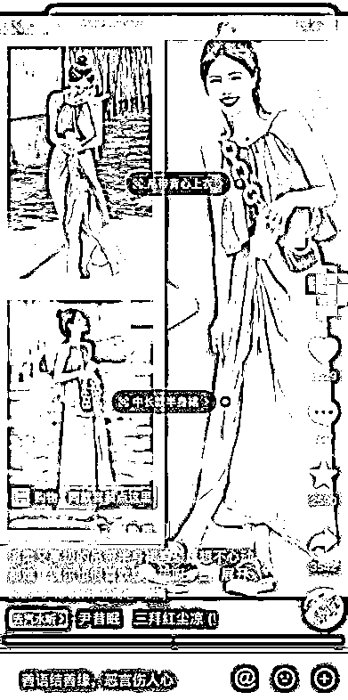

不需要拍摄视频，也不需要做视频混剪，本质上是对图片做二次创作，再以图文视频的形式发到抖音，通过橱窗、私域或挂车把成交做起来。

操作流程不复杂：找到商品图，把主体抠出来，再套一个背景模板，熟练之后一两分钟就能完成。也正因为这样，只要你愿意投入时间，一个人做十个账号都顾得过来。

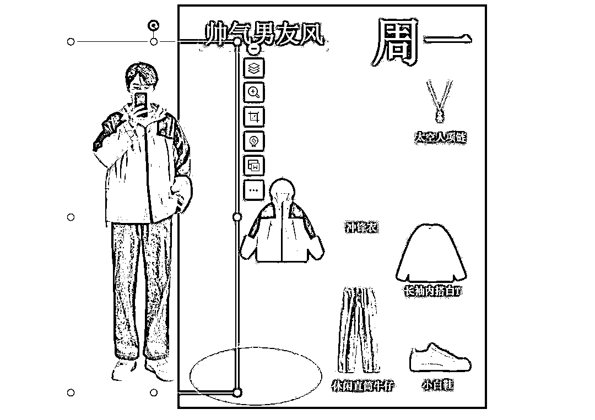

那这么做，能拿到流量吗？到底能卖多少钱、赚多少钱？有些表面普通的账号，最近一个月做到了 100 万-250 万的销量。

那这么做，能拿到流量吗？到底能卖多少钱、赚多少钱？个别看着不起眼的账号，近一个月做出了 100 万到 250 万的销售额。

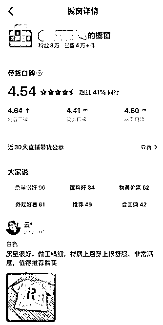

@盗坤老师 当时还没挂车、也没投流，只靠橱窗和引导微信成交，就卖出了 20 万。

后来过了半个月，他的图文开始直接挂车，同样没有投放和直播，单账号单日最高卖了五千多。

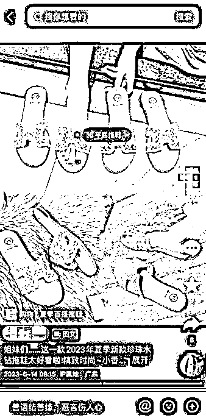

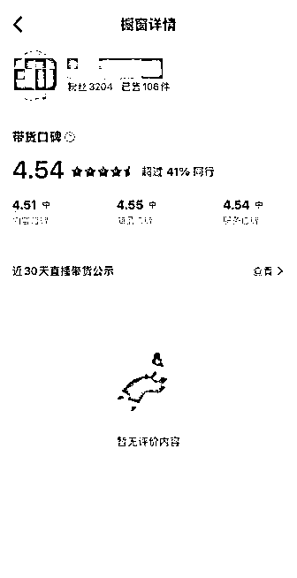

结合观察和官方数据，想把这个项目做好，主要有三大要素：

选「颜值/新热」商品

做「高清/有用」图文

配「热门适配」BGM

后面会逐一展开：

「颜值/新热」商品👉第四步：沉淀选品与素材

「高清/有用」图文👉第五步：制作图文视频

「热门适配」BGM👉第六步：发出内容，促成成交

内容参考：《闷声发财，抖音图文二创带货》《抖音蓝海市场细分用户人群，优化选品，轮播图童装单月利润 2W+》

## 1.2 项目的好处与短板 @抖音电商官方 @刘逍遥

今年 5 月之后，抖音图文带货进入快速增长期，整体 GMV 超过 12 亿，其中粉丝不到 5 万的达人靠图文带货创收 8.9 亿元。有些看似普通的账号，月销总额也能突破百万。

为什么能做到？抖音图文带货主要有三方面的优势：单篇流量高、成交转化高；创作简单、上手更快；图文与电商结合度高，卖点直观。

先看单篇流量高、成交转化高。

官方统计数据如下：

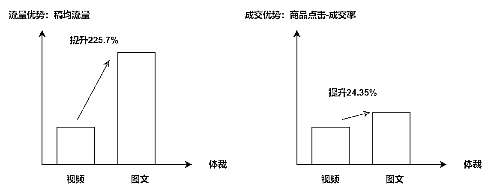

数据显示，图文带货视频的平均单篇流量，比视频带货高出 225.7%，商品成交率则上升了 24.35%。

来看几个真实案例：

一个 8000 多粉丝的穿搭博主，不拍短视频、不做直播，只靠一篇图文，用两张照片、一段配乐、几句文案推荐连衣裙，单篇带货超过 34 万，月带货超过 120 万；

一个读书号作者，用图文晒出读后感，为一本书带货超过 48 万；

一个美食号作者，拍下好吃的巧克力分享出去，靠图文带货 32 万；

……

再看创作简单、上手更快。

和短视频、直播相比，图文内容的制作省事得多：准备好 3-5 张图片就能发作品，不用混剪，也不用真人出镜。

因为几乎没什么门槛，缺少经验的新手也能很快入手，甚至在 P 图软件里套个模板，素材就搞定了。

而且目前图文带货基本都在手机上完成，一部手机足够支撑做图和发布的全流程，不必被电脑束缚。

最后看图文与电商结合度高、卖点直观。

用图文做种草，产品的核心卖点直接摆在用户眼前，能快速勾起购买兴趣。

再加上购物车、橱窗链接，下单很方便，整体成交率也能被拉高。

当然，有优点就有缺点。抖音图文带货的短板在于，对图片排版有要求。

熟悉小红书的圈友应该知道，图文内容最看重首图，就像视频的开头黄金三秒。首图不够吸引人，这条内容大概率会被划走。所以做图文需要一点审美；不过对中老年书单号这类赛道来说，这点不是重点，更需要考虑的是怎么把核心内容突出、做得显眼。

内容参考：《单号日入 1000+，抖音图文带货玩法喂饭级教学》

## 1.3 变现怎么玩 @抖音电商官方

「抖音图文电商」的商品来自抖音精选联盟，不用自己发货、做售后、当客服，主要靠赚佣金出单。

不过，把变现闭环跑通的路不止一条。

路径一：开通「商品橱窗」前，先通过短视频种草，把流量引到其他渠道成交，比如引到微信。

想在抖音直接带货，前提是开通「商品橱窗」。按官方规则，开通条件有三个：公开发布视频数 ≥ 10 条

抖音账号粉丝 ≥ 1000 账号已实名认证

在这些条件还没满足之前，可以先发图文视频，再把用户引导到微信成交。

具体怎么在抖音引导用户加微信？可参考👉【9 月航海｜抖音短视频｜实战手册-章节 11.2.1 如何引流至微信】。要注意，这种引流动作并不被官方允许，再小心也一定有风险。想做到 0 风险，最好等开通「商品橱窗」后，用橱窗、挂车等方式变现。

路径二：开通「商品橱窗」后，通过引导橱窗、挂购物车、直播间成交。这也是「抖音图文电商」最核心的变现路径。

关于怎么实现千粉开橱窗，👉「第三步：账号冷启动，攒到千粉开橱窗」会专门讲到。

拿到橱窗后，可以在图文视频里挂上购物车，引导用户点击作品左下角的购物车完成购买，你就能拿到分佣。

如果当天的挂车额度已经用完（粉丝 1000-3000 的账号，每天限发 2 条带购物车视频），可以在评论区引导大家去点橱窗下单。

万一某条视频突然爆了，还能顺势开播，把出单效果放大，赚到更多佣金。

## 1.4 谁适合做 @唐明杰

如果你正在找一份上手快、又不会占用太多时间的副业，可以试试这个项目。图文作品的制作很省事，拿到商品图片，按 9:16 裁好，传到抖音，配上合适的背景音乐即可。账号运营也不难，坚持更新、持续瞄准爆款作品就行。

内容参考：《抖音蓝海市场细分用户人群，优化选品，轮播图童装单月利润 2W+》

## 1.5【拓展】抖音的推荐算法与底层逻辑 @徐立群

想在抖音做项目，底层逻辑与算法是绕不开的。如果你希望之后做起来更有手感，建议读完这一节。

当你发出一条视频，或开起一场直播，系统按什么规则来决定要不要推、推给谁？这套规则就是推荐算法。

先确认一件事：在抖音的算法里，短视频和直播是两套逻辑。严格来说，短视频的流量池和直播的流量池是相对独立的。

所以我们经常看到，几百万粉丝的短视频达人，直播间只有几个人在线；反过来，一些做直播带货的号，粉丝不过几万，直播间却有好几万人，一场还能卖几百万。

比如下面这个号，1.3 万粉丝，一场直播卖出 100 万+。

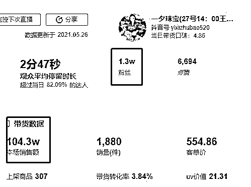

继续往下拆，算法大致可以分为：兴趣标签体系 + 阶梯流量池体系。

所谓兴趣标签体系，就是抖音通过大数据记录和分析用户行为，给每一个用户和账号都打上 N 个标签。

这些标签大致又分三类：

基础标签：你的年龄、性别、城市、手机品牌……

兴趣标签：你喜欢哪一类内容？汽车、段子还是小姐姐跳舞？

交易标签：你会在抖音上买什么价位的什么东西？

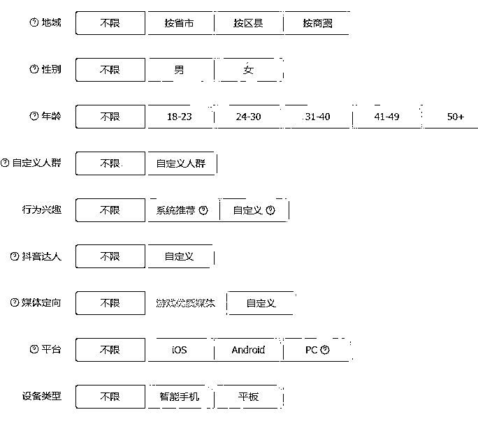

图示：抖音广告后台的部分标签

打开抖音刷内容时，我们刷到的都是和自己兴趣标签相匹配的内容，短视频和直播都一样。所以，翻一翻一个人的抖音，基本能猜到他平时在看什么、喜欢什么。

兴趣标签体系有两层作用：一方面，它决定抖音把什么内容推给我们；另一方面，它也决定我们的内容会被推给什么样的观众。

所以，市面上很多教你“养号打标签”的方法，大多不靠谱。那套做法让你拼命刷同行的内容，只能给你的观看习惯打标签，没法给你的内容打标签。

那怎么给内容打标签？必须发布内容、跑出各种数据，才能生效。

阶梯流量池体系，说的是短视频和直播都各自有大约 8 个层级的流量池。

一条视频或一场直播，要在抖音搭好的“斗兽场”里一轮轮 PK 胜出，才能不断升入下一个流量池。

短视频的 8 级流量池大致如下：

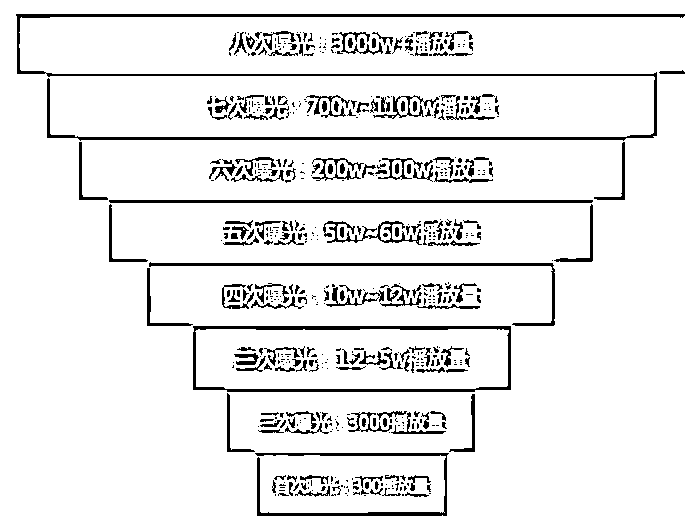

短视频和直播间，考核标准都可以粗略归纳为三大项。

短视频的三大考核指标：完播率、互动率（点赞、评论、转发）、转粉率。

你的视频或直播间，开局都是青铜，要在最低级流量池里接受检验。三项指标表现得不错，打败一堆青铜里的青铜，就能升入下一个流量池，成为白银战士。

如果继续在众多白银选手中胜出，就能接着晋升黄金、铂金，直至王者；

如果输了，大概率就只能留在白银；屡战屡败的话，还可能降回青铜。

需要说明的是，算法是抖音赖以生存的核心能力，原则上是个不会公开的“黑盒”，而且一直在变动。

内容参考：《万字长文：抖音直播带货入门保姆级手册 》1.0

# 第二步：做好这些准备

## 2.1 设备和环境要求 @柠柠

设备必须用手机，不能用 iPad。

苹果手机

建议选苹果 7 以上的机型。抖音会对停产机型做一定的风控。如果手机之前登录过违规或封号的账号，还有设备风控的风险。

安卓手机

安卓机型比较杂，不好统一推荐；如果手机以前登过违规或封号的账号，也一样有设备风控隐患。投抖+的话，建议用安卓手机，更容易过审。

网络环境

做矩阵操作时，别让多台设备连同一个 WiFi，建议用 4G 网络。

内容参考：《抖音图文引流，累积 70w+私域流量，月纯利 5W+》

## 2.2 账号注册注意什么 @钱劲

做抖音图文电商，账号最好多备几个，比如 3-5 个。前期如果心里没底，也可以先养一个号跑通流程，先出一单也算成功。

如果曾经注册过账号、发过视频但没有粉丝基础，可以把旧视频先隐藏起来，再继续发新内容，不必重新注册。

如果之前做过短视频，也有一定粉丝积累，但定位和现在完全不搭，那就建议注册新号。

注册时，推荐办新的手机号码。一个人在同一家运营商最多能办 5 个手机号，三家加一起 15 张。不建议使用移动和多号或联通沃小号，有一定封号风险。15 张足够用了。

注册过程中，以下几点要记住：新号注册前，建议先用新手机卡打几个电话、发几条短信、消耗一些流量，避免被风控

新号注册时，尽量做到一台设备只登一个号，不要用双开应用注册

新号注册后，先别急着实名认证，可以等账号做起来后再选择性实名

如果手里的设备之前登录过被平台封掉的抖音号，建议先刷机再注册新号

如果是批量注册，要控制同一 WiFi 下的账号数量，或者直接用手机流量注册，避免触发风控

内容参考：《9 月航海 | 抖音短视频 | 实战手册》《抖音图文带货非常好做，小白，想做副业的朋友可以冲》

## 2.3 账号定位怎么定

带货账号怎么定方向？下面是一些可以参考的经验。

### 2.3.1 方法一：从个人兴趣出发 @文林

比如我的爱好是绿植，平时喜欢养花种草，后来验证下来这群人下单情况还不错。我是怎么筛出这个人群的？还原一下当时的思路。

从自己的兴趣里找需求

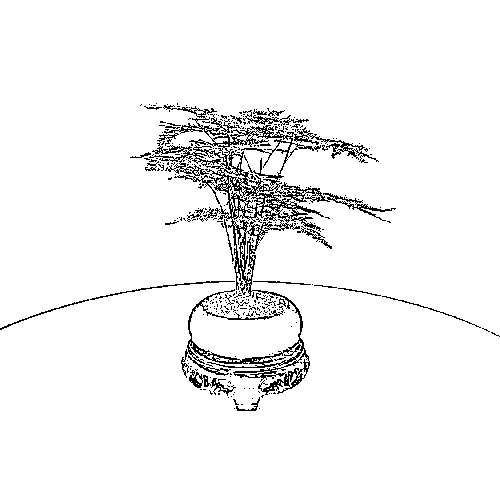

做减法

但 5 个需求实在太多，我开始做减法，实事求是地盘点自己在这 5 个方向上的真实能力。书、绿植、美食、乒乓球这 4 项适合我；民谣音乐因为自己唱歌跑调，做不了。

分析市场供需和竞争对手

确认自己的优势之后，我继续做减法，用的方法是分析市场供需关系，以及竞争对手的情况。

好的战略选择是，找一件自己大概率能打赢的事，再上场。

书和美食这两个类目，市场需求大，竞争也大。做书单的很多，做美食的也很多，内容生产已经相当成熟。我一个刚入行的新手，想在短视频上打过这些对手，概率很低。所以书和美食先被我排除。

剩下乒乓和绿植。乒乓的需求不小，但我查下来，抖音上做乒乓的账号基本靠广告变现，带货的很少；就算有人带货，销量也起不来。

头部乒乓商品的月销售额才几千元。头部玩家都赚这么少，新入局者想赚钱就更难了。乒乓因为天花板太低，被我划掉。

查大盘数据

最后只剩绿植。我没有因为只剩这一个选项，就头脑一热直接开干。

而是先去查绿植类目的大盘。我用飞瓜（其他工具比如抖查查、蝉妈妈也可以）看了绿植在抖音的整体销售数据。

数据确实不错。记得当时是 7 月，绿植在抖音的销售额大盘已经达到 2 亿了！

# 绿植盘子越滚越大，新手该从哪切进去？

先看一组能让初创团队坐直的数据：绿植这个细分市场，月度成交额约在两亿元。真正让人心动的是趋势——最近三个月，每月环比增幅稳定在20%左右，说明抖音上的绿植生意还在往上走。两亿并非终点，未来摸到五亿也有想象空间；我1月28日复查时，这个数字已经跳到3.19亿了。

看到这里，我把目标受众锁在18—35岁、日常喜欢摆弄花草绿植的那群人。

小结

靠兴趣切入生意，好处很直接：你本身就是受众中的一员，对他们的痛点和期待门儿清，上手门槛低，挑品、做内容都更容易踩中真实需求，出结果的概率自然更高。而且做的是自己乐意投入的事，过程不觉得煎熬，反而能享受其中。

不过有个坑得避开：受众别选得太窄。盘子太小的领域，上限往往也低，想赚大钱很费劲；更麻烦的是反馈来得慢，等不到正反馈，人就容易打退堂鼓。

出处：《通用能力｜怎么定位和选品》

### 2.3.2 方法二：从自己熟悉、擅长的群体下手

有些朋友并非宝妈，但在母婴行业摸爬滚打多年，对宝妈群体的痛点和诉求非常清楚，这同样能作为切入点。逻辑不难理解——你懂这行，选品时就能更精准地拿捏这群人的真实需求，挑到对路的货，成功率自然水涨船高。

所以先盘一盘：哪块业务你熟、哪块你拿手？顺着这个方向去找对应的人群。

出处：《通用能力｜怎么定位和选品》

### 2.3.3 方法三：蓝海人群

前两条路都走不通，怎么办？还剩最后一招：找蓝海人群。所谓蓝海人群，直白说就是同行还没扎堆、竞争密度很低的那类受众。

举几个例子：中老年女性、体型偏胖的女性、汽修师傅、电工焊工、装修工人、园林从业者、农业种植户……都算这类。同行少，市面上现成的视频也做得糙；你要是愿意用心打磨，相当于降维打击，跑出来的概率不小。

我自己就选过装修师傅这个群体，当时推了一款吊顶打钉神器，七天卖出42万，利润率两成多。

蓝海方向参考清单：

| 方向 | 对应人群 | 匹配等级 | 适合什么样的人 |
|---|---|---|---|
| 中老年女装 | 中老年女性 | ★★★★★ | 受众面广；有女装底子、又懂中老年女性心理的人最对口 |
| 大码女装 | 体型偏胖的女性 | ★★★★ | 女性向优先；有女装经验、熟悉中老年女性用户者契合度最高 |
| 中老年大码女装 | 体型偏胖的中老年女性 | ★★★★★ | 受众面广；有女装经验、了解中老年女性用户的人最合适 |
| 儿童汉服 | 宝妈群体 | ★★★★ | 受众面广；懂宝妈、又有汉服行业经验的人最佳 |
| 大码男装 | 体型偏胖的男性 | ★★★ | 受众面广；懂服装、了解男性用户的人更合适 |
| 绿植盆栽 | 年轻用户 | ★★★★★ | 受众面广；爱绿植、手里有绿植供应链的人最佳 |
| 3C数码配件 | 大部分人群 | ★★★★ | 受众面广 |
| 宠物玩具等宠物周边 | 养宠物的人群 | ★★★★ | 受众面广；爱宠物、自己养宠物的人最佳 |
| 渔具 | 钓鱼人群 | ★★★★ | 爱钓鱼的人最佳，渔具从业者更佳 |
| 户外/登山/野营/旅行用品 | 户外人群 | ★★★★★ | 爱户外的人最佳 |
| 时尚饰品 | 女性 | ★★★★ | 对时尚饰品有研究的人最佳 |
| 二次元产品（比如二次元口罩） | 二次元人群 | ★★★★★ | 喜欢并了解二次元的人最佳 |
| 母婴玩具 | 宝妈群体 | ★★★★ | 受众面广；宝妈群体、懂宝妈用户的人最佳 |
| 美食 | 爱美食的人群 | ★★★★★ | 受众面广；特别适合爱吃零食、会做菜、会拍摄的人 |
| 做菜调料 | 爱做菜的人 | ★★★★★ | 受众面广；特别适合会做菜、会拍摄的人 |

提个醒：别为了追蓝海而追蓝海。有些群体冷到几乎没需求，那就千万别碰。

出处：《通用能力｜怎么定位和选品》

### 2.3.4 方法四：参考项目热门赛道

玩法不同，热门方向也会有出入。

拿「抖音图文电商」来说，眼下相对吃香的方向有：亲子、食品、服装、家具、图书。你可以去这些方向里翻对标号，再倒推自己该站哪个位置。

## 2.4 账号设置

「抖音图文电商」在账号设置上要求不算高，照着对标号模仿就行。

头像：跟你要带的货气质对得上即可；用网上的真人照片也有好处，容易拉近关系、攒信任。

昵称：好记、有辨识度、带点趣味，最好能把专业标签嵌进去，显得真实可信；别堆复杂符号或生僻表达。

简介：讲清楚人设、价值主张，以及你能给到什么价值——我是谁、我干什么、能为大家带来什么。把领域、身份等标签揉进去，文字简洁，配一点表情符号。

举例：

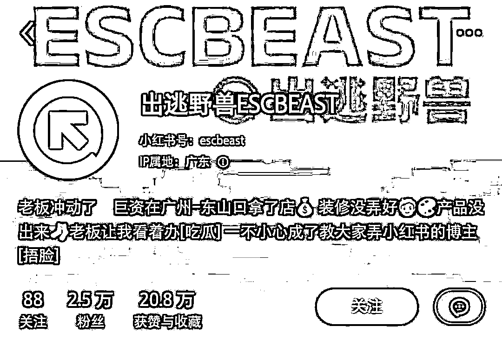

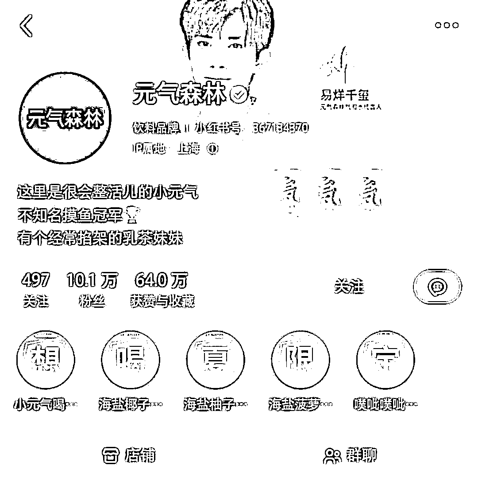

背景图：产品、人设、工作场景相关的都行，能增强账号人设的真实感。

置顶作品：通常用来承担转化任务。对「抖音图文电商」来说，可以置顶最近主推品的视频，或数据最好的作品。前期还没作品时，可以先不设置。

# 第三步：冷启动冲千粉，把橱窗开起来

💡

章节概要：前面说过，「抖音图文电商」的核心变现路径，是开通「商品橱窗」后，通过挂购物车、引导橱窗购买，或点击直播间成交来转化。

但开通「商品橱窗」有门槛。按官方规则，必要条件有三条：公开发布视频数≥10条；抖音账号粉丝≥1000；账号已完成实名认证。所以这一章的核心任务就是：✅3.1 弄懂抖音带货权限；✅3.2 快速做到千粉；✅3.3 开通橱窗并添加商品。完成这一步，冷启动最大的难题就解决了。

## 3.1 先弄懂带货权限

「商品橱窗」即「抖音带货权限」。说直白些，就是平台给的卖货资格：短视频能挂购物车，达人主页能摆推荐橱窗，直播时也能挂商品；既能推自己的货，也能替商家卖。

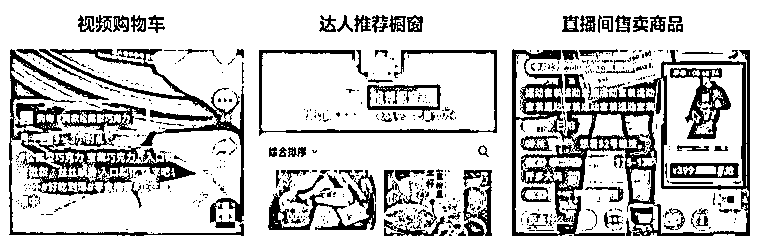

很多人分不清抖音号、商品橱窗、抖音小店，这里一次说清。

① 如果你手里有货、要卖自家产品：需要一个开通商品橱窗的抖音号，再加一个缴纳了对应类目保证金的抖音小店。

② 如果你不碰货、只帮别人卖：只需要一个开通商品橱窗的抖音号，然后从别人的抖音小店挂商品链接去卖。

所以，开通「商品橱窗」对抖音带货来说，基本是必要条件。

按官方规则，开通「商品橱窗」的必要条件为：公开发布视频数≥10条；抖音账号粉丝≥1000；账号已实名认证。其中前两条需要我们努力达成，尤其是「抖音账号粉丝≥1000」。因为一般做到千粉的过程中，视频数自然也会≥10条。所以下面重点说，怎么达成千粉。通常建议粉丝涨到1000以上；想稳一点，可以多涨一些，到5000左右。后期靠自然流量涨粉，不需要额外做投放Dou+等动作。

出处：《万字长文：抖音直播带货入门保姆级手册》1.0

## 3.2 快速实现千粉的几条路

### 3.2.1 前置动作：先定目标人群

新账号先在电脑端开通查看视频数据功能，入口在「抖音创作者服务中心」。正常发布视频，同时开始小额投放Dou+，让账号快速打上创作者标签。投放金额：每条视频20—30元，投3—4条作品。投放设置里选性别、年龄、对标账号、粉丝量，对标账号选对标达人即可，达人数量5—10人。这样操作一轮下来，新发布的视频大概率就能推送给比较精准的目标人群。

### 3.2.2 方式一：用Dou+加速涨粉

持续发作品，遇到播放量、点赞率等数据表现比较好的视频，就投达人相似涨粉。当单个粉丝成本低于1元、投入产出比约1:1时，马上追投。建议投到1000粉以上；想更快完成账号启动，可以按预算继续投到5000粉。

总结一下：遇到好投产比，要尽快完成冷启动，时间就是金钱。如果投产比太低，比如一个粉丝2元多，就看自己的接受范围；花费太高就停掉Dou+投放。做法是把作品设为私密后再公开，投放会自动停止。

出处：《抖音如何快速涨到1000粉？》《抖音短视频蓝海带货，月利润2W》

### 3.2.3 方式二：直播间挂榜涨粉

这招主要针对抖音直播：刷礼物上榜后，会有人点关注；有些主播也会主动引导用户关注榜单上的账号。

注意，不是去大直播间，而是去几百人的小直播间。刷一两块礼物就能到榜一。可以提前把头像换成「在线客服」或「某某助理」，方便蹭流量、蹭粉丝。

出处：《抖音如何快速涨到1000粉？》《抖音短视频蓝海带货，月利润2W》

### 3.2.4 方式三：外部互粉互赞群

可以加抖音互粉互赞群来涨粉。在QQ里搜「抖音互关」「互赞」等关键词就能加群。起步阶段的账号，可以借社群发动更多人第一时间观看视频，并完成转发、点赞和评论，帮助作品进入初级流量池。

前提是：加入的群人数要足够多，活跃度也要足够高。

出处：《抖音如何快速涨到1000粉？》《抖音短视频蓝海带货，月利润2W》

### 3.2.5 方式四：蹭热点涨粉

借热门新闻、热门榜单音乐、热门梗、热门道具、热门视频合拍来蹭热点流量，可以更快涨粉。

比如某部电视剧、综艺很火，可以做简单二次剪辑或合拍来蹭热点，但要注意版权问题。

出处：《抖音如何快速涨到1000粉？》《抖音短视频蓝海带货，月利润2W》

### 3.2.6 方式五：相似人群换赛道起号

这招适合已经非常熟悉中医赛道的朋友。定位确定后，可以看对应的用户画像，先选人群相似的其他小赛道起号，带货流量也不错。

比如中医号的相似人群赛道，可以试佛学号、国学号等，具体要自己测试。

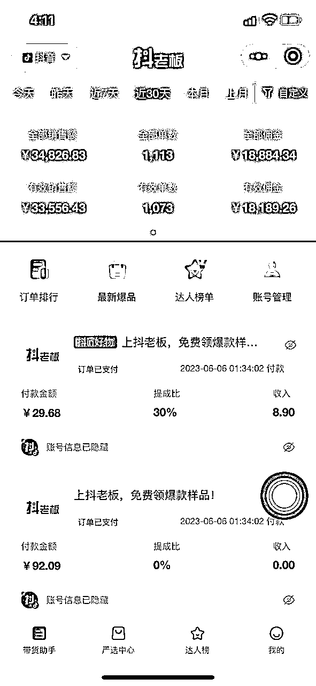

出处：《37天8w8佣金，0-1抖音图文矩阵带货突出重围》

这五招都能在起步期帮你攒下基础关注。接下来反复打磨内容，把精准粉做到四位数以上，冷启动就算完成；想更稳，可以在五千左右停手，后面交给自然流量，不必再额外投Dou+。

## 3.3 开通并使用橱窗

### 3.3.1 开通商品橱窗

达成千粉后，打开抖音APP：进入个人页，点右上菜单图标，再进创作者中心，选电商带货，就能进入「商品橱窗」开通页面。

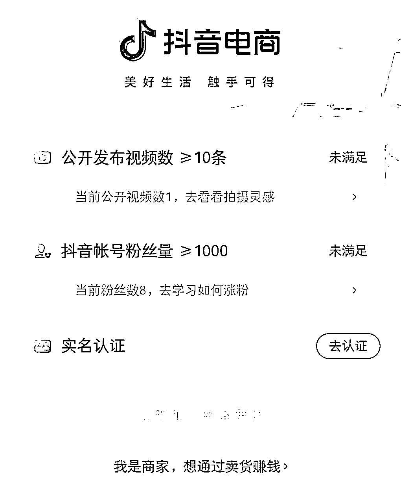

以前开通橱窗要缴纳500元保证金，现在改为完成100单以上销售后，再补交500元保证金即可。满足条件后，点击「立即加入电商带货」申请开通。申请权限时，按自己的实际情况选择成为「带货达人」或「小店卖家」。带货达人适合自己无货源、未开店、帮其他商家带货的用户；对做「抖音图文电商」的人来说，基本选这个即可。下一步会选择收款账户，主要是方便结算佣金，佣金会打到对应账户。

怎么确认是否开通成功？返回抖音首页，点“我”—“商品橱窗”。如果页面提示“恭喜您-已经成功完成电商达人带货权限申请，可以前去选品广场添加商品推广了”，说明已经开通成功；如果提示“推广商品需开通带货权限申请，申请成功即可成为带货达人”，说明还没完成，需要按提示完善账户信息。

商品橱窗开通后，可以到选品广场选择精选联盟产品，添加到橱窗进行带货，也能查询订单金额等数据。

开通「商品橱窗」后，发布带购物车视频有限制：粉丝数低于1000的账号，每周限发1条；粉丝数1000—3000的账号，每天限发2条；粉丝数3000—10000的账号，每天限发5条；粉丝数10000及以上的账号，每天限发10条。

### 3.3.2 添加商品

常规添加商品，打开👉抖音精选联盟·达人版，浏览或搜索目标商品，添加到橱窗即可。

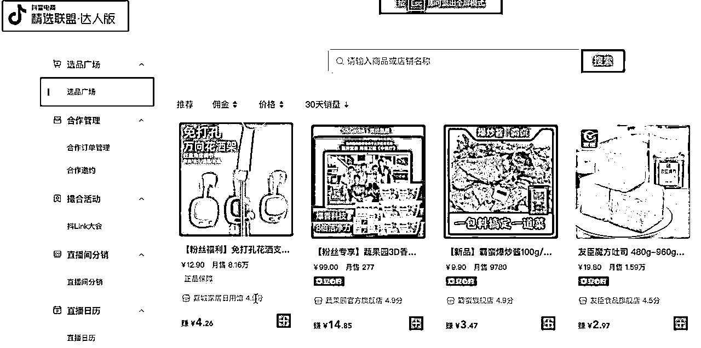

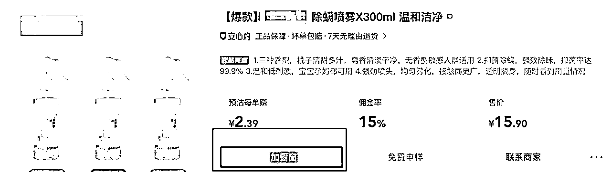

添加成功后，在后台「橱窗商品管理」中就能看到添加的产品。

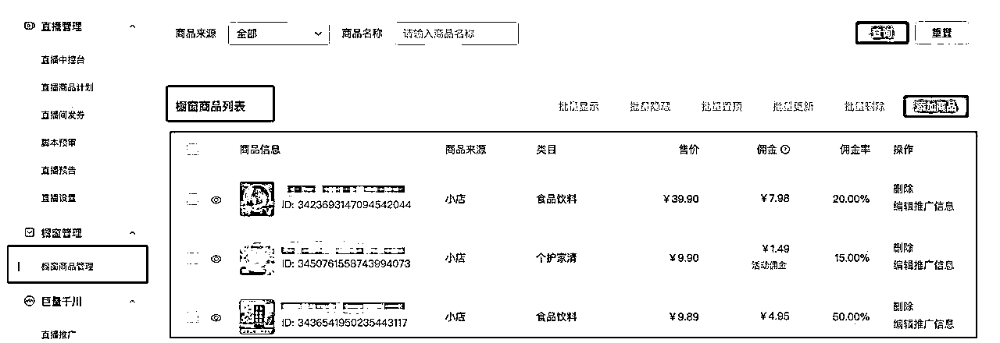

另一种情况：如果直接对接商家，商家会给商品链接。若打开后是面向C端的购物链接，很多人不知道怎么加到自己橱窗。

手机端：复制商家给到的链接后，进入商品橱窗—选品广场—右上角链接，点击后粘贴商品链接，点击查找，再加入橱窗即可。

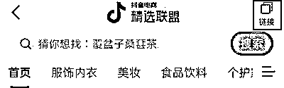

电脑端入口和手机端不太一样，路径是：直播管理—橱窗管理—橱窗商品管理。巨量百应电脑端入口：https://buyin.jinritemai.com/dashboard

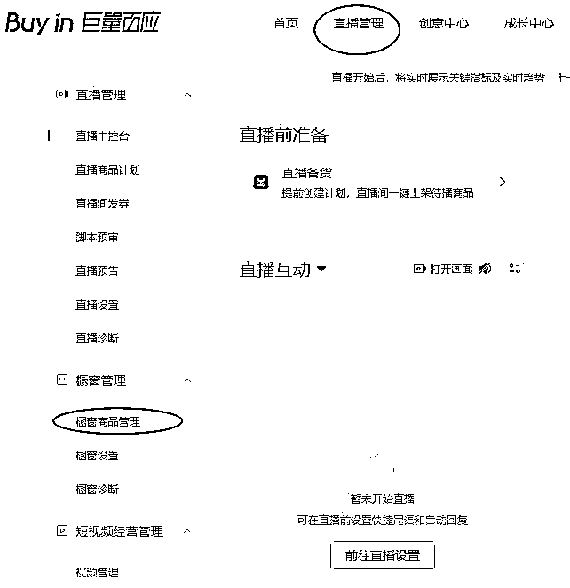

打开后，在商品管理里点“添加商品”，把链接粘贴进去，就能添加商品。

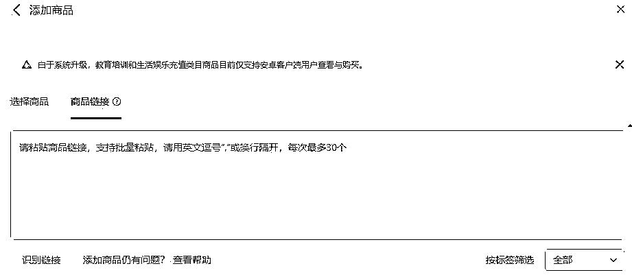

出处：《抖音图文带货中的细节操作》

### 3.3.3 置顶橱窗商品

电脑端：在直播管理—橱窗管理—橱窗商品管理中，找到需要置顶的商品，右侧会有置顶选项，点击即可置顶。

手机端：进入商品橱窗—橱窗管理，拉到橱窗商品的位置，会看到“同款”和“管理”字样。点击管理，勾选商品，点击置顶即可。

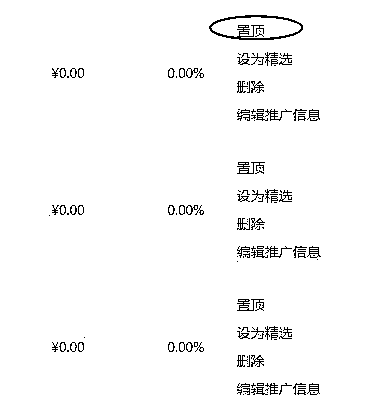

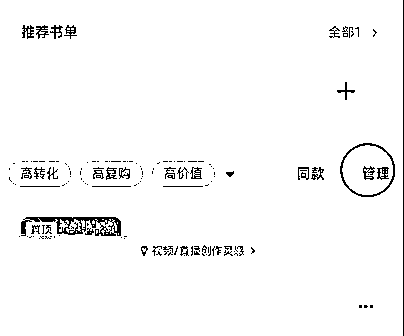

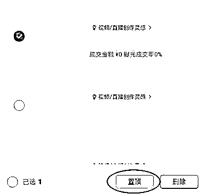

出处：《抖音图文带货中的细节操作》

# 第四步：积累选品与素材

💡

章节概要：这一章的动作，可以跟「第三步：账号冷启动，达成千粉开橱窗」同步做。

选品一直是电商项目的核心。抖音现在的选品类型已经比较丰富，如果能结合「抖音图文电商」的图文特点，找到需求量大、竞争小的产品，带货竞争力和爆单概率都会高很多。

新手建议先了解选品的核心逻辑与原则：✅4.1 选品的核心逻辑；✅4.2 选品原则。想要更落地的选品方法与步骤，可以看：✅4.3 选品方法，里面有6种更适合「抖音图文电商」的选品方法；✅4.4 更多通用选品法与参考资料，包含「选品特训」手册和抖音选品参考类目。

当然，品不是选出来就好，还要通过不断测试，淘汰不合适的商品：✅4.5 测品；✅4.6 选品避坑。

另外，也可以切入抖音上相对蓝海的类目，做差异化竞争，压力小，也容易拿到正反馈。对做带货的人来说，选品是长期主义的事，需要不断选品，不断培养、打磨自己对利基市场的敏锐度，直到找到合适的品。

## 4.1 选品底层逻辑

抖音选品的底层，其实是选需求；选需求的底层，是选目标用户。

所以最底层的逻辑是：先确定一个自己想做的目标用户人群；再找这群人的需求，细分类目；最后根据各种方法找到匹配度高的产品。

选品还要结合市场供需来看：春夏秋冬分别适合卖什么？节日里什么产品有需求？最近卖得好的品，有没有相关产品可以跟？比如很多人家里摆绿植，天气热时绿植容易发黄，就可以想到绿植营养液这类产品，顺着这个点继续深挖。

# 抖音选品不是玄学：3个原则+4个方法，照着执行就行

## 4.2 选品原则 @文林

先说明一下：这部分「选品原则」背后的数据口径停留在2022年3月，具体数字放到今天可能没那么新了，但选品这件事的底层逻辑基本没变，思路完全可以沿用。

想要更落地的选品步骤，可以直接翻👇

✅4.3 选品方法：整理了6种更贴合「抖音图文电商」的打法
✅4.4 更多通用选品法与参考资料：内含「选品特训」手册和抖音选品参考类目

### 4.2.1 原则一：先锁定目标客群

选品的第一关不是挑货，而是挑人——先把货要给谁这个问题弄明白。

那怎样才能找到既适配自己、又适合在抖音上卖货出单的人群？这里有3条经验，逐一分享。

**经验1：从兴趣出发，由单个个体推演出目标群体，再逐步收窄**

拿我自己讲，绿植和花草是我真心喜欢的东西，后来验证下来，这批人的下单表现很不错。

我当初是怎么圈定这个人群的？把过程还原一下。

**先想兴趣在哪**

刚做抖音电商那会儿，我在选品上纠结了很久，一直拿不定主意。后来索性换了个思路：先看自己到底喜欢什么——喜欢读书、喜欢养点小绿植、喜欢听民谣，当然也爱吃美食、爱打乒乓球。

**再往下收窄**

五个兴趣铺得太开，于是我开始做收缩，实事求是地盘点自己在这五件事上的真实功底。

书、绿植、美食、乒乓球这四样适合在抖音上尝试，民谣因为自己唱歌跑调，直接出局。

**结合供需和对手，确认自己哪里有优势**

做完第一轮筛选，我继续收。用的方法还是看供需关系和竞争态势。选赛道有个朴素逻辑：找到一件自己打得赢的事，再往上冲。

书和美食虽然市场需求大，但竞争同样大。书单号、美食号早就铺天盖地，内容也做得非常成熟。

以我一个刚入场的新手，想靠短视频在这些老手面前分一杯羹，非常难。所以，书和美食先被排除了。

剩下来是乒乓球和绿植。乒乓球的需求不算小，但我调研后发现，抖音上的乒乓账号基本都以接广告为变现方式，正经带货的很少，就算有，销量也低得可怜。

头部乒乓商品的月销售额也才几千元。头部都只能做这么点量，新入局的新手想赚到钱就更难了。乒乓球因为天花板太低，同样被划掉。

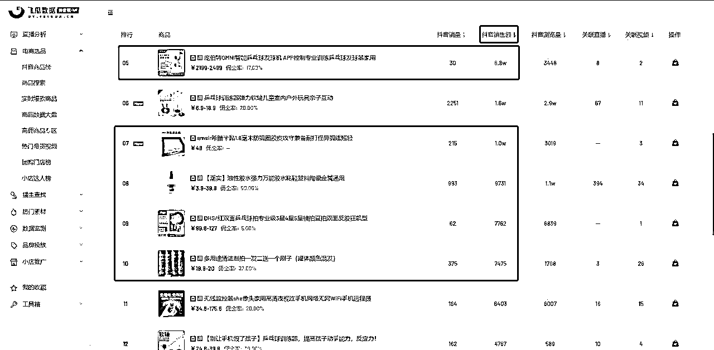

**再把大盘数据翻出来看**

最后剩下绿植。我没有因为没有别的选择就拍脑袋定下来，而是先去把绿植类目的大盘查了一遍。

我用的工具是飞瓜（抖查查、蝉妈妈这些平台也可以），专门去看了绿植类目的整体销售数据。

大盘相当能打——记得当时是7月，绿植在抖音上的月销售额已经做到2亿了！

月销2亿的盘子，对新人或者初创团队来说已经算很好的起点。而且当时的数据显示，绿植的月度增长也不错，近3个月的环比增幅都在20%上下，说明这个类目在抖音上还在持续扩大。

当时是2亿，那以后冲到每月5亿也不是没可能。等我1月28日再去查的时候，绿植类目已经涨到3.19亿了，增长趋势完全兑现。

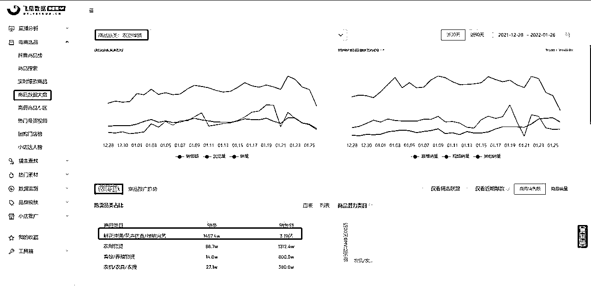

到这里，我的目标客群就算正式敲定了：18-35岁，喜欢养花养草、喜欢绿植的人。

**经验2：从自己熟悉、擅长的人群介入**

假如你不是宝妈，但你长期在母婴行业里做，对宝妈们的难处和需求摸得很透，那么从这批人切入也完全可行。

因为越是熟悉、擅长的人群，选品时越能精准踩中他们的真实需要，挑出来的东西更容易被接受，成功率自然更高。

所以不妨想想：我熟悉哪个领域？擅长哪块？顺着这个方向去锁定对应的人群，再动手选品。

**经验3：瞄准蓝海人群**

前面两条路都走不通，怎么办？还有最后一条：选蓝海人群。

蓝海人群是什么？就是竞争对手非常少的那一类人。

比如中老年女性、偏胖的女性、汽车维修师傅、电工电焊工、装修工人、园林从业者、农业种植户等等。

这些人所在的赛道，竞争少，对手做的视频内容也普遍粗糙。对咱们来说，只要内容做得稍好一点，就是降维打击，成功率高出不少。

我之前选过装修师傅这个人群，当时挑了一款吊顶打钉神器，7天卖了42万，利润率达20%以上。

不过要特别提醒：不要为了蓝海而蓝海。有些人群冷门过头，就千万绕开。

原因是抖音和淘宝的消费路径完全不同。淘宝上用户是先搜索、再购买，目的非常明确。

抖音则是一种逛街式消费，大家没有预设目标，刷到什么感兴趣才买。而用户刷到的内容由算法决定，每个人每天刷视频的时间就那么多。

在有限时间里，抖音的算法天然会把更多流量分给受众面更广的内容。

所以，什么样的蓝海值得认真深耕？建议是：这类人群对应品类在抖音的月销售额最好能做到5000万以上。

即使再蓝海，也不能低于1000万的月销门槛，否则很难做出成绩。

内容来源：《通用能力｜怎么定位和选品》

### 4.2.2 原则二：先圈类目，后选商品

目标人群定下来之后，新问题又来了：这群人的需求太杂了，吃喝玩乐什么都有。这时候最关键的是先把类目定下来，再考虑具体选什么品。

选择大于努力，这句话放在抖音选品里特别真实——一次选择，可能就决定了你一年赚几千万还是一年赚几千。这是我自己踏进过百万级亏损的坑后换来的觉悟。

刚开始做抖音时，我选了一个特别小众的蓝海类目去做。做了两个月才发现，身边选其他类目的朋友，有人两个月就月入10万，而我的收入还没破万。更要紧的是，被我浪费掉的，是前期最值钱的两个月红利窗口。

那类目到底怎么确定？可以参考下面这套流程：

**先看抖音大盘，选定一级类目**

直说吧：选类目不能一拍脑袋就定，必须有数据做支撑。

最起码要知道抖音上一共有多少类目，每个类目目前的销售额是多少、前景怎么样。这些信息用飞瓜数据都能查到。

后面我会把通过飞瓜拉出来的抖音9月一级类目月销数据放上来。

一句话：先看大盘，再选一级类目。大盘的上限，就是你能赚到的上限。

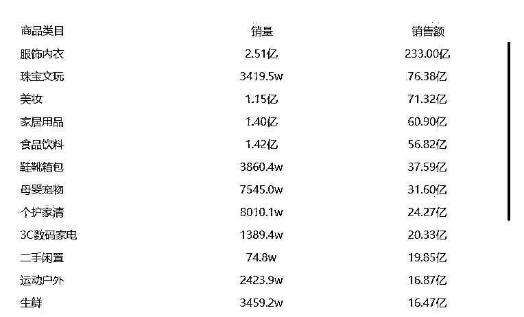

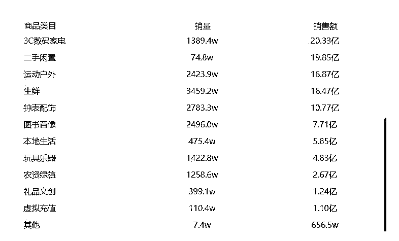

**一级类目定完，再往二三级类目切**

一级类目选好之后，还可以继续往下细化到二级、三级类目。切得越细，做账号做内容的时候就越垂直、越精准，面对的对手也更少，流量获取自然更容易。

二三级类目数量非常多，我拿服装类举个例子做个示范。

一级类目【服饰内衣】可以拆出二级类目【女装】，再往下还能分出三级类目【中老年女装】、【大码女装】。而【大码女装】这一块的月销

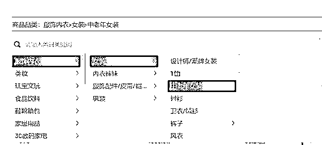

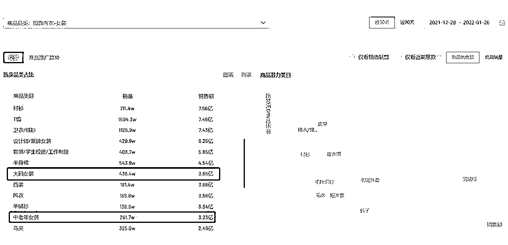

### 4.2.3 原则三：按供需关系选品

怎么根据市场供需去选最合适的品？简单概括就是三句话：需求要够大，对手要够少，对手要够弱。

这三个条件可以单独看，也可以组合着用，组合不同，对应的市场空间和竞争难度也不同。

那怎么快速找到符合这些条件的品？有两条路：一条是避开高竞争区，去挖市场里的蓝海类目；另一条是留在红海类目里，找其中的蓝海子类目，哪怕只是喝汤也能喝得很舒服。

下面重点讲我如何把这两条路结合起来找到蓝海类目的经验，同时也整理了几个我个人觉得机会比较大、竞争烈度相对温和的类目供参考。

**经验一：在红海类目里找蓝海子类目**

比如女装是公认的红海，竞争激烈到不行。但如果选女装里的蓝海子类目——【中老年女装】、【大码女装】——局面就完全不一样了。

【中老年女装】在抖音一个月能卖出3个多亿，退货率才百分之十几。

而年轻女装呢，一个月销售额100多个亿，退货率却高达50%，竞争激烈程度比中老年女装高出百倍。

**经验二：避开高竞争环境，找市场里的蓝海类目**

怎么判断一个品是不是蓝海？对手是多是少、是强是弱？

有一个很省事的方法：直接去看竞品的视频和直播间，看看对方的内容是精致还是粗糙。如果做得很粗糙，那这个赛道竞争大概率不激烈，基本可以判断为蓝海类目或蓝海产品。

比如有人卖服装，直接把直播间架到雪山上去卖羽绒服，你感受一下这个卷法：

而中老年女装那边的画风是这样的：

值得关注的蓝海类目（抖音能做的类目很多，这里只列一部分）：

- 中老年女装｜客群：中老年女性｜指数：5星｜理由：受众面广；懂女装又懂中老年女性的人最匹配
- 大码女装｜客群：体胖女性｜指数：4星｜理由：女性向更佳；熟悉女装和该人群者最合适
- 中老年大码女装｜客群：偏胖的中老年女性｜指数：5星｜理由：人群覆盖面大；懂女装且懂她们的人最合适
- 儿童汉服｜客群：宝妈｜指数：4星｜理由：客群基础广；懂宝妈或做过汉服行业的最佳
- 大码男装｜客群：体胖男性｜指数：3星｜理由：覆盖面广；懂服装又了解男性用户的最佳
- 绿植盆栽｜客群：年轻用户｜指数：5星｜理由：受众多；喜欢绿植并有供应链资源的最优
- 3C数码配件｜客群：大众｜指数：4星｜理由：适用人群很广
- 宠物玩具等宠物周边｜客群：养宠人群｜指数：4星｜理由：客群广；养宠、爱宠的人最合适
- 渔具｜客群：钓鱼人群｜指数：4星｜理由：垂钓爱好者或渔具从业者最合适
- 户外/登山/野营/旅行用品｜客群：户外人群｜指数：5星｜理由：热爱户外的人最合适
- 时尚饰品｜客群：女性｜指数：4星｜理由：懂时尚饰品的人最合适
- 二次元产品（比如二次元口罩）｜客群：二次元人群｜指数：5星｜理由：喜欢并了解二次元的人最佳
- 母婴玩具｜客群：宝妈｜指数：4星｜理由：客群广；宝妈或懂宝妈的人最佳
- 美食｜客群：爱吃的人｜指数：5星｜理由：受众广；爱吃零食、会做菜、会拍的人尤其合适
- 做菜调料｜客群：爱下厨的人｜指数：5星｜理由：覆盖面广；会做菜又会拍的人最合适

## 4.3 选品方法

「抖音图文电商」这个项目，平台有自己的偏好和倾向。

具体到选品上，官方给出的建议是：

类型上：高颜值的商品、功能/形状/外观新奇特的商品、新品/趋势品/热点品、应季时令品、价格有优势的福利品
卖点上：商品正在促销、有限时抢购、有专属福利

举例：

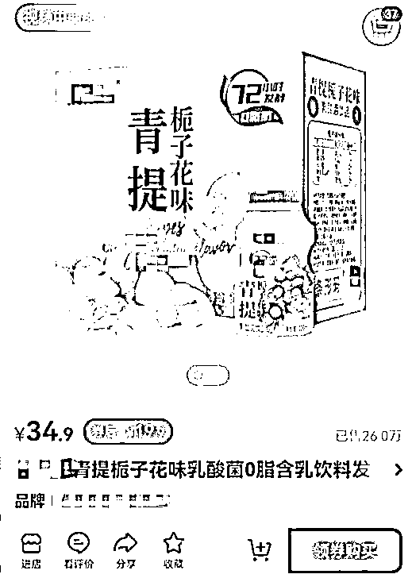

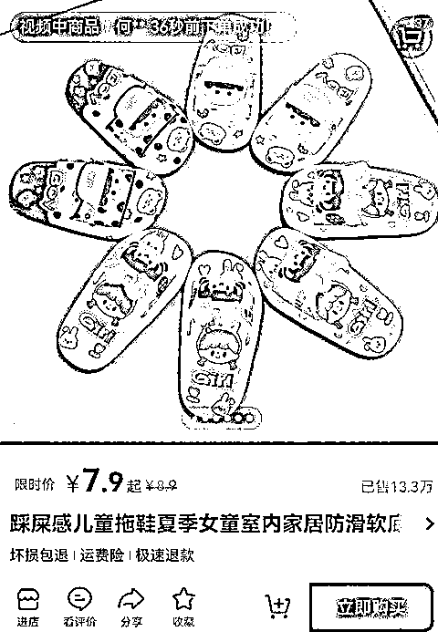

大家在选品的时候，可以重点对照上面这些类型和卖点去筛。

### 4.3.1 方法一：从粉丝画像切入，借考古加找对标 @刘逍遥

**① 先看清自己账号粉丝的人群属性**

什么是粉丝的人群属性？就是粉丝的男女比例、年龄占比这些数据。

每发一个作品，抖音都会给账号打标签，而你的粉丝结构，大概率会影响后续视频推送给什么样的人。这也是很多账号一换方向就瞬间没流量的原因。

那自己的账号粉丝属性从哪里看？

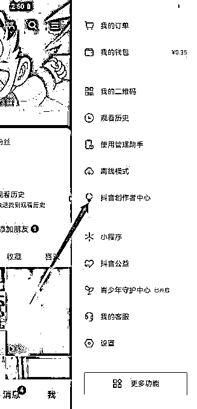

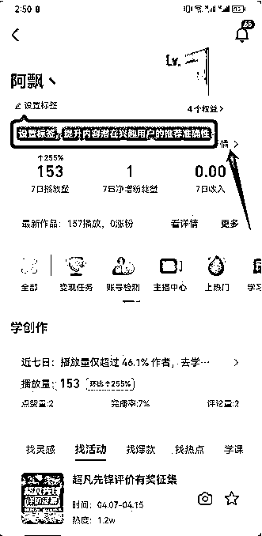

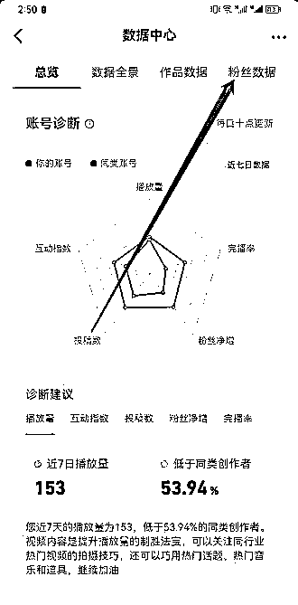

**② 顺着自己的粉丝画像，寻找对标账号**

当你对自己的粉丝属性足够了解之后（我一般主要关注男女比例和年龄区间），就可以去找粉丝画像相近的账号了。对标账号粉丝越少越好，最好是最近爆过单的，它的选品和素材都可以拿来参考。

怎么找到和自己粉丝画像接近的账号？我常用考古加，官方工具巨量百应也能做到。

考古加：https://www.kaogujia.com
巨量百应：https://www.douyinec.com/

下面以考古加为例演示。

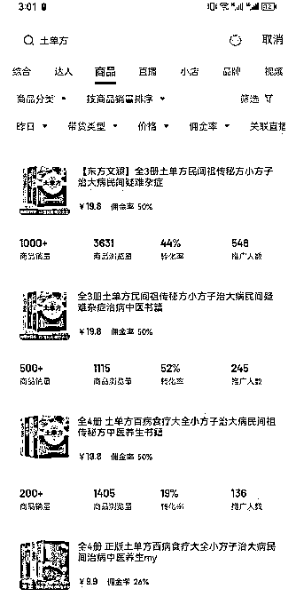

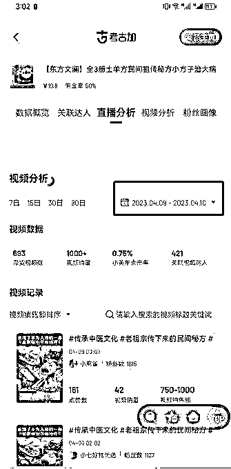

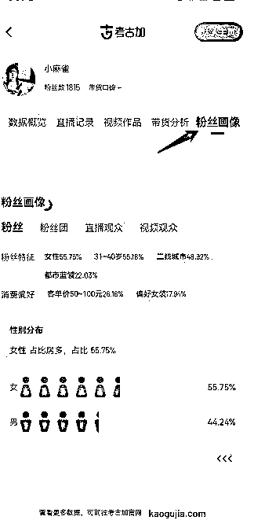

另外，考古加自带关注功能，不用再特意跑去抖音内部关注作者，省去了一大段筛选时间。关注分组还会清楚标注好年龄段和性别分布，体验很省心。

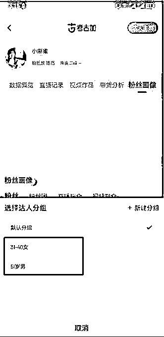

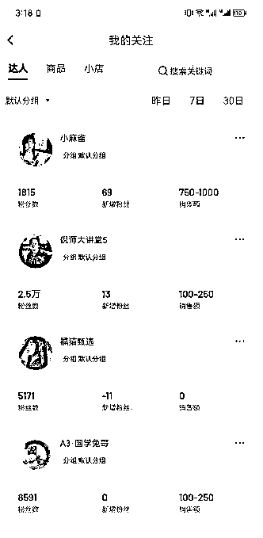

内容来源：《95后打工人，副业做抖音中老年书单号，单月变现5万+的复盘》

### 4.3.2 方法二：用巨量百应搜关键词、按销量挑品 @唐明杰

在电脑端打开巨量百应，点进精选联盟，再进入选品广场，在搜索框输入对应的关键词，然后按销量排序：

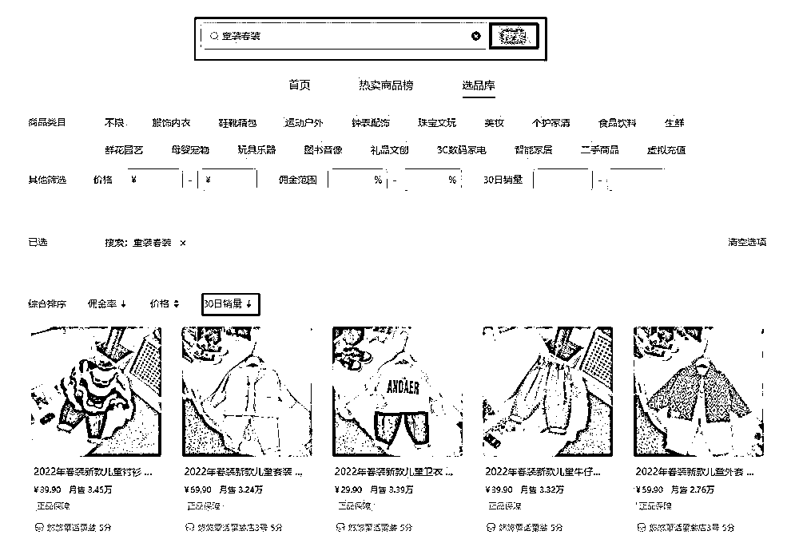

往下拉，找到佣金和价格都合适的产品，例如：

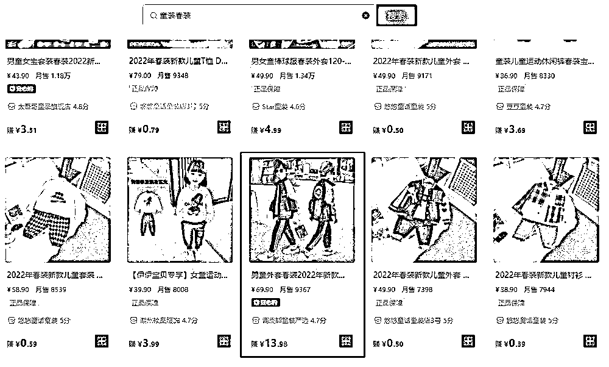

点击进入产品分析页，重点看佣金率、店铺评分、推广数据和用户评价这几个维度：

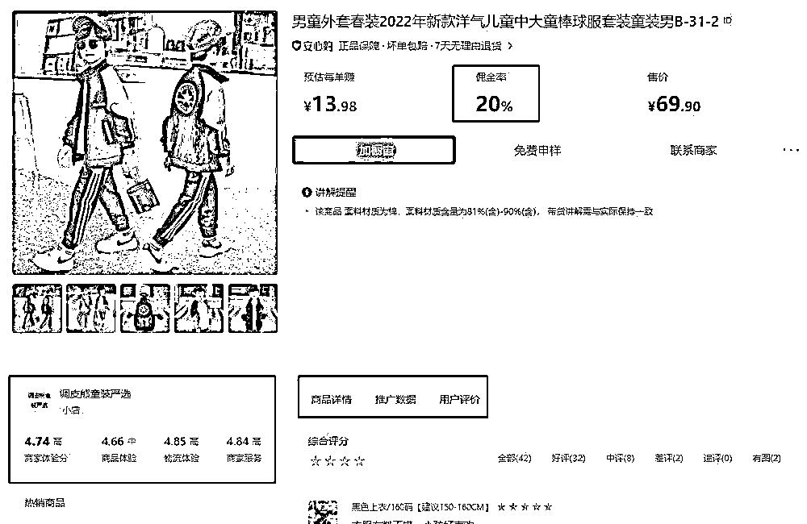

带货佣金率15%以上比较稳妥，体验分一般选4.5及以上的，其他三项也不能太逊色，这样账号的带货口碑分才不容易被拉低。

内容来源：《抖音蓝海市场细分用户人群，优化选品，轮播图童装单月利润2W+》

### 4.3.3 方法三：考古加联手精选联盟达人版 @郭晓文

打开抖音第三方数据平台考古加：https://www.kaogujia.com

按照下图的方式来筛选视频：

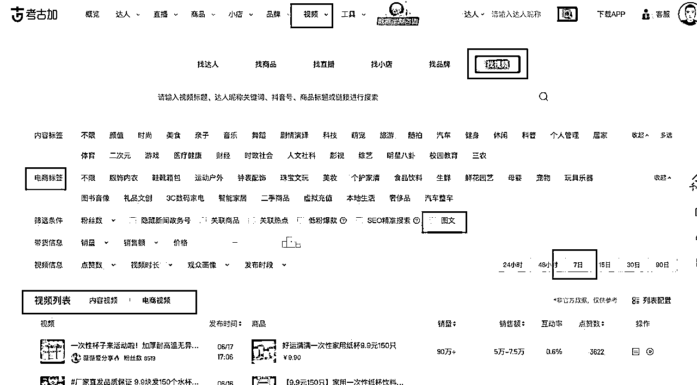

具体操作：

点击视频，进入视频筛选界面（见上图）

筛选条件中勾选「图文」，这样只会看到以图文二创形式带货的内容；视频信息勾选「7日」，就能把最近7天爆起来的图文内容全部筛出来。

「电商标签」这里，可以一个栏目一个栏目地翻，看看除了服装类目之外，还有哪些类目适合用图文带货。

以下图为例：像服装这种一级类目，你还能继续筛出它下面的二级类目：

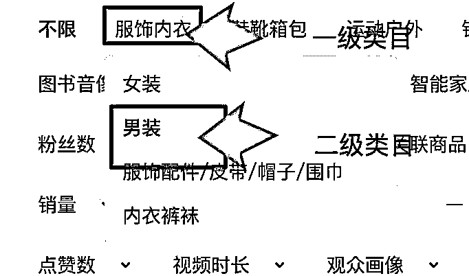

点进某个栏目后，视频列表里的两类内容都值得看看。

内容视频，就是不挂小黄车的视频。在这里你能找到很多只做电商内容、但不挂车、引流到微信变现的账号。

电商视频，就是挂小黄车的视频。在这里你会看到不少直接用电商内容带货、留在抖音站内变现的账号。

重复上面的动作，就能把不同类目下、用这两种方式变现的账号以及他们在带的货都摸清楚。

找到对标账号之后，想更全面地看它的各项数据怎么办？

这里要教大家一个官方数据工具——巨量百应：

网址：https://www.douyinec.com/
前提：需要有一个能挂橱窗的抖音号
配套插件：https://pan.baidu.com/s/1CSnqvqRefzhB0BLGTFa-Tg?pwd=2c3y，提取码 2c3y，来源 @水哥爱搞钱

具体操作过程看下面这个视频：如何通过抖音号查看对标账号详情.mov【在线播放】

把上面这整套流程走熟，你就能找到对标账号，并且把对方的大部分动作看得清清楚楚，选品难题也顺势解决。

内容来源：《两个搞钱技能，帮你看清图文二创赛道的全貌》

### 4.3.4 方法四：考古加联手精选联盟商家版 @刘逍遥

电脑端考古加的顶部工具栏里，有一个「爆品探测」功能：

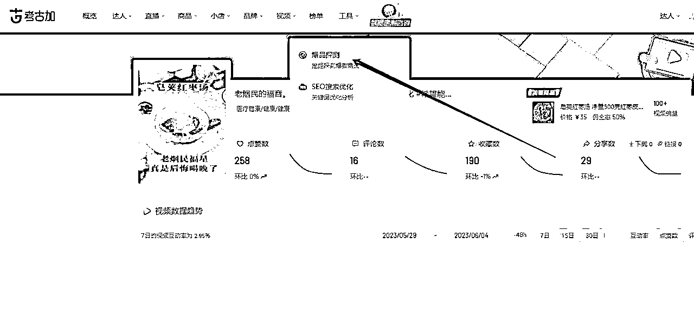

进入后设置好筛选范围，时间越近越好，类型选自己所在的赛道。比如我自己做图书赛道，就选「图书」，时间选「今天」：

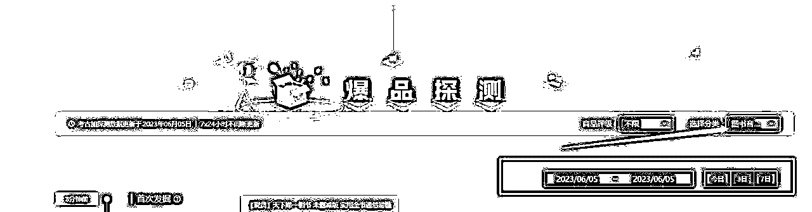

如果发现某个品正好是自己赛道里的，自己也正好想带：

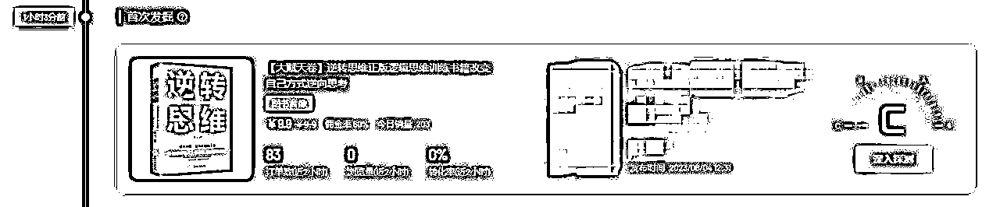

直接点击作者的头像，找到对方的抖音ID复制下来：

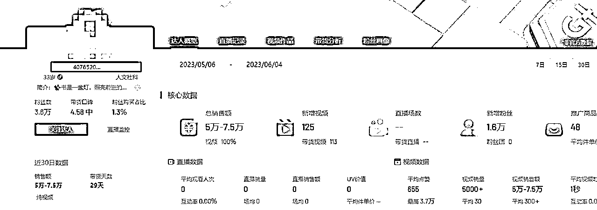

然后你需要一个抖音小店的商家账号。现在抖音小店都是0押金入驻，只要有营业执照就能轻松开通，个体户和企业都可以。实在没有执照的圈友，也可以去某宝找人代办一个，几十块钱就能解决。

进入👉巨量百应商家版（也就是精选联盟商家版）页面后，选择「找合作」：

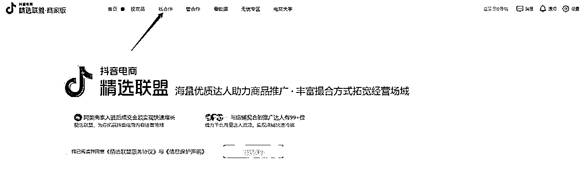

把刚才复制的作者抖音ID粘贴到对应位置，就能找到这个达人：

点进达人的主页，还能继续查看视频数据。

这么一来，单条视频究竟拿下多少成交额、跑出多少播放，都能看得明明白白。要说准确度，平台官方口径目前最靠谱，我们反复比对后也证实，误差基本可以忽略：

剩下的动作，就是把这两套工具搭配起来用，筛出真正能打的爆款视频，再把它对应的配图素材一并收进囊中。

内容来源：《单号日入 1000+，抖音图文带货玩法喂饭级教学》

### 4.3.5 招式五：创意中心淘爆款 @钱劲

在抖音 App 里点开商品橱窗，其中藏着「创意中心」这个入口，那里同样陈列着一批跑量惊人的视频。选定自己所在的类目慢慢翻，遇到中意的商品就记下来：

内容来源：《抖音图文带货非常好做，小白，想做副业的朋友可以冲》

### 4.3.6 招式六：挑自己拿手的品类 @抖音电商官方

落到选品这一步，先别急着看榜单，先盘问自己一句：哪一类货我带起来最顺手？

兴趣、本事、过往阅历、手头资源——从这四块入手，把自己的长板找出来。特点越鲜明、强项越突出，你在同类账号里的胜算就越大。

兴趣：能坚持很久、还乐意主动安利给别人的那种爱好。

本事：相对于多数人你更拿手的那一手，也就是绝活。

阅历：成长路上、职场里、情感中的那些事，讲得真诚就自带感染力。

资源：手里握着而别人没有的条件，例如供货渠道、拍摄场地、专用道具。

内容来源：《抖音电商图文带货来啦！3 步走，把握新机遇》

## 4.4 通用选品思路与参考资料补充

### 4.4.1 先读「选品特训」手册

建议把八月航海那本《8 月航海｜选品特训｜实战手册》翻出来。

它的开篇部分，梳理了选品的底层概念与判断标准，前人踩坑之后留下的思路、建议，基本都收录其中。

翻到第二部分，能看到成体系的通用打法——从冷门蓝海切入、跟着大盘趋势走、按季节节奏铺货等等，总有一种契合你的节奏。

第三部分起，内容按平台分开讲，抖音、视频号、淘宝、小红书以及跨境渠道各有对应章节。这些技巧看懂之后，完全可以搬到「抖音图文电商」上来用。

### 4.4.2 近 90 天图文带货热卖 TOP10

下面这份名单，统计的是最近三个月抖音图文赛道成交最猛的十个三级类目：

· 饮料——5.82 亿
· 套装/学生校服/工作制服——5.48 亿
· 连衣裙——5.14 亿
· 普通膳食营养食品——4.30 亿
· 饼干/膨化——4.16 亿
· 方便速食/冷藏食品——3.90 亿
· 糕点/点心/面包——3.37 亿
· 纸品/湿巾——3.33 亿
· 裤子——3.00 亿
· 山核桃/坚果/炒货——2.34 亿

对照这份名单，看看哪个方向能跟你手里的优势咬合上。

### 4.4.3 值得一试的冷门类目

抖音可做的方向远不止这些，下面仅挑一部分竞争相对缓和的方向举例：

· 中老年女装｜中老年女性｜5 星｜覆盖面宽；本身懂女装、又摸得清中老年女性心思的人最合适
· 大码女装｜肥胖女性｜4 星｜女性向品类里表现很亮眼；熟悉女装、了解中老年女性用户的人匹配度最高
· 中老年大码女装｜胖中老年女性｜5 星｜受众面宽；懂女装且了解中老年女性用户的人最契合
· 儿童汉服｜宝妈人群｜4 星｜覆盖人群大；懂宝妈、有汉服行业经验的人最佳
· 大码男装｜肥胖男性｜3 星｜受众较广；做服装出身、又了解男性用户的人更占优
· 绿植盆栽｜年轻用户｜5 星｜受众人群广；本身爱养绿植、手里有绿植供应链的人最合适
· 3C 数码配件｜大部分人群｜4 星｜覆盖人群大
· 宠物玩具等宠物周边｜养宠物人群｜4 星｜受众广；爱宠物、自己养宠物的人最适合
· 渔具｜钓鱼人群｜4 星｜钓友最合适，渔具行业从业者同样占优
· 户外/登山/野营/旅行用品｜户外人群｜5 星｜热衷户外的人最合适
· 时尚饰品｜女性｜4 星｜懂时尚饰品的人最优
· 二次元产品（比如二次元口罩）｜二次元人群｜5 星｜喜欢、了解二次元文化的人最合适
· 母婴玩具｜宝妈人群｜4 星｜人群基数大；宝妈以及懂宝妈用户的人最合适
· 美食｜喜欢美食人群｜5 星｜受众极广；尤其适合爱吃零食、会下厨、会拍的人
· 做菜调料｜喜欢做菜的人｜5 星｜受众广；会做菜、会拍摄的人特别合适

## 4.5 怎么测品 @九月

测一个品，结局往往只有三类：顺利开单；播放不足一千、也没开单；播放破千却依旧零成交。

凡是跑出订单的，就一路加码推，直到这条素材、这个品再也带不动为止；

破千播放却零成交的，换套素材再试两天，仍然没动静就果断放手；

连一千播放都够不着、单也没出的，别犹豫，直接丢掉；

万一撞上能爆的品和素材，就把手头所有账号一起扑上去。

拿不定主意该不该测某个品时，去瞄一眼同行，也就是你的对标账号，答案往往就出来了。

同行多半靠矩阵号铺量。在考古加里输入这个品的关键词，会搜出一大批相关视频，一条条点进去，留意有没有路子相近的。

接着进入这些相似视频的作者主页，瞄一眼 IP 属地：

属地完全相同，基本可以断定背后是同一个人在批量运营。

同一个品底下冒出的矩阵号越多，这个品的爆发力就越强。当你数出十个以上的矩阵号在推它，不用再想，把全部账号压上去。

说到底，最好的老师就是同行。

内容来源：《37 天 8w8 佣金，0-1 抖音图文矩阵带货突出重围》

## 4.6 选品时容易踩的坑

不少人挑品时费尽心力，自认为找到了天选之物，摩拳擦掌准备开干，谁知刚发布就吃了违规、链接被下架；还有些品与预期天差地别，压根没人下单。

根子在于，你挑的品正好落在平台的红线区。做这行的人各有各的血泪教训，下面把这些坑摊开来，愿你少走弯路。

坑一：商家体验分 @唐明杰

店铺的体验分，会直接牵动达人端的带货口碑分。货品一旦拉胯，买家可能把火撒在达人身上，投诉或是差评都会拖累口碑（尤其投诉，分数跌得飞快）。

口碑分一旦走低，转化率跟着遭殃。所以第一件事，是查清目标商品背后的商家体验分，它由三块构成：商品体验、物流体验、商家服务。

如下图

我个人的门槛是 4.5 分往上，另外三项也别太难看。如此即便账号挨了投诉、口碑分被砸下去，等后续销量起来，分数也能比较快地回血。

内容来源：《抖音短视频蓝海带货，月利润 2W+》

坑二：产品转化率和带货达人数 @唐明杰

这一项要看选品广场里的商品数据。优先挑转化率偏高的，同时销量得压过推广人数。还要留个心眼：某个品某天销量忽然冲得很高，推它的达人却寥寥，这多半是直播间里出的单，这类同样要排除。具体情况见下图：

内容来源：《抖音短视频蓝海带货，月利润 2W+》

坑三：带货佣金 @唐明杰

佣金给得高，往往意味着客单价高，单子难跑；佣金压得低，自己又没赚头。两头之间要找个均衡区，15% 到 30% 这个区间相对舒服，当然还得结合其他因素判断。至于佣金绝对值，低于 10 元我基本不碰。

这没有标准答案，全凭个人打法，有人专挑高佣的品，适合自己的运营节奏就好。

挑中一款货，不妨顺手逛一圈它的店铺，看看有没有别的能一起推的，选品效率能提上来。跑出成绩的品，就把素材复制裂变，铺到其他账号上，多半同样能出单。后续容易起量的品，也可以反复发，把效率吃干榨净。

这一整套动作，说白了就是在选款、测款。

内容来源：《抖音短视频蓝海带货，月利润 2W+》

坑四：选品要合法合规 @文林

去年十月有位朋友上架了射钉器，事前不清楚这类商品属于平台禁售范围，没撑几天，权重很高的店铺就被封停，代价惨重。平台规则务必提前摸清，明令禁止的东西碰都别碰。

抖音的禁售清单，可查《电商创作者管理总则》——入口在抖音电商学习中心（jinritemai.com）。

内容来源：《抖音小店视频带货｜小航海学习手册》

坑五：不选特别小众的品 @文林

六月有人试了个极冷门的品，投入大量精力，回报却只有其他品类的十分之一，回想起来纯属虚耗，两个月的红利窗口就这么没了。

这里的「极小众」有个量化标准：整个类目月销售额不足一千万（不是指单个链接）。

内容来源：《抖音小店视频带货｜小航海学习手册》

坑六：视频展示效果要好 @文林

筛出一堆备选之后，还有一道关必须过：有些品的漂亮销量是靠直播做出来的，而直播间的成交逻辑与短视频并不相通。

带货视频的画面冲击力必须够，像美妆就适合放使用前后的强烈反差。

最理想的效果，是观众刷完马上冒出「这我也用得上、得买一个」的念头。

内容来源：《抖音小店视频带货｜小航海学习手册》

坑七：不选质量差的产品 @文林

挑品时眼里别只有佣金，商品和店铺的分数同样要查。店铺评分尽量守在 4.5 以上，单品的好评率也要拿得出手。

如此既能把转化做上去，也不至于被差评牵连，拉低自己账号的带货分，反过来拖累出单。

内容来源：《抖音小店视频带货｜小航海学习手册》

坑八：选择供货稳定的店铺、佣金稳定不调整且可谈的店铺 @文林

有过这样的教训：视频已经起量爆单，商家却备货不足，白丢了一堆订单。因此店铺的供货能力必须提前确认。

判断办法是看历史销量，例如家居类目月销十万以上，通常供货比较稳；当然也要分品看，冷门类目月销一千也算够用。

经验做法是：大类目挑排名前十的店铺，小类目挑销量前三的店铺来合作。

一旦发现要爆，尽早跟商家打个招呼，确认库存深度。销路打开之后，还能顺势谈更高的佣金，请对方开一条专属的佣金链接。

还有人吃过这样的亏：货带起来了，次日商家把佣金往下调，原本一单能挣五十，转眼只剩十块。这种事只能靠事先挑靠谱的店铺与商家来规避。

内容来源：《抖音小店视频带货｜小航海学习手册》

# 第五步：把图文视频做出来

⚠️眼下「抖音图文电商」的审核尺度收紧得厉害，作品一旦被判定内容同质化，账号就可能吃到 7 天乃至 30 天的限流，中招概率大概在三到四成以上。

想把被限流的可能性压下去，做图文这一步就得多花些心思：多找差异化的素材，把图片去重的工序做扎实。

当然，即便这些动作都做了，也未必躲得过限流。但账号本来就是消耗品，多开号、多铺内容、多试错，远比反复琢磨「怎么又被限了」划算。

## 5.1 图从哪来

图片来源大致有这么几条路：

其一，在找品、看对标号的途中顺手收集同行素材，二次加工成自己的；其二，定下品之后去淘宝、小红书等平台搜同款，把图片取回来再裁剪、套版、抠图；

其三，实拍：自己下单买回来，或让商家寄样品，拍出真实照片。

再分享一个抠图网站 @数藏强哥 2：

👉在线抠图软件

光靠截屏很容易被判重复，而这个站点不用注册，把图拖进页面就能抠好，成品质量也说得过去。

内容来源：《抖音图文带货实操两个月，谈谈我作为小白走过的十个坑》

## 5.2 图文怎么做才有效 @抖音电商官方

品选好了，怎样让图文更容易爆？关键落在画面上。

文字部分，可以拿爆款改写，也可以照着同行的写法来。

### 5.2.1 对图片的要求

硬性门槛是清晰度要够，且至少放两张图。

所有图的横竖方向、尺寸比例尽量统一，别重复用图，也别随手乱拼；

要把商品讲清楚，第一张封面必须干净、精致、好看，背景别乱，主体不能被挡；后面的图则换个视角，去呈现卖点、制作步骤或使用场景。

要点：

· 画面要露出商品的高颜值与实用功能；
· 构图规整，干净清楚，主体一眼可辨；
· 用真实拍摄的高清图，把颜值与新奇特之处充分展现；
· 首图可用艺术字做高度概括，把重点顶出来。

优秀案例示范：

避坑点：

❌ 拿网图、大字报这类非原创素材充数
❌ 拍得模糊、画面歪斜，看不出商品主体
❌ 背景一团乱，整体观感被毁
❌ 所有图都是同一个角度，同质化严重

反面教材：

### 5.2.2 对文字的要求

对文字的最低要求是：排版干净，价值感突出。

在图上压字幕时，别跟原画面叠在一起，也别挡住主体；

标题则要能传递信息价值，靠明确的卖点，或真切的体验感去打动人。

要点：

· 文字要管用，跟图对得上，围绕商品的特点、卖点、亮点来写；
· 呈现真实测评、攻略分享、体验心得与生活经验；
· 排版条理分明，段落清清楚楚。

优秀案例示范：

【真实测评】读完房琪这本书，我这个社恐居然敢主动跟人搭话了。前后翻了三遍，实在偏爱她的笔触，那些敏感、自卑、心里没底的朋友，真的可以去看看，她写下的每个字都带着劲儿。

【攻略分享】走温柔路线的姑娘看这里：杏色半裙气质很软，外面配一件黑色开衩针织，既收腰又百搭，一身穿下来，优雅和甜都在线。

避坑点：

❌ 与图片毫无关系，靠段子、鸡汤之类的猎奇内容凑数
❌ 夸大其词、虚假描述，或直接照搬网上的段子、广告语、百科词条
❌ 刻意贬低他人

实在没思路，就照同行的写法找找感觉。

## 5.3 第二招：美图秀秀混图去重 @刘逍遥

平台上每天涌进海量图文，撞车的概率自然高，一撞就容易吃限流。如果你用过同行素材、担心被判同质化，可以试试下面两招。

### 5.4.1 单图去重

拿我自己的带货图举例，对标的原图长这样：

我先去小红书翻出风格相近的图，放进美图秀秀里：

接着另找一张咬了一口的梨，用美图秀秀把主体抠出来，贴到背景图上，再补几句合适的文案，一张对标而来的原创图就成了：

### 5.4.2 拼图去重

打开美图秀秀，选「拼图」功能。

我习惯四张一组来拼，多用于零食类；面向中老年群体时，汤包一类的品用得更多。

导入那四张图，进「高级编辑」，切到无缝模式，拖动融合度滑块就能整体缩放画面；排版怎么顺眼，就怎么调换图片顺序：

跟单图相比，拼出来的图撞车的可能性明显更低。

### 5.4.3 收尾提画质（可选）

两种去重手段走完，还可以借助「wink」这款工具，把图片清晰度再拉高一些，此步不做也行。

素材出处：《单号日入1000+，抖音图文带货玩法喂饭级教学》

## 5.5 实拍法：原创素材这样拍 @刘逍遥

这个办法需要准备一盏俯拍灯，手机尽量用 iPhone 12 及以上机型。等商家把样品寄到手，先找几组同赛道的高赞爆款内容，按它的构图和节奏现场比着拍。担心同质化的话，就在画面里添些元素，比如假花或其他小物件；要是手头真没道具，直接把手伸进镜头，再贴点贴纸，去重效果通常不错。实拍的好处是省力省时、原创性高，缺点在于要等样品寄送，容易错过商品热度最高的那几天，所以比较建议把实拍和混剪结合起来轮着用。

素材出处：《单号日入1000+，抖音图文带货玩法喂饭级教学》

## 5.6 注意事项：分行业优化，别踩红线 @抖音电商官方

图文品质越高，越容易带动成交。不同类目可以按自身特点来打磨内容：服装类从日常穿搭切入，主推应季款，多拍带场景感的穿搭图；书籍类选热销榜上的书，用清晰实拍图配合真实阅读感悟来打动用户；食品类找卖相亮眼或有特色的美食，用高清细节图搭配真实体验，让人隔着屏幕都心动。

平台也特别强调了几条底线：同一张图不能反复使用；图文内容必须与挂车商品强相关；低质模糊的图片不要用；标题和文案要符合主流价值观。

参考出处：《抖音电商图文带货来啦！3步走，把握新机遇》

# 第六步：发布视频，获取佣金 @抖音电商官方

## 6.1 挂车视频怎么发

图片形式的小视频目前只能在手机端发布。选好要用的图片，按系统提示一步一步来操作即可。

发布时有两点要留心：一是BGM的选择，二是小黄车每天有挂载数量限制。
BGM怎么选？音质得清晰，不能有杂音、爆音、卡顿；旋律调性要与商品卖点、图文风格匹配；优先选抖音或全网热度高的歌曲；卡点音乐在切换图片时更带感；背景音乐越火越容易留住人；还可以看目标消费人群来配相应的氛围音乐。
小黄车限额方面：开通商品橱窗后，粉丝数不到1000的账号，每周只能发1条带货视频；1000—3000粉丝，每天限发2条；3000—10000粉丝，每天限发5条；1万粉以上，每天最多10条。
挂车视频正常发布后，买家视角如下：

## 6.2 给视频补橱窗入口 @小马哥

每天挂车的条数用完后，还可以在评论区把橱窗入口挂出来，引导买家点进来。手机端路径：商品橱窗 → 短视频管理 → 选对应视频 → 点评论区推荐橱窗。

另外也可以设置成自动给电商营销内容配上橱窗入口。电脑端路径：直播管理 → 短视频经营管理 → 视频管理。

电脑端有个手机端做不到的地方：想移除挂载或推荐入口，直接点取消就行，手机端没有这个功能。

如果挂车名额没用完，只是一时疏忽忘挂，也能靠同样方法把视频补挂上小黄车。

参考出处：《抖音图文带货中的细节操作》

## 6.3 佣金怎么到账

抖音精选联盟-达人版：https://www.douyinec.com/
打开上面的链接进达人后台，余额管理处能看到佣金数据。
结算规则：每一笔订单在买家或系统确认收货15天后发起结算；如果商家在15天内没结，那就等商家先结完再轮到达人结算；简单说，大部分订单都在确认收货+15天这个时间点结算；结算完成后，佣金自动转入可提现余额；平台会抽10%。
提现入口：抖音APP → 我 → 商品橱窗 → 佣金统计 → 提现；到账速度：聚合账户当天到，微信和支付宝第二天到。

# 第七步：复盘数据，持续迭代

## 7.1 数据怎么查、怎么看 @抖音电商官方

### 7.1.1 图文视频数据查看

除了选品和内容，定期复盘带货成绩同样是图文生意的重要一环。抖音电商罗盘可以看图文带货的成交概况，也能对单条图文的核心指标（观看、点赞、关注、完播率、商品曝光成交转化率等）做诊断，拿到改进建议。
入口：https://compass.jinritemai.com/login
用达人身份登录【抖音电商罗盘】，点一级菜单【图文】，就能看到数据。

手机端路径：【抖音APP】→【商品橱窗】→【今日数据】→【罗盘达人】→【内容分析】→【图文】

### 7.1.2 从数据里找转化提升空间

复盘时可以抓住图文带货的核心成交公式，围绕两个方向做优化：一是把图文短视频的观看次数做上去，二是把千次观看成交金额（GPM）提上来。

Step1：盯住核心数据与流量来源，随时看趋势变化、做调整。可以切换不同时间范围，也能筛选图文类型（挂车图文/商品图文）；能看整体流量与成交表现，包括观看次数、点赞次数、成交金额、成交转化率等；再根据这些结论拆解流量来源，锁定核心入口、对比数据变化，用观看次数和成交金额判断各渠道的流量大小与转化效率，及时修正策略。

电脑端

手机端

Step2：逐条看图文流量和成交情况，找出运营的突破门道。排序条件可以自由切换（如按观看次数、成交金额排序），在此排名下查看各条图文的数据表现；也能直接搜商品，定位目标商品的图文数据。

电脑端

手机端
Step3：找到问题内容后，怎么把数据变成具体动作、优化图文表现？
想让观看次数上去：看点赞、关注、完播、商品曝光成交转化率这些维度，拿同行做参照，了解自己的内容处于什么水平。点赞、关注、完播偏低，就参照同行的优质内容去改；商品曝光成交转化率偏低，问题多半出在选品，可从商品评分与评价、商品类型、适用人群/季节、价格区间等方向去调。

电脑端

手机端
千次观看成交金额怎么提？关键在摸清用户想看什么、为什么没下单，进而拉高单条视频的成交额。退款比例也要盯紧，太高的话通常说明产品质量或物流出了问题，建议尽快和商家沟通，也可以找已购买的粉丝问问情况，处理好售后并及时调整选品。

## 7.2 优化主线：爆单三步法 @抖音电商官方

抖音电商在图文创作与经营上总结了一套“图文带货爆单3步走”打法：先选好商品，再做好内容，最后总结提升。项目执行中可以照着这套逻辑重点推进。

参考出处：《抖音电商图文带货来啦！3步走，把握新机遇》

## 7.3 违规怎么看、怎么处理 @小马哥 @抖音电商官方

视频违规怎么查？手机端：短视频管理里如果出现黄色“建议”标识，说明可能有情况；显示“暂无建议”就基本没事；有建议的话，去后台查看系统有无更具体的通知。

电脑端：短视频管理里每条内容都会带提示，“暂无建议”表示基本正常；如果提示建议优化或显示其他内容，就要再做调整。也可以直接到抖音创作者中心看内容详情，查具体违规提示，再结合自身情况决定要不要申诉。

如果图文内容收到了处罚通知，却不知道原因或怎么办，可以看这些官方规则文档：
不清楚平台内容规范，看👉抖音电商内容创作规范，里面有真实、专业、可信、有趣等要求；
作品/账号违规不知为何，看👉电商创作者内容规则全解析，涵盖常见违规场景、违规案例与推荐做法；
想了解违规的后果，看👉电商创作者违规与信用分管理规则，包括违规处理流程、扣分细节、信用分细节；
想知道怎么申诉，看👉创作者违规申诉管理规则，涉及申诉途径、申诉材料、申诉时效。
参考出处：《抖音图文带货中的细节操作》

## 7.4 小黄车还能这样优化 @唐明杰 @小马哥

挂小黄车时，最好多加2条或更多相似产品的链接。这样做有两个好处：视频放完后小黄车会自动弹窗；商家万一某款下架，车里还有其他商品顶上。
小黄车标题也能优化，用“视频同款”“点击购买”这类引导性文案，点击率会更好。
小技巧：怎么找出单的视频？
手机端：进商品橱窗，往下滑到创意中心上方，点短视频管理，进去后能看到对应成交数据，这里是按短视频维度统计的，需要自己把出单产品和视频做个对应。也可以直接点今日数据，选对应内容方式，在列表中查看成交数据。
电脑端：数据参谋 → 成交详情 → 成交明细。

成交形式分为橱窗、短视频、直播、其他，找到对应内容形式和标题即可。数据参谋 → 订单管理 → 联盟订单明细里，有订单ID、商品详情和佣金明细。
参考出处：《抖音蓝海市场细分用户人群，优化选品，轮播图童装单月利润2W+》《抖音图文带货中的细节操作》

## 7.5 心态放稳，先把量做起来 @唐明杰

开头两三周没单太正常了。这个阶段你只要想放弃，项目立马就结束，也不用再纠结。但要是决定继续，就放开手脚干，每天把该发的量发满，别管有没有人下单。
等到某天突然出单了，从一天两三单慢慢涨，再到撞上小爆款、一天十几二十单甚至更多，这时候0-1才算跑通。
为什么会有这个过程？挂小黄车的视频本身就会受到一定限流，新号作品少、流量少，前期不出单很正常。等你攒下一定视频量后，有时候当天发的内容不带来单，反而是以前发的视频在一直出单。很多作品是慢慢被推流的，可能要过好几天才有流量进来。
所以别太在意眼下的播放数据，选款靠谱、视频做得不算差，单子自然会来。记住：当天发的不代表当天出单，可能得等上一阵子。把视频量一点点堆起来，出单就会稳定下来。
参考出处：《抖音短视频蓝海带货，月利润2W+》

## 7.6 新手常见问题 @唐明杰

问：现在入局童装、中老年女装，新手还行吗？
答：这俩赛道确实竞争激烈，但服装行业讲究换季，能抓住换季窗口反而有空间。服装类目对新手也比较友好，后面可以再拓展其他蓝海类目。
问：新号能不能靠互关互粉完成冷启动？
答：要看目标人群。如果互关互粉能换来目标人群，倒也可以试。做垂直类目账号的话，更推荐用抖加来涨粉。
问：图片二次剪辑加工，能做出种草效果吗？
答：可以，商品本身就是靠短视频来种草的。服装年年换季，每一季的新款对平台来说都算新数据；上季度卖得好的达人，这季度不一定还卖得好。款选对了，短视频很容易跑出高播放，起号也快，后期完全能吃自然流量涨粉变现。
问：轮播图门槛低、容易批量做，同质化严重怎么破？
答：关键在于解决选品和账号冷启动两个问题。第一，选细分风格、细分市场的差异化产品，主动避开红海竞争；用近期爆款、应季新款来制造差异，新品爆款对平台来说也是比较新的视频。第二，账号要有强标签和一定基础权重；攒下基础粉丝后，短视频的播放量就会趋于稳定。
参考出处：《抖音蓝海市场细分用户人群，优化选品，轮播图童装单月利润2W+》

# 第八步：把成果继续放大

项目稳住之后，要做的事情就是持续更新，不断优化产品、图片和数据，同时保持发视频的频率，按数据反馈调整，直到撞出一个爆款。
这个阶段先多铺作品，盯观看和用户反馈。挂了车的看订单量，没挂车的看播放量和评论区；要是有不少人问“怎么买”“哪里买”，就多准备类似的款式。
再往后，怎么进一步放大？方向有三个：千川投放、开直播接流量、搭建矩阵号。

## 8.1 方法一：用千川放大爆款

投放的意义在于把已验证的爆款数据和收益再往上推一层。内容加热以前一直用DOU+，但DOU+投完后作品还是留在内容流量池里做曝光；千川更偏商业推广，流量覆盖范围更大，同时包含内容流量池和广告流量池。
短视频不挂小黄车投DOU+，推送范围仍在内容流量池；挂上小黄车再投DOU+就不同了，挂车视频的推广属于“小店随心推”，它是千川的一种，算商业推广行为。挂车链接要过内容流量池和广告流量池两重审核。
千川投放的细节这里不展开，想系统了解可查官方文档《巨量千川平台使用手册》；生财圈友也整理过千川保姆级攻略，参考👇【保姆级千川攻略】巨量千川投放经验120条，投放新手必看。
建议先用免费流量跑出正反馈，等项目验证通了，再用付费流量把盘子撬大。
参考出处：《抖音商业IP大航海1.0丨学习手册（完整版）》

## 8.2 方法二：直播间接住流量

适用场景：内容突然爆了、订单也跟着涨，此时开播能接住这波流量，把收益再放大。
逻辑链路：短视频先把流量引过来，给直播间导流并促成成交；直播间顺势被打上对应标签，拿到直播间feed推荐流量，同时还能给账号涨粉，形成良性闭环。

### 8.2.1 直播间怎么搭

抖音直播本身是个很大的话题，这里不铺开讲，只聊怎么完成一场基础直播。想学更多玩法，参考👇9月航海|抖音半无人直播|实战手册、11月航海|抖音绿幕直播|实战手册。
直播的核心无非人、货、场，下面就从这三块说起。

#### 8.2.1.1【场】设备篇

最基础配置就是一部手机+一个手机支架。看直播地点和预算，可以有三档选择：轻便灵活、自己就能操作的手机直播间；画质更清晰、玩法更多的电脑直播间；以及有专业导摄支持的演播室直播间。
更多高清和专业设备推荐，参考👇抖音电商的3种直播间和40种设备-抖音电商学习中心。

#### 8.2.1.2【场】场景篇：基础版在家就能搭

居家布景示例一：直播间里现场装袋、贴单发货，开盲盒、开蚌这类玩法也是同一路数。抖音电商学习中心-抖音电商官方学习平台.mp4【在线播放】
居家布景示例二：围绕主推款的外观、用法、功能、优惠等角度来讲解。抖音电商学习中心-抖音电商官方学习平台(1).mp4【在线播放】
进阶版：更推荐有团队的玩家。绿幕/摄影棚：适合各类品牌直播间，背景可以按品牌调性定制。

工厂/仓库：主打源头直发，省去中间环节。

店铺货架式：适合商品种类多的商家，直接在店里开播。

室内生活景：

做厨具、家居、百货这类产品，别把直播空间当成静态货架，放进匹配的场景里展示，转化会更自然。

室外场景：商场里、种植园中、养殖场旁都能落地，让货品和现场元素产生互动。

小型舞台或T台：更适合品牌类、运动类以及设计感较强的货品直播，借T台氛围勾起用户整套搭配的购买冲动。

这个项目把最基础的直播空间搭起来就够用，想了解更细的操作，可查阅官方文档：「从 0-1」实现直播间顺利开播。

#### 8.2.1.3【场】话术脚本：场景定好了，话怎么讲

话术样例

✅参考话术

开头引入：家人们，爆款七号商品链接这就安排，公屏把7号刷起来，我直接给大家上三圈大尺寸的；链长1.6米，这个长度的珠子戴出来好不好看，你们自己看。

卖点介绍：先说底子，这个款全网销量已经突破五位数，是店铺里的头号爆款。它凭什么年年排在销量前列？真不是靠颜值夸张到惊天动地，而是胜在不挑人——小姑娘能戴，当了奶奶姥姥也能戴，年龄跨度拉得很开。

利益点：凡是公屏扣7的家人，每人送一个价值29元的洗衣袋；左上角先点关注，再把券领到手。

催单：七号这个款更划算，余量不多了，看中就直接拍、拍完就付款。

想补更多话术，可看：电商直播玩法及话术。

附1：直播宣传规范速查字典

【持续更新】达人宣传规范速查字典。担心开播时说错话、踩到禁忌词，提前翻一遍。

附2：脚本预审入口：巨量百应

用法看这里：预审工具全面升级：电商内容前测攻略-抖音电商学习中心

#### 8.2.1.4【人】一个人也能把直播跑起来

常见的半无人直播，往往就是单人撑起一个直播空间。开播前要把话术备齐，比如观众进房怎么欢迎、讲货时怎么铺垫；讲品过程中还得兼顾公屏互动。前期准备做足，同样能卖出单。

团队直播：两人以上小团队，通常一人出镜，在镜头前和客户沟通；另一人守后台做运营，比如调品、点开商品讲解，并盯着直播曲线提醒主播调整话术节奏。

想再提效率，可以双号并行，上午一个、下午一个；前提是两人都能主播也能运营，方便轮班切换。否则单人连说一整天，嗓子很难扛住。

内容来源：《初阶 | 抖音-半无人直播｜航海实战手册》

#### 8.2.1.5【货】开播前，先把商品挂上去 @Erik

选品定下来后、正式开播前，还有一步不能省：先把商品上传好。别等开播后再补，否则直播空间容易被判违规。

抖音常用的后台操作入口是巨量百应，流程如下：

1.

用抖音号完成登录

3.
进入“直播管理”

打开直播后台的商品控制页，把商品加进去

商品加完后，在后台控制页还能调整排列顺序、控制商品是否展示，并补充卖点信息。

#### 8.2.1.6 开播入口在这里

开播入口：打开抖音APP，点底部【+】号，再选【开直播】，按提示走完就能开播。

### 8.2.2 直播间优化：这些细节别漏 @唐明杰 @抖音电商官方

直播间能优化的地方不少，重点落在素材和话术上：

背景画面可换成图片轮播，或让混剪片段循环播放；商品结构要排好序，把爆款尽量往前放；视频里把商品标号做清楚，让画面中的货品和小黄车链接号一一对应，方便用户找；贴图也要利用起来，加上引导关注、引导点小黄车、优惠提示等卖点信息，帮助提升点击；背景音乐别太吵，选目标人群听着舒服的；话术也能优化：把同行的直播录下来，用飞书转成文字，再按自己的表达重写一遍；前期多刷同行，取长补短；多拿优秀同行做对照，发现短板就一点点改，别指望一次到位。

这套模式不强依赖专业主播；如果有专业主播加持当然更理想，可作为后续升级方向，慢慢过渡到人货场配置更专业的直播间，效果会更稳。

想提高曝光，可以从几处下手：拉长开播时间，覆盖用户搜索的高峰时段；直播内容与转化数据（停留、互动、成交等）表现好的，更容易被优先推荐；口碑分保持高位、不违规；标题里的关键词要明确，品牌和商品属性写清楚。

在「抖音图文电商」这个项目里，现阶段把基础直播空间搭好、能接住流量就够了。想再抠细节，可参考官方文档：「从 0-1」实现直播间顺利开播。内容来源：《抖音蓝海市场细分用户人群，优化选品，轮播图童装单月利润 2W+》

## 8.3 方法三：用矩阵放大结果 @思蒙

门槛不高的项目，比如「抖音图文电商」，说到底是在用数量换概率。前期，数量往往比质量更关键。所以作品能多更就多更，账号能多开就多开。

航海过程中你会看到，有些伙伴的内容和你差不多，甚至谈不上多出彩，可他的号就是起来了——这背后就是概率。选品和图文制作的方法掌握之后，拼的就是【量】。单条视频爆的概率按1%算，发10条呢？或者做10个号呢？每个号都是1%，叠加起来，跑出爆款的概率是不是就高多了？

过程中你还会发现，有的号开局流量就顺，有的号始终半死不活（前提是内容质量过关、水平差不多）。这其实是账号体质与概率共同作用的结果。

做矩阵的方法不复杂：批量起号、批量发内容，把手册前面的项目流程复制到更多账号上。矩阵跑起来后，挑出底子更好的号重点养，表现差的就注销替换。

内容来源：6 月 8 日《短剧 CPS 的进阶技巧及常见问题答疑》@思蒙

# 第九步：拆解爆款赛道案例

为了帮大家更快锁定合适赛道，这里整理了爆款赛道的案例和可复用打法，供参考。

## 9.1 亲子方向 @抖音电商官方

内容类型：图书类分享。数据参考：单条平均播放约50万，单客价格约20元，单条平均成交额约3万元。可复制结构：先用热销或畅销数据吸引注意，再配实拍图与清晰大图，加入真实体验反馈，背景乐选热门曲目。配图参考：

童装类内容。数据参考：单条平均播放约20万，单客价格约40元，单条平均成交额约1万元。可复制结构：选应季、可爱或颜值高的童装，搭配实拍图和清晰大图，讲清亮点，再用轻快可爱的背景乐。配图参考：

## 9.2 食品方向 @抖音电商官方

内容类型：糕点与饮品内容。数据参考：单条平均播放约60万，单客价格约30元，单条平均成交额约10万元。可复制结构：用颜值高或新奇的美食，配实拍、细节和清晰大图，加入真实体验反馈，背景乐选热门曲目。配图参考：

水果零食类内容。数据参考：单条平均播放约30万，单客价格约30元，单条平均成交额约1.5万元。可复制结构：选热销或清爽的美食，配实拍、清晰和细节商品图，加入真实体验反馈，背景乐选热门曲目。配图参考：

## 9.3 服装方向 @抖音电商官方

日常穿搭内容。数据参考：单条平均播放约80万，单客价格约85元，单条平均成交额约6万元。可复制结构：贴合季节，搭配有人设感、场景化的穿搭图，文案要对路——把季节、单品、用户痛点和爽点以及热点话题串起来。配图参考：

穿搭合集内容。数据参考：单条平均播放约100万，单客价格约60元，单条平均成交额约5万元。可复制结构：贴合季节，用有人设感的多张穿搭图，文案同样要对路——把季节、单品、用户痛点和爽点以及热点话题带进去。配图参考：

## 9.4 家具生活 @抖音电商官方

内容类型：单品展示与组合分享。数据参考：单条平均播放约7万，单客价格约30元，单条平均成交额约1万元。可复制结构：选颜值高或实用的商品，配实拍、使用步骤、效果呈现、成品画面和清晰大图，再用舒缓背景乐，带上热点话题。配图参考：

单品展示

组合分享

## 9.5 图书类目 @北辰

看到一个只靠图文卖货的账号做得挺稳，卖的是唯美绘本：半年做到1.7万粉，橱窗成交2.1万。内容形式很简单，绘本实物拍摄后加一点滤镜，再配复古风文案和配乐，对80后格外有吸引力——他们的孩子正处在读绘本的年龄。

内容来源：《唯美绘本。 半年 1.7 万粉，橱窗销量 2.1 万》

