# 抖音搜索成交力实战手册（2023.08）

资料源：`remhu1p2pr.feishu.cn/docx/O9SZdIXxYoWBJWxDf85cgzDwn9f`

成稿日期：2023年8月10日

用法提示：这份笔记想把一个项目的操作空间摊开来讲，方便你判断和落地。想直接跳到某块内容，按 Ctrl+F 或 Command+F 搜关键词即可。

写在前面

💡 各位好，

欢迎翻开《抖音搜索成交力实战手册》。接下来二十一天，我们会围绕一个目标反复碰面：把抖音站内搜索的关键词选出来，持续做内容，最后能带来客户或成交。

这轮实战需要借助商业化的选词产品。考虑到大家要在短时间摸清方法并做出结果，我们争取到了为期三十天的免费试用资格，领取与操作放在第四章「四、抖音SEO实操技巧」。这里也要谢谢提供支持的 @令狐峰、@Hawli（李小随）两位教练。

抖音SEO，说白了就是优化抖音站内搜索排名：依据平台算法挑词，把精准人群引过来，让团购商品、直播间、小程序、短视频、图文这些载体排得更靠前，从而拿到更多曝光和收入。

动手前，先回答三个问题：

1）眼下入场，窗口还有多大？
2）哪些人适合干这件事？
3）这本手册怎么用，才更容易出成绩？

1）窗口还有多大？

把时间拨到2023年5月末：抖音搜索的日活已经越过五点六亿；按每人每天至少查三次来算，一天搜索动作超过十七亿次。

用户习惯也在变：以前更多是搜账号，现在越来越多搜内容。内容型搜索的占比，2019年约三成二，2021年升到六成五，2022年预计到九成。搜索目的越清楚，下单意愿通常越强，商业含金量也就越高。

再看“词”的供给：两千六百万个关键词里，高搜索、低竞争的有1831万条，接近七成，蓝海特征明显。再看“人”的供给：抽样两千万条博主视频后，发现99%的创作者并不研究SEO。

2）谁适合？

抖音生态够杂，能切入的人也多。比如招商加盟方向，洗鞋、收纳、洗衣、餐饮都算；本地高客单方向，二手车、装修、家电维修、买房、旅游、宠物、婚纱等；电商方向，开抖店、从淘宝转抖店、做抖店代运营；知识付费方向，证书、求职、自媒体、电商培训；传统工厂方向，大型机械、小型精密机械；大健康方向，医药与医疗服务，但要有资质；金融方向，保险、贷款、券商开户；消费品方向，护发、个护、化妆品、纸巾，最好配抖店。

上一轮实战给了一个信号：把抖音SEO和高客单项目放在一起，更容易看到结果。

3）手册怎么用？

第一，选词是命门。词选偏了，后面多半白忙。可要人工筛出既有商业价值、竞争又不高的词，费时且难。为降低门槛，我们给每位同学争取了“极客增长”个人版一个月的免费名额。领取路径和详细用法在第四章，这部分要重点啃，边用工具边理解。

第二，二月我们验证了高客单与SEO的结合，五月又发现长尾词是精准选词的一条路。本期新增长尾词打法，详见4.5“长尾词选词方法”。

第三，别闷头做。遇到手册覆盖不到的地方，多问多聊，大家一起找答案。

希望这趟航行结束时，你不仅拿到结果，还多了一群能并肩作战的人。

这份材料由龙哥盟联合圈友 @令狐峰、@Hawli（李小随）以及若干在抖音SEO上拿到结果的圈友共同整理，仅供航海船员和龙哥盟星球圈友学习。

创业像搭积木。会获取搜索流量，等于多了一套更快的搭建手法；这套能力还能迁移到别的项目，慢慢变成你的个人壁垒。

也欢迎圈友在实践中反馈，帮我们一起把手册补得更完整。

# 一、抖音SEO与高客单项目 @令狐峰 @Hawli（李小随）

## 1.1 概念先厘清：抖音搜索排名优化

SEO，全称 Search Engine Optimization，中文叫搜索引擎优化。它的做法是顺着搜索引擎的规则，把某个“产品”的自然排名往上推，让它在所在行业里占住靠前位置，进而拿到品牌层面的回报。这里的“产品”不限于网站，也可以是商品、视频、直播、图文。

只要一个平台有搜索框，就有SEO的用武之地：百度、🛰️、📕、头条都如此。放到抖音，SEO就是围绕站内搜索做排名优化，借助算法规则把团购商品、直播间、小程序、短视频、图文等载体往前排。

抖音目前的用户盘子约九亿，日活约七亿；57%的人每天至少搜一次，日搜索量在七亿人次以上。它正在变成获取信息的超级入口，优质视频内容则是平台护城河。视频形态的搜索结果信息密度更高，也越来越多人优先选择。

哪些人适合做抖音SEO？
可选方向很宽：
- 招商加盟：洗鞋、收纳师、洗衣、餐饮等；
- 本地高客单：二手车、装修、家电维修、买房、旅游、宠物、婚纱等；
- 电商：抖音小店、淘宝转抖店、抖店代运营等；
- 知识付费：证书、求职、自媒体、电商等培训；
- 传统工厂：大型机械、小型精密机械等；
- 大健康：医药产业、医疗服务等，需具备资质；
- 金融：保险、贷款、券商开户等；
- 消费品：护发品、个人护理品、化妆品、纸巾等，最好有抖店。

归纳一句：抖音SEO是通用型方案，行业覆盖面广。它既能服务客单高、频次低、需求急的生意，也能承接普及面广、单价相对亲民的生意。

哪些人不适合？
没有可售卖产品的人；碰黑五类或平台明令禁止业务（如K12）的人；此前完全没接触过抖音的人。

## 1.2 为何值得做抖音SEO

逻辑不复杂：抖音和📕在吸走流量，百度、淘宝的流量盘子则在收缩。

搜索流量之所以被叫作精准入口，是因为用户通常带着明确问题来查，需求强度相对高，人群也更准。

互联网早期，搜索就是主入口，百度一度压过腾讯和阿里，站在BAT最前面。今天百度声量下去了，但“搜索”这个动作并没有消失。

过去大家查信息去百度、查商品去淘宝，一个管信息，一个管电商。可百度生于2000年，淘宝生于2003年，都跑了二十多年，市场早被切得很碎，竞争已是红海中的红海。

新渠道不一样：抖音2016年起步，日活约七亿；📕2013年起步，日活约一亿。两边都有六成以上用户会产生搜索行为，搜索流量规模很可观。你可以回想自己的习惯：是不是越来越常在抖音或📕里查东西？

1、抖音搜索数据梳理

平台大致经历了几个阶段：
- 2016—2017年：娱乐色彩重，颜值、游戏内容多；
- 2018—2019年：专业内容增多，平台扶持垂直流量；
- 2020年：电商扶持加码，罗永浩、李佳琦等进场；
- 2021年至今：本地生活、三农、电商以及抖音搜索一起推进。

以2021年12月底抖音公开数据为参照（2022年数据未公开），能读出三点：

1）搜索习惯在养成

截至2021年12月底，抖音搜索月活超过五点五亿；人均每天至少查一次，日搜索人次超过六亿。

用户从“找号”转向“找内容”的趋势明显：内容搜索占比从2019年的32%，升到当时的65%。

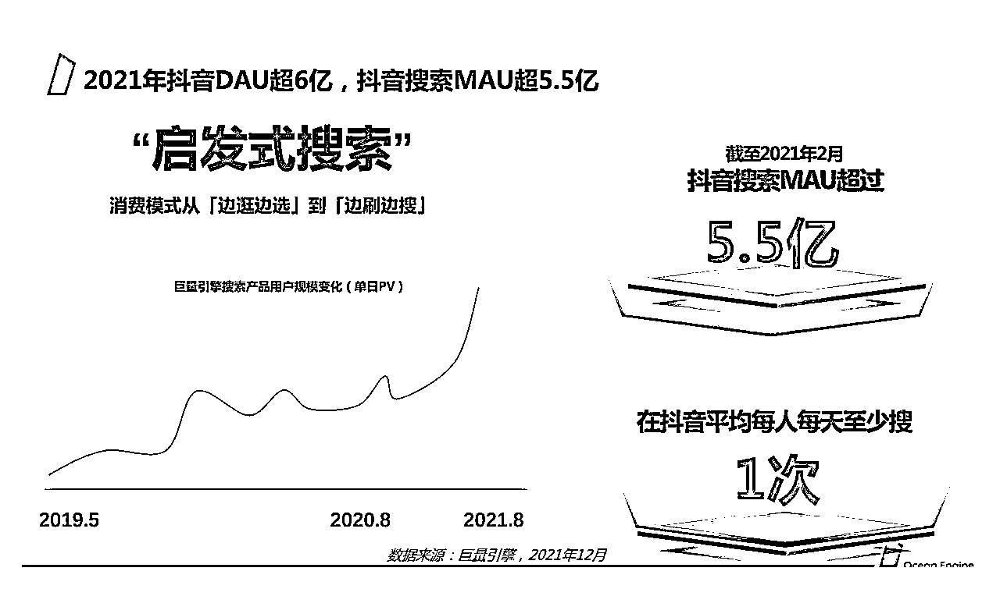

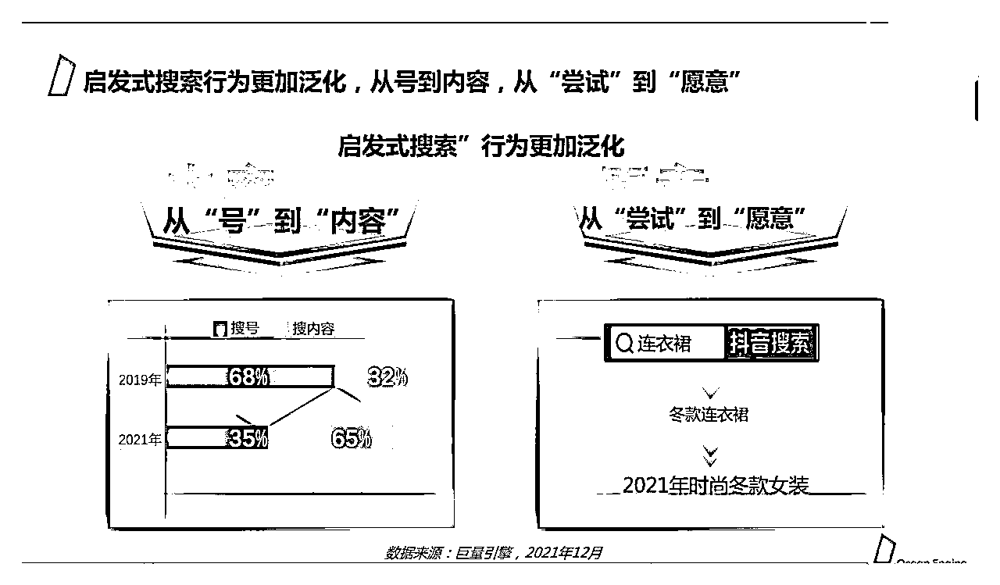

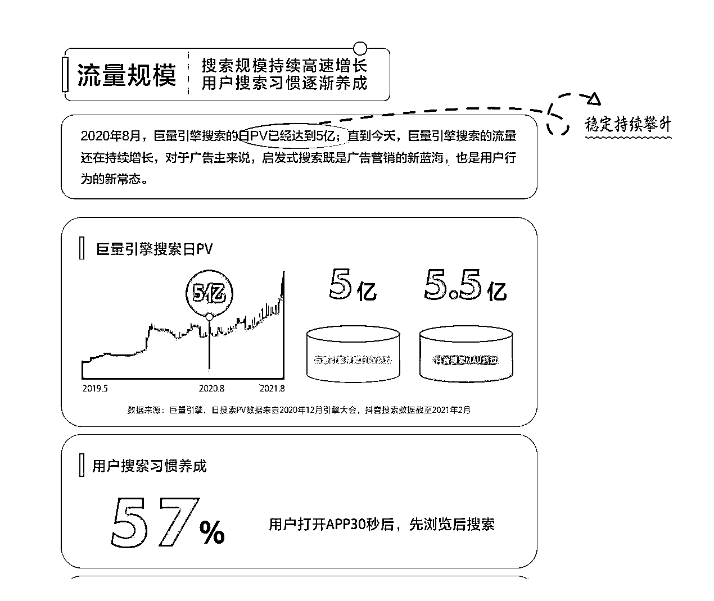

2）商业价值在增强

搜索意图越清楚，购买冲动越强。关键词的演变很能说明问题：从“连衣裙”，到“冬款连衣裙”，再到“2021年时尚冬款女装”。

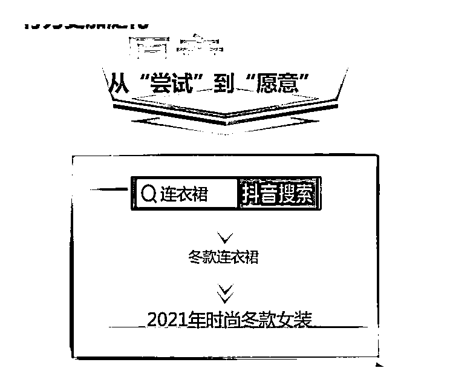

电商相关搜索流量增长突出：零售涨281%，食品饮料涨223%，教育培训涨155%。多个行业搜索量增幅超过200%，增长势头和流量红利都比较明显。

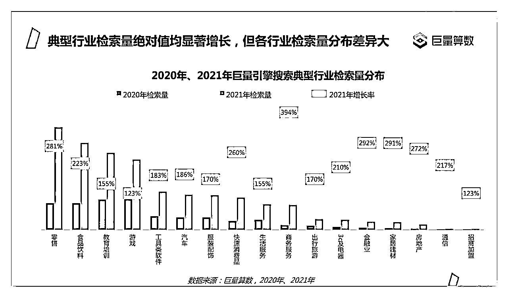

搜索用户里，女性占52%，男性占48%；24—30岁人群占比明显上升；一线和超一线城市用户占比也在增加，消费能力更强。

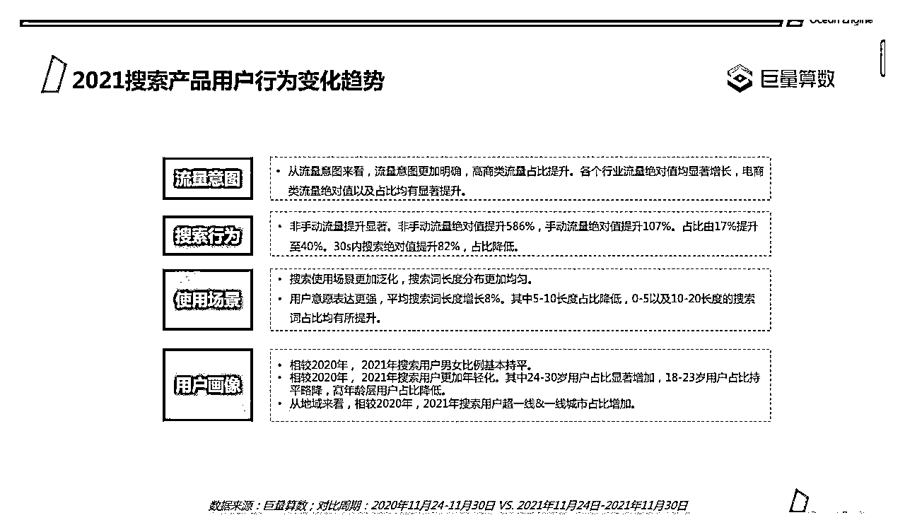

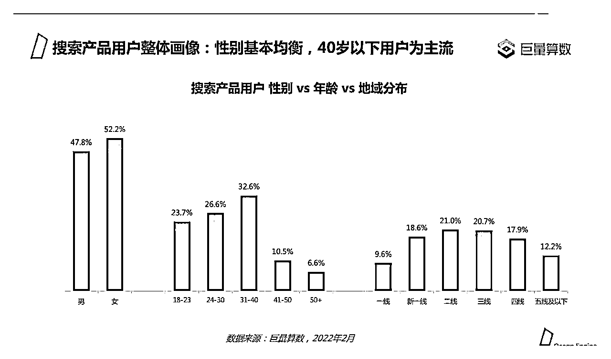

2、抖音搜索仍是蓝海

红海指需求大、竞争也大；蓝海指需求大、竞争相对小。抖音有两类主要流量入口：推荐流量和搜索流量。推荐流量越来越卷，平台会看5秒完播率、2秒跳出率、互动数据等。对比之下，官方增长率说明搜索流量还没那么挤，至少大量关键词仍处在蓝海区间。

下面从“词”和“人”两个方向拆。

1）词的竞争

按我们自研“极客增长”工具的统计，2600万个关键词中，高搜索、低竞争的有1831万条，占比69.4%，接近七成。

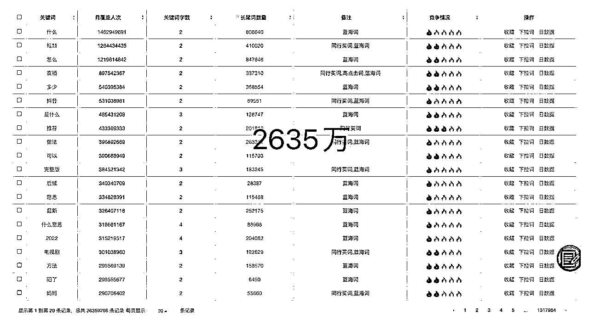

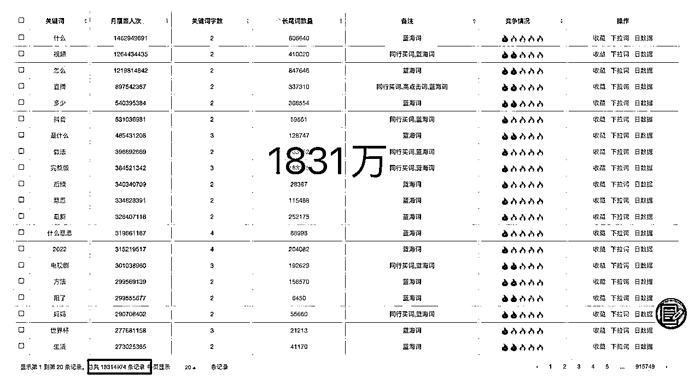

2）人的竞争

再看创作者端：我们统计了5000万条抖音KOL、KOC数据，抽样2000万条博主视频后发现，99%的博主并不懂SEO。他们作品里的标题、话题往往很短，甚至没有实际信息。

整体看，搜索里还藏着不少蓝海机会，比如下图：

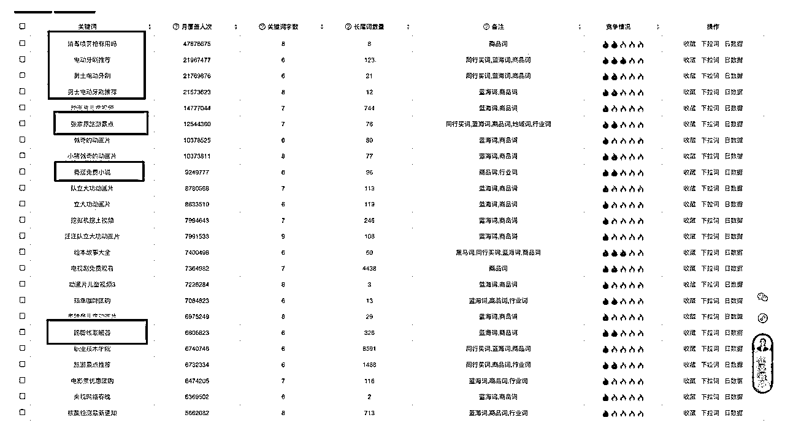

用工具扫一遍，很快能捞出高价值词。像“男士电动牙刷推荐”，月覆盖人次2157万，竞争度仅2；“番茄免费小说”月覆盖924万人次，系统竞争度也是2。类似可挖的词还有很多。

再举个实例：去年我们做了一个靠抖音SEO获客的旅游号“涵涵在杭州”，停更一年后，每天仍有约1000次搜索曝光，93%的播放来自搜索。

和自然流量比，它不必天天维护；和付费流量比，它成本更低。抖音搜索流量的好处可以总结为：
- 竞争小：仍属低洼地带，排名相对好推；
- 见效快：小词通常1—5天有反馈，大词约一个月起效；
- 成本低：无需日更，围绕一个词每月发一条即可；
- 更精准：用户目的明确，成交概率更高；
- 不违规：操作都在正常范围内。

## 1.3 高客单项目指什么

通常，成交价到四位数以上，就可以归入高客单。无论线上还是线下，这类项目其实不少见。

抖音日活超过七亿，流量池很大。数据也说明，高客单并非卖不动。越来越多线下生意、高客单生意，把销售场景搬到了抖音：
- 三一重工在抖音卖卡车，一场直播GMV超过5000万；
- 新东方烹饪学校在抖音招生，抖音生源占全渠道35%；
- 不少律师用抖音普法获客；
- 线下代办商家到抖音抢流量找客户；
- 香薰蜡烛培训班在抖音直播招生。

相比线下那套复杂营销，抖音的销售场景更轻：不用搭实体，不用养电销团队，单人也能操作。

哪些人适合做抖音高客单？
- 有实体经验，想把线下销售转到线上的人；
- 愿意研究项目，对高客单机会和线索有敏感度的人；
- 执行力强，喜欢短视频和直播，想靠抖音变现的人。
三条满足一条即可。

## 1.4 抖音SEO与高客单项目为何契合

实践下来，高客单产品更适合用抖音SEO，原因有三：

1、单客价值高

高客单产品单个客户往往就是四位数以上。用抖音SEO找精准客户，能压低获客成本；每成交一单，回报也不小。很多高客单项目原本获客成本很高，掌握搜索打法后，成本能明显往下走。再叠加搜索的长尾效应，收益会更可观。目前做高客单的学员，收益从几万到几十万都有。

2、适合精细选词

高客单客户多数是已有需求，不是被临时触发的需求，所以对精准度要求更高。一位精准客户，价值可能顶一百个泛流量。它的玩法与低客单不同，而抖音搜索的选词逻辑正好能贴合需求，筛出更匹配的人。

3、搜索用户匹配度高

高客单决策路径通常更长，用户会多方查资料、做比较，再决定买不买。搜索是绕不开的一环。抖音又是当前日活最大的搜索入口之一，很容易成为参考依据。用户搜完，如果你的内容能给出满意答案，他选你的概率就会上升。几十块的东西，可能刷到就下单；几千块的东西，通常会多查多比，这时候搜索结果就是影响心智的关键位置。

# 二、如何挖掘抖音蓝海高客单项目 @安神

💡 本章导读

在学抖音高客单项目怎么做SEO、怎么引流变现之前，有个前提不能跳过：先找到适合自己的高客单项目。

挖项目比引流更重要，别把顺序做反。应当先有项目，再倒推需要什么流量、面向什么人群；哪怕只有一个变现雏形，也别让流量先变成负担。

这一节先讲四条挖掘蓝海高客单项目的路径：
✅路径一：从问题里看见需求
✅路径二：从现有项目往外延伸
✅路径三：做高客单项目的中介
✅路径四：借选词工具找项目

下面具体展开。你也可以结合后面的项目案例库，筛出自己能做、也愿意做的方向。

精力有限时，要尽快拿到正反馈。高客单项目尤其看重精准流量和高转化，粉丝价值比表面流量更重要，不必一味追大流量。平台内容同质化后，流量获取越来越难，把每一个引来的粉丝服务好，才是更稳的做法。

## 2.1 路径一：从问题里看见需求

我自己做电商时踩过不少坑。解决这些坑，本质上就是在回应一种需求；同行大概率也会遇到。

比如虚拟商品、微商产品，做电商的人都知道侵权是高频问题。侵权有故意，也有无意，但都得处理。这里会牵出两个角色：被投诉方要找申诉办法，品牌方要持续维护线上市场。淘宝、PDD、JD、抖音、快手等平台都有自己的知识产权通道，供品牌方维权。

目前卖家违规后，市场上单次申诉收费大约2000元，也有大几千的，具体看店铺等级和销量。申诉路径大致两类：一类依据平台规则、法律法规（商标法、著作权法、裁判文书网案例等）做正规抗辩；另一类用“特殊”方式制作品牌方全链路授权资质。

第一类几乎不花什么钱，核心是吃透平台规则和法律。但正规抗辩受卖家商品本身限制，成功率有天花板。

我把这些经验整理成持续更新的案例库，放在抖音当钩子引流。很多人不愿讲这些，我反而把其中很大一部分拿出来分享，让用户感到真诚。我计划做一个社群，比如299元，包含1V1咨询、一年社群答疑、持续更新的案例库，再借社群承接第二波高客单转化。

跑通申诉后，我前后花了两年学习品牌方维权方法。实际执行方多是第三方控价公司，这行很吃技巧和经验。这些品牌维护公司常在知乎引流，我为了学，也花了几万元买过不同服务。

直接效果是：在某个电商平台，可以比较容易做到Top1，甚至垄断某个单品或大搜索词。当然，前提是你有商标、著作、专利等，可以买、租、拿授权，或自己注册。

这就是我在抖音知识付费里的定位，赛道只切淘宝平台。我不是法务，也不是律师，更不是行业里最顶尖的人，只是从自身业务周边长出来的玩法。常规电商拿流量靠补单、开车，我换了一条路，帮小个体拿流量，顺带学会侵权申诉。

听到这里，你可能会觉得选赛道不容易，得先掌握一项很基础的技能，这样最容易上手。但也不完全如此——前面说过，我每年也会试一些别的私域项目。

## 2.2 路径二：从现有项目往外延伸

我手上有七八个抖音、快手、📕账号，男女号都有，老年号、年轻号也有。这样做是让平台按人群给账号打标签，再观察不同人群爱看什么。我的项目大多是“刷”出来的：多看，从身边开始找。

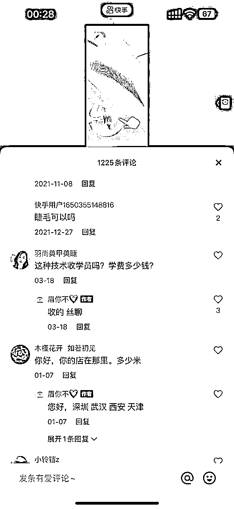

# 高客单项目与抖音SEO实操笔记

先抛一个切入点：客户线索买卖和线上课程，这条路美容行业早就有人在走，雍禾也算一个，但人家主营的是植发，这块只是捎带手。说实话，想跟这些机构搭上合作并没有想象中那么难，有兴趣的可以来深聊。

纹绣这个领域，我应该算老玩家。早年间我在淘宝开店做引流，把拿到的客户线索转手给线下机构，它们再通过🛰️群向学员推销高价技能课，一单从3000到1万都有。我的收入主要分两块：一是淘宝店卖教程，一个月大概四五万，那会儿同行普遍卖十几块、几十块，我直接挂199块，反而成了最贵的。操作方式也不复杂——把全网的课程都买回来，慢慢拆解、筛选、重新分类。二是向机构卖线索，一条几十块。

这个生意的核心，其实圈定了一群想创业的女性。现在的纹绣门槛已经低到不需要门店，拎一套设备就能上门服务。对她们来说，只要把同城线上的流量做好就行。但光靠看视频根本学不会，视频里最多能让你搞明白前期要砸多少成本、需要哪些设备、流程手法大概是什么样，最后想真正上手，还是绕不开线下的机构。

这么一看，植眉是不是就是纹绣的进阶版？纹绣是半永久的东西，隔个一年半载就得重新补一次，而且过程本身属于轻微创伤，效果也没法和原生毛发比；在大城市做一次纹绣，动辄大几千甚至上万。种植则完全不同，即刻见效、永久保持，价格虽然贵一些，但愿意买单的基本都是高净值人群，转化反而容易。

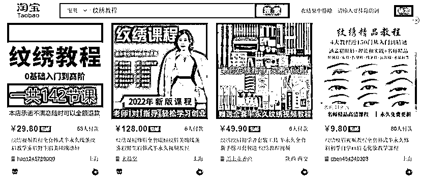

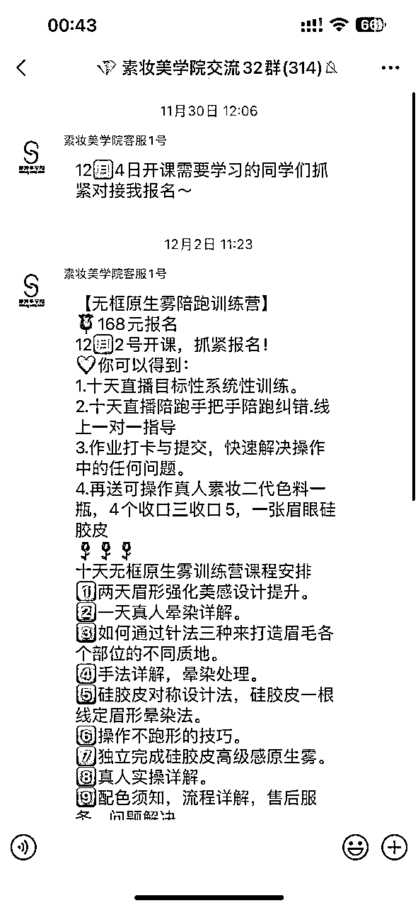

## 2.3 思路三：在中间环节赚差价

其实早在我的赚钱手册案例库里，我就留意过一个专门做离岸公司注册和维护的账号，服务内容相当于境外版的年审加代账。这个账号平时主要分享香港公司，因为做跨境的人，十个有九个需要注册香港公司。我自己在淘宝做虚拟服务时，也顺手注册了美国、英国、香港、新加坡等好几家境外公司。

价格差有多大？通过猪八戒办一家英国公司，注册费要3900元，之后每年维护还得3500元。可你知道吗，我在fiverr上找一个本地代办，60美元就搞定了。专业的事交给专业的人去办就行，你压根不用操心对方怎么搞定注册地址、联系电话这些琐事，这就跟国内代办个体户执照、食品许可、二类医疗器械一样，监管部门通常不会实地核实地址，除非你要开银行对公账户。

你只要能把流量做起来，再把这个信息差用透，项目就能自己转起来。更妙的是，只要公司一直存续，每年几千块的维护费就是源源不断的管道收入。

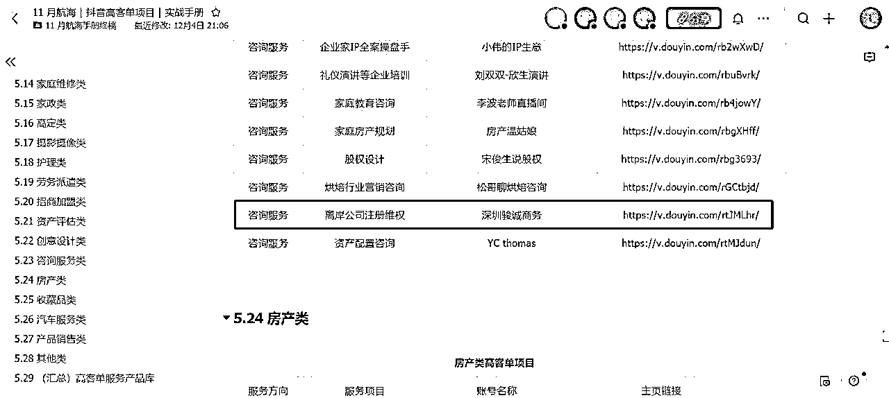

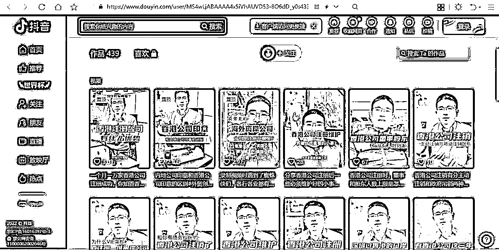

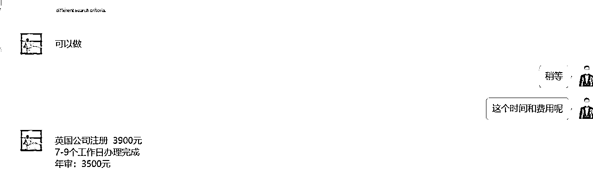

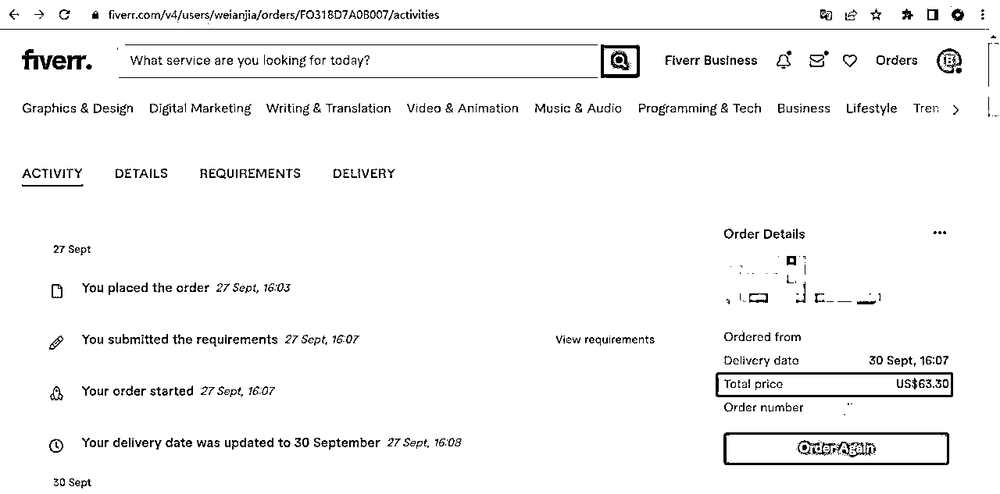

顺着这条线，我再补一个自己亲自调研过的方向，一单利润能做到4000以上。境外公司的文件要在国内使用，必须做领事认证。领事馆那边不设任何第三方代理，官方收的费用也就几十美元。但普通人没办过这事，流程全然陌生，于是代办需求就长出来了。国内那些所谓的代办机构，互相之间报价能差出一千多，这本身就是一条信息差。知乎上一堆引流的号，说白了就是倒爷。

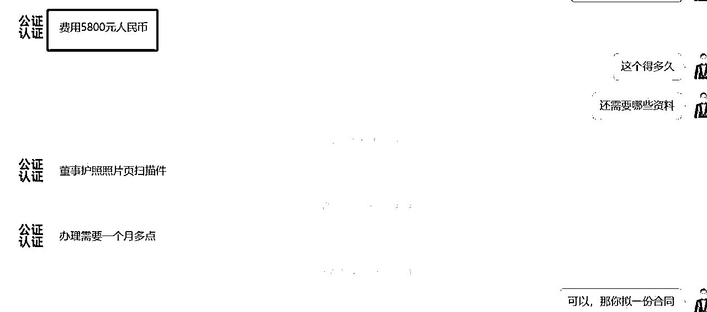

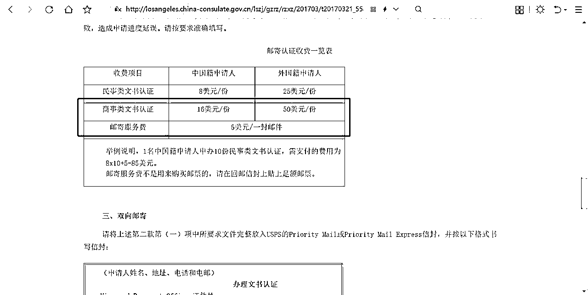

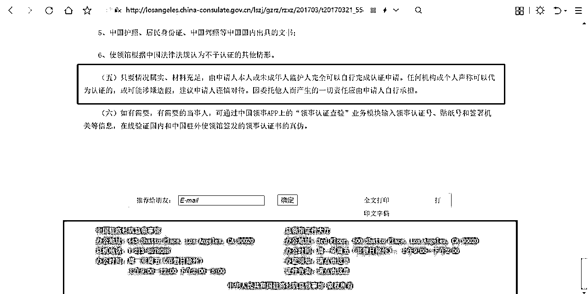

境外的文件在国内使用，需要做认证或公证；国内的文件拿到境外，也是同一个道理。还有哪些细分的玩法，大家可以去这个页面慢慢琢磨，希望你能找到适合自己的路子：http://losangeles.china-consulate.gov.cn/lszj/ 内容来源：《如何挖掘蓝海高客单项目》。

## 2.4 思路四：拿选词工具捞项目

高客单的市场里，真正需要靠灵感凭空想出来的项目只占少数，大部分早就存在。关键是用特定领域的关键词，把那些客单不低的需求筛出来，让方向变得更具体。极客增长的大数据选词工具自带一个商机挖掘模块，我来实际演示一遍。

第一步，用现有行业词根做入口。以心理学为例，打开极客增长个人版选词工具，输入词根“心理”，词库马上就出来了。

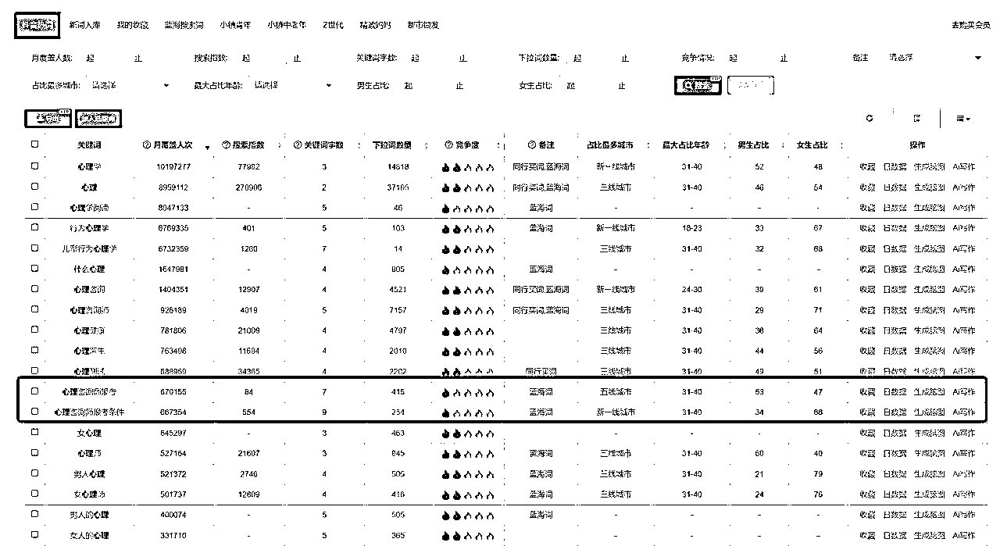

按月覆盖人次排个序，心理学相关的最热关键词一眼就能看到。翻完一整屏，会发现不少机会：心理咨询、心理测试属于大众款，而真正亮眼的是“心理咨询师报考”——这个词明显贴着高客单。懂点心理学的人应该知道，心理咨询的收费通常在300到800元/小时，可大部分咨询师一年收入不超过5万，说明这个赛道目前并不优质，坑有多深，踩过的人心里才清楚。

但心理咨询师报考完全是另一番光景。愿意真金白银做咨询的人不多，可愿意学心理学、考个证书的人却乌泱泱一大片。现在市面上已经没有国家认可的咨询师证可以考，对想做心理咨询培训的人来说，反而是个窗口期。市面上这类培训的客单价基本在3000到10万之间，确实是一块不错的蛋糕。以此类推，不止心理行业，其他领域都可以沿用这个关键词挖掘的思路。

第二步，用需求词直接反推。还是在极客选词的商机挖掘模块里，把词属性筛成“怎么”，关键词字数限制为5个，再来看结果。

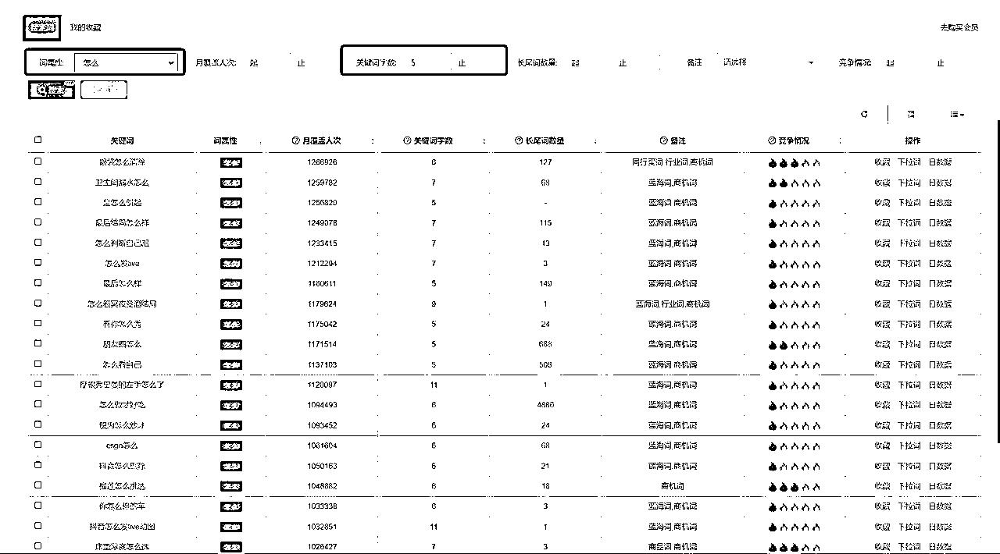

结果非常直观：“眼袋怎么消除”背后是美容人群，“卫生间漏水怎么办”“床垫厚度怎么选”背后是装修家居人群。每一个让人头疼的生活问题，几乎都能对应到一门高客单生意。

传送门：https://dyinseo.com/DouyinKeywordBusiness/index.html

## 2.5 高客单项目案例库（含230+方向）

我们结合前面梳理出来的几大方向，整理了一批能直接落地的项目，并且在抖音上找到了对应实操账号，方便大家直接对标学习。

为什么要费这个劲？因为行业实在太多，要把每个项目的执行细节都写出来根本不现实，前文能给的是通用方法论；落到具体项目时，还得靠你自己去补功课。比如落户代办要准备哪些材料？哪些信息需要提前摸清？办理窗口期是什么时候？再比如二手拖拉机租赁，上哪找合作方？上游下游的价格怎么谈？租赁协议怎么签？这些细节，锁定方向之后要自己去查、去学。我们能做的，是帮你把可选的方向圈出来，也就是这份案例库。

服务方向：项目所属的大类，例如线下代办、二手贸易、教育培训等。
服务项目：能直接落地的具体项目，也就是项目的核心关键词，拿这个词去搜资料、搭体系。
账号名称：抖音上实际操盘这个项目的案例账号。
主页链接：对应账号的抖音主页，点进去就能学习。

内容来源：2月航海｜抖音高客单项目｜实战手册

# 三、抖音SEO排名算法是怎么运作的 @令狐峰 @Hawli（李小随）

💡章节导读：用户流量在哪，商业机会就在哪。抖音SEO的价值洼地已经摆在那里，接下来就用14个问题，把排名算法的底层逻辑快速过一遍：

认证账号、核心关键词、粉丝和话题权重、发布时间、作品类型、标题内容、内容收录、作品互动数据、用户搜索后打分、提升关键词排名、PC端和手机端、作品封面、抖音矩阵、千人千面。

记住一句话：只要按抖音SEO算法的口味来，每个视频多发五分钟把细节做好，搜索流量就能被你截走。一起冲！

## 3.1 账号认证：有没有V，差别很大

问题：账号认证会影响排名吗？哪种账号优先级更高？

A：蓝V和黄V（蓝V是企业认证，黄V是个人认证）
B：普通个人号

答案选A。实际搜一个词，切到用户列表就会发现，那些有商业价值的热词，前排坐着的几乎都是蓝V或黄V，素人号几乎看不到：

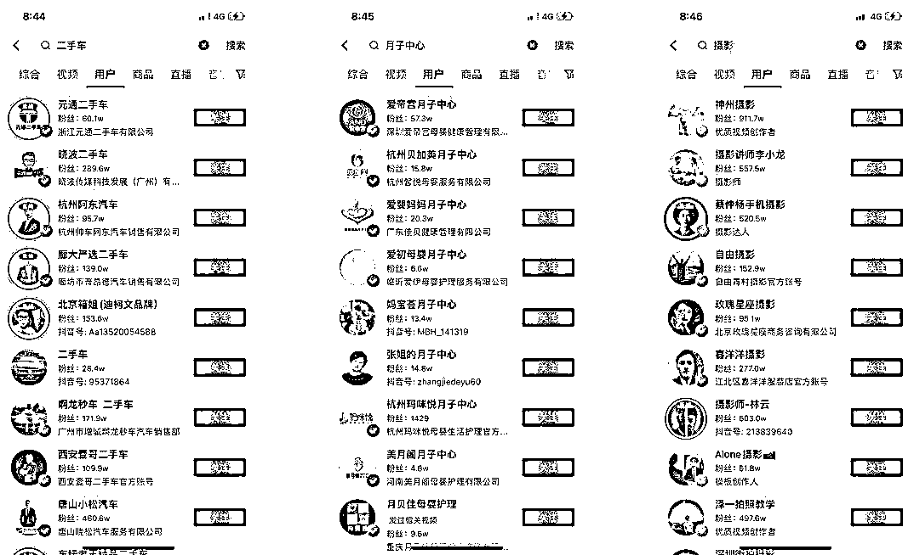

再换一些竞争激烈、可以变现的关键词，前排依然被蓝V和黄V包场：

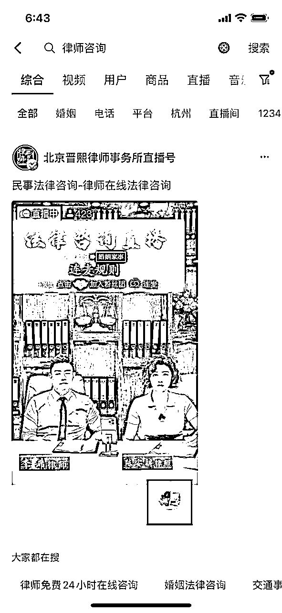

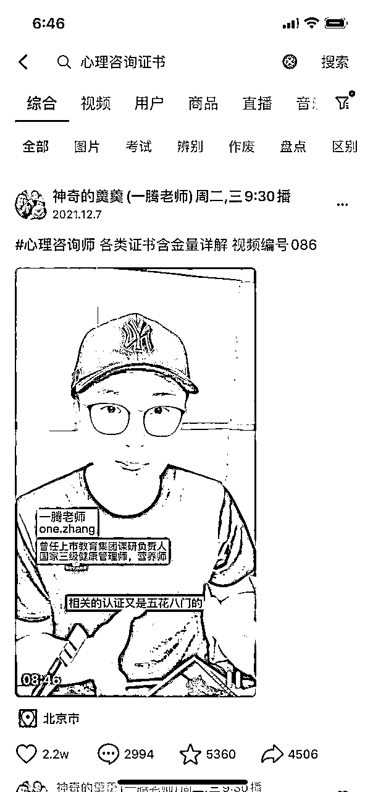

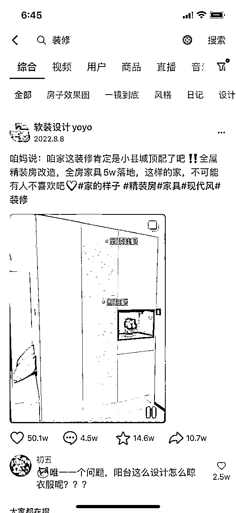

为什么平台偏爱认证号？底层原因是权重。蓝V和黄V的权重天然更高。有些领域没有黄V根本开不了口，比如医疗行业，大量的内容要求必须有医生资质才能讲。黄V代表专业、有门槛，平台的风险被摊薄了。蓝V背后是企业，有公司做背书，安全性也更高。所以认证状态自然成了算法的重要参考。

## 3.2 核心关键词：让账号名字会说话

问题：其他条件完全一样、内容也一样，哪种号的排名更靠前？

A：账号名称直接带上你想做的关键词
B：账号名称和关键词没有任何关系

答案选A。名称里有关键词，平台识别和推荐的效率更高。尤其是在直播间抢搜索流量的时候，账号名字起的作用相当明显。看下面这几张图，前两个账号名称要么包含目标词，要么是近义词。你可能会好奇第三张：搜“心理咨询证书”，账号名称里并没有这个词，为什么也能排前面？因为权重并不是单一变量，一共12种因素在共同决定排名，结果并不绝对，只能说明这个词的竞争烈度还不够。

12个排名优化细节：

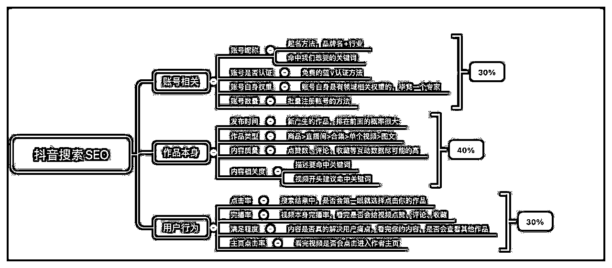

## 3.3 粉丝和话题权重：谁才是真正的王牌

题目：账号粉丝数与话题权重，哪个更重要？

A：粉丝数优先
B：话题权重优先

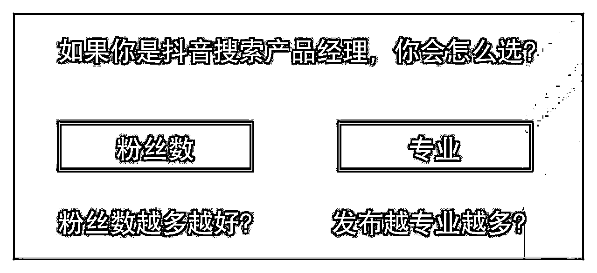

答案选B。话题权重排第一，粉丝数只能排第二。原因很简单：粉丝一多，领域就会泛；“略懂”和“专业”之间的距离，一个在珠穆朗玛峰半山腰，一个在峰顶。换句话说，你在一个话题下拿到的赞同越多，你在该话题下的排名就越稳。但粉丝数也不是摆设，它代表了博主被喜欢的程度。只能说权重优先级上，话题高过粉丝——看到别人粉丝多不用焦虑，在垂直领域持续输出，对方干不过你。反过来，如果你的产品是泛流量品，比如鞋服这种消费品，又特别喜欢直播间成交，那直接买一个几十万粉丝的号，反而是性价比很高的操作。

## 3.4 发布时间：为什么新内容更吃香

问题：发布时间会影响排名吗？

先想一个基础问题：内容发布得早和晚，本质区别是什么？

答案是信息的准确性。时间一久，原本正确的信息可能就变了。比如你写一个产品教程，结果一年后产品改版，教程立刻作废；再比如你卖二手车，车都出手了，这条信息也就没有意义了。而信息的准确性和及时性直接影响用户体验，抖音最在乎的就是用户体验，这是它安身立命的本钱，所以时间维度必然被纳入算法。

观察抖音SEO的现象，很少看到3年前的视频，多数是半年内、1年内或2年内的内容。时间还会改变竞争格局：有些词现在打得火热，如果没有数据做支撑，过一年可能反而没人抢了。不过不用太担心，后面会讲怎么让排名活得更久。另外，抖音排名的更新速度极快，有时一天一个样，甚至会用A/B测试的方式轮流展示搜索结果前几条，这就是所谓的“千人千面”。

## 3.5 作品类型的权重排序

问题：不考虑内容质量，下面6种类型的权重怎么排？

1）商品（团购）
2）直播间
3）小程序
4）视频合集
5）单个视频
6）图文

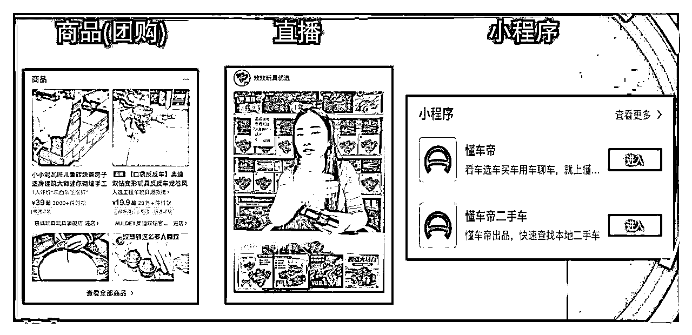

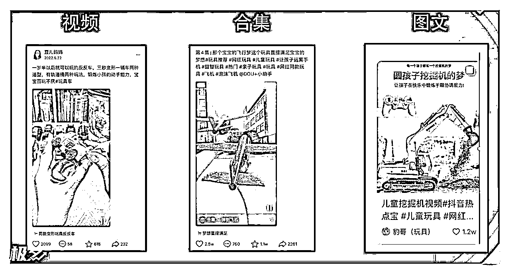

答案：1 ＞ 2 ＞ 3 ＞ 4 ＞ 5 ≥ 6，也就是商品（团购）> 直播间 > 小程序 > 视频合集 > 单个视频 ≥ 图文。

理由是什么？在不影响用户体验的前提下，尽量往商业化方向倾斜。

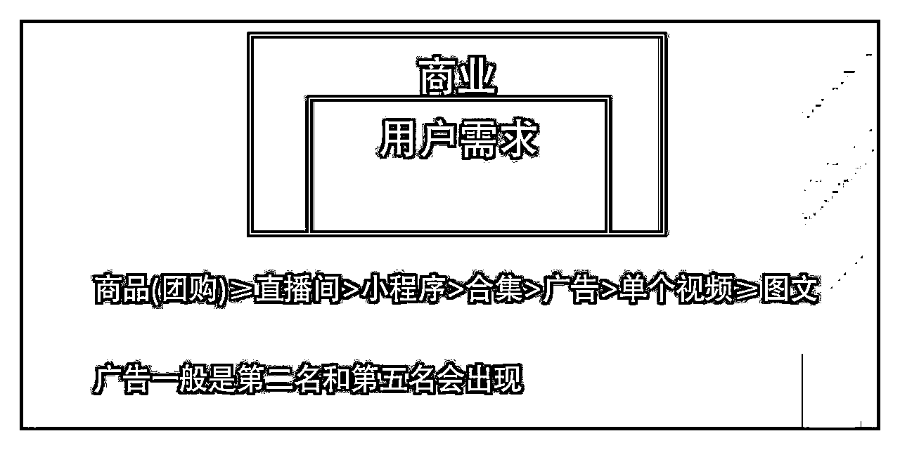

电商是抖音的核心发动机，能给平台和商家带来利润，能带货又能推荐好词的商品词虽然只占少数，但只要货能卖出去，就优先给量；直播间同样能卖货，还能把“人货场”完整呈现出来，实时互动、当场解疑，转化率非常高；视频合集则是把合集里所有视频的点赞、播放、评论、收藏数据一起计算；视频的优先级本来就比图文高，这条不需要多解释。

## 3.6 标题内容：关键词必须出现

问题：标题一定要命中关键词吗？

答案：必须（同义词也可以，但最好直接用关键词本身）。你想做哪些词的SEO，比如想做“录屏软件”这个词，那么合集标题、视频描述、话题标签、甚至视频内容里都要出现这个词。这样对抖音的算法非常友好——算法不用猜你视频在解决什么问题，用户也能一眼看到自己的搜索词。

关键词要出现在下面几个位置，并且各出现一次以上：作品描述是否包含关键词、作品内容是否提到关键词、作品合集及合集描述是否包含关键词、作品话题是否包含关键词、作品封面是否包含关键词。

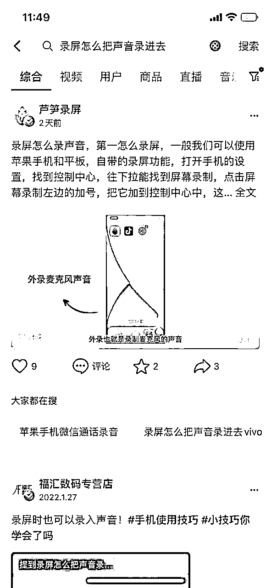

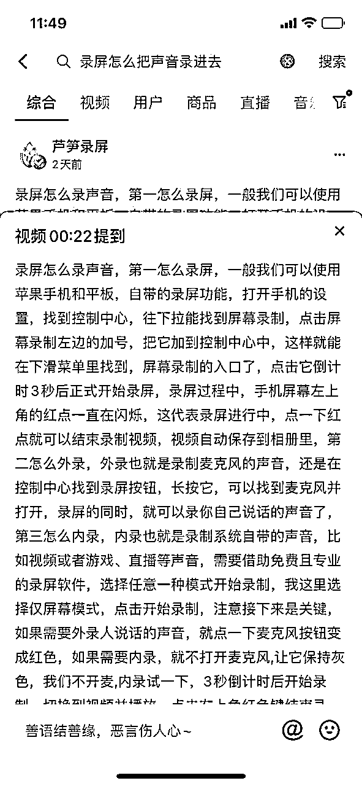

在描述里加话题有什么好处？第一，能累计该话题的权重，排名更好做；第二，排名本身就更容易往前靠；第三，还能蹭到话题合集下的一些流量。话题最多加5个，千万别放无关话题，否则会拖累推荐流量。补充一句：如果是在学课之前发的视频、没管过SEO，可以选择图1里的修改标题做优化，搜索流量马上会有起色。

30天之内发的作品，在手机端就能改标题、话题和封面。超过30天的话，需要到抖音创作者中心电脑端去改：https://creator.douyin.com/creator-micro/home

## 3.7 内容收录：怎么进入关键词搜索池

问题：发出去的内容，凭什么被关键词搜索结果收录？

答案：相关性算法 + 用户喜欢程度。

1）相关性算法。百度有一条相关性算法，专门判断内容与搜索词是否匹配。比如在百度搜“刘德华的老婆”，结果必须是“朱丽倩”，否则就算回答错误，这就叫内容相关性算法。

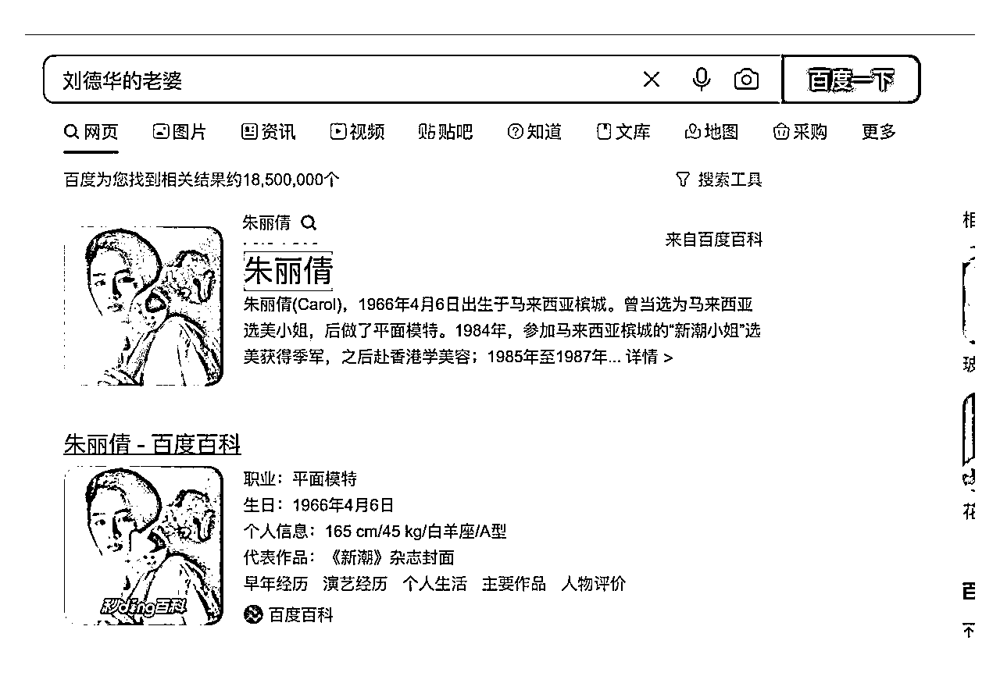

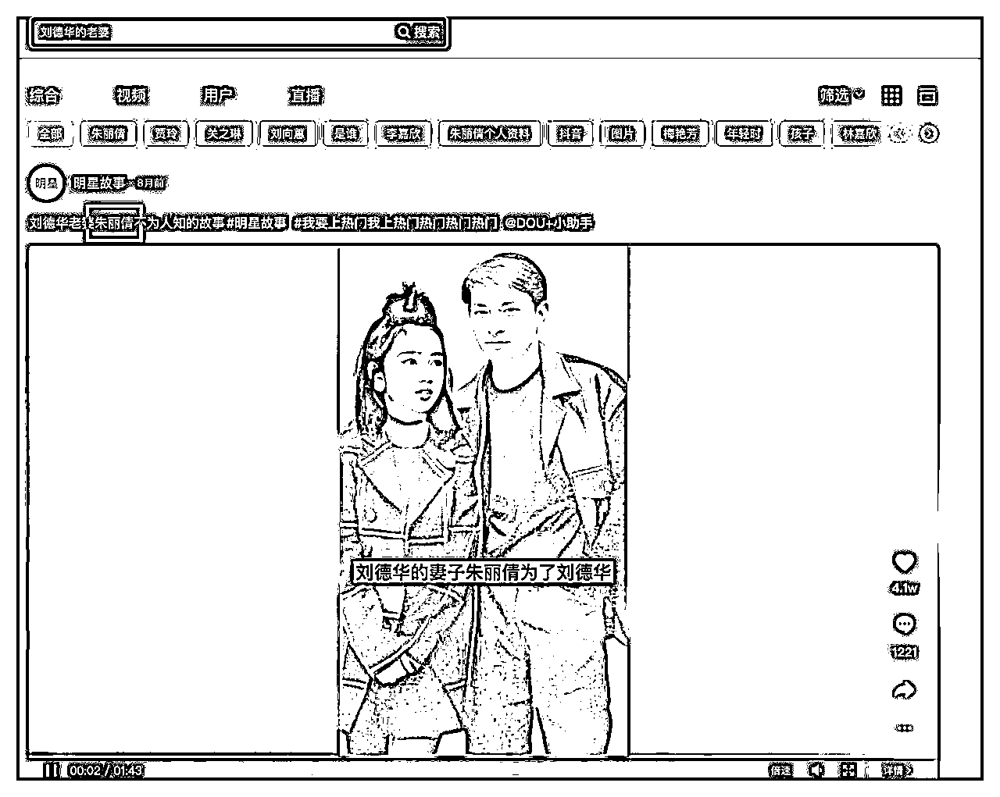

抖音搜索的逻辑一个道理，根据内容和关键词的相关度来排位，所以视频内容本身特别关键。怎么做才能既被用户喜欢、又被算法喜欢？方法一：你足够懂这个行业，能写出真正的干货——这个门槛对部分人来说偏高；方法二：把抖音搜索前5条的内容拿过来拆解，取长补短。前5条已经通过算法和用户的双重检验，你把它们的精华整合成一条视频，算法的认可度自然更高。

2）用户喜欢程度。能不能被收录，不只是算法层面的较量，还要看用户怎么给你的作品打分。最低检测线是：用户有没有看完前2秒和前5秒，也就是2秒跳出率、5秒完播率。现在抖音用户耐心极其有限，看到不喜欢的视频可能2秒内就划走。我们实测出来的参考标准是：2秒跳出率低于40%，5秒完播率高于50%，整体完播率大于8%。其次是点赞率，点赞播放比要达到3%。只有这些指标达标，作品才有资格参与排名，否则可能根本进不了搜索结果。

3）禁止堆砌关键词。有人为了做SEO，喜欢疯狂堆词。正常的建议是：一个关键词，在标题和话题中合计不要超过3次，否则容易被判定为堆砌。注意，这里的“不超过3次”是“标题+话题”加在一起算。

## 3.8 互动数据：排名的血液

问题：完播率、点赞数、评论数、收藏数重要吗？

基本不用多说，肯定重要。关键词竞争越激烈，对数据的要求就越高。因为这些数据代表的是用户对作品真金白银的认可——抖音永远站在用户一边，用户认可的内容，它才敢推荐。想快速积累这些指标，可以用抖+投放来拉升点赞、评论和收藏，帮作品攒够分数和权重。

## 3.9 用户搜索后的行为

Q：有人在抖音上搜了某个关键词，看完我的作品后，做了点赞、收藏、评论或关注，这些操作会影响后续排名吗？

A：会。

之前我们讨论过，账号权重和内容权重都是从过往数据里沉淀下来的，比如粉丝规模、领域专业度、历史作品热度。而“用户打分”恰恰相反，它看的是大量用户当下的即时反馈。也就是说，最近一段时间内，用户通过搜索找到你的内容后，究竟做了哪些动作，这些就成了“近期数据”。

抖音给搜索结果排座次时，会把旧数据和新反馈结合起来看。新反馈具体指什么？

短视频方面，包括播放后的点击率、点赞、收藏、评论、关注等操作；还有一个相当重要的参考项是“问题解决率”——用户看完你的视频，会不会转头又去点别人的视频？如果会，那就说明你的内容没有真正帮他解决疑惑。类似情况一多，排名自然撑不住。

直播方面，有进直播间点击率、停留时长、弹幕评论、礼物、粉丝团、关注、购买等。

商品方面，则有点击率、下单购买、停留时间、收藏等。

总之，用户搜索之后给出的正面反馈越密集、越积极，你的得分就会越高。说到底，把内容和细节打磨到位，才是稳稳站在前排的根本。

## 3.10 排名靠后如何提升关键词位次

问：我的视频在某个关键词下已经有排名，但位置比较靠后，比如排在第10名，这时候有没有办法往前升？

答：
1）如果作品是合集形式，尽量保持更新频率，内容质量也要跟着提上来，让整套合集的权重慢慢坐实；
2）有条件的话，可以投一点抖加，给账号和作品增加一些权重加持；
3）换个更有吸引力的封面，有时会带来意想不到的惊喜。

举个例子，有位同学搜索关键词时能看到自己的视频，但只排在第7名。后来他靠创建合集、持续积累权重，直接把排名做到了第一名。

## 3.11 电脑端和手机端的搜索规则差异

问：抖音电脑端和手机端给出的搜索结果相同吗？

答案是不相同。手机端会出现商品、广告等商业内容，电脑端通常看不到这些。我们用实际搜索来验证：搜“旅游”时，手机端有广告，电脑端没有；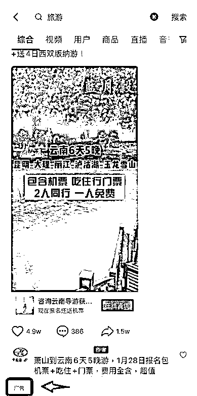 搜“益生菌”时，手机端出现商品卡片，电脑端没有；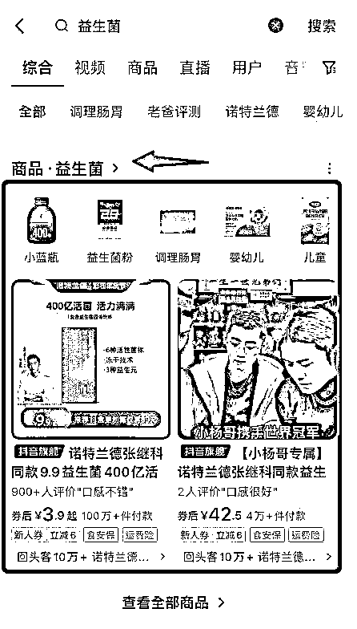 搜“懂车帝”时，手机端有小程序入口，电脑端也没有。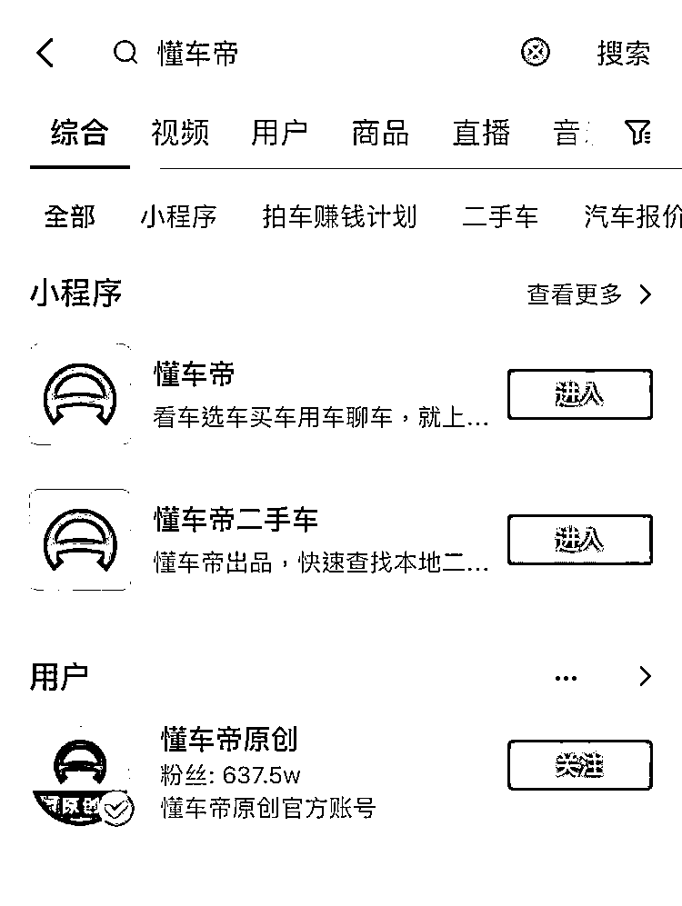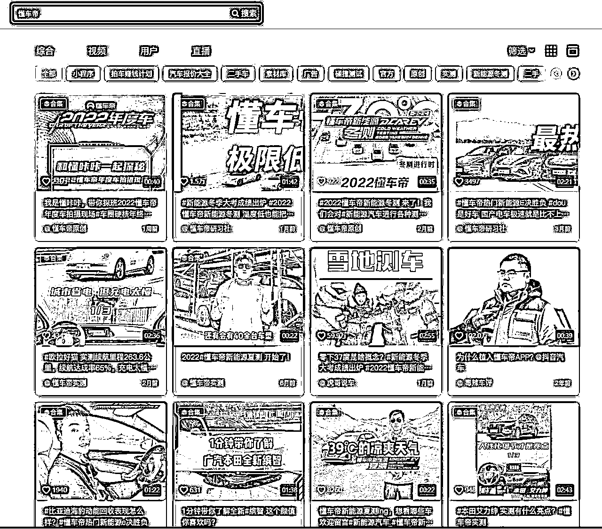

## 3.12 作品封面也能左右SEO表现

问：作品封面（包含开头前3秒）会不会影响SEO排名？

会。用户在搜索时，更倾向于点开封面抓眼的作品，这会直接推高搜索结果中的“点击率”指标。至于什么样的封面算吸引人，没有统一标准，得结合行业来看。笨办法就是多搜多看多收集，慢慢就有感觉了。

例如，能占据“二手车推荐 2 万到 4 万”这个关键词前排位置的视频，封面大多把关键词直接写了出来，因为搜索词和展示结果本来就是直接挂钩的。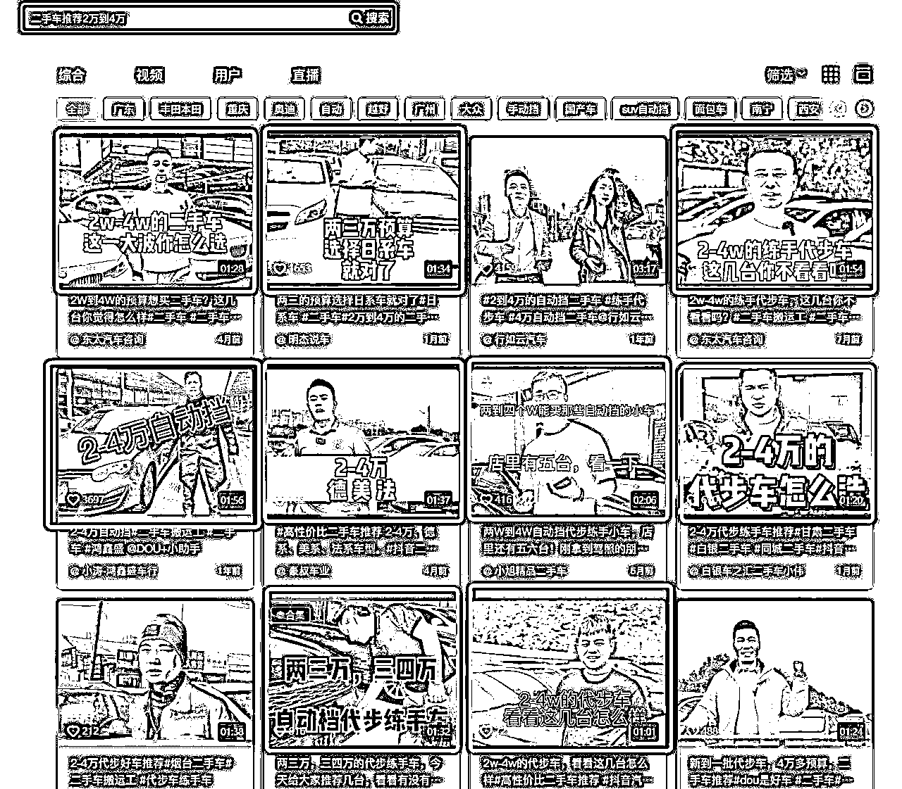

封面为什么这么关键？一方面要勾住用户点击，另一方面还牵扯到抖音的内容识别算法。抖音不仅会读取文字信息，还会识别视频画面里的文字。具体操作上，系统会对视频做抽帧检测，也就是从整段视频中抽取出若干帧画面来识别文字。

如果你没有自定义封面，系统就随机截几张图来识别；如果你上传了封面，系统就会优先识别封面上的文字。所以，封面里最好带上SEO关键词，让算法一眼看懂你在讲什么。

## 3.13 抖音矩阵有没有必要做

问：抖音矩阵有必要搭建吗？为什么要做矩阵？

做矩阵有两个核心目标。第一个是搜索霸屏，也就是让搜索结果里出现的内容几乎都来自你。霸屏带来的好处非常直接：
1）充分展示专业性。潜在客户一搜全是你，自然会觉得你有实力，从而信任你；
2）不给竞品露脸机会，客户也就无从比较和压价；
3）能分散账号风险，特别是减肥、命理这类敏感领域，更需要用矩阵来兜底。

不过在项目初期，正常的做法是先专注做一个账号。抖音一天最多能发布75条作品，按照权重积累的逻辑，把所有内容集中在一个账号上，账号权重会沉淀得更快。

第二个目标是为了冲破人群限制。有时候同一个视频在这个账号上发不温不火，换到另一个账号反而爆了。这背后其实是推荐算法在做选择，你只需要记住：抖音的结果本身就带有概率性。

## 3.14 千人千面到底是怎么回事

抖音的算法天然就是千人千面的。特别是一些竞争激烈、尤其是本地生活类的关键词，不同用户的搜索结果可能不同，这正是系统在测试不同内容的数据反馈。

千人千面具体指什么？就是不同用户看到的排序会不一样，但整体内容基本一致。比如同一支视频，有人看到它排第一，有人看到它排第五，大家的展现顺序就是有差别。而“整体一致”的意思是：搜索结果里出现的还是那些视频，只是先后顺序发生了变化。

为什么会有这种差异？

1）有人看到你的视频在第一，有人看到在第十，是因为抖音存在灰测机制。系统先把你的作品放到第一名观察数据，数据表现不好，排名就会降下去；数据表现好，排名就会升上来，直到稳定下来。

比如搜索团购类关键词时，抖音会优先把离用户更近的结果推上去。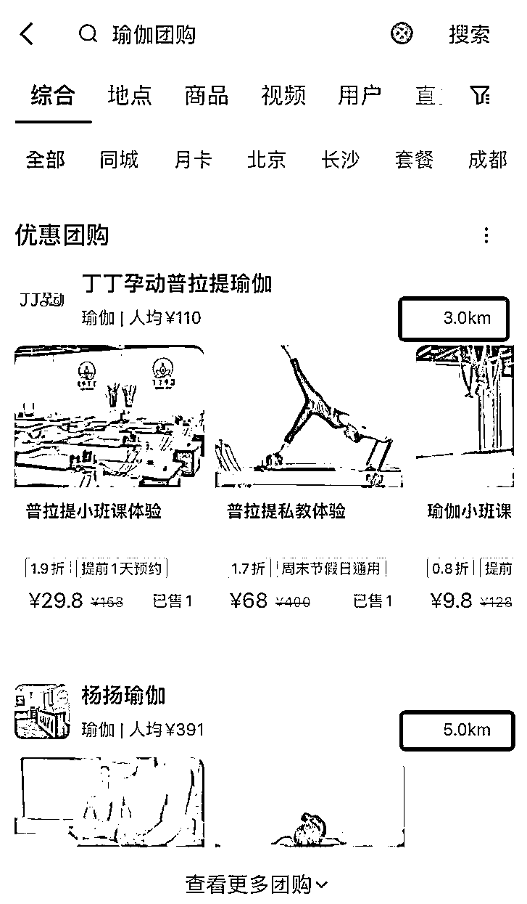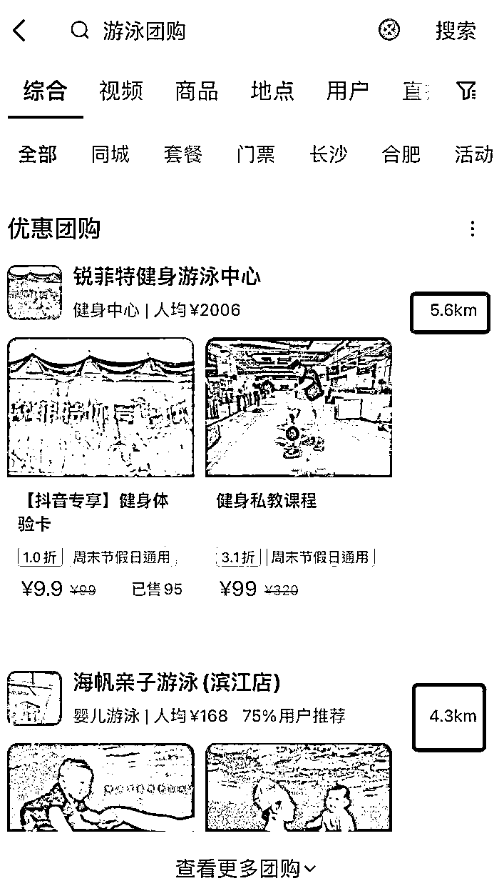

总之，抖音手机端的分发时刻在变，不同人看到的结果不一样，而且系统还会轮番展示搜索结果的前几条，用来测试哪条内容更能满足用户需求。

## 3.15 抖音SEO原理梳理

抖音搜索SEO的排名算法，本质上就是“优胜劣汰”和“蓝海思维”的竞争。我画了一张脑图，把抖音SEO拆成三个部分：账号属性、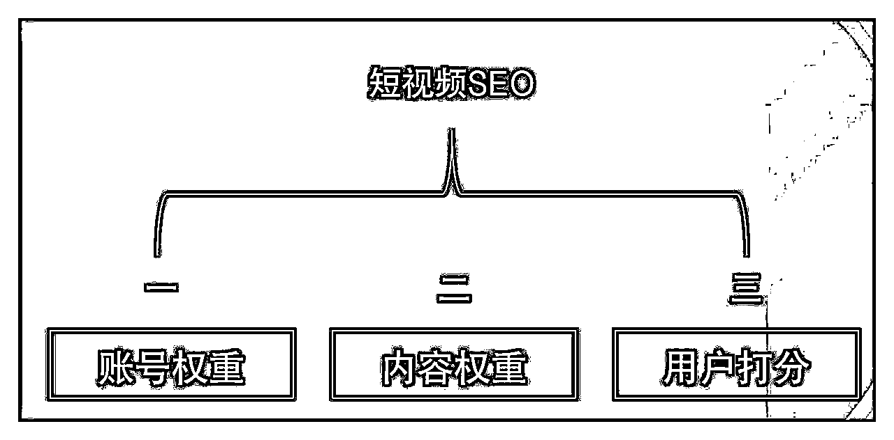 另外还有一张覆盖12个排名优化细节的脑图：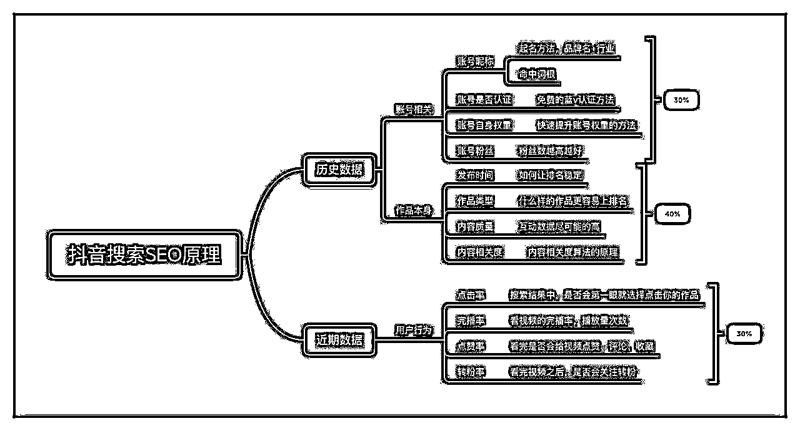

这里要特别强调蓝海思维：我们要做的，是从海量关键词中筛出真正属于自己的蓝海词。因为单个关键词能容纳的搜索结果有限，你的作品得分必须压制住竞争对手，才有机会拿到理想排名。

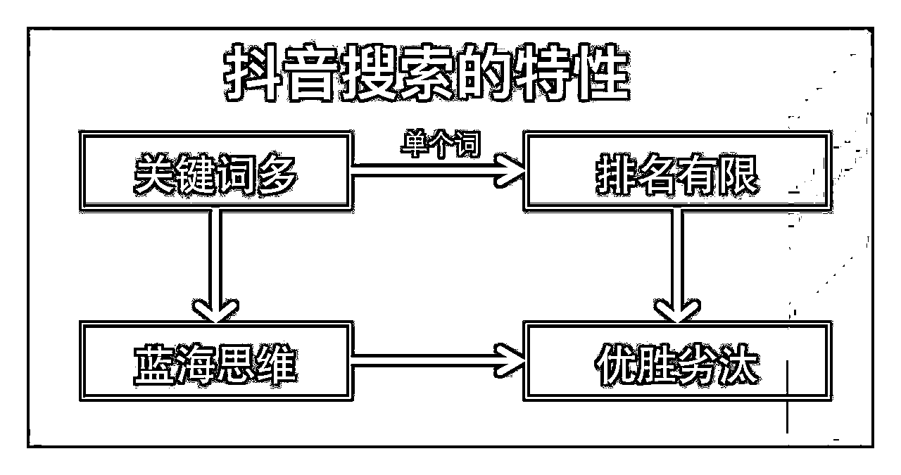

# 四、抖音SEO实操方法 @令狐峰 @Hawli（李小随）

## 4.1 搜索流量占比怎么看

章节概要做抖音SEO必须建立数据思维，用数据复盘来判断选词方向，进而优化SEO动作。而看懂搜索流量占比，是这条路上迈出的第一步。下面从单个视频和多个视频两个层面，分别给出可落地的操作办法。

### 4.1.1 单条视频的流量来源怎么看

想知道一条视频的播放到底来自哪里？想弄清楚用户是用哪些关键词搜到你的视频？具体入口在这里：

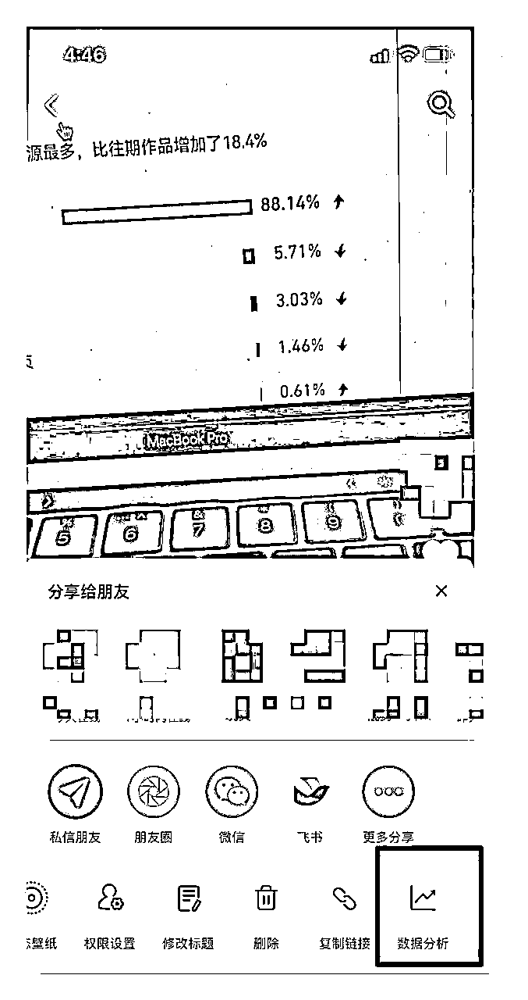
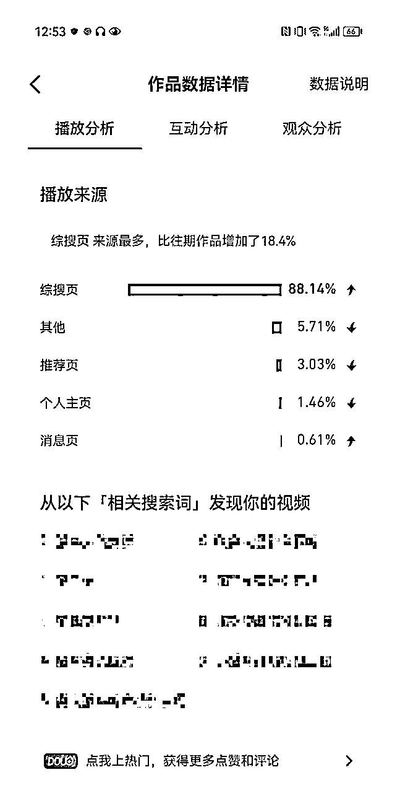

### 4.1.2 近30天全部视频的搜索流量占比怎么查

如果一条条看太麻烦，可以到抖音创作者中心的数据后台，那里会汇总所有作品最近7天和最近30天的数据情况。

详细的操作流程可以看视频演示：151_1676010352.mp4【在线播放】  
有一点要特别注意：“作品搜索量”代表的只是作品被搜索到并展示出来的数据，它并不等于真实播放量。

## 4.2 抖音SEO的核心思路

前面讲了怎么看搜索流量。抖音SEO的根本目标，其实就是持续放大搜索流量在整体流量中的占比，也就是尽可能把搜索排名往前推。

如果问我做抖音SEO什么最要紧，我会直接回答：选词。选词这件事，重要程度至少在50%以上。选择大于努力，如果方向跑偏了，之后投入再多的排名技巧也等于白费。

拿“提升记忆力”和“提高记忆力”来对比：前者的月覆盖人数是11408，后者是96962，“提高记忆力”的搜索规模几乎是前者的9倍。要是没有数据作参考，哪怕其他条件都一致，最终结果也可能相差十倍以上。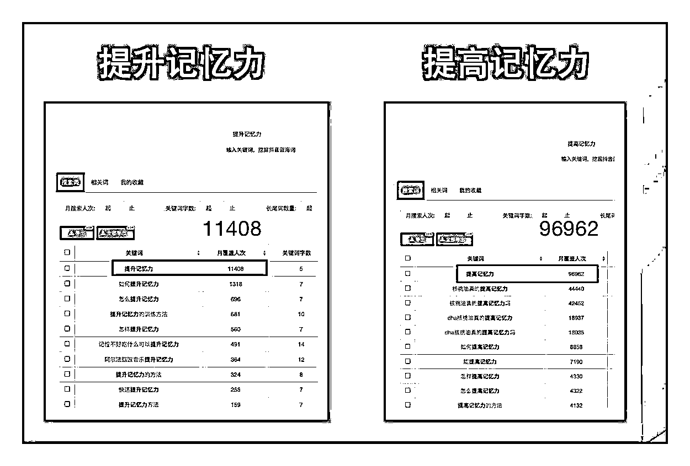

所以，抖音SEO最重要的事就是选词，而选词的核心思路就是锁定蓝海词。目前找词主要有两个流派：蓝海词流派和长尾词流派。

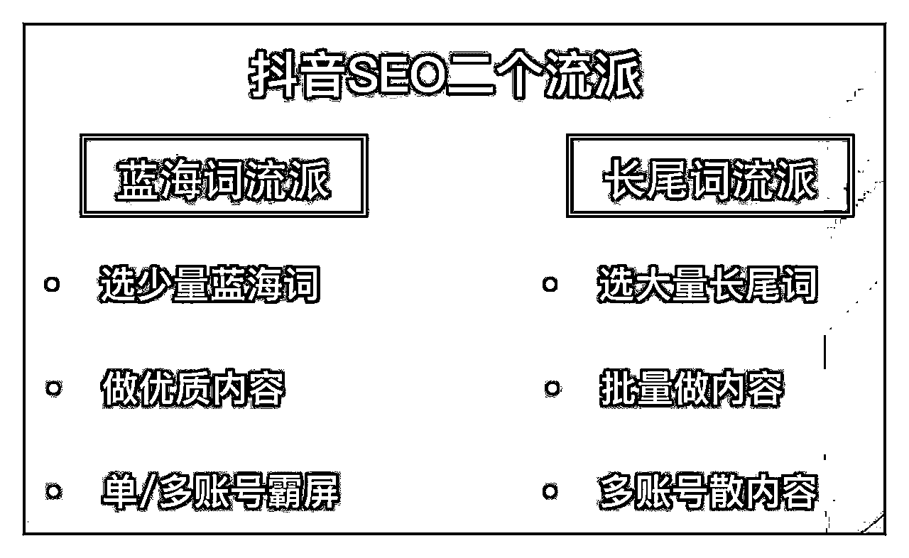

蓝海词流派：只盯少数蓝海词，数量控制在100个以内。这些词的月搜索量平均在几万量级，做内容时就围绕这组词死磕。做完一轮之后，还可以换一个账号把这组词再做一遍，从而达成关键词霸屏。

长尾词流派：选大量关键词，1000个起步，上不封顶。数据显示，词越长竞争度大概率越小，因为越长越冷门的词，被其他博主靠运气撞上的概率越低。这类词多数来自抖音下拉推荐，月搜索量通常在1000以内，适合用批量低成本的方式生产内容。

为了提高搜索数据，一个作品不要只攻打一个关键词，可以同时布局3-5个词，前提是这些词都与内容高度相关。

长尾词流派遇到的最大难题，是怎么快速找到充足的下拉词。你可以用下面这个链接批量获取抖音下拉词，并且支持数据导出：
https://www.dso100.com/DouyinSugKeyword

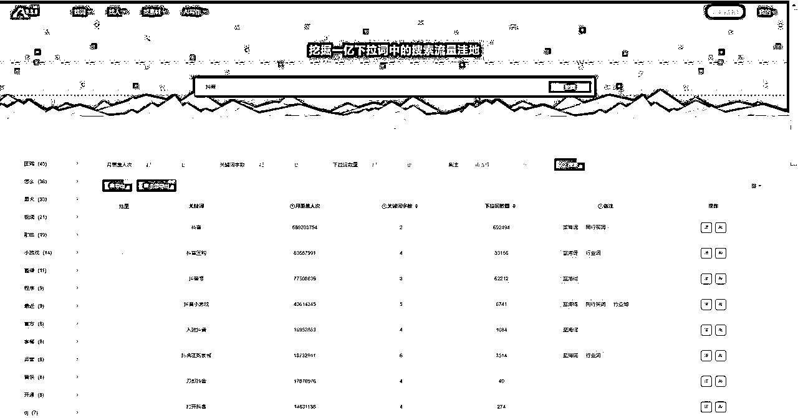

## 4.3 蓝海关键词去哪里找

章节概要在抖音SEO里，选词几乎就是决定成败的核心环节。可按照常规操作，要选出既有商业价值又相对蓝海的关键词，既费时又费力。

考虑到航海的时间周期，我们希望帮大家降低选词的难度，让大家在21天里能把重心放在内容创作上，真正跑通“关键词→流量”的闭环。所以，我们向每一位同学争取到了一个大福利：「极客增长」个人版选词工具1个月免费使用权。

这一章会详细说明福利怎么领、工具怎么用。这部分是全手册的重中之重，大家一定要结合工具认真实操、尽快上手。如果在航海中遇到问题，也可以随时向教练求助。

### 4.3.1 极客增长工具的操作方式

选词工具地址：https://www.dso100.com/

1个月免费名额领取办法：开船后我们会统一收集手机号并开通权限，请大家及时关注航海群里的官方公告。

电脑端教程：DSO工具教程（查词+AI）  
移动端教程：飞书 20230301-125857.mp4【在线播放】

### 4.3.2 搜索数据字段分别代表什么

这是极客增长工具的搜索结果面板，下面把几个关键字段给大家讲清楚：

1、日数据  
它衡量该关键词在抖音上一天内的累计搜索次数，同一个人可以多次搜索。

2、月覆盖人次  
它统计的是该关键词及其所有长尾词加在一起的总覆盖人次。同样，一个人可以搜索多次，所以这是多个关键词叠加后的累计结果。

3、关键词字数  
关键词越长，通常机会越大，因为很少有人会主动盯住那些又长又偏的词。

4、竞争度  
数值从1到5，1表示竞争最小，5表示竞争最大。但这个数字只能作为初步参考，它主要是根据内容数量估算出来的，最终竞争强度还得结合自身账号和内容情况来判断。毕竟竞争度是相对的，账号粉丝越多、内容越强，同样的关键词对你来说就越容易做。

5、备注字段  
黑马词：流量正在显著上升的词；  
同行买词：同行业广告主投放覆盖度比较高的词；  
高点击词：用户点击意愿明显偏高的词；  
蓝海词：搜索量大但竞争还不算激烈的词。

## 4.4 借助选词工具确定关键词

### 4.4.1 选词的三条主流路径

路径一：围绕产品/解决方案选词。  
比如你做的是婚礼主持服务，那么核心产品/解决方案就是“婚礼主持/婚庆司仪”。这是大多数人第一时间会想到的选词角度。但要注意，必须从用户习惯的搜索叫法出发，而不是从自己的行业叫法出发。比如用户想找婚礼主持，可能搜“婚礼主持”，也可能搜“司仪”“四大金刚”。

从上面可以看到，不同叫法的搜索量级差距很大，所以要尽量选择大众更常用的说法。

路径二：围绕用户需求和痛点选词。  
举个例子，有人做失眠调理，那么“失眠”就是用户的需求与痛点。用户会围绕“失眠”搜索相关内容，而你作为提供解决方案的人，就需要顺着这些需求去做内容，让用户觉得你的方案最适合他，转化率才会更高。

路径三：围绕场景和人群选词。  
很多需求只在特定场景或特定人群中才会出现，比如“新房除甲醛”。大多数人的除甲醛需求，都是在买完房、刚装修完之后产生的。围绕这类场景和人群创作内容，用户会主动对号入座，觉得内容就是为他准备的，自然更容易被打动。

### 4.4.2 本地关键词如何撬动更多流量

搜索带有地域属性的词时，搜索量往往偏小，原因来自两个方面：
第一，主词本身的搜索量就不大，再分摊到各个城市，自然就变得很小；
第二，很多人在搜索时并不会带上地域，系统会参考用户标签，自动把距离更近的店铺或内容推给他。

基于这个逻辑，做本地关键词时，可以直接挑一个主词，然后带上地理位置POI。这样系统就会自动把内容推送给周边用户，不会因为只用了地域词，就把那些忘记带地域搜索的用户白白挡在门外。

### 4.4.3 先算一笔账，再判断搜索量值不值得做

选词时到底该看多少月覆盖人次？其实没有标准答案。它取决于你所在的阶段、客单价和转化能力。

收益 = 客单价 × 搜索量 × 曝光量 × 线索率（转私域率）× 转化率

假设客单价是5000元，搜索量（月覆盖人次）是10000，排名前5能获得50%的曝光，曝光后引流到私域的比例是10%，最终转化率是5%，那么一个月的收益就是：
5000 × 10000 × 0.5 × 0.1 × 0.05 = 125000元。

算完这笔账，你就能清楚地判断这些词该不该做，以及该投入多少精力与预算。

所以，我更建议老板们去经营高客单价产品。客单价一旦上去，对关键词的要求就不会那么苛刻，哪怕搜索量很小也值得做，因为只要成交一单，回报就很可观。

选词时把以上这些要点想清楚，做搜索这件事就已经成功了一大半。

## 4.5 长尾词怎么选 @马钱钱

### 4.5.1 先理解用户的搜索意图

长尾关键词的底层逻辑，就是让作品内容和用户搜索背后的真实意图精准对上。

我们可以做个假设：有个人马上要换工作，搬到另一座城市生活。他自己有一辆电动车，丢掉太可惜，当二手卖掉又太亏。要是能托运到新城市，那就可以继续骑。这时候，他真正的需求就是“电动车托运”。

围绕“电动车托运”，他会关心哪些问题呢？无非是托运的运费、价格，能不能托运到某个城市，托运过程有什么注意事项，会不会弄坏、刮花，怎么打包，要不要买保险等。

把这些问题做成一套视频合集，站在用户角度提供有价值的信息，并用真诚的态度去分享，用户是能感受到的。

如果你是做物流或托运服务的，就可以定位到骑行人群，针对性地输出内容，甚至可以从“电动车托运”延伸到“摩托车托运”。

也就是说，从自己的产品、业务出发，去深入挖掘用户搜索背后的真实意图，才能吸引到更精准、更垂直的潜在客户。

### 4.5.2 用字母组合做关键词调研

这里介绍一个方法：把【关键词+字母】组合起来，用来扩展长尾词。以“电动车”为例：

一个关键词搭配26个字母，至少能产生260个相关话题。接下来只需要从这些话题中筛选过滤，把与自身业务相关的词挑出来，作为短视频创作的主题，再按对应话题提炼出爆款标题放到封面上，一条作品的基本框架就成了。

而且，“电动车”这个核心词并不是固定的。换一个核心词，再配合26个字母，就能继续生成一大批新的长尾关键词。

### 4.5.3 多工具一起用，话题源源不断

这个方法能帮你在创作话题时打开思路，获得更多灵感。

第一步：根据自身产品和业务，先收集大量话题方向，收得越多越好，然后把它和不同的流量词组合起来。

公式：非同义词的流量词 + 和“XXX”组合 + 可以创作的话题

比如流量词用“电动车”，中间“XXX”部分需要自己发挥，再结合可创作的话题，就能延展出一大片内容方向。

# 抖音SEO七步走：让搜索流量替你带客

做抖音SEO，第一步不是急着发视频，而是先把方向校准。整套流程拆开看，无非是锁定选题、摸透关键词、办好认证、搭起合集、打磨内容、投对流量这几件事，每一环都藏着门道。

选题要和自家生意紧紧咬合——话题离业务越近，聚拢的粉丝质量越高，成交路径也越短。

比如围绕「电动车」，再分别搭配“价格”“电池”“瑕疵品”这些词，就能裂变出一整片选题。

接下来，用工具做批量组合：
https://seoscout.com/tools/keyword-combiner
http://kombinator.org/
懒得找工具的，直接在谷歌检索“Merge words”或“Keywords Combinator”也行。

第三步，把生成好的选题提示词填进关键词库表，一边头脑风暴，一边套爆款标题模板批量出稿。

内容来源：《如何用谷歌 SEO 的内容营销方式做抖音 SEO》

## 4.6 把抖音SEO效果拉满的实战路径

### 4.6.1 路径一：选词要抠细节

想摸清抖音当下的热门搜索，可批量拉取关键词数据，入口在这：https://www.dso100.com/KeywordDouyin

想要更细颗粒度地筛词，可以按这个流程走。

第一步：打开极客增长工具，输入你瞄准的词。
拿「创业」试一下，返乡创业、餐饮创业、农村创业这些方向，搜索需求旺盛，竞争度却偏低，属于典型的低竞争需求区。
提示：工具标注的竞争度和蓝海词只是辅助判断，适不适合自己，还得看制作能力。

第二步：展开下拉词，看背后数据。
锁定一个蓝海方向后，点开下拉词入口，能挖出更多真实搜索需求。例如：

会呈现出下面这些需求：

查询时有个小门道：直接搜大词，结果里杂质很多。像搜“二手车”，价格、推荐、交易市场、直播等维度全冒出来。可你只想要“宝马二手车”的词，单搜又嫌量少。

这时把词写成“宝马 + 二手车”，即“词A + 词B”，结果就丰富多了。

如果想过滤掉“二手车”，加个减号：词A - 词B，意思是不想让这个词出现。
如果想两个词出现哪个都行，就并排写：词A 词B。

选词有几条铁律：
- 涉及同城生意，区域范围必须卡死；
- 月搜索几十的词直接跳过；月搜索百万级的大词先别碰，练出手感再接；
- 竞争度偏高的词，算不上优质词；
- 意图模糊的词不能用。字越多指向越准，字越少越含糊，建议选四字以上；
- 同行视频里大概率会讲烂的词，别跟风，例如“社群营销的六大核心流程及打法”；
- 品牌词往往转化更好，自家品牌能用，竞品品牌也能用；
- 客单价越高越值得投，低客单除非搜索体量足够大，否则没必要争搜索排名。

不过，“搜索量大就一定好”这话得打个问号。
背后有两层隐藏逻辑：搜索量既牵动转化率，也牵动客单价。
更靠谱的结论是：转化率和客单价都占优的词，搜索量越大才越值钱。当然，最终还要回到你的业务形态。

场景演练：
假设你做本地同城二手车买卖，下面这些词里，哪些该做、哪些该放弃？看图。

正确答案

补充技巧一：多词覆盖法 @雅士哥哥
一条视频里，大词小词都塞进去。
比如你要攻「草莓蛋糕」，用户可能搜“草莓蛋糕怎么做”“草莓蛋糕的做法”，那么关键词不妨定成「草莓蛋糕做法」。“蛋糕的做法”覆盖大面，“草莓蛋糕做法”抓住细分，两头都吃到。

内容来源：《通过五个操作方法，实现快速上排名的技巧分享》

### 4.6.2 路径二：拿下蓝V与黄V

排名权重从高到低大致是：蓝V/黄V > 关键词精确匹配 > 真人出镜口播 > 其他因素。前三项带来的加成远超剩余项，所以认证这件事，能办就尽快办。

蓝V如何申请？
通常只有企业或个体工商户具备申请资质，标价600元。但如果你已经开了抖音小店，这笔钱可以免交。

黄V认证入口：设置 -> 账号与安全 -> 申请认证。

### 4.6.3 路径三：用合集抢排名

看个实例：“买房攻略”月搜索约15万，一条仅66个赞的视频却挤进了前排。秘诀就是做了合集，关键词被完整覆盖。哪怕互动数据拼不过别人，合集策略依然能把它托上去。

怎么建合集？进抖音创作者服务平台操作：
https://creator.douyin.com/creator-micro/content/collection/manage

合集有两个坑要避开：
第一，放进来的内容必须主题一致，乱塞无关内容会拖累排名。
（内容来源：《我是怎么做到连续 3 天，视频达到 10w 播放和关键词排名第一的》）
第二，每周至少排查一次作品有没有被限流，违规的要撤出合集，同时补一条新视频顶上空位。
判断方法：电脑端登录创作者中心，进入“内容管理-作品管理”，看到“需优化”三个字，基本就是违规了。

（内容来源：《抖音 SEO 如何维持排名，提高引流效率》）

### 4.6.4 路径四：视频质量硬起来

（一）拍摄环节

刚切入高客单产品SEO，建议先上“大字报”款式：实拍 + 文案 + BGM（或配音讲解）。
这类内容制作门槛低、能批量复制，完播数据也不差，可以先跑起来。

（内容来源：《如何通过抖音 SEO 卖一套房，我选词的小技巧和文案查重避坑分享》）

下面是可照搬的拍摄流程。

1）器材清单 @封伟-自动化变现
后期软件：剪映、智能剪辑、美图秀秀、PR、AE之类。
硬件：手机或相机、三脚架、稳定器、收音麦克风。
场景道具：幕布、小摆件、补光灯、灯箱。
人手配置：三人一组最顺，一人拍、一人演、一人提词。
硬性要求：尽量真人露脸。平台给真人内容更多倾斜，容易立住IP，筛粉更准，也更能长期做。

（内容来源：《3 人新手团队，0 投放抖音涨粉百万，转化注册用户 20 万》）

2）标准拍摄步骤 @光光
整条链路是：剧本先行，把故事脉络、角色、场景定下来；再拆成分镜去实拍或录屏；素材到手后配音；最后进剪辑台出片发布。

（内容来源：《实操分享：一个人、零基础、业余时间、从 0 到百万粉的【保姆级教学】》）

3）四种常用拍法
- 手机怼脸：省成本、省动作，脚本一备好随时开拍。但前提是内容输出够硬、个人魅力够强，最好再设计一个“视觉锤”，让观众过目不忘。
- 采访对谈：提问者先扔一个有争议的钩子，再让受访者打开话匣子。真实感强、亲和力足，适合经历丰富、故事多的大佬。策划好选题，用问题牵出内容，多机位批量产出很高效。
- 侧机位念稿：机位固定，提词器辅助念词。适合背不下台词的人，但表情、手势必须在线，念出来要有起伏、有重音、有可信度，同样便于多机位量产。
- 场景化叙事：口播讲自己的经历，配上贴合文案的画面。这种玩法需要专业班底，懂镜头语言和构图设计。把生活片段放进去更有说服力，还能顺手展现实力。

（内容来源：《航海实战｜抖音-垂直 IP 号｜实战手册 》）

4）拍摄细节
- 语速压住。说太快，观众会莫名紧绷。
- 画面透亮。挑好灯具或亮堂场景，让脸和背景都柔和，别拍成黑乎乎一片。
- 声音带戏。短视频本质是情绪生意，声音最容易撬动情绪。语调里的能量和感情，比画面更直接。
- 配乐选熟。背景音乐负责烘氛围，优先挑那种耳熟却叫不出名字的曲子，用户接受门槛低。曲目最好从热榜里找，情绪指向要明确。但记住，配乐永远不能压过人声，人声才是主角，同时留意整体音量，别小到听不见。
- 发布之后，把音量调到和别人一样，横向对比一下，及时优化。

（内容来源：《航海实战｜抖音-垂直 IP 号｜实战手册 》）

（二）剪辑环节

1）工具盘点 @Alan
电脑端：剪映PC版、PR、AE、Final Cut（上手相对轻松）。
手机端：剪映、快影、秒剪（视频号官方出品）、字说（做文字弹幕）、来画动画（PPT转视频）。

纯新手建议直接用剪映，尤其电脑版。你要是从没碰过剪辑，打开软件一头雾水，那就别折腾，选它没错。PR和Final Cut Pro对小白不够友好，操作一复杂人就容易烦，最后弃坑。剪映胜在傻瓜式，反馈来得快，容易坚持下去。

拍摄剪辑的详细教程网上很多，这里不展开。想学的，去「剪映」里翻：

「下载剪映，点击下图按钮即可学习」

资料包：《剪映 APP》49 节零基础入门视频教程
剪辑小技巧：https://articles.zsxq.com/id_rez6536bn6so.html

（内容来源：《航海实战｜抖音-垂直 IP 号｜实战手册 》）

### 4.6.5 路径五：用抖+放大战果

新号最难受的地方在于：用户画像还没成型，铁粉也没攒下。你花大把时间磨出一条好内容，系统却不知道该推给谁。人群不对，互动自然惨淡，作品很难爆，点赞也上不去。

但付费投放是个放大杠杆，能帮你干成三件事：
一是用付费流量撬开自然流量。互动数据一旦起来，内容就有机会冲进更大的流量池；
二是把互动数据直接抬上去，作品权重跟着涨，SEO效果也出来了；
三是筛出有爆款相的内容，快速拉粉，把基础盘撑大。

哪些作品值得投？
- 在目标搜索词下已经能搜到你，但位置靠后（比如二十名开外）；
- 数据出现“异常值”的作品，投起来回报最高。

异常值怎么理解？
点赞、收藏、评论、转粉率这几项里，任意一项比日常水平高出三分之一以上。
举例：平时一条作品的综合互动（赞+藏+转）在50以内，评论不到10条；某条突然冲到80到130甚至更高，那就是异常值。
当然，这条内容得真能体现专业度、涨的是精准粉，才值得掏钱。要是标题里还埋了目标搜索词，投放效果会更香，还能顺带吃到搜索流量。

1）投放目标选哪个？
起号阶段做抖+，目标应该定在？
A. 点赞评论量
B. 粉丝量
C. 主页浏览量

答案是A：点赞评论量。

原因很直接：新作品的基础互动太寡淡，投点赞评论能迅速把数据堆出个样子。有了底子，路人才愿意跟风点赞、留言。
不少人刷视频先看评论区，你评论冷冷清清，别人连参与的欲望都没有，完播率也会被拖累。再加上大家都有跟着大众走的倾向，数据越好看，越有人愿意点。

那粉丝量为什么不选？
投粉丝量时，平台为了交差，很可能把一批“见谁都关注”的人塞给你，而不是你的目标客群。比如推来一堆五十来岁的大妈，粉丝数是达标了，可后续流量分发要吃亏。
花钱买来的关注，未必真心认可你。他们可能顺手一点，之后刷到你的内容也不点开，这会拖累账号后续作品的推荐表现。

反过来，投点赞评论有机会帮你冲破当前流量池，因为互动数据是加权的：
完播：10分
点赞：8分
评论：5分
转发：3分

等一条作品的赞评被喂起来（比如两千赞、两百评），还能吸来精准粉，这时候再投涨粉，才是顺水推舟。

2）投放时长怎么定？
如果让你选投放时长，你选哪个？
A. 2小时
B. 6小时

先看各档差别：
2小时：点赞评论跑得快，但人群匹配粗糙；
6小时：同样快，精准度略好一点；
12小时：系统有足够时间摸索，已经比较准；
24小时：跑满一整天，精准度最高。
超过24小时的档位就不讨论了。

答案是：先投2小时，再补一单24小时；或者直接上24小时。
为什么？因为我们图的是两样东西：基础权重，和精准粉丝。
人会跟着大众走，这个规律摆在那：点赞少，别人懒得点；评论少，完播率就低。
所以先花100块投2小时赞评，把基础数据快速托起来；紧接着追一单24小时，让系统慢慢找人。
如果你对内容互动有底气，直接投24小时也行，让系统从容匹配，拿性价比最高的流量。
6小时和12小时更适合覆盖特定时段上线的人群，比如你专攻深夜流量。
蓝V账号投放没有2小时选项，用6小时顶上即可。

3）投放人群怎么设？
系统智能推荐，还是达人相似？
A. 系统智能推荐：100元5000播放
B. 达人相似投放：100元2500播放

粉丝画像已经成型，选A；还没成型，选B。
怎么判断画像对不对？看看点赞列表里是不是混进了大爷大妈，评论区是不是精准人群，如果是，说明模型没问题。这时候选智能推荐，能拿到5000播放。
毕竟抖音算法在全球范围内都算顶尖，算法本身就是它的护城河，相信系统不吃亏。

刚开始做号的人，通常会把“相似达人定向”作为首选投放玩法。但这个玩法到底在投什么？它瞄准的并不是某个具体达人，而是这位达人近期热门作品沉淀下来的粉丝人群画像。打个比方：一位博主因为夸某件产品好突然火了，但他自己并没有在卖这个产品；这时候你替他这款产品做投放，把链接推给这类人群，往往能收到意想不到的效果。

选对标账号是个需要格外用心的事，基本的标准有两条：1. 目标达人的粉丝要非常垂直，最好是他才刚刚把号做起来不久；2. 粉丝总数尽量不要太高，不然人群构成会比较杂，控制在1万到10万之间更合适。如果实在挑不出对标达人，也可以退回自定义模式，手动把年龄、地域、兴趣喜好、性别这些维度划分清楚。

4）什么情况下适合开自定义模式？
如果一条内容对用户的性别、年龄段、所在地区、兴趣标签有明确限制，那就直接用自定义定向。

5）为什么会出现Dou+无法投放的情况？
平台其实很愿意把好内容推出去，但下面这些作品会被拦下来：1.质量不达标：没有核心内容、画面模糊、暴露出产品缺陷、静帧不动、画面被拉伸变形、破坏景物的3秒及以下短视频、看完让人明显不舒服的内容。2.搬运类：视频里显示的ID和上传者ID对不上、账号被打上搬运号标签、明显截取PGC内容、录屏操作、画面中残留其他平台水印。3.风格调性不合适：内容偏低俗或夹带软色情、观看体验不好、与平台整体调性相悖、价值观不够正面。4.潜在风险类：隐藏广告或欺诈、标题党、医疗养生相关、抽烟喝酒画面、违规饲养野生动物、出现虐待儿童情形、疑似赌博场景。5.明显的商业营销内容：视频里有品牌定格画面、品牌词字幕、品牌水印、口播广告；背景中带有品牌词或明显商业元素。6.未经授权的明星/影视/赛事内容：涉及版权问题无法投dou+，需要向 feedback@douyin.com 提交授权证明材料。7.视频的标题和描述包含以下信息也不能投：（1）联系方式，手机号、🛰️号、🐧、二维码、🛰️👸号、地址；（2）招揽性质的文案，标题里招人、口播里拉人、海报传单主动邀请、给到价格信息；（3）暴露商标，比如品牌定帧、商业字幕、没有进入官方库的商业贴纸；（4）有明确指向的企业名或店铺名称。另外，不符合抖音站内社区公约的内容也不予投放。

6）抖+投放技巧 @张棪
1. 作品一旦带上营销属性就没法直接投抖+，但挂上小黄车后可以走小店随心推；选择目标时不用投“商品购买”，改投“点赞评论”，跑出来的效果和抖+几乎一样。要注意：挂小黄车后账号权重会下降，得根据数据及时调整；小店随心推的投放结束后，点赞评论数据才会进入到排名计算，新视频在投放期间甚至可能搜不到。2. 蓝V用户在使用官方表单获客工具被拒绝时，可以试着建立一个200元以上的投放计划，里面只放这一条视频，有概率审核通过。或者蓝V前期不挂表单，等排名做起来后再去抖音企业号后台补充添加，最后在评论区置顶做引导。3. 合集法：先用不带营销性质的视频把权重养起来，再创立一个合集把这条视频收录进去，把营销性质的视频放在第一位置。这招早期很好用，现在可能有概率首页不展示第一条，其他方式都被限制时可以试试。

内容来源：《抖音 SEO 两个月获客 600+，我的经验分享》

7）抖+投放做个小结
新号阶段可以直接投对标达人，投放时长选24小时，把账号里所有作品都过一遍，最后把点赞和涨粉数据最好的一条揪出来。怎么判断对标达人合不合格？他的内容水平可以不如你，但粉丝量要够大；因为这一步很关键，所以多花些时间去寻找完全值得。如果确实不会选达人，或者心里没底，就切到自定义模式，把年龄、性别、兴趣、地域这些条件一项项精细化。起号期预算建议至少准备2000元以上：1500元拿来投点赞评论，500元专门投涨粉。操作时每次选5个视频，单个视频投100元，统一选择点赞评论，把全部作品跑一遍，剩下的预算投给评论区互动数据最好的作品。再挑出涨粉最好的作品，投500元涨粉目标，借此算出粉丝单价。后续如果还有预算，粉丝单价低于1块的话，围绕涨粉表现好的作品继续加码，把粉丝量做到5000以上。

8）抖+投放常见问题

也有不少省钱门道：可以多关注【Dou+小助手】直播间，节日期间平台时常发放优惠券；要学会及时止损，当投放金额到了30—50元数据还不行，直接把这条视频设为私密就能中断投放；效率优先，只给那些审核过关、模型反馈达标的作品花钱；系统推荐的“火伴计划”其实是一张满98减30的DOU+优惠券，别急着点，等到真要投放时再激活。

审核没过该怎么办？系统提示“不适合继续推荐”时，先打开审核理由尝试申诉，申诉通过可以继续；如果提示“不能投放”，先隐藏这条视频。违规作品一旦超过阈值，账号可能被处罚。审核被驳回后，隔半天再试一次，大概率能避开同一个审核员。

其它几种投放目标分别在什么时候用？
1.点赞评论：适合新号打标签，前1—3条作品都可以尝试。当互动红线压过蓝线、5秒完播率达到40%—50%以上时，点赞评论能帮作品加分，顺势撬动自然流量。流量跑到1K、5K、1W、10W左右的瓶颈时，用它来突破流量池；但注意若数据停滞不涨，可能是在排队等待人工审核，计算播放量时需要把DOU+带来的流量部分去掉。
2.粉丝量：账号还没积累到1000铁粉之前，优先选择精准涨粉，快速把粉丝模型建立出来。不同赛道价格有差异：泛类约3毛，垂直类2—3元，同城粉丝会更贵。
3.主页浏览：投放主页浏览能拉长用户在主页的停留时间——用户点开视频跳转到主页，这段停留会被计入视频时长。如果主页背书能力很强，看完后能带来转化，主页浏览与转粉比例在10:1左右，就值得投。此时吸引来的关注粉丝往往是真爱粉。这些关注粉丝后续也会沉淀为铁粉，成为账号基础播放量的支撑。

### 4.6.6 方法六：如何让关键词排名保持得更久
在抖音搜索SEO里，任何一个关键词的排名都无法永远稳固。如果某个词好不容易做到了前几位，想多维持一段时间，就得尽量做到下面几点：
1）内容要真正解决用户的问题。如果视频并没有把问题讲透，系统给出的“用户满意度”分数会很低；发内容的时候还要围绕抖音的相关性算法去设计。
2）搜索端用户的满意度至关重要。短视频这边，常规指标是点赞、关注、评论这些互动行为；如果一条视频的点赞数和收藏数接近1:1，甚至收藏比点赞还多，就有机会进“搜索精选问答”。精选问答通常能稳定待在第一的位置，不受千人千面干扰。还有一个容易被忽略的指标是“问题解决率”——用户看完你的视频，还会不会点开别人的视频？如果他继续找他人内容，说明你的视频没把问题解决透；这类数据积累多了，排名只能降。直播端则要看停留时长、互动量、关注和购买行为。
3）合集要谨慎使用。自身排名已经不错的视频，没有必要加进合集；合集在搜索结果里出现的并不一定是你设定的第一个视频，可能会影响转化；一旦视频被选为精选问答，再加进合集反而会分散权重。如果要运营合集，更新频率至少保持一个月一次，才能积累出合集的整体权重，在时间维度上持续体现新鲜度。
4）人工干预法 @雅士哥哥：视频发布大概半小时后，叫上5到10个朋友搜索对应的关键词，选择“最新发布”，让他们先随意浏览一些别的视频，然后打开你的视频完整看完，最后像正常观众一样点赞、留评论。两个注意点：评论内容一定要和视频主题有强关联；同时避免这些朋友全部连在同一个WiFi下。

内容来源：《通过五个操作方法，实现快速上排名的技巧分享》

## 4.6 【拓展】抖音SEO团队怎么搭建 @魏其琛
组团队做抖音SEO，优劣势都很突出：用多人堆内容，用数量换效率，视频发布速度能立刻拉满。这里就分享一下 @魏其琛 用团队模式做抖音SEO的打法。整个团队的工作大致可以划分成“成员分工”和“团队协作SOP”两大部分。

### 4.6.1 团队成员怎么分工
员工A：负责把SEO关键词筛出来、规划选题、撰写文案。
员工B：手动润色修改文案、快速把拍摄场景布置好、真人出镜、完成配音、剪辑成片。
员工C：承担拍摄、剪辑、发布上线、创建合集、投流和数据复盘。

### 4.6.2 团队协作SOP
前置阶段，员工A先整理和筛选SEO关键词，同时寻找可以参考的对标视频。接下来的执行节奏如下：
9:00—11:00，员工A制定当日选题，用ChatGPT生成文案初稿，并确认当天需要完成的内容量。
11:00—12:00，员工B对文案进行调整，把无法用素材替代、需要真人出镜的镜头挑出来，形成一份“必拍镜头”清单；这类镜头可以由IP本人出镜，或者借助场景互动口播来补足。
13:00—14:00，员工B出镜，员工C负责拍摄，把所有“必拍镜头”拍完。
14:00—14:30，员工B完成配音，拿到配音素材。
14:30—17:00，员工B完成剪辑，输出成片。
17:00以后，员工C负责把视频发布出去，并同步建立视频合集。
次日9:00—11:00，员工B去查看视频数据，执行抖+投放，并跟进客户线索。

内容来源：《冷门行业，如何从0获取高质量客户》

# 五、怎样把抖音流量导进私域
本章概要：抖音SEO的最终目的在于获取更多流量。当排名优化完、流量已经进来之后，就要接着考虑怎么把流量接住、消化掉。如果你自己手里有商品，在账号或店铺内直接完成交易当然最好。但多数人的变现路径离私域更近，比如把用户引导到🛰️，或带往线下去成交。这一章一共整理了7种常见的抖音引流方式，包括：
✅ 在账号简介里设置引流信息
✅ 把引流内容放进资料包
✅ 在视频内容中植入引流入口
✅ 在评论区做置顶引导
✅ 私信回复时巧妙带出联系方式
✅ 【推荐】用官方提供的引流工具
✅ 【推荐】用链接把用户引到私域
这里必须提醒一下：抖音的规则变化很快，任何引流方式，哪怕再隐蔽，被多次举报后都可能构成违规。所以这7种方法里，最耐用的是最后两种。流量来之不易，转化更要踏踏实实做。商业闭环越完整，离见到成果就越近。

## 5.1 把引流钩子埋进视频里 @创度
流量承接的核心逻辑是：从用户痛点出发，找到产品的价值，去满足真实需求。这个价值也就是所谓的“钩子”——它回答了一个问题：用户凭什么加你？设计钩子时，一定要站到用户这一端去想，他最缺什么、最想要什么。

我拿自己来举例。我做的内容是项目拆解。ChatGPT刚刚爆火的时候，我发布了一条视频，详细讲了它的背景、能用在什么场景、怎么用它变现。结果从评论区留言和用户搜索数据来看，大多数人真正卡住的问题是：根本不知道怎么注册，也不知道怎么使用。于是我整理了一套保姆级教程，把它当钩子藏进视频，让大家免费找我领取。这条视频最后爆了，播放量冲到50W，三个🛰️号全被加爆，流量大到根本接不住，最后只能把大家往👸号引。后来复盘统计，这条视频给我带来上万私域用户——钩子的力量，真的不容小觑。

内容来源：《抖音 SEO 如何维持排名，提高引流效率》

## 5.2 在账号简介里留下引流信息 @木易Troy
个人简介区域放联系方式，抖音查得不算太狠，但“🛰️”“VX”这类词千万别直接出现。最稳妥的做法是用符号去替代，比如用“地球”“卫星”这类平台自带的表情，后面加一个“+”和你的🛰️号。我本人用这个方法，从来没有被封过号。另外，个人简介一天可以改三次，这意味着每天最多能替换三个🛰️号；如果被添加得太频繁，改一下简介就能继续。

## 5.3 在资料包里藏好引流信息 @木易Troy
想让别人主动加你，必须有足够的理由：要么提供价值，要么给他一份特别想要的东西。这份素材应该按你自己的行业特点提前准备。我的电商账号准备了一张抖音小店的思维导图，还有一份淘宝拉爆手淘搜索的排单计划表，对电商新手来说都是实打实的干货。

## 5.4 在视频内部留下引流信息 @木易Troy
视频结束前，可以把你这个领域做好的干货思维导图或XX文档晒出来，再说一句“需要的朋友评论区留个言，私信我666就行”这类引导语。不过有些时候，这种话术会让作品失去豆荚加热的资格，所以话术要反复打磨，尽量别让系统识别出来。

## 5.5 用评论区做引流承接 @木易Troy
有些视频已经爆了，但当时没在内容里放钩子，怎么办？第一时间冲到评论区留言，然后把自己的评论置顶。大部分人看完视频都会养成“滑评论区”的习惯，这时候你的置顶留言就会被看到，转粉率也会跟着提上来。话术基本和视频导流一致：“需要XX的铁子，私信我666领取！”如果一条不够，就多发几条。

## 5.6 私信回复里的引流方式 @木易Troy
私信这个场景抖音盯得很紧，不能一直复制粘贴同一套引导话术，也不要频繁提“🛰️”“VX”之类的谐音词。话术必须不断变化，比如：
“你好，可以看看我主页留的联系方式哦！”
“你好，这边被加频繁了，方便留一下你的联系方式/电话吗？”
用错别字代替，比如“家我XXXX”“佳我XXX”来替代“加我”。
也可以做张表情包，把“+我：XXXXXX”直接做进图里，发给对方，直观又高效。
以上方法可以来回切换。我每条话术最多连续发5个人左右就换一套，防止被系统盯上、直接禁用私信功能——一旦触发这个限制，7天里不能回复任何人，只能眼睁睁看着流量从眼前流走。

内容来源：《抖音 IP 小航海复盘，一条视频引流 500+私域，2 天变现 2W 元》

## 5.7 【推荐】用官方引流工具最稳妥 @令狐峰
如果你是蓝V号，就可以使用官方推荐的引流工具。常规入口是 https://e.douyin.com/ ，登录后在短视频或直播间里直接挂载：

具体如何操作，参考官方推荐的视频说明：《企业号线索行业常用工具使用指南-抖音企业号经营工具使用指南-巨量学官网》。

## 5.8 【推荐】用超链接把流量导向私域 @令狐峰
在关注自动回复（仅限企业号）、社群欢迎语、私信回复里添加超链接，访客只需点一下，就能一键进入你的私域阵地，效率非常高。工具地址是：https://ixiaguo.com/ ，视频演示：ABUIABA6GAAg4o_WkwYo0vHUoQY.mp4【在线播放】。

# 六、高客单项目怎么做转化和复购
本章概要：高客单产品其实未必需要极其庞大的客户量。流量越多自然越好，但如果你只是想让营业额和利润维持在一个让自己舒服的水平，那找到一小群精准客户就完全够了。抖音SEO要做的，恰恰就是帮你筛选出这批人。
流量精准到位之后，最难的是怎么转化。这一小节会围绕几条实战路径来分享，分别是：整体服务流程的打磨、CRM体系的搭建、精神价值的提供，以及高客单成交的核心要点。你完全可以结合自身产品的特性再做延伸，在星球里继续找资料，把转化路径做得更丰富、更立体。

## 6.1 高客单社群凭什么能做到74%转化 @美德布耀布耀德
精准流量进来之后，更关键的工作是如何维护好客户关系。这个板块我会围绕“增加顾客粘性”来展开。高客单商品和普通消费品的最大差异，在于品牌溢价的幅度特别大。想让用户为高溢价买单，你必须拿出产品本身以外的价值。
这种“产品之外的价值”包含两个层次：一是品牌带来的身份确认、社会地位认可和虚荣心满足；二是真切的消费体验，以及让顾客感受到产品或者品牌背后的精神内核。这两层都做到了，你就拥有了别人无法轻易复制的价值，顾客才会持续回流。顺着这个方向，我不断尝试各种方法，最后沉淀下来三个关键动作：
1、整体服务流程要有仪式感
2、用CRM体系把管理效率提上去
3、学会“造梦”，向客户传递精神价值

### 6.1.1 打造整体服务流程的仪式感
要说哪个行业最爱仪式感，奢侈品当属第一，并且也真正把仪式感做到了极致。在外界看来，这个行业似乎很高冷、很有门槛，但其实他们并没有发明什么高深莫测的操作，只是把每个环节都打磨到了极致。奢侈品行业会把顾客从进店到离店的完整动线切成不同触点，再围绕每个触点做针对性设计。按顾客动线来看，触点不外乎：欢迎－探索－介绍产品－体验产品－处理问题－结束销售－送别－售后维系。
在这些触点里，“欢迎”和“介绍产品”是线上最需要仪式感的两个环节。接下来就重点拆解这两个环节怎么在线上做出真正的服务体验。

1、欢迎环节的仪式感怎么做
欢迎这件事，其实由三个细节组成：橱窗陈列、欢迎的话术和动作、破冰话术。

1）橱窗的陈列怎么设计
大家逛奢侈品店铺时，从看见门头的那一秒开始，体验就已经启动了。最简单的证明就是：奢侈品每一次橱窗设计都不单单是摆产品，而是有主题、有故事地在表达。

比如这里是爱马仕的橱窗，它早就超出了“陈列”的范畴，更像一个个艺术品。路过的顾客往往会停下来多看几眼，甚至带着欣赏艺术品的眼光去看。像这组橱窗，既融入了希腊神话的叙事感与美感，也把产品巧妙展现了出来。
而品牌经验落到个人IP身上，线上“橱窗”就是我们的朋友圈。朋友圈封面、每一条动态的文案和配图、头像、个性签名，全都要用心设计，因为它们的分量和奢侈品橱窗一样，决定用户第一眼看到你的质感。

2）欢迎话术也需要设计流程
每位新朋友加上🛰️之后，先别急，安排一个自我介绍，然后再邀请进群。群设置方面，也可以加上“进群需群主确认”的规则。如果群里的老朋友想拉新朋友，我们会先和群友说清楚：请让新朋友先加🛰️。等友好地完成介绍后，我才会点通过。这一套进群门槛本身就是一种仪式感——亮出身份、提高价值、互相认识、给足尊重。高客单的终极成交状态，是你和客户站在平等的位置上交流，而不是把自己活成一个小客服。所以从欢迎这一步开始，就该有这个姿态。

3）破冰话术要有温度
打完招呼以后，可以自然聊一聊天，把气氛打开。在奢侈品的销售培训里，会让员工提前准备上百条破冰话术，欢迎结束之后，就靠这些话题跟客户轻松聊起来。

# 高客单私域，开场白和运营都该这样做

线上和顾客打交道，同样需要精心设计“第一句话”。很多人不知道开场聊什么，其实翻翻对方的头像、看看它的签名，或者读一读他写的自我介绍，这三处都是现成话题。更具体的做法可以听线上沟通课。需要留意的是，闲聊时的氛围和语气，尽量向社群的调性靠拢，别让客人觉得突兀。

私域里来了新人，你不先开口，对方很可能就一直沉默。但仅仅打个招呼远远不够。我们要在最初的对话中把自身的价值传递出去，同时拿捏好分寸，不能让对方觉得你在自夸显摆。

4）介绍产品，要把“场景感”做出来

任何一个单品，可以讲的特点都有很多个。先问清楚客人的情况，再从中挑一到两个点来讲，最好别超过三个。而且不要上来就念叨设计、版型、做工这些硬指标，而是要告诉他，穿上之后，在哪些场合下能收获怎样的关注和评价。这样一来，客人会顺着你的描述去脑补自己上身的画面，下单的念头自然更强烈。

举个例子，一件黑色绸缎上衣要上新，怎么写出这种“画面感”？

场景一：你要赴一场好友的婚宴，这件衣服就是天选——黑得低调耐看，不经意间就能让人记住你的好气质。

场景二：和闺蜜约下午茶，这件丝绒泡泡袖带着一点复古的俏皮，拍照时你一定是最上镜的那个。

场景三：平时上班穿也完全没有问题，丝绒质感配上收敛的黑色，剪裁干净利落，通勤大方又不张扬。

这就是带场景的推荐方式。

整合起来就是一套“1+2+1”的模式，在新品发布时特别好用。它带来的不只是产品信息轰炸之外的另一种体验，营造了满满的仪式感，还能让客人从中获得审美上的愉悦、茶余饭后的谈资，以及对整体穿搭的启发。

### 6.1.2 用CRM体系把客户管理做得更顺手

CRM 这个工具，能帮你把每个顾客的消费轨迹都摸清楚。比如打开转账助手，里面就有一个“顾客管理”入口，从这里开始，就能把 CRM 的基础工作搭起来。

进去之后，所有顾客的数量就一目了然：还在持续购买的、渐渐流失的、最近才来的，分别有多少，而且具体是谁都能看清，方便你进行下一步维护。

所谓老客，是指连续消费从未中断、保持每三个月至少买一次的人；流失客呢，就是原来一直在买、但最近三个月内已经不再下单的；新客则正好相反，是最近三个月才跟你发生交易的。这三个月的时间区间是可以自己调的。考虑到我们卖的是高客单品，三个月内客人愿意花钱就已经很难得了。

有了这些数字，接下来就是拆解：老客里面都有谁？每个人贡献了多少金额、消费了几次？

这批人必然是要放在心尖上的。通过计算他们的购买间隔和平均花销，就能大致勾勒出核心客群的承受力，以后在选款和定价上，心里会更有底。再往下走，结合后面要讲到的顾客信息征集，还能大概摸清她们的偏好和处境，选品时知道往哪个方向使劲，维护关系时也知道送什么才讨人喜欢。

流失的那部分客人，同样值得我花力气去追。尤其是其中花钱比较猛的，那更是要优先盯住。三个月不来了，到底什么情况？是哪里让服务打了折扣，还是人家生活中有变动暂时买不了？得一个一个去排查。

分析完原因，就要用手段去“唤醒”。可以想办法制造一点小惊喜，毕竟，能被称为“流失”的，说明此前是买过东西的。时不时送上一束花，或者点一份下午茶，如果对方不是真遇到了经济上的难关，这两个动作基本上就能把人拉回来。

要是试过还是没反应，那就只能把火力集中到新客身上，想办法把流失的空缺补上，想办法多发展新客、把新客养成老客。只要持续做这两件事，店铺的业绩就能保持一条向上的曲线。

这里面的数据其实还能挖得更深，今天就不展开说了，感兴趣的可以私下再来找我聊。

客单价高，自然意味着利润空间可观，所以前期花在分析上的精力是值得的。另一方面，数字不会说谎。如果群里只有你一个人打理，光凭感觉做事，很容易把某些重要客户给忽略掉。有数据在旁边提醒着，至少能让我们对这些关键对象多一分上心。

当然，工具终归只是工具，真正要把客人服务好，还是得一对一地去沟通，把每一个人当作不一样的个体来看待。

OK，工具讲完了，再补充一点更落地的操作：

如果时间宽裕，可以将顾客信息搜集和转账助手搭配使用，颗粒度会更细；嫌麻烦的话，只靠转账助手也足够。关键是每一笔订单都要记录好。

Excel 表头需要列清这样几列：客户姓名、购买日期、商品名称、对应图片、件数、进价、卖价、所属类目。将来要做数据分析时，随时都能调出来，看看同比、环比，哪些类目走得好、哪些还有空间，后面选品就有据可查。诚然，很多人凭着长年积累的直觉也能下判断，但我是零售管货出身，还是更倾向用数据说话，用相对完整的分析来辅助判断。

再来看顾客信息的采集，分两类：

1）第一类是硬性画像：出生年月、性别、职业和级别、所在公司、日常出入的场合、家里几口人、另一半及孩子的信息等。收集这些，是为了在聊天时能找到共同语言，也方便我们提供别人给不了的价值。知道了职业背景和常出现的场合，推荐东西时才能贴合她的身份和需要。

而且，运营一个高客单的群，圈子里的每个人本身就是资源。平时多留心，说不定还能促成群友之间互相链接，这又是另一种价值。

再比如，了解客人的家庭构成和配偶情况，对选品也有启发。我这边 98% 是女性客户，她们买丈夫的吃穿用度，基本都是自己顺手搞定。如果我能大致掌握她们配偶的身形偏好，推男士系列的时候，效果通常不差。另外，我的客户大多和我同龄，陆陆续续都有了孩子，所以未来那些高品质的母婴产品，很可能就是我的下一个增长点。

哪怕只是知道客户家孩子的生日，也能在那一天送上一句祝福或一份小礼物。毕竟孩子的破壳日就是妈妈的受难日，这份心如果能传达到，客户心里一定是暖的。

2）第二类是审美风格档案：属于哪种气质路线（端庄、前卫、甜美、复古等）、穿衣取向、发色、肤色、妆容偏好、身型特点，这些可以根据你店铺卖什么来适当增删。这套资料的服务对象不只是当下的带货，还能帮我们捕捉客户的隐藏需求。我整理这些档案，不单是为了卖现有的包和衣服，那些数据以后也大有用途。假如将来我自己做服装品牌，等于提前拥有了精准的客户画——用来选品可太方便了；若要涉足美业，也能直接看出客户偏向那种护理类型。总之，样本量只要足够大，这些积累无论接下来往哪个方向创业都用得上。

那这些信息从哪来？行业里有一句话叫“非销”，意思是在闲聊过程中不动声色地捕捉，另一个渠道就是翻对方的朋友圈。

以上动作都属于 CRM 的基础信息铺设。真正把路子走完，还需要第二步的分析判断，和第三步的执行跟进。

这么一套方法论的好处很明显，就是能给你一个清晰的行动框架。不管你是哪种性格的群主，照着做至少能保证不出大错，及格分稳稳拿到。确实有些群主人来疯，天生擅长社交，用自己的体感就能把群气氛搞得很活跃，也能把客人挨个照顾到。

但总有人不具备这类天赋，或者说拿不出那么多精力。这时候，标准化的流程和作业方法，就比拼个人天赋靠谱得多，甚至它可以让别人照着执行，把你自己从日常琐事中解放出来。

我的客户里，累计购买超过十次的就被我划为老客，年消费过三万的都是 VIP，这两类人我会真心实意去维护。新客只要沟通态度到位，暂时不买也没关系，我仍然愿意耐心经营。有了这个分层，就能为 VIP 设计专属的仪式感细节，前面已经仔细讲过了，这里就不重复了。

### 6.1.3 学会造梦，贩卖精神层面的满足

造梦说白了，就是挑起一个人内心深处的欲望和向往，这件事至关重要。

那在线上做高端产品的一对一销售，具体怎么造梦呢？可以抓住这三个关键：产品梯队的陈列、图片素材的运用，以及给客人意外之喜。

1）选品要有策略，这一步本身就是在造梦

“产品分级”是奢侈品牌的惯用操作。多数一线奢侈品牌都有自家的高级定制线，价格昂贵到没几个人买得起——全世界范围内也就五百来号人吧。但即使这样，各顶级品牌依然要走秀、要出高定。做皮具和时装的香奈儿、LV、迪奥，也争先恐后地进军高级珠宝，这是为什么？

答案都是同一个：抬升格调，拉高全线产品的品牌溢价。让顾客花相对少的钱，也能触摸到那个更高远的梦。

循着这个逻辑，我在上新选品时也会特意做些布局。社群里始终会留出一些顶奢的资源位，比如爱马仕，或卡地亚、江诗丹顿这种几十万到百万级腕表的内购名额。

虽然真正买的人少之又少，一年也就零星几单，但我们依然保持几乎每月 3-4 次的频率，差不多一周一次。这还是同样的道理——客户也是需要培养的。不少客人现在对奢侈品心怀向往，但暂时还够不着。没关系，我这边还有这些牌子的美妆线内购，以及许多性价比很高的柜外渠道。

这些品就算不赚钱也要放出来，为的就是养住客人的习惯：将来她想买好东西，第一个想到我的群。等到她真正有这个能力入手时，自然会回来找我。

2）图片是梦想照进现实的第一步

能勾起购买冲动的，往往是一张足够动人的图。犹豫不决的客人，很可能看一眼某张图就下了决定。

这也是为什么奢侈品牌那么依赖广告大片和明星穿着示范。在线下店铺，顾客能看到的只有實物和镜中的自己。但线上的优势在于，可以直接展示好看的人穿上身的效果——美的东西天生勾人。

为了效率和投入产出比考虑，我们没有自建摄影团队去拍精致商业大片，而是专门组了一个搜图的团队，从全网找高清的、质感高级的图片。但如果全是官方大片也不妥，那种过度高冷的调性容易和我的客户群产生距离感。所以📕上那些好看的素人分享图，也是我们上新时的宝贝。

再加上货品到手后随手拍的实拍图、我自己的亲身示范上身照，一起发出来，就有了烟火气，亲切感上来了，带货也就顺了。

3）给顾客一点“wow”时刻

这部分就不多展开了，总之是要让一部分顾客发出“哇”的惊叹。想体验的话，欢迎来成为我的专属 VIP。

4）替顾客搭好“展示”的舞台

卡地亚每年都要办高级珠宝展。在展览期间，负责大客户维护的员工会专门邀请有经济实力的客人到现场看展，顺水推舟引导消费。这个活动一定会配备晚宴之类非常隆重的环节。

你以为只是让他们花钱吗？其实不少客人买下的高级珠宝动辄几百万上千万，放在家里大多是收藏，没什么机会戴上身。帮他们创造“展示”的场合，比推销本身更关键。

这个思路完全可以搬来用。比如做减肥的，就可以办一场走秀，让客户穿着减重后的新衣服走红毯、拍定妆照。肥都减下来了，当然要给人家一个展示的舞台。

我们也会不定期举办各类活动，让客户穿着从我这买的衣服、挎着从我这买的包，漂亮地站在那里拍照，留下纪念。办活动的小窍门是，多利用你所在城市的展览或活动资源，把格调撑起来，这本身也是在造梦。我就经常借着品牌展览的东风来办活动，上次的活动照片分享给大家，反馈真的很好。

2、讲故事，输出精神价值

营销课上总提到，奢侈品的营销核心在于“讲故事”。故事讲到最后，无非是让消费者愿意为了内心的那份感觉买单，这也就是所谓的“价值定价法”。

比如卡地亚的猎豹系列，其最广为人知的出处是温莎公爵的爱情。公爵不爱江山爱美人，为了迎娶那位夫人，宁愿放弃王位，还特意请卡地亚为爱人创作了许多以猎豹为主题的经典之作。从那以后，猎豹系列就变成爱情的图腾，在品牌中占据特殊地位。这故事实在太经典了，所以这个系列直到今天依然是卡地亚的招牌。

奢侈品界的每一件作品，背后都连着一段故事、一个灵感、一位设计师的想法。再看香奈儿，它的品牌传奇人们早就听腻了，香奈儿女士和十四个男人的情史更是为人津津乐道。但这个香艳故事能广为人知，很难说没有商业推手在背后发力。香奈儿已经延续了一个多世纪，如今撑起这个牌子的早就不是创始人本人了，而是背后的资本——维德摩尔家族。但大众几乎没人认识这个家族。

品牌方刻意让资本保持隐身，把一个富有魅力的香奈儿故事推到台前，这样传奇才能代代相传。就连那些风流韵事，本质上也是香奈儿品牌公关的一部分。

如果是我来操盘一个新品牌，我肯定会在故事层面下一番功夫：怎么把品牌story和产品story讲好？但我现在卖的是别人的品牌，所以我的重心就是把现有产品背后的故事讲透。我们很少像代购或一般奢侈品卖家那样，在群里刷屏展示产品细节，而更愿意讲它的来源、它的传说。也正因为如此，我们和同行之间拉开了差异。

下面分享一个我最近发过的品牌故事案例。

看图：左上角第一张是活动宣传海报，海报要会讲故事；第二张是推广文案，内容要做到能和每个人的生活产生关联；第三、四张是分享内容的节选，既要有干货信息的输出，也要有个人感悟的流露；末尾三张放的是客户们的真实反馈。

讲故事还有一个作用，就是训练顾客的审美与鉴赏能力。通过我们开设的课程，带大家学会“怎么品”。每一段故事在讲述时，都能引发情感上的共振，带来一种精神享受。这样客人买回去的就不只是一个物件，而是带着温度与意义的载体，还能拿来当谈资。

如果客人只有在你这儿才能享受到这些额外的东西，那他对你的依赖自然会越来越深，复购和转介绍就是水到渠成的事情。

内容来源：《服务流程打造仪式感，CRM 提升管理效率，高客单价社群也能实现 74%转化》

## 6.2 高客单价的课程，怎么做转化成交 @宋老师

粉丝已经加进来了，后面怎么和人家搭话、怎么聊才能出单？直接进入【转化篇】看实操。

### 6.2.1 加人只是开始，趁热打铁马上沟通

很多人费了半天的劲儿加上🛰️，就卡在不知道该说什么好。这里给大家几个动作，照着做，成交率能上来不少。

破冰话术的重量不用多说。我们专门试过不同篇幅的开场白，最后结论是：话越短，成交效果越好。来看一张图。

右边是两张聊天截屏，一个是参哥，一个是卢战卡。你单看对方的第一句话，会愿意回哪个？是“卢”还是“参”？这告诉我们：破冰的关键，是要给对方一个能接住话的钩子，有来有回才行。

### 6.2.2 做转化，最后要把 IP 本人解放出来

产品销售的 SOP 必须梳理出来，我现在已经把它跑通了，把自己给解脱出来了。我常讲，私域转化这件事最耗费心力，但同时也是最节省心力的。

说它耗时间，是因为创始人得亲自把整套转化流程走一遍，还要琢磨如何应对各种不同类型的客户。说它省时间，是因为一套话术一旦被标准化，后面就能复制出很多个“你”去完成同样的转化。

所以一定要做 SOP，里面不仅要有完整的聊天模板，还要写上给不同客户的建议话术。我每天晚上都会拉着团队复盘当天的成交情况，聊得好的话术存下来，效果差的就迭代掉。成功经验是可贵的，但如果成功也能够按照流水线复制出来，那就更珍贵了。

### 6.2.3 今天，你用心发圈了吗？

想要在私域里稳定出单，朋友圈是绕不开的阵地。发好了，真能实现“躺着收钱”。朋友圈具体怎么发？这里直接送上几套公式：

高客单价的朋友圈，真正成交的不是“货”，而是“人”。而“人”的核心，是这条朋友圈有没有温度、有没有信任感、有没有专业性。

我走过一段弯路：刚开始不好意思发朋友圈，总觉得圈里厉害的人太多，担心自己露怯。后来才慢慢想明白，那些真正的牛人才没空刷别人的朋友圈，他们只是不停地在输出、在吸引。所以你不用担心，你的圈子里一定会有欣赏你、愿意看你内容的人。所以，“发出去”远比“反复纠结”重要。

再给大家三个找选题的参考框架：喜爱力、信任力、产品力。

送大家一句进阶的建议：朋友圈最好能做到“千人千面”，根据不同的标签去推送合适的内容。这部分是比较高阶的玩法了。

### 6.2.4 高客单为什么能成交？这里有三个要点

讲讲我关于高客单价转化的体感。现在我们每个月都能稳定新增 25 个左右消费过万的客户。我认为核心就三点：

1、案例可以极大压缩成交的周期

最早期没有成功案例的时候，出单慢得让人心焦。后来我们做了一批 H5 形式的案例展示，大单的转化速度肉眼可见地变快了。

2、越是被拒绝，别人越想要

最开始收高价的时候，我几乎不做筛选，来者不拒，结果成单率并不理想，客户量也上不去。后来我转变了策略，开始有意地拒绝——条件不合适的不接。拒绝完之后发条朋友圈，甚至有人直接把钱打过来我也没要。这样一来，不但没有把客户推走，反而来的人更多了，素质和能力也提升了一大截。所以做高端，一定要立规矩，没有门槛和原则，就不会有大单。

3、销售工具要备齐，临门一脚才踢得进

就像这届世界杯，很多球队带球到了门口，就是踢不进。我们很多老师聊转化也有这种感觉：对方明明都已经问到你课了，你就是成交不了。很多时候，问题不在话术上，而在“武器”不够。光靠一张嘴就想拿下大单，是非常难的。你需要准备一些辅助转化的工具。这是我们正在用的其中一部分，给你看看：

内容来源：《如何把公域流量转为私域，提高产品转化率》

# 七、抖音SEO效率提升工具

💡

章节概要这一节帮大家整理了五类比较常见的提效工具，用起来能让抖音 SEO 的执行顺畅不少，这里面包括：

✅ 极客 AI 批量生成短视频

✅ 视频文案一键提取

✅ 私域引流“丝滑”小工具

✅ 虚拟主播（部分提供免费版）

✅ 自动写作工具

✅ 视频剪辑助手

有了这些宝藏工具傍身，大家就能把更多精力花在内容排名的优化上，一旦跑出正向反馈，还可以快速复制、批量放大，把属于自己的“流量”握在手里。

## 7.1 用极客 AI 工具批量产出短视频

1、先选写作场景

打开 AI 写作板块后，先挑一个合适的写作场景，再根据场景去选参考提示词。比如要写短视频脚本，就选“短视频脚本大纲”这个提示词，当然，你也可以按照自己的想法自定义需求。然后点击“AI 写作”按钮，内容就会自动生成了：

2、爆款内容怎么“洗”？

我们做抖音搜索优化时，通常会参考搜索结果前五名的内容来学习对标。具体的做法是，挑一个同领域的对标账号，把它的视频拿过来，选择指定内容，然后使用 AI 改写功能一键完成原创化。

# 3 点一下改写，新稿即刻生成

3、批量产出多份稿件

如果手头要铺很多内容，AI的“加倍改写”会省不少力气。只要给出一条指令，系统便能一次给出3到10个版本，后续从里面挑顺眼的再微调即可，不满意还能继续点改写，直到符合预期。

AI生成文案后，怎样用剪映快速做成短视频？

剪映的电脑端和手机端都内置了“图文成片”功能，操作门槛很低，基本一路“下一步”就能生成视频，非常适合先快速做一个初稿。不过图文成片自带的素材，别的人也经常用，原创度不够，最好手动替换掉部分画面，再当作最终视频发布。

4、借AI关键词脑图找选题

没思路、方向模糊时，可以让AI关键词脑图帮忙。填入一个词，脑图自动展开，且能往下做二级分支，选题池会随之变大。

## 7.2 视频口播文案提取方法

1）手机单条链接取文案：轻抖小程序

先在抖音、快手、头条等平台复制目标作品的链接，再到🛰️里搜“轻抖”小程序，进入提取文案入口粘贴链接，一键即可得到文字稿。

2）电脑端成批取文案：轻抖与飞书妙记

若想一次处理多条，需要先把视频存到本地。下载环节仍可用轻抖，也可访问 https://vtool.pro/ 。随后打开飞书妙记：https://www.feishu.cn/product/minutes/ ，把视频成批上传，文字稿就会批量输出。

3）极客增长：取文案兼AI润色

从抖音电脑端或手机端复制链接，进入极客增长的提取页面：https://www.dso100.com/copyWriters?isBatch=true 。拿到文字后，还能直接在站内做AI改写。

## 7.3 更顺滑地把人引到自有池子

工具推荐虾果（爱短链）：https://ixiaguo.com/

演示文件：ABUIABA6GAAgprC0mwYo2Oaw2AI.mp4，支持在线播放。

7.4 数字人主播（有部分免费方案）

腾讯智影：https://zenvideo.qq.com/

7.5 自动出稿工具

AI写文案入口：https://www.dso100.com/DouyinVideoOcr ，可批量写作，也能批量润色。

7.6 剪辑软件清单

电脑端可用剪映PC版、PR、AE、Final Cut（后三者学习曲线不同，剪映更易上手）。

手机端常见选择有剪映、快影、秒剪（视频号官方工具）、字说（做文字弹幕）、来画动画（把PPT转成视频）。

# 八、抖音SEO真实项目复盘 @令狐峰 @Hawli（李小随）

💡章节概览

接下来把镜头对准实际操盘者：常规SEO与高客单SEO各选六个项目，看看他们怎样借抖音检索入口把数据做起来。前人的经验，能帮后来者少走弯路，也希望能给读者增加实战底气。

## 8.1 常规SEO：六个项目拆解

案例1：皮肤喷雾品牌

这是一家皮肤用品品牌方，目标是在抖音里建立用户认知。该品类检索热度不低，大类词每月约有165万次查询，产品成交价约60元，回购情况较好。

流量来自抖音直播，主要吃检索端曝光。产品为自营实体货，在平台内完成交易；玩法是授权达人做无人值守直播。

原先的难点是品牌在抖音存在感偏弱，竞品已占去不少市场份额。他们希望借抖音既拉销量又种心智。做法是用“矩阵号+无人直播”压低成本，把核心词铺进账号昵称、开播标题、主页合集以及部分作品标题，最后把相关检索结果刷成自家阵地。

效果方面，单账号分别记录了30天与7天数据。

在没有投放的情况下，直播场景里94%的访客来自检索，用户搜到后进入房间下单：

案例总结：有资源、有实力的品牌，可以用矩阵铺量直接吃下品类检索入口，把用户认知抢过来。

案例2：中老年保健产品

做电商的这位伙伴主攻中老年用品。10月31日起，他一边发作品一边开播卖个护家清保健类产品，单笔成交约50～70元，累计开播22场，每日两场。

内容形态是竖屏作品，访问来源既有推荐也有检索。货由第三方供给，在平台内通过作品与直播完成交易，工具就是开播房间。

他的诉求是借热门入口把货带得更准。操作中他发现品类里某品牌被高频搜索，用户会直接搜品牌名下单，于是采用真人出镜的开播场景，并把核心词放进账号昵称、开播标题、主页合集与部分作品标题，从而拿下品牌名相关的检索访客。

结果：自10月31日启动，22场直播每场销售额约750～1000元，13天卖出500件：

以下分别是10天与近13天的带货记录：

开播场景中，检索来源占65%：

案例总结：品牌势能与明星效应，同样可以成为获取检索访客的抓手。

案例3：工具型APP

一位做工具APP的创业者处于早期阶段，希望借抖音检索入口拉新增并完成变现。产品年费99～199元，用户体验口碑不错。

内容以竖屏作品为主，访问渠道集中在检索端。产品为自营软件，转化路径是引导到第三方平台下载并使用。

难点是获客与激活成本偏高。作为小众应用，单个下载用户成本约15～20元，他希望能从SEO上找到突破口。

此前作品转化平平。我们带他用极客工具梳理痛点、筛出竞争较少的蓝海词，用三十天左右做了3个词（具体词涉隐私不展示）。

结果：9月21日正式发布相关内容，仅统计苹果端：

下载：日均从200次升到600次，三十天新增逾一万次安装；

效率工具榜：名次由400名前进到200名。

按此估算，全年增收：12000×5%×199×12 = 14328000元；

按每个用户至少15元获客成本估算，全年可省：12000×12×15 = 2160000元。

案例总结：不少人缺乏用数据找痛点的习惯；只要抓住几个核心痛点，就能以较低成本获得稳定访客。

案例4：同城团购

这是团队自己做的测试，用来验证检索访客能否长期留存。围绕SEO做本地生活带货，前后发了约20条作品。一年过去，每月仍能带来数万检索访客，十二个月累计就是数十万，长尾效应明显。

内容为竖屏作品，访问来源包括推荐和检索。产品是实体商品，属于本地生活带货，货来自第三方，转化方式是引导到线下完成交易，直接卖利润款。

案例总结：让作品持续吃长尾，本来就是值得追求的目标。通过筛词绕开正面厮杀，就能稳稳接住访客；即便一年不更新，检索端依然有量。

案例5：同城实体门店

一位做同城业务的伙伴想给门店导客，单笔消费500～1000元，前期经营处于亏损。

内容以竖屏作品为主，来源覆盖推荐和检索。产品是自营实体服务，路径是引导到线下成交，主推利润款。

痛点在周边商户竞争激烈、低价内卷，获客又难又贵。我们结合同城属性，用“城市/区域+品类词”的组合，再叠出门店特色，把老板人设做突出。

课程结束后他立刻落地，账号零粉丝也接到了精准客源并开单；后来由于在多平台检索结果中形成霸屏，还拿到羊城晚报的独家采访。

案例总结：这套方法见效快，能绕开传统竞争，明显压低实体门店的获客开支。

案例6：宠物医疗

这位线下课伙伴做宠物医疗，单笔消费200元以上。此前他投入不少组建视频团队，长时间没跑出结果，来上课前团队已经解散，目标转为靠检索获取精准客户。

内容为竖屏作品，来源包括推荐和检索。产品是实体医疗服务，货来自第三方，转化靠引导到自有池子成交，主推利润款。

线下课现场，我们直接帮他梳理用户痛点、找蓝海词，最终从宠物疾病方向切入。他优化的词每月约有3～4万次查询，排到首位后，精准客源稳定进入。

## 8.2 高客单SEO：六个项目拆解

案例1：留学项目

这位伙伴专做留学，单笔金额较高，此前已有抖音账号，也积累过一些访问。

内容为竖屏作品，来源包括推荐和检索。产品是自营咨询服务，转化方式是引导到自有池子成交。

痛点是推荐端遇到天花板，需要新入口带来更多线索。

线下课根据选定的词直接调整合集。早上改完，下午就起量：一条发布已满三十日的作品新增11万播放、2000个点赞，带来150条潜在客户线索：

案例总结：已有视频基础的客户，只要做小幅调整，往往很快能看到结果。

案例2：电商培训

这位伙伴做跨境培训，抖音里的查询量不算大，但人群精准、对手不多，产品定价约4000元。

内容为竖屏作品，渠道以检索端为主。产品是自营虚拟课程，转化路径为引导到自有池子成交。

前期作品访问偏少，客源不够准，他希望借检索拿到更匹配的人。

结合业务特点，我们建议先打产品词，迅速接住精准需求；后期再扩到品类词或痛点词。

他照课程执行两天就有反馈，引来8个人，很快成交1单，金额3980元。

案例总结：只要单笔金额够高，查询量小不是问题，关键是人群要准。

案例3：考研项目

某考研品牌以线下业务为主，价格从几千到十几万不等，全国有多处校区，此次对接的是总部。

内容为竖屏作品，来源覆盖推荐和检索。产品是自营线下虚拟课程，转化方式为引导到自有池子或线下成交。

难点在于考研赛道竞争激烈，压力既来自外部对手，也来自各地区业绩排名，因此希望用检索入口拿到更精准的客源。

我们结合品牌特点，挑出考研相关的高转化词，让伙伴通过发布作品去占位。

三十天内成交2单：一单约1.6万元，一单约9万元，合计107200元。

案例总结：低频但高单价的业务，精准访客比数量更重要。

案例4：全国二手车（含同城）

一位做城市高端二手车的伙伴有自己的抖音账号，想学检索方法以提升人群精准度，车辆成交价在20～100万元。

内容为竖屏作品，来源包括推荐和检索。产品是自营车源，转化路径为引导到自有池子或线下成交。

单客价值很高，但此前作品带来的人群不够准。线下培训时，我们依据数据确定走品牌词路线，直接承接“品牌+二手车”的查询，因为面向全国，不受地域限制。

效果：单条作品播放11.1万，其中49%来自检索，查询热度明显上升，所抢词位稳定排在首位。

案例总结：词选对、方法用对，通常都能跑出结果。

案例5：同城加盟

这位伙伴做城市实体店加盟，希望从抖音获得有加盟意向的人，单店合作金额约3万元。

内容为竖屏作品，来源覆盖推荐和检索。产品是第三方实体加盟项目，转化方式为引导到自有池子或线下成交。

原来的问题是作品有访问，但后台咨询寥寥，缺的是高意向人群。

我们结合实体店业务，帮他挑了转化更强的词，直接对接有需求的人。

选词后做了8条作品，三十天收到50个后台咨询，加到自有池子20多个。他反馈：以前播放不差，后台却没人问，还得不停更新；现在围绕检索做，每天都有咨询进来。

案例6：房产小程序

这位客户负责北京周边城市新房，赛道竞争较激烈。

内容为竖屏作品，来源包括推荐和检索。产品是房产，货来自第三方，单笔金额高，转化路径为引导到自有池子或线下成交。

同行内卷严重，多数渠道获客都贵，他希望用检索主动找客，同时控制拍摄成本。

我们把所有楼盘的查询数据做了系统梳理，最终选定10个楼盘词（每个词月查询约1000次），注册10个小程序，其中4个排到首位，其余几个进入前5。

效果：

小程序值不值得做？看这两点

从案例里能提炼出一个很明确的判断：先看你的行业和小程序搭不搭；再看你是不是想把生意打理得更省心。要是两边都符合，那就值得上手。尤其是希望少花精力、多借工具提效的老板，这类项目更适合尽早布局。

