# 短剧代推项目：八月实操全记录

> 原始资料：[`remhu1p2pr.feishu.cn/docx/KAn0dbY1AoBy0NxZj9OcNe8nndh`](https://remhu1p2pr.feishu.cn/docx/KAn0dbY1AoBy0NxZj9OcNe8nndh)

整理日期：2023.08.11

阅读提示：这份材料把玩法逻辑、上手顺序与执行细节拆开讲，适合边读边练。若想直达某段，可调出文档查找功能（Windows 按 Ctrl 加 F，Mac 按 command 加 F）检索关键词。

写在前面

💡

各位好，欢迎进入八月的短剧分销 CPS 实操课程。之后我们会在这里多次碰面。

短剧是 2022 年末从短视频平台蹿红的一种剧集新形态，情节波折密、钩子多，很容易让人一集接一集看下去。

它和小说推文有相通之处：先放出部分高能片段，再引观众去版权方处付费解锁全集，推广方按充值额抽佣，常见比例在五到六成。区别在于载体是视频，节奏更快，起量更猛，变现效率更高。眼下市场扩张快，对新手比较友好。

哪些人适合做「短剧 CPS」？

✅ 玩过短视频、懂网络梗的人
✅ 每天能匀出两小时搞副业的人
✅ 能坚持、愿持续更新作品的人

想从短视频平台分到一杯羹，这个方向值得一试。

路径不绕：对接素材渠道，拿到片源，剪完发布。本期开放两个渠道，省去四处找门路的时间——渠道一，麻雀 Matrix；渠道二，创作猫。注册方式与功能见下方链接。

执行上有三个发力点：选剧目、挑片段、做剪辑。想提高出单率，这三处不能省。以下三章是重点：

✅ 四、选剧与素材获取
✅ 五、重编剧情，提高爆款命中率
✅ 六、剪辑成片

若基础闭环已经跑通，这次该盯提效与矩阵。单条爆的概率若为 1%，十条呢？十个号呢？为此材料加了两块内容：

✅ 进阶剪辑法：快速混剪+CRV
✅ 第九步：矩阵思维，放大结果

结合高手经验与平台新政，材料还增补更新了不少内容，望能助你推进更顺。

还没迈第一步、却被脑补的困难劝退的朋友，希望这份材料能替你搬开拦路石，顺利开局。

另外，多问、多聊很关键。材料覆盖不到之处尽管提，我们一起找更多解法。愿大家此行既有收获，也结识一群同行伙伴。

以下内容由生财有术联合圈友制作，仅供航海船员及生财有术星球圈友学习。也欢迎圈友在实践中持续反馈，和我们一起完善；有修改建议可联系鱼丸（yuwan387）。

# 第一步：项目认知

## 1.1 认识短剧 @老严干货 CPS @精准侠 @思蒙

### 1.1.1 短剧是什么

刷视频时，你是否见过那种几分钟一集的连续剧？情节像网文，呈现像影视剧——那就是短剧。

2022 年末起，短剧在短视频平台走红，成为一种新剧集形态。题材集中在赘婿、神医、战神、总裁、言情等。它剧情紧凑、时长短、不拖沓，正好对上平台下沉市场用户的胃口。每集 1-5 分钟，前后连贯，单部约百集，以竖屏为主。

剧场很多：九天剧场、阳光剧场、微剧吧……可以类比成长视频平台，但片单各有不同。区别在于，它们多寄身于短视频平台内的小程序，观众在平台内直接观看。

市场正爆发：去年上半年规划备案 2859 部，单月备案微短剧超过 400 部。

下饭属性也强：短平快契合现代观看习惯；神转折与密集爽点戳中年轻人，被称作“互联网嘴替”。

受众以三四线城市及乡镇成年男性为主；也有例外，如近期大火的“顾少”类剧目，吸引 30-40 岁女性，充值比例很高，10 万播放能带来 4000 元以上充值。

紧凑剧情、多重反转、刻意埋下的爆点、YY 式幻想情节，都是让用户掏钱的关键。短剧分免费与付费两类。

免费短剧主演多为 IP 本人，靠星图、广告变现。

### 1.1.3 付费短剧

推广逻辑同小说推文：看到高潮处戛然而止，想继续得充值。变现靠引导付费：单集解锁或开会员：

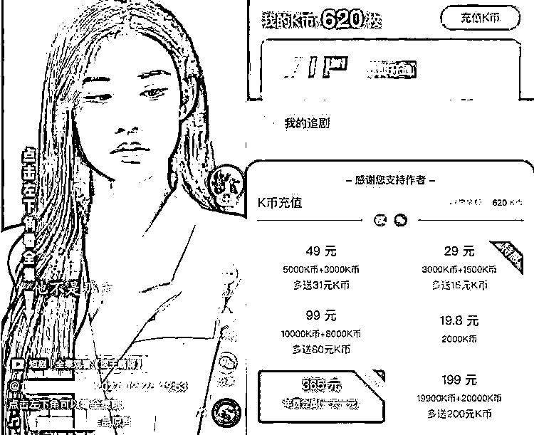

这类片子多改编自爽文。近年热门套路是扮猪吃老虎、屌丝逆袭的 YY 爽剧，比如抖音上常被调侃的“歪嘴龙王”“歪嘴战神”赘婿系列，不少人刷到过。

内容来源：《目前为止最详细的【短剧推广实操手册】，没有之一！》《短剧 cps 怎么赚大钱》《短剧分销 CPS 推广：红利期新项目科普+保姆级教程》

## 1.2 短剧 CPS 认知 @老严干货 CPS @精准侠 @思蒙

### 1.2.1 什么是短剧 CPS 项目

认识短剧之后，「短剧 CPS」就好懂了。

玩法是：达人把素材重新加工，发布作品并挂上小程序；用户点入充值，达人即可分佣，链路顺滑。

前几集免费，精彩处需付费解锁。用户开通会员后，达人分成通常在 50%-60%，个别能到 70%-80%。

片源一般由官方（即你绑定的推广端）提供。达人简单二创后上传抖音、快手，挂版权方小程序，引导观众点入付费看完整版，赚取充值返佣。

做过小说推文的人会觉得模式眼熟，但视频节奏更快，爆发力更强，变现效率也更高。

转化参考：100 万播放约 3～4 千元收益（仅供参考，以实际为准），浮动取决于选剧与剪辑手法。

二创形式有两种：混剪、解说。混剪切片重去重；解说重文案。

解说类目前不是主流，原因有二：

1. 制作周期长，要自己写文案，综合要求高，产出效率低；
2. 文案好、播放也高，转化却可能很差，比如十多万播放、收益为零。

原因在于，用户跟着解说思路走；爽剧被解说后，观众可能觉得解说更有趣，就不愿付费，还等你接着讲——既省钱又省脑。

综上，本手册聚焦混剪类做法，解说类不展开，学有余力者可自行摸索。

### 1.2.2 实操步骤概述

先建立心理预期，后文逐一展开。重点落在第三、四、五步：

第一步：准备短视频账号，如抖音、快手、视频号等；
第二步：选推广平台，本期两个渠道：麻雀 Matrix、创作猫；
⭐️第三步：选剧并下载素材，渠道内主页一般可见，下载后即可剪；
⭐️第四步：素材二创，重编剧情，遵循爆款原则，提高命中率；
⭐️第五步：剪辑，导入软件，按剧情重组，做去重与混剪；
第六步：发布到抖音、快手等平台，挂载看剧小程序即算完成。

内容来源：《目前为止最详细的【短剧推广实操手册】，没有之一！》《短剧 cps 怎么赚大钱》《短剧分销 CPS 推广：红利期新项目科普+保姆级教程》

### 1.2.3 注意事项

⚠️ 原片禁止直发，必须剪辑，方法见「六、剪辑视频」。直接上传原片会违规甚至封号，收益也会被推广端扣没。

## 1.3 适合人群与门槛 @晓飞 @思蒙

短剧推广正处红利期，一条视频赚上万的例子不少。

但心理准备要有：

① 收益不稳、有难度、需耐心。

真实情况是：播放高不等于充值高；搬运会被限流封号，容易废号；内容要剪辑去重，照搬模板数据难好。

总体是量变博质变，含运气成分。素材人人二创，一部爆剧上万人推，精彩片段就那几段。

这与混剪带货、影视解说不同：短剧是在“湖泊”里找素材，后者在“大海”。一分钟爽点才可能换来付费，一部剧约百集、百分钟素材，且易被平台判定搬运，授权解封虽有可能，但耗时废号。

② 吃剪辑功夫。

只做批量流水线、不精修，就只剩运气。因为要做的是一部剧，一分钟内爽点集中，精修后效果可能像另一部剧。比如《顾少的隐婚罪妻》，去掉台词、按画面重制，精简后剧情完全翻转——同事剪完说前后衔接随性得很。

手册用较大篇幅讲剪辑👉「六、剪辑视频」。能不能做？能，但更适合：懂短视频、熟网络表达的人；每天至少两小时的人；自律且能短期摸清短剧内容的人；执行力强、长期持续产出的人。

入场建议：准备 1 个以上抖音与快手号；1 台以上运营手机（一机一号）；会用剪映做基本操作。加分项：在视频平台发过自己剪的内容。

素材现成、变现顺畅，成本是时间与账号。新手也能干，技巧不多，剪辑+发布，靠量取胜。

内容来源：《目前为止最详细的【短剧推广实操手册】，没有之一！》

# 第二步：前期准备

## 2.1 硬件 @思蒙

苹果：7 以上型号即可，保证剪辑工具不卡。若手机曾登违规/封号账号，有设备风控风险，选无违规记录的设备。

安卓：型号不限，不太老、剪映不卡即可。同样注意风控。

网络：一两个号用家里 WiFi 够了；做矩阵别让多设备共用 WiFi，用手机流量更稳。

内容来源：《目前为止最详细的【短剧推广实操手册】，没有之一！》

## 2.2 账号搭建 @思蒙 @惟乔 @清欢 @云珞 YunL

三平台可选：抖音、快手、视频号。快手与视频号审核更紧，抖音当下最好做。

抖音：一机一卡一号为佳，流量或 WiFi 都行；矩阵忌多设备连同一 WiFi。
快手：无违规记录，新老皆可。
视频号：新号更稳妥。

抖音老号问题：我们以为注册久=老号，平台不这么算。注册久但没发作品=新号；发过几百条却只有几百几千粉、没打标签的，也是新号。真正老号是在某领域已有标签、数万粉丝。若要换到不相关领域，最好重开。比如原 5 万粉，换内容至少要有 5 万粉才能对冲（官方说法）。

我新号旧号都试过，同样内容旧号爆得更好，还带起了旧作品播放。官方解释：粉丝基数小、无标签，无论注册早晚、发没发过，都算新号。前提是无违规；若违规，建议注销、卸载后重装再注册。

不放心想用新号：① 换另一张卡绑定，老号释放后重注册，省去注销等 7 天；② 没多余卡，可花几块钱在淘宝找人换绑再注册；③ 已实名的账号建议注销，换绑有被盗风险。

养号：每天刷 2-3 小时视频或直播，正常点赞关注；没空就挂个直播。不必刻意刷短剧，让平台识别你是正常用户即可。发作品后每天仍刷 2 小时，发布前 10 分钟以上、发布后 10 分钟以上。养号有一定玄学成分，时间更该花在出片上；在意的话可照做。快手、视频号没这么讲究。新号前几天流量好，要抓住。

内容来源：《目前为止最详细的【短剧推广实操手册》，没有之一！》《新手用生财的方法做短剧 CPS，一个月 1.4w+收益》《短剧 cps，小白也能月入过万的蓝海项目》《我用生财教我的方法做短剧》

## 2.3 账号定位 @猫柠

短剧分男频女频。男频主角多为男性，男主逆袭、打脸爽剧，粉丝偏男性。女频主角多为女性，常设心机女二，情感线为主，粉丝偏女性。

先定方向，一个号只走一条线。

各有优劣：男频大尺度片段流量高，但易违规、掉链接；女频易共情，女主被男主与女二欺负，评论更多。按喜好选。

发男频就保持男频属性，发女频就保持女频属性。

内容来源：《短剧推广：每天 1-2 条视频，单个账号月变现 1w+经验复盘》

## 2.4 账号设置 @思蒙

头像、昵称、简介、背景图四项。

头像：小红书搜高清好看的男女头像或趣味图。
昵称：网上搜好听的，3-4 字为佳，不会起就参考同行。
简介：正能量、不违规的句子，百度或小红书现成可用。
背景图：小红书找好看图；进阶可用 PS 或创客贴（网址：https://www.chuangkit.com/）加文字引导。

资料设置后别频繁改。不会设置就学同行：搜行业词如#关关剧场 #东方剧场 #九州视频，或爆火剧名如「顾少的隐婚罪妻」，能看到大量同行。模仿即可，几分钟搞定，不必耗时：

内容来源：《目前为止最详细的【短剧推广实操手册》，没有之一！》《短剧 cps，小白也能月入过万的蓝海项目》

# 第三步：了解推广平台

💡

章节概要

账号就绪，接下来选推广平台。如今平台对新人友好，不必像过去那样授权绑定。为省时间，本章推荐两个渠道：

## 3.1 麻雀 Matrix

完成后进入小程序：

点「我的」看到此页面，微信小程序即注册成功。

### 3.1.2 下载 APP，登录账号

# 从注册到选剧：麻雀 Matrix×创作猫实操

在微信里先找到已注册的小程序，接着下载麻雀 APP；复制弹出的链接，用手机浏览器打开就能安装：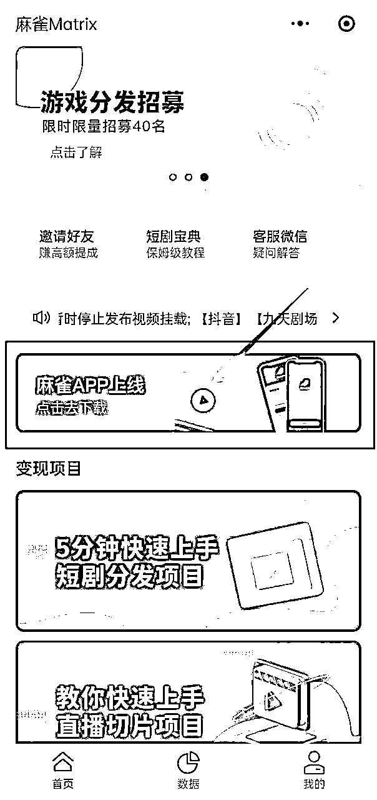

有个容易忽略的细节：同一部剧通常配了三个推广页，各自挂在不同剧场，也对应三个渠道的投放方式与剧场名称。入口一般在页面右上角，或者点进详情后、剧名下方。

## 3.1 平台一：麻雀 Matrix @思蒙

麻雀 Matrix 在短剧分销里出现频率较高。照着下面步骤完成注册并熟悉界面，就可以动手推剧。

### 3.1.1 微信小程序注册

在微信聊天界面长按识别下方码（当前页截图即可）：

进入后点微信授权登录：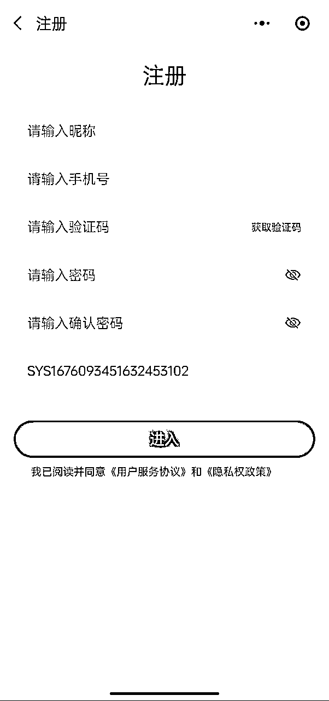

登录成功会跳到首页：

点右下角“我的”，出现这个界面就代表账号已经开通：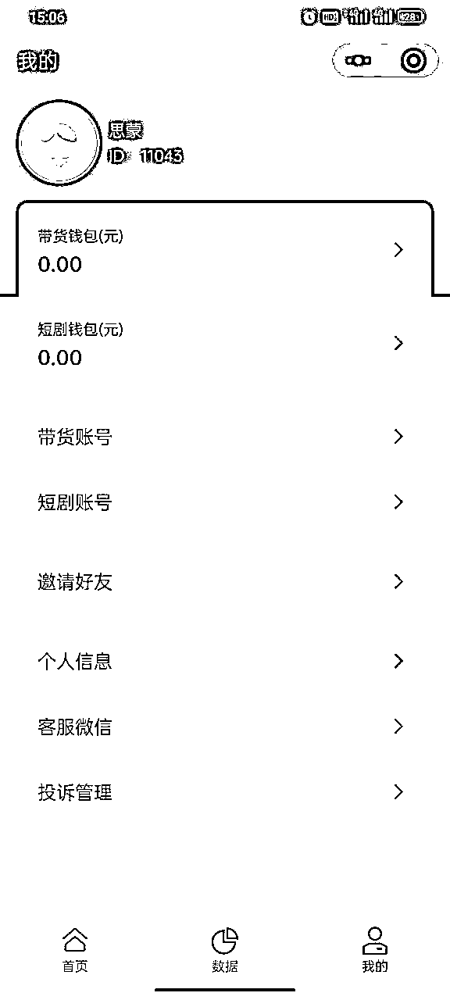

同样的位置再核对一次：进入“我的”页面即注册成功。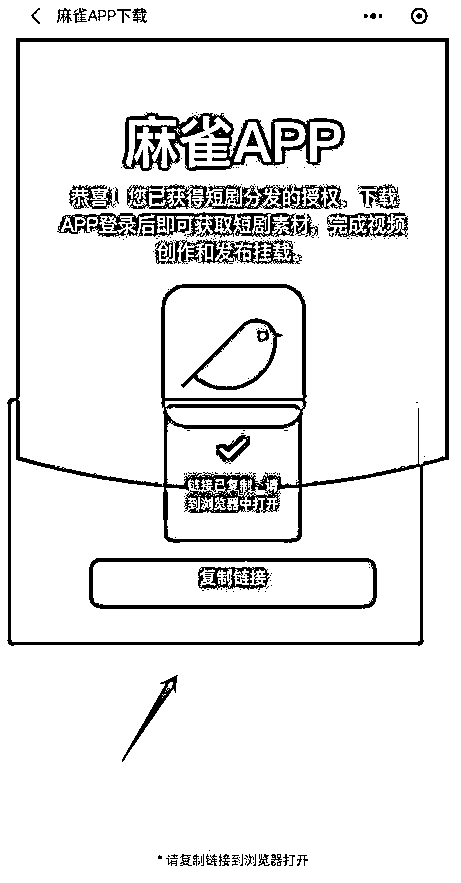

之后安装 APP，用刚才那个账号登入：

### 3.1.3 麻雀 Matrix 功能速览

先熟悉几个常用页面：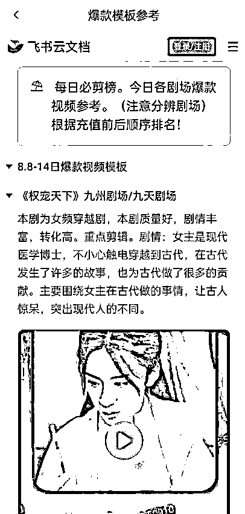

APP 打开后主要有这些区域，下面逐一说明：

最上方横幅叫“重要通知”，会推送近期热度高的剧目，也会同步规则变动。比如抖音调整挂载政策后，这里会挂出新的操作指引。

继续往下是“热门短剧”区，点剧名就能进入详情并创建对应任务（图中剧目仅作演示，不是推荐）。不清楚怎么挂载，可以点左侧“查看如何挂载推广”。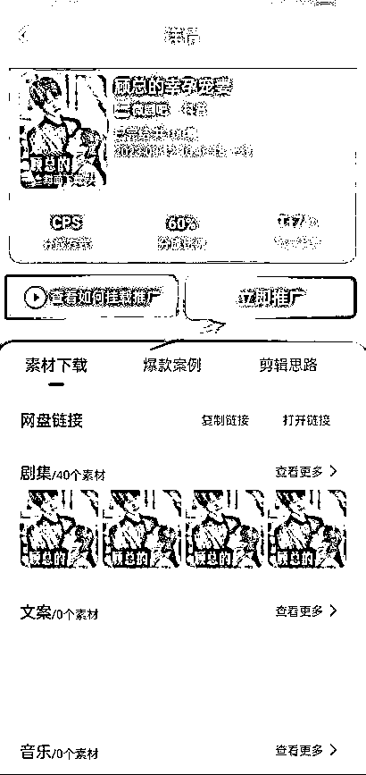

这里要留心：一部剧常常有三个推广入口，分别落在不同剧场，也对应三个渠道的投放方式与剧场名。入口在右上角，或详情页剧名下方。举例来说，同一个剧场在三个渠道可能分别显示为“微剧吧”“红火剧场”“章章剧场”。分发不受影响，发布前确认渠道即可。

“分佣比例”这类数据，去小程序或 APP 的“变现”—短剧列表页就能看到；点进单剧也有，结算周期是 T+7：

首页“抖音小程序推广计划”里同样能查到各渠道的佣金。

这里有个变化：8 月 8 日抖音新规落地后，以前佣金由麻雀统一打款，现在改走“抖音小程序推广”。一部分金额在抖音侧结算，剩下的仍在麻雀提现，整体佣金比例没有变化。

所以该页面的收益会拆成【推广计划分佣比例】和【平台补贴】两块。快手、视频号目前仍由麻雀统一提现。

表单信息通常保持默认即可：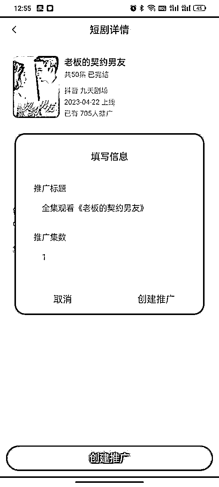

### 3.1.4 麻雀 Matrix 如何实现短剧推广🔥

点“创建推广”，系统会打开相册让你挑视频（首次使用要授权相册访问）；选完后自动跳到抖音或快手。

接着从手机相册里选已经剪好的成片，传到抖音，补上 #标题、话题等，点发布。

注意，这里挑的必须是你剪辑完成的成品。剪辑教程见《六、剪辑视频》。

另外，抖音近期规则调整后，挂载小程序偶尔会掉链接或看不到入口，原因是账号粉丝不到一千，暂时不具备抖音小程序挂载资格。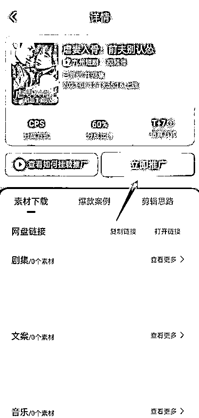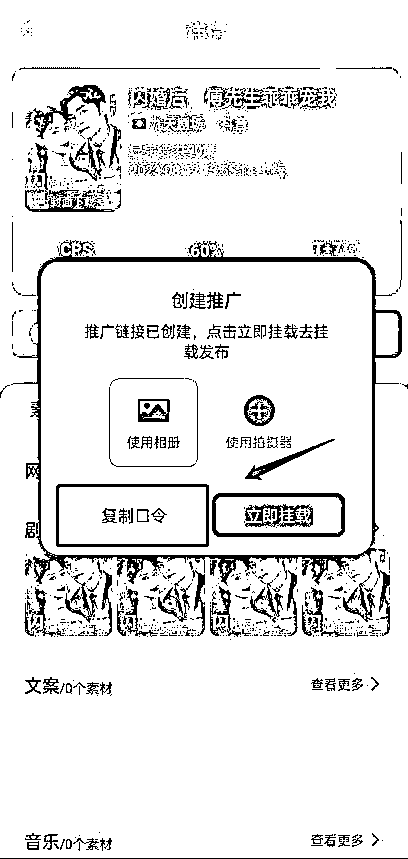

发布时把口令写进标题；发布完成后，再把同一段口令放到评论区并置顶。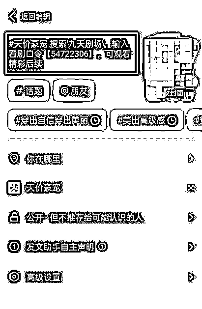

等作品数量积累起来、有一条小爆款把粉丝带到千粉后，就能正常使用挂载入口，链接也更稳定。其他渠道没有千粉门槛，可以直接挂。

具体操作可看下方视频。第 3 种方式后期复测时也会掉链接；一旦遇到掉链接，把对应短剧口令复制到评论区置顶，前期先以涨粉为目标。

8 月 10 日麻雀 app 挂载方式.mp4【在线播放】

## 3.2 创作猫：推广与剪辑一站完成

不同分销渠道各有自己的 APP。装好后，剧场内容、视频素材、教程、公告、收益都能在里面找到。推广流程中遇到的大部分问题，对应 APP 里都有答案。同一个账号还能同时接多个剧场的任务。看到海量素材的那一刻，才算真正推开“短剧 CPS”的门。

### 3.2.1 下载 APP，登录账号

创作猫官网：https://chuangzuomao.cn/ ，打开后按页面提示扫码安装。

注册流程和常见应用差不多：填账号密码、手机号，收验证码即可，这里不展开。

### 3.2.2 创作猫功能速览

创作猫既能推剧，也能做视频，所以界面内容更丰富。先看几个核心模块。

#### 3.2.2.1 短剧推广功能

打开 APP 首先落在“学习”页，里面有操作教程、任务说明，主要帮你熟悉各项目。如果对“短剧 CPS”某一步不清楚，可以先在这里搜一搜：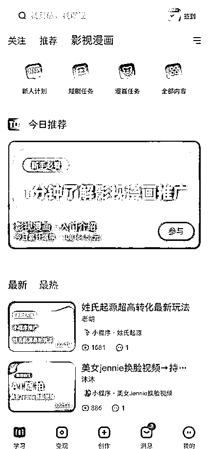

点底部“变现”，这里是创作猫最关键的模块之一。可推剧目会集中展示，点对应条目继续：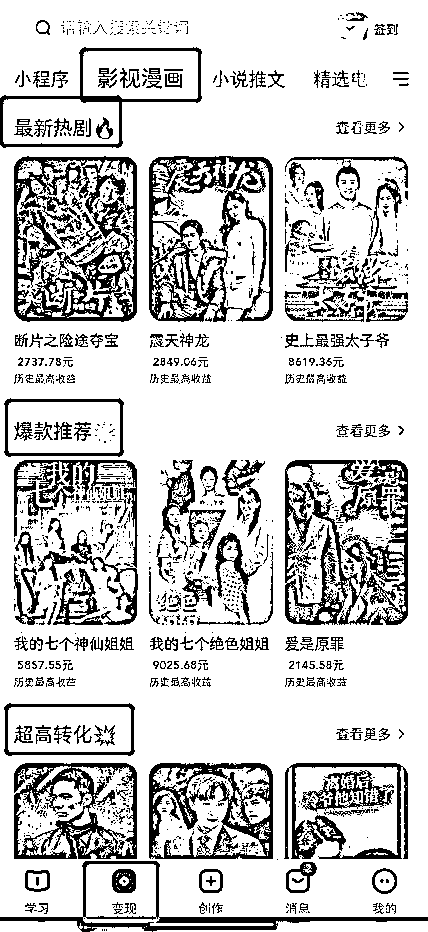

再往下拉，还有更多剧目，并且支持按渠道、分成类型、上架时间筛选和排序：

点进感兴趣的剧，能看到推广素材（视频素材）和推广按钮等：

具体怎么推，放在“3.2.3 如何实现短剧推广”里讲：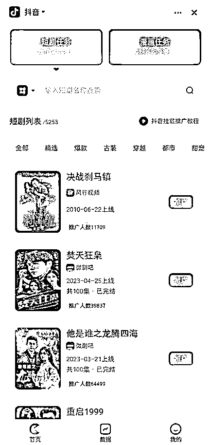

选择“短剧任务”，会出现大量剧目，也能按精选、爆款、古装、穿越等标签挑。左上角可切换准备发布的渠道：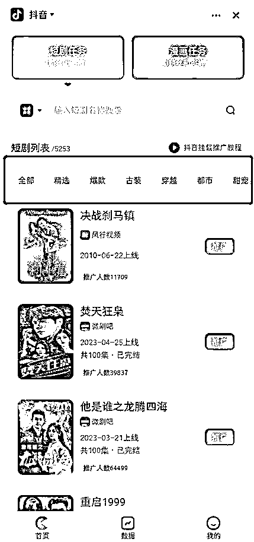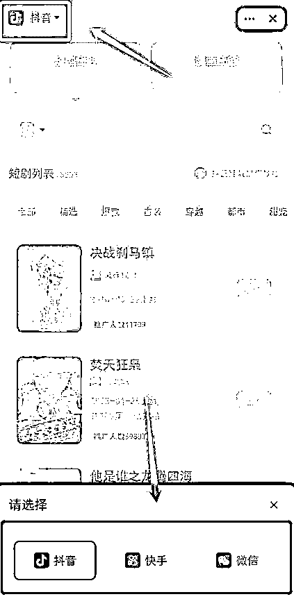

点中想推的剧后，同样会进入推广页，显示分成方式、分销比例、素材等；左上角依旧能选渠道：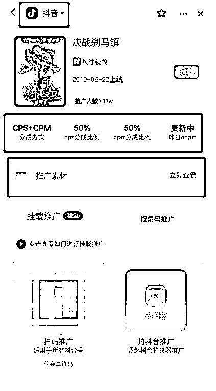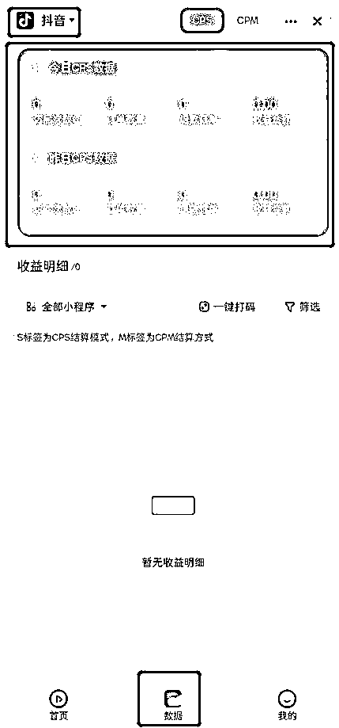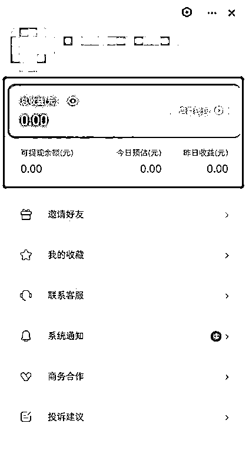

提现可绑银行卡或支付宝。结算周期分两种：CPS 是 T+7；CPS 按销售金额结算，比如用户通过你的作品或链接充值，你从中拿分佣，收益产生后过 7 天（一般指工作日）可结算提现。CPM 是 T+30；CPM 按千次展示结算，一次展示指一个用户完整看完，收益产生后过 30 天（一般指工作日）可结算提现。

创作猫的推剧功能主要就是这些页面，多点点、多熟悉即可。

#### 3.2.2.2 创作功能

创作猫比较特别的地方，是视频创作和剪辑能在 APP 内完成：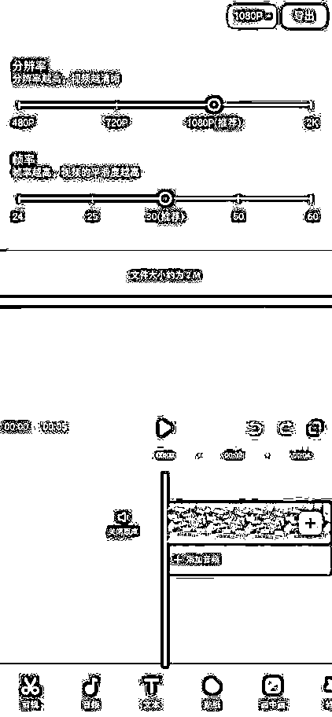

它的剪辑逻辑和剪映接近，会剪映基本就会用创作猫，这里不再展开。工具箱里还藏了不少功能，可以按兴趣试玩：

#### 3.2.2.3 收费说明

使用工具、观看教学灵感等会收费。下面这些功能在实际剪辑时存在付费限制，但不影响整体推剧：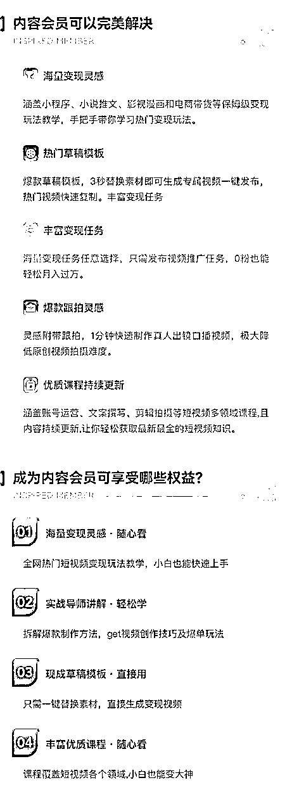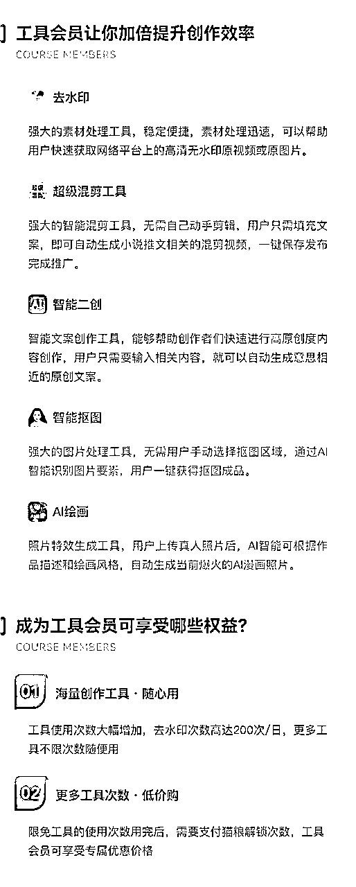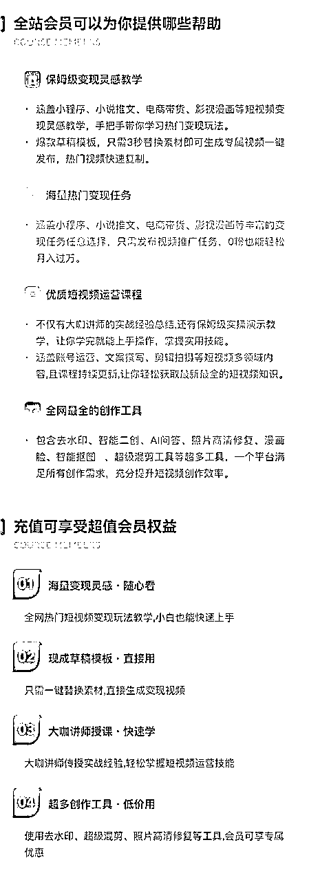

### 3.2.3 创作猫如何实现短剧推广🔥

创作猫的推剧流程和麻雀 Matrix 差别不大，这里不再逐字展开，直接看官方教程视频：

创作猫短剧推广教程.mp4【在线播放】

# 第四步：选择短剧并获取素材🔥

💡

章节概要：大家在熟悉平台时，应该已经见过各种类型的剧目。那么，怎样挑出适合推的剧？这就是本章要解决的问题。

尤其对新手来说，单凭自己很难判断哪部剧更容易起量。毕竟“短剧 CPS”很大程度上是在拼概率，老手也常翻车。掌握一些筛选技巧，才能把力气用在刀刃上。

麻雀 Matrix 和创作猫也明白这一点，所以两个平台都会整理爆款榜单，帮大家找方向。

本章从以下几个角度展开：

✅ 通用思路：从视频数据反推爆款  
✅ 平台方法一：麻雀 Matrix 的爆款参考  
✅ 平台方法二：创作猫的爆款参考  
✅ 进阶玩法：选新剧，大胆试  

⭐️ 航海期间，教练会在群里同步近期爆款和对标视频，可以跟着学。

找到值得推的剧后，别忘了拿素材。注意：原片不能直接发，必须剪辑；剪法放在《六、剪辑视频》细讲。若把原片直接传到各短视频渠道，轻则违规，重则封号，收益还会被平台没收。

百闻不如一见，百见不如一练。找到适合自己的筛选技巧，再去试试更容易起量的剧目吧。

## 4.1 选择适合推广的短剧

### 4.1.1 方法一：麻雀 Matrix/创作猫的爆款参考 @猫柠

常用的两个渠道是麻雀和创作猫，它们都有爆款剧目推荐。

麻雀 Matrix：
先看麻雀。它有“热门短剧”标签页，会列出当下热度较高的剧。下方带筛选器，可按剧场和时间段筛：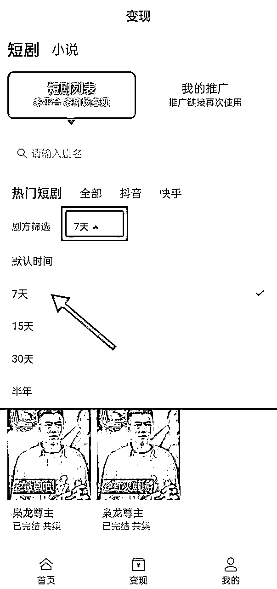

7 天内冒头的剧，通常可以直接拿来用。遇到特别能打的剧，时间范围可以放宽，比如之前火了好几个月的《顾少的隐婚罪妻》。

同时，右侧“全部”标签页能筛出刚上线的剧。有人偏爱做新剧，觉得内容越新、竞争越小、效果越好。但平台几乎天天上新，不是每部新剧都能成为爆款。真正该追的不是“什么新做什么”，而是“什么火做什么”；顺着平台调性，做用户爱看的内容，流量才会过来。

创作猫：
把两个渠道的热门榜放在一起看，眼尖的人会发现有重合，比如《叔的小祖宗闪婚后宠爆了》。

为什么两个渠道的热剧不完全一样？因为剧场授权、推广人数、粉丝体量不同，数据自然会有差异。但一部剧能同时进入两边热门榜，说明它的数据相当能打。

延伸：爆剧和新剧怎么选？经验如下：

① 优先做爆剧：爆款剧 ＞ 新剧  
② 如果两个爆款热度接近：爆款新剧 ＞ 爆款老剧  
整体排序：爆款新剧 ＞ 爆款老剧 ＞ 新剧。

内容来源：《如何选择爆款短剧，并做到先借鉴后超越 @猫柠》

### 4.1.2 方法二：让数据替你选剧 @猫柠 @惟乔 @清欢

在短视频里，经过市场检验的题材常常会迎来第二波流量，这条经验放到哪个赛道都成立。做短剧推广时，先别急着动手，可以去各大平台逛一圈，看看最近哪部戏的讨论度和播放量在往上走。

搜索框里可以轮换这些词：短剧、九州小剧场、抖音短剧、抖音短剧新番计划、触摸短剧、超爽短剧、热门短剧、短剧推荐、好剧推荐、热门短剧推荐、因为一个片段看了整部剧……等。

以抖音为例，敲入上述任意词，再在结果页做条件过滤：

挑近期热度高的戏，盯住两个信号：第一是红心量，数字越大越说明受关注，单条破千更值得看；第二是同一部戏被多少条作品使用，覆盖面越广通常越热。图中一天内红心最多的六条内容里，有两条都指向《我在民国当少帅》，可见它当时正起势。

再举一例：照同样方法查，能看到《慕总的隐婚罪妻》和《医王龙婿》红心高、关联作品也不少。女频方向可先试前者，男频方向可先看后者。

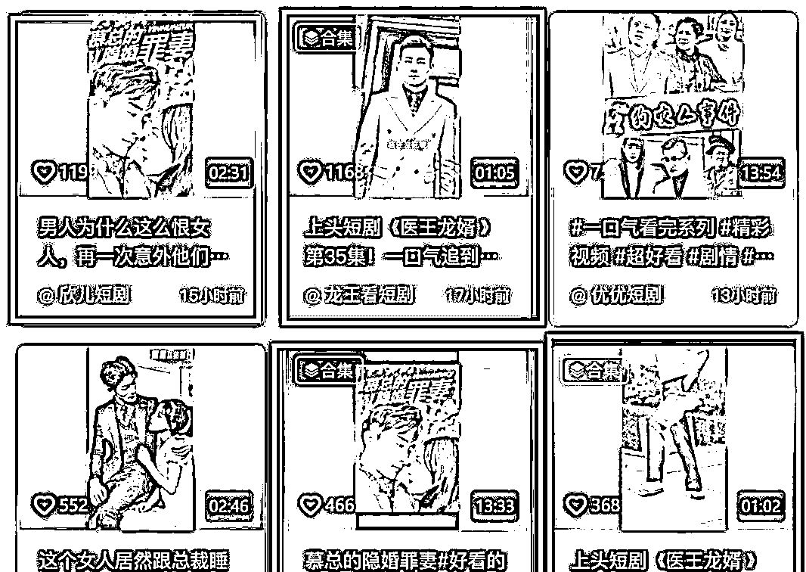

查数据时，先限定最近24小时；若挑不出来，再把窗口拉到七天，或换词重查，直到红心量与同剧作品占比都顺眼。

别的平台也照这个路子做。

假如某部戏既能在抖音关键词筛出来，又出现在麻雀、创作猫等渠道的热推名单里，可信度就更高。优先做这种被多处交叉印证的项目。

碰到数据顺眼的戏，重点记四件事：剪的是哪部；单条多长；首尾怎么处理；出爆款的账号粉丝多不多。粉丝基数小却跑出高播放，参考价值更大。

比如查《顾少的隐婚罪妻》，结果见下图：

红心成千上万的作品，基本已被市场筛过一轮，可以放心跟。剪的时候可借它的首尾框架，直接照搬，中段再做微调。

资料参考：《短剧推广：每天 1-2 条视频，单个账号月变现 1w+经验复盘》《新手用生财的方法做短剧 CPS，一个月 1.4w+收益》《短剧 cps，小白也能月入过万的蓝海项目 @清欢》《如何选择爆款短剧，并做到先借鉴后超越 @猫柠》

### 4.1.3 方法三：用热点宝锁定目标 @猫柠

在抖音搜“热点宝”，点进小程序：

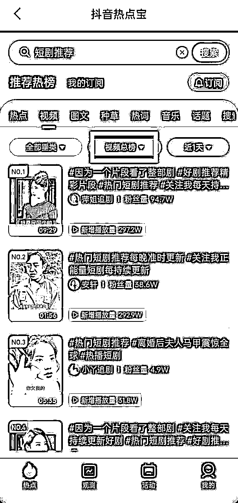

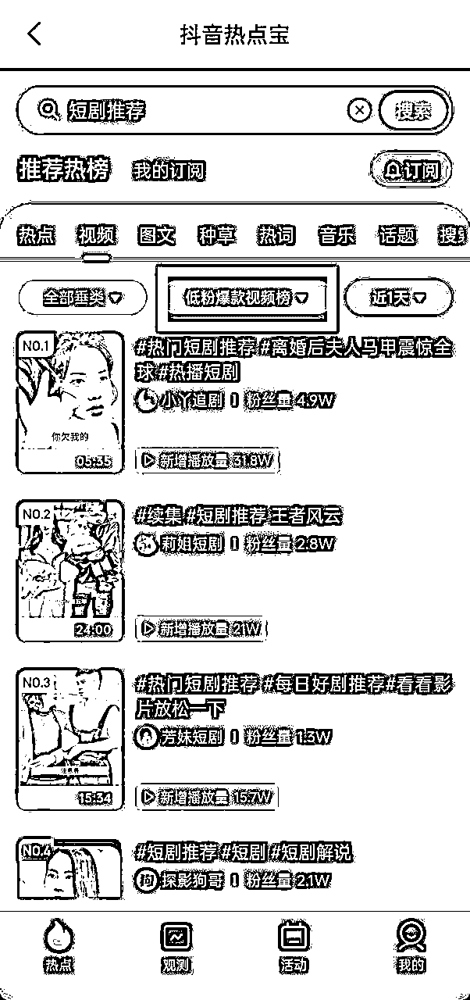

榜单里，视频总榜头名是《我在民国当少帅》，低粉爆款视频榜头名是《离婚后夫人马甲震惊全球》；这两部同样出现在麻雀的热推片单中。

这说明几条选剧路径并非各走各的，而是能彼此印证。真正能跑的戏就那么几部，用一种办法挑出来后，再用另一种办法复核，心里更有底。

新手想快速上手，最稳的路是找现成样本，对平台已经跑通的内容做仿剪，也就是先“照作业写”。

资料参考：《如何选择爆款短剧，并做到先借鉴后超越 @猫柠》

### 4.1.4 进阶玩法：抢新剧的先手 @惟乔

这招更进阶，刚入门别急着用，适合已经能判断内容好坏的人。

新剧没有太多可参照的成片，得按自己的理解去剪。后文“五、下载素材并组合剧情”会讲怎么把剧情搭得更顺。

新剧质量不一定稳，但优势是能抢时间差；麻雀 Matrix 和创作猫都能筛到新剧。

若把短剧 CPS 看成短视频里的蓝海，那做新剧就是蓝海中的先手区。

选新剧还要看账号定位。眼下短剧垂直赛道分得不算细，大体只有男频、女频。

如果某部男频戏跑出了数据，先看粉丝性别比例，确认观众是否真以男性为主；确认后，后续重点剪男频，新剧也优先挑男频。

女频主流是虐向：先压后翻，关系线多围绕女主与男人、女主与第三者、女主与家人展开，收尾多为 HE（happy end）。

男频更偏爽向：复仇、扮猪吃虎、穿越、艳遇。

资料参考：《新手用生财的方法做短剧 CPS，一个月 1.4w+收益》

### 4.1.5 注意事项：三类剧要避开

方法讲完，再划几条红线，以下几类戏别碰：

1. 剧场未授权的项目不做。没有授权，剪完也拿不到钱。
2. 一发就掉链接的项目不做。链接没了，收益同样落空。
3. 男频、女频不要混在一个号里做。起号阶段要精准流量，内容越垂直越容易打标签。

资料参考：《如何选择爆款短剧，并做到先借鉴后超越 @猫柠》

## 4.2 视频素材从哪里拿 @思蒙

选定目标后，去麻雀 Matrix 或创作猫搜剧名，找到对应条目就能拿素材。

### 4.2.1 渠道一：麻雀 Matrix

这个渠道的素材多以百度网盘形式放出。

从首页点进每部戏的推广页，能看到网盘地址。复制到浏览器打开，或直接点击：

然后点【全选——箭头指的小框】，再点【保存到我的百度云盘】，页面会要求登录百度账号：

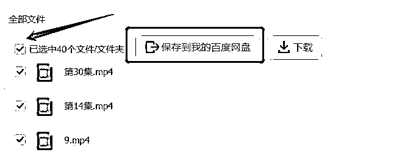

已有账号直接登，没有就注册一个。登录后到网盘把剧集全部下载。

也有项目会在“网盘链接”下面直接放“剧集素材”，点进去勾选下载即可。

官方剧场给的集数通常是1—20集或1—40集，不会把全量素材都放出（版权限制）。

但部分精彩模板会用到官方库外的片段。例如《顾少的隐婚罪妻》的爆款开头取自96集和97集，这种就得自己补资源。

常见做法是问有资源的同学或前辈；也可以去B站、淘宝、拼多多搜，一般能找到。

# 第五步：重排剧情，提高出圈率🔥

💡 章节概要：同一部热剧，跟剪的人一多，想冒头就不能只会照搬。要会把剧情拆开、重新拼，让成片更抓人。

这种能力得练。还没练出手感前，先借别人的组合方式：

✅初级方法一：去抖音找模仿样本
✅初级方法二：留头截尾，压缩情节
✅初级方法三：套用麻雀 Matrix 的模板

等你慢慢有了判断，再自己搭：

✅进阶方法：把高光片段重新编排，贴住传播节奏

⭐️ 航海期间，教练会在群里丢近期热剧和参考片，跟着拆解就行。这个过程要沉住气，能不能起量有时也带点运气。多试多改，出圈并不远。

## 5.1 剧情为什么关键 @思蒙

短剧 CPS 有两个抓手：一是选剧，二是剧情把控。

选剧像选品，决定项目底盘；剧情把控则是在养创作思路。

新手还不会挑戏、也谈不上创作时，先模仿：跟着最热的戏、最火的模板仿剪。选剧办法在“第四步：选择短剧并获取素材”已经铺过。

往后可以按仿爆款的思路，加上自己攒的经验，围绕剧情设计新的剪法，把同一部戏做出多个版本。

短剧能起量，是因为它贴着短视频平台的调性，也符合观众对内容形式的预期。

核心一个字：爽。别把自己的好恶带进去，嫌这里假、那里作。主要受众可能和咱们不在一套认知里，所以要站到用户那头想。

剪辑围绕“爽”做文章：赢要爽、受虐要爽、打脸要爽、复仇要爽……情绪越强，观众越愿意往下看。

播放高的作品，一定是在某个点上戳中了人。这个点就反复用，用到它没价值为止（一般也不会没价值）。

剪剧情时，把成片拆成前、中、后三段。

前段负责留人，必须精彩；
中段最好不是爽就是惨，起伏要足，抓住观众心理；
后段留钩子，提升转化（不会就学电视剧每集收尾）；
总时长压在3—6分钟。

后面几种教程，基本都绕着这个理念转。

资料参考：5月23日《短剧 CPS 的项目现状及航行路径》@思蒙

## 5.2 初级方法一：去抖音找模仿样本 @云珞 YunL @猫柠 @张柯 Ker

好的模仿样本最好满足：发布未满24小时；红心破千；播放明显高于同号其他作品；账号粉丝越少越有参考意义。

第一步：搜“短剧”，筛选条件选24小时内、最多点赞。一个词找不到合适样本，就换词继续搜。可试“短剧、短剧推荐、好剧推荐、热门短剧、因为一个片段看了整部剧、‘短剧名称’”等；也可以点开任意视频，看别人挂什么标签，再照着搜：

第二步：按红心数排序，找符合自己方向（男频/女频）的戏，挑破千的点进去看。

找到合适视频后，前期可以1:1仿剪，后期再适当创新。

看到数据顺眼的戏，重点看：剪的是哪部；单条多长（定剪辑时长）；首尾怎么处理（定剧情参考）。

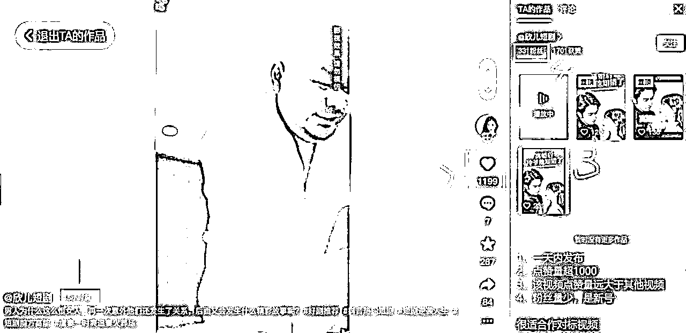

比如拿近期热门《史上最强太子爷》来说：

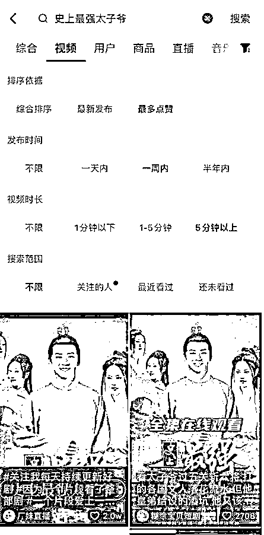

原素材附的几条抖音作品链接，数据都很亮眼。

能看出爆款很相似，甚至开头几乎一样，前面几个万赞作品只是做了去重。

所以有时不知道一部戏怎么剪，就去找样本、多看多学，手感自然就来了。

资料参考：《我用生财教我的方法做短剧》《短剧推广：每天 1-2 条视频，单个账号月变现 1w+经验复盘》

## 5.3 初级方法二：五集剪一条，留精华 @老严干货 CPS

单集篇幅多在1—2分钟。拿五集起步，把拖沓部分去掉、只留情绪点，最后压到三四分钟；熟练后十几二十分钟就能产出一条，原创检测也更容易过。

关键动作是：至少选五集以上剧情拼成一条。若不知道删什么，先简单学一下高传播剧情的搭法，把不必要内容去掉即可👉《5.4 进阶方法：拼接精彩剧情，遵循爆款逻辑》

资料参考：《短剧 cps 怎么赚大钱》

## 5.4 初级方法三：借用麻雀 Matrix 模板

平台会把爆款模板整理出来，每天更新几条。确定要剪的戏后，按模板1:1仿剪，既能找参考，也能学剪辑思路。

进入麻雀 Matrix，点“短剧宝典-近期大爆模板”就能看到入口：

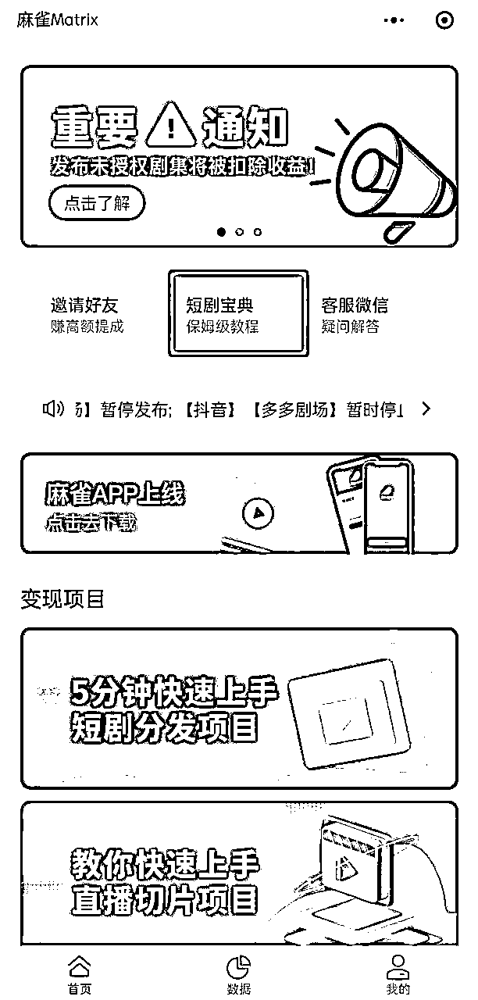

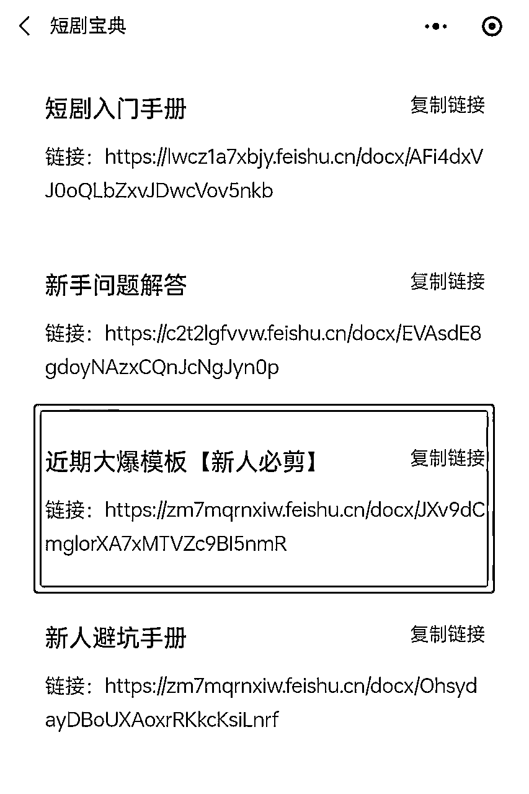

把链接复制到网页或微信打开：

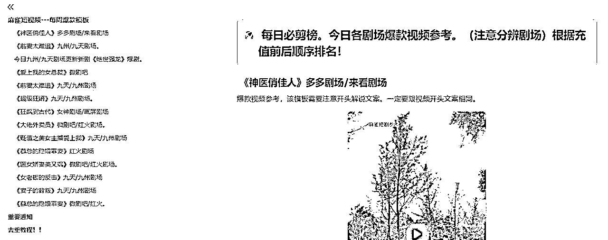

模板里主要有：热剧推荐+一两句剪辑重点+成片参考。

热剧八成左右的首尾本来就相似，善用模板能省不少无用功。

## 5.5 进阶方法：高光片段重排，贴住传播节奏 @思蒙 @猫柠 @老严干货 CPS @云珞 YunL @惟乔

这招要求你懂剧情，也懂受众，最好有经验后再用。

操作不复杂：

先把整部戏通看一遍。一部戏通常2小时以内，2倍速不到一小时能看完；熟悉后可以用软件3倍速甚至5倍速快速预览。

看的时候记下高光点，再把这些片段剪成一条4—6分钟的成片。

但“怎么把高光片段拼成一条”，要掌握下面几点。

### 5.5.1 高传播结构

高传播作品通常遵循：前5秒抓人，中段高光不断，后段戛然而止。

开头：前5秒很关键，挑不符合预期、离奇、有爆点、有吸引力、有悬念的内容；一般会交代人物、环境和故事背景，并埋下基本冲突。

中段：冲突片段可以是反转、争斗等，展示主要人物遇到的挑战；高潮片段是冲突到顶的时刻，常是故事转折点，主要矛盾最紧张。中段不是爽就是惨，起伏要抓人，尽量删掉配角戏和平段。

后段：留钩子，让观众想知道后面发生了什么，吸引他们点小程序付费看全集。比如女频里男主知道女主受伤后会不会后悔，但别把后悔片段剪出来；男频里炮灰挑衅男主，观众都知道男主要装逼打脸了，但别把打脸片段放出来，引导用户去看正版，自己看男主怎么花式打脸，从而获得愉悦感。或者你看剧时很想知道后续，就把那个情节点放在尾段，别放后续。

也可以参考 @思蒙老师这个模板，结构差不多：

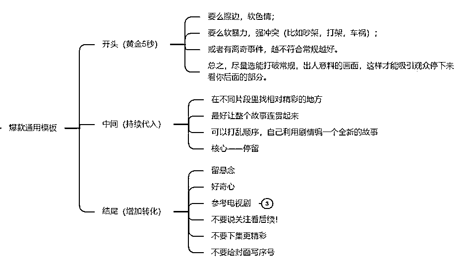

不管怎么起承转合，模板的核心不变：

一虐一反转算一个循环，刺激观众情绪起伏，最后在反转前停住，引观众看后续。“虐”只是指代，和虐剧无关，所有剧种都能套这个循环。

在此基础上，常见高传播剧情就三类。

男频：男主扮猪吃虎+反转打脸+复仇+悬念结尾；穿越+YY+堆爽点+悬念结尾。

女频：女主被虐（很毁三观那种），比如开幕雷击（暴力、暧昧）+男女主虐恋+反派搞事+悬念结尾；或者真相大白型，比如女主被女配冒充，女配从嚣张到绝望，结尾留一点悬念。

剪视频时，可以再拆出更细的主线。比如女主被虐，可以细化为：男主直接虐女主，两人正面冲突；女二陷害女主，引发矛盾；婆媳冲突；利用小孩博同情……每条线都能单独成片，也能多条线交叉，关键是过渡要顺。

### 5.5.2 素材怎么挑

有了前、中、后三段，素材怎么选？

按角色选：比如女频，今天剪男女主和恶毒女配的戏，就选相关剧情；今天剪男女主和婆婆的戏，就选婆婆相关剧情，恶毒女配少出现或不出现。一集5—10分钟为佳，没灵感剪3分钟也行。

按剧情选：按“开幕雷击+虐+小逆袭+虐+小逆袭+虐+悬念”排序。

虐是什么？男主虐女主、女配虐女主、炮灰虐女主，主角处于下风。

小逆袭是女主反击伤害她的人，语言反击、肢体反击，或男主/其他人帮女主说话，都算。很多虐和小逆袭是连在一起的。

剪辑时不断循环“虐-反转”。剪2分钟，中间可能只反转一次，两个循环就结束；剪10分钟，就做5—6次循环再收。非必要过渡剧情全部删掉。

怎么判断非必要？删掉后观众仍看得懂，不会疑惑“怎么突然出现一个人？他是谁？为什么帮主角？”

这套逻辑玩熟后，戏热不热都一样，你都能剪得精彩，普通项目也能剪出传播力。

要熟练，拿到素材先完整看一遍，然后做笔记，如图：

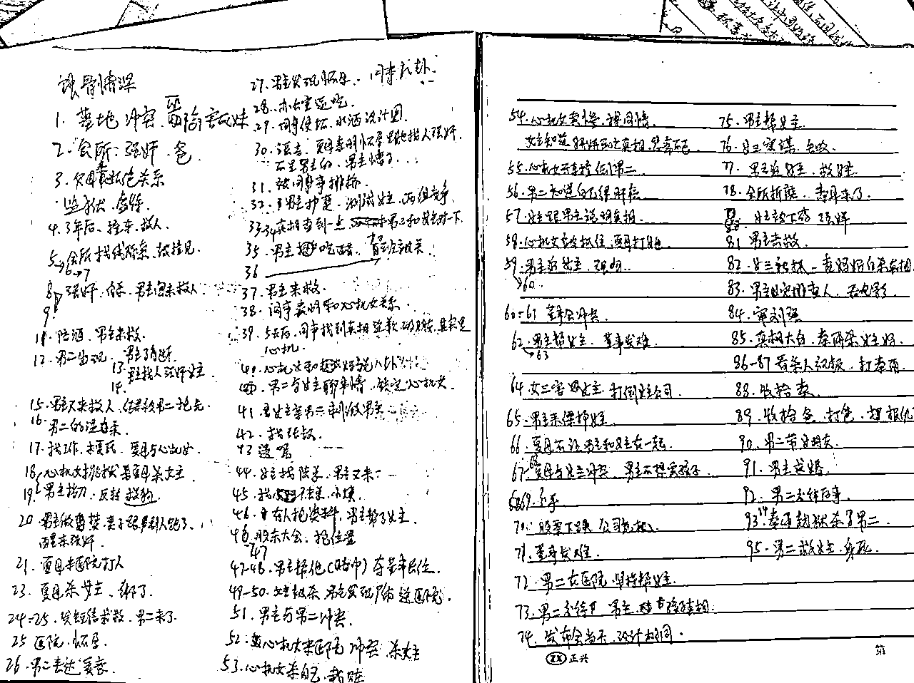

另外，必须了解抖音发布规范，可能违规、拿不准的情节不要放。

### 5.5.3 对白可拆可调序

场次能换先后，单句台词同样能挪位置。假设原始故事里 A 桥段在前、B 桥段在后，你动剪刀时把 B 提前，只要观众理解不吃力，B A 这种顺序就成立。落到一句对白也一样：A 句本来在 B 句前面，若调换后语义不歪、观感不别扭，B 完全可以先出现。

另外，罗嗦、对情节没有推动作用的词句，该舍弃就舍弃。

拿一场戏来说明：男方当着女配的面夸她、顺带压女主。原对白大概是这样：“高中起我便对你有好感；那会儿你纯真温善，像天使；反观顾安然，骄横任性，吵得人心烦。”

最初可以原样保留。
删一层后：“高中起我便对你有好感；那会儿你纯真温善；反观顾安然，骄横任性。”
再删一层：“高中起我便对你有好感；那会儿你纯真温善。”
最后只留：“高中起我便对你有好感。”

归根结底，不伤情节、不碍观看，你就能按自己的判断动台词。拆句、拼句的价值，正在这里。

### 5.5.4 拆片案例复盘

**实例一：《顾少的隐婚罪妻》**

拿《顾少的隐婚罪妻》来说，我每拆完一条爆款，会把其中出现的桥段单独拎出来，按“开场、冲突、收束”归档，再筛出几个高频桥段。桥段备齐后，换一换先后搭配，就能生成大批新内容。

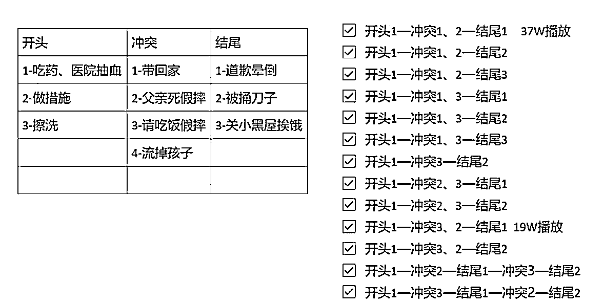

**实例二：《神豪保安》**

经过剪刀处理，这条片子呈现出的情节是：

男主向狗下跪，第一处压抑；男主接手家业，第一次翻盘；男主遭保安阻挡，第二处压抑；管家赶来救主，第二次翻盘。

爷爷替男主安排秘书，属于过渡桥段；男主再度回到小区，第三处压抑；

秘书现身，第三次翻盘；放在片尾，牵引观众追下一集。

这条片子配了旁白讲解，即便不配，逻辑同样成立。

参考出处：《目前为止最详细的【短剧推广实操手册】，没有之一！》《短剧 cps 怎么赚大钱》《短剧推广：每天 1-2 条视频，单个账号月变现 1w+经验复盘》《我用生财教我的方法做短剧》《新手用生财的方法做短剧 CPS，一个月 1.4w+收益》

# 第六步：成片必须过剪辑关

⚠️ 先立一条底线：原始素材绝不能直接往平台扔，剪刀这一关必须走。若把下载来的片子原封不动传上去，轻则被判定违规，重则账号不保，推广平台那边的分成也可能被追回。

刚入门的朋友，建议先用两样工具：

剪映：使用门槛低，教程资料多；创作猫：内置推广片源，能直接拖进时间线开剪，操作思路与剪映接近。

因此下面仍以剪映的操作为主线。

## 6.1 基础操作

完全没摸过剪辑软件的人，可以先看这段教学，跟着亲手走一遍，把剪映的界面布局和常用功能认全：

mmexport1677167802702.mp4【在线播放】看到“导出视频”那一步即可，然后自己再完整操作一次。

若想继续深挖，可以翻本期航海的剪辑特训手册👉「8 月航海｜剪辑特训｜实战手册」，基础与进阶内容都有覆盖。

成片长度建议落在4至6分钟。偏短，观众会觉得不过瘾，点开追全集的动力不足；偏长，完播率容易下滑，观众可能中途退出。

导出通常选竖屏比例9:16，画质1080p，帧率60帧：

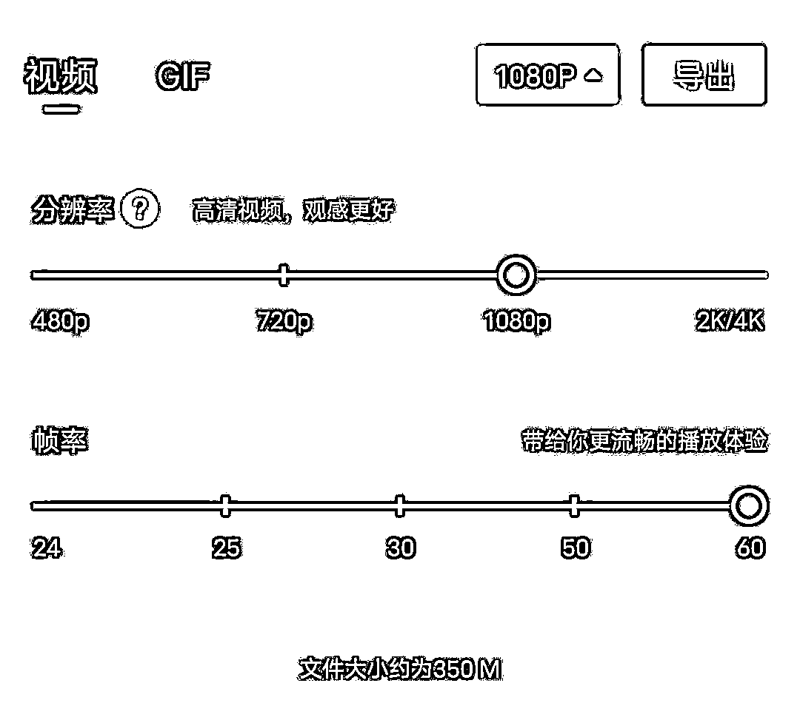

## 6.2 如何让成片更原创🔥

做原创化处理，说直白些，就是防止片子被限流。画面若与别人高度重合，被系统认定为搬运，流量会被压，严重时账号也会被处理。对缺乏混剪经验的新手而言，这一关确实棘手。

平台算法识别搬运，常用手段是抽帧对照。

一段片子由大量静止画面连续播放而成，其中单张画面称为一帧。

上传之后，系统会抽取部分画面，与已有内容库比对；重合比例一旦越过判定线，就可能被标成抄袭。

原理如此，真实机制还要复杂不少。

所以核心思路是：让画面与别人拉开差异，使系统难以识别。

下面这些是老师们日常在用的做法，可供借鉴。

处理工具：

剪映：https://www.capcut.cn/CR VideoMate: http://www.cr-soft.net/crvideomate.html

crvideomate.rar 使用说明：

做「短剧 CPS」时，剪映的常规手法已能解决不少原创化场景；再配合「CR VideoMate」，基本可以覆盖需求。下文重点讲剪映的处理方式，「CR VideoMate」并非必修项。想把技术再推高一层，欢迎自行研究～

### 6.2.1 原创化处理总原则 @思蒙

几乎做任何短视频项目，都绕不开原创化处理。

因此把这件事理解透，不仅对短剧推广有帮助，以后做相关项目也能少踩坑。

奇杰老师在星球里讲过这块内容，建议抽空阅读，认真消化：

【短视频混剪进阶】单人日产 200 条实战攻略：https://t.zsxq.com/0eHtHeLXs

批量混剪-单人日产 200 条实战教程：https://t.zsxq.com/0eCtPxXXv 另外，动手时先记两条：

其一，别堆数量，要把细节做足；

其二，主轨优先于副轨。

先解释“别堆数量，要把细节做足”。常有人问我：素材上叠了一大堆处理元素，原创审核怎么还是不给过？

我通常先答一句：

原创化处理，不靠数量，靠精细。

这句话建议记牢：

原创化处理，不靠数量，靠精细。

怎么理解？

先看一张图↓

这是剪映桌面版的工程截图。给大家5秒，先判断：这种处理，算多吗？

先别急着给结论，再看下面这张：

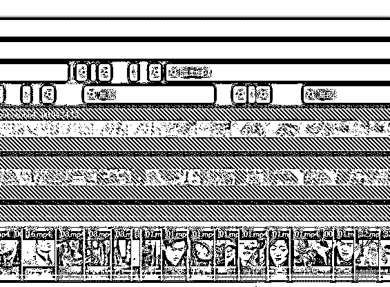

第二张看上去还没第一张堆得多，对吧？但它的审核通过率，往往高出一截。

原因在哪？

先看特效：第二张铺了不少零碎特效，不是一个效果从头套到尾。这就是“细”——细碎的细。

继续往下看图就清楚了：

贴纸依旧是同一款，但关键帧加了许多。

关键帧起什么作用？贴纸不会僵在原地，它会随时间位移、转动、放大缩小……动态呈现通常比静态更有效。

这同样是“细”——细节的细。

此外，第二张把主轨素材切得很碎。

切碎有两个好处：

第一，能加入更多转场，原创化效果更强；

第二，抽帧更密，20秒抽一回通常比60秒抽一回更理想。

还有一点：主轨画面也要做缩放、上下左右平移，甚至旋转。

这仍是“细”——颗粒度细。

再说“主轨优先于副轨”。

意思是：投入同等精力，在副轨上堆贴纸、堆特效，不如给主轨画面做缩放、位移、旋转、抽帧来得有效。

当然，副轨也不能丢。主副一起处理，再搭配CR-V，效果更稳。

收个尾：

原创化要做细，可以是碎特效的细、关键帧的细，也可以是主轨切碎的细；

可以从碎特效、关键帧、主轨素材这些方向入手；

更重要的是，多给主轨画面做缩放、位移、旋转、抽帧。

参考出处：6 月 8 日《短剧 CPS 的进阶技巧及常见问题答疑》@思蒙

### 6.2.2 新手去重五步法 @清欢

这里分享几个我常用的基础手法，新手也能较快上手，安全过审。

操作顺序：1）一条剪好的5分钟片子，通常由几十个小段拼接而成，先右键选“复合片段”，把片子合成一段，后续裁剪更方便。

2）叠加多个滤镜、贴纸和特效，参数调到不破坏整体观感为止。

3）对画面做自由剪裁，留下带字幕和人物主体的区域。

4）用画面模糊填掉被裁掉的上下部分，顺便再增加一层原创化处理。

5）调整片子速度，加速到1.1x—1.3x即可。

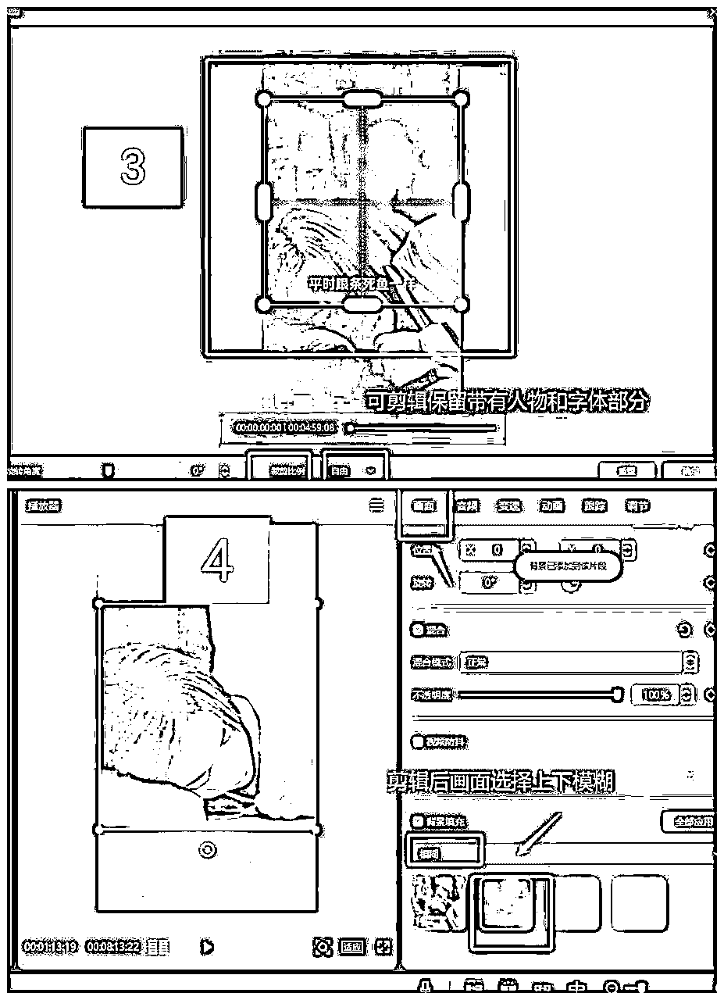

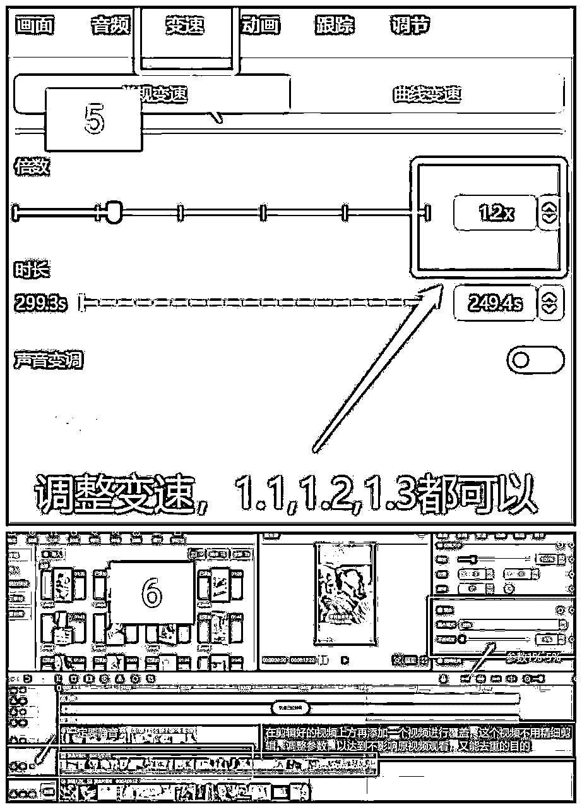

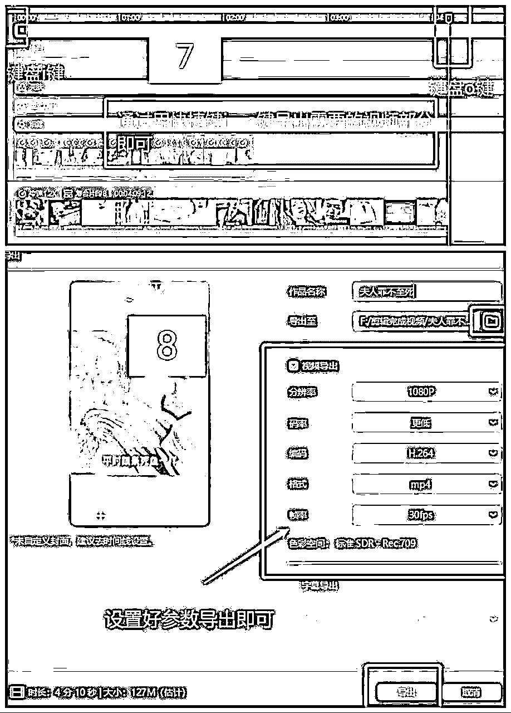

参考出处：《短剧 cps，小白也能月入过万的蓝海项目》

### 6.2.3 常用剪辑动作去重 @狼魂小毛 @云珞 YunL

@狼魂小毛 老师和 @云珞 YunL 老师的思路本质接近：多上剪辑动作，把原创化处理做扎实。

@云珞 YunL 老师常用的剪辑动作有20种：

叠化转场、游动水印、贴纸、滤镜；

画中画，透明度1%—30%，选不影响观看的透明度；

特效，透明度调小到1%—15%，别干扰观感；扫光特效、旋转、调节、配乐、变速、镜像；

字幕、解说、封面、标题、文字、音效、转场视频、剪裁。

视频教程在这里，可以对照学：短剧去重 20 个方法.mp4【在线播放】

更习惯看图文的，也可以看 @狼魂小毛 老师的教程：处理字幕。

下载来的原创片有些自带字幕，可以先把字幕去掉（没有就跳过），后面再用剪映补。也可以剪的时候先不管字幕，等剪完再处理；有人会铺一层白底，重新加字幕，具体如下：

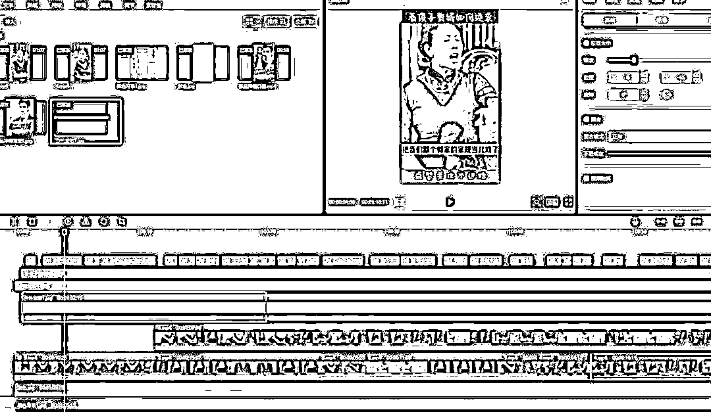

这里给一个省事的办法：用【智影】去字幕。先说明，这个方式不太稳，时好时坏，有时抹得不干净，原来有字幕的位置会发糊。其他去字幕的路子还有蒙版、裁剪、放大等。

【智影】去字幕：https://zenvideo.qq.com/smart/waterMask

把链接复制到浏览器打开，点本地上传，或者右上角登录；登录后点本地上传：

把之前下好的片子传上去，框住要去字幕的区域，点确定，字幕就去掉了：

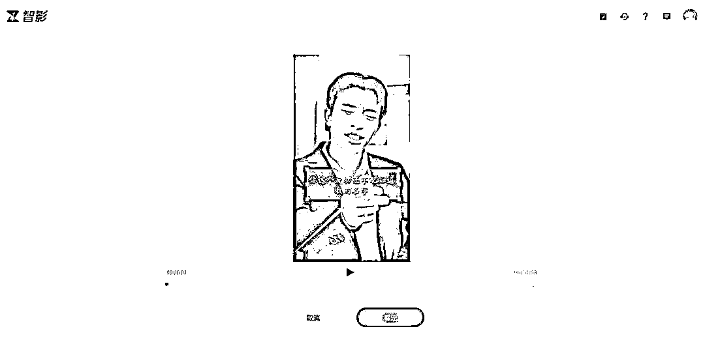

最后把处理完的片子下载下来。字幕这块，也有人用PR和剪映配合做。

**修改封面**

封面就像门面，选得好，用户更想点进去，播放量也更容易起来。

这一步用剪映就能做，比较基础，不再展开。

**片头片尾**

剪出来的片子别和原片一个样，先掐头去尾，后期再用剪辑软件做片头片尾，几秒钟足够。片尾可以从素材库搜“谢谢观赏”或“下集更精彩”加进去，方法不唯一，有别的创意也能用。

最后导出保存，导出的片子可以传到手机上：

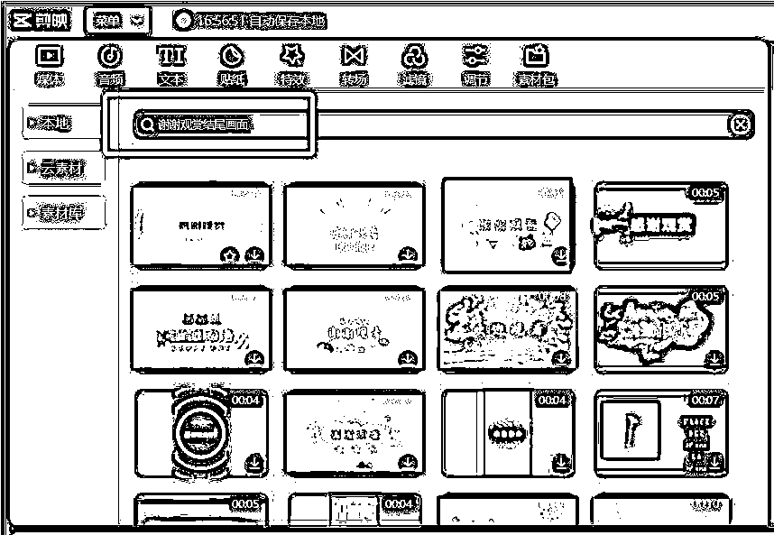

**变速**

片子导入后先做常规变速，选0.9变慢，再做下一步：抽帧。

抽帧完导出。然后重新导入片子，加速选1.1，这样成片时长和原片会非常接近。

**抽帧**

抽帧就是在片子里按一定间隔取若干帧，模拟隔一段时间拍一张照片再合成片子的过程，类似低速摄像。

具体操作：

把时间线拖到要抽帧的位置，点分割，或者按快捷键CTRL+B切开，再把切出来的片段删掉就行。

⚠️ 注意事项：

抽帧要挑没人说话的时候，或者人物讲完话、上下句之间的空当；别在人物正说话时抽，不然话会被抽没，前后连贯也会受影响。

不影响观看效果的前提下，尽量多抽帧，原创化效果会更好。

**转场**点“转场”，里面效果很多。

想给某段片子加转场，先点分割，再点想要的效果；右边还能调时长，按需要拉就行：

**镜像**

镜像就是让画面左右翻转。步骤是：把需要的部分分割后，直接加镜像：

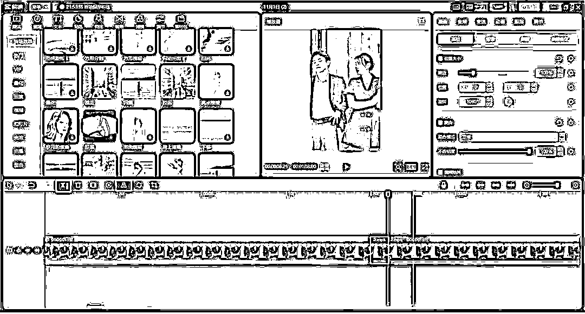

镜像前后的效果对比：

**导入视频和音频、加滤镜**

可以按喜好加，也可以随手拍段短片、随便放段音乐、随便加个滤镜，然后把强度调到最小。

目的不只是加东西，而是让平台识别到我们对片子做过创作。

**素材库**把素材库用起来，里面有很多热门素材，平时在别人的片子里也常能看到。想用什么就在搜索框搜，加到片子里往往能事半功倍：

**加特效、贴纸**

加特效可以改变原始风格，也能配上和原片搭的特效。在不同位置加不同特效，改变与原片的相似度。

**画中画**

这也是改原片MD5值的关键动作。

在画中画里导入一张自己拍的图片，拉长到覆盖整段片子时长，铺满画面。

或者导入一段自己拍的纯色短片，拍自家墙壁或地板都行，时长和原片一致，同样铺满画面，把不透明度调到最低。

**调节视频参数**调节亮度、对比度、饱和度、光感、锐化等参数，微调一点，10以内即可。数值越大，越可能影响原片清晰度。

**视频混剪**找剧里的几个亮点拼成一段，剪掉中间啰嗦没用的部分，再拼接；也可以把亮点放到开头，或者加个前情回顾。

**实操心得：**

剪得散一点，多加点转场，基本没太大问题，也没出现不能上热门的情况。也可以适当加自己的东西，比如解说之类的原创内容。

这些是常用剪辑手法，但说实话，单靠它们也做不到完全原创化。还可以再配上解说画外音（就是影视解说那种，对情节做讲解），以及多集混剪。

参考出处：《短剧自然流打法 1 个月变现 2w 的实战经验分享》

### 6.2.4 改剧情也能去重 @惟乔

可以通过删掉部分台词，甚至调换台词顺序来改变情节。比如原本是A、B、C、D四句，改成C、D、A、B，或者加一句E。

多用插叙：先讲最精彩的部分，再通过回忆交代背景。

参考出处：《新手用生财的方法做短剧 CPS，一个月 1.4w+收益》

### 6.2.5 高效混剪与CRV @思蒙 🔥🔥

很多人剪一条片子要花不少时间和精力，发出去效果还不一定理想。所以我们请了短剧CPS航海教练 @思蒙，分享10分钟快速剪出片子的方法，给混剪提供更多思路和参考。

希望大家跟着教程学会快速混剪，为项目赋能，做出爆款涨粉变现。

快速混剪-视频教程：

10 分钟混剪有封面版本.mp4【在线播放】想进一步加快产出，还可以借助CRV工具，让一条原片裂变成多条。

CRV教程如下：CRV 教程.mp4【在线播放】

用了CRV后，想把原片裂变成几条，就在设置里把“裂变次数”调成几，产出效率会明显提升。

对大部分同学来说，学到这一步并练熟，已经足够应对「短剧CPS」的混剪去重需求。如果对自己要求更高，可以继续看下一章。

但要注意：技法不是越多越好。把最顺手的方法练熟、不断优化放大，多发片子或搭建矩阵，才能放大「短剧CPS」出爆款的概率。

参考出处：《10 分钟快速混剪》@思蒙

## 6.3 素材批处理与批量混剪 @牛顿 273

想提升剪辑效率，这一章值得学。

5月航海期间，@牛顿 273 老师做过一次高手分享，可以搭配这一章一起理解，进一步提升剪辑能力和效率：5月30日《短剧剪辑进阶：复现爆款与流程优化》@牛顿 273

### 6.3.1 工具一览

下面这些工具后面可能会用到，有需要自取。

链接：https://pan.baidu.com/s/15dtlJU3ZHljFwEshmiMS9g?pwd=rtq1

提取码：rtq1

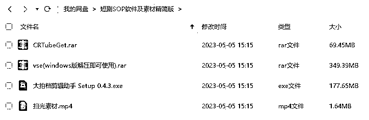

VSE 开源地址：https://github.com/YaoFANGUK/video-subtitle-extractor

VideoSrt 开源地址：https://github.com/wxbool/video-srt-windows

大拍档剪辑助手官方下载地址：http://spdpd.net/

### 6.3.2 前期整理

#### 6.3.2.1 素材切段

# 短剧CPS全链路实操：素材清洗、去重混剪、发布与评论维护

## 素材整备：把整部短剧拆成可剪辑片段

**Step1** 先在剪映里新建工程，把整部短剧放进主轨道。全选主轨视频后按 Ctrl+C 拷贝，再按 Ctrl+V 放到副轨道。随后把副轨上的所有片段选中，右键执行“新建复合片段”，让它们合成为一个整体。

1.1.mp4【在线播放】

**Step2** 接下来处理副轨字幕：在界面右上方找到蒙版，选择镜面蒙版，把蒙版范围卡在原字幕所在区域，粗细调到刚好覆盖字幕。然后给副轨加上模糊效果，路径是“特效—画面特效—基础—模糊”，模糊强度控制在 20 到 40 之间；判断标准很简单：原字幕要被盖住，同时没有字幕的画面不能让观众觉得糊得难受。

1.2.mp4【在线播放】

**Step3** 把进度条从片头拖到片尾，逐段确认副轨的模糊蒙版是否把所有字幕都遮住了。若全部遮住，直接做 Step4；若某些位置仍有字幕露出来，就把那一段副轨单独切开：把时间线放到该片段起点和终点，分别按一次 Ctrl+B。切好后，调整这一段蒙版的上下位置，再继续 Step4。

1.3.mp4【在线播放】

**Step4** 新建名为“模糊原字幕”的文件夹，把处理过的视频按段落导出进去。以 30 集为一段举例：时间线放在第 1 集开头按“I”，再移到第 30 集末尾按“O”，用这两个快捷键把导出范围限定在 1 至 30 集。随后点界面右上方的“导出”，参数选 720P、偏低码率、24fps，这样剪映和后续工具处理起来会更省时间，文件名写成 01-30。Step3 里单独调整过蒙版位置的片段，另外导出即可。

还有一个更省事的做法：先按 1-30、31-60 这样的区间把副轨切好——选中副轨，把时间线放到第 30 或第 60 集末尾，按 Ctrl+B 切一刀——导出时只选中副轨里 1-30 集对应的部分，按 Shift+X，导出范围就被锁定在 1-30 集，最后点导出。

1.4.mp4【在线播放】

**Step5** 再建一个“提取字幕”文件夹，把副轨暂时隐藏，导出目标文件夹改为“提取字幕”，重新导出一版视频。这一版后续专门用来提取字幕。

1.5.mp4【在线播放】

**Step6** 启动 VSE 这款硬字幕提取工具，把“提取字幕”文件夹里的文件选进来，框定字幕识别区域，然后开始识别。一般推荐用快速模式，速度更快，30 集大约 20 分钟，具体取决于电脑性能；代价是极少数台词可能被漏掉。漏字和个别错字不用慌，可以在 Step7 精修字幕时处理，也可以等以后用到相关片段时再手动补。这个环节的作用是把内嵌字幕转成 srt 外挂字幕；也可以换用其他基于 OCR 图像识别的工具，例如付费软件 Videosrt Pro，性价比不错，VSE 运行不畅时可以拿它替代，开源地址：https://github.com/wxbool/video-srt-windows。

1.6.mp4【在线播放】

**Step7** 建立“精修字幕后”文件夹，把 VSE 产出的字幕文件与“模糊原字幕”里对应的视频一起拖进剪映，先给视频做镜像翻转。接着把字幕导入轨道，注意字幕开头要与视频开头对齐；再调整字幕风格、字号和缩放，把它移动到蒙版遮挡的区域。之后随便点选一条字幕，在右上方字幕面板里检查有没有过长句子，若有，就在最后的一两个字前按 Enter 回车断行。完成后导出视频和字幕文件，导出时记得勾选字幕导出。

1.7.mp4【在线播放】

**Step8** 打开大拍档剪辑助手，进入“素材裁剪器”（APP—素材裁剪器），导入 Step7 精修后的视频。点“自动分割裁剪”，选择按字幕分割，并指定 Step7 生成的字幕文件；分割方式选“用于文件名被搜索”，点“分割”，再点右下角“裁剪设置”，保持默认设置确认，导出切好的视频。新建“分割后片段”文件夹，把输出结果移进去。

1.8.mp4【在线播放】

完成 Step1 到 Step8，素材片段分割这项工作就收尾了。

#### 6.3.2.2 去重模板搭建

**Step1** 找一段 4 到 5 分钟的视频拖进剪映，这段素材后面会被替换。把它复制一份放到副轨道 1，副轨 1 之后同样要换成待去重的半成品视频。选中副轨素材，右键选择分离音频，再把分离出来的声音删掉。

**Step2** 做模糊背景去重：主轨视频加模糊效果，副轨视频加矩形蒙版，把蒙版尺寸调到能露出大部分画面。

**Step3** 做扫光去重：把扫光素材放进副轨道 2，用裁剪功能改成 9:16，混合模式设为滤色（画面—基础—混合模式），播放速度调到 0.5，入口在界面右上方的“倍速”。

**Step4** 做画中画去重：往副轨道 3 放一段与剧情无关的素材，删掉声音，不透明度设为 2%（画面—混合—不透明度）。

**Step5** 做贴纸去重：从剪映左上方贴纸库挑 2 到 3 个贴纸加到轨道，时长与主轨视频对齐。

**Step6** 制作结尾引导：对主轨和副轨 1 做定格。选中轨道，把时间线放到副轨 1 末尾，点定格按钮。然后选一个箭头贴纸，调整大小和朝向，让它指向左下角——在抖音观众视角里，这个位置对应付费跳转入口。再加一句“点击观看精彩后续”，用朗读功能转成音频：点文本，右上方有“朗读”，挑一个合适音色，点“开始朗读”。把生成的音频放到定格画面下方，随后删除文本，因为文字引导可能触发营销判定，带来限流风险。

**Step7（可选）** 在剪映左上方的音频—音效素材里搜索“咚”，挑一个合适音效放在定格画面开始处。

具体操作可对照演示视频，遇到没看明白的步骤，建议反复看几遍：2.去重模板展示.mp4【在线播放】

到这里，去重模板就做好了。以后混剪完一条视频，把半成品导入模板，替换掉 Step1 里主轨和副轨 1 的素材，就能完成去重。

### 6.3.3 批量混剪操作流程

前面两步产出的素材怎么用？下面进入批量混剪。

**Step1** 在抖音搜索目标短剧最近一天或最近七天点赞靠前的混剪作品，用 CRTubeGet 下载；不下载、直接在线看也可以，因为我们只需要拿到对应片段的几句台词。

4.1.mp4【在线播放】

**Step2** 到“分割后片段”文件夹里，按 Step1 爆款作品的开头、结尾以及中间若干片段的台词去检索，把相关视频片段导入剪映。通常建议把台词所在片段的前后相邻片段也一起导入，保证剧情衔接完整。

**Step3** 对 Step2 导入的片段做裁剪。在剧情逻辑通顺的前提下，尽量删掉无意义的过场，只留下有看点的对白。裁好后导出成“开头01”“结尾01”“中间01”“中间02”等文件。还可以根据爆款视频结尾的一句台词，在“分割后片段”中定位对应片段，把目标片段前后一两个也一起导入，再抽帧删掉没有对白的过场，剪成自己的结尾片段：

4.2、4.3.mp4【在线播放】

**Step4** 把 Step3 导出的视频放进新的剪映草稿，将中间片段重新排序。例如原本是“中间01”“中间02”“中间03”“中间04”，可以调成“中间04”“中间03”“中间03”“中间01”。

**Step5** 从“分割后片段”里随机挑 3 到 4 个片段，尽量避开爆款视频里已经出现过的内容，随机插入 Step4 的草稿中。对随机片段做微调，让前后衔接自然，然后导出整段视频，这就是半成品。演示视频只插入了一个原剧片段，剪辑也比较粗糙；实际操作可以多插几个、剪得更细，这一步的核心目的是降重：

4.4、4.5.mp4【在线播放】

**Step6** 把 Step5 导出的半成品放进此前做好的去重模板，用半成品替换模板中主轨和副轨 1 的素材。操作方式是把剪映左上角媒体库里的半成品拖到要替换的素材上，并勾选“复用原视频效果”。由于替换素材只能用较长片段覆盖较短片段，可能需要先把主轨和副轨 1 的视频缩短，替换后再调整半成品时长；替换后，导入的半成品片段长度会与原先缩短的素材片段一致。

**Step7** 对主轨和副轨 1 的最后一帧做定格：选中轨道，把时间线放到末尾，点定格按钮。再调整音频、视频、贴纸等其他轨道的时间轴，最后导出，得到的就是混剪去重后的成品视频。

4.6、4.7.mp4【在线播放】

素材出处：《短剧CPS实操心得——素材批量处理SOP及批量混剪思路》

## 6.4 注意事项 @正帆

### 6.4.1 字幕错位的处理办法

字幕对不上怎么处理？

做法是把拼接完成的完整视频按时间点拆开导出。例如总时长 1 小时，就按每 20 分钟一段导出，分成 3 段并做好分类。若分段后仍有字幕错位，就把单段时长继续缩短，比如改成 15 分钟一段。这样就能解决字幕对不上的问题。

### 6.4.2 剪辑环节的实用细节

**要点一：封面要统一、清楚**

封面相当于账号的门面。用户进入主页后，如果封面干净好看，而且一眼能看出在剪哪部剧，就更容易吸引关注。封面来源主要是：从麻雀平台直接下载现成素材，有能力的再用 PS 修一下，让画面更舒服；这样别人点进主页，能清楚看到剧名。注意封面不要打序号。可以给封面统一加外边框，外边框模板能直接把封面拖进去使用。三连封面、单连封面.zip

**要点二：清晰度按平台素材来**

画面观感直接影响观众是否愿意停留。清晰度以麻雀平台下载的封面清晰度为准即可，不必过度处理；用 PS 稍作修饰也可以，我自己是直接使用原图。按个人喜好，把主页封面的亮度和清晰度调成统一风格即可。

导出参数可参考以下自用设置：分辨率 1080p，码率偏低，帧率 30 帧。

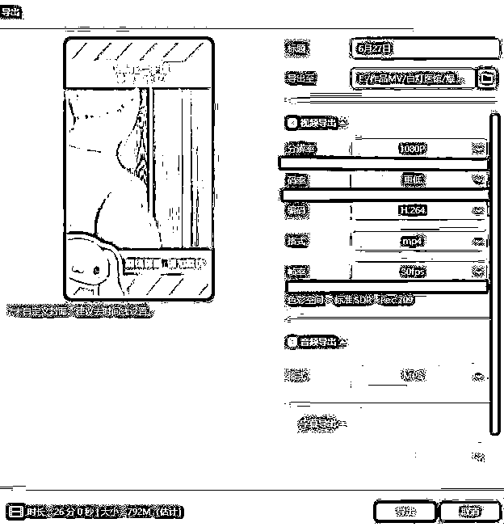

**要点三：结尾引导要落到剧情上**

前面已经强调过结尾引导的重要性，所以剪辑时结尾贴纸、音效、语音提示都不能省，用这些元素把观众的注意力留住。片尾制作可参考：AirPortal 空投快传 _338942886.mp4【在线播放】

素材出处：《新人0-1跑通短剧CPS并盈利1k+》@正帆_

# 第七步：视频发布与评论区运营

## 7.1 发布视频

剪辑完成后，就可以把视频发到抖音、快手、视频号等平台。操作并不复杂，打开麻雀Matrix和创作猫这两个 APP 即可。发布时，只要发布页面能看到对应小程序，就说明挂载成功，例如：

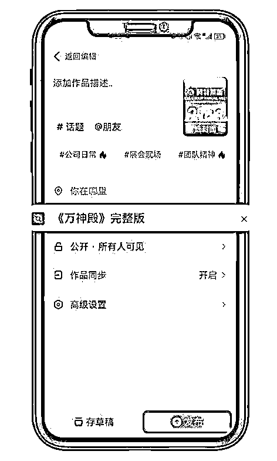

具体流程再梳理一遍。

### 7.1.1 用麻雀Matrix推广短剧的步骤 @思蒙🔥

页面信息保持默认即可：

随后点“创建推广”，系统会让你从相册选择视频；首次选择需要授权读取相册。选好后会自动跳到抖音或快手。接着在手机相册里选中已经做好的视频，上传到抖音，填好标题、话题等内容，点发布即可。标题和话题的写法可以参照爆款账号。

另外，抖音平台近期政策调整后，挂载小程序可能出现链接掉落或看不到链接的情况，原因是账号粉丝不足一千，暂不支持抖音小程序挂载。处理办法是：先选【九天剧场】的口令挂载方式（其他剧场暂时不支持），点【立即推广】，先【复制口令】，再点【立即

发布视频时，把口令粘贴进标题；发布完成后，再把口令放到评论区并置顶。

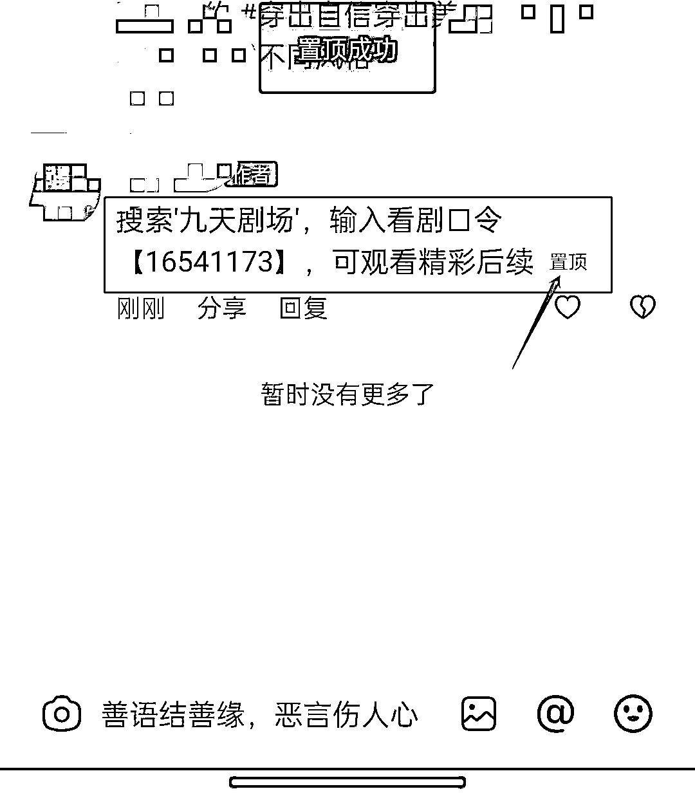

等账号发布了一定数量的视频，并且有作品小爆之后，粉丝很快能涨到一千，就可以直接使用小程序挂载，链接也不容易掉。注意，其他平台没有千粉限制，可以正常挂载。具体挂载方式可看下面的视频。其中第 3 种方式经后续再次测试，也存在掉链接的可能；如果掉链接，把对应短剧口令复制后置顶到评论区即可，现阶段先以涨粉为主。

8月10日麻雀app挂载方式.mp4【在线播放】

### 7.1.2 创作猫APP推广短剧的路径🔥

创作猫官方教程如下：创作猫短剧推广教程.mp4【在线播放】

这是 7 月以前的官方教程，最新版与麻雀的挂载方式差别不大，大家可以在官方 APP 里查找。

### 7.1.3 发布环节的隐藏细节 @云珞YunL @思蒙 @张柯Ker @猫柠

发布视频时有一些不太显眼的小技巧，虽然不同账号情况会有差异，但可以作为参考：

同一部剧可以更新十几条视频，前提是每条都做去重处理；但每条成品内容不要前后关联，否则观众会等着看下一集，反而不愿意充值。同一个原视频，也就是未经修改或去重的版本，不要在抖音重复发布，容易被查重。当然，也有人重复发没收到违规，甚至流量还不错，但这与账号本身有关，是否冒险发相同视频需要自己判断。

在同一个抖音账号上，相同或相似剧情可以重复发，但必须做去重，而且不要超过三次。最常见的情况是：某条视频爆了，把相同剧情或视频去重后再发，第二遍大概率还会爆。

快手视频如果已经被隐藏，不要再发第二次，容易违规。

目前短剧CPS最值得深耕的平台仍然是抖音，快手较难过去重。

视频号的特点是：新号阶段平台会给较多流量，有时不经意就能爆一条，但 7 天后流量会回落，所以一定要抓住新号红利期。

因此发布时仍以抖音为主，快手和视频号同步运营即可；视频号要重视新号红利期，如果账号废了要及时更换。

当某部短剧认真剪完却流量不理想时，不必太灰心，换一个平台发布，有时反而能获得很高播放量。

短剧发了两三条还没出单，可以再多剪两条，用数量博概率；如果流量仍无起色，再考虑放弃，有时爆款就差那一两条视频。

素材出处：《我用生财教我的方法做短剧》、《如何使用 ChatGPT 辅助产出短剧解说类视频》@+1

## 7.2 评论区维护 @某人周

短剧CPS与小说推文在评论区维护上有区别。小说推文需要在评论区做引导引流，短剧CPS则不必如此。但为了让视频获得更高流量和更高转化，建议在评论区主动引导回复，也可以借鉴热评写法，引发讨论。这个动作依然可以参考小说推文的评论区玩法，底层逻辑相通。以下内容均为小说推文的评论区维护方法，大家可以参考学习。

### 7.2.1 及时回评，拉近距离

好数据离不开评论区互动。及时点赞、回复观众留言，让观众感受到博主在关注他们；聊剧情的就接两句，吐槽角色的就表个态，只发表情的也可以回一个表情。

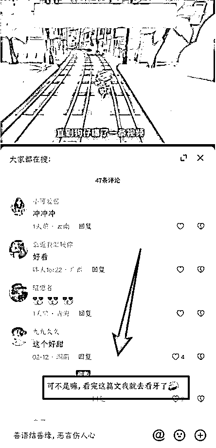

### 7.2.2 主动抛话题，带动讨论热度

在评论区抛出有趣的话题，可以和剧相关，也可以无关，鼓励观众表达看法，调动情绪，提高评论区活跃度。比如吐槽某个角色“真下头，就该 xxx，早该 xxx”，或者抛一些离谱问题吸引围观，例如“邻居家老婆快生了，我姓王，能帮起个名吗”，也可以适当拱火增加热度。

### 7.2.3 清理评论区，守住安全线

把不合适的评论清理掉，包括辱骂、广告等违规内容，避免不必要的限流。尤其是与视频无关的引战吵架、互骂几十条的情况，直接删除，必要时拉黑。还有部分推文博主会开小号来截流，在“在哪看”“叫什么”等评论下回复他们的关键词；遇到这种情况，先删除对方评论，再从消息通知点进其主页拉黑，最后在原评论下引导自己的关键词。比如下图这种情况就需要删除：

### 7.2.4 双号联动，制造互动氛围

用大号和小号先把自己发布的视频完整看完，点赞和收藏都安排上。再用小号在评论区适当留言，比如“尊贵的会员先走一步”“看完回来了，是很好看的 xx 文”等，为后续互动埋下伏笔。还可以轻微剧透，给点进评论区的观众留下悬念，吸引他们继续观看，比如“结局很好”“这渣男的下场很爽”等，适度勾起观众对后续剧情的好奇心。

资料出处：一篇讲小说推文高阶打法、靠精细运营实现稳定出单的分享。

# 第八步：收益结算与提现

播放量高，收益不一定就高；不过二者大体同向，真正的结果仍要看转化。现实中常遇到：人家十万播放，成交反而不如你的五万；你一万播放还没开单，别人四千播放却先出单。碰到这种差距不用焦虑，保持更新，机会迟早会来。

下面把「麻雀 Matrix」和「创作猫」的收益查看与结算方式讲清楚。

## 8.1 麻雀 Matrix：查收益、看佣金（@思蒙）

### 8.1.1 收益入口

❗️先记住：视频要在麻雀 APP 内发布；收益可在 APP 与小程序查看，其中小程序展示的数据更全。

时间维度可切换今日、昨日、近一周、当月、前一月等。

### 8.1.2 分佣与结算

首页还有一个「抖音小程序推广计划」入口，点进去能看到不同平台对应的佣金。

要提醒的是：8 月 8 日平台规则调整后，原本由麻雀统一打款的部分，改为通过「抖音小程序推广」结算——一笔佣金会拆成两处，一部分在抖音小程序结，剩余仍在麻雀提现，但整体佣金比例没有变化。

刚入门可以优先考虑九天剧场、世纪剧场，或者微剧吧、红火剧场；这几家更容易跑出爆款，转化通常也更友好。

### 8.1.3 提现步骤

在麻雀小程序或 APP 进入【我的】，找到【去提现】，再点【去绑定】，按页面要求填写本人银行卡信息并完成绑定：

还没结算时不用急着绑卡，等收益到账、能提现了再绑即可。到账金额会先扣 2% 的税。

绑好后点【立即提现】，下方会出现【去签约】；输入身份证号、勾选协议并【确定】，页面显示【已签约】后，再点【立即提现】。

提现款通常 1—3 个工作日到账。

资料参考：一篇详细的短剧推广实操长文。

## 8.2 创作猫：收益与提现

打开创作猫 APP，点“变现—影视漫画”，进入后在底部找「数据」和「我的」，推广表现与收益都在这里：

提现可绑银行卡或支付宝。结算周期有两类：CPS 是 T+7，CPM 是 T+30。

CPS 按销售金额分佣——用户通过你的作品或链接充值，你就能拿到相应比例。T+7 指收益产生后，再等 7 天（通常按工作日算）可结算提现。CPM 按千次展示计费，一次展示一般指一个用户完整看完；T+30 指收益产生后，再等 30 天（通常按工作日算）可结算提现。两种方式都支持绑银行卡或支付宝提现。

# 第九步：矩阵放大成果🔥🔥

## 9.1 为什么矩阵有效（@思蒙）

「短剧 CPS」门槛不高，本质是拿数量去换概率。起步阶段，数量往往比质量更关键；能多更就多更，能多开号就多开号。

做航海时你会发现，有些人的作品和你水平差不多，谈不上多惊艳，却突然爆了，这就是概率。选剧、剪辑的基本功掌握后，后面拼的就是【量】。

单条爆的概率是 1%，那十条呢？十个账号呢？每一条都是 1%，叠加起来，爆的机会自然更大。而且有的号一开始流量就顺，有的号一直没起色——前提是作品质量过关，这背后是账号底子和概率共同作用。做矩阵时，可以把表现好的号留下继续养，差的注销再换。

出处：6 月 8 日一场关于短剧 CPS 进阶与答疑的分享，讲者 @思蒙。

## 9.2 AB 账号测试法（@神仙姐姐）

这套方法用于快速判断：哪个号更适合哪类剧，从而更快出单。

第一步：AB 测试，找异常值。同一条视频发三套，即 3 个抖音号、3 个快手号、3 个视频号。有的号吃“扮猪吃老虎”，有的吃虐剧，有的吃甜宠，但刚起步时你并不知道号的“口味”。同样借鉴同行，别人出单，自己却卡在 500 播放，很可能就是没匹配到合适的剧。一个号测剧，和三个号一起测，差别不大，干脆一起上。辛苦剪了 1—3 小时的视频，套三套模板分开发即可。

一部剧发 4—6 条。如果这些号都没出现异常值，就换剧。所谓异常值，就是平时播放 500 左右，某条突然跑到 1000+、2000+。这样测几部剧，通常能筛出一两个合适的号。

我之前有个号：先发战神类，500 左右，pass；换甜宠，出现过异常值，但没及时跟上，或其他原因没起来，pass；再换特异功能类，还是 500 左右，pass；最后发现它居然适合古惑仔类型。

第二步：复制异常值。方法一，同一剧情反复去重、反复发，也就是“炒冷饭”。既然出现过异常值，说明有爆点；平台用户多、每次推荐人群也不同，自然可以继续发。方法二，同一部剧换不同剧情继续发。方法一适合账号起流量后，快速发第二、第三条；后面想有更大突破，还得靠新剧情。有新剧情时，就用方法二发 4—6 条。

没测出异常值的号怎么办？继续测：一部剧发 4—6 条，三部剧都没效果就换类型，比如男频换女频、虐剧换甜宠、战神换逆袭，不断换到合适为止。男频优先战神类，女频优先虐剧——那种“明知接下来要打脸，还是想把打脸看完”的爽感，很贴合当下短剧用户心态。

如果目标只是做 2 个号，建议准备 4 个号去测，这样能更快筛出 2 个合格号。就像赛马，从 4 匹里挑出 2 匹好马继续跑。

第十步：复盘数据，别被数据绑住

这部分建议先做出 20 个作品后再看。视频数据和账号动态，是后续复盘与优化的重要参考。系统大约会在次日 10 点提示可查看已发布作品的数据分析；次日点开自己发布的视频，左下角会出现【数据分析】，点进去即可看到详细数据：

重点盯两个指标：前 5 秒完播率和整体完播率。通常这两个数据能判断作品质量以及大爆的可能性。

简单说：5 秒数据差，说明开头吸引力不够，下次尽量选更抓人的开头；整体完播差，往往是冲突不足，或者剧情跳转太猛，下次注意。看数据、做判断，控制在 30 秒内就够了。

但如果你看完数据，下一条还是不知道怎么做，不如把时间拿去尽快产出下一条。不是叫你不看参数，而是别把注意力过度耗在参数上。数据（5 秒播放、整体完播、2 秒退出等）是参考，是帮后续创作的；研究半天没结果，索性先放下。

如果你爆过单，可能会发现：有的爆款参数明明不如另一条，播放却更高；反过来，自己参数比小明好，小明爆单了，自己只有几千播放。原因是你没理解平台的目的，甚至忘了自己的目的。

举个例子：你是老板，让两名店长各开一家水果店。A 店装修气派、灯光和陈列讲究，顾客愿意进店，平均逛十来分钟，日流水 2000 元；B 店装修普通，不算差但比不过 A，顾客不怎么留意装修，转两眼买完就走，平均停留 3 分钟，日流水却有 8000 元。作为老板，后续资源你会给谁？

这就是在说：参数好本身说明不了全部，我们的目的是转化、是挣钱。谁能更高效地转化客户，谁就更强。有的作品 5 秒播放、整体完播不理想，播放却高，因为用户点进去没几秒就点左下角了；有的参数漂亮，用户看完却没点链接。提高“装修档次”（5 秒播放）、拉长“停留时间”（完播率）当然有用，但它们最终都服务于【转化】，别本末倒置。

粉丝量也一样：有用，但新号阶段作用没那么大。我们的目的是转化，而转化通常靠高播放带来。一条大几万播放的视频，关注者观看占比可能连 1% 都不到，几乎可以忽略。何况关注你的粉丝，很多是想看后续，这样就不用去左下角付费了。关注=粉丝对你的期待。所以重心应放在更大的公域流量上，放在持续产出好作品、让更多人看见上，而不是盯着几个粉丝的增长。

资料参考：短剧推广实操长文，以及 6 月 8 日 @思蒙 的 CPS 进阶答疑。

## 9.2 调整创作方向

做出一定数量的视频后，你对剪辑软件会更熟，素材和方法也有积累。这时可以适当增加作品细节，结合个人情况调整风格。

同时多研究同行和各平台爆款分享，看哪些类型转化更好：开头用了什么剧情，能不能勾起好奇？中段剧情怎么推进？结尾如何引导转化？中间有没有穿插其他素材？也可以回看本手册「五、重组素材剧情，提升爆款概率」「六、剪辑视频」的内容，继续提升创作和剪辑能力。

资料参考：前述短剧推广实操长文。

## 9.3 用 ChatGPT 做解说（@+1）

本期航海并不推荐大家用解说方式做「短剧 CPS」：投入时间长、门槛高，短期很难看到好效果，容易劝退。但如果你已经熟练掌握「短剧 CPS」，想尝试突破，可以做短剧解说类视频。

别盲目做，可以结合工具，比如 ChatGPT。2 月 AI 绘画与 ChatGPT 航海期间，黄小刀教练分享过如何训练属于自己的 ChatGPT，回放链接：https://i.shengcaiyoushu.com/t/BOA7hbp3，干货很多。找素材、发视频等步骤与常规「短剧 CPS」一致，下面不再重复。

### 9.3.1 训练与投喂

第一步：训练自己的 ChatGPT。先明确它的角色——一个影视解说博主：

第二步：投喂数据。视频开头的黄金三秒很关键，直接影响后台算法是否推流。这里列一些开头思路，大家可继续补充：

（1）豆瓣网友口中的传奇老太，七十岁仍涉毒，还被封为“史上最牛P”……  
（2）三天身家过亿，这个男人的逆袭像开挂，可好运没撑多久……  
（3）被贴上最 NB／最惨／最狂／最冤标签的囚犯或劫匪……  
（4）荷尔蒙拉满的爽片……  
（5）刀锋划过手腕的女人，究竟遭遇了什么？前一日，她与丈夫大壮因为……  
（6）剧情反转超乎想象／令人难以置信／没料到……  
（7）他叫某某，表面是……？其实另有身份，来……接着讲。  
（8）伴侣出轨、家暴还不爱你，怎么办？这部片教你把老公管得服服帖帖。女主是……开始叙述。

还可以给角色起好记的外号，比如大壮、小美、二狗、钢蛋、翠花、阿XX、小哥、大哥、小凤等，把热词和记忆点塞进人物描写里，方便用户快速记住角色。

再加一点调皮调侃：角色下线就说“领盒饭”；失去自由就调侃“可惜他刷不到这条视频了”。

### 9.3.2 配音工具

入门用剪映足够；付费工具我习惯用微信小程序「配音pro」，一次付费终身使用：

抖音上一些专业影视解说号常用「魔音工坊」配音：https://www.moyin.com/ 。这个声音你应该很耳熟。优点是人物声音多、机械感弱、有感情；缺点是偏贵，就算单独购买某个配音，也要搭配 VIP 才能用：魔音工坊配音.mp4【在线播放】

### 9.3.3 剪辑与成片

1）从巨量创意或有米云下载解说视频，在剪映里识别字幕，导出 txt 文档：

接着正式改文案。以《你是天堂，也是地狱》导出的文案为例：顾念偷偷参加完他的婚礼后选择结束生命；她和他是青梅竹马，而自己只是他深夜寂寞时的一剂良药；当顾南易深夜回到公馆，看到浴缸里的顾念，彻底慌了。

2）把文档粘贴到 ChatGPT 里做二创改编，向它提问并设定角色：

如果回答不满意，点下方按钮重新生成：

GPT 会输出不少内容，提炼有用的部分，不通顺的句子手动修正：

3）把文案导入配音软件，输出音频：

加上 BGM，氛围感就出来了：

5）导出前记得加视频封面，用麻雀 APP 里的剧集封面即可，一条视频就完成了：

7 月 2 日 (1)(4).mp4【在线播放】资料参考：一篇讲如何用 ChatGPT 辅助产出短剧解说视频的分享，作者 @+1。

## 9.4 违规红线要清楚（@思蒙 @惟乔）

在平台混，最重要的是清楚规则，别和平台硬碰硬，除非收益远大于成本。抖音的规则在【抖音安全中心】都能看到，核心无非几条：不违反国家政策、法律法规；不涉黄涉暴涉毒；内容要有正向价值观。

# 短剧推广：少踩坑，多出片

先说一条底线：凡是可能踩违规线的素材，尽量别碰。少冒一次险，就少一分麻烦。

最容易出问题的内容主要有这几类：
- 衣着过于暴露、画面露骨；
- 侮辱人格，比如骂人“狗东西”“呆子”“贱人”之类；
- 打斗、羞辱他人、复仇情节，不宜过多；
- 尤其脏话、威胁、动手打人叠在一起，违规概率更高。

如果某些内容非剪不可，建议用解说的方式带过去。

还有一个常见情况：同一段素材，你发被判违规，别人发却没事。这和账号本身的“体质”、审核员的尺度都有关系，不必过度纠结，删掉、调整、重发即可。

心里要有一笔账：时间投在哪里更值钱？把纠结、抱怨、等申诉的工夫拿来，能不能多剪一条片？记住，你的时间最贵。

（参考：《目前为止最详细的【短剧推广实操手册】，没有之一！》《新手用生财的方法做短剧 CPS，一个月 1.4w+收益》）

那遇到违规怎么处理？

第一步：把短剧作品授权证明开出来，上传平台申诉，电子版即可。

申诉文案可以写：我方已与该影视剧拍摄公司达成推广合作协议，对方同意授权推广。

不会操作这一步，可以去航海大群求助。

第二步：提升作品原创能力，把重复踩坑的概率降下来。

（参考：《短剧自然流打法 1 个月变现 2w 的实战经验分享》）

## 9.6 心态放稳，动作不断 @思蒙🔥

不少人刷到别人爆单，回头看看自己发了十几条还没起色，就开始怀疑：我的视频怎么还不爆？

先别急。那些爆单的人，可能在参加航海前就已经实操过一阵子，对流程并不陌生；也有人本来就有剪辑底子，比起纯新手，出片速度自然更快。不妨看看他们平均发了多少条，再对照自己发了多少条。

把技术和能力差异放在一边，真正要做的就是尽量多产出，把出片效率一轮轮提上去，埋头干就对了。

我第一个线上项目，前三个月颗粒无收；第四个月赚到一千多；第五、六个月又碰上转型难关；一直到第七、八个月之后，才逐步稳定在月入一两万以上。

所以说，航海不是终点，而是起点。

线上项目不像上班，干着就月月有工资。它可能是这个月挂零，下个月五千，再下个月几百，之后又突然过万。所以心态得稳。我虽然没把做项目当创业，但确实得用创业的心态去做。

认真做，未必马上有好结果；可完全不做，结果一定是零。永澄老师直播时讲：“要么得到，要么学到；不参与，才是最大的失败。”

只要一直在做，好结果就会离你越来越近。最后想说：别把航海当终点，它其实是新起点，坚持做下去。就算眼下还没拿到结果，你的剪辑水平、去重方法是不是也长进了？以后做别的项目照样能用，等于省下了下一回重新学的时间。

后续遇到问题，先去航海手册、索引站百问百答里翻翻，那里已经攒了不少前人的经验。

（参考：6 月 8 日《短剧 CPS 的进阶技巧及常见问题答疑》@思蒙）

## 9.7 短剧CPS高频问题答疑 @老严干货CPS @清欢 @云珞YunL @惟乔

**选剧与爆款**
Q：什么情况下该换一部剧？
A：某部剧持续有流量、收益也不错，就别急着换；等流量和收益都掉下来再考虑。若还有收益但不算高，可以一边继续做，一边试发同类爆款剧。

Q：视频爆了之后怎么做？
A：①整理成合集；②在评论区做引导，文字容易吞评论，用图或表情包更稳妥；③尽快再发新作品，借势引流。

**账号与平台**
Q：什么样的团队适合做，什么团队不适合？
A：只要有时间，团队都可以做，这个项目目前进入门槛不高。

Q：被封号的情况多不多？
A：很多，尤其快手，90%以上都会碰到封号问题。不过版权方会提供授权书，拿授权书去解封，通过率在80%以上。所谓封号，多数是暂时被限制上传作品，因为短剧里打斗、擦边镜头多，容易被判违规。

Q：暴力、擦边内容会永久封号，还是只限制几天？
A：不会永久封号，都是限制上传。

Q：上传作品用旧号好还是新号好？新号要不要养号、打标签？
A：旧号新号都行。快手新注册就能发，不用养号；抖音新注册一般不给流量，需要简单养一养，不用刻意打标签，发得多了系统自然会匹配。

Q：我有兼职团队，可以让兼职人员发吗？
A：完全可以，特别适合有团队资源的人。

Q：抖音和快手哪个更好做、收入更高？
A：首选抖音，但一条成片可以多平台分发。

Q：目前主要就是抖音和快手吗？
A：抖音是去年12月16日才打通的，微信视频号也可以。

Q：需要实名吗？
A：不用实名。

Q：有版权的短剧库素材量够不够？人越来越多会不会同质化，影响收益？
A：素材充足，目前还在早期，不存在这个问题。

Q：会有退款问题吗？
A：退款流程比较麻烦，需要联系人工客服；几十万充值里，退款也就一两百。

Q：自己批量做账号，会被限流吗？
A：限流多半还是内容质量不过关。

**内容与剪辑**
Q：需不需要配解说？
A：账号流量正常时，不配解说同样能拿到高播放。有影视解说基础或感兴趣，也可以尝试，配解说更利于提升原创度。文笔好，或者从影视解说转行，可以加解说。比如做轻解说：原片片段+解说+原片片段，不必全程解说；能力提高后再做全程解说。新人成长路径是混剪、轻解说、全程解说。以前没做过短视频，别以为全程解说原创度高、更赚钱，就跳过混剪直接上解说。作为观众看别人解说觉得容易，自己做很花时间，也难。

Q：一天发几条视频合适？
A：2到3条都行，按自己的时间调整，最低保持一天一条。

Q：发布时间段有要求吗？
A：尽量在17点后发，每两小时一条，23点发布流量也不差。建议多看优秀账号的发布时间，或者自己测试不同时段的流量，一般5到6点、9到10点、11到12点，流量都还可以。

Q：播放量高但转化低，是什么原因？
A：原因不少：链接挂错，只挂了小程序，没落到具体剧集；片尾或评论区没有引导观众追同一部剧；剪辑逻辑有问题，把观众最想看的都放完了，结尾缺悬念，付费冲动就弱。

Q：作品提示可优化，该怎么处理？
A：流量低的直接隐藏；流量达到20w以上被提示，按要求重新剪辑发布，把被提示的视频隐藏掉。

Q：剪短剧一定得用电脑吗？
A：不一定，手机也能剪；电脑操作更省事、速度更快、细节更好控制。

Q：账号没有流量怎么办？
A：先看是不是账号流量的问题，账号流量在1000以上，多半就是个人剪辑的问题了。

Q：播放量上不去怎么办？
A：爆过之后，同样可能面临播放量低。尤其只爆了一两条就涨了几千上万粉的账号，系统打不上标签，再发新内容时话题不一致、吸引人群不同，按已有人群模型推不出去，播放量就会越来越低。如果突然只有100到200播放，多半是账号没标签、推流不精准。怎么办？多发，一天2到4条，坚持一周以上。做短视频要有心理准备，不可能天天high，关键靠执行力，用数量搏上热门概率。一天单账号干2到4条，干一个月。

Q：去重参数要加多少？
A：并非越多越好，底线是不破坏画面观感。

**链接与显示**
Q：小程序链接失效了怎么处理？
A：多半是作品触碰了平台规则，删掉或隐藏即可。

Q：发完视频后看不到自己挂的短剧怎么办？
A：换另一个账号就能看到，不影响其他用户观看。

（参考：《短剧 cps 怎么赚大钱》《短剧 cps，小白也能月入过万的蓝海项目》《新手用生财的方法做短剧 CPS，一个月 1.4w+收益》《我用生财教我的方法做短剧》）

