# 🛰️爆文实战：从找料到 10W+ 的完整打法

整理时间：2023 年 8 月 18 日

小提示：若想快速跳到某个知识点，可用页内搜索（Windows 按 Ctrl+F，Mac 按 Command+F）输入关键词定位。

## 开篇说明

💡 各位好，欢迎打开这份《🛰️图文爆款写作实战手册》，后面我们会多次碰面。

先交代基础：本手册由 5 月航海项目旧版升级而来。此次补入的重点有三块：上一期高手的实操经验、当下容易起量的内容赛道、新手怎样更快获得平台推荐，主要落在第五、七、九部分。因此读到与旧版相近的段落，不必意外。

本次还梳理了五个相对好起量的方向：情感、热点、剧评、法律、历史。每个方向都围绕图文爆款的基础打法，分别讲清成文思路与操作细节。

写作是一项能复用的底层能力，换平台也常常通用。所以手册也收入了微头条的部分经验，用来补足大家的写作功底。

随着 ChatGPT 普及，手册加入了相关操作流程，借助工具降低重复、提高出稿速度，争取做出更多 10W+。可转到「六、ChatGPT 写作流程」。

变现部分也做了细化，列出更多路径。可转到「七、图文账号的变现方式」。

❗️每期资料都会持续更新。如果你参加过上一期，下面这些新增或修改更值得看：
五、当下热门赛道
七、怎样用 ChatGPT 自动成文
九、怎样快速获得推荐

为了让项目全貌更清楚，手册收集了多位圈友的实践。大家能从不同人的路径里，看到从 0 到 1 的各种玩法。

因为经验来源多、再按流程编排，读起来可能略有拼接感，但内容完整，请理解。

使用建议：五个方向里按兴趣选起点。常刷热榜、爱看热点，就先试热点；爱读情感故事、容易共情，就先试情感；下班常追剧、对剧情有判断，就先试剧评；关注法治节目和社会新闻，就先试法律；喜欢三国水浒、常读史，就先试历史。

兴趣决定能否长期写下去。爆款变现靠手感与时间积累，在自己喜欢的领域写，更容易坚持，也更容易提高命中率。精力允许，也可以多赛道并行。

另外，多问、多聊。手册解决不了的，去航海群请教同伴，一起找答案。愿这趟航行既有成果，也收获同行伙伴。

本资料由龙哥盟与圈友共同完成，仅供航海船员及星球圈友学习。实践中欢迎反馈，联系鱼丸（yuwan387）提建议。

不多说，开始。

## 懒人版导图（点开查看）

# 一、2023 年做🛰️图文还有机会吗？

圈友 @渭水徐公 的判断是：2023 年的🛰️图文依旧有机会，和 2016、2013 年一样。

他的依据如下：

回看团队成绩：单篇最高收入 7 万多元；月入过万学员 120 人；200 多人收益超过 3000 元；300 多人收益在 500 元以上。

很多学员此前没写过，从零起步到拿结果很快。首期有人 3 天见收益，拿到 300 多元。整体结果不错。

大家也看到，近段时间头条、百家等平台流量收益下滑，有同学单价跌了接近十几倍。

🛰️图文不同：成文时间短，一篇通常 1500 字上下，口头组织半小时，打字约一小时。字数不多，单价高，长尾持续。

所以从收入、难度、耗时三方面看，🛰️图文是近期自媒体里较易上手、也较易变现的方向。

附几张变现截图供参考。

注：以上为坚持日更作者的收益。

当前变现主要有广告和打赏。广告是主渠道：自主接单、品牌方上门、正文带货、文末贴片；打赏多见于人格化较强的账号。具体见「六、图文账号的变现方式」。

# 二、五条爆款创作赛道

目前跑出成绩的方向，常见五类：

情感类

热点类

历史类

剧评类

法律类

本次会讲这五类如何做出爆款图文。

五类文章都绕不开材料、选题、正文、标题这些环节，所以手册在同一部分穿插不同赛道的技巧。例如讲“怎样找合适材料”时，会分别说情感、热点等该怎么找。

# 三、先完成开写准备

💡 本章要点

正式写作前，先完成注册、账号包装、开通流量主等动作，尽量快。它们不是重点；重点是把文章做出爆款、拿到流量收益。

若对🛰️搜索优化有兴趣，可参考圈友分享的订阅号搜索优化方法，通过设置获取自然搜索流量。

## 3.1 注册账号

打开🛰️公众平台，点右上“立即注册”，选“订阅号”，按页面提示填资料。

准备一张身份证和对应银行卡；可用本人，也可借家人资料；身份证不够，用公司主体注册也行。

限制：个人 1 个；个体工商户、企业及其他组织 2 个；政府和媒体 50 个。

名称与介绍涉及搜索优化，本手册不展开。取好记、贴合赛道的名字与简介即可。

精力有余，可看圈友关于订阅号搜索引流的分享。

## 3.2 开通流量主

注册后，凑够 500 粉即可开通流量主。直接买粉最快，也不耽误后续流量；渠道某宝很多，这里不细说。

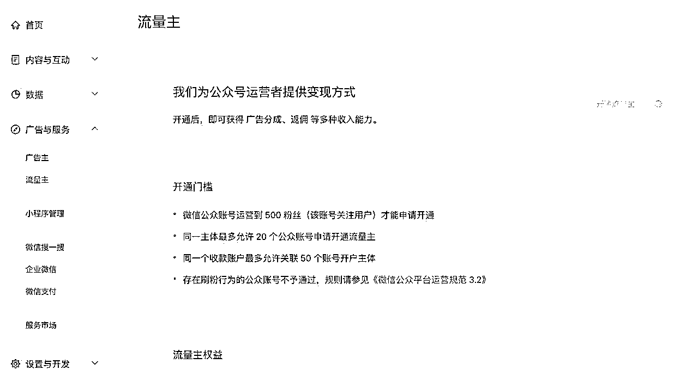

开通后，先以原创标识群发三篇，打赏权限随后开放。账号名、头像与打赏页尽量统一，人格感更真。

再简单布置门面：头像、名称、几句简介。前期准备就差不多。细节不必纠结，内容质量是核心，别本末倒置。

# 四、爆款文章的生成逻辑

💡 本章要点

优质爆款通常要满足五点：标题抓人、原创、有信息增量、不做新闻复读、不散播负能量。五点具备，才有大爆可能。

一篇成品的常规流程：

找材料

定选题

写正文

做标题

四步走完，主体已成型；剩下题图、导语等小环节影响较小，这里略过。

下面按不同文章类型，讲这四步怎么落地。

## 4.1 怎样搭建材料池

做内容的人都有同感：想日更，最大问题是原料从哪来。没有积累，写一篇故事就费尽脑汁；连更一个月，恐怕连早年 🐧 空间的旧文都想翻出来。

本节解决：爆款故事的材料从哪找。

### 4.1.1 情感类：材料渠道

渠道很多：身边亲友、邻居的见闻；线上知乎、抖音、百度、头条等。

生活中听到看到触动你的事与话，随手记；网上刷到有意思的内容，也随手存。

有读者基础后，可设自动回复留🛰️号，让读者来倾诉，从他们身上获得故事。

平日读书看报的好句、新奇故事，影视剧和小说情节，也可入库。宝藏到处有，难在发现。

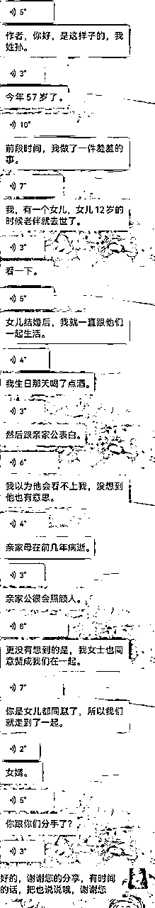

下面重点讲亲友与短视频两条线。@Ray

1）亲友讲述

故事常来自生活。前阵子和亲戚吃饭，二姨很爱聊村里的事。她提到一位已婚妇女，有两个孩子，去大城市打工后与他人相好，还生了孩子，逢年过节不回家，最终与原配离婚，两个孩子留给老人，父母都不管，很可怜。

若不是亲戚讲，我很难相信。原以为这种狗血情节只在电视剧、小说或新闻里，没想到离自己这么近。

于是我想到，刷抖音时情感纠纷新闻下常有网友留言，讲亲身经历或身边人的故事。能否把这些拿来用？这就是第二条线。

2）短视频平台的故事与留言

方法是：用关键词在各平台搜情感故事，同时追后续、看留言区延伸故事，丰富材料池。

步骤：先按关键词搜，如“婆婆”；筛选结果，优先媒体号发布的视频，因为媒体自带流量；若纠纷没结局，搜“事件后续”；纠纷视频下很多人会讲自己的经历，可参考；不只新闻，情感节目也可，如《爱情保卫战》《老娘舅》；不知道节目名，就搜“情感纠纷节目”。

具体操作：我在抖音搜“婆婆”，再加情绪词或动作词，相关视频很多。

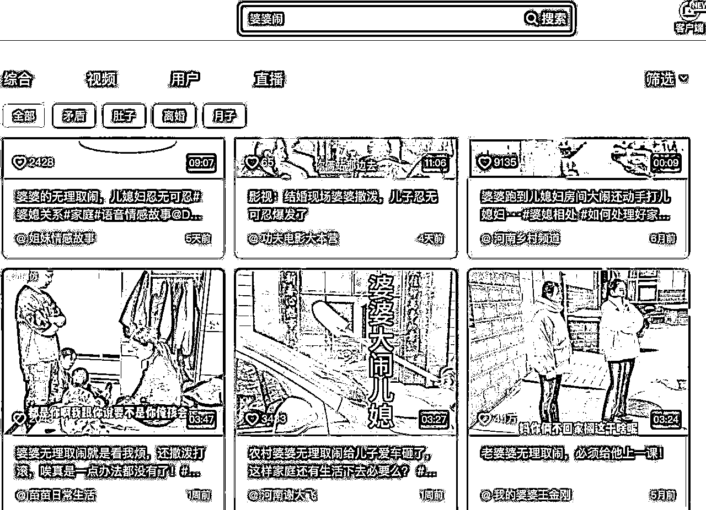

搜到后不能直接用，要筛选。个人用户视频不少是剧本演绎，优点是受众明确、已经验证，但材料可能旧，或是其他平台爆款改编，直接搬阅读量不高。另一类是媒体新闻视频，媒体号常转发并加标题，性质接近营销号，但自带流量，留言区很精彩。

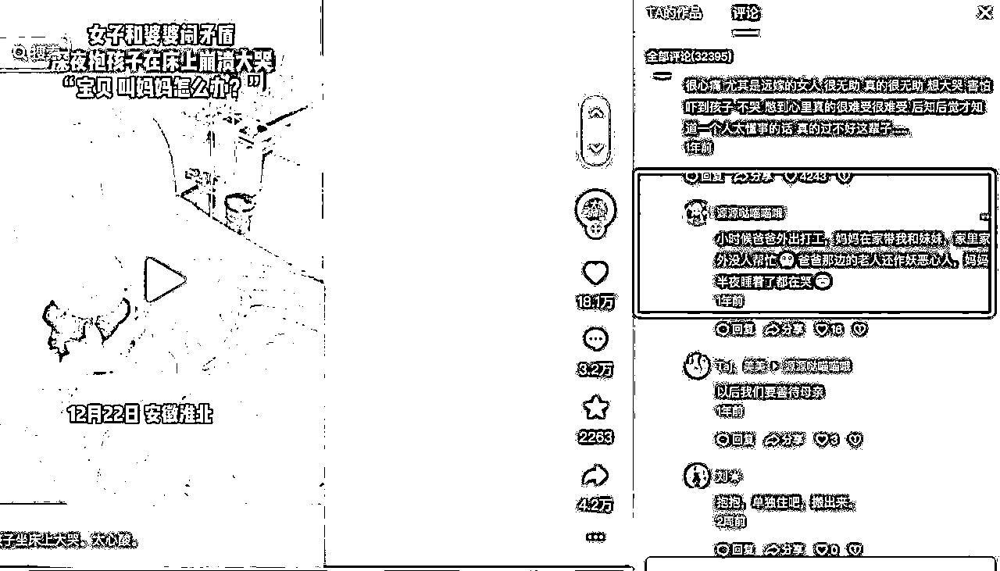

看大象新闻这条，18 万赞、32395 条留言，说明引发共鸣，有网友会讲亲身经历。比如图中圈出的留言，内容虽简单，但已可拿来加工。

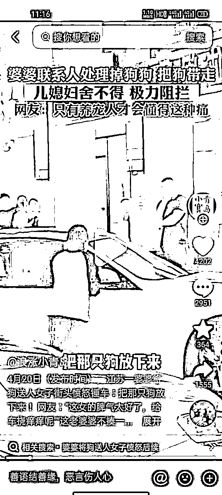

搜索下拉框出现“XXXX 事件后续”，说明大家关心结局。我也好奇搜了，没有后续。那仍按老办法，打开留言区找相关评论。

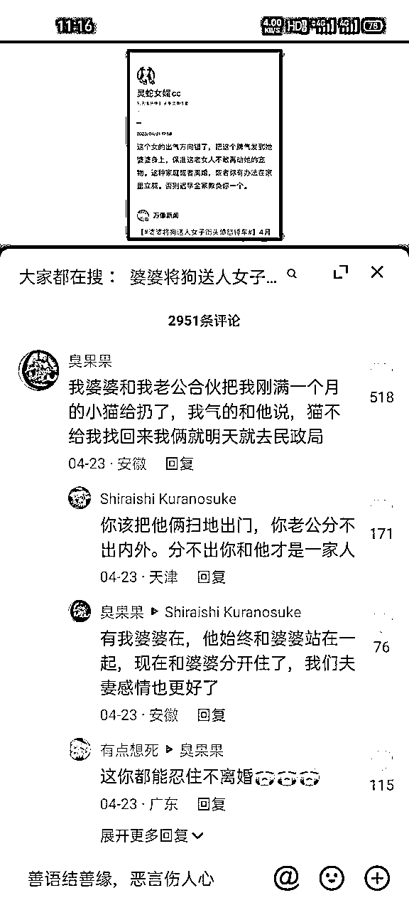

这是一条情感调解视频，讲恶婆婆打断儿媳手臂，和两个女儿一……

这条留言是我搜索前 20 分钟刚发的，仍需自己改编。我在 B 站搜曹心柔相关内容时，也看到该调解视频来源，里面有不少故事材料。把新闻放到抖音搜，再看视频下有没有网友留言。

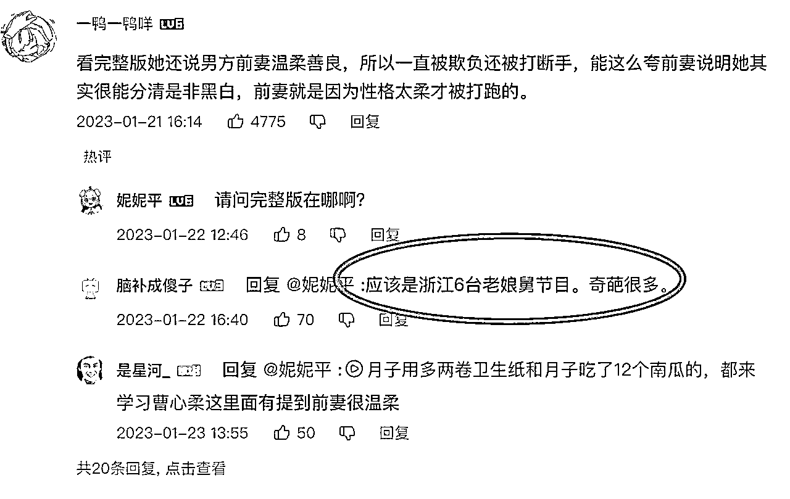

材料找到后，就可以进入故事创作。

内容来源：5 月 25 日《抖音平台挖掘情感素材，网友评论也能出爆文》@Ray

### 4.1.2 热点类：材料渠道

热点材料基本来自几个榜单：🧣、今日头条、知乎等。这些地方常有可选选题。

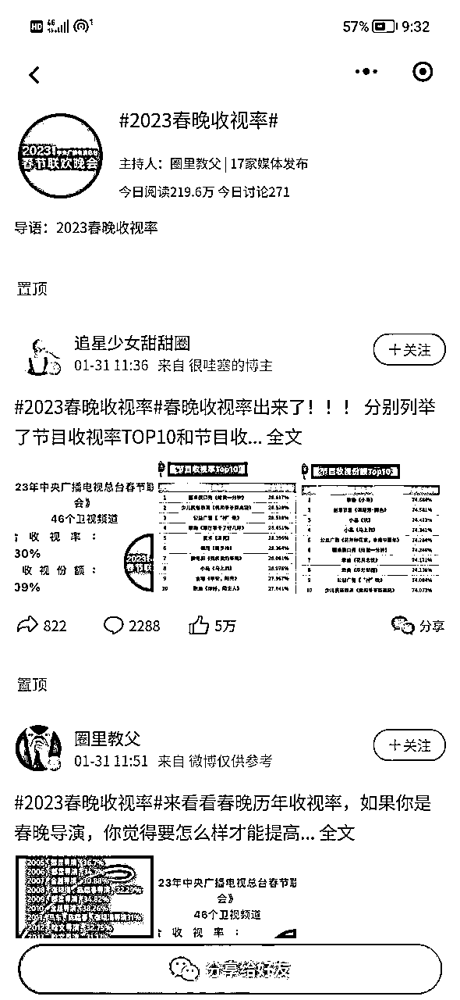

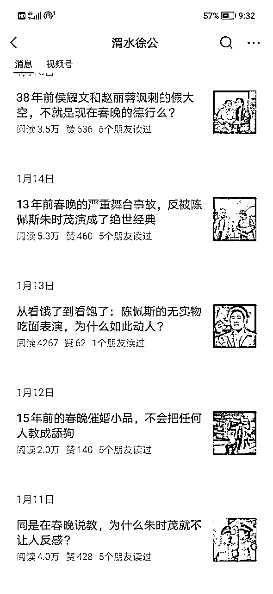

但榜单内容有时经过包装，要留心大众真正关心什么。很多知乎高赞回答有流量，却未必上榜。这类内容往往更值得写，也更容易爆。因为它们是一个赞一个赞顶出来的，即使没有榜单加持仍有人关注，说明是大家想看的内容。我们要选的，就是这种直击痛点的好内容。

### 4.1.3 剧评类：材料渠道

剧评不必愁原料。只需三步：

1）追剧时把打动你的画面或台词截图存入材料池；

2）分析剧集高光段落；

3）把剧与原著对照，写出差异和狗血之处。

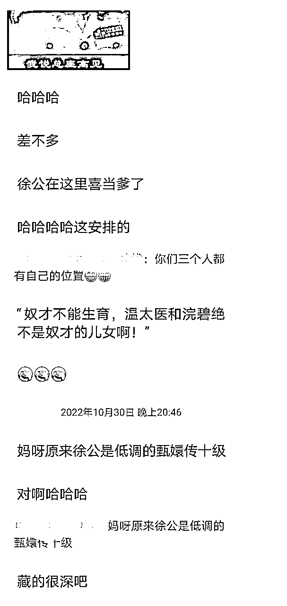

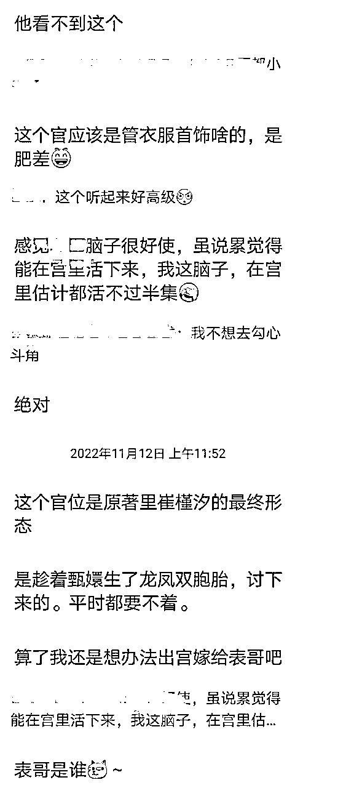

以《知否》《甄嬛传》为例。两部剧口碑热度都不错，盛祖母对明兰的教诲、明兰对生活的感慨，都能衍生不少写点。

仅《知否》淑兰和离的高光段，就能拆出三篇以上。

先交代背景：淑兰出身经商的盛家大房，带着丰厚嫁妆嫁给穷秀才孙志高。婚后婆家花她的嫁妆，还百般刁难。孙秀才要带风尘女子回家做妾时，盛家大房震怒，才有了和离。

三个展开方向：

① 淑兰和离成功的真相——古代男权社会里，孙秀才没有明显过错，淑兰并不占优。可深挖关键：娘家维护她，不顾名声受损，只要她脱离苦海；也可引申女人自己立不住会怎样。淑兰嫁妆丰厚、养着孙家，却被折磨得苍老，说明她性格太软。

② 孙秀才为何敢与盛家叫板？根本原因可写：经商的盛家地位不如读书人孙家；孙家一无所有，真闹翻光脚不怕穿鞋；两家交恶不只是两个家庭，而是两个家族，盛家即便和离也要顾及孙家宗族。

③ 明兰帮淑兰和离后，祖母的话暗示她与小公爷的结局。可写点更多：齐衡与明兰私下相爱，却注定无法相守。

第一重阻力，来自家世悬殊。齐衡生在国公府，又是独子，平宁郡主把全部指望都放在他身上；反观盛家，不过是五品小官门第，明兰还是庶出。第二重阻力，在于齐衡虽对明兰有意，却没有为这段感情豁出去的胆量，母亲一反对，他便退缩。第三重阻力，是平宁郡主根本看不上明兰，她若真想刁难，手段多得很。

光是剧里一个出彩片段，就能延伸出三篇甚至更多文章。对喜欢追剧的人而言，可写的东西是不是一抓一大把？

### 4.1.4 法律类：素材渠道有哪些

一是新闻渠道。北青网、1818黄金眼等官方媒体发布的内容，可信度一般较高，用来写作比较稳妥。二是头条新闻热榜，以及地方热榜。

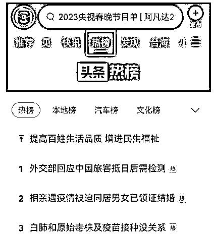

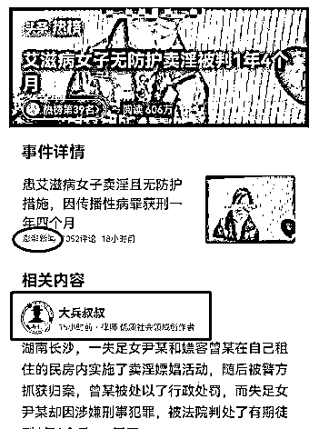

点进热榜条目，通常能找到官方媒体的原始报道。举个例子，“艾滋病女子卖淫无防护被判刑”一事，来源就是澎湃新闻；平时遇到其他热点，也可以点进去看看，顺便关注相关媒体。久而久之，你手里的媒体资源会越积越多，查资料时更省事。榜单下方还有不少法律从业者写的分析，同样值得翻看。

有些律师号会标明“抄袭必究”，大兵叔叔就是一个例子。他们的写法可以借鉴，但千万别原样搬用。否则，平台可能把你的内容判定为相似作品，只推给粉丝；严重时还会招来原作者投诉，实在划不来。

第三个渠道，是裁判文书网。

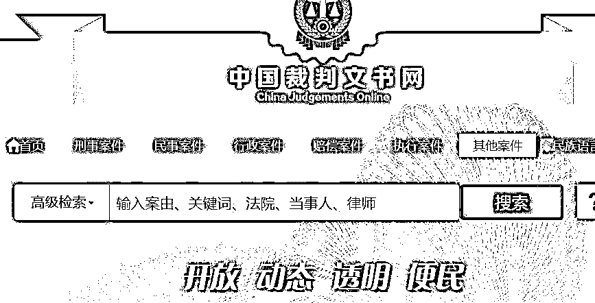

网站里收录了不少已宣判案件，适合作为写作资料。不过，涉案人的真实姓名必须做模糊化处理，不能直接写出来。这样做，既能保护当事人，也能降低被投诉的风险。

### 4.1.5 历史类：素材渠道有哪些

历史类的材料并不难找。大家从学生时代就接触历史课，里面有意思的桥段多得是。帝王将相、寻常百姓，将军出征、女子出嫁，可落笔的角度非常丰富。何况读者天然爱听故事，用惊险、紧张、圆满、愤怒或搞笑的情节抓住注意力，就是一条好路子。

获取渠道同样多样：看过的影视剧、听过的《百家讲坛》、历史领域大V的讲解，都可以转化为素材。甚至遇到某位历史人物时，还能顺着时间线追问他后来的遭遇——多数人只记得人物在史书里的某个瞬间，而我们要做的，是把他一生的起伏完整呈现出来。

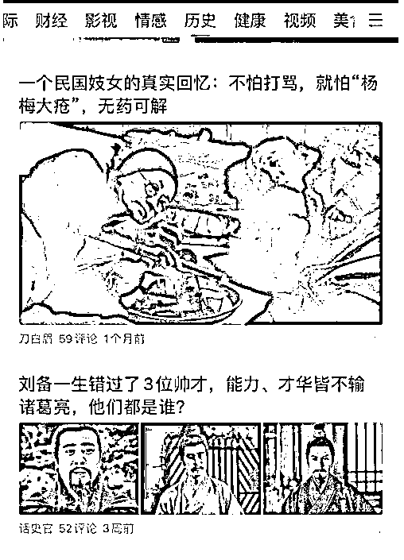

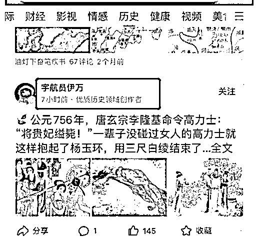

平时逛头条、百家号等平台，也会撞见不少历史类小故事，这些都能收进素材库。B站上有几位讲史很出彩的创作者，不妨关注：文大郎说三国，水平相当拔尖；正直讲史对清朝历史很拿手；直男文史课用漫画说史，轻松又有趣；御史房做综合历史内容，观点梳理得很细致。

另外强烈推荐喜马拉雅，因为《百家讲坛》的节目它几乎收得很全。写故事的前提，是把故事吃透。闲下来或通勤路上，随手点开一集，主播会用浅显易懂的方式把一段历史讲明白，这就是现成的故事来源。再加上内容有思想深度、史料出处也可靠，动笔时自然顺畅。

我自己经常听《百家讲坛》，下面分享几档常听的节目。

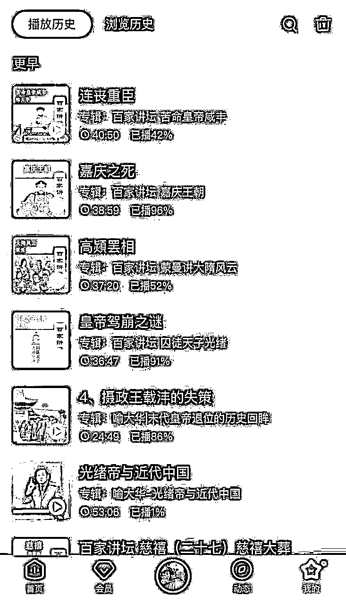

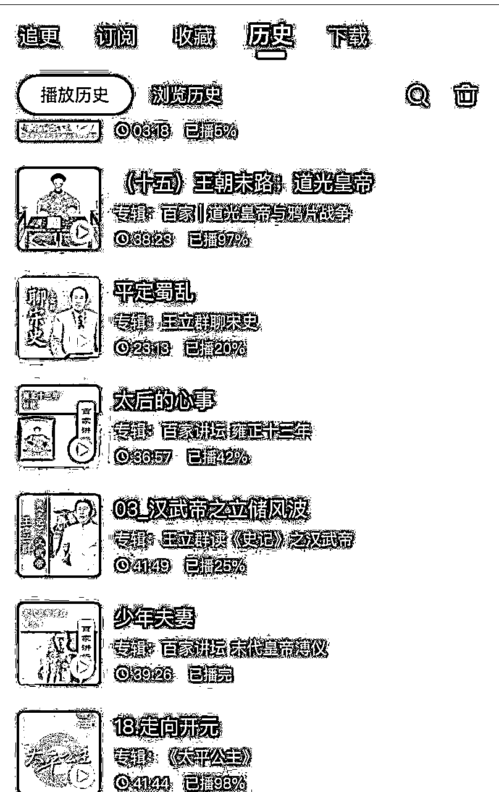

### 4.1.7 素材库怎么搭

手头积累的渠道多了，素材自然会源源不断。这时，把它们按类别整理成库，等真正动笔时，只要从库里挑出合适材料进行组合即可。

下面拿情感类素材库做个示范。

先列几个可参考的账号：写故事的刘小念、陈若鱼、猪小浅。三人都写故事，路数各有差异，既可以模仿她们的写法，也能从这些账号里搜集故事素材和爆款标题。

在「4.3.1 情感类：爆文模板」中，会讲到情感类正文的框架：一个故事＝标题＋主人公＋故事主干＋结局。

进一步拆解：一个故事＝标题＋主人公＋故事主干（梦想或目标、挫折或阻碍或意外、惊喜或反转）＋结局。

再拆细一点：一个故事＝谁～想做成什么事～为什么做或如何做～过程中碰上什么～最终结果如何。

动笔前，先确定故事主题，再拟好标题，然后围绕主题一路写下去。

主人公部分：交代“我是谁、年龄多大、来自哪里、从事什么职业”等基本信息；接着介绍与主人公有关的人或物，说明彼此是什么关系、如何认识、对方做什么，也做个简要交代。

故事主干部分：主人公想做什么、发生了什么事、遭遇了什么难题，其中涵盖目标或梦想、挫折或阻碍或意外。

结局部分：这件事给主人公带来什么影响，主人公如何应对或本该怎样应对，最后结果是什么。

按这个流程走，一个故事就成型了。

接下来，就依照这套公式来整理、搭建素材库。

日常见闻、文学作品、小说、影视剧、热点新闻、各类网站平台，都能提供素材。怎样让它们被反复利用？

先分别建6个库。库建好之后，让它们互相交叉使用，就能迅速拼出一个故事。

1、标题库。刷到让人忍不住点开的标题，就立刻丢进这个库里。可参考的例子有：

1）我66岁，退休金8000，儿孙满堂，但我却不想活了；
2）听完我妈死前说的那番话，我这辈子都不能结婚了；
3）我和堂哥的地下恋，坚持了20年，结局让人意想不到；
4）我68岁，生过大病才知道，有些东西必须握紧，比亲生孩子还可靠。

诸如此类，带有反常感、能勾起点击欲的标题，都可以收进来。

2、人物库。新闻、报道、八卦、小说影视，乃至身边真实发生的事，里面的人物都可以抽出来存进这个库。比如：

1）18岁未婚就当妈的小佳；
2）患有不孕症的小爱；
3）40岁不结婚，还有很多女人倒贴的老光棍；
4）55岁大妈生三胎；
5）50多岁大妈再婚，还要100万彩礼。

总之，身上带反常点、容易引发争议的人物，都值得留下。

情节骨架库下面再分三个子库：目标库、阻碍库、反转库。来源与前面相同，把事件中人物的愿望、碰到的波折、意外之喜分别记下来。

3、目标库。示例：

1）不孕的夫妻想生娃；
2）结婚想买婚房；
3）老大爷想找老伴；
4）重男轻女的家庭二胎想生男孩；
5）想开一家美容院。

类似愿望都可以归到此处。

4、阻碍库。示例：

1）结婚多年的恩爱夫妻始终没有怀孕，医院也查不出毛病；
2）房租突然涨价了；
3）谈了几年的男/女友，因为彩礼、房子等原因遭到父母反对；
4）好好的在跳舞，突然中风了；
5）和男/女友感情很好，一方突然卷钱失踪了；
6）和老公/老婆相亲相爱多年，老公/老婆突然要离婚。

这些都属于阻碍或意外。

5、反转库。示例：

1）老家拆迁，得了很多钱和房子；
2）本来女友父母要50万彩礼，突然只要8万；
3）失散多年的儿子突然开着宝马回来了；
4）结婚多年、看过很多医生都没怀孕的女人，3年后突然怀孕了；
5）房东突然减免房租。

这些都可以当作惊喜或反转素材。

6、结局库。来源同上，把人物最终走向记录下来，好结局、坏结局都收。比如：

1）复婚了；
2）离婚了；
3）一家人幸福快乐地生活在一起；
4）儿子把她接到家里养老；
5）找到合适的老伴，一起安享晚年；
6）去了养老院；
7）夫妻更恩爱了。

六个库建好以后，几分钟就能搭出一个故事。

拿刚才的编号来演示：从除开头外的几个库中取1、5、2、4、5、3。小佳18岁，未婚先孕当了妈妈（人物库1）；她一心想开美容院（目标库5），手里却只有8万元，看中一间月租7万元的铺面，刚准备租，房东改口要9万元（阻碍库2）；她正打算放弃，消息传来，房东中风了（阻碍库4），房东的子女不愿出钱治病，急于把铺面脱手，愿意降到6万元租给她（反转库5）；八年后，她的美容院做成连锁品牌，孩子的父亲也回来找她，一家人最终幸福地生活在一起（结局库3）。

照这个思路，一篇有起伏的初稿就出来了。而且素材自带真实感，读者更容易产生共鸣。

如果不想写故事，而是想写观点类、鸡汤类文章，也可以拿这种小故事做底，再补上观点、名言或金句。常见的鸡汤文结构就是三个小故事，每个故事后面跟几句观点、名言或金句。那就在六个库之外，再添一个“观点名言金句库”，基本就齐了。

言归正传。故事雏形有了，再填入细节、对话、动作、心理活动，就能变成一篇有血有肉的故事文。

故事想抓人，情节就得有波折，不能平铺直叙，起承转合也要安排得当。素材库用顺手了，一天写十个故事并非难事。

一个素材库能变出N个故事，诀窍在于：把人物、目标、阻碍、反转、结局这些要素拆开，再重新组合。比如小佳那篇用的是152453，也可以换成12345，或者22335，按需微调即可。

再看一个简短示例：

人物设定：小爱，26岁，做财务；她丈夫小王，29岁，跑业务。两人是夫妻。

情节走向：小两口想要孩子（目标1），婚后三年却始终没动静（阻碍1）；医院跑了不少，药也吃了不少，仍然无效。两人慢慢认了，不再治疗，结果一年后竟意外怀孕（反转4）。

结局：7 夫妻感情更胜从前。

合在一起，雏形如下：我叫小爱，26岁，财务工作者；丈夫小王29岁，是业务员。结婚三年多，我们一直盼着有个孩子，可一直没做避孕措施，肚子也没消息。医生看了许多，药吃了不少，依旧没用。后来我们想开了，不再折腾，谁知一年后竟然怀上了。

雏形有了，但篇幅太短，吸引力也不足。下一步要往里加细节、加情节，波折越足越好。

内容填满后，就进入补观点、加信息量的环节，也就是收尾。

故事写完，先@自己一下，再附上你的总结或感悟。末尾给读者留一个问题：可以问他们是否认同你的看法，也可以问他们对故事中的事情怎么看。想问什么，就抛什么。这样，一篇完整的故事文才算收工。

以小爱那篇为例，收尾可以提炼这样的观点：迟迟怀不上孩子的夫妻别灰心，积极配合治疗、把心态放平，仍有可能等来转机。再向读者发问：你周围有没有不孕不育的夫妻？他们后来有孩子了吗？

当然，总结观点、感悟和提问都可以按你的想法来，但这一环不能省。若能在观点里嵌几句鸡汤、名人名言，或影视、书籍中的金句，效果会更好。

以后看电影、刷新闻、读书、追剧、看视频时，不妨留意：有趣的标题或开场、人物、目标、阻碍或意外、反转、结局，这六个要素都可以抽出来，分门别类放进素材库。需要时随手取用，就不必担心缺素材。

换个说法，找素材好比逛超市：哪样菜顺眼、哪样菜勾食欲，就先放进购物车。整理素材、搭建素材库，则像把买回家的菜分门别类塞进冰箱，想吃时一拉门就能取。写故事则像下厨：红萝卜、甜玉米、马蹄、筒骨可以一锅煲汤，也可以换别的食材搭配着炒。至于读者偏爱哪道菜、哪锅汤，众口难调，只能多试几次才能摸准。

写作时注意：主干情节要详略得当。与主题无关的，一笔带过；能凸显人物性格、推动故事发展的，则要写透。结尾不妨反着来，让读者读完后觉得“出乎意料，却又在情理之中”。主干部分多用动词，用口语化的句子推进。形容词能少则少，动作要连贯，让读者仿佛站在现场，有代入感、有画面感，情绪自然被带起来。

一句话，故事要少铺陈，语言要紧凑。比如“月工资100元”“一个月挣100块钱”，尽量把场景立起来，名词和动词搭配着用，文字就更鲜活。转折词、连接词也要多用。

还有一点：别抄，别抄，别抄，重要的事情说三遍，标题也一样。自己动脑子改一改，可以借鉴，不能照搬。

选材尽量贴近生活，多写温情、正能量的内容；狗血、暴力，尤其违背公序良俗、涉及乱伦色情的东西，碰都不要碰。

我搭素材库用的是Excel，之后导入印象笔记，因为表格看着直观。大家顺手的工具不同，自己挑就行。

上面这张图就是我的素材库。库中素材彼此交叉、重新搭配，能变出许多不同故事；60条素材，够写一年，当然，存量越大越好。

## 4.2 如何挑出好选题

渠道多了，怎样沙里淘金，筛出真正可写、值得写的内容？

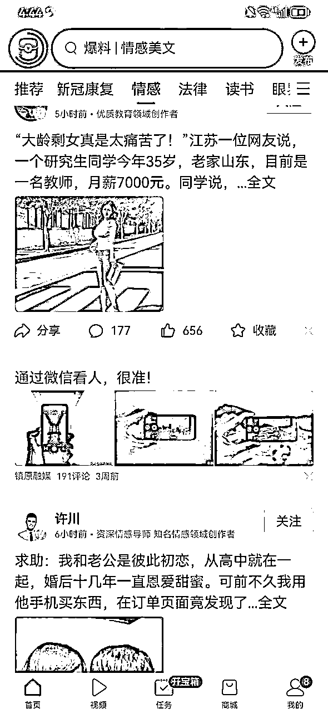

可以优先看那些能引发共鸣、足够动人、自带争议或反常的素材。具体可参照以下八个维度：

1）有曲折性；
2）有情绪；
3）有信息增量；
4）有关民生问题；
5）明星名人；
6）性；
7）暴力；
8）金钱。

一篇故事里，八个要素中最好至少占到三个。

### 4.2.2 热点类：怎样定选题

热点类选题，自然优先盯各类热榜。我平时用得较多的是🧣热榜和知乎热榜，不过细分到不同热点类型，选题思路也有差异。

第一类是“指点江山型”，专门对准当下社会不公事件发声，受众以中老年男性为主。做这类选题，知乎热榜比🧣热榜更合适。原因在于，知乎对负面新闻的曝光尺度更大；🧣热榜的修饰感更重，冲击力也弱一些。

还有一点值得留意：不少知乎上的爆款回答明明流量很好，却未必能登上热榜。这类内容常常比榜单上的更锋利，写出来反而更容易爆。为什么？因为它们是读者一票一票赞上去的，说明情绪已经被点燃。我们选材，就该盯住这种一针见血的内容。

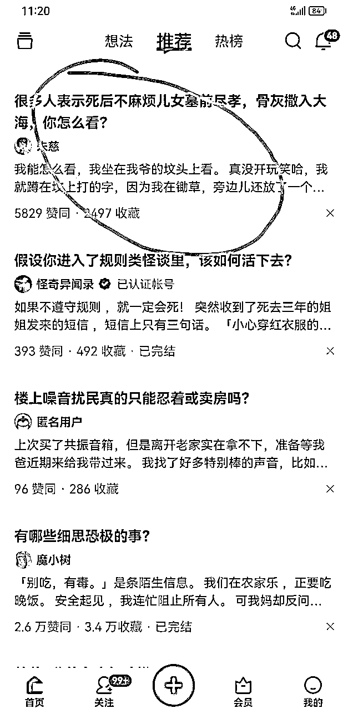

第二类是“娱乐热点型”，紧跟时下娱乐话题，核心读者是中青年女性。这类选题不必多解释，对多数创作者而言，🧣热榜几乎是首选。做法也简单：每天多刷几遍🧣，留意带“热”字标识的榜单条目，从中挑题即可。

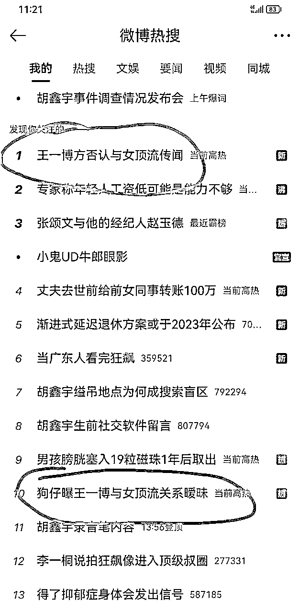

第三类是“养生热点型”，主打科普类内容，读者不分性别，以中老年人为主。这里要特别提醒：此“养生”非彼“养生”。它往往从老话里取材，比如“立春三不吃两不喝”之类。老年群体对死亡和疾病的焦虑较重，这类内容常常能带来可观的阅读量。具体操作上，可以结合农历节气，从热榜中筛选与“健康”沾边的题目来写。不过落笔时只能往古代习俗上引，不要给出任何医学建议，否则容易出问题。

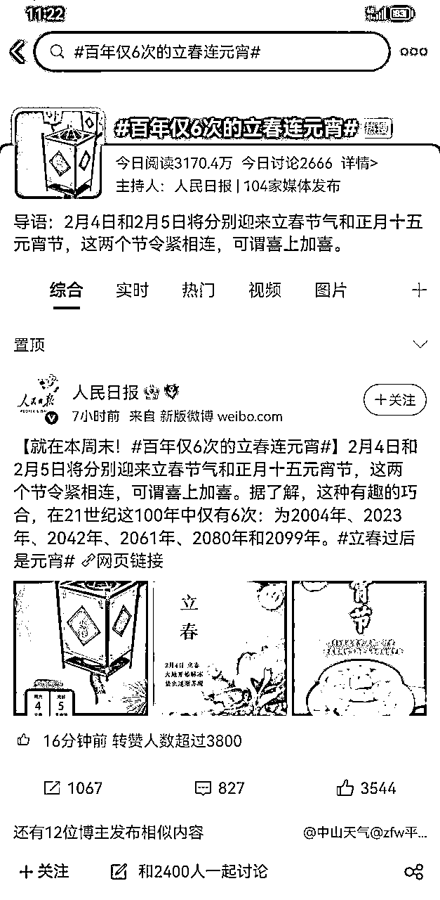

其他热点细分类型，我研究得不多，就留到以后慢慢摸索。

### 4.2.3 剧评类：怎样定选题

剧评类选题主要有两条路。

第一条是“热点＋剧评”。以电影《满江红》为例，上映时热度很高，评价也两极分化。若能在这一窗口期推出五六篇、七八篇角度新颖的影评，流量自然能接住。

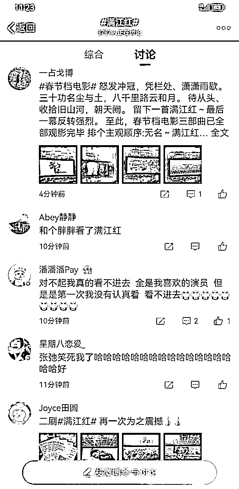

第二条是“经典老剧”。像《知否》《甄嬛传》《大明王朝1566》这类作品，自带大流量，信息密度也高。随手抓一个细节，就能延展成不少内容，选题几乎不会枯竭。说得夸张些，单靠一部剧写几百篇也不难。

这两条路，都可以作为你的选题方向。

### 4.2.4 法律类：怎样定选题

写新闻类内容时，尽量挑官方媒体报道过的事件，被投诉的概率会低很多。

再重复一遍：素材优先选官方媒体报道过的，投诉风险会小得多。

这也是我这次没推荐大家去🧣、知乎找法律类素材的原因。除此之外，各地新闻节目同样能充当素材来源。碰上哪条新闻让你血压直往上冲，就选它；看完毫无波澜的，直接略过。

# 选题有筛子，正文有架子

判断一条新闻值不值得动笔，先过一遍“开幕雷击七要素”这道筛。两条以上命中，排进优先队列；恰好一条，暂时搁着；一条都够不着，果断弃掉。

查法律条文不必钻牛角尖，搜索引擎就能解决。搜索词抓住故事内核即可——比如有人把别人脑袋敲成轻伤，那就查“故意伤害致人轻伤怎么判”这类表述，方向大致不偏。

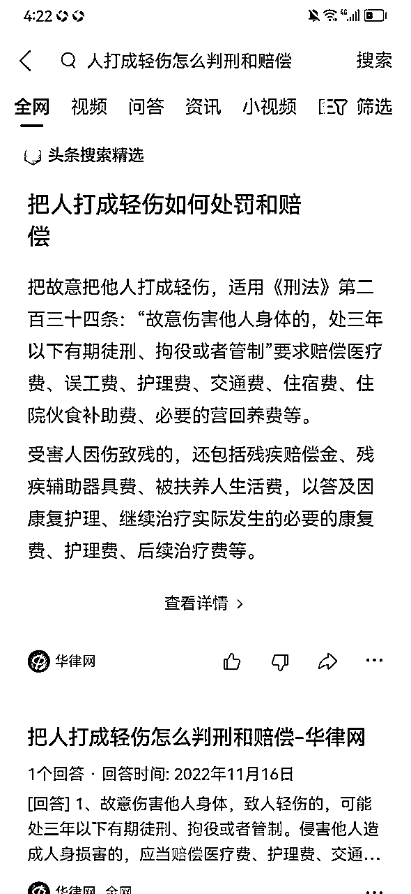

### 4.2.5 历史类：选题的两种走法

做历史内容，其实两条路都通：借势热点，或者按自己的偏好稳稳落笔。

**先说服帖热点这条路。** 要紧的是对热门动向保持敏感。胡歌官宣得女引爆全网那阵，不妨翻翻史书里重要人物降生或添丁引发轰动的记载来呼应；某县长落马的消息传开，也可以顺势写写古代官吏的贪墨往事。

可这条路不好走：热点与史实之间必须高度咬合，还得具备以今溯古的穿透力，对作者笔力要求不低。新手别勉强上手，往后练笔中慢慢攒本事。

**再说按自己步调写这条路。** 说白了，拣自己中意的人物和事件来写。码字首要的是自己写得痛快。仰慕的、厌恶的、叫人扼腕的、催人泪下的，统统可以作为笔下主角。

锁定人物之后，先把感情基调定下来：是推崇，是怜悯，是颂扬，还是褒贬各半。基调一立，顺着人物行迹铺陈，全篇守住一条主线，大体就不会跑偏。

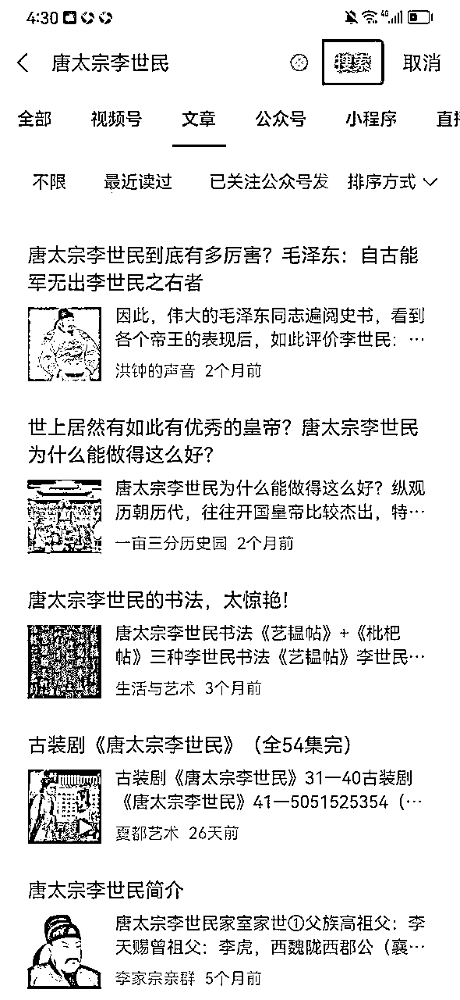

有些人物传世材料极少，偏偏你格外偏爱，如何是好？不妨迂回包抄，从其祖辈、后嗣、身边亲近之人切入。也可在合理范围内做些虚构补白，但切忌离谱过头，守牢一条底线：编出来的情节照样得为真实秉性撑腰。

另外提一个圈友@一来趟过的路子：近代史。做历史号的朋友，近代史不妨一试。这个赛道冷启动偏慢，动辄个把月，还带些变数；可一旦杀进流量池，阅读表现相当扎实。可参照“飞扬说史”，几乎日日有大小爆文，短板是推文里常常不挂广告。

出处：6月8日《👸号流量主的经验分享》@一来

### 4.2.6 选题技巧 @亦小亮

**其一，往窄处切。** 情感赛道照样能再往下分：婆媳关系、相亲话题、女性议题等。切得越窄，受众黏性越强，读完的人越多。

热门题材同样能切。军事可拆成台湾选情、俄乌战事；历史、网红幕后故事也能切。就拿前段时间的豪哥哥举例，从人物经历、运镜路数、内容编排、变现路径、走红缘由等维度逐个拆，每个维度都能独立成篇。

**其二，摸用户胃口。** 借助搜一搜、看一看、🛰️指数检索关键词。搜出来指数走高、内容供给偏少、品质尚存空间的细分地带，就是可乘之机。

**其三，掂长期价值，即长尾效应。** 这一条我挑选题时格外较真。凡是不符合“一鱼多吃”思路的标的，我绝不点头。拿我手上那个旅游号来说，稿子写罢，还会同步铺到携程、大众点评等渠道。

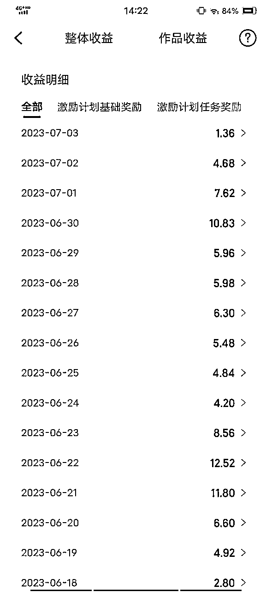

携程那边眼下每天稳定给我进账约摸十块钱，真下功夫深耕远不止这个数；累计到手也快满三千了。

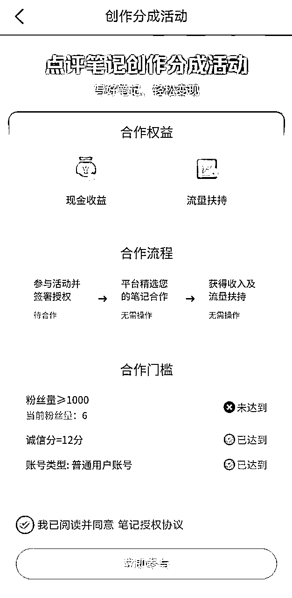

旅游号照样能蹭热点。贵州榕江村超打得火热那阵，我就围着榕江旅游铺了三篇稿，分别从出行攻略、民俗风情、本地物产三个切口落笔，美美吃了一波流量红利。

疫后复苏以来，旅游注定是常热赛道，很值得长线经营。体育赛道同样适合长做，再往下切，比如篮球里的中国女篮。

出处：7月4日《如何迅速把一篇文章的阅读量提高到1万+》@亦小亮

### 4.2.7 选题避坑 @半糖梦呓

👸号吃的都是公域流量，字里行间必须加倍留神。题材一旦触雷，文笔再好也难起量；有时仅仅因为碰了某个违禁词，照样挨平台限流。

究竟哪些雷区要绕开？大致三类。

**头一条，政治红线碰不得。** 内容平台每月清理的账号数以千计，其中大头是搞黄暴的，另有相当比例是撞了政治红线。

政治红线指什么？死死记住两个词：党史、军史。打算写文史内容的作者尤其要绷紧这根弦。党和军队向来是正面形象，落笔只能取正面素材，其余一概绕行。若要万无一失，1840年以后跟中国沾边的事，最好都绕开。民国人物与史事，半糖的建议是谨慎对待，新手最好别伸手。

文史领域天生敏感。做自媒体的人，得把责任和初心揣在心口。不该出口的话，半句都嫌多；敏感史事与人物，一丝一毫都别挨。

那有人要问：我就是爱写历史，咋整？建议新手从古代史切入，最好锁定中国古代史。一来稳妥，二来受众面宽、题材丰富，容易跑出爆款。

**第二条，蹭热点别啃人血馒头。** 蹭热点是自媒体人的本分，可有一类热点放在公域平台，绝对不能碰，那就是啃人血馒头。

何谓啃人血馒头？看两桩前车之鉴。二更食堂曾坐拥百万粉丝，如今已遭封停。起因是滴滴空姐遇害案后，二更食堂消费公众关切，捏造大量子虚乌有的情节，措辞香艳低俗，对逝者构成侮辱。这般行径就是啃人血馒头。下场如何？体量再大，说封就封，半点情面不留。

另一桩是今夜90后。有个孩子跟母亲吵完架跳了桥，今夜90后凭空编出一堆根本不存在的细枝末节，事后证实纯属瞎掰，无非是博主拿来赚眼球。这个号也落得同样封禁的下场。

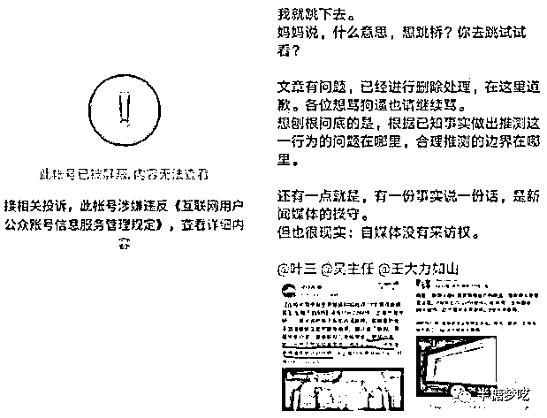

拿亡者大做文章，甚至凭空捏造细节，用浮夸的、带性暗示的笔法去描摹事件，这副吃相着实难看。网络既受法律管束，也绝非道德飞地。国人历来笃信死者为大，谁想借亡者做文章，必定惹翻众人。

又有人问：撞上这类热点，我不啃人血馒头，也不脑补造谣，就以平头百姓的视角评点一下世相，成不成？

不成。

因为稍有不慎就会激化群体对立、煽动仇怨情绪。满屏正能量你视而不见，偏偏揪着负面不放，平台不拿你开刀拿谁开刀？

出处：《今日头条七大变现方式，我只用一种，半年赚80000》

## 4.3 正文落笔的门道💡

💡 小节提要

文章主体其实是有章法可依、有现成范本可套的。我们要干的活，无非是照葫芦画瓢，把材料搜罗齐整，再稍加打磨填充。

就本次航海涉及的五大品类而言，各自的爆款范本如下：

情感类：标题+主角+叙事主线+收束
热点类：标题+事件概貌+立场/看法+收束
剧评类：标题+剧情脉络+见解/剧情拆解+收束
法律类：报地点+摆矛盾+述案情+网友评+讲法理+给对策+邀互动
历史类：抛出疑问+给出解答

接下来逐一拆讲，各品类分别有哪些范本可套。

### 4.3.1 情感类：正文如何搭建

情感故事的写法可以概括为四块拼图：标题、主角、叙事主线、收束，合起来便是一篇完整故事。

铺开来讲：标题+主角+叙事主线（内含愿景或目标、波折障碍或突发状况、以及惊喜或翻转）+收束。

再拆细些：谁～打算干什么～为何干或怎么干～干的过程中撞上了什么～最终落得什么结果。

落笔时，先敲定要写什么题旨，把标题拟妥，再扣住题旨一路写下去。

主角部分：交代我是何人、年方几何、籍贯何处、营生为何……把基本情况简略过一遍；接着引出与主角牵涉的其他人或物，跟主角什么瓜葛、如何结识、各自营生……同样点到为止。

叙事主线：打算干什么、出了什么事、撞上什么坎。这其中涵盖愿景或目标、波折障碍或突发状况。

收束：这桩事给主角带来何种影响、主角如何应对或理应如何应对、最终结局怎样。

至此，一篇故事便告成立。

留意：能跑出爆款的好故事，至少得占住五样：标题够勾人、内容属原创、信息有增量、不炒冷饭、不散播负能量。五样齐备，才有大爆的可能。

行文一般取第一人称，便于读者代入。当然这并非铁律，全凭个人偏好。

叙事主线的情节要拿捏详略：跟题旨不搭的，一笔带过；能凸显人物脾性、助推情节行进的，泼墨详写。

收束尽量反着来，让读者收获“出乎意料、却又在情理之中”的阅读感受。

打个比方：某女出嫁，彩礼要价过高，婆家扬言退婚——读者预判的走向是散伙，我们偏把结局写成成了亲。至于为何还是成了，就得靠你自己去编排那段翻转戏码了。

故事允许虚构，也可以取自身边人或自己的真实经历，但必须导人向善，不可逾越伦常道德，不可夹带负能量。

范本方面，素材多取冲突强烈、反转迅疾的家庭伦理式标题，如公公赠款、保姆行窃、二婚继女等，此处不再逐一照抄。

### 4.3.2 热点类：正文如何搭建

#### 4.3.2.1 案例一：事件作干，观点作叶

一篇完整的文章好比一棵树。文章梗概——即事件本身——是树干；其余散落的金句、见解、细节、立场，是枝叶。

树干的要求很朴素：把事讲清楚就成。倘若事件盘根错节、需泼墨甚多方能交代明白，那就集中笔力把某一个切面讲透，切忌贪大求全。事件一复杂，篇幅势必拉长，完读率就要遭殃。

枝叶呢，承担的是亮明立场和见解的职能。写故事那会儿，枝叶全拿去铺陈细节，为的是让故事显得真切可信；可写热点文是另一码事，素材本身就是真实发生的新闻，无需再借细节自证真实。硬塞进去反倒可能捅娄子——二更食堂那次就是活教材。

所以热点文里头，枝叶只管一桩事：站队、亮态、把看法说透，别的功能一概砍掉。

热点文的门道就这么直白。叙述事件时，一旦情绪涌上来，就借词句把它倾泻出来，去拢住跟你同频的读者。记住这一句，够使了。

#### 4.3.2.2 案例二：两档难度的爆文范本@妞妞💋

入门版热点文=标题+引子+事件铺叙+收束（参照：泡哥看世界）

进阶版热点文=标题+引子+事件铺叙+参照对比（可略去）+收束（参照：桌子的生活观）

范本拆解：

1）标题（务必埋下开幕雷击，控制在五十字内）

示例：突发！“中石油牵手门”男女主再曝大料，这背后可不简单

2）文章引子（百字上下）

可以写自己对此事的感触，也可以径直切入事件。

示例：
① 生活时常塞给我们惊喜。成都一位摄影小哥不过是随手玩个街拍，竟拍出一桩国企高管的“牵手门”丑闻。
② 某月某日，一则话题冲上热搜。“宝妈因孩子吃了同学生日蛋糕发飙”，此事旋即在网友间炸开了锅。究竟所为何事呢？
③ 谁能想到，珠穆朗玛峰上也会上演这般剧情。近日，#珠峰攀登者放弃登顶救起濒死女子#这一话题飙上热搜榜首。
④ 诸位可还记得十天前武汉教师碾压学生致死一案？谁能料到，学生竟在校内被自己的老师碾死。然而事情才过去数日，又一轮噩耗袭来：被撞孩子的母亲，在孩子离世十天后，也从二十四楼纵身跃下。

等等……按自己顺手和拿手的路数来就行。

3）事件铺叙（五百字上下）可借GPT打辅助

即把事件的来龙去脉——时间、人物、地点、经过——完整过一遍（五百字上下，配相关图片）。这一步可交由GPT协助整理叙述。

① 若用的是GPT3.5，把要写的热点事件全文复制过去，投喂给GPT，令其代为梳理、提炼提纲与主题，以及事件内核（文章过长的要切段投喂，单段别超六百字，超了它会撂挑子）。

指令语：
“XXXXXXXXXX” 你是热点事件点评师，请帮我梳理、提炼出上面热点事件的提纲和主题，还有事件的核心内容。

注意：这里的“XXXXXXXXXX”即你所选热点事件的原文。

再令GPT将其刚提炼的内容写成一篇成稿，指令语：
请将你上面梳理和提炼出的提纲、主题，还有事件的核心内容，写成一个完整的事件，事件的主题意思不变，字数500字。

② 若用的是GPT4，就更省心，直接把链接甩给GPT，让它自行读取并梳理、提炼提纲、主题与事件内核。

指令语：“XXXXXXXXXX” 你是热点事件点评师，请帮我梳理、提炼链接里这个热点事件的提纲和主题，还有事件的核心内容。

注意：这里的“XXXXXXXXXX”即所选热点事件原文的链接。倘若链接来自百度、头条或其他站点，GPT读不了，得先把文章复制粘贴进飞书，再把飞书链接递给GPT；若是👸号文章，则可直接投喂。

另外需留意，此功能得启用GPT4的Model: Plugins•Enabled plugins模式（专为让GPT4读取链接内容而设的插件），如下方图示：

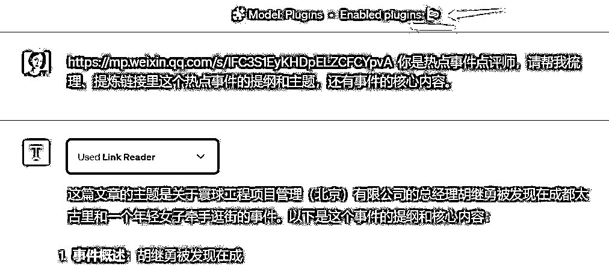

再令GPT将其刚提炼的内容写成一篇成稿。

指令语：
请将你上面梳理和提炼出的提纲、主题，还有事件的核心内容，写成一个完整的事件，事件的主题意思不变，字数500字。

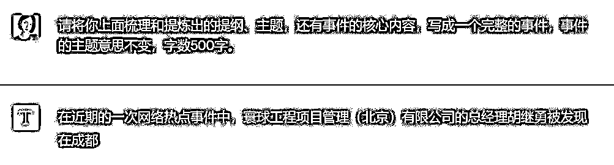

这么绕一道弯，图两样：一是躲开与热点原文撞车、原创审核过不了关；二是把事件做薄，让人扫一眼便知前因后果，又不至于冗长拖沓，对拉升完读率有好处。

4）参照对比（三百字上下）

这一步可有可无。若热点正猛、热度居高，大可跳过；反之，补上为妙。

操作方式是上网搜摸一两个同类事件，拿来跟本事件并置比对，再缀上几句评点。

5）亮出论点并点燃读者情绪（三百字上下）

此处同样可请GPT代劳，令其拟出对事件的看法与论点，随后自己再动刀润色。毕竟GPT是机器，不带情绪，我们得把它改得更有火气、更“愤青”一些。

指令语：
请点评你上面刚写的这个热点事件，见解独到一点、犀利一点，以引发读者的情绪，字数300字。

范本：
诸君不妨先扫两眼下面两篇范文：
范文1：胡继勇带女员工在太古里牵手逛街！女方的素颜照很一般，但胜在腿长肤白无对比论证简单粗暴法
范文2：“我儿子被投毒了！”家长群聊天记录流出后，我看得好窒息……有对比论证有深度的写法

照前头讲的「范本拆解」，瞧瞧范文2的内容是怎么搭起来的：

① 标题（埋下开幕雷击，五十字内）
“我儿子被投毒了！”家长群聊天记录流出后，我看得好窒息……

② 文章引子（百字上下）
6月6日，一则话题冲上热搜。“宝妈因孩子吃了同学生日蛋糕发飙”，此事旋即引发网友热议。究竟所为何事呢？

③ 事件铺叙（六百字上下）
从“有网友发帖分享了一段家长群中的对话，从聊天截图我们得知：六一儿童节，有位家长带了蛋糕，给孩子们集体分享”到“再毒的奶油蛋糕，其危害性也比心灵的终极污染小得多”。

具体请看原文：“我儿子被投毒了！”家长群聊天记录流出后，我看得好窒息……

④ 参照对比（三百字上下）
对照1：知乎作者“一只小仙女”讲过自己的亲身遭遇。
对照2：有网友提到，妈妈的一位同事因为孩子吃了辣条，硬逼孩子吞下成人两倍剂量的泻药。
对照3：主持人倪萍分享的一段往事，令我颇有触动。
具体请看原文：“我儿子被投毒了！”家长群聊天记录流出后，我看得好窒息……

⑤ 亮出论点并点燃读者情绪（三百字上下）
“只有自己的内心得到过满足，才不会匮乏”到“没有人一生都在吃标准的食物，也没有人一生都在走正确的道路。对孩子和家长来说，适当保持一点松弛感和容错率，或许我们都能活得更轻松”。

出处：7月13日《用GPT写热点文&👸号快速入池的方法》@妞妞💋

### 4.3.3 剧评类：正文如何搭建

剧评的范式为：标题+剧情脉络+见解/剧情拆解+收束=剧评。

1）观点文路数的剧评，无论剧情还是细节，最终都得落到一个归宿上，这个归宿便是你的见解。

举例：明兰不知，原来顾廷烨与贺弘文求娶她目的相同（读者会好奇究竟是哪个目的）。

剧情脉络是：顾廷烨设局求娶明兰。他明知明兰与贺弘文即将议亲，特意将贺弘文那青梅竹马的曹表妹送入京城。果不其然，曹表妹登门求做贺弘文的妾室，贺弘文动了心，故意晾着明兰等她让步。就在两方僵持之际，顾廷烨出手求娶明兰。

# 《知否》剧评：合适，比爱情更长久

写《知否》剧评，收益常比预想中更可观。先说明兰的婚事：她配贺弘文，条件对得上；她配顾廷烨，也同样成立，只是两边看重的点不同。贺家看重的是她的家世底子，以及遇事沉得住气的处事章法；顾廷烨则记着父亲那句“娶妻娶贤”，更在意品性与手段。明兰恰好两样都拿得出手——有主见、有办法，进了顾府还能与继婆婆周旋。

那篇文最后落在这样一层意思上：婚姻的根底是合适，而非爱情。两个人能彼此托举，往往比单靠一腔热情走得更稳。明兰也表达过相近的看法：女人别把目光全锁在儿女情长上，经济与精神都独立，才看得见更开阔的世界。文章最终收获3.8万阅读、200多块收益。

墨兰则是另一个流量富矿。不少读者纳闷：她做了那样不体面的事，怎么反倒成了四姐妹里嫁得最风光的？剧情交代得很明白——为了踏进永昌伯爵府，她不惜拿盛家名声做代价，与梁晗越了礼，再逼全家替她圆场，体面地把她送进梁家。单看婚后，梁晗宠爱她，婆婆也和善，确实满足了她高嫁的期待。

可嫁得风光，不等于日子舒心。她占着正妻名分，却把心思全耗在与妾室争宠上，还主动替丈夫纳妾，把家里搅得鸡犬不宁。四姐妹中她起点最高，生活却最乱；另外三位倒凭自己的经营，把不如意的婚姻一点点扳成了想要的样子。这篇拿到4万+阅读，收益280多。

上面两组案例，对应剧评的两种写法：一种是“标题+细节+观点+总结”的完整框架；另一种不搭大结构，专心拆剧情，把情节底下的暗线和人物命运翻出来讲。

第三种写法可看曹锦绣。她费尽周折成了贺弘文的妾，真进贺家才发现，日子只是温饱不愁，别的指望一概没有。贺家祖母时常敲打她，贺弘文待她也不热络。有一回她借口身体不适，把表哥诓进屋里，便有了衣襟半敞、主动示好的一幕。要读懂这场戏，先得看清妾的处境：名分低人一等，说白了不过比体面丫鬟强些；而正室管教妾室，名正言顺，不必顾忌什么情面。她一再试探底线，贺弘文心里那点旧情与愧疚很快就被磨没了。人做选择时都会掂量得失，可付出真心却遭欺骗的那一刻，再热的心也会凉透。这篇阅读量冲到10万+，收益800多。最后也留一句提醒：流量再诱人，也别自己编剧情。造假一次，账号信任就折一次。

### 4.3.4 法律类：七步成稿

新闻类爆款可套一个七步结构：地名、冲突、新闻、网友、法律、做法、互动。全文控制在1200到2000字，上限2000字，超了完读率容易掉。

第一步，地名。要写到省、市，最好具体到地级市，开篇首句就交代清楚。最常见写法是“近日X省X市”，别绕弯。

第二步，冲突。紧接地名，放在第一段前50到100字。先想明白这条新闻最让人上头的矛盾是什么，再用几十个字把它拍到读者眼前，让人隔着屏幕也跟着血压升高。比如：近日山东菏泽，一位女司机把油箱加满，仪表盘却显示加了59升。可这辆车油箱额定容量只有41升，进站前车里还余着将近十升油。她找加油站理论，对方一口咬定没问题。女司机压着火去了4S店，做了一件让所有人都没料到的事。这就是“地名+冲突”的开局。若冲突本身不够猛，也可先用情绪化短句破题，比如“太欺负人了！”“这是在耍无赖吗？”“必须给个说法！”

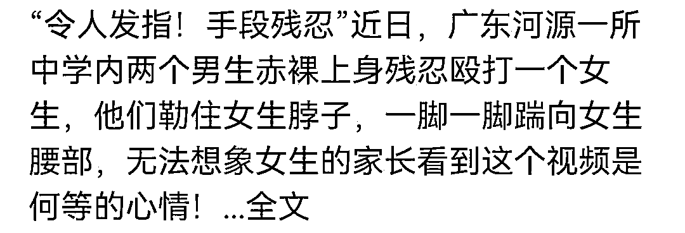

第三步，讲新闻。花400到800字，把事件从头到尾理清楚，节奏可以放慢。语言要口语化，像跟熟人唠嗑一样自然，别端着公文腔。顺序上只用正叙，插叙、倒叙别用；读者一旦跟不上节奏跳出页面，后面写多少都白费。

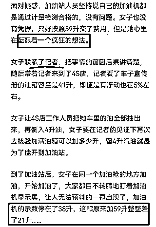

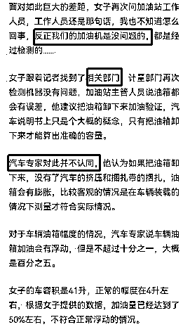

叙述过程中要有意识加些钩子式词语，比如“她心里酝酿着一个大胆的想法”“眼睛死死盯着油表”，再把女司机联系记者、找计量部门、咨询汽车专家的经过写出来，读者就会沿着你的节奏一路读下去。

第四步，网友看。这段200到300字即可。去新闻评论区翻几条高赞留言贴进来；若稿子写得多了，脑子里攒了不少看法，也可自己代拟几条，反正是“网友说的”，对错难查证，只代表个人观点。最好正面、反面、中立各来一点，最后附上自己一小段点评，内容就饱满了。

第五步，说法律。篇幅同样400到800字。不需要法律从业资质，只要援引条文没有硬伤，照样能撑起爆款。平时可这样积累：多刷知乎热榜，答主常会顺手列出相关法条，相当于替你省了找资料的功夫；再存一份电子版法规文件，写时按关键词检索即可。法条列完，还要套回案件，分析当事人行为对应哪一条、按规则该受什么处罚。

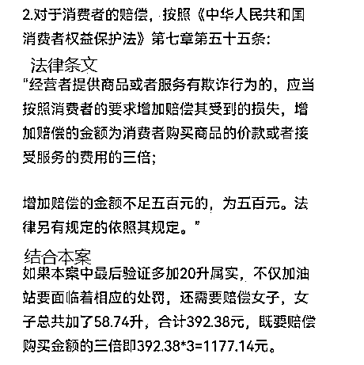

第六步，怎么做。放在倒数第二段，三两句就行，告诉读者遇到类似坑该怎么应对。若前面篇幅吃紧，可在这里补一段自己的亲身经历，讲讲你碰到同类情况怎么处理；真没遇到过，编一段也无妨，用意只是引发共鸣。

第七步，引互动。收在最后一段，留两三个开放式问题，比如“你身边有过这种事吗？”“换作你会怎么维权？”评论区自然就热了。

### 4.3.5 历史类：四套写法

历史类文章，👸号和头条底层逻辑相通，都是提出问题、给出解答。差别主要在题目：头条偏爱有深度、够概括的表达，最好能给人启发；👸号则追求猎奇、吸睛，标题要夸张到让人忍不住点进来，才能换来阅读。

第一种，从人物结局切入，写遗憾或意外。按时间线讲这个人从出生、青年到中年、晚年的轨迹，每个阶段挑一两桩有分量的故事穿插进去。晚年部分要写得格外用力，那是整篇文章的落点。

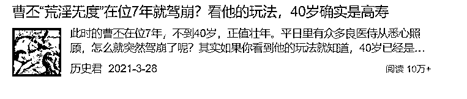

第二种，从人物性格的反差切入。主体还是讲生平，但重点落在颠覆认知的事情上。前大半篇幅讲大众熟悉的事迹，后面用小篇幅揭开他不为人知的一面。比如素有善名的人做过恶，功绩显赫的皇帝也有糊涂账。

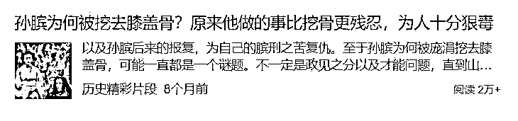

第三种，把一个事件的原委说透，让读者由衷佩服。这种写法类似追热点，可多角度展开。比如从清代保密制度延伸到各朝各代的继承难题：皇帝没有子嗣时怎么选继承人？立长与立贤哪个更稳？孩子多是福是祸？一个问题能拆出好几种讲法。

第四种，盘点式写法。这个最简单，盘点那些打破大众固有认知的人物，也盘点有作为的皇帝、战神级武将、幸福女人、悲苦女人等等。不需要太深理论，一个人物配一个小故事，自圆其说就行。

## 4.4 标题就是打开率

标题决定打开率，打开率决定阅读量，阅读量又决定收益。好消息是，标题有规律可循，最核心的方法叫“开幕雷击”——让读者第一眼看到某个陈述，瞬间觉得震惊或好奇，像被雷劈中一样，忍不住想点进来。

### 4.4.1 开幕雷击的七类钩子

经过反复验证，能制造“雷击感”的标题要素主要有七个：金钱/数字、性暗示、暴力、死亡、捷径、异常/悬念、民族主义。这里面最安全、最好用的，是“异常”。

七种要素不只在👸号有效，短视频、百家号、头条图文、问答、微头条里同样通用。平台规则允许的前提下，能糅几个就糅几个。

不少作者理解偏了，把雷击当成狗血、暴力和血腥，动辄写出一地红。那样只会让读者浑身不适，还可能被限流、被投诉、被删文甚至封号。真正的雷击，是出现令人惊讶的言论或画面，跟日常认知拧着来。它不需要“太震惊了”“惊呆了”这类直白字眼，更不是“一刀砍下、血溅当场”的现场直播，而是用含蓄说法，把想象空间留给读者。

举例来说，某人家里有亲人离世，按理应悲痛万分，他却兴高采烈。这种反常本身就是钩子，读者会想弄清楚他到底为什么笑。再比如，小卖部矿泉水卖3元一瓶、10元3瓶，明眼人都看出分开买更划算，3瓶只要9元，可店家居然乐呵呵的。这个标题同时踩中“金钱”和“异常”：店家亏了为什么还乐？你是不是也想知道答案？

记住：暴力、血腥、涉黄画面，字面一个都别带出来，要保持一层纱的距离。别为了流量硬碰平台红线，那只会得不偿失。标题里能命中七要素中的两个，打开率基本就有底了，数量越多越稳。

### 4.4.2 标题实战

先看“金钱+异常+悬念”的组合。一位女士65岁再婚，老伴每月退休金9000元，直到外孙生日，她才发现被骗——👸号40万+阅读，收益3000多，发到头条也爆了35万。另一个例子，63岁找了后老伴，每个月给5000零花，三个月后她一天都不想过了——👸号20多万，收益2000多，头条冲到80万。从负债3000万做到百亿身家，同一个套路骗了大家五次——137万阅读。做电商的表妹赶上直播风口，亲戚都说她年入百万，去找她学经验，她却连连诉苦——这是典型的金钱+异常。年薪80万的北京金融女、29岁主动表白，竟被年薪30万的二本男拒绝——还是金钱+异常的组合。

再看“异常+悬念”。写《知否》的文章里，梁晗娶墨兰不是因为盛祖母的面子，而是把柄握在人家手里——3.6万阅读。明兰不知道顾廷烨和贺弘文求娶她的目的一致——3.8万阅读。嫁到齐家当主母的盛小六才是真正的狠角色——3.7万阅读。

“性暗示+悬念”类最出数据。曹锦绣衣襟半敞求欢，才让人明白贺家为何不要明兰——17万+阅读。33岁那年生病，丈夫连夜带着孩子跑了，半夜有人压在身上，睁开眼吓傻了——150万+阅读。52岁保姆照顾32岁小伙三个月后怀孕，小伙否认，她大骂不要脸，结局出人意料——1000万+阅读。24岁保姆照顾59岁老人半年，老人每天摸她的脸，得知真相后她甘心照顾老人一辈子——800万+阅读。老公不在家，公公半夜提要求还塞来3万块，结局无人料到——45万+阅读。

标题是流量的闸门，闸门一开，收益才有想象空间。

## 4.5 发文前自查

1）节奏要快、短、平。快速进入主题，句子尽量短，叙事走平路就好。2）读者多在空闲时刷手机，不想费脑，浅白文字比文绉绉的书面语更受欢迎。3）一句话尽量不超过15个字，一段别塞太多内容，两三句刚好。4）逐句检查病句，主谓宾要齐全，还要确保上一段结尾和下一段开头能接上，阅读才会顺滑。5）心里要有避雷区：政治类内容记住两个词——党史、军史，不碰；黄赌毒，同样不碰。写了不该写的，时间白费、收益落空，还可能赔上账号。6）最后再读一遍标题，冲击力够不够？画面感强不强？不够就继续打磨。

把公号爆款的路走通，粉丝和收益会陆续涌来。能举一反三的话，这套方法搬到其他平台同样见效，实现一鱼多吃。

# 五、热门赛道：近期数据较好的方向 @一来@林戏生 @妞妞💋

经过5月航海实战，一批账号跑出了不错的数据，以下方向最近几个月都很能打：情感、三农民生、军事、明星穿搭、近代史、名人金句解读。这些赛道的素材来源与写作逻辑，和前面五大领域一脉相承，这里不再展开步骤，只列出方向供参考。

## 5.1 情感领域@一来@Adrian

情感领域的特点，是账号起量比较快，尤其受女性作者欢迎，用AI辅助创作，文本原创度也不低。但写的人多，竞争激烈，标题不抢眼就拿不到阅读；尺度没把握好，还会招来封号风险。

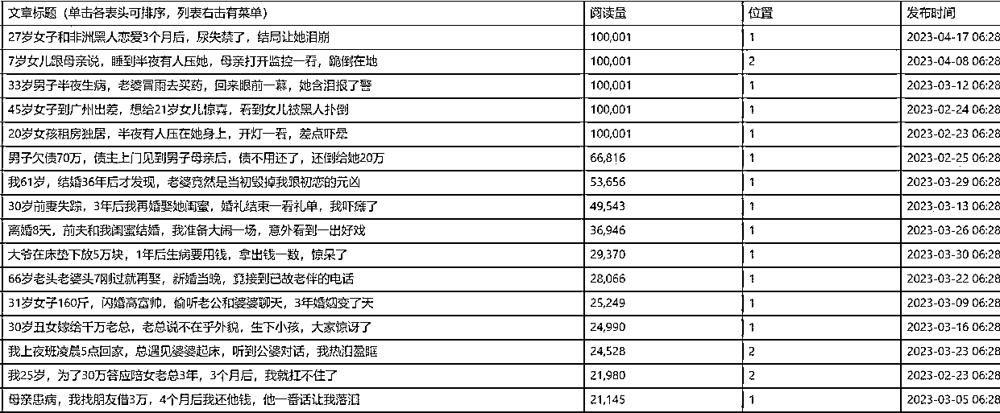

关于情感文的素材、选题和模板，前面章节已经写得很详细，可以回看「4.1.1 情感类：素材来源」「4.2.1 情感类：如何选题」「4.3.1 情感类：爆文模版」中的对应内容。另外提醒一句，情感类单价普遍不高，就算阅读量做得漂亮，总收益也不一定跟着好看。内容来源：6月8日《👸号流量主的经验分享》@一来。

## 5.2 三农民生领域 @一来 @林戏生

三农民生是5月的黑马领域，不少账号连续出爆款，内容也好写。👸号读者整体年龄偏大，对这类话题天然关注，流量增量很可观。单价属于中等水平，大致万字40到120元。文章结构多为总分总，展开容易。题材相当宽泛，社会现象、天气预报等都可以作为切入点。

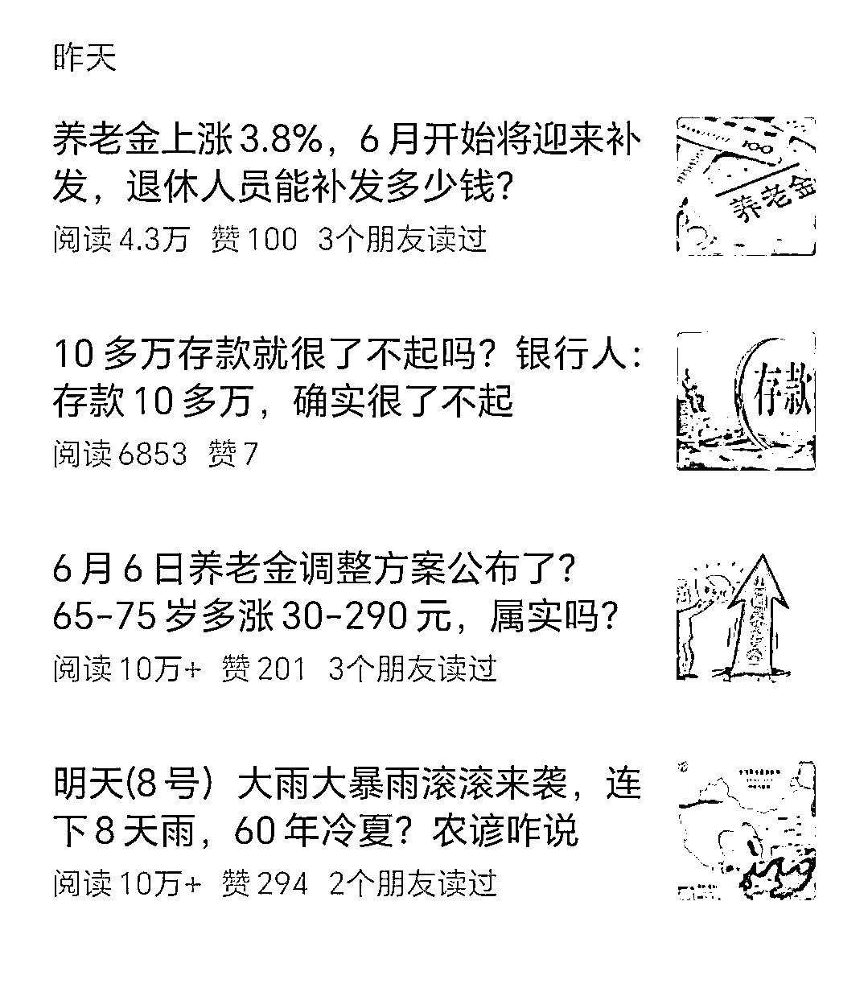

# 爆文实操：从对标选题到成稿

## 选题从哪来

做自媒体，第一步不是埋头写，而是先找参照物。在🛰️“看一看”里搜三农关键词，会翻出一串文章；挑阅读量破十万的，点进去关注作者。照这个法子攒下十来个账号，再拆解其中高阅读内容。其他平台同理，按阅读、播放、点赞找高表现内容，拆解对标。

拿《“返乡潮”又开始了？大量农民工陆续返乡，究竟是怎》那篇为例。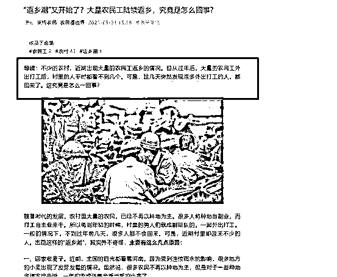 把原文一段放百度搜。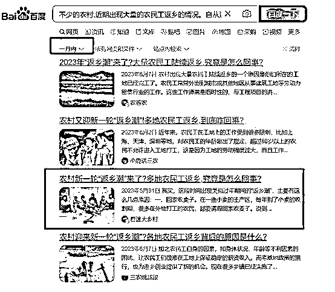 找到时间相近文章对比。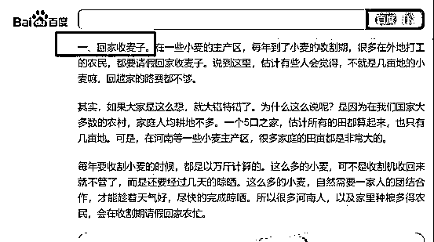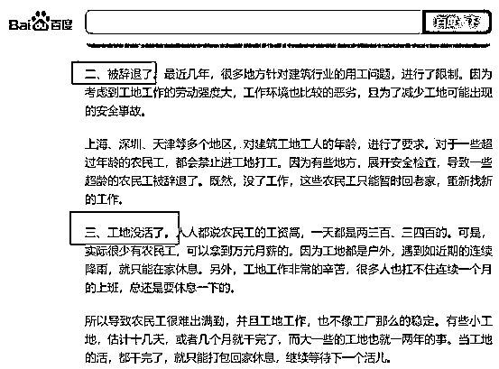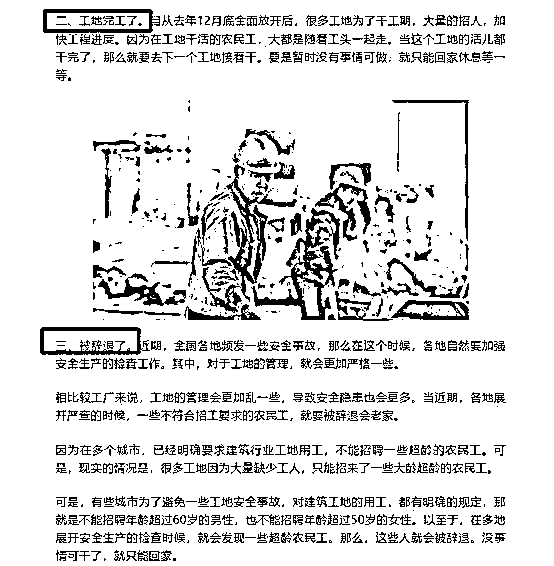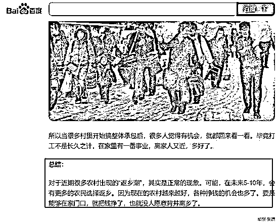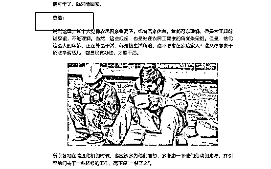 结论很清楚：骨架、铺陈几乎一样，变化只在措辞，外加一点个人思考。作者是百度百家号，更新1585篇。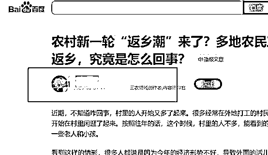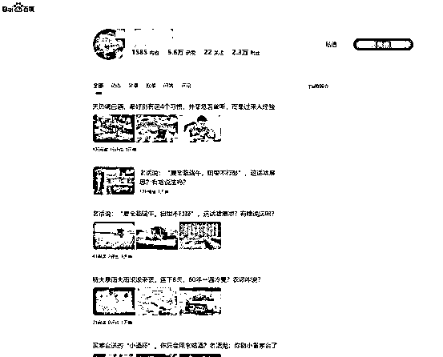 搜一下会发现同主题写过多篇，阅读都不错，说明选题有市场，否则不会反复做。

素材出处：7月6日《👸号流量主核心逻辑分享》@林戏生；6月8日《👸号流量主的经验分享》@一来。

## 5.3 军事领域：先避风险，再追爆款 @一来

风险先说：别碰过度敏感、诋毁或讽刺国家的选题。

六七月这个方向热门，爆款多，点赞在看高；但数据容易两极分化，可能上万，也可能个位数。别怀疑账号掉出流量池，这是正常波动，继续更就好。

素材有三路：🛰️对标号、今日头条、百家号。🛰️里走“发现—看一看—热点”，刷军事文，阅读过万就看账号；流量稳或近期爆款多，就关注星标。头条和百家号：把军事爆款题目复制到头条搜，看谁在写、是否持续输出军事内容，关注。没灵感时翻账号，还能顺藤摸瓜找衍生对标。三平台关注十个左右，素材基本够。

找选题：不熟时直接复制爆款选题。翻关注的对标👸号，近半月阅读超5万的爆款题目，标题保持原样拿来用。从头条/百家号选，找评论或点赞特别多的，一个指标到500以上即可。👸号选更快更简单，但同题写的人多，所以和头条百家号交叉。选题集中在俄乌战争、普京、泽连斯基等关键人物。

例子：《基辛格：美国宁可投降，也不敢制裁的国家，只有这3个》那篇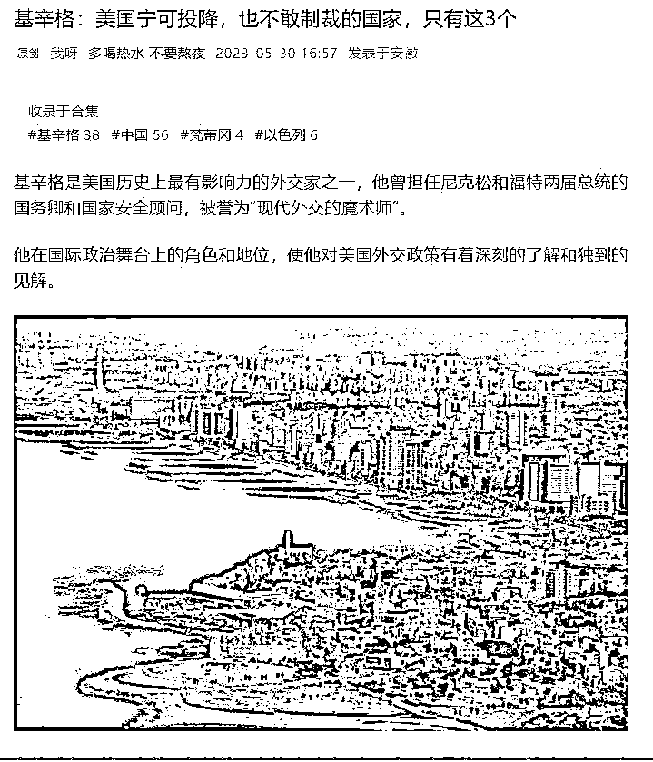是仿写，收益4000多，爆款之一。思路：对标号写同题有10w+，标题原样复制；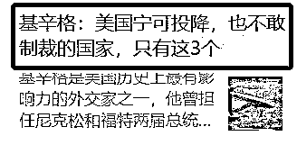随后看结构：先开场，再列三个国家，最后收尾分析；结构照搬，内容看几遍懂大意，用自己话讲。说白了，就是做一次高级的原创化改写。不是篇篇爆，要感受、尝试、多写。流程收束成一句：借对方已经验证过的标题；把正文读三遍吃透；搭出框架；换成自己的语言写成千字上下；选三张匹配图片；配图发布。这就是👸号爆文的一种做法——模仿。写作底子好的人，最好借题自己构思、输出独立观点；手感弱一些，再走仿写。

军事领域大致每万次阅读100元；麻烦在于文中广告常缺位，台湾相关选题缺广告的情况尤其多。所以起号阶段可写台湾，起号成功尽量不写，否则有阅读也没高收益。军事题目最多问题是文中广告，多留意。创作本质是不给社会添乱，负面信息太多别写，账号才长久。

## 5.4 明星穿搭：小众赛道也能长做 @一来

这个方向适合长期做，小众。三月火，有人单账号月20万流量主收益。明星自带流量，起号更新相对简单。素材同样有三条路：👸号里的对标号，头条上的明星穿搭号，以及网易上的同类账号。找法：发现爆款就复制到百度、头条、网易、👸号，能看到很多人写同题；找垂直、持续更新、阅读不错的账号关注记住，没素材翻。爆过的题，再次爆的概率不低。挑题时我只盯两点：它本身是不是已经被市场验证过；第一眼扫到，我会不会心动、觉得有戏。有，就用。选题关键，没好多选题自己造大概率翻车，多花时间研究爆款标题。某篇没起量，隔几天再试几版，或者换号发。有些账号偏爱某类题目，多试会有感觉。

写法可以按这个顺序走：开场白，随后上穿搭图，再逐图拆细节，最后收个尾。例文：张天爱“下车照”被疯传，生图下真实腿围太夸张，360度无死角！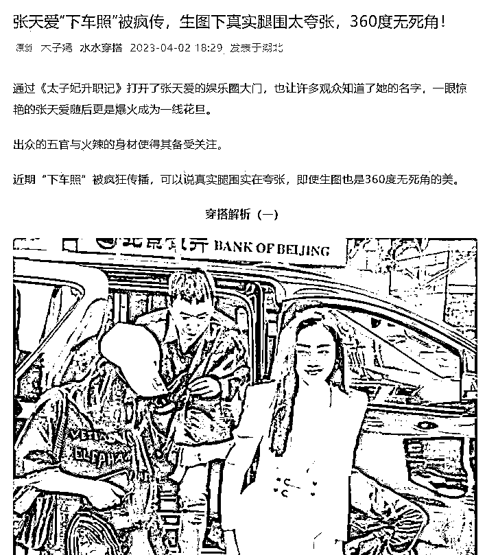 开头写明星代表作和被熟知，再放穿搭图分析重点。注意别写明星负面，易投诉。操作要点：锁定高知名度女星；标题要有吸引力；图片必须精致；再围绕图去提炼穿搭亮点，这一步更吃功力。好在穿搭文单价一直不差。

## 5.5 近代史：起号慢，进池后稳 @一来

这个方向我试过，冷启动不轻松，往往要熬一个月，结果还未必确定；可一旦账号被流量池接纳，阅读就会比较稳。题材敏感，外平台可用的素材偏少，审核卡得也严。因此素材主要靠对标号，最好批量找、逐个关注。“飞扬说史”值得观察，爆款多，且能长期待在流量池。想扩充历史号，就把他文章里的爆款题目放到👸号搜，看看同题还有谁在写，再关注星标。选题还是找爆款、同题二创或另起新写，模板可参考历史类那套写法。

## 5.6 名人金句：低风险高收益 @妞妞💋

这个方向门槛不高，容易出爆款，风险低、收益高。七八月一直热，我7月拿到两万多；也有人8月到4日就收益过万。素材和情感故事文同源。除了盯做这类内容的👸号，还可以在👸号搜“某某说”，莫言说、杨绛说等都会冒出来；多看几篇，系统会持续推荐，你对这个领域越熟，素材越厚。也可以在各平台搜名家名言、警句、鸡汤，或者翻为人处世类书，挑那些文笔好、能引发思考、给人洞察和启示、鼓励正面生活、有哲理、能共鸣、能慰藉人心的段落。

成文公式：标题（最好有开幕雷击，也可直接“某某说……”）+名言+解读（理解）+体会（收获）+建议。例文：杨绛：真正强大的女人，需要失去这四样东西。 标题用开幕雷击勾兴趣，或用某某说体。 现在正热，按公式套几篇试试；明星类避开，最好不写或少写。

# 六、ChatGPT写作流程：两步产出爆文 @木白 @袁永兵 @妞妞💋 @小浩哥

这一章想说的很直接：内容行业的两大痛点——原创度不够、出稿慢——ChatGPT能分担不少。工具用顺了，从想题到发布，半小时左右就能跑完一篇。把前面讲过的写法接上它，爆文产出会轻松许多。

两种生产方式。第一种是精耕细作：人负责四成，模型负责六成。人选好题、搭好情节、改稿润色、拟标题、上传发布；正文文字里，模型能顶八成以上，人主要做删繁和润色。第二种是批量生产：把爆款文喂给模型，让它产出可复用的指令和正文；再建多套故事模板，批量跑稿提效。但模型不是万能，人工润色仍不可省。文中凡涉及模型操作，都配了prompt供参考。要说明的是，本章只谈方法，例子不做推荐；具体爆文风格，回看“四、爆文写作逻辑”。另外，4.0能直接读链接，3.5只能读文本，用的时候别混淆。如果追速度、要数量，可翻“5.3 如何快速用ChatGPT出稿”。账号问题需自己解决，本文只讲用法；想深入，读《5月航海 | ChatGPT | 实战手册》。

## 6.1 正文落笔：两种生产路径

### 6.1.1 方式一：精细化生产

#### 6.1.1.1 写作风格调教

先把手册里的爆文模板和“4.4.2 实战案例”翻出来，集中投喂；再找几篇👸号范文一起学。 指令：请学习这篇文章的写作风格，总结并命名为“风格A”；正文用三引号包住，即text: """文章内容"""。这是OpenAI推荐的做法，能把命令和待处理数据分开。篇幅别太长，否则可能报错；👸号爆文约1200字，一般稳。 风格提炼完，再让它把这个风格用于后续写作，当前先不要动笔。

#### 6.1.1.2 选题怎么来

先拿一篇爆过的文章，把情节抽出来喂给模型，当作选题样例，让它一次给多个方向；不满意就继续提修改点，直到有比较顺眼的，再由人定题。这样练熟后，故事素材几乎不用自己硬编。

选案例时，翻前文“4.2 如何找到合适的选题”的爆文库和榜单，或“4.3 如何写好文章正文”里的例文即可，这里不展开。

抽情节有两条道：一是原文已给——开头几句或标题就把主要情节说了，直接拿来； 二是让模型代劳——让它扮演情感文作者，50字内压缩全文，重点保留冲突、悬念、转折，结尾一句收住，正文仍用三引号包住。

定题时，把主要情节交给模型，让它生成若干候选，再挑最终方向。指令可这样下：围绕“主要情节”仿写五段，要像真事，第一眼就抓人，让人非往下读不可；情节有波折，开场要有“开屏雷击”感；素材落在普通人生活里，家长里短、婆媳、家庭伦理最合适。

#### 6.1.1.3 大纲先落地

下一步让模型出大纲，不合意就继续改。指令可写成：依据“选题内容”构思一篇1500字上下的短故事，调子偏现实，语言平实鲜活，容易让读者代入；情节要像真事，能勾住人，有曲折，开场有“开屏雷击”效果；背景贴近普通人，家长里短、婆媳关系、家庭伦理优先；先只给大纲。

小技巧是把不同指令做成多套大纲模板，也就是模型库；以后写某类文章，直接调对应模板。我的常用模型大致有这些。

前期不妨多试几个模型，比较谁产出的内容更合口味，再固定下来长期用。写的时候，可在模板里塞入自己想要的剧情和细节。比如第一条指令：你是一位感受敏锐、笔法熟练的作家，新任务是根据给定内容写一个有情感深度、带人性探索的故事；用第一人称；开篇交代主角的家庭背景和简介，并给角色起名；故事要让人代入，能引发读者对人物和处境的共情。

# AI写稿别偷懒：分段写、人工改、标题自己取

很多人以为，把一个题目丢给机器，就能直接拿到一篇能发的稿子。真这么干，拿回来的文字往往带着一股模板味：不是分成一二三条，就是按“先、再、最后”排排坐，读起来机械，像流水线下来的。所以别指望全自动，也别批量生成，质量很难高。更稳的办法是拆开写：每一块重点写什么、控制在多少字、还要注意哪些要求，先讲清楚，最后再拼起来。这样操作，原创度大概能到六成。

#### 6.1.1.4 正文别整篇丢给AI

与其一口气生成全文，不如一段一段来。比如开头那部分，要求用第一人称像聊天一样讲，语言别端；多写人物做了什么、说了什么，少堆心理活动；只写这一段该写的事，不要往外扩；整段控制在400字以内。把这些条件说清楚，再让AI写，比笼统说“写个开头”强得多。

#### 6.1.1.5 人工润色不能省

机器给的是标准答案，冷冰冰，缺人情味，也缺情绪价值。稿子拿回来，得自己调句子、补引文、在段落之间搭桥，结尾再往上抬一抬。一篇千字左右的原创文章，这样弄完，原创度能到七成以上，主流平台基本都能过。

不同部分拼在一起时，接缝处经常出现重复或多余的话，该删就删，该改就改。有时候两段讲的是同一件事，留一段就行。

结尾也常啰嗦，空话一堆。一般留两三段就够；如果承接生硬，花几分钟顺一下。比如可以压成：经过一场风波，我和老板更珍惜彼此的友谊；在共同努力下，不实传言终于澄清，我们都松了口气，也明白真正的友谊经得起考验。如今再回想那个难忘的晚上，正是那场误会让我们找到彼此，也更懂珍惜当下，那些曲折成了生命里很宝贵的财富。别担心删了字数不够，通常仍会在一千二百字以上。

### 6.1.2 方式二：批量产出，先喂爆款再仿写

#### 6.1.2.1 先拆爆款，再让AI仿写

批量生产不是无脑点生成。可以先找一篇十万加爆款文章链接，让GPT分析它的结构，再照着写。注意，只有GPT4.0能直接分析链接；用3.5的话，得把文字内容复制进去。因为字数限制，它可能写不完，可以让它接着续。最后一定要通篇检查，重复内容和不合适的内容删掉。

#### 6.1.2.2 有剧本就直接喂指令

另一种办法是自己优化指令，直接让ChatGPT写正文。你已经有剧情或剧本，只是不想一点点敲，就把想法喂给它。参考指令大意是：设定一个富有洞察力的作家身份，以某个主题创作一个引人入胜的故事；开头详细写背景，给故事添趣味和复杂性；接下来写发展，增加戏剧性；中部深入挖人物，揭示内心，引起共鸣；高潮设计一个出人意料的转折，让读者有“原来如此”的惊喜；结尾总结主角感情变化，让读者明白点什么。全文控制在1200字以内，既紧凑又有细腻情感和真实感。用这个指令产出的文稿，可以看示例。

#### 6.1.2.3 建好模型，效率才上来

想提高效率，可以用不同指令建多种模型。这样你要写某一类文章时，直接找对应模型就行。我的创作模型主要有下面这些。

一开始可以多试几种模型，看哪个写出来的内容更合手，之后就用那个持续写。创作时还可以在模板基础上加入自己的剧情或内容。比如指令一：让一个偏敏感、熟练的作家，根据给定内容写一篇有情感深度和人性探索的故事；第一人称；开头交代主角家庭背景和个人简介；给角色取名；让读者感同身受，能联想到自己生活里的类似问题；1300字以内，保持紧凑和吸引力。故事主线是：28岁的杰克，父亲开出租车，母亲做医务工作，他在一家小公司当市场专员；49岁的艾米是房东，离异多年，儿子在外地工作，她做会计。两人从房东房客的日常来往中慢慢生出感情，杰克表白后被艾米拒绝，两人尴尬又矛盾；后来一次电视机故障，让他们感受到彼此的关心和陪伴，艾米在酒意下接受了杰克；最后艾米提出结婚，双方家人反对，他们仍决定领证。这个例子要写出爱情的力量，也要让人看到年龄在爱情面前并不重要。

再比如指令二：主题是“爱情迷阵：丈夫异地工作，我却无法抵挡公司领导的温柔陷阱”，要写情感纠葛和道德冲突。先交代女主角的个人和职业背景、她和丈夫的关系，以及丈夫为什么被调到异地；再初步勾勒她和公司领导的关系。接着写丈夫离开后她的生活变化，尤其是她和领导逐渐发展出的不正当关系，要写准她的心理挣扎、困惑、内疚和恐惧。然后设计危机，比如丈夫突然回家，或者同事发现秘密，让她开始反思并寻找解决办法。最后给一个反转：她可能选择忏悔坦白，也可能接受自己的行为并面对后果，让读者对人性有更深理解，也对她的未来有期待。这个故事同样用第一人称，开头介绍家庭背景和个人简介，给角色取名，控制在1300字以内，让读者能共情，并想到自己生活中的类似问题。

### 6.1.3 方式三：追热点，用Bing扩写微头条

#### 6.1.3.1 先去头条找高曝光素材

我最初是刷到一篇十万加爆文，后来发现它有出处。那篇👸号文章是6月9号发的，但6月8号头条上已经出现同标题、同角度的微头条。这就引出一个写热点爆文的方法：平时多刷头条热点新闻。找曝光量大、评论多的微头条，把内容提取出来。微头条开头部分常常可以直接当爆文标题，比如“会唇语的网友说，董美女刚要十指紧扣，胡总是拒绝的”。

#### 6.1.3.2 把热点和微头条内容交给Bing

找到热点和素材后，可以用Bing来写。操作步骤是：打开Bing官网，需要魔法才能用，进入后点聊天。

然后下指令生成文章。比如先给一个热点事件：国企领导出差带“小三”逛街；让它先了解这个新闻，再结合微头条内容写。微头条里提到，会唇语的网友说董美女刚要十指紧扣时胡总拒绝了，胡总疑似说“有人拍照”，视线还往街拍摄影师那边瞟；董美女疑似说“我都不怕，你怕什么”，于是牵手成功。外媒四个词概括这件事：SOE cadre’s career-ending stroll，翻过来就是国企领导一次散步把职业生涯走没了。还期待网友扒出更多线索，比如董美女各种炫富，钱哪来的，如果存在腐败，要一查到底，也让外媒看看什么叫中国式街拍反腐。指令要求从吃瓜群众角度出发，以“会唇语的网友说，董美女刚要十指紧扣时，胡总是拒绝的”为题写一篇1200字文章；不要用排比句，尽量用大白话，口语化，让小孩子都看得懂，别文绉绉；每段简洁口语化，50字以内，让人快速看完，一段只讲清楚一件事，情节环环相扣、紧密推进；语言模仿真人语气，吸引人读；开头根据故事场景概括一种社会现象，再引出故事，要有噱头、有悬念。参考那种流水线工人余骏的口气：到了之后才发现，流水线活儿累得很，一天干满12小时，加班是常事，拿到手的钱还低于市场平均。

这里有个底线：热点文千万别造谣。AI生成时不可避会虚构，自己必须对事件有详细了解和把握。捕风捉影的、未经证实的内容不要写。尤其要避开与警察、政府部门冲突的事件；如果内容有损他们的形象，又没有实际证据，很容易被叫去喝茶。生成文章后，把鼠标移到右上角，会出现几个按钮，点第三个复制按钮就能复制下来。

内容来源：

## 6.2 标题这关，还得人来把

取标题要人工操作。一个好标题，直接决定文章有没有人点开。ChatGPT生成的标题目前没法直接拿来用，但可以让它起几个，给你提供灵感。

### 6.2.1 让AI先给标题灵感

做法是先让ChatGPT学习几个爆文标题，再让它为自己的文章生成标题。比如给它五条爆文标题，然后说：参考上面五个标题，为我提供的内容生成五个吸引人的标题。后面附上文章内容。

如果觉得都不好，可以追加要求，让它再给一些。比如“不够戏剧性，再给五个更吸引人的，可以标题党、更狗血一些”；或者“不够吸引人，再优化一下，加入异常、反转、数字、冲突等元素”。

### 6.2.2 批量取标题的简易模板

为了方便更快完成批量取标题的动作，这里提供一个只需给主题就可以套用的标题写作指令：

# 标题不抓人，点击率就上不来

准备选题时，别急着铺正文。先问一句：这个标题，读者凭什么点？标题往往决定第一道门槛。一个合格的标题，通常短、直给，扫一眼就懂大概，同时又留个信息缺口，让人忍不住想点开。情绪词用得好，点击率常常会往上走，例如“崩溃”“反击”“震惊”这类；再把具体人物、关系拉扯、现实困境和未揭晓的悬念塞进去，吸引力会更强。

玩法一：只给关键词，让模型自己发散。工作、恋爱、婚姻、人际关系，或者老板、男友、男同事、老公等角色主题都行：

第一轮结果不理想，就补一句，让它顺着继续写：

玩法二：先丢现成爆款标题，再让它仿写同类风格：

等它吐出一批后，挑最顺眼的那条，人工再修几刀，基本就能直接上场。

## 6.3 借 ChatGPT 把出稿速度提起来

如果赶速度，或者要的量很大，可以借鉴 @妞妞💋 老师的做法。前提是选题（5.1.1.2 找选题）、大纲（5.1.1.3 写大纲）和日常积累的素材库（4.1 如何搭建素材库）都已经在手边。把这三样连同自己的要求一起丢给 ChatGPT，让它直接开写。提示词可以按下面这个框架给：

细节描写：
气氛：
叙事人称：
背景：
角色：
情节：
结局：

你是一位很会讲故事的人，请依据上面这些设定，写一篇约 1200 字的故事。

一次回答的字数有上限，没写完就让它接着往下续：

“前文结尾内容”
刚刚这里没写完，请继续。

标题可以在初稿基础上，再结合“4.4 如何写好文章标题”手工打磨。比如《56 岁大妈嫁 63 岁老头，儿子拒认继父，18 年后，儿子抱住继父哭喊爸爸》这个标题，就是反复改出来的。

正文润色时，可以对着“4.5 爆文写作自检方向”过一遍：段落重新切，拗口的句子改得更像日常说话，通常不用大动就能发。成稿效果可见文末配图：

照这个节奏，一篇故事很快就能落地。当然，前提是素材库里已经存好情节大纲；手熟以后，一小时做十几篇并不稀奇。不过每个人调教 ChatGPT 的时长不同，对成稿标准也不一样，不能一刀切。平时有空，还是建议多和它磨合、多调教。

## 6.4 实操心得

心得一：从想选题到发布，一般要花 1～2 小时。主要卡在 GPT-4 的速度上，夜里更慢，网络还容易抽风，所以尽量别把写作安排在晚上。

心得二：用这套方法把 ChatGPT 调顺后，连续产出约 5 篇，最好重新调一次。按 GPT-4 API 的输入限制来估算，它能记住的上下文大约 25000 个 token。1000 个 token 通常约等于 750 个英文单词，或 400～500 个汉字。5 篇稿子加上调教内容，往往接近一万字；再往后写，最初的设定可能就被它抛在脑后了。因此更推荐 GPT-4；GPT-3.5 的上下文只有 4096 个 token，差不多写一篇就得重新调教。

心得三：如果只能用 GPT-3.5，那就得多花时间调教。它上下文记得少，逻辑也偏弱，容易出现前后断裂，甚至一本正经地胡说。条件允许的话，还是换 GPT-4：记忆更稳，逻辑更顺，写出来也更有人味，等于帮我们多往前推了一步。

资料出处：
《ChatGPT + 👸号爆文写作，从 0 开始，7 天达成阅读 10W+，方法全分享，毫无保留》
《大杀器 ChatGPT 问世 135 天，一篇👸号爆文 10 分钟搞定，千元收益唾手可得！》
6 月 1 日《👸号 AI 写作分享》@小浩

# 七、用 ChatGPT 把写稿和发布串成自动流水线@春柏

## 7.1 要准备哪些技术和工具

要让 ChatGPT 自动写文章，主要会碰到三样东西：ChatGPT、影刀 RPA 和 Python。ChatGPT 的入门内容，手册第五章已经讲过；影刀 RPA 在 B 站官方账号有细致的视频教程；Python 方面，B 站课程也不少，学会后能把大量重复劳动交给程序。

以情感故事自动生成为例：先人工把 ChatGPT 调教好，再准备故事大纲。随后打开 RPA，设好流程——选中输入框、填入提示词，按发送，等返回，抓取文字并写入文件；这一套动作循环执行，直到整篇写完。

提示词可以这样写：

根据下面“”“里包含的故事大纲，采用“风格 A”，用第一人称写一篇故事。要求：
1. 全文拆成 9 段；
2. 每段至少 130 字。
先交第 1、2、3 段。

text: """
故事大纲...
"""

如果一次让它输出太长，模型容易产生幻觉，质量会下滑。所以一篇 1200 字左右的文章，我会拆成 3 次，每次约 400 字。ChatGPT 对字数统计并不敏感，因此我每次让它写 3 段，这样对篇幅的控制会更稳。

写故事更推荐 GPT-4，效果明显好于 3.5。提示词里的“风格 A”是提前调教好的写作风格；调教与大纲写法，详见《ChatGPT + 👸号爆文写作，从 0 开始，7 天达成阅读 10W+》。

文末配图展示的是 RPA 操控 ChatGPT 自动写故事的过程。

## 7.2 发布也能交给 RPA

上一步生成的文字会落在文件里。接着用 RPA 操作👸号后台，把发布流程自动化：

1. 登录后台。RPA 打开网址，用账号密码自动登录。
2. 新建图文并填入内容。文章放进指定目录，RPA 读取后自动粘贴到新建图文消息里。
3. 设定格式。提前固定字体 17px、行间距 1.75 等参数；按钮位置固定，RPA 执行起来不难。
4. 扫码发布。最后一步要管理员手机扫码，只能人工完成。听说在👸号“安全中心”关掉扫码后，可以做到全自动发布。

图例（实际流程会因电脑设置不同而变化，这里只作示例）：

这样一来，把生成的文章放到指定目录、套好固定格式，发布基本就能自动跑起来。

文末配图展示的是 RPA 操作👸号自动发布的过程。

## 7.3 让流程批量跑起来

把前面两步接起来，就形成“自动写文章 + 自动发布”的链路，人工只剩最后的扫码动作。

### 7.3.1 批量操作怎么设

用 RPA 循环执行上述两个流程：先批量生成文章，再批量发布，批量操作就成立了。

举个例子：

1. 把故事大纲拆成 4 份，每份单独存成一个文件。

2. 把这些文件统一放到一个目录下。

3. 在 RPA 里设置循环，读取文件中的大纲，交给 ChatGPT 写故事。

按这个思路，文章可以批量产出。生成结果统一放进一个目录，再用 RPA 循环读取并发布到👸号，批量发布也跑通了。

### 7.3.2 还有两个卡点

不过，这条批量链路有两个关键问题：

1. 大纲从哪里来？如果同时运营 100 个账号，每个账号每天发一篇，一天就需要 100 份大纲；靠人工写，一个人几乎扛不住。
2. 文章质量不够稳。ChatGPT 直接写出来的内容，会有重复啰嗦之处，仍需要人工修整。

这两个卡点能解决吗？能。

## 7.4 大纲也能批量造

大纲依旧让 ChatGPT 批量产出，但别让它凭空想——那样质量不稳。更靠谱的办法，是让它照着已有爆文来仿写。步骤是：

1. 批量抓取对标账号的文章。
2. 把抓到的文章交给 ChatGPT，让它提炼故事大纲。
3. 参考提炼结果，再生成相近的大纲。

### 7.4.1 先把对标文章批量抓下来

我最初是用 Python 完成批量抓取的。后来想了想，RPA 应该也能做，只是提取正文时可能更费劲。

要批量抓👸号文章，先得有一个自己的👸号。流程如下：

1. 登录后台，点击创建“图文消息”。
2. 点最上面一排按钮里的“超链接”。

3. 在弹窗中点击“选择其他👸号”。

4. 输入目标👸号名称。

5. 点搜索，页面会列出该号下的文章。

6. 这样就能拿到所有文章链接；有了链接，整批文章也就都能提取。

上述过程用 Python Selenium 可以做到完全自动。

### 7.4.2 让 ChatGPT 批量提炼大纲

文章抓下来后，先存到本地文件夹，再用 RPA + ChatGPT 汇总大纲。这一步 GPT-3.5 就够用；GPT-4 虽然更强，但在这个环节提升有限，而且不调用 API 时还有“3 小时 25 次”的限制。3.5 更快、成本更低，效果也不差。

提示词可以这样给：

故事大纲格式：
1. 引子：人物背景与人物关系；
2. 冲突：故事开端和冲突；
3. 转折：发生什么转折；
4. 解决：最后如何解决冲突。

根据下面“”“里的内容写一个故事大纲，要求：
1. 修改人物名称、年龄；
2. 适当调整故事情节，让故事更吸引人；
3. 用第一人称写；
4. 大纲文字简洁明了，不超过 200 字；
5. 按上面的格式输出。

text: """
故事内容"""
"""

用这个办法，故事大纲可以批量生成，质量也过得去。还可以让 ChatGPT 基于已有大纲继续改写，裂变出更多大纲。这样，大纲来源的问题就解决了。

来源：6 月 27 日《ChatGPT 自动化生产👸号文章》@春柏

# 八、爆文变现：阅读量如何变成收入

💡 本章速览

👸号的收入和阅读量挂钩，说到底做的是流量生意。它的长尾效应很明显，哪怕过去很久，流量仍可能持续进来。文章建议写到 1200 字以上，这样正文里能放两条广告，收益空间更大。

还有一点省心：收益不用自己提现。每月会自动打到你开通流量主时绑定的银行卡，次月 1 号和 15 号分别到账。哪怕只有一分钱，也会按时入账。

目前，👸号爆文常见的变现路径有两类：广告变现和打赏变现。广告是主力，打赏更像偶尔加个鸡腿。本章会把两类方式展开讲，供你参考。

## 8.1 收入是怎么算出来的

收入按阅读量结算，也就是大家常说的流量：流量越大，进账越高，而且长尾拉得很长。不过流量单价并不是固定值，它会受不少因素影响，例如文中、文末广告的曝光量、点击量，以及完读率等。

另外，文章最好写到 1200 字以上，这样能插两条广告，对收益有帮助；如果只有 800 字左右，通常只能放一条。

## 8.2 收益怎么到账

👸号不需要手动提现。每月收益会自动进入开通流量主时绑定的银行卡，一个月打两次，分别在 1 号和 15 号，发的是上一个月的钱。即便只有一分钱，也会准时到账。每月 1 号和 15 号可以去手机银行查看，偶尔有延迟，但不会缺席。到账金额为税后金额，已扣除 20% 个税。

## 8.3 钱从哪里来

### 8.3.1 广告收入（大头）

广告变现，就是在文章里嵌入广告，比如小程序、游戏、电商等卡片；用户点击卡片，或点击后产生消费，都可能带来收益；有时整篇文章本身就是广告。

常见的有四类，这里先展开前三类：

1）方式一：自己接广告

先关注👸号“新榜有赚”，里面有不少赚钱路子，既有分销，也有文案类任务。例如《刘小念》号每天发的那种，按阅读量计费，一个阅读大约 4 毛钱。不同任务的时间要求不一样，有的 24 小时内可删，有的能长期挂着。新榜里有教程，可以自行研究。

按系统提示一步步走即可。抢到单后，在商家规定时间内把广告文案发到自己👸号，就可以等收益。到账后可立即提现到🛰️，速度几乎秒到。

我只发过两篇，都是 24 小时可删的类型，每篇收入 800 多块。后来觉得有点消耗粉丝，就没继续发，打算等粉丝再多一些再试。“新榜有赚”里还有别的赚钱方式，大家可以慢慢研究。我亲自试过的只有“发文案按阅读赚收益”这一种，其他玩法还没碰，留给大家自行探索。

2）方式二：商家主动找上门

商家通常会在后台留言“商务合作”，然后加🛰️谈价格。一般要我们先报价，对方提供文案，我们复制粘贴即可。费用按头条、二条、三条区分，头条最高，通常 2000 元以上一篇。

这种广告要谨慎接。先看对方文案涉及什么内容；涉黄、涉赌、封建迷信类不要碰，有封号风险。

价格一般如下表：

具体要求和实际价格，以你跟商家谈妥的为准。

3）方式三：在文章里自己带货 @徐胖子

👸号带货在十年前很火，后来视频带货崛起，图文带货的效率被压下去不少。但也要看到，👸号带货仍然有空间。

为什么还能做？主要有四点优势。

第一，👸号流量池大。圈友 @渭水徐公 的👸号训练营已经开到第七期，十万加爆款累计 1000 篇以上，阅读过万的小爆款更多。一个账号每天发 8 篇文章，每篇最多可植入 10 款产品，8 篇就是 80 款。只要其中一款卖爆，收益就会很可观。

# 👸号变现、入池与避坑全攻略

👸号在带货这件事上有几个很实在的好处，值得先说清楚。

**内容跟商品的绑定很宽松。** 你写什么领域，不代表只能带那个领域的货。比如你做的是情感号，学习类、励志类、文学类、情感类书籍都能挂；吃的用的，也照样能在👸号里推。

**佣金空间也不错。** 带的商品可以自己去对接商家谈分成，图书类的佣金能到五成，水果、蜂蜜这类也至少有两成。

**结算走官方通道，省心。** 流量主收入有保障，佣金到账效率高，这块基本不用操心。从用户下单、确认收货，到佣金结算，创作者在后台都能查到，官方打款，整个流程在后台看得见。

操作上大致是这么几步：先注册👸号、入驻平台；粉丝数达到500以上，核对好财务结算资料，申请开通流量主；审核一般3到5个工作日，资料正常提交当天就能过。流量主开通后，再开通返佣商品广告，进入推广商品，把商品广告嵌进文章里发出去，分享文章就能赚收益。

👸号的带货逻辑跟头条类似：文章里出现什么商品关键词，就把对应商品插进去。

单篇文章最多能挂10款商品。读者看推文时点商品卡片，可以直接跳转小程序一键下单，成交之后流量主就能拿到销售分成。

另外，无论什么时候带货、带的是书、日用品还是水果，下面这个模板都能套：第一步用故事开场，第二步从故事过渡到话题，第三步介绍商品本身，第四步引导下单。具体怎么写，可以去看徐胖子3月6日《如何在👸号带货》里的分享。

**第四种方式是文末贴片广告带货。** 扫二维码注册成为有赞分销商，挑自己想卖的产品生成超链接，贴到文章末尾就行。

不会做超链接的话，可以让客服帮忙，不过需要把有赞账户密码告诉对方。我的超链接就是让客服做的。

客服🛰️：可扫码添加

有一点要注意：账号还没做起来的时候，发文尽量简洁干净，别搞得太花哨。等账号起来了、粉丝多了，再根据粉丝年龄调整——年龄偏小的可以弄得活泼些，年龄偏大的保持清爽就好。简单说就是文章顶部放一张图，甚至不放图，正文里加点分隔符。

分隔符不要太多，大约每200到300字放一个，别少于200字，也别多于300字。

### 8.3.2 打赏变现（补充渠道）

流量主开通后，先发三篇带原创标的群发文章，打赏权限就能拿到。账号的名字和头像，跟打赏的名字和头像尽量统一，这样人设显得更真实。

打赏收入通常集中在IP感很强、人设特别稳的账号上，这类文章下面可能出大额打赏。对我们来说，它只是一个补充渠道，算不上主流变现方式，但开通之后偶尔也能添个小菜。

# 九、怎样快速进入流量池

💡

进流量池这件事，时间真说不准。有账号一天就进去了，也有账号半年都摸不到门槛，所以很多人管它叫👸号的玄学。

不过多数情况下，连续写个7到21天，基本都能进。说白了，只要更新不断、标题有钩子、内容够垂直，进池是迟早的事。

手里有注册一年以上的老号，相对会带一些权重，进池速度通常快一点。我们做过不少测试，老号确实占优势。自己没有的话，可以发个朋友圈问问周围人有没有注册时间比较久的👸号，借来实操，会快不少。

如果是刚注册不久的新号，先锁定一个领域，然后找对标账号，照着它的爆款选题和内容做二次创作，每天更2到3篇，别断更，也能比较快进池。

进了流量池，基本就等于开始赚钱了。

如果账号迟迟不进池，就得回头想想自己在这件事上花了多少时间、投入了多少精力、有没有认真琢磨标题。通常付出一分回报一分，一天写一篇和一天更两篇、做一个号和做两个号，测出来的效果肯定不一样。

## 9.1 怎么判断账号是否进了流量池

👸号的规则也在变。以前只要单篇文章进了流量池，比如阅读量从个位数跳到三位数、四位数，有了“看一看”的流量，基本就能判断账号进池了，第二天再发文，阅读往往就起来了。

但最近好像调整了。有时单篇进了“看一看”流量池，第二天再发，流量还是很少，甚至只有个位数阅读，那就接着更新，直到账号真正进池为止。

进池最直观的变化，是文章阅读量冲破1000甚至上万。但如果只是从个位数变成两位数或三位数，就不一定了，因为有些流量可能来自“搜一搜”。

所以观察和持续更新都很关键。

内容来源：6月8日《👸号流量主的经验分享》@一来

## 9.2 从文章内容里提炼视频文案

选题定了、文章写完也发到👸号了，结果就稳了吗？当然不是。接下来这一步值得试一试，它可能帮你把文章阅读快速拉到1万。

做法是用已经写好的文章再延伸出两三篇，甚至五篇视频文案——对，就是视频号文案。视频号文案可以从文章开头截一段，也可以把文章小标题串起来。还可以倒着来：先写视频文案或大纲，再补正文，这样操作更顺。

视频形式可以用图片为主、图文和视频结合、或者纯视频。剪辑底子薄或刚上手的话，直接做纯图片或纯视频，不用混搭，省时间。当然过了原创之后，混搭的推荐效果通常会更好，不过可以慢慢练。纯图片就多用渲染和展示效果，娱乐领域拿明星图片做一个视频，用剪映的图文成片功能就能完成。

纯视频素材可以用治愈系或解压类视频，比如下面这段洗车解压视频，配上生活情感类文案就很合适。

c136b7f2b804ed57fd8ed7ca6967958d.mp4【在线播放】

注意：文章发表后7天内阅读量达到1万，才能被放链接。

我大概算过，视频每1000次阅读，点开文章的比例能在10%以上，还有长尾效果。比如我之前写王宝强的《八角笼中》，到现在每天还能有几百阅读。

你可能会说热点过去就没流量了，别急，重点在后面。

🛰️最近上了“问一问”，可以用视频回答问题。如果没有合适的问题，还能一个号提问、另一个号回答。

有一点要清楚：回答问题只能用视频号身份，所以你可以把视频号名字改成👸号的名字，这样一份内容能在三个地方用。

这就回到选题上了。选题选得好，👸号、视频号、问一问能串起来互相倒流，三个地方都能变现，不只靠流量主收入。

比如副业这个方向，三者结合得很顺，旅游领域也一样。

做创业和副业的号已经尝到了“🛰️问一问”的红利，而这还只是开头，“问一问”里还有不少领域是空白的，值得深挖。

内容来源：7月4日《如何迅速把一篇文章的阅读量提高到1万+》@亦小亮

## 9.3 借已入池账号给未入池账号引流

① 在已入池的👸号文章开头或结尾插入未入池账号的名片，如图：

② 或者在已入池账号的文章开头或末尾放未入池账号的文章超链接，如图：

上面两种方法可以选一种，也可以一起用，如图：

这两种操作都在👸号后台编辑文章时完成。

（2）插入文章超链接的操作步骤

再加一句引导语就行：

就这么简单。

有人会问：我没有已入池的号怎么办？可以找朋友或同学合作，具体方式自己谈。比如让朋友帮你放文章链接，把这篇的收益分给对方，怎么合适怎么来，互相帮忙、大家都舒服就行。

内容来源：7月13日《用GPT写热点文&👸号快速入池的方法》@妞妞💋

💋

### 9.3.1 找朋友帮忙关注

1、找5到10个不同地区的朋友，让她们在🛰️里搜索并关注你的👸号。

2、让这些朋友从订阅号推送里点开你的文章看（你不要自己把文章分享给她们），阅读时按正常节奏来，别快速划过去。方便的话点个“在看”或赞。如果当天朋友没刷到订阅号推送，不用刻意去找，等推送了再看就行。

下面是我后台的数据，我差不多每天找十几个朋友阅读，持续了一周左右，账号就进池了。

这是第一篇进池文章的数据，其实文章进没进池挺明显的，阅读量一般会翻几十倍。

### 9.3.2 自己先读一遍+对标爆文

账号还没进池时，我会先点开自己的文章从头读一遍，把阅读体验记下来，比如排版别扭、字号偏小、开头介绍太啰嗦、后面情节没意思等等。把这些问题记下后，再把文章分成三段，跟10万+爆文做一比一对照。

对照哪些地方呢：主人公什么时候出场、第一个挫折出现在哪里、第二个挫折在哪、标题里的悬念到第几段才揭开……我会一条条摘出来核对，找到自己差的部分去优化。

举例：

先看那篇10万+，开头就埋了悬念，逻辑清楚，转折也不生硬，很自然就让你去猜“老婆是怎么拆散的”，八卦心一下被勾起来。再看我写的，红线处的转折很硬，逻辑乱，读者一下就能猜到“老婆拆散了我和初恋”，后面完全没有看下去的欲望。

所以优化方向就是：故事要顺、逻辑要清，开头五句话把人物、职业、关系和悬念交代清楚，然后马上进入故事细节。

如果用GPT帮忙优化故事，我的指令是：“需要扩写的内容”请扩写这部分，要有具体的故事细节、对话、动作和神态描写、情绪，写一下（可以按你的具体需求提要求）。

### 9.3.3 靠“数量”怎么取胜？

常有人问：账号更了一个月还没进池？两个月还没进？我的结论是：最好的办法就是多开账号、多发高质量文章。矩阵是对抗不确定性的最好方式。

为什么要多个账号？因为账号有随机性。打个比方，家里三个孩子同父同母同吃同住，为什么只有一个常生病？很多人觉得是体质问题，但父母能决定孩子先天体质吗？其实很难。账号也一样，同一个作者、同样的写法，有的号两天进池，有的十五天，有的怎么都不进。所以对抗这个问题的办法就是多账号。从两个号起步，如果三个号都不进池，那就是文章质量的问题，再回头抓质量就行。

为什么多发文章？这里的“多”是指多练。熟能生巧，写得越多提升越快，也能快速摸清一个领域。多写多看、多踩坑，成长就快。

内容来源：5月30日《情感类公号如何从0-1起号，拿到第一个100元》@Adrian、6月29日《👸号文章如何快速入池》@Beverly、6月8日《👸号流量主的经验分享》@一来

@Adrian、6月29日《👸号文章如何快速入池》@Beverly、6月8日《👸号流量主的经验分享》@一来

# 十、写作避坑清单

下面这些内容摘自微头条老师@半塘梦呓的分享。虽然讲的是今日头条，但逻辑上所有内容平台创作都适用。这里摘几个常见的坑，更多可以去原帖《微头条踩坑经验》看。

## 10.1 措辞上的坑

不少人发文前已经养成查违禁词的习惯，明明查过没问题，但还是有些地方容易踩。

### 10.1.1 为躲违禁词把文章改差了

前面提过，很多违禁词让人意想不到，查出来时你会纳闷：这也能算违禁词？但平台有平台的规矩，大平台为了安全，限制就是严。有人为了绕开违禁词，用空格隔开，或者拿拼音、错别字代替，少量用没问题，但别在开头用，全文也别反复出现。

### 10.1.2 提了竞品平台的关键词

别带竞品平台的关键词。写着写着不自觉就冒出“还花呗”“看🧣”之类，措辞一旦显得很营销，也可能被限流。

### 10.1.3 文中出现企业名称

稍不留神就会写“去中国移动上班”“去电信营业厅办事”“去中石化加油”，这些企业名都别带。如果非提不可，用“某通讯公司”“某银行”之类模糊掉。引用名言也别写“某企业CEO说”。给主角起名也要小心。有个人一直找不到限流原因，我一看，主角叫“大华”——大华是知名企业，还上过美国的制裁名单。主角也别叫“小米”什么的，都有风险。甚至别写“门铃叮咚一声响了”，因为“叮咚买菜”。

### 10.1.4 主角名字别乱取

前面说主角名字跟企业名撞了要小心，那取个像人名的总行吧？叫“王强”？不好意思，“王强”在句易网里是敏感词。这类太大路的名字，一不小心就撞上官员名或重犯名。所以起名别太指名道姓，叫小王、小强、阿强、强强都可以。但叫“小王”就安全吗？“小王刚吃好饭”——不好意思，“王刚”也是敏感词。“小李刚洗完澡”——“李刚”也是敏感词。所以这块必须多留神，发文前过一遍句易网要记牢。

### 10.1.5 标点符号别乱用

别全文只用逗号一逗到底，也别通篇都是感叹号。那样会被当成“马景涛体”，文章显得很廉价，读者不喜欢，审核也不喜欢。

### 10.1.6 专业领域词汇要避开

专业领域的词不要随便用。比如没有医学资质认证，却写主角急出了乳腺增生——“增生”“结节”这类属于医学用语，没有医生资质写这些可能被判定为误导读者。

### 10.1.7 句易网查不出的隐形雷区

还有一些违禁词句易网可能查不出来。暴力血腥类，比如割腕、脑浆；带封建色彩的，比如占卜、卜卦、风水、当铺；带性暗示的，比如小姨子（句易网里“姐夫”是敏感词）、黑丝（“蕾丝”是敏感词）、情趣、袭胸。这些词在句易网都查不到，只能平时自己多积累。

建议收藏一份句易网查不出的隐形雷区：

1、渣男、渣女、高富帅、白富美、富二代、官二代、男神、情侣套房、打情骂俏、试管婴儿、代孕

2、首付、房住不炒、宣扬房价上涨的都会被打压

3、支付宝、信用卡、保险、银行卡

4、投资、炒房、炒股、赌博

5、人格侮辱、干了见不得人的事、好吃懒做、三观不合

6、辞职、离职、资料、空降、投资

7、奥运、抗洪、三胎的话题都受限

8、热点别乱蹭，很多可能是坑。不管写得多正能量，舆论不可测，就可能被限。没有金V护体，就写稳妥些，才能做得长久。

9、“叮咚买菜”是品牌名，“叮咚”最好别用。

10、凡是涉及其他软件、商品品牌名称的，基本都别提最保险。

这块没太多规律，靠敏感度和日常积累。

## 10.2 配图防限流清单

违禁词排查，很多人早已熟练；可真正让账号被限流的，往往是容易忽视的图片细节。给微头条选图时，同样要多留一道心。下面这些常犯错误值得逐一避开。

### 10.2.1 别让图片泄露个人信息

生活类场景尽量不出现人脸；若有人露脸，务必打码，孩子尤其要保护。手机号、车牌号等也要遮盖处理。明星照片要慎用，涉及负面新闻的明星更应避开。

### 10.2.2 别把营销信息带进画面

选图稍不留神，画面里就可能冒出品牌 logo 或公司名称，这类内容比较敏感。除了明确的品牌名和标识，还要留意品牌标识与品牌文化：苹果电脑的标志很显眼；美团外卖就算把袋鼠打上马赛克，亮黄色头盔和工服也容易让人认出。育儿领域随手拍到奶粉罐，罐上的 logo 也可能带来问题。图片里出现支付宝、🛰️二维码，同样要打码。

### 10.2.3 远离负面和敏感画面

抽烟、酗酒、娱乐场所等配图偏负面；大面积裸露身体则属于敏感内容，例如光膀子、袒胸露乳的大爷，给宝宝洗澡的照片，以及小孩子大面积裸露身体的图片，都不适合使用。

### 10.2.4 别用引起不适的图片

恐怖画面、车祸现场、有人被打得鼻青脸肿等图片，容易让读者不舒服。此前有学员写蛇相关文章，放真实蛇图也不行，最后换成了卡通蛇。

### 10.2.5 配图必须和内容对得上

文字写的是中国人，画面却出现外国人；文中讲婆婆，配图里婆婆去超市、做饭却是两个人；文中说车头相撞，配图却是车尾被撞；文中讲别人的事，却用明星照片——除非写某部电视剧、电影可以用剧照，或追娱乐热点时用明星照片。

这些规则，都是接下来找图时要留意的重点。

## 10.3 运营避雷笔记 @Nicole·纯

### 10.3.1 排版别花里胡哨

发表时一般用秀米，排版保持简单。因为写的是情感文，读者以中老年人为主，版面越清爽越好，核心还是内容。

### 10.3.2 旧文重发要克制

提醒一句：尽量不要重复发表。重复发表只适合一两个月前的文章，而且不能频繁使用。

目前出现过三种情况：

1、有人经常发以前的文章，结果被限流，比刚开始做还惨，每天收入只有个位数。

2、有人发了旧文后，原创标识被摘掉1—3天。

3、也有人每天都能发旧文：一天发七八篇，其中一篇是前期的，总数上没出问题。

每个账号情况不同，以上案例仅供参考。

### 10.3.3 原创要开，转载别开

文章原创一定要开启，否则会影响单价和推荐。想开通赞赏，则要先有3篇原创文章打底。快捷转载这个开关千万别碰，一旦开启，别人就能随意转载你的文章，流量会被分走。

所以发表之前，把上面这些部分检查一遍，再看看有没有显示广告的插入；若页面出现下列字样，就说明正常。

文章发布后，用自己的🛰️看一遍，检查有没有错别字（👸号文章只能修改20个字符，且仅能修改一次，标题不能修改）。可以给自己点赞、点在看，但不要点广告，更不要转发到朋友圈和群，也别让别人给自己点广告。如果总是同一批用户给你点赞、点广告，账号很容易出问题，甚至根本进不了流量池。

内容来源：3月13日《避开这些坑，你也能写出爆款文章》@Nicole·纯

