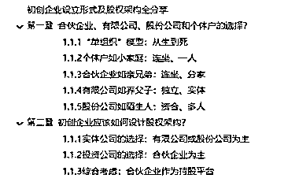
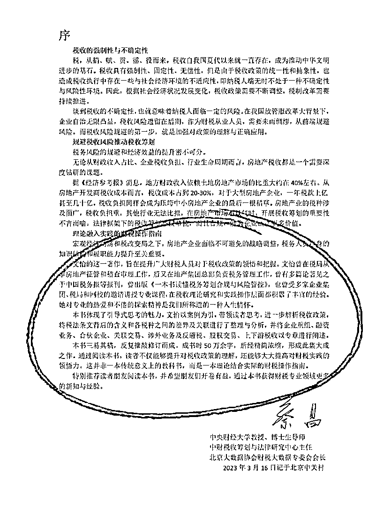

# 创业第一步：选对经营主体、分好股份

不少创业者把精力都压在业务上，注册时却对经营主体和持股安排随手处理。等税负上来了、搭档之间起了争执，才意识到前期没想清楚，代价往往不小。

我是刘文怡，清华与一所美国常春藤院校的工商管理双硕士，也曾入选税务领域的全国性高层次人才项目。我给中税协、东奥，以及四川、西藏、宁波、安徽等地的税务部门讲过课，也在川师大、西南交大、西南财大和若干家全球五百强企业站过讲台。早年我在税务系统做公务员，后来在多家全球五百强集团负责税务事务，累计节税逾百亿元；目前是一家全国前四、5A税务师事务所的合伙人。监管端的检查流程我经历过，企业端的税务事务我也负责过。

前阵子我写过一篇分享，讲自己从小地方一路考进清华、后来拿到百万年薪的成长经历，收到不少生财朋友的鼓励。闫君建议我接着写最拿手的领域，于是有了这篇文章。

打算创业的人，大多要面对注册经营主体这一步。可有限公司、合伙、个体户、股份公司这几类形态，在税负上到底怎么不同，很多人一时看不清；前期安排不当，赚来的钱可能大量拿去交税。关于创业早期的持股设计，我在清华、北大都开过课。这次内容来自我在人民邮电出版社出的书——《一本书读懂税务税务筹划合规与风险管控（金税四期适用版）》，想帮大家把创业早期的第一道坎先迈过去。不管你已经深耕财务，还是刚踏上创业路，都能有所收获。

文章分两块：先聊只设一个经营载体怎么挑，再聊同时设多个载体如何排布。我会借一家烘焙小店的例子，配几首顺口溜，把不同选项的差别掰开揉碎讲清楚，尽量做到直白、轻松、不绕弯，希望对你有所帮助。

相关链接：
https://kdocs.cn/l/cvBfeemTjOfy  
https://wugz3cl7dd.feishu.cn/docx/V5JpdhySsoIJirxcw4DcKkOInhg

留言区：
闫君：多分享，好运自然来[胜利]。这套持股与税务思路很实在，准备起步或已经在路上的创业者都值得看，谢谢文怡掏心窝的分享。
红泥小酒杯：感谢！
马时珍：赞
书豪：赞
铃铛：条理清楚
Aimmon：已买
芷蓝：现在单干开公司的人确实多了
生财小苗哥：找搭档不容易，股份说不明白，后面容易闹矛盾！得收藏起来多看几遍！