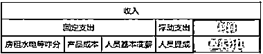
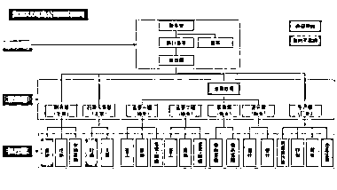
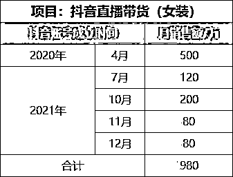
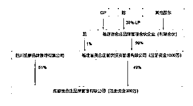

# 创业公司股权设计：四步走，绕开这些坑

我是刘宁培，平时在深圳做企业咨询，常打交道的是股权、经营管理和商业模式。家里有一对龙凤胎，最近一边带娃一边抽空写点东西。生财有术我从第二期就开始付费，算是老会员了。

# 一、创业期：先看合作，再谈股权

## 1、合作有五层，投入由浅到深

合作双方要掏出来的钱、时间和精力，是层层递进的。常见合作大致分五种。

（1）一次性合作：佣金、采购、租赁。比如我帮某家公司介绍客户，对方成交并回款后，按事先约定给我佣金；公司按需采购办公用品、电脑、文具；租办公室、租共享单车、租充电宝付租金。这类合作最浅，钱货两清。

（2）非核心职能合作：外包、贴牌。外包是把非核心业务交给第三方，常见的有劳务外包、客服外包、美工外包。贴牌则是找成熟供应链代工，省掉自建厂、开模、招人的高成本；制造业很常见，美业也很多，比如面膜、医用冷敷贴，源头工厂大多在广州增城、佛山一带。

（3）核心职能合作：代理、加盟。代理在传统行业供应链里很常见，品牌方管技术和生产，把货铺给各地代理商、经销商，代理商负责渠道和售后，赚差价。大品牌会细分到县级，普通品牌一般到市级；因为协议一签好几年，品牌方对代理筛选很严，一二线城市尤其不会轻易换人。加盟则更重：品牌方向加盟门店输出产品、品牌、营销、运营、管理和工具，通常赚三笔钱——加盟费、品牌费或管理费、供应链差价；品牌方会看加盟商投入度和执行力，也会派督导巡店；加盟商则要看投入金额、盈利方式和回本周期，最关键的是确认品牌是不是在割韭菜。

（4）项目制深度合作：共同开发。常见于利润高、回款慢的工程项目。一方负责项目洽谈、签约和回款，另一方负责资金调度、及时到位和长周期垫资；项目周期长，双方关键人员都要配齐。

（5）股权合作：合资公司。几个人都觉得某个方向能赚钱，能力上能互相补位，资源上能互相支撑，就一起成立公司，按股权比例分利润。这需要三个条件：

一是方向一致，都看好这个赛道，愿意长期投入，通常至少三年；很多公司合作不到半年就散了。

二是能力互补，有人擅长战略和顶层设计，有人擅长销售成交，有人擅长落地运营，能快速做出利润；如果缺的板块靠市场招聘能补上，也可以接受。

三是资源互补，资金、品牌、技术、渠道等各有各的优势。

第五种合作最深，关系紧密度几乎可以类比婚姻。

来找我们咨询股权顶层架构和比例的人，大约有30%会被劝退。原因是他们并不满足上面三个条件，既没必要成立公司，也没必要花几十万、上百万甚至几百万去买股份，用前四种合作方式就够了。生财圈子里，我劝退过的人预计有二十多个。股东不是靠哥们义气拉进来的人，股东是要为利润做贡献的；很多股东最后反而成了累赘。

## 2、初创公司股权的16个陷阱

先说明一下：之前我在生财写过两篇初创股权设计的文章，这里不重复。广州线下分享时，重点讲了“四步走”框架，当时时间有限，16个陷阱没展开，现在补上。

### （1）从控制权看

①股权平分，人人有份。两人各50%，三人33%、33%、34%，四人各25%……结果是谁也拍不了板。一点鸡毛蒜皮的事都要开会：负责前端的股东要刺激销售，负责后端的股东要奖励交付，公说公有理，婆说婆有理；没人拍板就没有执行，市场还没打开，内部分配先出了问题。

②股份被稀释得太狠。创始人前期不要把比例放出去太多。初创期最好保留67%以上，发展期52%以上，扩张期35%以上。如果没做顶层规划，也不用有限合伙、金字塔架构、一致行动人、投票权委托这些工具，后面再融两三轮，股份越摊越薄，最严重可能被踢出局。

③持股多的人被持股少的人拿捏。三个人合伙，任何两人加起来都能压过第三人，也就是1+2>3。公司同样没人说了算。最经典的是49%、49%、2%，两个大股东反而被那2%牵着走。

④让员工直接登记为股东。退出时要跑工商变更，费时费力。初创公司不建议做股权激励，轻则被当成画饼、职场PUA，重则员工第二天就离职。就算员工认可公司未来，也建议用虚拟股、代持、期权池预留、有限合伙做LP等方式间接持有，不要直接工商持股；否则业绩没完成退股或离职退股，手续一大堆。

### （2）从进入机制看

⑤拿资源来换股份，但不动真格。有人没任职、没出钱、没有技术专利，只想用资源换股权。如果他敢签对赌协议，约定多长时间内给公司带来多少利润，完成后再给股份；不敢签还要股份，就让他离远点。很多时候所谓资源整合，其实就是赚差价的二道贩子。

⑥兼职创业还想要股份。创业成功率低得惊人，全职创始人吃住都在公司都未必能让公司活下来，兼职的人还想拿股份，有点说不过去。我们接过最夸张的案子：一家公司6个初创股东，只有2人全职，另一个兼职股东身上挂着七八个项目，天天飞到东飞到西。

⑦老板想给，员工不想要。公司赚钱了，老板打算做股权激励，核心员工却摇头。因为员工不知道股权有什么用、每年能分多少、未来十年八年能有多少溢价、什么时候行权、什么时候能卖出套现。

⑧股权白送员工。老板有格局，真心想稳定人心，也知道股权值钱，提出白送。但员工和老板想法不一样，甚至会反问：注册资金是实缴还是认缴？公司产生债务我要不要承担？

### （3）从分配机制看

⑨按出资额分配。资金驱动型企业可以这么分；资源型、人才型、技术驱动型企业要慎重。很多案例是出钱多的人占大股，但对利润贡献不大，每年分红最多；真正经营公司的人因为资金压力，前期出资少、贡献大、分红反而少。结果往往是经营者自己出去另开一家公司，把业务和利润慢慢转走，出资人发现后闹上法庭，双方都受伤。

⑩早期投资人拿大头股份。资金驱动型企业可以，资源、人才、技术驱动型企业要慎重。理由同上：另立门户、业务转移、利润做空、官司收场、双方受损。

⑪某个股东持股比例压倒性领先。比如90%:10%、95%:5%、99%:1%。传统制造业和家族企业里很常见，甚至100%控股也无可厚非。但如果已经决定几个人合伙，这种比例没有激励，小股东的热情可能只是普通员工的热情。

⑫不知道怎么分。给多了怕自己亏，给少了怕对方亏。这个问题内容比较大，放到下一部分讲。九成以上初创企业都会踩同一个坑：把员工身份和股东身份混在一起。

### （4）从退出机制看

⑬人走了，股份还在。公司成立时没有约定退出机制，初创股东离开后也不退股。公司赚钱时，每年要给离开的人分红；等找到替代人才，没有余量股份可用；资本要进来，看到走的人还在分钱，也会要求先解决这个历史遗留问题。公司亏钱负债时，离开的股东还要背上债务风险。

⑭创始人淡出运营，却不退股。同样因为没约定退出机制。创始人不做公司的事，跑去更好的赛道，股份却留着。后面高管激励、融资都会越来越难，利润也可能停在那里。还想继续干的小股东，大概率会自己另起炉灶。

⑮退出价格没有提前约定。每个人对股权的定价都不一样。不管按市盈率、市销率还是净资产估值，都要提前约定好计算方式。江湖再见还是朋友，以后还有合作机会。我们遇过最离谱的，是大股东派人打小股东，逼对方退股。

⑯竞争对手拿到了公司股份。公司成立时没有约定优先购买权。正常情况下，某个股东退股，现有股东有优先买入的权利；没约定好，股份落到竞争对手手里，对方想搞垮你，手段多的是。

## 3、九成初创企业都逃不开：把员工身份和股东身份搅在一起

现实中的问题通常是这样的：

三个人出资一样多，但有人不参与经营，股份和工资怎么分？

两个人合伙，一人只出钱，另一人又出钱又出力，股份怎么分？

四个人出资一样多，两人经营、两人不管，经营收入怎么分？

和朋友开饭店，我出15万、朋友出10万，他在店里管理，工资每月1.1万，股权怎么算？

一人出全资偶尔出力，两人全职出力但不出资，怎么分配更合理？

做音乐餐吧，我和另一个人各出50万且全职干活，第三个人出100万不管事，三人平分公平吗？

100万的店，两人各占一半，A只持股，B持股还要加管理技术，怎么分红？

服装店资金各半，他负责日常管理，我偶尔帮忙，四六分合适吗？

两个人创业，一个出资不管事，另一个出资又出力，股权怎么分？

三个人做餐饮店，都全职参与，出资比例57:28:15，怎么分红才公平？

这些问题，可以用一句话收口：做员工在前，做股东在后。

顺便讲一下企业经营的基本概念：几个方向一致、能力资源互补的人成立公司做项目，要先准备够公司撑过一年零收入的资金储备，别让资金链断裂；画好组织架构图，在图上明确岗位职责，再给每个岗位定薪资待遇，含提成。公司一年的利润，等于全年进账减去年支出。股东分红，分的是这个利润。

如果一个人既是员工又是股东，第一层身份一定是员工：按岗位要求干活，正常领底薪和提成；完不成岗位要求，就不适合继续任职，年底等分红就好。第二层身份才是股东：收入减去支出后，剩下的利润按股权比例分。

很多案例是这样：三个人分别负责产品、销售和运营，公司赚钱之后，每个人都觉得自己贡献最大，要求多分股权。但这是两件事。股权在创立时就定好了；项目该分红就按规则分红，提成该拿就按规则拿。如果是新项目，可以重新成立公司或设事业部单独核算；老项目因为赚钱了再来争贡献、争分红，吃相很难看。

讲一个真实案例。L先生和M先生在惠州淡水开了一家苏宁易购。两个人关系好，讲义气，一起出加盟费、买样机、租店铺，一起全天在店里卖货，约定都不拿工资，每个月收入减掉产品成本、房租水电，剩下利润五五分。前几个月一切都好，到了第9个月，L先生来跟我诉苦：店里90%的业绩是他一个人做的，M先生越来越懒，只贡献10%；做得多，拿得一样多，他觉得不公平，想散伙。

这就是典型的把员工身份和股东身份搅在一起。如果一开始就约定不同电器的销售提成比例，谁卖的产品先按员工身份拿提成，剩下的月利润再按股东身份五五分，问题会小很多。还是那句话：做员工在前，做股东在后；岗位职责完不成，就不该继续在公司任职。很多初创企业都是因为把这两件事混在一起，最后分配不均，草草收场。

# 二、发展期：员工股权激励怎么做

## 1、为什么要做股权激励

初创股东要把精力放在投入产出更高的事情上。项目从0到1跑通，扣掉成本开始盈利，接下来要考虑放大，进入1到10、10到100的阶段。创业期亲力亲为是对的，熬夜打包发货都是常态；但到了复制期，创始人还做这些杂事，时间就变廉价了。全交给外人又不放心，怎么办？

答案是培养第二梯队，让核心高管成为“老板”，为自己打工。

互联网项目比如知乎带货、短视频带货，第一个账号跑通，就开第二个、第三个……直到第一百个。实体项目比如理发店、美容店，一家店赚钱了，就找客户属性相近的地方再开一家，把成功路径复制一遍。

第二梯队就是组织架构图里的中间管理层。我们给一家深圳电商公司做过架构，当时总共稀释20%股权：财务主管和行政人事主管各3%，运营经理8%，生产部6%。

## 2、为什么股权激励有用

因为股权激励本质上就是分钱。积分卡、KPI、OKR、阿米巴、事业部核算，说到底都是合理分钱、合理刺激。上班族做副业是为了搞钱，有资源的人创业是为了搞钱，在稳定发展的公司争取股权分红，也是为了搞钱。

短期看分红权。每年能分多少，是看得见的。比如那家深圳电商公司年利润500万，运营经理A有8%分红权，正常年薪24万，分红40万，合计税前64万。竞争对手想挖他，开30万、40万没用；就算开到64万的1.2倍，也就是76.8万，A大概率也不会走——因为公司明年利润可能做到600万，他的综合收入更高；而且去新公司也有被用完之后晾在一边的风险。

长期看股权本身的增值。公司走到最后，通常有四条路：

第一条，经营不善，倒闭。

第二条，持续赚钱，利润稳定，家族传承，接着做。

第三条，被收购。资本看好公司业务或财务流水，按行业市盈率收购，手里的股权可以交易套现，可能有十倍溢价。

第四条，做大做强，走上市路径，几年后套现，可能有百倍溢价。

如果A因为对利润的贡献拿到股权，公司走上第三、第四条路，他手里的股权会非常值钱。

不谈那些宏大的使命愿景价值观，多数人工作就是为了钱。马云总结得很到位：辞职就两个理由，要么钱没给够，要么心里委屈。大部分情况是钱没给够。有客户问我怎么管理年轻员工，我也想知道，除了多给钱，还有什么办法能管住这群嗨点泪点都高、动不动就辞职的95后、00后。

## 3、股权激励落地12步

### 进入机制层面

#### （1）定目标：分存量利润，还是分增量利润

##### ①分存量利润

老板要启动新项目，原项目只放20%的精力，不想太操心，又怕高管被挖走导致利润下滑，就可以把一部分利润分给核心高管。

举个例子：项目年利润500万，明年利润目标还是500万。老板和高管约定，只要做到目标，就拿出20%的利润分红，也就是100万。如果公司有5个高管，人均年收入多20万。竞争对手想挖人，就要在行业正常薪资基础上再加20万，或者直接配股权。

悦刻的项目挺有意思。熟悉我的人知道，我喜欢找被动收入项目，比如纯托管的优剪，项目稳定，不容易被割韭菜。今年我了解到悦刻，接触了公司的人和几位深圳店老板，算下来门店坪效是优剪的三倍，确实心动，但当时还不能开，要等10月1日之后。

认识一位老板，在广东开了12家店，每家店每月贡献大约8000到10000利润。他的分钱方案是：门店收入由员工每天收款，大家都能看到；门店支出包括房租水电、产品成本、员工底薪，底薪基本在2500到3000。利润等于收入减支出，员工参与五五分成。员工相当于拿了门店50%的分红权，自然拼命做：店里缺货会催老板订货，客户砍价尽量不让步，改成送小礼品，很多琐事根本不用老板操心。

其他门店常见的做法是阶梯式提成：底薪4000左右，业绩3万提成3%，业绩5万提成5%。同样做到5万业绩，员工到手收入可能差一倍，积极性差异也一眼就能看出来。

##### ②分增量利润

（这一部分原文没有展开，就到这里。）

# 分股权前，先把丑话说清楚

有的项目原本利润500万元，老板和高管约定：来年超出500万元的部分，按四六开、三七开、二八开等比例分成。另一种思路是“减耗分享”：生鲜行业损耗常见30%，永辉能做到5%，把省下来的损耗按经理、主管、店员等职级分配。两种做法都说明一件事：分钱机制得先立规矩，不能拍脑袋。

（2）时间节点：分红别拖  
考核从哪天开始、到哪天结束，分红什么时候发，股权何时授予、怎么行权，都要提前写明白。高管尤其看重分红到账速度，拖久了激励就凉了。美业这类轻资产公司，可以一季度一分，甚至月月分。

（3）认购价：别白送  
零出资：员工不掏钱，但要卡在职年限、岗位职责完成度，且不能有大过失。  
折扣认购：不掏钱难上心，白送更不珍惜，可以按市场价打几折让员工买。小米早期有三种组合：全薪+少量股份、半薪+半股份、少薪+多股份。  
市场价认购：按双方谈定的价格出钱，算法很多，常见的是按倍数买。

（4）权利：实股和虚拟股分开看  
实股既分权又分利，要在工商注册，通常给资本方，常用土豆协议保护投资人，也避免离婚分权。  
虚拟股、干股、分红股只分利润不分权，没有公司管理决策权，主要给高管，常用vesting逐年成熟。

再往分配机制层面看：

（5）来源：谁出让  
来源可以是创始人、联合创始人。

（6）稀释：两种算法  
同比例稀释：比如创始股东比例是60:30:10，约定稀释20%给高管，就变成48:24:8:20。  
无中生有法：比如原股本100股，增加20股给高管，总股本变120股，比例变成50:25:8.3:16.7。  
一开始就做好顶层设计的，用同比例稀释；公司是人力驱动型、不断有同领域人才加入的，用无中生有法。

（7）数量：控制权优先  
顶层考虑控制权，基层考虑激励权。释放给员工的额度尽量低于总股权的三分之一，既要守住控制权，也要让对象真有感觉。  
初创期公司明年能不能活都不确定，这时做股权激励往往没效果。比如年利润50万元，拿20%即10万元分给5个人，人均2万元，折合每月1666元，还不如直接加底薪。除非你确定未来几年利润能指数级增长，而且员工也相信。  
圈友有个真实案例：项目2020年4月成立，团队刚试水抖音直播带货。零售看人、货、场：人要有形象好、口才好的主播，忠诚度高更好；货要有物美价廉、交付快、能账期的供应链；场在线上，抖音直播玩法要熟。团队早期摸索试错烧钱，这时让员工掏钱认购股权，说以后值钱，员工多半躲得远远的。等第一个账号跑通、模式验证了，有数据再谈股权，机灵的员工知道公司要走矩阵，股权可能高于市场价，会想办法多拿。假如这时花100万元买公司10%股权，公司2021年又操盘四个账号，加上最初账号，月销售额做到980万元；2022年每月稳定在1000万元左右，年销售额约1.2亿元，扣除成本净利15%，年利润1800万元，10%税前分红就是180万元，一年回本，股权确实值钱。等公司年利润1800万元时，再想用100万元买10%股权，就不现实了。所以，若你有把握未来几年利润指数级增长且员工也知道，盈利初期就可以做股权激励。运营高手、美女主播、上游供应商都可以用股权绑定，竞业协议签好，大家在这家公司长期干，一起赚钱一起分钱。

（8）对象：内外都要想  
内部：管理层、高管、核心员工。核心员工也要给，因为高管若被对手挖走，核心员工能快速补位，业务不会断档。  
外部：上下游伙伴和资本方，按谈判情况给虚拟股或实股。

（9）模式：按阶段选  
这部分比较复杂，先记框架：  
创业期：虚拟股（干股/分红股，在职分红，在职期间享有；增值权）、业绩股、超额利润激励。  
发展期：实股，虚拟股的超额分红+在职分红+少量注册股。  
扩张期：实股、内部创业股、金色降落伞（老员工）、虚拟股、岗位股权（做到岗位就给）、知识股（合理评价，兼顾双方利益）。  
股权既是分钱工具，也是整合资源工具。希望大家把股权用好，把公司做大做强，分钱分得有格局，而不是批量割韭菜。某火锅店某明星那套，感兴趣可以查持股51%的四川至膳，名下谭鸭血、贤合庄、烧江南、黄鱼先生、天然呆奶茶、炊二哥、灶门砍、娃三……

退出机制层面：

（10）退出时间：设锁定期  
约定多久内不能退，防止套现。

（11）回购价：人走股留  
对双方都好，提前约定回购价和初创股东优先购买权。退出机制要共赢，不是博弈，江湖再见还是朋友，未来还有合作机会。

（12）合同：白纸黑字  
别只做口头约定，落到合同里。

写在最后：有股权顶层设计问题（没上市规划的）可以找我，1小时聊清；需要上门落地股权方案也行，1个月内解决。

https://t.zsxq.com/fyNbAuR https://t.zsxq.com/UBqVvjU https://t.zsxq.com/27eqV7A

 

 