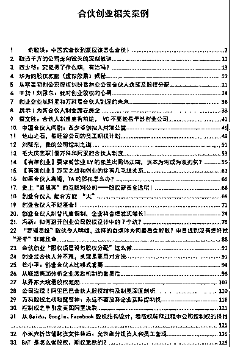
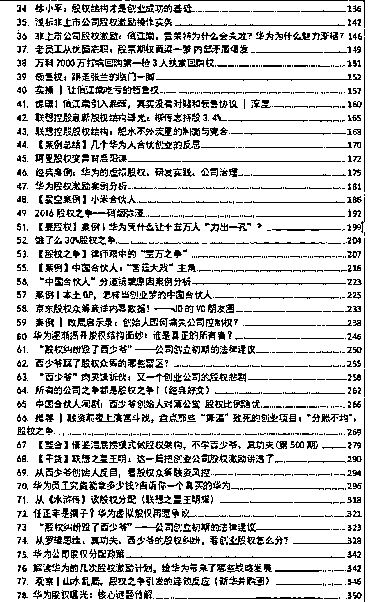
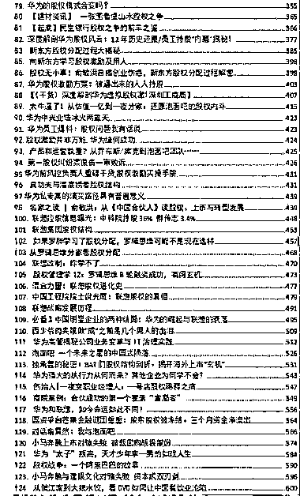
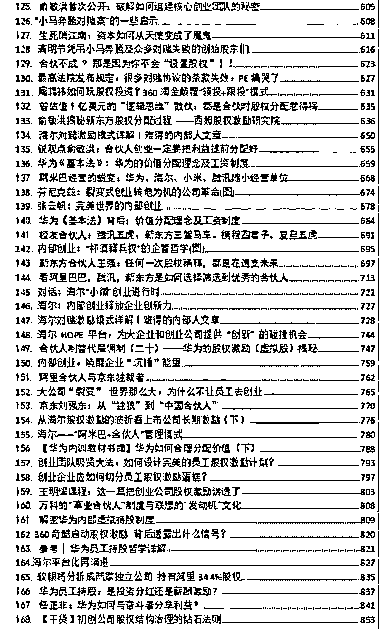
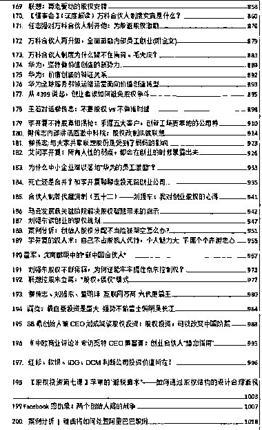

# 股权合伙案例合集，创业者收藏

作者：老黄牛  
发布时间：2020-10-20  
（精华帖 · 122 赞）

这份【股权分配与合伙创业】案例合集，想在网上找全并不容易，有需要的朋友可以直接保存。合集里收录的每一篇，都是公司创始人从创业开端讲起的亲身经历和复盘；内容有看点、能打气，也夹杂着不少让人心里发酸的片段。别错过，老黄牛整理分享。

评论区：
成义：多谢分享
C 小调：多谢啦😊
后山人：这个正好用得上，感谢[抱拳]
Mr.Wang：[握手]谢了！
路明：谢分享[咖啡]，网上很多资料都东一块西一块
老黄牛：对，这版收得相对全
海子：刚打开扫了一眼，干货感就很强[强][强][强]
老黄牛：懂的人自然懂[呲牙]