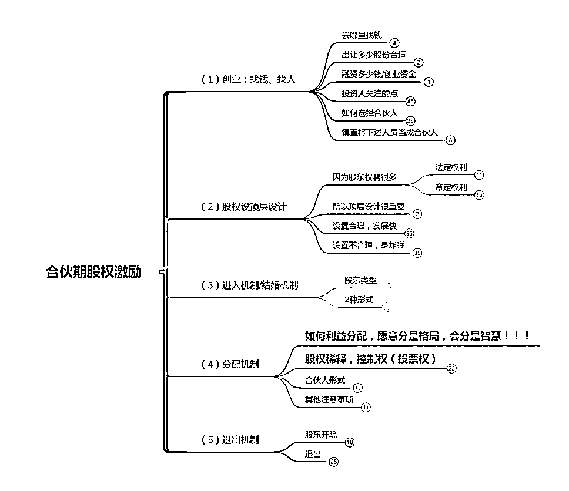
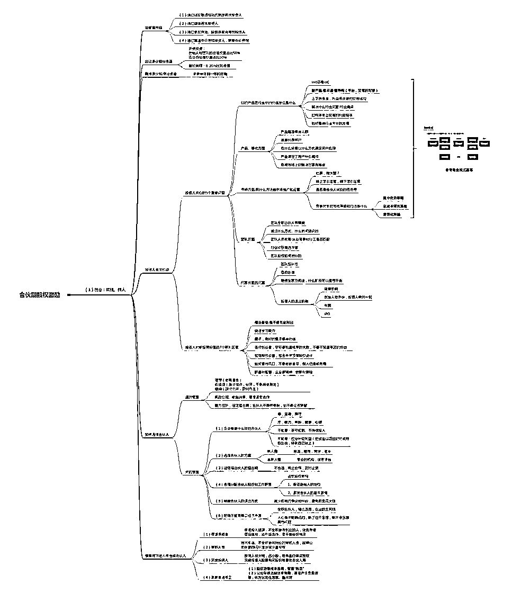
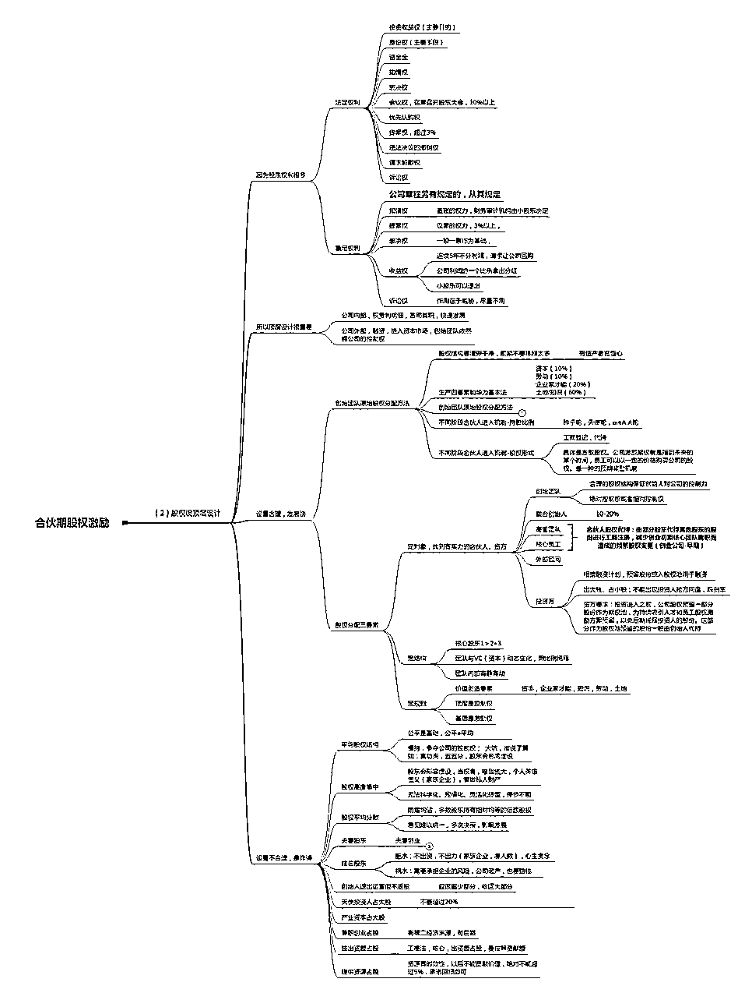
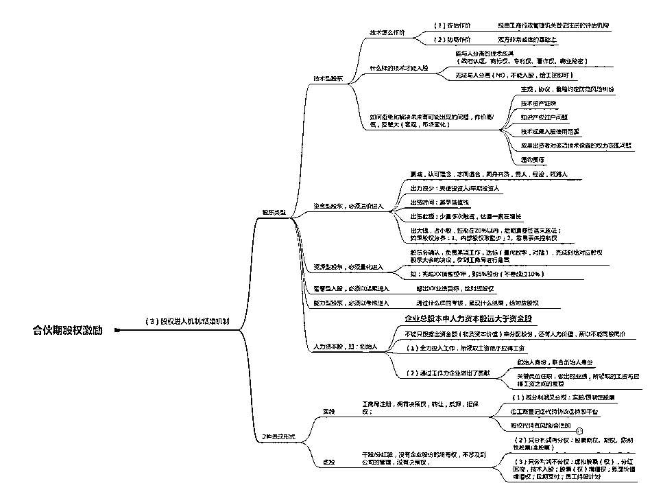
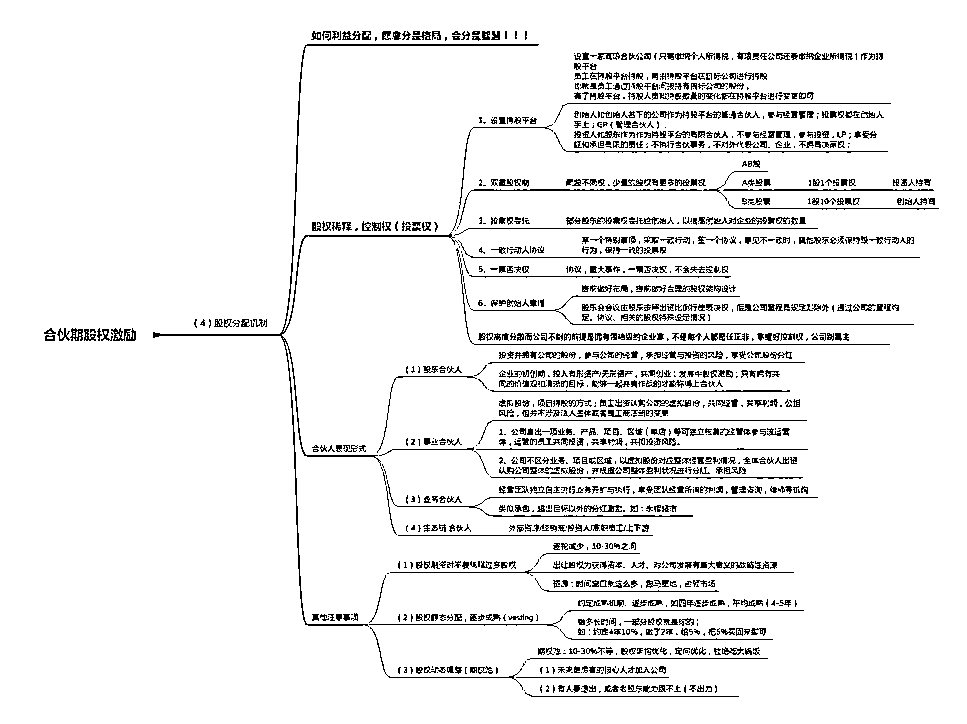
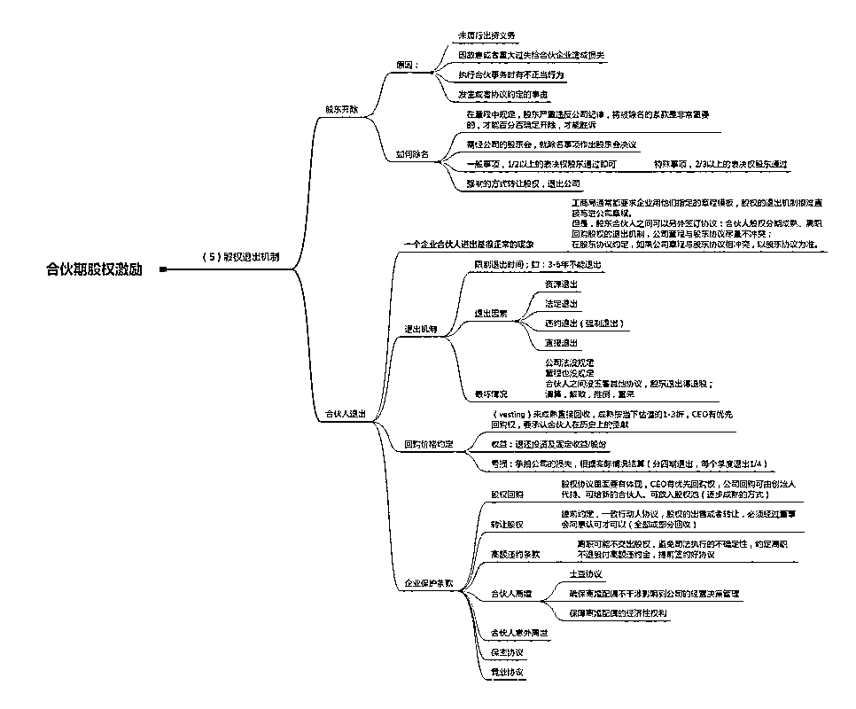

# (精华帖)(91 赞)创业期如何设计股权激励

**创业分股：先立规矩，再谈情义**

创业两件事：找到对的人、拿到活下去的钱。股份顶层安排，像两个人过日子：互相体谅、付出对等，内部有干劲，对外募资扩张也顺；若都觉得吃亏、对方不领情，最后容易散伙。公司同理。

入股规则没立好，出钱多的人拿大头，公司越盈利，带头干的人越泄气，出资方坐享收益；划分规则没立好，不引资源会掉队，引过头又可能让发起人丢掉主导权；离场规则没立好，占着股份不出力的人靠历史贡献混日子，想再拉强人入局，手里已无股可分。

前两项之前聊过，这回把后三项说透：

（1）创业：找人、找钱
（2）顶层安排：先把架子搭稳
（3）入股：六类人怎么给
（4）划分：主导权与合作人安排
（5）离场：怎么开、怎么退、怎么买回

**（3）入股：六类人怎么给**

先看入股的人，分六类。

技术入股方：只有能跟人分开的技术成果，比如官方认证、商标、专利、著作权、商业秘密，才适合折价给股；否则发工资就行。

出资入股方：要高于面值进来。高多少，看发起人对公司作价的判断和商业逻辑。广州一位客户，公司年净利约百万，给高管做鼓励时，15万可买30%权益。算下来回报约两倍，难怪有人听完问：“你们股份还卖吗？我也想买。”

门路型入股人：必须用数字约定，凭成果说话，完成多少指标给多少权益，占比尽量别超一成。嘴上渠道遍全国、真变现时一地鸡毛的人不少。要记牢：信息不等于门路。要信息，用企业信息查询工具抓取即可，一堆。

点子入股：看成效进入，用结果说话。能力入股方：看考评进入，通过考评再给。人力贡献股：发起人、联合发起人不能只按掏了多少钱，还要看人力价值。总股本里，人力贡献股通常远大于资金股，所以不能同股同价。

按生产四要素和华为基本法，初始团队原始权益可这样切：资金占10%，劳动占10%，企业家占20%，知识占60%（其中基础贡献24%，岗位贡献36%）。那些投点小钱、不太出力、占比却很高的公司，带头的人要长点心：公司越赚，你越觉得亏。

六类人进来后，主要两种形式。

一是实名股：去工商注册，有决策权、转让、抵押、担保等法定和章定权利。既分利又分权，包括实名股/限售股，可通过工商登记、代持、持股载体落地。

二是名义股：分红股，没有所有权，没有决策权，也不碰公司管理。只分利再分权的，有股票期权、期权、限售股（准股票）；只分利不分权的，有虚拟股票（权）、分红回偿、技术入股、股票（权）增值收益权、账面价值增值收益权、递延支付、员工持股安排等。

**（4）划分：主导权与合作人安排**

利益怎么分，愿意分是格局，会分是智慧。股份没设计好，倒闭、易主、打官司、上不了市的例子太多。

先说主导权。发起人保住话语权，常用六招。

① 设持股载体：用一家有限合伙企业做载体，只缴个人所得税；有限责任公司还要缴企业所得税。员工在载体持股，载体再持目标公司股份，人员、数量变化都在载体变更即可。发起人和其名下公司当普通合伙角色，参与经营，投票权在发起人手里；投资人和持股方当出资但不理事的角色，不参与经营、不执行合伙事务、不对外代表公司、没有决策权，享分红、担有限责任。

② 同股不同投票权：少量股份可以有更多票。

③ 投票权委托：部分持股方把票委托给发起人，提高发起人的票数。

④ 统一行动方约定：就某特别事项统一行动；意见不一致时，其他持股方必须跟随统一行动方，保持投票一致。

⑤ 关键否决权：通过约定对重大事件设单票否决，避免丢掉主导权。

⑥ 保护发起人章程：提前布局、提前做合理股份架构。股东会通常按出资比例表决，但公司章程另有规定除外，可通过章程约定、契约和特殊股份设定来实现。

再说合作人形式。

持股合作人：投资并拥有公司股份，参与经营，担经营与投资风险，享股份分红。初创期投入有形或无形资产，共同创业；发展期做鼓励。只有价值观一致、目标清晰、能并肩作战的，才称得上合作人。

项目合作人：名义股份、项目持股。员工出资认购名义股份，共同经营、共享利润、共担风险，但不涉及法人主体或工商注册变更。公司拿一项业务、产品、项目、区域（单店）等可独立核算的经营体，运营员工共同投资，共享利润、共担投资风险；公司不区分业务、项目或区域时，也可以名义股份对应整体盈利，全体合作人出资认购整体名义股份，按整体盈利分红、担风险。

业务合作方：经营团队独立自主开扩与执行，享受团队经营所得利润。管理咨询、律师等机构类似承包，超出目标以外的部分做分红鼓励，比如永辉超市。

产业链合作方：外部资源、经销商、投资人、离职员工、上下游。

其他事项也要盯住。

募资时别摊薄太多，逐轮减少，出让比例在一成到三成之间；出让股份是为了拿资本、人才和对公司发展有重大意义的战略资源。时间窗口有限，尽快抢占市场。

小区饮用水走过1.0到4.0：1.0市政水煮开喝；2.0桶装饮用水约20元一桶送上门；3.0社区售水点提水；4.0家庭净水设备。佛山一位客户已升到5.0——直饮水进家，类比燃气进户。创立之初募资2000万，组建团队、试错、申请专利、铺进全国10个小区，两年完成商业模式0—1；现在进行第二股募资，准备从1—100，和城市合作人一起投资做市场，形成规模效应，提高竞争门槛，也提高后来者成本。老板很清楚：股份分得好，公司越做越大，尽快融到战略资源，一起抢占市场，免得被行业巨头吃掉。

而深圳某净水器客户，抱着20世纪的老思想：公司是我的，100%投票权是我的，股份不分。结果只能让人感叹：“我碾压你，不需要理由。”

股份还要静态授予、逐步兑现（vesting）。约定兑现规则，比如四年逐步兑现，平均4—5年；做多长时间，一部分权益就是你的。比如约定4年10%，做了2年给5%，把5%买回来即可。

股份还要动态调节，设激励池。池子一成到三成不等，用来优化股份架构、定向优化，杜绝平均主义。未来更厉害的核心人才加入、有人离场，或者老持股方能力跟不上、不出力，都需要这个池子。

**（5）离场：怎么开、怎么退、怎么买回**

先说开除。原因包括：没履行出资义务；因故意或重大过失给合伙企业造成损失；执行合伙事务时有不正当行为；或者约定的事由。

怎么除名？在章程中规定“持股方严重违反公司纪律将被除名”的条款很重要，这样才能确定开除、才能胜诉。需要经公司股东会就除名事项作出决议；除名属于一般事项，一半以上表决权通过即可。

再说离场。企业持股方进出很正常，工商局通常要求用指定章程模板，离场规则很难直接写进公司章程。但持股方之间可以另签契约：分期兑现、离职买回权益的离场安排；公司章程与契约尽量不冲突。在契约中约定，如果章程与契约冲突，以契约为准。

最坏情况是：公司法没规定，章程没规定，持股方之间也没签其他契约，离场就得退股；协商不妥，只能清算、散伙、从头再来。

可以限制离场时间，比如3—5年不能退。离场情形包括资源退出、法定退出、违约退出（强制退出）、直接退出。买回定价要约定：未兑现直接回收，已兑现按当下作价的一到三折，CEO有优先买回权，同时要承认合作人在历史上的贡献。若在盈利期，退还投资及固定收益/股份；若在亏损期，离场者承担公司损失，按实际情况结算，可分四期，每季度退四分之一。

其他保护条款也要提前做：股份买回在契约里体现，CEO有优先买回权，公司买回可由发起人代持、可给新合作人、可放入激励池逐步兑现；转让股份提前约定，统一行动方契约，股份出售或转让必须经董事会同意认可（全部或部分回收）；高额违约条款，防止离职不交股份，避免法院执行的不确定性，约定离职不退股付高额违约赔偿，提前签好契约；合作人离婚，用“土豆条款”确保配偶不干涉影响公司经营决策管理，保障配偶的经济性权利；合作人意外离世；保密约定、竞业限制约定等。

离场规则这里血泪教训很多。北京做工程的刘师兄，创业之初讲义气，都是哥们，股份分。没想到公司发展越来越好、利润越来越高，想引进更牛的运营负责人、技术负责人，人才不给股份留不住，但已经没有股份给了。创业之初的哥们持股方，有的已经不出力，靠历史贡献吃平均主义。和“哥们”先后洽谈、协商、谈判，几次都没谈妥，最后花了68万，找团队去北京解决。真是实实在在的坑：亲兄弟也要明算账，什么都不要测试人心。

作者微信：13725519468

 

留言区有读者点赞，作者回应创业不易、能帮一个是一个，并说明案例来自线下客户；亦仁加精华并鼓励多分享。作者还提到，后续会聊发展期、扩张期的母子公司相互持股安排。