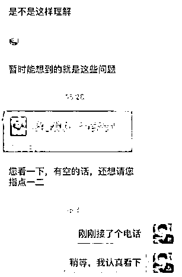

# 初次创业，合伙人别选错

作者：郑玉斌  
日期：2023-02-22

下午，一位龙哥盟的圈友加了我，说想请教两件事：一是合伙人之间怎样搭建财务监督机制；二是只拿技术股，还是同时多投一些资金股更合适。

他提问前先发了红包，这个习惯真不错。金额多少并不重要，关键是让人愿意认真回答。

等这两个问题聊完，我反而发现，他真正棘手的麻烦可能不在这里：他的合伙人究竟有没有给他应有的尊重，是否真心想和他一起把事业做起来。细节牵涉隐私，这里不展开，一句话概括就是——那位合伙人存在恶意侵占、隐瞒事实、不够真诚的问题。

不少创业者刚起步时，靠的是一腔真诚和敢冲敢闯的劲头，对股权怎么分、利益怎么算并不特别敏感。也正因如此，很容易被别有用心的人利用。那么初次创业，合伙人到底该怎么挑？我把建议整理成七条，放在飞书文档里，阅读更方便：

https://ozqj66fvp1.feishu.cn/docx/DvIxdXPDho6vsBxNAklc5H4lnLf

评论区的声音也值得一听。有圈友直言，选合伙人最核心的是双方能提供彼此缺少的稀缺资源，其他都次要；马上有人反驳：如果只是缺资源，合作或者购买就行，没必要绑定成合伙人，长期共处还得看别的。也有人强调性格和三观必须合拍，光靠一纸协议撑不长久；还有人说找合伙人跟找伴侣差不多。另一位分享了自己五五开合伙的经历，直言很折磨，绑定太多，不好拆。更务实的提醒是：责任、权力、利益要分清并形成制衡，了解股权中的关键比例线；分蛋糕之前，先把分配规则落到纸面，别靠哥们义气和口头承诺——面对利益，人性真的可能变得贪婪又自私。