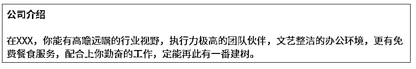
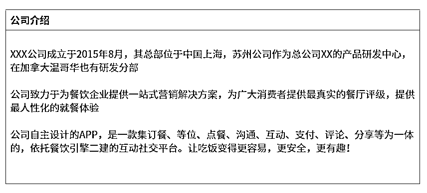
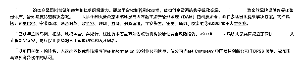
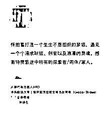
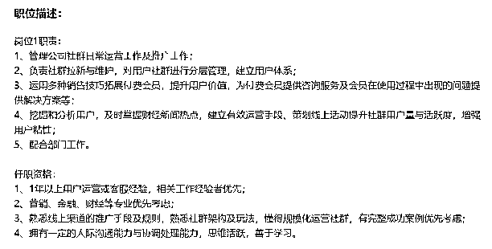
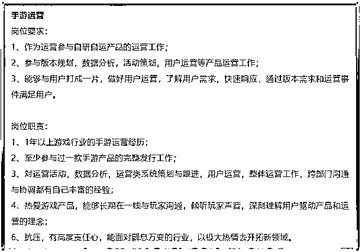
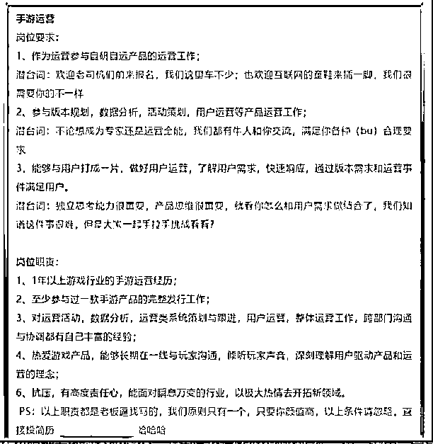

# (精华帖)(135 赞)预算紧、招牌弱，小团队怎样选对中层、稳住人？

作者：鱼丸｜亦仁助理  
日期：2021-08-30

小团队招人难，难在预算有限、体量不大、名气还没打出去。更难的是，想找一位真正能带队伍、能对业绩负责的中间层骨干。这一期「轻享」就围绕这件事聊：怎样找到和业务合拍、又靠得住的中层，并让他们愿意长期留下？

本期主讲忆菁先给了一个提醒：内行做专业事，这没问题；但合伙人的责任，别往中层身上压。这是选中层时极容易被漏掉的坑。老板若把不会的都外包给外部，最后自己反倒容易变成局外人。

忆菁是有瞰学社联合创始人。她待过三家创业企业，阶段从天使轮走到B+轮，队伍从二十人扩到三百人；其中一家她是创始班子成员，另外两家她是核心管理者。她的经历里，有创业企业找中层、带中层时常踩的坑，也有能借走的经验。

目录

一、创业型企业为何难招管理者

1. 预算紧、体量小、招牌不响

2. 方向没定清

3. 创始人没摸透自己的偏好和长板

二、局面怎么扳回来

1. 招牌不响怎么办

2. 方向不清怎么办

3. 人岗匹配怎么提准

三、优秀中层如何稳得住

1. 目标讲透

2. 阶段拆解，小赢带大赢

3. 信任打底

---正文---

我是忆菁。今年自己下场创业后，有个感受特别强：小而新的团队想物色一位既能打硬仗、又扛得住营收的业务负责人，难度非常高。这样的人就是组织里的承重层。承重层要认同公司的方向与做事准则，和团队合拍，还得把身边人带起来，形成人才成长的良性循环——大家通常称他们为中层。

不少创业企业偏爱扁平结构，却容易忽略中间层骨干的成长。早期老板能力强、业务模式又简单，带几个执行同学就能跑起来。可队伍一旦越过十五到二十人的门槛，就该出现能对结果负责的骨干。否则会出现：员工按点上下班，老板被杂事拖住，腾不出脑力想战略；规模与营收卡住，后面容易出大问题。

接下来分三块聊：

一、创业型企业为何难招管理者

二、怎样把人和岗对得更准

三、用什么办法稳住优秀中层

一、创业型企业为何难招管理者

1. 预算紧、体量小、招牌不响

第一道坎，是“创业”标签本身。

背景漂亮的求职者为何偏爱大型平台？因为起步企业品牌没立住，待遇难对标，业务波动大，制度不细，管理还可能粗放，工作强度也不低……

2. 方向没定清

第二个常见原因：掌舵者自己没把路线盘明白。

1）业务边界说不清，能量尺子量、能验收；

2）部门之间职责打架；

3）项目推进缺章法。

典型故事是这样：起初凭感觉定路线A，招来做过A的人；跑一段发现A走不通，改B，原班经验无法迁移；接着C、D、E、F轮番上，最后要么人才被折腾晕，自己离开；要么老板觉得不合适，让人走。

3. 创始人没摸透自己的偏好和长板

第三点更隐蔽：老板没看清自己的偏好与长板。

掌舵者的口味、气场会塑造早期团队。人有好恶，也带价值判断。越能照见自己，越知道该找哪类同伴。

举个例子：你推崇平等开放、沟通直来直去；却招来一位分寸感极强、必须先划清权责才肯动手的人。他业务再强，也会和早期文化打架。你业务上离不开他，相处上又别扭；久而久之，沟通变形，团队协作也受影响。

别轻易说“为了公司我可以压住价值取向”。除非你真准备百分百调整行为和心态，否则诚实面对自己。常说创始人是企业上限，其实老板对自身认知的深度，也决定企业能走多远。

二、局面怎么扳回来

上一节梳理了创业企业招管理者的常见劣势。这一节围绕三点，说说应对打法。

1. 招牌不响怎么办

先把企业优势挖出来。

早期最大招牌往往就是创始人：见识、专业、性格会吸引同频者。但别把个人魅力当铁饭碗。即便你是行业IP，最多在引流阶段占点便宜：候选人池大一些、简历质量高一些。若老板说不出企业和业务到底强在哪，人来了也留不住。

1）招聘也要有“用户视角”

招人像做产品，要站到求职者角度。

先重视对外包装：企业简介、岗位广告，都是企业名片，有广告作用。广告做得走心，人才才愿意点进来。

企业简介是候选人的第一眼。很多人把招聘当“卖岗位”，沿用货架式推销逻辑：我想卖产品；卖给预设目标；产品对你多好。问题在于，它默认用户会主动看广告。现实是：信息过载，别人凭什么注意你？

所以要反过来假设：候选人根本不会点开。问自己：

求职者挑公司时最想确认什么？

我写的简介和岗位页面，像不像我想吸引的那类人？

同类机会摆在一起，我的信息凭什么被记住？

再代入候选人：好机会那么多，一个有潜力的年轻人为何选我？我能给他什么？沿此列优势，例如：

a. 创始班子履历硬、业务底子强——中间层能学真本事、开眼界。

b. 企业资源足、增长快、空间大——骨干能独立操盘、拿到作品与战绩。

c. 现金底薪未必高，但绩效上限大，项目成了总包不寒酸。

d. 团队气氛开放——事情不是靠一个人扛，伙伴执行力靠谱，一起干有奔头。

……

2）招聘文案对比

下面挑几份真实招聘素材，从不同角度拆一拆。以下为部分摘录。

企业简介·反例一：

看完云里雾里：老板是从知名大平台出来创业的，但主营是什么、有效信息有哪些，都没交代。

企业简介·反例二：

只提了企业与产品概况，文字平，记忆点不足；放在招聘平台，被划过去也正常。

企业简介·正例一：

   

对比三组材料，不妨想一想：应聘者在不了解企业时，最想获得哪些信号？

正例里的简介，给了一个思路：

a. 做什么产品/服务？怎样显得可靠又有实力？

例如：提供数据基础设施与内容生产；淡马锡、红杉、软银等机构投资；工作范围自由、国际化；阿里巴巴、字节跳动、联合利华、资生堂等世界五百强及本土头部企业已经合作。

b. 团队什么成色？怎样让人觉得想加入？

成员来自名校名企，优秀者相互吸引。

c. 优势在哪？怎样形成吸引力？

有内部培训、高手分享会；落户支持更友好；气氛不错，专业线、管理线都能发展。

看完之后，是不是对工作场景有了画面，也大致知道什么样的人能融入？它还借知名投资方、团队履历等可信信息增强说服力。

所以，创业者招聘前期别轻视招聘文案。必要时，老板要亲自把关。

再看岗位页面。它同样是重要包装。下面以运营岗为例。

岗位页面·反例一：

这类运营招聘常见；但若它来自一家主打创新的企业，就违和。想招有创新劲的人，文案却毫无创新气息，怎么让人投？

岗位页面·正例一：

我前司做小众手游，想找有点游戏运营经验、又带创新思维的人，也欢迎互联网行业同学。当时岗位页面如下：

它把职责说清了，可没体现“创新、探索热情”，跨行的人凭什么被打动？

我后来做了补充，基本内容不动，红字为增补：

这样写，潜在应聘者会感到企业文化开放、成员有趣有活力。后续筛选也要看价值观与文化是否契合。

面试时你的状态也要和宣传一致：说开放，就别端着；开放不等于提问不锋利，而是面对候选人时更尊重、更愿意回应。

招人有点像谈恋爱：你愿意花心思琢磨，追到心仪对象的概率才高。

2. 方向不清怎么办

前面说，掌舵者路线老变、部门职责打结、业务线交错、流程不顺，都会让企业烧钱烧时间。早期又难完全避免调整，怎么降低人员流失？

1）目标可改，阶段目的要钉牢

先明确商业模式：靠什么赚钱、客户从哪来、产品是什么，老板心里要有账。

再明确阶段目的：先冲规模做流量，还是一开始追利润？目的定住，落到员工头上的策略才不会走形。

即便后面把100万营收目标调到200万，或从微信生态转去抖音生态做增长，只要阶段目的没变——比如仍要快速增长——目标与方法就围绕它转。

2）别把合伙人该扛的活甩给中层

我始终认为，创始班子两大作用：

一是难关时最后撤；

二是遇到重要且不确定的新业务，先冲上去担责。

第一点好懂，重点说第二点。

探索型新业务，很多人想找个有类似履历的人来试。弊端是：你很难判断他干得好不好。你没亲手做过，只能凭大逻辑判断，不了解内部资源与真实业务，决策容易偏。再加上信任没沉淀，短期没结果，团队信心容易散，后面动作也会歪。

所以，偏探索又关键的项目，应由创始人或核心班子成员亲自打到一线，先拿到从零到一；等到要标准化、规模化，再请强中层来落地。

我并非否定“老板管钱看方向”，也不反对“专业事给专业人”，但前提是：合伙人级责任不能外包。老板把不会的都丢给外部，自己就会退成局外人。这也是招中层时最易忽略的坑。

若业务相对清楚、对组织也有认知，仍常出现人岗错配。怎么认人？

3. 人岗匹配怎么提准

1）见过的优秀样本太少

老板见的人不多，就很难快速判断对方处于什么水平、是否合用。就像没见过高手，难知道自己做到什么程度算好。前期要多见、多聊、多积累。

2）招人尺子模糊

根子在标准。早期企业不能照搬成熟公司的尺子。最大的区别：别只看经历和能力，更要看特质与态度。

特质：

这是底层稳定属性：开放、自信、热情、沉稳等，决定一个人适合什么企业、业务和岗位，也对应工作驱动力。

积极的人接到陌生领域，会想办法做出结果；消极懒散的人，不适合快速试错、快速奔跑的初创团队。

态度：

它决定成事上限。真想干，执行会更狠，会想尽办法抵达目标。

我在生财平台曾分享过考察特质的问题，详见 https://t.zsxq.com/fUfM766 ，这里再收拢几个面试提问。

问题一：你为什么选这个行业/岗位？

看职业驱动力。热忱强的人会说清理由：收入、成长、视野等；说得具体、有事例，说明认真想过；含糊其辞，可能只是海投凑数。

问题二：这行没你想的那么好，有XXXX（比如常加班、常出差、回报有风险、好初衷未必有好结果）——

看负面信息下的接受度与抗压。观察对方第一反应：能接住？早想过并愿付代价？还是明显迟疑？

问题三：围绕简历项目，追问达标关键节点、策略和思考过程。

验证项目是否亲自做过/带过。真做过的人，对过程细节、结果背后的取舍心里有数；管理者也应熟悉关键环节，否则只是挂名。回答含糊，多半只是旁观。如果你要的是能扎进业务拿结果的人，这里就容易踩坑。

前司招人时，新业务线起势不错，急需能快速落地并放大规模的人。我手上两位候选人：一位七年经验、带过几十人队伍的老兵；一位工作两年、冲劲很足的年轻人。选谁，我一度拿不定主意。

三、优秀中层如何稳得住

1. 把靶心画清

中层留下与否，常取决于他是否明白公司要什么结果。目标若虚，力气白费，强者也会心累。把范围、交付物、验收口径说到位，团队才有方向。

2. 把大仗拆成小仗

长目标切成阶段任务，先打赢一场小仗，攒信心和手感，再滚成大胜。老是看不到里程碑，中层很难持续硬扛。

3. 用信任兜底

创始人与骨干之间，要靠说清楚、守承诺、敢授权、给支持来养信任。探索期尤其如此；短期没结果就互相怀疑，人才自然流失。

# 挑人看劲头，留人抓半年

前阵子招人，两位候选人的对比让我印象很深。一位履历只有两年，资历确实单薄，可那股非要把事干成的冲劲藏不住；他也很坦率，说接下来两年就打算靠拼命干活多挣些钱。另一位摸爬滚打了七年，履历扎实，讲话也有条有理，可一聊才发现，他眼下对“干出成绩”这件事没那么执着，反倒更看重生活与工作的平衡。

权衡之后，我把机会给了那位只有两年履历的小伙子。结果他后来的表现远超我的想象：到岗才三个月，就把负责的那块业务盘子做到原先的三倍，薪酬也跟着翻番，成了公司里当时最年轻的部门领头人。

这件事也让我更加坚信：本事和履历都可以靠时间攒出来，真正起决定作用的，往往是他骨子里的特质和做事的态度。

所以在挑人这件事上，我的信条一直没变：把好选人的关，远比事后拼命栽培更关键。老话不是讲嘛——根基要是偏了，上面再怎么扶也难直。

## 三、好苗子如何留得住

假如你已经挑中了一个值得培养的中层骨干，那接下来最要紧的一步，就是让他先踏踏实实在公司干满半年。通常来讲，只要这位新人撑过前六个月，那道“危险关”算是过去了，后面就可以按至少干满一年来盘算。

想把挑中的人真正留住，关键就两件事——

一是让他在短期内先打出点成绩；
二是观察他的价值取向，看他能不能跟公司、跟队伍磨合到一块儿。

先说帮他尽快出成绩这件事。

### 1. 目标得讲透、定死

公司里立目标，绕不开KPI跟OKR这两样工具，我说说自己的用法。

像市场、运营、销售这类岗位，本来就得靠数字来衡量，那不妨直接走KPI那套，把要达成的数字指标定死。

如果是产品类岗位，或者那种需要慢慢摸索的项目，数字一时半会儿说明不了问题，那就适合用OKR——O讲的是方向，公司到底图什么、业务上要奔哪儿去；KR则是实现路径，也就是从哪条道走，才能把公司盼的东西拿到手。

说到底，KPI也好OKR也罢，没有谁一定比谁强，得看公司眼下处在什么阶段、是什么文化、做什么买卖，挑顺手的来用就行。

不过我也碰过不少把OKR用死的例子。有些初创小团队，为了显得自己够开放，偏偏不设具体的业绩指标，拿OKR来顶替，结果半年一晃过去，买卖没见起色，底下人反而觉得方向乱成一锅粥。

想让OKR真正跑起来，前提是这支队伍自己就有往前冲的劲头。管理方式得从强压硬管，转成信员工自己能往前跑，敢让他们用更新鲜的路子去够更高的目标，同时公司还得持续给人添柴加火。可要是生意本身就简单，老板和底下人又天天纠结得失，不肯营造那种放手让人干的氛围，那最后翻车，也是意料之中的事。

### 2. 拆成小台阶，先啃下一口

定目标得切成几段来走：先把眼前这一小关攻下来，再一口一口攒成大胜仗。

打个比方，某块业务一年要干到一千万GMV，那就按季度或者月份往下切；比如头三个月先冲两百万，那就先领着大伙把这第一关啃下来。

要是手头压着几块硬骨头，像招人、带队伍、业务上的要害数字这些，不妨先挑公司急需、自己也拿手的那块下手，在队伍里先立个能出活的标杆。

这么干图什么？说白了，就是让新来的先有底气，也让大伙对这个人服气。有句话挺在理：打赢了，什么问题都好盖过去；真正让底下人心里长草的，是左等右等都等不来一个结果。

接着聊价值取向怎么磨合。看清某位骨干，最好的时机就是在带队打胜仗的过程里，看他是怎么出招的。有些骨干肯扎到最前面，自己先干出个样来；也有人光动嘴皮子，揪着细枝末节不放，偏偏抓不住要害——这就是典型的“只动嘴”型选手。

### 3. 信任得一点点攒

老话讲事在人为，而人又是环境的产物。一个队伍要养出互信的气氛，个体与个体之间那份信得过，同样缺不得。

有回跟一位在组织人力圈挺有名气的顾问同桌吃饭，她干这行已经二十年，早先在几家有名的猎头公司和人力方面的咨询机构里待过，后来自己拉摊子，专给刚起步的公司出主意、做陪练，开头收的费用压得很低。这七八年下来，她前前后后挑了一百来家企业，跟着一家从天使阶段一路走到上市，也陪着两家从零起步做到十亿美金估值。她自己的名气，也跟着这些故事一点点传开了。

把这个道理挪到老板和手下骨干之间，其实也一个样：在公司买卖最晃荡、最不好干的那阵子肯进来的人，绝对是公司里格外值钱的宝贝。

反过来问一句：当老板的，招人时有多少是揣着“先弄进来试试，不成再换”的念头？抱着这种心思，哪来的耐性去听人家讲真话，又怎么可能真把对方遭遇的事儿放在心上？

会看人、会带人，大概是每个自己干的人都躲不掉的一门功课，跟各位共勉。

我叫忆菁，在职业培训这个行当里自己干，但愿我这些自个儿的经历，能给各位带来点启发。

要是你在职业培训、用户增长和运营或者创业这些话题上有啥想问的，也欢迎找我接着聊。

P.S. 要是你也想在生财有术专栏聊聊自己的心得和看法，点这个链接 http://form.shengcaiyoushu.com/f/HA1G1g 填一下表，我们会分批请有赚钱门道和真实案例的朋友来做分享。表已经填过的就不用管了。

评论区：

鱼丸|亦仁助理：谢谢老师的分享，有问题大家尽管在评论区提~
有霸夫：人少的队伍确实容易碰上这些坎，自己干真难，步步惊心。
亦仁：很棒的分享，很受启发。我最近也在琢磨，人多了产出反倒少了，根子还是没把最关键的事厘清、不够聚拢。而在没厘清最关键的事之前就去招人，效率也谈不上高，甚至会走形为照着人再去安位置，其实大可不必。
电饭煲：刚好在招人上犯难，谢谢老师。
白一喵：忆菁真棒～～～
忆菁：谢谢小白哈哈
忆菁：谢谢亦仁[胜利]
嘉庚学长：写得真好，关注了。