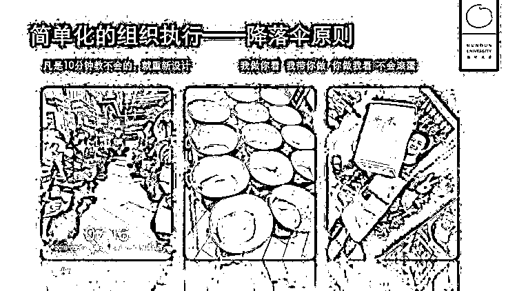

# 培养人才，越简单越有效

昨天听了生鲜传奇创始人王卫的课程，有几个点让我反复琢磨。整理下来，最触动我的是这三件事。

第一，目标客群到底怎么定。中国的小区是很特别的商业场景：人口密度高，住户在收入水平、家庭结构上往往接近，入住时间也相对集中。生鲜传奇的选址和人群定位，正是围绕这个特点展开。比如它瞄准中产人群，那怎么找到这批人？王卫的判断很直接：一个小区的房价，基本能反映住的是哪类人。与其挨家挨户做消费者调研，不如先看房价；想在一个城市找到中产，就锁定房价在 xxx 以上的小区。这个思路让我很受启发，原来找客户池还能这样切入。

第二，线下门店开在哪里。不必依赖复杂的大数据，原则就是离小区越近越好，能进小区就更佳。在中国，有效辐射范围不是 2 公里，而是 500 米；只要人口密度足够，生意就能成立。

第三，人才如何批量复制。既懂营销、又会管理、还熟悉产品的店长，市场上极难找，真要有，一年恐怕得开到 100 万元。想用每年 6 到 7 万元的薪资招年轻人顶上，就必须给他们赋能。怎么赋能、怎么批量复制？先让管理简单到近乎“傻瓜式”。如果标准化时塞给员工厚厚一摞管理手册，大家反而不知道从哪下手，标准很难落地，所以流程必须简化。

比如货架卡，原来中间是挂钩，员工挂上去容易歪；后来改成插槽式，咬合更紧，整齐问题就好解决。培训也是，集中培训成本高，改用视频网站；可让人坐几个小时看课不现实，于是拆成短视频，遇到什么问题就看对应内容。新员工入职甚至不必一对一带，看视频就能上手。

两个细节我印象最深。其一，怎么让地面保持干净？不少生鲜店地面有水渍油污。生鲜传奇有个“席地文化”：每天早上坐在地上开会。衣服是公司的，裤子是员工自己的，只要员工愿意坐下去，地面就脏不到哪去。靠这个动作保证清洁，不需要堆一堆卫生标准。其二，怎么让店里没异味？臭味通常来自垃圾桶，于是要求店员每天清洗四遍。但仅靠要求还不够。有次一个小伙子为了证明自己洗得干净，把脸贴在垃圾桶上拍照。这个细节带来启发：以后每次洗完垃圾桶，都让员工把脸贴上去拍照打卡。垃圾桶清洁问题也就解决了。SOP 不必堆得太厚，有时一个简单、可验证的考核动作，就能达成目标。

还有一点很重要：人才并非靠慢慢培养，而要靠筛选。重点在赛马，而不是相马。这和宗毅提出的裂变式创业有相通之处：别直接任命，而是让候选人竞聘上岗。靠竞争赢来的位置，往往会更珍惜；反过来，如果是被安排上去的，这个岗位未必是他真正想要的，结果反而可能不理想。

课程内容还有很多，这三点是我印象最深、也最想分享的。希望对你有帮助。

评论区也很有意思：有人总结，目标清楚、管理简单，甚至能减少中层，还开玩笑说要去开水果店；有人认同，要让员工和服务对象都能轻松操作、轻松学习，而不是被复杂流程困住；也有人觉得生鲜传奇的分享很实操，听完就能做，靠标准化和信息化压成本，打破生鲜不赚钱的困局；还有人追问分享出处；龙哥表示有启发并加精；多位读者对“SOP 不必太多、简单考核标准就够”深有同感，并反思自己写 SOP 时看两眼、之后没人看，可能是方法没用对。