# 走向规范化的创业团队，绩效评估怎么做才不埋雷？

文 / 鱼丸（亦仁助理）

大家好，我是鱼丸。今天请来许范范老师，聊聊创业公司管理者经常头疼的一件事：绩效评估到底怎么做，才能真正发挥正面作用，而不是反而给团队添乱？

许老师目前在一家世界500强企业担任区域人力副总，也做过人力资源咨询公司的高管顾问，有十年职业发展教练经验，最擅长人力资源和团队管理。她之前写过一篇关于创业团队招募面试的文章，被不少圈友打印出来组织团队学习，还有人拍了彩印页面给她看。亦仁大大也觉得，绩效、薪酬、员工发展这类队伍管理话题，圈友确实很需要。许老师于是答应来帮大家管管“后院”。

许老师有一个观点：不少创业公司做评估，结果只用来分钱。这不能算错，但很可惜。评估结果在人才选育用留的各个环节都派得上用场，比如奖金分配、晋升淘汰、任务选择、荣誉表彰、经验分享、人才盘点、人员招聘、优化考核等。这次分享里还有一些思考框架和工具，值得认真做笔记。

下面进入许老师的分享。

目录
一、评估的价值与风险
二、绩效评估操作要点
1. 怎么设定评估项
2. 怎么收集评估依据
3. 怎么出评估结果
4. 怎么应用评估结果
5. 怎么反馈辅导
三、总结

---正文---

大家好，我是许范范。在生财，我有个外号叫“一文打天下”，因为只发过一篇文章，就被加了精华，还进了龙珠俱乐部，参加了线上私董会。我不太会赚钱。我目前的身份是一家世界500强公司的区域人力副总，做过人力资源咨询公司高级顾问，也是十年职业发展教练，核心方向是人力资源和团队管理。

我最近发现，自己熟悉的领域对生财圈友也有用。写了《创业团队如何招募面试到合适的小伙伴》之后，有近百位圈友加我，有人把万字图文全部打印出来让团队学习，还是彩印，还拍照给我看。我挺感动的。亦仁说，绩效、薪酬、员工发展这些话题大家都很急需。也许我可以帮大家当好团队管理的大内总管。

今天来聊绩效评估。之前和一些带团队的龙珠俱乐部圈友交流，大家都说这个问题让人头秃：评估有什么利和弊？到底做不做？什么时候做？评估谁？评估什么？怎么评估？评估完怎么用？我会用一篇10119字的长文来尝试解答，读完大概需要25分钟。先从利弊说起。

一、评估的价值与风险

评估通常出现在创业团队业务规模、人员规模到了一定阶段，复杂度超过老板一眼能看透的范围，靠人治推不动的时候。衡量不了，就管理不了。公司进入规范化管理阶段后，绩效评估要解决的就是目标传递和效果衡量。它也是一种过程管理，把评估当成抓手和指挥棒，把管理触角伸到更大、更系统的地方。

评估要管三件事：员工愿不愿意做（态度）、能不能做（能力）、机制允不允许（机制）。这些都做到位，组织能力和业务目标才稳。但评估如果做得糙，也会带来一堆新问题。

1. 评估做不好会怎样

1）只盯着眼前。评估很容易抓住当下能看见、能量化的数字，比如当期营收和利润，那些对长期有影响、短期又看不出效果的事往往被放在一边。用户留存和满意度被忽略，方向慢慢就偏了。

2）重视打仗的，轻视做饭的。销售、商务这些直接产生业绩的岗位更容易被看到，产品、研发、质检、运营这类支撑性岗位容易被冷落。老板看不见的地方，中后台的资源投入、积极性和话语权都会受影响，最后给业务竞争力埋雷。

3）部门墙越筑越高。评估压力一来，各业务部门都想从公司整体利益里多占资源、多抢支持、多捞好处。信息和经验不再共享，互相提防。中后台没有露脸的机会，只能求不出错，于是照本宣科，官僚味道就出来了。

4）责任开始外逃。大家只顾自己利益，出了问题第一反应不是解决，而是推责任。管理者也不敢让团队试错，因为创新可能出错，出错会影响评估。

5）队伍梯队没人管。有些管理者只盯着当期业绩，把员工当成完成任务的工具，习惯用挑剔的眼光找毛病。员工也干脆放弃主动性，按规则办事，只出手，不动脑，不走心。

我有个创业的朋友，这些坑几乎全踩了。评估以后，全公司都冲销售额去了，因为奖金高，其他部门好多人想转销售。质量管理松了，出了大纰漏，赔了一大笔钱。各部门互相推责，销售负责人和质检负责人在她办公室里当面吵起来。她说那一瞬间觉得，自己一定是脑子被驴踢了才做评估，做了还不如不做。

但这真的都是评估的错吗？不做评估，这些问题就消失吗？不一定。做得好，评估的好处也很明显。

2. 评估做得好能带来什么

1）目标能聚焦，也能拆下去。团队变大、业务变复杂后，老板管不过来，只看结果远远不够，过程也得管。评估一方面把公司的注意力收拢，让大家朝一个方向使劲；另一方面把公司目标一层层拆到部门、小组、岗位和个人，做到有的放矢。

2）组织能力能沉淀，不再只看牛人。评估会推动公司规范化、标准化，比如目标设定、过程追踪、反馈辅导，这些都会带出制度建设、经验传承和流程优化。组织能力强了，就不会因为个别牛人进出或状态波动而大起大落。

3）共同利益把大家拴在一起。评估目标和评估结果都强调强绑定、强协同，部门和部门之间、员工和公司之间更容易形成同舟共济的状态，各自为战会少很多。

4）激励和晋升有据可依。评估结果可以对应工资、奖金、期权、福利，也可以对应提拔、调整、降职、淘汰，还可以用于荣誉表彰、树立标杆。规则客观，结果公平，员工看得到也争得到，士气自然不一样。

5）倒逼管理者培养人。评估是根指挥棒，员工知道该往哪个方向提升。管理者也会被逼着磨炼带队伍的真本事，兼顾长短期目标，储备后备力量，人才梯队慢慢就有了。

利弊都摆完了。下面说操作。

二、绩效评估操作要点

想让评估发挥价值、避开弊端，关键是5+1。5是评估项的设置、评估依据的收集、评估结果的出具、评估结果的应用、评估后的反馈与辅导；1是管理者的团队管理能力。

1. 怎么设定评估项

这里最麻烦的是平衡两对矛盾：业务目标和个人目标，长期目标和短期目标。

很多公司图省事，或者管理层还没想明白，就让员工自己给自己定目标。我在咨询公司时见过一家公司，评估完全是自下而上。员工自己报目标，领导来回拉锯几次，然后一层层往上汇总，部门目标有了，公司目标也有了，所有人的年度目标就这么定了。这很可怕。管理层是省事了，但公司没有统一方向，个人报上来的指标和数据有没有效也没人验证。无法衡量，就无法管理，评估等于白做。

所以，设定评估项要先想清楚三个层面，不是一上来就给每个人定目标。我上一家公司让我重新设计员工绩效体系时，我跟领导说，公司战略部门要先把公司评估体系理顺，人力资源全程参与。公司评估体系和部门评估体系，是岗位和员工评估体系的前提，必须一层层分析设计。

1）公司/团队的评估项怎么定

整个公司要聚焦什么目标？这个问题没想清楚，后面全是白费。创业公司的老板要清醒，也要坦诚。任何想绕过这步、直接去做那些相对容易步骤的想法，都是虚假动作。

如果业务已经比较规范化，过程能拿出很多量化数据，适合用KPI。如果量化不了，更多要靠团队主动性和创造力，用OKR更合适。大多数创业公司更适合OKR。虽然也有人说OKR不该用于评估，但从实践来看，它的关键结果部分确实能当指挥棒用，而指挥棒本身就带着评估导向。

怎么找出公司层面的核心目标？推荐两个工具。

第一个是战略平衡计分卡。它从财务、客户、运营管理、学习成长四个角度，找出公司核心目标和关键评估项。它能平衡短期目标和长期目标、财务目标和非财务目标这两对常打架的目标。以财务指标为最终结果，再通过客户、运营、团队学习等指标一层层推演，本质上是在推导公司战略的因果关系。示意如下：

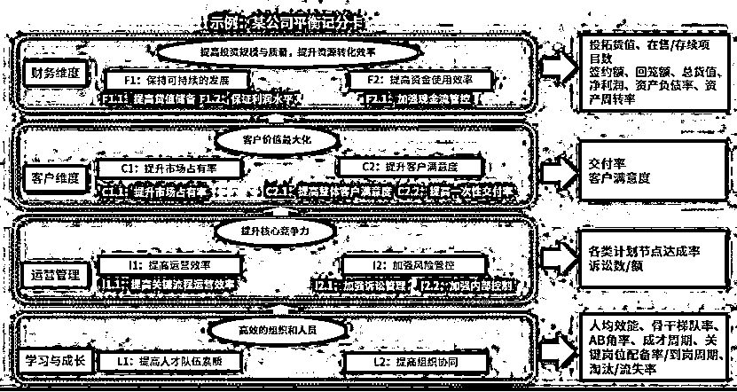

第二个是商业模式画布9要素。画布从价值创造、客户管理、资产管理和财务管理四个界面来看，涵盖价值主张、客户群体、客户关系、关键业务、重要合作、核心资源、渠道通路、收入来源、成本结构九大要素。这也是我比较推荐的分析工具，网上可以找到滴滴、樊登、小红书等公司创业阶段的画布。核心问题参考如下：

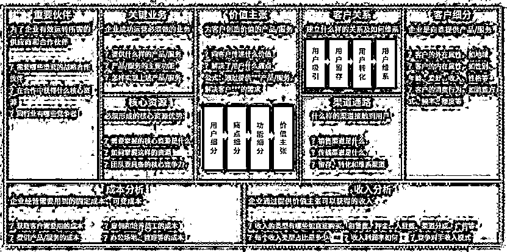

这两个工具，相当于给老板一块仪表盘。公司业务就像在开飞机，仪表盘上不能只有速度（比如利润），还要看油量、高度、剩余里程。抓住影响80%业绩的那20%关键指标，后续分解才不容易跑偏。

2）部门/小组的评估项怎么定

部门/小组的评估项，从公司评估项里拆出来。这里最常见的阻力是：公司目标怎么拆给部门？部门之间怎么协同？部门负责人怎么认同？

建议开部门/小组OKR研讨会。当时我们也是这么做的。公司目标出来以后，负责人差不多已经想好怎么分配指标，但我们还是建议把各部门负责人拉来研讨，引导他们自己定OKR。因为人会倾向于兑现自己说过的话，自己定的目标，以后执行起来更认账。创业公司不要求一次做到完美，可以按D、C、A等评价原则，小步快跑、阶段回顾、持续迭代。

下面是一个参考示例。里边的目标和关键结果，就是部门/小组的评估项，同时也是该部门负责人的评估项。

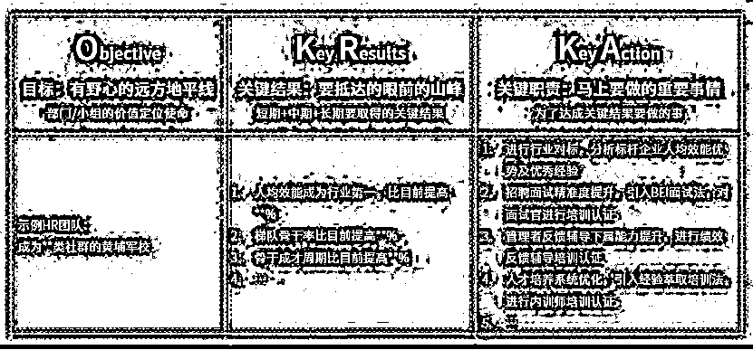

目标设置上，要方向清晰、鼓舞人心，有明确的时间周期，和公司业务价值充分挂钩，交给独立团队去执行。
关键结果设置上，要具体、量化、有挑战，跳一跳才够得着；要上下左右对齐，大家都真心认可；只写对目标有决定性影响的项，不要全部罗列；写结果，不写隔壁部门该做的事；每一项都要有明确责任人。

3）岗位/个人的评估项怎么定

公司、部门层面的评估项理顺后，岗位和个人的评估项才会更容易定准，也更高效。岗位和个人层面依然可以借用OKR思路，其中目标对应的是岗位价值。建议从两个维度看：岗位价值和角色价值。

岗位价值，就是为什么设置这个岗位。通常可以用“为***群体提供***服务/支持，以解决/提升***”这个公式来写。最常见的误区，是把职责当成岗位价值。比如一个苹果果农，最终评估项就是苹果成熟个数和成熟率；为了管过程，可以倒推追加结果个数、结果率、果树成活棵数、成活率。而栽树、松土、施肥、捉虫、授粉都是职责，不是岗位价值。

角色价值，很多创业团队可能没想过。创业公司人少，一个人经常同时承担几种角色，还能推动团队工作的某些优化。

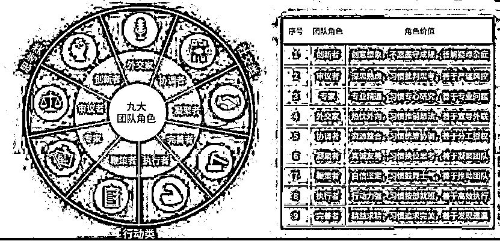

除了工作产出，评估里还要放上人才梯队建设和价值观传递的内容。普通员工的目标任务书可以参考下面的样子。

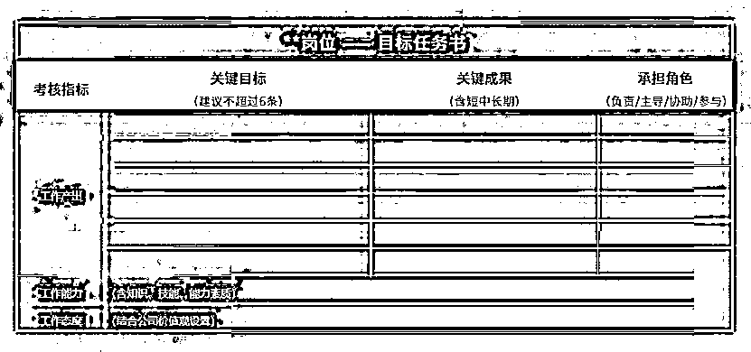

目标任务书最好由部门/团队负责人和员工一起沟通确认，逻辑和部门/小组OKR研讨会是一样的。

如果研讨时发现很难梳理出岗位核心目标和关键成果，那通常是负责人和成员对评估都还缺少经验。可以试两个方法。一是找优秀公司同类型业务的同类岗位，看他们的评估项怎么设，先模仿，再超越；二是拆解那些优秀员工，看看他们达成了哪些关键成果、具体做了哪些动作，答案就藏在里面。

2. 怎么收集评估依据

这里有两个大坑，必须提醒大家。

坑一：评估依据没有统一归口。依据没有说服力，结果就站不住，评估也起不到作用。量化评估项最好由公司指定一个部门或岗位统一统计，避免扯皮。公司大一点可以设战略管理部、计划运营部或总经办；公司小一点可以设计划管理岗或综合管理岗。数据统一归口后，横向纵向都能对得上，才不会出现各部门信息不对称、数据“打架”的情况。

主观评估项，比如工作态度、价值观、跨部门协作，需要用BEI行为事件法，观察任务背景、重难点、员工角色与行为、行为结果，员工才会信服。团队越来越大后，也可以在评估周期结束时，让员工填写工作总结作为依据。参考模板如下：

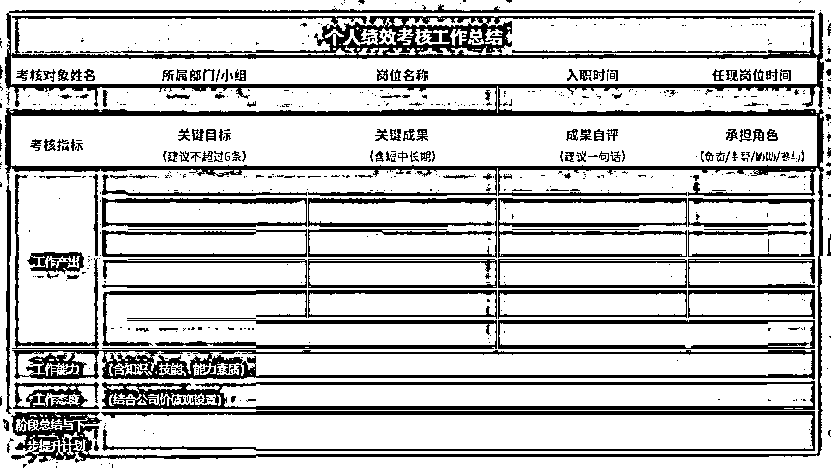

坑二：用360°互评当评估依据。早年很多公司这么干，因为不得罪人。大家互相打分，结果跟具体某个人关系不大，等于集体说了算。我也经历过。最后变成什么样？没人敢红脸，没人敢争执，意见不同就憋着，反正公司又不是我的。公司慢慢变成老好人俱乐部，敢说真话的人反而待不下去。现在360°更多用于反馈和发展，已经很少用在评估上。收集依据再难，也别图省事去搞互评。

3. 怎么出评估结果

创业公司常踩的坑是打分。一位创业公司的朋友说，他们公司用评分制，结果部门之间比着给高分。满分100，一个10人部门人人95分以上，还有3个100分。我看过他们公司的评估体系后，觉得不能怪部门负责人。他们要带人干活，还要考虑团队以后干活的劲头，公司不给规则，分数自然水涨船高。隔壁部门都90多分，凭什么我们部门80多分？

所以公司必须给出具规则。创业团队不建议用太复杂的打分方式，更推荐S卓越、A优秀、B、C待发展、D不胜任的五级强制分布法，是否强制分布可以根据团队情况决定。结果规则一般按二八原则：优秀及以上大约占20%，待发展及以下大约占20%。

# 考评结果，用处远不止发钱

队伍还小的时候，把全员放进同一套比例里做强制排布就能运转；等人一多，就得落到业务单元上，比如成员超过十人的部门或小组，再执行强制分布。

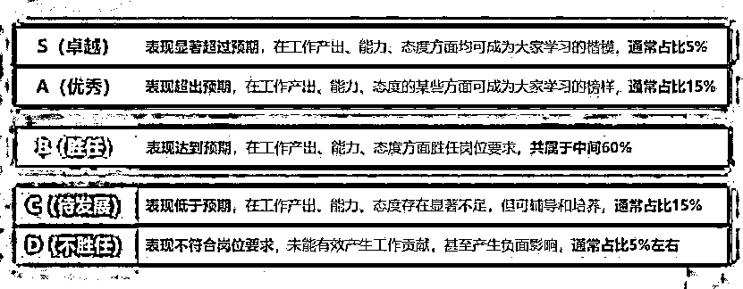

档位怎么切，不是拍脑袋定死的，要跟着业务节奏走。势头好、想给团队鼓劲，就把优异和拔尖的占比往上提；经营承压、需要敲打甚至清退尾部，那就把待改进及以下的盘子放大。

如果想把个人表现和集体成绩捆在一起，也可以让各单元按自身的考评等级采用差异化比例：该单元评上 A 优秀或 S 卓越，成员拿优秀档的机会就增加，C 待发展可以少评甚至不评；等级不理想的单元则反向收窄。

有的部门块头大，超过三十人，主管还想把处在“胜任”区间的成员再分出层次，让奖金发放和晋升通道更有梯度，这时候不妨增设 B+ 与 B- 两档。

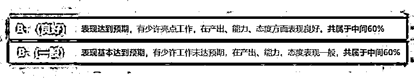

## 4. 考评结果能用在哪些地方

接触过不少初创公司，它们把考评结果唯一的出口锁定在发钱上。这不算错，只是有点大材小用。从选人、用人到育人、留人，几乎每一环都能借上力——奖金发放、升降去留、任务委派、荣誉激励、经验沉淀、人才盘点、招聘校准以及考评机制自身的迭代，都算在内。下面逐项说。

**1）奖金发放：规则先讲清楚**

最容易翻车的地方，是绩效与奖金之间的对应关系含糊不清。本意是公正透明的考评，反倒容易被员工解读成暗箱操作。

我见过有企业把制度写成“参考考评情况酌情发放奖金”。什么叫酌情？员工看了会作何感想，又凭什么信服？

倘若考评机制上线不久，对结果的客观性还没底，不愿把奖金全额与考评绑定，那就拆成两块：一块随考评结果浮动，另一块与营收、利润这类可量化的指标挂钩，按阶梯比例递增，相当于给奖金上了双保险。

直接与考评挂钩的那部分，初创公司不必设计得过于繁琐。系数法最常见也最顺手，我此前搭建考评体系时也多用这一种，示意如下。

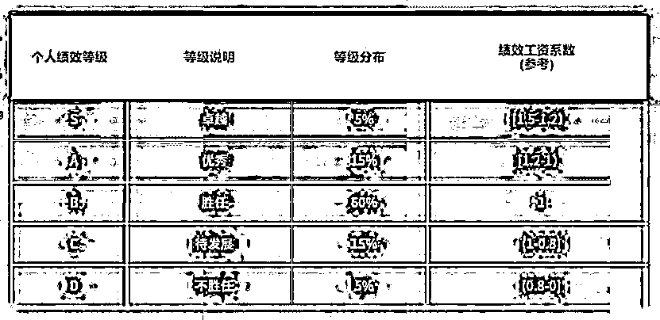

需要说明的是，系数调节的是绩效工资，基本工资不在其列。浮动区间定多大，一头要参考公司的人力成本承受力，另一头要考量岗位对业务的价值贡献与工作特性，再做细微修正。

**2）升降去留：用评级划出硬杠杠**

把评级转化为升降规则：比如年度考评或连续两个季度拿到 S 卓越，即可进入晋升加薪通道；A 优秀对应调薪；C 待发展面临降职降薪；D 不胜任则退出。部分管理岗的内部竞聘，也可将考评达标设为报名资格线。

**3）任务委派：机会向高绩效倾斜**

拿到 A 优秀或 S 卓越的人，可以优先认领公司的标杆项目、新业务探索、高毛利业务，甚至在新方向上获得与业绩兑现绑定的股权。而 C 待发展、D 不胜任的成员，则须无条件服从组织安排。

**4）荣誉激励：把“为什么是他”讲透**

对 A 优秀、S 卓越的员工，可以安排有仪式感的表彰、评优、榜样故事采写。树标杆时切忌只夸人，而要具体说明他做成了什么事、展现出哪些行为，才换来这份成绩与认可。

针对团队、部门甚至整个公司，每逢关键的里程碑成果，同样可以设计仪式感十足的庆祝。我了解过一家初创公司，办公室里摆着一面系着红绸的铜锣，谁攻下自己的关键目标就去敲一下，同事用拍立得记录，照片贴在旁边墙上，注明攻克了哪项挑战。久而久之，敲锣成了许多人向往的荣耀时刻。

**5）经验沉淀：让个人本事长成组织本事**

安排 A 优秀、S 卓越的员工做经验分享，把高手的打法尽快转化为团队资产。初创团队要慢慢摆脱对个别能人的重度依赖，避免其状态起伏与业绩波动牵动整家公司。最见效的路径，就是把高手经验萃取出来，这本身也是对队伍最好的培养。至于 C 待发展、D 不胜任的情形，可以组织小规模的负面案例复盘。

**6）人才盘点：盘人如盘钱**

对企业和各级主管来说，定期盘人的节奏应当不亚于盘账。常用做法是“业绩—潜力”九宫格，把团队成员放进格子里审视，时刻警觉人才储备能否支撑业务。盘点结论要及时反哺选用育留的各项决策。

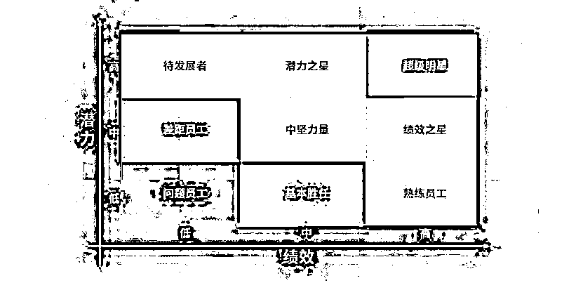

**7）招聘校准：让考评结果反推用人标准**

考评数据同样能指导招聘。其一，依据考评维度校准招聘条件，特别是冰山之下那些难以改变的性格、价值观与内驱力。我见过一家公司，出纳岗位的价值观要求是沉得住气、有耐心，可它对外所有岗位一律要求有冲劲、敢开拓，前后明显打架。其二，把考评与盘点结果结合起来，及时修补团队的能力短板，或有意引入能搅动一池春水的“鲶鱼型”成员。

**8）考评体系自身的迭代**

这一点最容易被遗忘：每轮结果出来后，都应回到团队与公司目标的达成情况上，重新检验考评机制是否合理、是否有效，并据此改良。对身处快速变化行业的初创公司，这一步格外要紧。

## 5. 结果落地后，反馈辅导怎么跟上

这里最常见的失误，是结果算完、奖金发完就画上句号，员工却一头雾水——好在哪里、差在哪里，全然不知。

考评是管理手段，不是目的本身。真正要传递的是：哪些行为值得坚持和鼓励，哪些行为不可取、原因何在、正确的做法是什么、下一步如何改进。做不到这些，考评的意义就大打折扣。

也见过相对规范的公司，要求主管必须做绩效面谈，可谈什么、怎么谈、如何与员工沟通，全凭个人悟性。结果谈完还不如不谈，隔阂反而更深。员工哭着拍桌：“你凭什么说我不够拼，你问过我经历了什么吗？”然后摔门而去。

因此，考评结束后，既要安排主管与员工一对一沟通，更要事先给主管们做沟通辅导的训练。绩效面谈对管理者是道难题：谈得好，士气为之一振；谈不好，人心浮动、骨干出走。

**1）先解开主管“愿不愿谈”的心结**

主管向下属反馈，同样绕不开“能不能、愿不愿、会不会”三道坎。

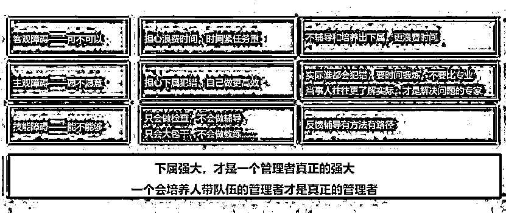

**2）再补足“会不会谈”的本领**

实际面谈中常会撞上各种棘手场面，相关技能必须提前训练。

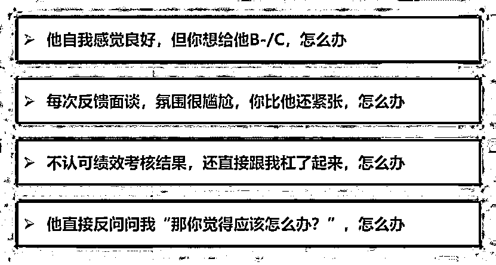

下面分享几个实操技巧。

其一，让反馈落脚在行为与事实上。对行为的描述与评价，可以沿用 BEI 行为事件访谈的思路，此前聊精准面试时也提到过。切忌停留在主观判断上，像“我感觉你沟通上还得练练”“好几个人反映你表达不太行”这类说法，只会点燃对立情绪；即便是夸人，“你表达能力很强”听起来也像客套，不够走心。反馈必须建立在具体行为之上。

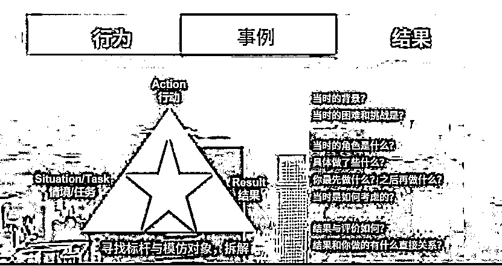

可以请对方讲讲自己的经历与代表性事例，也可以由你陈述观察到的情境：他承担了什么角色、采取了什么行动、带来什么结果与影响。必要时，还可以拿一位标杆人物的同类事件与行为做对照拆解，说服力会强得多。

其二，帮助员工提升能力、规划职业路径。这部分对管理者的功力要求更高。例如借助大五性格与职业优势模型，帮他看清自身与生俱来的长处和短板。

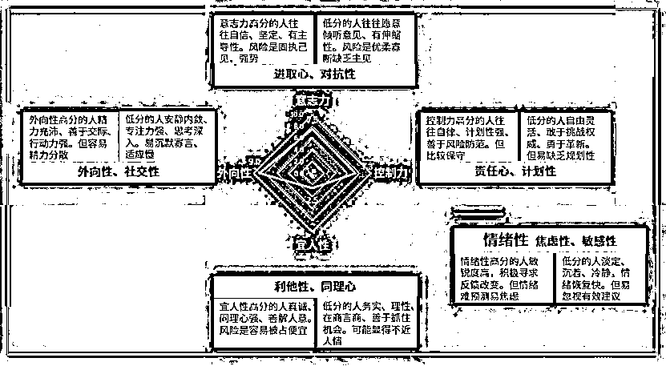

借助职业锚与内驱力模型，厘清他的动力来源、在意什么、什么样的岗位最契合，以及近期状态与内驱力满足度之间的关联。

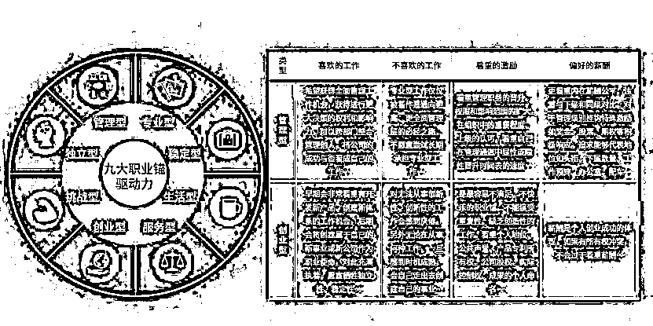

借助 GROW 框架陪他理出改进路线，一起讨论目标怎么定、现状差在哪、可选哪些方向、具体动作是什么，并在过程中持续跟进、给予辅导与肯定；还可以用能力—意愿矩阵，探讨下一步的管理方式。

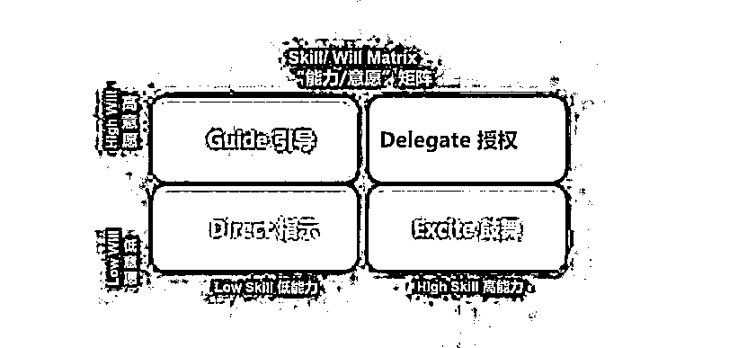

当然，工具不是枷锁，主管完全可以找到最适合自己的方式来带人成长。

## 三、总结：方案再漂亮，落地还得靠人

绩效管理极其考验管理班子的综合功力。它牵涉业务规划、公司愿景、价值观、人岗匹配、培养发展、激励保留、性格与内驱力分析、冲突化解等一系列命题。

考评体系设计得再精巧，最终都要靠管理者去执行，因此主管的能力直接决定了考评的成效。必须提前为管理者赋能，至少包括以下几方面：

1）公司的业务目标、发展愿景、阶段重心与核心价值观，管理层内部需先统一口径。
2）各部门/小组各自的核心价值、关键抓手以及协作方式，管理层之间要通力配合、形成合力。
3）各岗位的价值定位、职责边界与考评标准，对应主管必须心中有数、说得清楚。
4）针对性的面谈辅导培训，例如怎样处理负面情绪、怎样给出建设性意见等，主管要真正掌握；并且反馈不应只在考评节点做，日常工作中的行为也需及时点拨。
5）指导员工规划职业路径的本领，包括优势识别、成长路径设计、培养方法等，主管要拿得出手。
6）其余方面，如主管个人的领导魅力、班子内部的磨合、以身作则的表率、对人性的体察、对业务流程的提效管理等。

以上种种，都会左右考评落地的实际成效。

绩效管理这件事，路很长，急不得。人少的时候，方向往哪偏，喊一嗓子就能纠回来；可当队伍扩张、业务盘根错节，几十乃至上千人一同冲锋，指挥系统就必须升级换代，让目标与关键结果更聚焦、更可控。

搭建考评机制，不必苛求一步到位。一边跑一边复盘、持续打磨，往往是更务实的选择。在这件事上，小步快跑，同样能跑出速度。

我是许范范，后续会继续输出人力资源与团队管理方面的思考。也好奇你的创业公司正面临什么难题，或许我们可以聊一聊、碰一碰，欢迎随时找我。

P.S. 想在生财有术专栏聊聊你的实战心得与认知？欢迎打开 http://form.shengcaiyoushu.com/f/HA1G1g 提交表单，我们会陆续邀请有赚钱相关经验与案例的朋友来分享。若已提交过，请忽略本条。