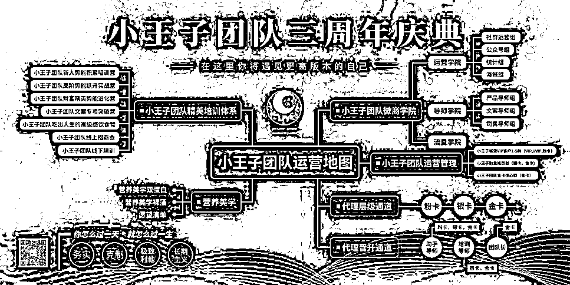
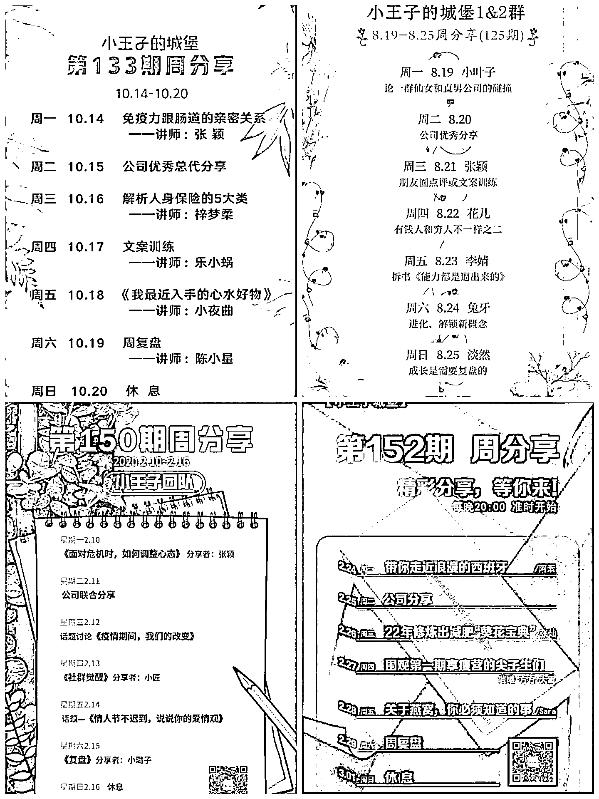
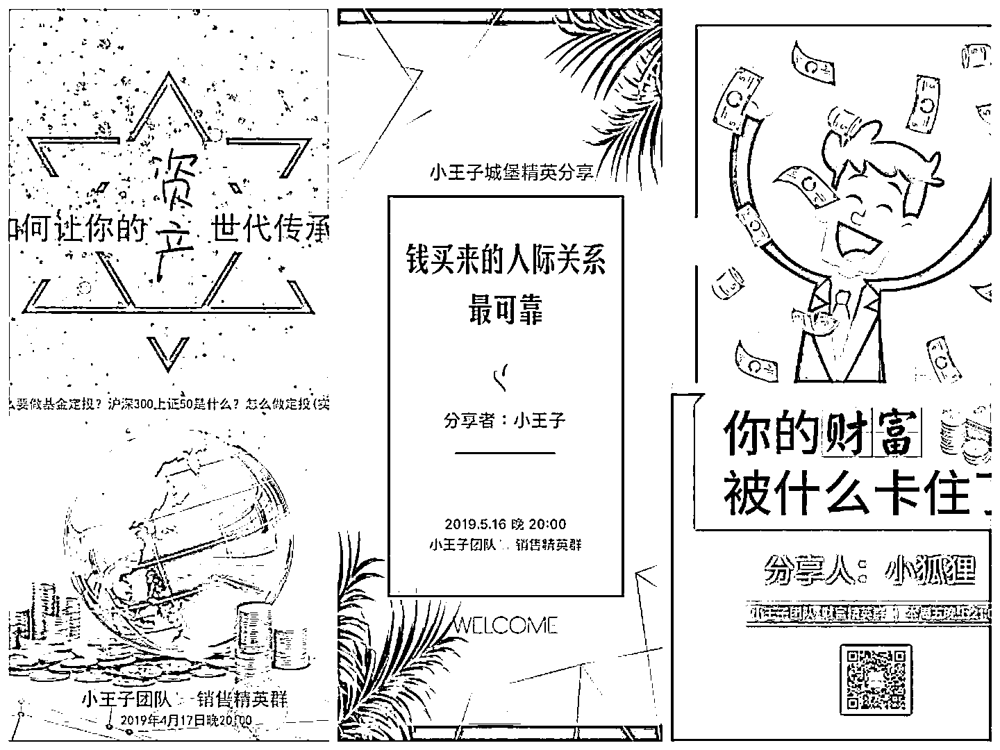

# 微商团队做大了，别再靠人硬撑

## 1. 搭一套运营班子

我是小王子。微商做到第二年，我把团队的管理方式整个换了一遍——从靠人情、靠人盯人，改成靠标准、靠流程。

以前讲究包产到户：谁把人拉来，谁就负责这个人的一切。新人从写文案、上课，到复购、升级，全压在引荐人身上。顾不上、不会带，也得硬着头皮上。有良心的会好好带；没良心的，收了钱就消失，这种人还偏偏最多。

最猛的时候，一年里分出三十来支小分队；可到了第二年，大半都悄无声息了。我复盘出四条：

一是带队的未必挤得出时间。本职一忙、家里一出事，精力就断档。  
二是自己会卖货，不等于会带销售队伍。不少人原创能力不够，群组盘不活，气氛也带不动。  
三是有人只想赚快钱，收一茬就跑，没有长远打算。  
四是带队的人干成了杂役，宣传图、课程、讲课、群组全包，时间一长累得够呛。

看清这些，我开始推标准化、流程化。直白讲：伙伴只管把人带进来，后面统一送进“微商学院”这个中台走一遍，由专人教，出来就是合格的微商人。引荐人不用再花时间带人。

学院每期招约九十人，从高层级伙伴里选，专门服务队伍。（运营地图见图1。）

让他们参与线上运营，我有两个考虑：一是卖货之外多学一门本事；二是队伍不是我的私产，希望大家有主人翁意识，一起把盘子做大。

学院分三块：

**导师学院**（两位院长牵头）：销售培训组负责新人辅导、销售实战、朋友圈特训、故事课等；产品知识组讲货品，也承担招商会答疑；朋友圈组做辅导、大型活动文案模板，还点评伙伴的朋友圈。

**运营学院**（两位院长牵头）：👸号组更新大群和活动内容，接近日更；海报设计组包揽日常分享与活动视觉物料；统计组相当于财务，记活动经费；社群运营组负责各大群、培训群和线上招商会群。

**流量学院**（我自己带）：讲获客方法，让伙伴们去学。

成员多来自最高两个层级，对队伍黏性更强、更忠诚，既练技能，也有助于业绩。体系跑了十八个月，一直在迭代；每季度招新，新人有入口，老人也能带新人。队伍实现自动运转，我腾出手去做更高层面的事。

它还是扩张的承接器：伙伴敢招人，后端随时接得住。去年下半年我越发确信，缺少标准流程，大流量来了也接不住；大IP通常不会亲手带微商新人，我们把这块兜住，合作就少了后顾之忧。

## 2. 群组分舱，各群只做各群的事

**基础群**共五个，囊括了全部层级的用户。这里的目标是让用户把产品用出愉快、安心和信任感。每天都有课，氛围一烘托，升级和复购自然发生，催单也就不那么费劲。运营组会提前一周把课表排定，大家直接转去朋友圈就行。

**代理群**只设一个，话题限定在销售和财商，门槛是最高两个层级。它承接的是从基础群升级上来的人。销售上遇到任何疑难，都可以扔进群里，大家互相出主意；谁出了单就在群里打卡，互相刺激，让金钱和能量都动起来。每半年，我会请专业的财商老师带大家做一次基金定投。这行手上过的现金多，我不希望大家当验钞机，而是让钱经过脑子过滤后真正留下来，而不是拿去买豪车豪宅糟蹋掉。（代理群海报见图2。）

**全国总代群**同样只有一个，进群的是对队伍忠诚、业绩也漂亮的最高层级伙伴。有些话对外说容易引起误会，我会放到这里讲；这里也承担价值准则的宣导，一两周启用一次。

每个群功能清楚、职责清楚，避免搅成一锅粥。当初这么分，是因为有人只想安安静静当个用户，不想看到任何销售内容；群里一旦发销售信息，他们会觉得自己被推销，心里膈应。索性分开：基础群不碰销售，代理群只聊销售和财商。

这么多群组由谁打理？就是学院的社群运营组。他们内部也有明确分工，每周都有人提前把安排做好。

训练营群的打法也有固定流程：统筹先发起项目，招募运营官和小助手，把导师和课程定下来；海报组负责出图，社群运营组负责运营，各管一摊，合力把项目做完。

## 3. 培训排成课表，新人和老人都有路径

对新人——也就是最低层级的伙伴——我们有一套入职培训，内容涵盖：价值准则宣导（由我亲自讲）、产品知识、资料库搭建、出道文怎么写、怎么加人、怎么开口介绍产品、常用APP怎么用，等等。

课后任务紧扣课程内容，文字和图片类的交到打卡小程序，由导师评分。其中“开口讲产品”这项，是让伙伴找自己的上级模拟一段买卖对话。培训每月开一期，滚动进行。

最高两个层级则上销售实战课和价值观输出特训。这批人就是冲着赚钱来的，所以文案训练、销售实战训练少不了；大家下场实操，导师逐一点评，在线一起学。

另外还有日进斗金、瘦身、美妆等主题训练营。这些营收的保证金不低，五百到一千五不等，为的是逼着大家把质量做出来。

我当过六年英语老师，其中三年半在培训机构，教案、教学计划、作业设计写过成千上万份，所以队伍的课程设置我会亲自参与。粗糙的培训我看不下去，也清楚什么课适合什么学员、学完能拿到什么结果。

## 4. 线上招商会：越短越有劲

线上招商会两三个月办一场。通常由导师学院在年初排好计划，提前半个月启动：先定统筹人，也就是项目经理，再由她拉起工作组——宣传、海报、审核、统计、答疑、故事、场控、👸号，各就各位。

正式开场前要彩排一到三次，主要看时间卡得准不准、大家配合顺不顺。早先办过三天场、两天场，最近两次试了六十分钟快闪，发现大家更吃这一套。最近在招商会上下单的客户，多半是被我们的运营吸引来的。

内容上，六十分钟场不单独安排产品讲解。开场前先在群里接龙收集产品疑问，答疑组快速把答案写出来，留到答疑环节用。流程是：团队长先讲队伍规模、业绩和价值观；然后两三个人讲故事；接着产品答疑；最后促单。

礼物会提前定制好一批。快闪式招商会，一个群六十分钟能做三十六万左右的成交，这是最近的数据。

招商会一结束，新人会进来一批。接下来一周办新人培训，大约七天；新人通常能学会朋友圈的基本结构、怎么开口谈单、怎么整理资料、怎么加人，也能出点货，于是开始琢磨升级。再过一周，办销售实战培训，专攻硬技能——出货。从招商会到这两次升级，基本不用邀请人操心，学院运营团队全包了。

## 5. 心法：让九十多人愿意持续把事做好

看到这里你应该发现了：所有活动背后都是运营团队在跑。搭这样一支队伍本身不难，难的是让九十多个成员在卖货之余，还心甘情愿义务干活，而且干得漂亮。

### 01｜价值观教育

团队信奉十二个字：克制务实、极致利他、长期主义。它相当于公司的企业文化，把大家的心拢在一起，干活才不觉得累，也更容易出成绩。

这行手上过的钱多，一不留神就会去赚自己能力圈之外的钱——P2P、各种盘，赔到倾家荡产的人不少。我不愿伙伴们沾这些，所以第一条就是克制务实，管住贪念。同时，也别去结交不靠谱的人，万一对方哪天爆雷，很容易被牵连。

我常劝大家经营个人影响力，这是个慢功夫，得耐得住寂寞，天天耕耘。个人品牌的内核，就是长期做一个靠谱的人。我们的项目本身也不差，快消品，只要一直做就有复购，其实是一本万利的生意。我不希望大家今天换这个、明天换那个，做一辈子还在底层销售打转。

还有一点，大家要抱团、要互助，比如一起做线上运营，共同把队伍经营好。价值观就是从这些事里长出来的。

如果你也带销售队伍，一定得有自己的价值观。不管是公司的还是你个人的，都要反复讲，从上到下做到知行合一，队伍的凝聚力才会越来越强。

### 02｜招募环节：竞争上岗

运营成员不是指派，是竞争上岗，这样大家才会珍惜。

招募通知提前半个月发出，附一张报名表，问四件事：八个工作组你想进哪个？过去有什么拿得出手的成就？每周愿意在这上面花多少时间？为了做好，你愿意付出哪些努力——至少写三点。

从这些回答里，大致能看出一个人的想法和行动力。第一轮先挑那些填得认真积极的人；第二轮把平时在群里不露面的人筛掉——我们既不了解他的本事，也搞不懂他为什么突然冒出来。

名单定下来后，四位院长分头通知自己的队员，告诉对方被录取了，同时发一张做得漂亮的录取海报，上面带着队伍👸号的二维码。大家肯定会发朋友圈，庆祝这来之不易的机会，👸号也跟着传播出去了。

### 03｜开营、结营仪式

仪式感不能省。

这些细节我这个团队长不插手。开营、结营属于社群运营组的活儿，全权交给他们策划。

开营仪式上，第一个出场的是我。我会郑重地把四位院长介绍给大家——他们是我的左膀右臂，队伍改革中立过汗马功劳。一个个介绍，一是让四位和所有人看见：我这个团队长没有居功自傲，也没有抢他们的功劳，我是打心眼里欣赏并尊重他们；二是侧面提醒新一期成员：要尊重四位院长，配合他们的工作。该给的情绪价值，一点不能少。

然后四位院长依次出场，再往后是各工作组组长亮相做自我介绍。

开营仪式和其他社群活动里，我经常能挖出队伍里的运营好手。所以，如果你觉得自己的队伍没人可用，多半只是你没发现而已。

结营仪式上，有功之臣会得到重赏，物质和情绪价值一样不少。

### 04｜每月一次分享

这个分享不是上课。论运营，他们比我强，轮不到我来教。我主要聊成长相关的话题。

招募时我们给过承诺：进了商学院，第一能学到技能，比如👸号编辑、销售培训、社群运营等，我愿意用万人队伍的信誉给他们背书，方便他们出去靠技能赚钱；第二能优先听到我的成长经验，我今年光学习就花了四十五万左右；第三，谁想转型，我可以对接一些微商队伍代运营的项目，在这里干得好，我推荐出去帮别人做运营挣钱。

### 05｜团队长的角色

一年多来，群里任何运营我都没插手，只是在一旁静静看着。我想要什么效果，运营团队会替我去实现。

我是队伍里的定海神针——说穿了就是个吉祥物。他们爱怎么折腾怎么折腾，天塌下来有我顶着。

团队长该是领路人。我绝不当服务员、老妈子，也绝不养巨婴。我在前面走，愿意跟的自然会跟上来。

我更愿意让优秀的人更优秀，让牛逼的人更牛逼，而不是把精力耗在拖后腿的人身上。

团队长还得出圈学习，结识圈子外的人脉。我曾带着大约四十人去上社群运营课，回来之后一个眼神大家就心领神会，效率高了一大截，质量也上去了。同时，团队长要舍得花钱出去学，别把自己困在微商这一亩三分地。

一年前我在这里讲的是具体做法，那时体系还不算成熟；一年后的今天，我讲的是背后的逻辑和心法，因为这套体系现在已经相当完整、跑得很顺，希望能给大家一个不同的视角。

老话说得好：纸上得来终觉浅，绝知此事要躬行。如果这些内容对你有用，别光看，练起来。

